# Mark Schemes — Transport in Plants
**8. Transport in Plants** · Cambridge (CIE) IGCSE biology (0610 & 0970)

## Alternative To Practical Questions (3 questions)

### Q1
(i) The surface area of the leaf is...

- 32–34 **AND** cm2 / 320–340 **AND** mm2; **[1 mark]**

(ii) The method used in this calculation is...

- Marking off squares (to avoid miscounting); **[1 mark]**
- Including partial squares / counting squares that are more than half covered;** [1 mark]**

**[Total: 3 marks]**

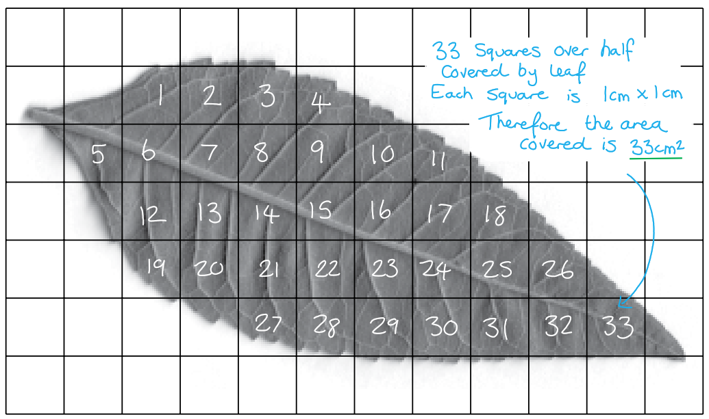
Two visible ways in which the upper surface of the leaf is different from the lower surface are...

Any **two **of the following:

- Veins are <u>less</u> prominent;** [1 mark]**
- <u>More</u> shiny;** [1 mark]**
- Dark<u>er</u> colour; **[1 mark]**
- Smooth<u>er</u> / <u>more</u> waxy; **[1 mark]**

**[Total: 2 marks]**

> *Note that the question asks you for differences that are **visible** in Fig.2, so answers relating to features that cannot be seen in the image will not be credited.*

> *It is important to **compare** here in order to get the mark. For example, saying that one leaf is dark as a statement on its own, without comparing to the second lighter leaf, would not allow you to gain the mark. *
(i) The loss of mass for each leaf is...

| Wind speed / m per s | Mass of leaf at the start / g | Mass of leaf at the end / g | Loss in mass / g |
|---|---|---|---|
| 0 | 5.7 | 3.8 | 1.9 |
| 1 | 5.3 | 3.3 | 2.0 |
| 3 | 5.9 | 3.7 | 2.2 |
| 6 | 5.1 | 2.6 | 2.5 |
| 8 | 5.3 | 2.6 | 2.7 |

- All values are correct;** [1 mark]**
- All values given to one decimal place; **[1 mark]**

(ii) Marks can be awarded for a graph that has the following features...

- Axes correctly labelled **AND** units;** [1 mark]**
- Even scale **AND** plots to fill more than half of the printed grid;** [1 mark]**
- All five points correctly (plotted points must be accurate to ±½ small square); **[2 marks]**
- Straight line that passes through the plotted points; **[1 mark]**

*If four of the plotted points are correct then ***[1 mark]*** can be awarded for marking point 3. Fewer than four correctly plotted points = no marks.*

(iii) The loss in mass at a wind speed of 10 m per s is...

- 2.9 g; **[1 mark]**
- Line drawn correctly on the graph (vertical line drawn up to line of best fit from 10 m per s and a horizontal line drawn across from the line of best fit to 2.9 g); **[1 mark]**

*Allow error carried forward here, meaning that if the points were plotted incorrectly in part ii) marks can still be awarded for reading the graph correctly here in part iii).*

(iv)  A more appropriate calculation that gives a fairer comparison is...

- Percentage change in mass = (change in mass ÷ starting mass) × 100; **[1 mark]**
- Different original mass would affect the result / this takes into account the starting mass; **[1 mark]**

**[Total: 11 marks]**

> *i) When filling in data in a table, always make sure that the numbers you are adding match the same number of decimal places as all the other numbers in the table. *

> *ii) The graph should be drawn as follows:*

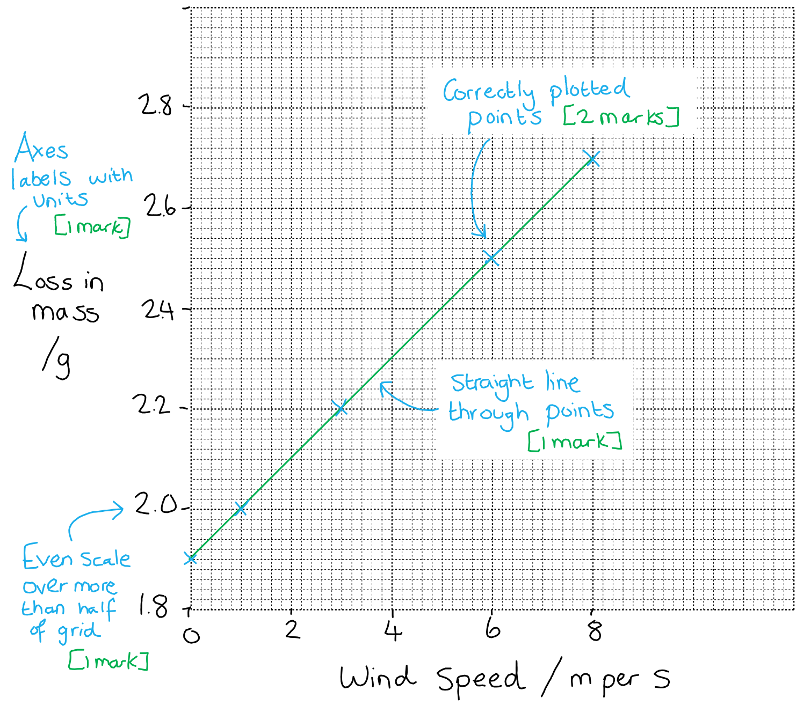

> *iii) The loss in mass can be calculated as follows:*

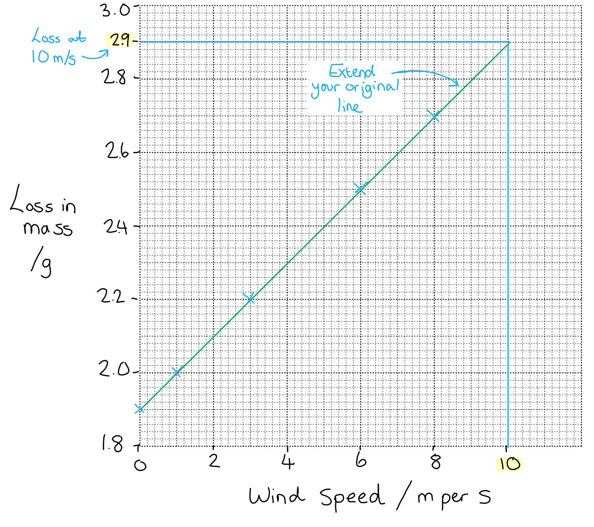

### Q2
(i) A species with a thin waxy cuticle was chosen for this experiment because:

- (Thin waxy cuticle) will lose water / transpire / evaporate water more quickly (than a thick cuticle); **[1 mark]**
- (So) will produce a measurable result in quicker time / it will be easier to measure its transpiration rate;** [1 mark]**

(ii) The shoot with ten leaves was cut from the branch under water and not in air because:

- Prevents air bubble getting into xylem / vascular bundle; **[1 mark]**
- (Which could) cause an airlock / stop further transpiration; **[1 mark]**

(iii) The purpose of petroleum jelly being smeared on in the areas shown in Fig. 2 is:

- To give a watertight / airtight seal between the shoot and the bung / rest of the potometer; **[1 mark]**

(iv) The students should avoid petroleum jelly getting onto the cut end of the shoot as shown in Fig. 2 because:

- The petroleum jelly would block xylem vessels/tubes / vascular bundle; **[1 mark]**
- (And) transpiration / water uptake is stopped / slowed down; **[1 mark]**

**[Total: 7 marks]**
(i) The leaves were first dried using a paper towel because:

Any **two** from the following:

- Water droplets may block stomata / prevent transpiration; **[1 mark]**
- First experiment (with wet leaves) would not be a valid comparison to subsequent experiments (when the leaves would be dry); **[1 mark]**
- An artificial rate of transpiration would be recorded; **[1 mark]**

(ii) An experimental step that the students should take after drying the leaves and before beginning to take measurements is:

- To let the experiment equilibrate / wait until the bubble starts to move; **[1 mark]**
- To demonstrate that the piece of beech is alive / able to transpire freely / will give valid results; **[1 mark]**

(iii) A blank results table would have the following features:

**Three **from the following:

- Independent variable / wind speed in the first column; **[1 mark]**
- Column 2 labelled Time taken to move 50mm; **[1 mark]**
- Unit of time included s/min/seconds/minutes; **[1 mark]**

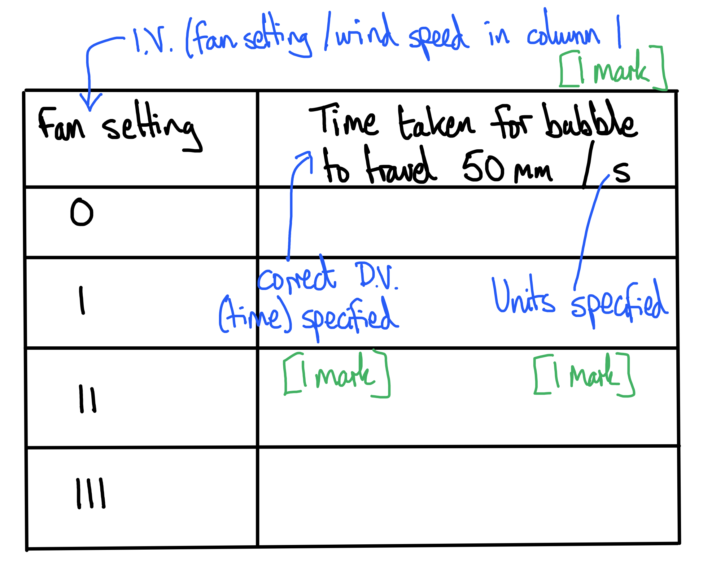

*Ignore repeats / lack of repeats*

**[Total: 7 marks]**
(i) The volume of water transpired by the piece of plant in the time taken for the bubble to move a distance of 50mm is:

- r = 1mm ÷ 2 = 0.5mm; **[1 mark]**
- πr2h = π × 0.52 × 50 = 39.25 / 39.3 / 39; **[1 mark]**
- Units: mm3; **[1 mark]**

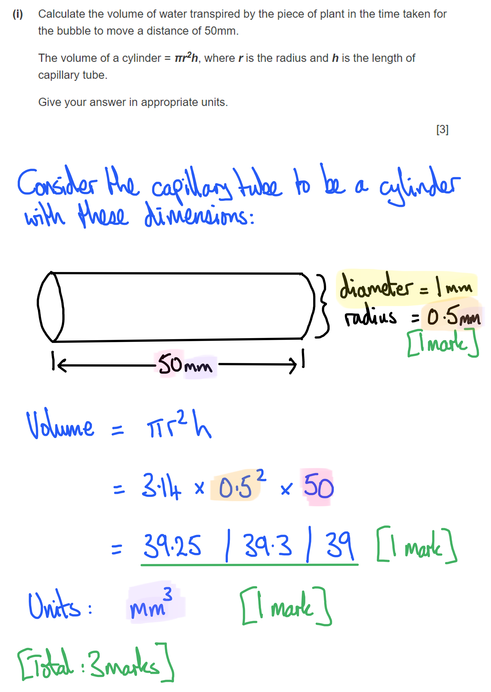

(ii) The rate of transpiration in mm3 min-1 is calculated as follows:

- 39 (mm3) ÷ 7.75; **[1 mark]**

*Allow error carried forward Do not award mark for dividing by 7.45*

- = 5.03 mm3 min-1;** [1 mark]**

*Error carried forward means that if you got sub-part (i) wrong, you won't be penalised twice for that error; if you use whatever answer you gave for part (i) in this calculation, and it works out correctly, then you'll get the ***[2 marks]*** available for sub-part (ii).*

> *It's important to use a decimal number for minutes. 7 minutes and 45 seconds is 7-and-three-quarter minutes which in decimal terms is 7.75. Using 7.45 as your number of minutes only equates to 7 minutes and 27 seconds. *

(iii) Two reasons why the answer calculated in part (ii) might be an under-estimate of the rate of transpiration that the plant may experience in its natural habitat, are:

**Two** from the following:

- The piece of branch is no longer attached to the rest of the tree / it may be dying / stopping its metabolic processes;** [1 mark]**
- The light conditions in the lab may be darker than natural daylight / reduced rate of photosynthesis; **[1 mark]**
- The plant cannot absorb minerals from the potometer; **[1 mark]**

*Ignore, the plant is drying out*

**[Total: 7 marks]**
The chart would have the following features:

- Bar chart **OR** line chart taking up more than half the allotted space; **[1 mark]**
- Fan setting / wind speed on x-axis; **[1 mark]**
- Transpiration rate on y-axis with units; **[1 mark]**
- Bars plotted accurately; **[1 mark]**

**[Total: 4 marks]**

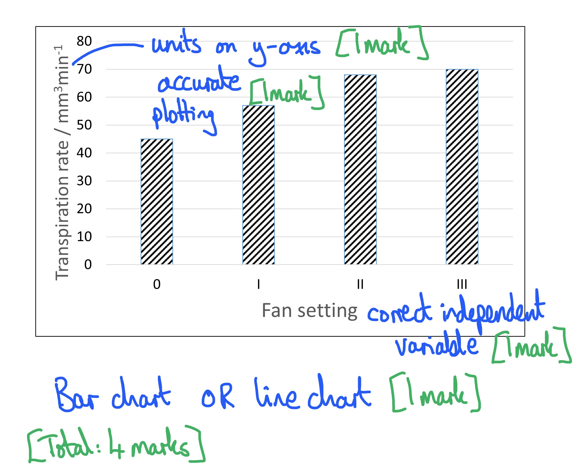

> *You can use a bar chart or a line chart for this graph. Strictly speaking, if the independent variable was a wind speed with a set of measured speeds, this should be a line chart with a linear x-axis scale. Because we are just plotting 'fan setting' where all we know is that I is faster than 0, III is faster then II etc., we can count these as a non-linear set of wind speeds, so that is why a bar chart can be allowed in this case. *

### Q3
(i) Safety precautions that should be taken while carrying out this method include:

Any **one **from the following:

- Cut on a (flat) surface **OR** do not cut in mid-air **OR** do not cut on an uneven/slippery surface;** [1 mark]**
- Cut slowly **OR** cut in a controlled manner **OR **cut only with a sharp blade **OR **cut with a solid/firm/good grip on the celery stalk (and on the knife/scalpel); **[1 mark]**
- Wear gloves / goggles (to avoid stain on body); **[1 mark]**

(ii) The results table should be prepared and completed as follows:

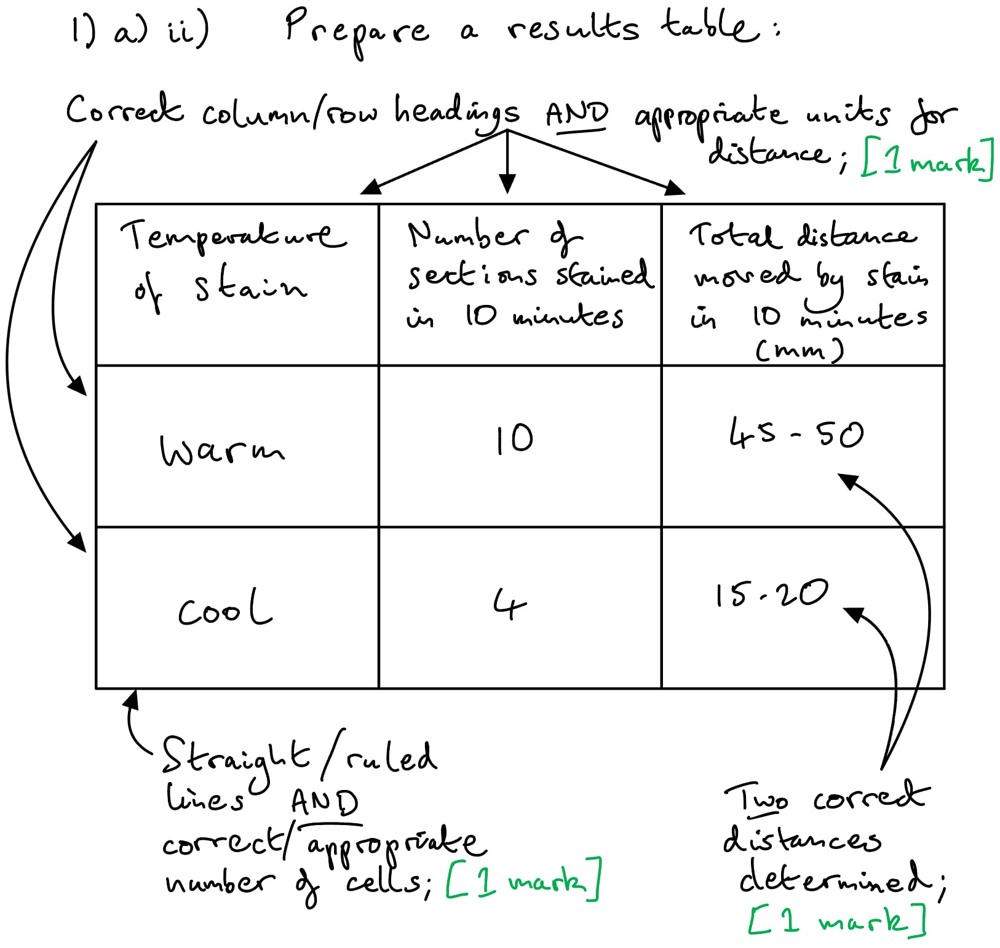

(iii) The rate of movement of the red stain in the celery stalk at each temperature should be calculated as follows:

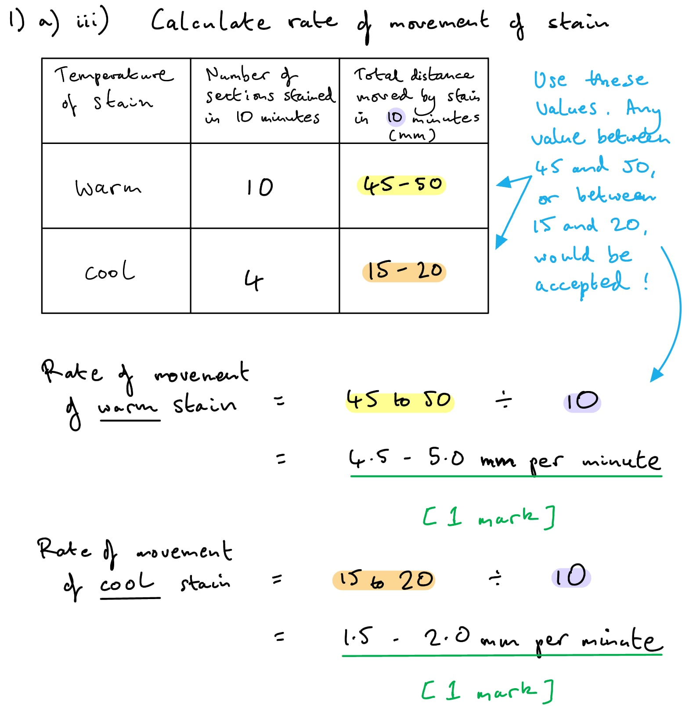

(iv) A suitable conclusion for these results would be:

- The higher temperature, the faster/further the stain/water moves **OR** the lower the temperature, the slower/smaller the distance the stain/water moves;** [1 mark]**

**[Total: 7 marks]**

> *For parts ii) and iii) be careful and read the information in the question **very carefully** - the question clearly states that "the cutting process was repeated until **no red stain was visible in the cut section**" - this means that the final cut section for each temperature (i.e. the **11th** cut section for the **warm** stain and the **5th** cut section for the **cool** stain) actually contain **no stain**. This means that these sections **should not be counted as 'stained sections' in the results table**, hence **10** stained sections for the **warm** stain and **4** stained sections for the **cool** stain! As we cannot be sure exactly where the stain stopped in the final section, you can give a range of values, as shown in the table.*
Variables that were kept constant in this experiment included:

Any **two **from the following:

- Length / width / surface area / size of celery (stalk);** [1 mark]**
- Size / width of cut pieces; **[1 mark]**
- Species / type (of plant); **[1 mark]**
- Time in stain; **[1 mark]**
- Concentration (of stain); **[1 mark]**
- Volume / depth (of stain); **[1 mark]**
- Type / colour of stain; **[1 mark]**

**[Total: 2 marks]**

> *These are known as the **control variables**. During any kind of scientific investigation, it is very important to keep as many factors as possible **constant / the same **(other than the factor you are changing - known as the **independent variable**). This is so you can be confident that **any changes measured **(i.e. changes in the **dependent variable**) are due to the change in the independent variable and not some other factor.*
Other sources of error, and suggestions for improvement to minimise the effect of the error, include:

Any **two rows **from the following table:

| **Source of error** | **Improvement ** |
|---|---|
| Stain may change temperature / cool down / warm up | Use water-bath / insulation / temperature controlled room / incubator / fridge / lids |
| Stalks / xylem tissue may be different width/length/size/age | Select stalks of same size/width/age / cut to same length or select celery stalks with same diameter / same number of vascular bundles |
| (5 mm) sections were too big to give precise results | Cut thinner sections / cut longitudinally |
| Stain may still move after stalks removed | Do each stalk (experiment) separately |
| Length of time on tile different | Cut both stalks at the same time |

*The suggested improvement must match the source of error, as shown in the table above, in order to achieve full marks. However, improvements given without an accompanying error (or vice versa) can gain 1 mark each (up to a maximum of 2 marks).*

**[Total: 4 marks]**
An investigation to determine the effect of humidity on the rate of movement of water through leafy celery stalks should be planned as follows:

Any **six **from the following:

***Independent variable****, maximum of ****three**** from:*

- Test at least two humidities; **[1 mark]**
- At least two stated humidity values with appropriate units; **[1 mark]**
- Method to create different humidity; **[1 mark]**

***Controlled variables****, maximum of ****two**** from:*

- <u>Same</u> temperature;** [1 mark]**
- <u>Same</u> wind speed / do investigation in still air; **[1 mark]**
- <u>Same</u>  light intensity / wavelength (of light); **[1 mark]**
- <u>Same</u> carbon dioxide concentration;** [1 mark]**
- <u>Same</u> species / leaf area / age / length; **[1 mark]**

***Dependent variable****, maximum of ****four**** from:*

- Measure the distance travelled up the stalk by stain **OR** use a photometer **OR** measure volume loss of liquid in beaker **OR **measure mass loss of ‘hanging’ celery **OR** record number of stain pieces; **[1 mark]**
- In a set time; **[1 mark]**
- Divide the distance by time (to determine rate);** [1 mark]**
- (At least) three repeat values at each humidity; **[1 mark]**

**[Total: 6 marks]**

## Multiple Choice Questions (29 questions)

### Q1
**Final answer:** **The correct answer is D.**

- Transpiration is the loss of water vapour from leaves, which occurs by diffusion through the stomata

**A** is incorrect as this does not describe transpiration, which is the loss of water vapour from leaves. The movement of water upwards from the roots is known as the transpiration stream.

**B** is incorrect as increasing wind speed increases the rate of transpiration.

**C** is incorrect as water evaporates from the surfaces of the mesophyll cells, not directly from the stomata.

### Q2
**Final answer:** **The correct answer is C.**

- To calculate the rate of transpiration:

$\text{rate of transpiration} = \frac{\text{distance travelled by bubble}}{\text{time}}$

- Calculate the distance travelled by the bubble between 120 min and 30 min:

= 44 - 17

= 27 mm

- Calculate the time that passes between 120 and 30 mins:

= 120 - 30

= 90 min

- Calculate the rate of transpiration:

= 27 ÷ 90

=** 0.3 ****mm / min**

**A** is incorrect as it corresponds to dividing 44 mm by 120 mins, i.e. it is the rate of transpiration between 0 and 120 mins, not between 30 and 120 mins.

**C** is incorrect as this is what you get if you divide time by distance (90 ÷ 27) rather than distance by time.

**D** is incorrect as this is the correct calculation but the wrong unit.

> **[exam-tip]**
> Always remember to calculate the change in distance and the change in time rather than using the raw values from the table.
> 
> Ensure that you include the correct units in your final answer.

### Q3
**Final answer:** **The correct answer is ****A.**

- Transpiration is reduced by **low temperature** and **high humidity**
- **Low temperature** gives water molecules less kinetic energy, so evaporation from mesophyll cell surfaces is slower
- **High humidity** means the air already contains a lot of water vapour, so the diffusion gradient for water vapour leaving the leaf is smaller, reducing diffusion through the stomata

**B **is incorrect because high temperature and low humidity both increase transpiration.

**C** is incorrect because low humidity increases the diffusion gradient for water vapour.

**D** is incorrect because high temperature increases evaporation.

### Q4
**Final answer:** **The correct answer is ****B.**

- Water moves through the plant in this order:

**root hair cells → root cortex cells → xylem → mesophyll cells**

- **Root hair cells** absorb water from the soil because they are in direct contact and have a large surface area.
- The water then passes through the **root cortex cells** to reach the centre of the root
- Next, the water enters the **xylem**, which carries water up through the root and stem towards the leaves
- Finally, in the leaf water moves from the xylem into the **mesophyll cells**, where it can evaporate during transpiration and is also used in photosynthesis

### Q5
**Final answer:** **The correct answer is ****B****.**

- A source is an area of the plant which produces more glucose in photosynthesis than it uses in respiration.
- In stage 3, the bulb has photosynthesizing leaves and provides glucose which can be stored within the bulb.
- In stage 6, the bulb no longer has leaves and so becomes a source of glucose for the next stage of development.

**A **is incorrect because the bulb provides glucose in stage 6 and so is a source at this point rather than a sink.

**C **is incorrect because  in stage 3, the bulb is storing glucose and is therefore a sink and not a source and in stage 6, the bulb uses the stored glucose up and so becomes a source of glucose, rather than a sink.

**D **is incorrect because in stage 3, the bulb is storing glucose and is therefore a sink and not a source.

### Q6
**Final answer:** **The correct answer is ****B****.**

- In plants that are adapted to live in very dry conditions, the stomata close when the temperatures increase to reduce water loss by transpiration. As a result, more stomata are likely to be open when it is dark than when it is light during the day
- This is shown in the graph by the reduced uptake of carbon dioxide during the day compared to during the night and also by the decrease in transpiration rate in the daytime, between approximately 6:00 and 18:00

**A** is incorrect because the higher rate of CO2 uptake and transpiration during the night time (between 18:00 and 6:00) indicates that the stomata are open.

**C** is incorrect because CO2  uptake continues throughout the 24 hour period and is at its highest during the nighttime hours.

**D** is incorrect because, although transpiration is reduced during the light periods, the process does not stop completely and so water uptake will also continue.

### Q7
**Final answer:** **The correct answer is ****D****.**

- This is because spongy mesophyll cells have a large surface area and a lot of air spaces around them for the water to evaporate to
- They are also close to the stomata, which is where most water evaporates out of during transpiration

**A** is incorrect because the palisade mesophyll cells have a small surface area close to the air and so only have a small area for evaporation. They also use up water during photosynthesis and so take in a lot of water for that reason.

**B** is incorrect because the xylem carries water into the leaf but is not a cell. The “cells” of the xylem are not alive.

**C** is incorrect because the phloem takes in sugars and amino acids and carries them away from the leaf. Water is not carried in the phloem.

### Q8
**Final answer:** **The correct answer is ****D****.**

- This is because this is the xylem vessel, which is the vessel that water and minerals travel through in order to get from the roots to the leaves of the plant

**A** is incorrect because this is the outer part of the plant and has the function of protecting the plant from the entry of pathogens.

**B** is incorrect because this is the phloem that carries sucrose and amino acids through the plant, not water.

**C** is incorrect because the cells in this part of the plant support the plant with their turgor pressure but they are not vessels for the transport of water.

### Q9
**Final answer:** **The correct answer is ****C****.**

- The dye will move more slowly when transpiration is slowest
- More humid conditions will reduce transpiration due to a decrease in the concentration gradient between the air outside the leaf and the air spaces in the spongy mesophyll
- A low temperature will reduce transpiration as it decreases the rate of evaporation from the surface of the cells in the spongy mesophyll

**A **is incorrect because high temperature would increase the rate of transpiration whilst high humidity would reduce rates of transpiration and fluid movement in the plant.

**B** is incorrect because high temperature and low humidity would likely facilitate faster movement of the dye due to increased evaporation and transpiration rates.

**D** is incorrect because even though low humidity would increase transpiration, low temperature reduces the kinetic energy of molecules, leading to slower movement.

### Q10
**Final answer:** **The correct answer is**** B****.**

- The root hair cell is the most external cell of the root, the cortex cells are aligned between the root hair cell and the xylem in the centre of the root.

All other answers are incorrect combinations of cells.

### Q11
**Final answer:** **The correct answer is A.**

- This is because the new leaves require the sucrose and amino acids in order to grow
- The new leaves have not yet grown and started to photosynthesise in order to provide a source of new biological molecules

**B** is incorrect because the mature leaves are able to photosynthesise and provide a source of biological molecules like sucrose and amino acids

**C **and **D** are incorrect because there is very little new growth/metabolic activity happening at these times of year and so the source of amino acids and sucrose is not needed very much

### Q12
**Final answer:** **The correct answer is B because:**

- Shoot X will have carried out transpiration and lost water from the leaves; this will have caused a reduction in mass
- Shoot Y has no leaves and so will not have lost water by transpiration, meaning that the mass will have stayed the same

**A **is incorrect because shoot Y would not have gained mass for any reason

**C** is incorrect because shoot X should have lost mass due to transpiration and shoot Y would not have gained mass for any reason

**D** is incorrect because shoot X should have lost mass due to transpiration

18. The diagram shows a section through a human heart.

### Q13
**Final answer:** **The correct answer is D because:**

- Z shows a xylem vessel, which has the role of transporting water (and mineral ions) from the root to the rest of the plant
- Xylem vessels can be recognised by their thickened cell walls

**A** is incorrect because photosynthesis takes place in the cells of the leaves, not in the roots.

**B** is incorrect because xylem vessel cells are dead and therefore do not carry out respiration.

**C** is incorrect because phloem vessels transport sugars, not xylem vessels.

### Q14
**Final answer:** **The correct answer is ****C**** because:**

- The phloem carries sucrose (and amino acids) in all directions from sources (which depending on the time of year could be leaves or storage organs like roots) to sinks (other areas of the plant where the amino acids and sucrose will be used or stored)
- The xylem transports water (and mineral ions) in one direction up the plant, from the roots to the leaves, driven by the pulling force generated by transpiration in the leaves

**A** is incorrect because transport in the xylem is unidirectional.

**B** is incorrect because the direction of transport in the phloem and the xylem is the wrong way around.

**D** is incorrect because transport in the phloem occurs in both directions.

### Q15
**Final answer:** **The correct answer is ****C**** because:**

- After 48 hours the leaves have **wilted**, you can see them drooping in the image
- Wilting is a sign that a plant has **insufficient water** – it has lost more water by transpiration than it has taken up and therefore water has moved out of cells, causing them to become flaccid

**A** & **B** are incorrect because translocation is the term used to describe the movement of sucrose and amino acids in the phloem.

**D** is incorrect because water loss occurs by evaporation of water from mesophyll cells inside the leaf and then diffusion of this water vapour through the stomata. Osmosis describes the movement of water between solutions separated by partially permeable membranes.

### Q16
**Final answer:** **The correct answer is ****B**** because:**

- Sugars are synthesised in the leaf via photosynthesis and then converted into substances such as **sucrose **and **amino acids** (using nitrate ions). The leaf is therefore a **source **- a region of production
- Sucrose and amino acids are then transported to other regions of the plant through the phloem (through which movement can occur in **both **directions)
- Sucrose and amino acids are transported to regions of **storage**, or to regions where they can be used in **respiration **(sugars) or for **growth **(amino acids) - a **sink**

**A** is incorrect because translocation involves the movement of sugars and amino acids through the phloem.

**C** is incorrect because movement through the phloem is two-way (unlike movement in the xylem, which is one-way)

**D** is incorrect because movement through the phloem occurs from a source to a sink. Some parts of a plant may act as a source or a sink at different times during the lifecycle of a plant.

### Q17
**Final answer:** **The correct answer is ****D**** (1 and 4) because:**

Water molecules evaporate from mesophyll cells, forming water vapour (a gas) which diffuses from an area of higher concentration in the air spaces inside the leaf to a lower concentration in the air outside the leaf (unless it’s very humid and the air is saturated with water!)

**A** is incorrect because diffusion is involved in the loss of water from a leaf, but condensation (change in the stage of gas to a liquid) is not.

**B** is incorrect because diffusion is only one of the processes involved in water loss from the leaves of a plant.

**C** Is incorrect because evaporation is involved in the loss of water from a leaf, but diffusion is also involved.

### Q18
**Final answer:** **The correct (false) statement is ****B.**** (in a potometer, an air bubble moves away from the piece of plant tissue that is under investigation) because:**

The air bubble moves **towards** the plant. the transpiration stream pulls water into the xylem at the bottom of the piece of plant. The bubble moves with the water, therefore towards the plant.

**A**, **C** and **D** are all correct statements.

For **A**, the transpiration of water pulls water up from the potometer, provided there is a tight seal between the end of the cut stem of the plant and the water supply beneath.

For **C**, the rate of reaction (or any process) always requires a measurement of time so that, in this case, the speed of uptake of water per minute/hour can be measured and stated quantitatively.

For **D**, water on the leaves may block stomata and prevent water vapour from diffusing out, hence affecting the rate of transpiration.

### Q19
**Final answer:** **The correct answer is ****B**** because:**

- Xylem vessels are dead cells which contain no organelles or cytoplasm. They lose their end walls during development to form continuous tubes
- Both of these adaptations mean water can flow through them easily in a continuous stream, as a result of the upwards pull created by transpiration in the leaves

### Q20
**Final answer:** **The correct answer is ****B**** because:**

- Shoot **B** has leaves and so transpiration will occur
- The water level in the tube will decrease, leading to a loss in mass

Shoot **A** has no leaves, so no transpiration will occur and the water level in the tube will remain the same, so there will be no change in mass.

### Q21
**Final answer:** **The correct answer is ****B**** because:**

Root hairs are extensions of the cytoplasm of root cells, increasing the surface area to maximise the absorption of water by osmosis and ions by active transport.

**A** is incorrect because ions are transported into the roots by active transport. Osmosis only applies to the movement of water.

**C** Is incorrect because ions are transported into the roots by active transport, not diffusion.

**D** Is incorrect because there is no indication that surface area is increased in this explanation, and osmosis should be mentioned in relation to the movement of water.

### Q22
**Final answer:** **The correct answer is ****D**** because:**

2 is the xylem as seen in a cross-section of a root in a dicotyledonous plant, and 3 is the xylem in a cross-section taken of the stem. The dye molecules are dissolved in water which moves up the xylem through the plant.

**A** is incorrect because 1 is the phloem. The phloem tissue is located in the outer region of the vascular bundle.

**B** and **C** are incorrect because 4 is the phloem in the root, which is found in smaller bundles surrounding the larger xylem vessels.

### Q23
**Final answer:** **The correct answer is ****D**** because:**

Plants lose water through **transpiration**. Water vapour can diffuse out of the leaves through the **stomata**. This water vapour comes from the spongy cells within the leaf; water will **evaporate **from the surface of these cells.

**A** is incorrect because respiration produces water, but it is not the process by which water is lost from the plant.

**B** is incorrect because translocation is the movement of nutrients and amino acids through the phloem.

**C** is incorrect because photosynthesis requires water as a source of hydrogen to produce carbohydrates.

### Q24
**Final answer:** **The correct answer is ****A**** because:**

- Humidity is a measure of the concentration of water vapour in the air
- When humidity is low there is a steep water vapour concentration gradient between the inside of the leaf and the surrounding air, so transpiration rate is high
- When humidity is high the concentration gradient is very shallow so transpiration rate is much lower

**B** and **C** are incorrect because both graphs show the rate of transpiration increasing as humidity increases.

**D** is incorrect because graph **D** shows the rate of transpiration remaining constant as humidity increases, which would suggest no relationship between the two factors.

### Q25
**Final answer:** **The correct answer is ****A**** because:**

- Water moves into root hairs by osmosis and then moves across the root cortex into the xylem
- From here it is pulled up the stem by the transpiration stream to the mesophyll cells in the leaf before evaporating from the surface of these cells into the air spaces surrounding the spongy mesophyll cells
- It then diffuses out of the stomata into the air outside the leaf as water vapour (a gas)

### Q26
**Final answer:** **The correct answer is ****D ****because:**

The less humid (drier) the atmosphere, the higher the diffusion gradient between the inside of the leaf and the outside (through the stomatal pore).

**A** is incorrect because a decrease in stomatal density means less transpiration (as the leaves have fewer stomata).

**B** is incorrect because a reduction in light intensity causes stomata to close, reducing the rate of transpiration.

**C** is incorrect because a reduction in temperature means the water vapour molecules move more slowly, so they would diffuse out of the stomata at a lower rate.

### Q27
**Final answer:** **The correct answer is ****D**** because:**

- Transpiration takes place via stomata, so the plant that has the lowest stomatal density will have the lowest rate of transpiration
- **D** has the lowest total surface area (number of leaves × average surface area of one leaf) and also the lowest density of stomata per mm2, with each stoma being fairly small in diameter

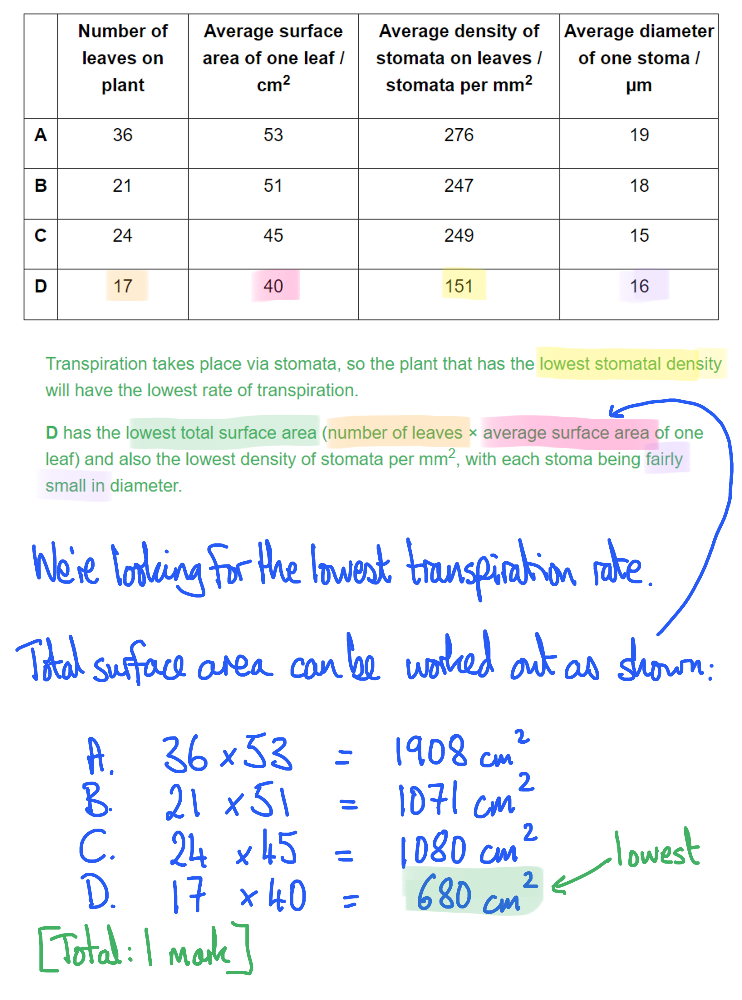

### Q28
**Final answer:** **The correct answer is ****C**** because:**

Amino acids would be the only substance from the options given to move through the phloem (as well as sucrose).

**A** is incorrect because glucose is never transported through the phloem; however, sucrose (a disaccharide that contains one glucose molecule) is transported through the phloem.

**B** and **D** are incorrect because starch and cellulose are large biomolecules that are insoluble in water, therefore they cannot be moved around the plant.

### Q29
**Final answer:** **The correct answer is ****C**** because:**

If a plant does not get enough water, it becomes limp and wilts. This is because water has left the cells and they have become flaccid, providing less support to the overall structure of the leaf. If a cell does not contain enough water there is no pressure pushing outwards against the cell wall and the cells will all shrink a little.

**A** is incorrect because a decrease in light intensity would just reduce the rate of photosynthesis, not cause the plant to wilt.

**B** is incorrect because an increase in humidity would reduce transpiration from the plant, meaning it would retain more water.

**D** is incorrect because a decrease in wind speed would reduce transpiration from the plant, meaning it would retain more water.

## Theory Questions (18 questions)

### Q1
> **[mark-scheme]**
> - Sucrose **[1 mark]**

> **[exam-tip]**
> Do not say "sugar" or "glucose" is transported; plants move carbohydrate in the form of **sucrose**.
> 
> Amino acids are not carbohydrates, so no marks will be awarded for naming these compounds.
> **[mark-scheme]**
> - Carbohydrates/glucose/sugars / amino acids are made in the leaves **[1 mark]**
> - The ring / removal of bark prevents downward movement in the phloem / blocks the phloem / prevents translocation **[1 mark]**
> - Sugars/sucrose / amino acids collect/accumulate (above the ring) **[1 mark]**
> - This lowers the water potential in the (blocked) phloem **[1 mark]**
> - Water moves in by osmosis **[1 mark]**

> **[exam-tip]**
> This is a high-level applied question. The most common mistake is forgetting the **osmosis** part.
> 
> The swelling isn't just "stuffed with sugar"; it's swollen because the sugar build-up draws water into the phloem. Mentioning water potential and osmosis is the key to the final marks.
> **[mark-scheme]**
> - Source = tuber/potato **[1 mark]**
> - Sink = new shoots / growing buds  **[1 mark]**

> **[exam-tip]**
> In **summer** the leaves are the source (making sugar) and the tuber is the sink (storing it). In **spring**, the roles are **reversed** because the tuber is releasing its stored starch to provide energy for the new shoots.
> 
> Read the time of year in the question carefully.
> **[mark-scheme]**
> Any **five** from:
> 
> - Root cells will run out of glucose for respiration
> - Root cells cannot release energy
> - Roots will be unable to carry out active transport / actively transport minerals (into cells)
> - There will be fewer nitrates for production of amino acids
> - There will be less magnesium for production of chlorophyll
> - Photosynthesis rate decreases / leaves cannot photosynthesise so the tree cannot grow
> 
> **[5 marks]**
> 
> Reject references to energy being made or produced in marking point 2.

> **[exam-tip]**
> The phloem transports sugars from the leaves to the roots. If this is disrupted, the roots will no longer receive the glucose they need for respiration and active transport.
> 
> Without active transport, the roots cannot absorb mineral ions from the soil. This matters because minerals are essential for key biological processes — nitrates are needed to produce amino acids, which are required for protein synthesis, while magnesium is needed to produce chlorophyll. Without chlorophyll, the rate of photosynthesis decreases and the tree can no longer grow.

### Q2
> **[mark-scheme]**
> (i) The tissue that transports water up the stem of plants is:
> 
> - Xylem **[1 mark]**
> 
> (ii) The name of the small openings on the underside of the leaf from which most water vapour is lost is:
> 
> - Stomata / stoma **[1 mark]**
> 
> (iii) The name of the cells that control the opening and closing of the openings named in (ii) is:
> 
> - Guard (cells) **[1 mark]**
> **[mark-scheme]**
> Any **three** from:
> 
> - At higher temperatures more water / a higher mass of water is lost **[1 mark]**
> - At higher wind speed more water / a higher mass of water is lost **[1 mark]**
> - Correct data quoted to back up either of the above points — e.g. water loss was greater in hot conditions than cool conditions, increasing from 2.5 g to 8.0 g **[1 mark]**

> **[exam-tip]**
> When asked to "describe" data from a table or graph, it is a good idea to first identify the trend or pattern, and then support it with numbers from the data.
To calculate the rate of water loss per minute:

rate of water loss = total water lost ÷ total time in minutes

- Determine the total water lost

8 g

- Determine the number of minutes

1 hour = 60 minutes

- Calculate rate of water loss

= 8.0 ÷ 60 **[1 mark]**

= **0.13** **g / minute** **[1 mark]**

> **[mark-scheme]**
> Award full marks for the correct answer in the absence of additional calculations.
> 
> Award a maximum of 1 mark for the correct answer without suitable units.
> **[mark-scheme]**
> (i) The name of this process is:
> 
> - Transpiration **[1 mark]**
> 
> (ii) The process of water movement named in (i) occurs as follows:
> 
> - Water evaporates from the cell surfaces inside the leaf / surfaces of mesophyll cells **[1 mark]**
> - Water vapour diffuses out through the stomata / moves out of the stomata down a concentration gradient **[1 mark]**

> **[exam-tip]**
> This is an "explain" question, so it is not enough to simply state that water moves out through the stomata — you must refer to the processes involved, such as evaporation and diffusion, to access both marks.
> **[mark-scheme]**
> - Phototropism** [1 mark]**
> - More light can be absorbed for photosynthesis** [1 mark]**

### Q3
*Crop plant:*

- Sugar beet; [1 mark]

*Explanation:*

Maximum** two** from:

- It grows in an appropriate temperature range; **[1 mark]**
- It grows in an appropriate rainfall range; **[1 mark]**
- Energy yield is greater than wheat / corn; **[1 mark]**
- Use of data to support answer e.g. of the three crops that can grow in the 12 - 24 °C temperature range, sugar beet has the highest energy yield of 110-140 GJ per ha compared to wheat with a max of 84 GJ per ha and corn with a max of 76 GJ per ha; **[1 mark]**

**[Total: 3 marks]**

> *If you are given data in a table or a graph try to get into the habit of quoting numbers from the provided data in your answers. This is very important in explanation questions to provide evidence to support your explanation and is a very common type of question. *
Any **three** from:

- Increased rate of transpiration; **[1 mark]**
- Greater concentration of water vapour inside the leaf than outside; **[1 mark]**
- More water vapour diffuses out of the leaf; **[1 mark]**
- Through stomata; **[1 mark]**
- More water moves up the xylem / by transpiration pull; **[1 mark]**

**[Total: 3 marks]**

A reduced concentration of water in the air increases the concentration gradient for diffusion. Remember that water diffuses out of the stomata of the leaf. It does not move by osmosis because it is not passing through a partially permeable membrane.

### Q4
A reduced concentration of water vapour in the air would increase the movement of water through crop plants as follows...

Any **three **of the following:

- Increased rate of transpiration; **[1 mark]**

**This is because...**

- The concentration of water vapour is greater inside the leaf than outside; **[1 mark]**
- More water vapour diffuses <u>out</u> of the leaf / the rate of diffusion of water vapour <u>out</u> of the leaf increases; **[1 mark]**
- (Diffusion occurs) through the stomata; **[1 mark]**
- More water moves up the xylem / due to transpiration pull (to replace the water lost at the stomata by transpiration); **[1 mark]**

**[Total: 3 marks]**

> *Reducing the concentration of water vapour in the air will lead to a steeper concentration gradient between the inside of the leaf and the outside. This will increase the rate of diffusion of water vapour out of the leaf through the stomata, causing more water to be pulled up the xylem vessels to replace it. *

### Q5
(i) The position of the xylem is shown by:

- Label line **AND X** pointing to any part of the ‘star’ in the centre of the root section;** [1 mark]**

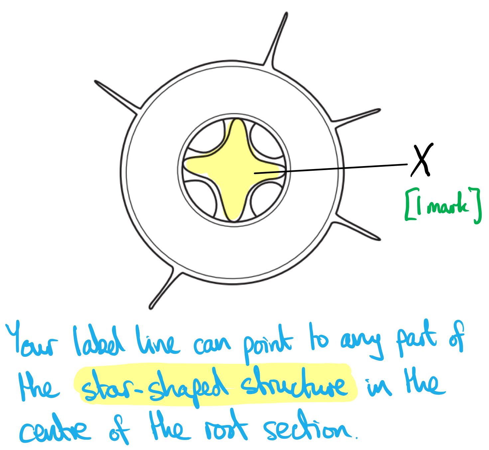

(ii) The xylem is a tissue because it is:

- Composed of (group of) cells with similar structures; **[1 mark]**
- Which work together to perform shared functions; **[1 mark]**

**[Total: 3 marks]**

> *This question covers core knowledge taken from an extended only paper 4 question.*
The internal structure of leaves results in the loss of large quantities of water in transpiration by:

Any **three **of the following from:

- <u>Xylem</u> supplies water; **[1 mark]**
- Air spaces (in the leaf); **[1 mark]**
- (Which create) a large (internal) surface area; **[1 mark]**
- Water evaporates from surface of mesophyll cells; **[1 mark]**
- Guard cells, open / close, stomata; **[1 mark]**
- Water <u>vapour</u>, diffuses / moves, out through stomata; **[1 mark]**

**[Total: 3 marks]**

> *This is a challenging question and there is a lot of scope for students to trip up and make errors.*

> *Avoid:*

- Explaining how the leaf is adapted for photosynthesis; this isn't the question
- Stating that water diffuses out of the stomata, without clarifying that it is water *vapour* that diffuses out
- Stating that 'guard cells open' when in fact guard cells change shape, which causes *stomata* to open

> *Make sure to:*

- Add that the air spaces in the leaf mean that there is a large surface area for the evaporation of water
- State that water evaporates <u>before</u> diffusing out of the stomata as vapour

### Q6
Labels W, X, Y and Z are:

- W - bung; **[1 mark]**
- X - water reservoir; **[1 mark]**
- Y - cm/mm scale; **[1 mark]**
- Z -  air bubble; **[1 mark]**

**[Total: 4 marks]**
(i) The volume of water taken up by the plant in the time of the experiment is:

- π × 0.52 × 23; **[1 mark] **
- 18 mm3; **[1 mark]**

(ii) The rate of transpiration of the piece of plant in mm3hr-1 is:

- 18 ÷ (47÷60); **[1 mark]**
- 23 mm3hr-1; **[1 mark]**

**[Total: 4 marks]**

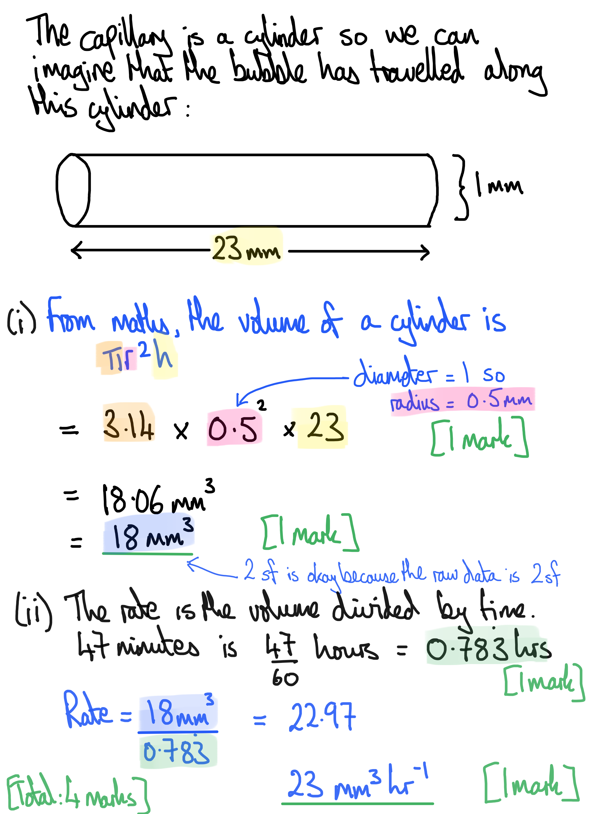
The predicted rate of transpiration would be;

- Any number over 23 mm3hr-1; **[1 mark]**

*Allow error carried forward; accept a number higher than the answer given in part (b)*

**Reason:**

- That air current dries the air / removes water vapour from around the leaf; more water is transpired to replace the lost water; **[1 mark]**

**[Total: 2 marks]**
(i) The rate of transpiration of a mature tree in litres per day (dm3day-1) is calculated as follows:

- Scale up 350 mm3hr-1 to 2.84 × 106 mm3hr-1 for a whole tree; **[1 mark]**
- Convert to dm3;** [1 mark]**
- Convert to 68 dm3 per day; **[1 mark]**

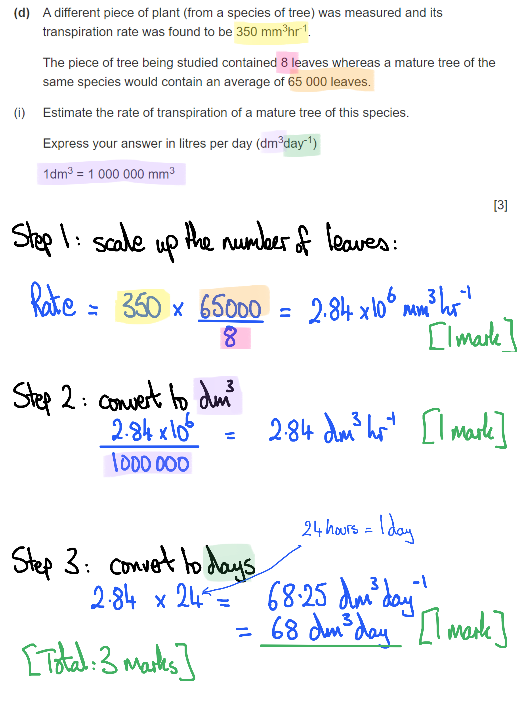

(ii) Reasons why the estimate in part (d) (i) is likely to be inaccurate are:

Any **three** from the following:

- The whole tree is standing outside / not in controlled conditions; **[1 mark]**
- Unlikely that the whole tree is under the same conditions throughout eg. varying temperature / wind patterns; **[1 mark]**
- 24 hours will include the night when the tree is not photosynthesising / low transpiration rate; **[1 mark]**
- Not all leaves transpire at the same rate / no account of leaf age/size is taken here; **[1 mark]**
- The piece of the cut tree may be dying / dead / not as metabolically active as the whole tree because it's been cut off the tree; **[1 mark]**
- Water may be in short supply to the whole tree in its habitat **SO **the tree cannot transpire as much water**; [1 mark]**

**[Total: 6 marks]**

### Q7
(i) A structural feature of the xylem can be described and the corresponding function explained as follows...

Any pair of points from the following:

- Structure: Xylem cells have a thick/strong (cell) wall; **[1 mark]**
- Function: (The xylem can) withstand / will not be negatively affected by tension/collapse/hydrostatic pressure; **[1 mark]**

**OR**

- Structure: Cells have lignin (in walls) / walls are impermeable; **[1 mark]**
- Function: (Lignin) prevents collapse **OR **provides waterproofing (of the xylem) / prevents water from escaping; **[1 mark]**

**OR**

- Structure: (The xylem lumen) is wide / has a large diameter; **[1 mark]**
- Function: (Xylem can) transport large volumes of water; **[1 mark]**

**OR**

- Structure: (Xylem have) no (cell) contents / cells are empty/dead / hollow pipes/tubes; **[1 mark]**
- Function: (There is) no/little resistance to flow of water / water can flow easily / continuous columns of water can flow / there is no obstruction to water flow; **[1 mark]**

**OR**

- Structure: (Xylem cells have) no cross/end walls; **[1 mark]**
- Function: (There is) no/little resistance to flow of water / water can flow easily / continuous columns of water can flow / there is no obstruction to water flow; **[1 mark]**

**OR**

- Structure: (Xylem cells have bordered) pits; **[1 mark]**
- Function: (This allows) lateral transport / movement of water out of the sides of the xylem (into neighbouring vessels); **[1 mark]**

(ii) The mechanism that is responsible for the movement of water in xylem vessels is...

Any **four **of the following:

- (Water is lost by) evaporation from (cell walls) in mesophyll (in the leaf); **[1 mark]**
- (This evaporated water is then lost by) <u>diffusion</u> of water vapour through stomata; **[1 mark]**
- (This leads to) decrease in (hydrostatic) pressure at the top (of plant/xylem) resulting in water moving upwards (down the pressure gradient); **[1 mark]**
- (Water moves in a) continuous column (in the xylem) **OR **there are no breaks/gaps/air bubbles in the column of water; **[1 mark]**
- (This is because of the) cohesion of water (molecules); **[1 mark]**
- (Cohesion is) the attraction between water molecules; **[1 mark]**
- (This force pulling the water up through the xylem is known as) transpiration pull; **[1 mark]**
- Water enters/leaves xylem by osmosis / down water potential gradient; **[1 mark]**

(iii) A role of the xylem other than transport is:

- Support / helping the plant stay upright; **[1 mark]**

***Accept ****other descriptions of support.*

**[Total: 7 marks]**

> *When referring to the pits within the xylem, avoid using the term 'holes' as this could lead to doubt as to whether you are referring to the pits in the sides of the vessels or the holes in the end walls of the xylem.*

> *When describing the upward movement of water in the xylem ensure that your answer clearly show an understanding of the importance of cohesion and that water does not move upwards due to osmosis. Remember that osmosis can only occur when there is a partially permeable membrane.*
An increase in temperature will have the following effect...

Any **three **of the following:

- (There will be an) increase (in the rate of transpiration); **[1 mark]**
- (Because there will be) more / an increased rate of evaporation (from the surface of the mesophyll cells); **[1 mark]**
- (This leads to an) increase in the rate of diffusion (of water vapour out of the stomata); **[1 mark]**
- (Increasing temperature increases kinetic) the energy of water (molecules); **[1 mark]**
- Stomatal pores become wider (at higher temperatures); **[1 mark]**
- (Pores widen because) guard cells become turgid; **[1 mark]**

***Accept ****reverse answers here if they are clearly related to a ****decrease ****in temperature.*

**[Total: 3 marks]**

### Q8
(i) The foods that the aphid could suck out of the phloem tissue are:

- Sucrose/sugar; **[1 mark]**
- Amino acids; **[1 mark]**

(ii) The role of phloem in plant transport can be explained as follows:

Any **four** from the following:

- (Transport in phloem is called) <u>translocation</u>; **[1 mark]**
- (Phloem) allows bidirectional movement / movement in two directions / movement up or down the plant; **[1 mark]**
- Movement (of food/phloem sap) occurs from a <u>source</u> to a <u>sink</u>; **[1 mark]**
- Sucrose/amino acids/food are produced / taken from storage (tissues/organs) at a <u>source</u>; **[1 mark]**
- A region of respiration/storage/growth is called a <u>sink</u>; **[1 mark]**
- Any named example of a source/sink (in the correct context), e.g. roots act as a sink when leaves are photosynthesising;** [1 mark]**
- Organs can be either a source or a sink at different times (in development / of the year); **[1 mark]**

**[Total: 6 marks]**

> *Phloem tissue transports the soluble products of photosynthesis around the plant. This process is known as translocation and will always occur from a source (where the substances are produced / removed from storage tissue) to a sink (any part that requires these products). Some plant organs may be either a source or a sink depending on the development stage of the plant. For example, roots may act as a source during a growth period but become a sink once the growth period is over.*

> *This question covers core knowledge but is taken from an extended paper 4 question.*
Xylem is adapted for its functions in the following ways:

Functions

- (Xylem tissue) conducts/transports water (and mineral ions); **[1 mark]**
- (To replace water lost through) <u>transpiration</u>; **[1 mark]**
- Water flows with low/little resistance (in xylem vessels); **[1 mark]**
- (Xylem provides structural) support (for plants); **[1 mark]**
- (Spirals) allows (some) flexibility / bending of stems (to prevent breaking); **[1 mark]**

**AND**

Adaptations

A maximum of **five** from the following:

- (It consists of) long/elongated (cells/vessels/tubes); **[1 mark]**
- (The walls contain) lignin / (are) lignified; **[1 mark]**
- (The cell walls) are impermeable to water / waterproof / do not allow water through; **[1 mark]**
- (There is a secondary) thickening of cell walls / (secondary) thickening appears as rings / spirals; **[1 mark]**
- (Xylem vessels are) hollow / contains no cytoplasm / (named) organelles; **[1 mark]**
- (There are) no end/cross walls (between cells); **[1 mark]**
- Vessels are joined with end plates / end to end; **[1 mark]**
- (There are) pits in the walls (for lateral water movement between vessels); **[1 mark]**

**[Total: 6 marks]**

> *This is a popular question for exam purposes so make sure that you familiarise yourself with how the structural adaptations of xylem vessels enable them to perform their role in a plant.*
The benefits of killing pests are as follows:

Any **two** from the following:

- (It will lead to) reduced/no damage to crops **OR **fewer/no crops will be eaten by pests; **[1 mark]**
- (This will) increase the yield / quality (of the crop); **[1 mark]**
- (This is) because there will be more sugar/amino acids available for (plant) growth; **[1 mark]**
- (Which would) increase / lead to more income/profit (for the farmer); **[1 mark]**
- (There would be a) reduced/less/smaller (risk / occurrence of) disease transmission (between pests and crop plants); **[1 mark]**

***Accept**** reverse arguments, e.g. 'pests would eat/damage crops' instead of 'killing pests will reduce damage to crops'.*

**[Total: 2 marks]**

> *Pests will eat the leaves and/or fruits of a plant, which will have a negative impact on the growth and yield of crop plants. This will ultimately cause the farmer to lose money in lost profits, so there are benefits to killing pests before they cause crop damage.*

> *This question covers core knowledge but is taken from an extended paper 4 question.*

### Q9
The predominant process by which water is lost from the leaf is:

- Diffusion **OR** evaporation; **[1 mark]**

**[Total: 1 mark]**

> *Water evaporates inside the leaf air spaces, then the water vapour molecules diffuse out through the stomata. This makes both answers acceptable for the mark. *

> *Transpiration is a process that pulls water up the plant in a long continuous column, and that water is in the liquid phase. However, water exits a leaf in gaseous form as water vapour, so evaporation or diffusion is a more accurate answer. *
Transpiration is beneficial for the plant because...

Any **two **from the following:

- It helps keep the leaves cool (as heat energy is lost as the water evaporates); **[1 mark]**
- Transport of water for photosynthesis **OR** to maintain cell turgidity; **[1 mark]**
- Transport of dissolved minerals/mineral ions/named mineral ion for growth / chlorophyll / protein synthesis; **[1 mark]**

**[Total: 2 marks]**

> *Remember that magnesium is an important mineral in the green pigment chlorophyll and is therefore key for plant growth.*

> *Nitrates are important for growth as they are used in the synthesis of DNA or proteins in cells.*
The transpiration stream happens in plants in the following way...

Any **four** of the following:

- Most transpiration occurs at the leaves/3; **[1 mark]**
- Transpiration is caused by evaporation and diffusion of water from the surface of the leaf / spongy mesophyll cells; **[1 mark]**
- Water <u>diffuses</u> through the <u>stomata</u> to the surrounding air down the concentration gradient; **[1 mark]**
- Water then evaporates; **[1 mark]**
- This decreases the concentration of water in the leaf **OR** reduces pressure/tension; **[1 mark]**
- Water is drawn up through the plant/roots/1 and stem/2 through the xylem by cohesion; **[1 mark]**
- To replace the water lost from the leaf; **[1 mark]**
- This results in more water being drawn up from the roots/1; **[1 mark]**
- This causes a constant 'transpiration stream' of water; **[1 mark]**

**[Total: 4 marks]**
Transpiration at night time would:

- Decrease / reduce; **[1 mark]**

*Allow: fall to zero*

**[Total: 1 mark]**

> *Photosynthesis does not occur in the dark, consequently, stomata will close (as there is less demand for CO**2**) so less water diffuses out and evaporates from the leaf. This results in a reduction in the rate of transpiration.*

### Q10
The features of xylem vessels that enable them to conduct water are:

Any **three **from the following:

- (Xylem vessels contains) no cytoplasm / (named organelle) / they are hollow; **[1 mark]**
- (They have) lignin (in their walls); **[1 mark]**
- (The cell walls) are waterproof / water impermeable / does not allow water through; **[1 mark]**
- (There is secondary) thickening of the cell wall; **[1 mark]**
- (Xylem consists of) long / elongated (cells / vessels / tubes); **[1 mark]**
- (The vessels have bordered) pits (for water movement between vessels); **[1 mark]**
- (There are) no end / cross walls (between cells) / end plates to connect vessels (end to end); **[1 mark]**

**[Total: 3 marks]**
A description of the pathway of water from outside the root to the xylem vessels is:

Any **five **from the following:

- (Water enters) root hair (cells) / **M **...; **[1 mark]**
- ... by <u>osmosis</u>; **[1 mark]**
- The soil has a higher <u>water potential</u> than the root (cells) **OR** the root (cells) have a lower <u>water potential</u> than the soil; **[1 mark]**
- Water moves from an area of high(er) water potential to low(er) water potential; **[1 mark]**
- (The) active transport of ions creates a water potential gradient (between the soil and root cells); **[1 mark]**
- (Movement of water occurs) across / through (partially permeable) membrane(s); **[1 mark]**
- Water moves across the root cortex/**L **(to xylem vessels) **OR** water moves from **M** to **L** to (**K**) to **J**; **[1 mark]**

**[Total: 5 marks]**

> *This question covers core knowledge taken from an extended only paper 4 question.*
(i) The percentage increase in the average flow-rate between zone 1 and 3 for healthy roots is:

- 87; **[2 marks]**

*Full marks awarded for the correct answer in the absence of calculations.*

**[1 mark] ***awarded for correct working in the presence of an incorrect answer.*

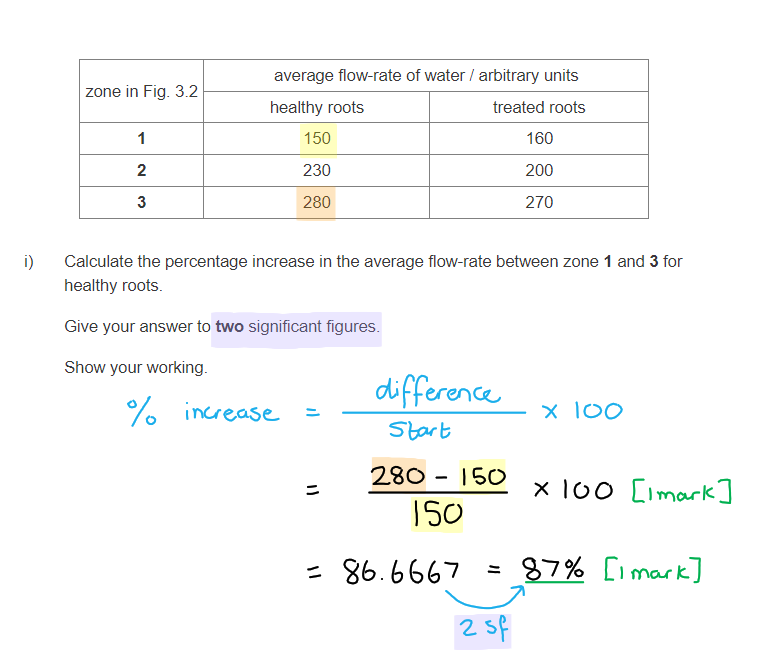

(ii) The width of xylem vessels in different zones of a root affects the average flow-rate of water by:

Any **three** from the following:

- The nearer to the tip / zone 1, the lower flow rate **OR** the further from the tip/zone 1, the higher the flow rate; **[1 mark]**
- Flow rate increases (from tip to bulb) in both treated and healthy roots; **[1 mark]**
- Flow rate is greater in zone 1 in the treated roots (than the healthy roots); **[1 mark]**
- Flow rate is lower in zones 2 and 3 in the treated roots (than the healthy roots); **[1 mark]**
- Comparative data quote with units e.g. flow rate in zone 1 of the treated roots was 160 au whereas in zone 3 it was 270 au; **[1 mark]**

(iii) There was little difference in the flow-rate in healthy roots and in roots treated with the toxic solution because:

- Xylem vessels are dead so toxins / treatment have no effect; **[1 mark]**
- Osmosis / water flow into root does not rely on living cells / energy / is passive; **[1 mark]**

**[Total: 7 marks]**

> *Always make sure to include units whenever you are quoting data from a figure or a table as part of your answer.*

> *This question covers core knowledge but is taken from an extended paper 4 question.*

### Q11
The completed sentence is as follows...

- The **phloem**** **transports food substances such as dissolved **sugars** made in the **leaves** to the rest of the plant. This process is called **translocation**.

- 3 or 4 words correct;** [2 marks]**
- 1 or 2 words correct;** [1 mark]**

**[Total: 2 marks]**
The completed sentences are as follows...

- (Water... process of) osmosis; **[1 mark]**.
- (Mineral ions move... process of); active transport;** [1 mark]**

**[Total: 2 marks]**
Possessing long hair-like projections is a useful adaptation for root hair cells because...

Any **two** from the following:

- This gives the plant a <u>large surface area;</u> **[1 mark]**
- Root hairs can grow between soil particles; **[1 mark]**
- This increases osmosis of water / active transport of minerals into the root cell; **[1 mark]**

**[Total: 2 marks]**

> *A larger surface area on the root hairs which protrude into the soil means that there is better access to water and minerals as more molecules come into contact with the membrane.*

> *They also give better anchorage for the plant, but this is not directly necessary for increasing absorption.*
The correct order is:

1. root hair cell
2. root cortex cells
3. xylem
4. leaf mesophyll cells

All correct for **[2 marks]** 2 or 3 correct; **[1 mark]** 0 or 1 correct; **[0 marks]**

**[Total: 2 marks]**

### Q12
Cell **X** in Fig. 1 is a:

- <u>Guard</u> cell; **[1 mark]**

Its role in the leaf is:

- When turgid, stomatal opening is large; **[1 mark]**
- Allows gas exchange / carbon dioxide to diffuse in for photosynthesis;** ****[1 mark]**

**[Total: 3 marks]**
The number of stomata per mm2 of this leaf surface can be calculated as follows:

- 4 stomata per 0.2 mm × 0.4 mm = 0.08 mm2; **[1 mark]**
- 1mm2 ÷ 0.08mm2 = 12.5
- 4 × 12.5
- 50 stomata per mm2; **[1 mark]**

**Final answer:** **[Total: 2 marks]**

> *Always show your working out for calculations as it can help you get marks sometimes even if you ended up with the wrong final answer!*

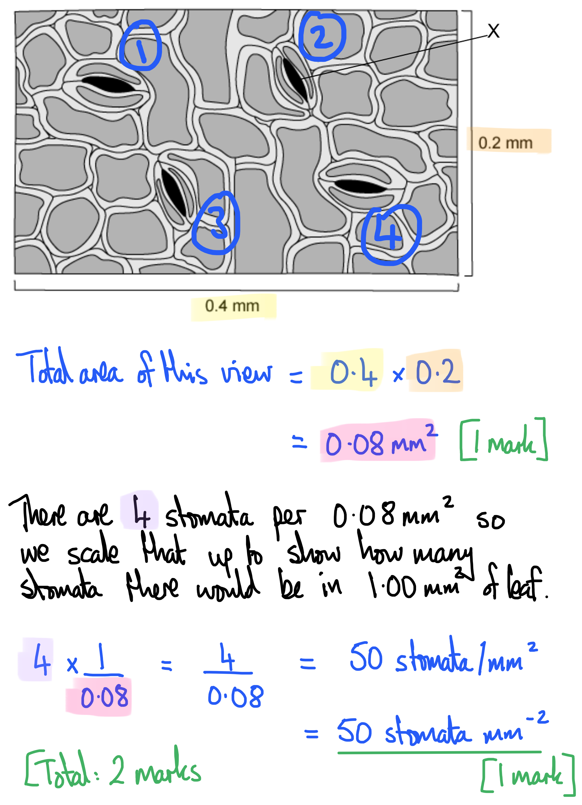
An increased number of stomata is not always advantageous because:

**Two** from the following:

- Water vapour is lost through the stomata; **[1 mark]**
- Larger number will increase water loss of the plant by transpiration; **[1 mark]**
- A plant will have to absorb more water from the soil to make up for larger transpiration loss;** [1 mark]**

**[Total: 2 marks]**
Species **A** is unlikely to be found growing in a hot, dry desert because:

Any **three** of the following from:

- (For Species **A**) Stomata are open in the light / closed in the dark; **[1 mark]**
- (For Species **A**) Stomata would be open during the day / when it is hot / warmest; **[1 mark]**
- In the desert the heat (in the light / day) would increase water loss by transpiration;** [1 mark]**
- Desert plants close their stomata in the light / day / Species **C** is more likely a desert plant; **[1 mark]**

**[Total: 3 marks]**

### Q13
The structure labelled **X** is...

- Xylem; **[1 mark]**

**[Total: 1 mark]**
The substances that are primarily transported in the phloem are:

- Sucrose / (dissolved sugars);** [1 mark]**
- Amino acids;** [1 mark]**

**[Total: 2 marks]**
The correctly completed **Table 1 **is as follows:

|   | Structure X | Phloem |
|---|---|---|
| Up only | **✓** |   |
| Up and down |   | **✓** |

**[1 mark]** for each correct tick

**[Total: 2 marks]**
The process of the flow of water from the roots to the leaves via the vascular network is ...

- <u>Transpiration</u>;** [1 mark]**

*Allow 'transpiration stream'*

**[Total: 1 mark]**

> *Transpiration is the **process** by which water evaporates from the leaves driving movement of water through the plants whereas the transpiration stream refers to the **physical flow** of the water through the vessels, its a subtle difference, but important to distinguish between when referring to transpiration.*

### Q14
Comparison of transpiration and translocation:

**Similarities**

At least **one** of the following:

- Substances flow through vascular bundle; **[1 mark]**
- As aqueous solutions; **[1 mark]**
- Both can travel upwards in a plant; **[1 mark]**

**Differences**

Up to **three **of the following:

- Transpiration occurs in the xylem **whereas** translocation is in the phloem; **[1 mark]**
- Transpiration carries water / mineral ions **whereas** translocation carries sugars / amino acids; **[1 mark]**
- Transpiration only travels upwards **whereas** translocation travels upwards and downwards; **[1 mark]**
- Transpiration involves some dead tissues **whereas** translocation needs live tissues to function; **[1 mark]**
- Transpiration is an open loop (soil → air) **whereas** translocation is more a closed loop (to avoid wastage); **[1 mark]**

**[Total: 4 marks]**

> *The command word 'compare' really means 'compare and contrast' which requires you to identify similarities and differences, not just one or the other. *
The two main products of a plant's metabolism that are carried in the phloem are:

- <u>Sucrose</u>; **[1 mark]**
- Amino acids;** [1 mark]**

*Accept any named amino acid*

**[Total: 2 marks]**

> *Other substances travel in the phloem and in the other vascular tissues like the xylem, but these two are referred to as assimilates. These are derived from the products of photosynthesis (in the case of sucrose) and the end result of nitrogen fixation / nitrogen uptake (in the case of amino acids required for protein synthesis). *
The term 'source' when used in the context of plant biology means:

Any **two** of the following from:

- (A tissue that) acts as the site of manufacture/synthesis/production of a particular nutrient/food compound/group of compounds; **[1 mark]**
- The part of a plant where a particular nutrient enters/is taken up; **[1 mark]**
- Any photosynthetically-active part of a plant; **[1 mark]**

**[Total: 2 marks]**

> *As opposed to a sink, which is any area of active growth and/or storage. *
Seeds such as these act as a source when:

- The seeds are germinating / the plant is growing from seed; **[1 mark]**

**[Total: 1 mark]**

> *It makes sense that a sink that stores energy and nutrients will have to give up its contents at some stage. In the case of seeds like these banana seeds, it is when the seed is required to germinate to grow the next generation of banana plants. *

> *The more familiar eating bananas that are sold widely in greengrocers / food stores are a seedless variety grown specifically for human consumption. *

### Q15
The words to complete the gaps are as follows:

In transpiration water is lost from the **leaves**<u> </u>of a plant.

The water **evaporates**<u> </u>from the surface of the<u> </u>**(spongy) mesophyll**<u> </u>cells and water vapour is produced.

The water vapour moves by **diffusion***** out of the plant through pores called **stoma(ta)**<u>.</u>

Award** [1 mark] **for each correct word

**[Total: 5 marks]**

> ** A common error here is to state '**osmosis**'. Remember that water only moves by osmosis when it is in its **liquid **phase, and when it crosses a partially permeable membrane. In this scenario, water is in its vapour (gaseous) state and merely moves out of the leaf's air space and into the surrounding air, so does not cross any membranes in the process. This Is therefore an example of simple diffusion. *
A completed Table 1 would contain the following information:

Any **two **of the following rows:

| Environmental condition | Effect of a decrease on the rate of transpiration |   |
|---|---|---|
| Humidity | Increases | **[1 mark]** |
| Temperature | Decreases | **[1 mark]** |
| Light (intensity) | Decreases | **[1 mark]** |
| Wind (speed) | Decreases | **[1 mark]** |

**[Total: 4 marks]**

> *Remember to describe the effect of a decrease, as specified in the question. Descriptions of an increase in the environmental condition won't earn a mark. *

### Q16
Two conditions that may cause wilting are as follows:

Any **two **from the following:

- No / little, water; **[1 mark]**
- High temperature; **[1 mark]**
- Low humidity / dry air; **[1 mark]**
- High wind speed; **[1 mark]**
- Long day length / high light intensity; **[1 mark]**
- High salinity / high salt (levels); **[1 mark]**
- Freezing; **[1 mark]**
- Disease; **[1 mark]**
- (Soil) waterlogging / low oxygen concentration / pH ; **[1 mark]**
- Mineral / magnesium, deficiency; **[1 mark]**

Answers must be qualified with a specific description of what would cause wilting e.g. not just temperature, but HIGH temperature.

**[Total: 2 marks]**
When wilting occurs, the following happens in the leaf:

Any **four **from the following:

- (Water moves by) osmosis; **[1 mark]**
- Water is lost from / moves out of, cells / vacuoles; **[1 mark]**
- (Movement occurs) down water potential gradient; **[1 mark]**
- The pressure of water / cell contents on (inelastic) cell wall decreases; **[1 mark]**
- The cell loses turgor / turgidity **OR** becomes flaccid / plasmolysed; **[1 mark]**
- Plants / cells rely on water for (structural) support / to prevent wilting; **[1 mark]**
- Water in (wilted) cells not being replaced as quickly (as it is being lost); **[1 mark]**

**[Total: 4 marks]**
The advantages of wilting are as follows:

Any **two **from the following:

- (Wilting causes) the stomata to close; **[1 mark]**
- This helps to prevent more water loss; **[1 mark]**
- Therefore water is conserved for other processes / other parts of the plant; **[1 mark]**
- (Wilting leads to) a decrease surface area exposed to the Sun / for absorption of heat; **[1 mark]**

**[Total: 2 marks]**

### Q17
Adaptation of the xylem are:

Any **three** from the following:

- Cells joined end-to-end / with no cross walls **AND** therefore forms a long continuous tube; **[1 mark]**
- Cells are dead / no cell contents **AND **therefore allows free passage of water; **[1 mark]**
- Outer walls are thickened / contain lignin **AND** therefore this strengthens the tubes / helps support the plant; **[1 mark]**

**[Total: 3 marks]**

> *Using a word like 'therefore' shows you have read and understood the question command word **explain **and have included this extra detail in your answer.*

> **[exam-tip]**
> For each adaptation, name the structural feature of the xylem first, then link it to how it helps water move or supports the plant.
> 
> Avoid vague phrases such as maximise space or minimise resistance unless you also say exactly what this allows the water to do.
Xylem and phloem vessels running side-by-side make up...

- Vascular bundle(s); **[1 mark]**

**[Total: 1 mark]**
The boxes correctly joined are as follows:

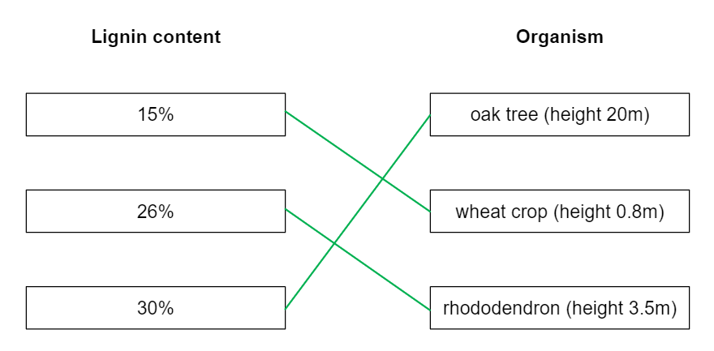

**[1 mark]** for each correct line.

**[Total: 3 marks]**

> *The important thing to realise here is that the role of lignin is to provide strength to a plant stem, so the stem can hold up the mass of the plant as a whole. In general, taller plants such as tree have a higher lignin content in their stems than short plants like grass and short crops eg. wheat. *

> *There are many other factors that govern the height of a plant, but lignin content is definitely one of them. *
An advantage of the xylem containing dead tissue like lignin is:

**One** from the following:

- No need to supply the cells with food/nutrients/minerals **OR** no cell waste products to excrete; **[1 mark]**
- Cells can be hollow / no cell contents **TO** allow free passage of water / minerals; **[1 mark]**

*Ignore references to the xylem providing support/strength to the plant. *

**[Total: 1 mark]**

### Q18
The piece of equipment that can be used to measure transpiration rate is:

- (A) potometer; **[1 mark]**

**[Total: 1 mark]**
(i) An experimenter might vary the temperature by:

- Carrying out the experiment in different rooms / in a cold room / heated room; **[1 mark]**

***Allow ****specific examples of different temperatures*

(ii) An experimenter might vary the wind speed by:

- Using a fan / air blower / hair dryer set to cool to mimic different wind speeds; **[1 mark]**

**[Total: 2 marks]**
The completed table is as follows:

|   | Level of each variable |   |   |   |
|---|---|---|---|---|
| Condition | High | Medium | Low |   |
|   | **Final answer:** **Any number in the quoted ranges below** | ** ** |   |   |
| Wind speed | **Final answer:** **2.6 - 5** | 2.5 | **Final answer:** **0 - 2.4** | **[1 mark]** |
| Temperature (range 10°C - 35°C) | **Final answer:** **2.6 - 5** | 2.5 | **Final answer:** **0 - 2.4** | **[1 mark]** |
| Air humidity | **Final answer:** **0 - 2.4** | 2.5 | **Final answer:** **2.6 - 5** | **[1 mark]** |

**[1 mark]** for each correct row.

**[Total: 3 marks]**

> *Transpiration rate generally increases in proportion to temperature and wind speed, because both factors increase evaporation from the leaf surfaces. *

> *Conversely, humid air reduces evaporation from leaf surfaces. An analogy is trying to dry clothes on a humid day; it's much slower than when the air is dry. *
The condition of a plant whose water levels have fallen so low that the plant can no longer support itself is called:

- Wilting / wilted; **[1 mark]**

**[Total: 1 mark]**
