# Exam Questions — Transport in Plants
**8. Transport in Plants** · Cambridge (CIE) IGCSE biology (0610 & 0970)
> Source: [https://www.savemyexams.com/igcse/biology/cie/23/topic-questions/](https://www.savemyexams.com/igcse/biology/cie/23/topic-questions/) · 50 questions across 3 sets

## Alternative To Practical Questions (3 questions)

### Q1 — medium — 16 marks

**Q1** [3 marks]

Fig.1 shows the lower surface of a leaf from a dicotyledonous plant, on a 1cm2 grid.

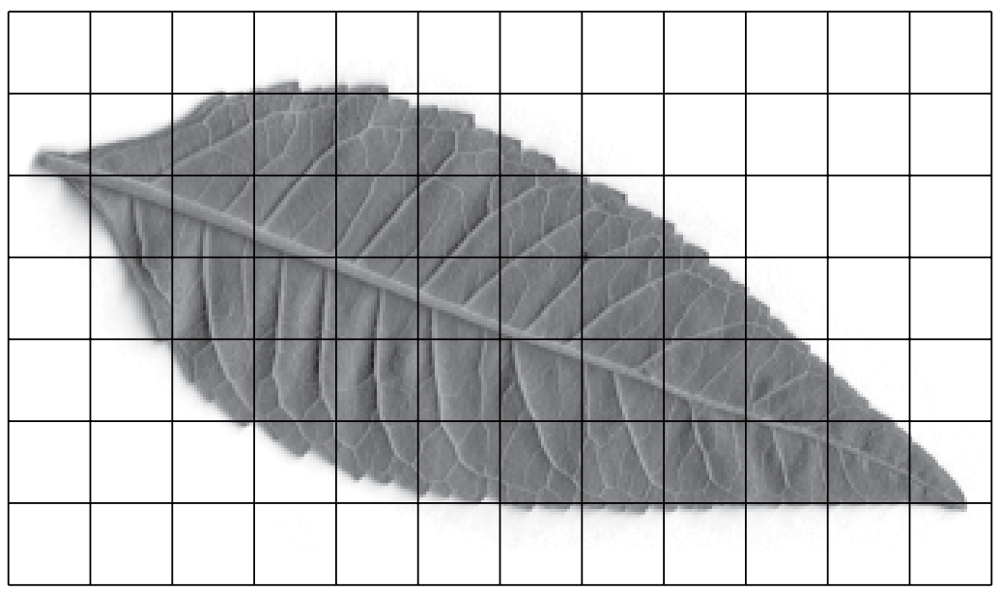

**Fig. 1**

(i)

Calculate the surface area of the leaf in Fig.1.

[1]

(ii)

Describe the method you used to determine the surface area of the leaf.

[2]

*Source: 2020 0610/06 Q2A*

**Q1** [2 marks]

Fig. 2 shows the upper and lower surfaces of the same leaf of another dicotyledonous plant.

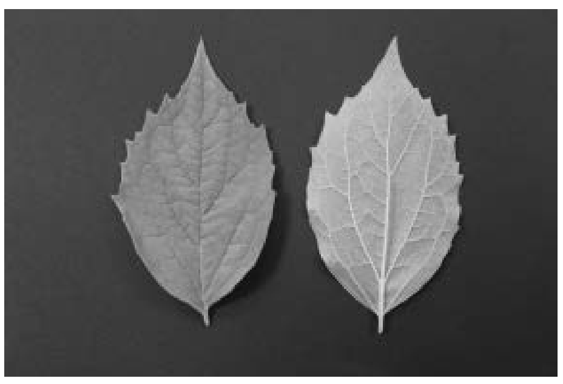

Upper surface              Lower surface

**Fig. 2**

Describe** two** ways, visible in Fig. 2, in which the upper surface of the leaf is different from the lower surface.

*Source: 2020 0610/06 Q2B*

**Q1** [11 marks]

A student investigated the effect of different wind speeds on the rate of transpiration of some leaves.

The student took five leaves from a tree and weighed each of them on a balance.

Each of the leaves was then hung from a different piece of wire.

Fans were used to blow air at different speeds over each leaf.

After 12 hours, the student weighed each leaf again. The results are shown in Table 1.

**Table 1**

| **Wind speed / m per s** | **Mass of leaf at the start / g** | **Mass of leaf at the end / g** | **Loss in mass / g** |
|---|---|---|---|
| 0 | 5.7 | 3.8 |   |
| 1 | 5.3 | 3.3 |   |
| 3 | 5.9 | 3.7 |   |
| 6 | 5.1 | 2.6 |   |
| 8 | 5.3 | 2.6 |   |

(i)

Calculate the loss in mass for each leaf. Complete Table 1.

[2]

(ii)

Construct a graph to show the loss in mass against wind speed.

[5]

(iii)

Use your graph to determine the loss in mass at a wind speed of 10 m per s. Show on the graph how you obtained your answer.

Give your answer in grams.

[2]

(iv)

A student criticised the results by saying that the loss in mass does not allow for a fair comparison between leaves.

Suggest a more appropriate calculation and explain why it gives a fairer comparison.

[2]

*Source: 2020 0610/06 Q2C*

### Q2 — medium — 25 marks

**Q2** [7 marks]

Some students decided to investigate the effect of wind speed on the rate of transpiration from leaves. For this, they used a potometer as shown in Fig. 1.

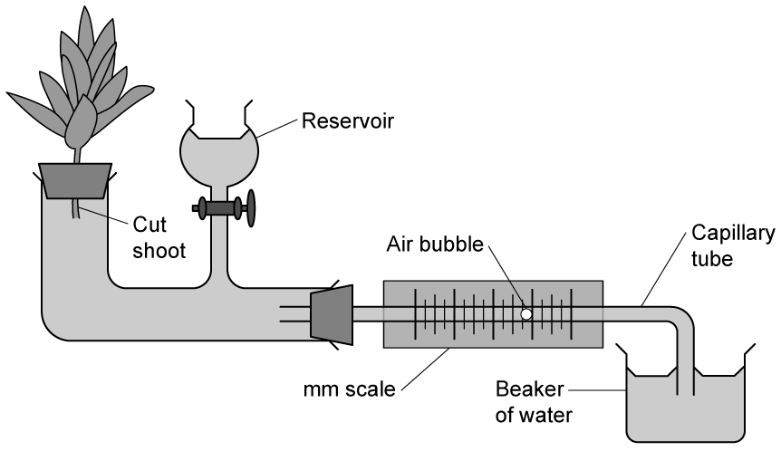

**Fig.1**

They selected a beech tree from the grounds of their school. Beech was selected because it is a species with a thin waxy cuticle.

In the laboratory, they filled a sink with water, placed the small branch underwater and cut a shoot off the branch. This shoot contained ten leaves.

Petroleum jelly (e.g. Vaseline™) was smeared around the edges of the cut end of the shoot prior to inserting the shoot into the potometer, as shown in Fig. 2.

Care was taken to avoid petroleum jelly getting onto the cut end of the shoot.

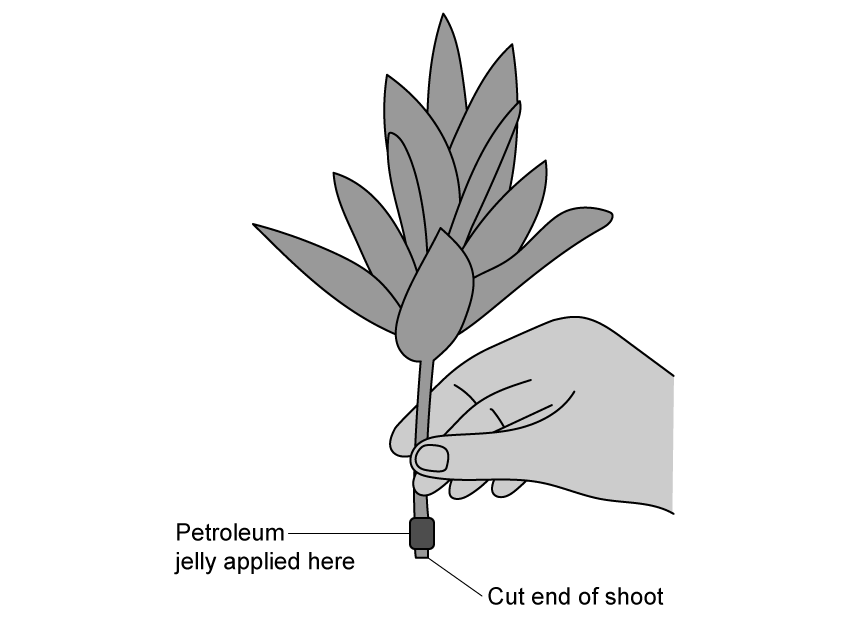

**Fig. 2**

(i)

Suggest why a species with a thin waxy cuticle was chosen for this experiment.

[2]

(ii)

Explain why the shoot with ten leaves was cut from the branch under water and not in air.

[2]

(iii)

Explain the purpose of petroleum jelly being smeared on the areas shown in Fig. 2.

[1]

(iv)

Explain why the students should avoid petroleum jelly getting onto the cut end of the shoot as shown in Fig. 2.

[2]

**Q2** [7 marks]

**Extract:**

Some students decided to investigate the effect of wind speed on the rate of transpiration from leaves. For this, they used a potometer as shown in Fig. 1.

They selected a beech tree from the grounds of their school. Beech was selected because it is a species with a thin waxy cuticle.

In the laboratory, they filled a sink with water, placed the small branch underwater and cut a shoot off the branch. This shoot contained ten leaves.

Petroleum jelly (e.g. Vaseline™) was smeared around the edges of the cut end of the shoot prior to inserting the shoot into the potometer, as shown in Fig. 2.

Care was taken to avoid petroleum jelly getting onto the cut end of the shoot.

Before the first experiment, the leaves were dried carefully by blotting excess water from the sink off them using pieces of paper towel.

The students used an electric fan with three speed settings to adjust the speed of air flowing over the leaves. The speed settings were numbered 0 (fan switched off), I (slowest setting), II and III (fastest setting).

At each wind speed they measured the time taken for the air bubble to move a set distance of 50 mm in the potometer.

(i)

Explain why the leaves were first dried using a paper towel.

[2]

(ii)

Suggest and explain an experimental step that the students should take after drying the leaves and before beginning to take measurements.

[2]

(iii)

Draw a blank results table that the students could fill in with their experimental data.

[3]

**Q2** [7 marks]

**Extract:**

Some students decided to investigate the effect of wind speed on the rate of transpiration from leaves. For this, they used a potometer as shown in Fig. 1.

They selected a beech tree from the grounds of their school. Beech was selected because it is a species with a thin waxy cuticle.

In the laboratory, they filled a sink with water, placed the small branch underwater and cut a shoot off the branch. This shoot contained ten leaves.

Petroleum jelly (e.g. Vaseline™) was smeared around the edges of the cut end of the shoot prior to inserting the shoot into the potometer, as shown in Fig. 2.

Care was taken to avoid petroleum jelly getting onto the cut end of the shoot.

Before the first experiment, the leaves were dried carefully by blotting excess water from the sink off them using pieces of paper towel.

The students used an electric fan with three speed settings to adjust the speed of air flowing over the leaves. The speed settings were numbered 0 (fan switched off), I (slowest setting), II and III (fastest setting).

At each wind speed they measured the time taken for the air bubble to move a set distance of 50 mm in the potometer.

The capillary tube in the potometer used in this experiment (see Fig. 1) has a diameter of 1mm.

(i)

Calculate the volume of water transpired by the piece of plant in the time taken for the bubble to move a distance of 50mm.

The volume of a cylinder = ***πr******2******h***, where ***r*** is the radius and ***h*** is the length of capillary tube.

Give your answer in appropriate units.

[3]

(ii)

The piece of beech under zero wind speed conditions took 7 minutes and 45 seconds to move the bubble 50mm.

Calculate the rate of transpiration in mm3 minute-1.

[2]

(iii)

Suggest **two** reasons why the answer you calculated in part (ii) might be an under-estimate of the rate of transpiration that the plant may experience in its natural habitat.

[2]

**Q2** [4 marks]

**Extract:**

Some students decided to investigate the effect of wind speed on the rate of transpiration from leaves. For this, they used a potometer as shown in Fig. 1.

They selected a beech tree from the grounds of their school. Beech was selected because it is a species with a thin waxy cuticle.

In the laboratory, they filled a sink with water, placed the small branch underwater and cut a shoot off the branch. This shoot contained ten leaves.

Petroleum jelly (e.g. Vaseline™) was smeared around the edges of the cut end of the shoot prior to inserting the shoot into the potometer, as shown in Fig. 2.

Care was taken to avoid petroleum jelly getting onto the cut end of the shoot.

Before the first experiment, the leaves were dried carefully by blotting excess water from the sink off them using pieces of paper towel.

The students used an electric fan with three speed settings to adjust the speed of air flowing over the leaves. The speed settings were numbered 0 (fan switched off), I (slowest setting), II and III (fastest setting).

At each wind speed they measured the time taken for the air bubble to move a set distance of 50 mm in the photometer.

The capillary tube in the potometer used in this experiment (see Fig. 1) has a diameter of 1mm.

In a similar experiment using a piece of shoot and leaves from a different species of tree, the students achieved the following results.

Fan setting **0** = transpiration rate 45 mm3min-1

Fan setting **I** = transpiration rate 57 mm3min-1

Fan setting **II** = transpiration rate 68 mm3min-1

Fan setting **III** = transpiration rate 70 mm3min-1

Plot the results on a suitable graph using the grid below.

### Q3 — medium — 19 marks

**Q3** [7 marks]

A student investigated the effect of temperature on water uptake in celery stalks.

Water is transported in the xylem tissue in plant stems.

Step 1

One celery stalk was placed into a beaker containing **warm** red stain. Another celery stalk was placed into a beaker containing **cool** red stain.

This is shown in Fig 1.

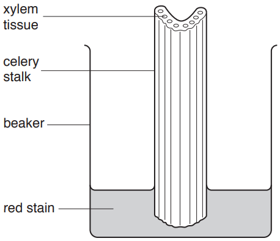

**Fig. 1**

Step 2

Both celery stalks were left in the red stain for 10 minutes.

Step 3

After 10 minutes the celery stalks were removed from the red stain.

Step 4

A 5 mm section was cut from the end of the celery stalk which had been in the warm red stain, as shown in Fig. 2.

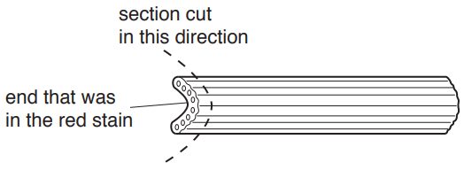

**Fig. 2**

Step 5

The section was inspected for the presence of the red stain in the xylem tissue in the celery stalk, as shown in Fig. 3.

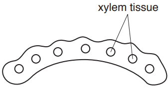

**Fig. 3**

Step 6

If the red stain was visible in the cut section, another 5 mm section was cut and the process repeated until no red stain was visible in the cut section. This allowed the student to estimate how far the red stain had moved up the celery stalk.

Step 7

Steps 4 to 6 were repeated for the celery stalk which had been in the **cool** red stain.

(i)

State **one** safety precaution that should be taken while carrying out this method.

[1]

(ii)

The student’s results are shown in Fig. 4.

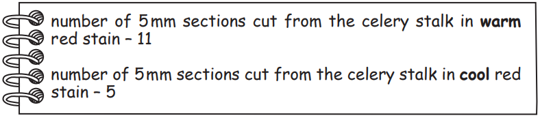

**Fig. 4**

Prepare a table and record your results in your table, in the space provided.Your table should include:

- the temperature (cool or warm) of the red stain
- the number of sections that were stained in 10 minutes
- the total distance moved by the red stain in 10 minutes.

[3]

(iii)

Use the data to calculate the rate of movement of the red stain in the celery stalk at each temperature.

Give your answers in mm per minute.

[2]

(iv)

State a conclusion for these results.

[1]

*Source: 2018 0610/62 Q1A*

**Q3** [2 marks]

**Extract:**

One celery stalk was placed into a beaker containing warm red stain. Another celery stalk was placed into a beaker containing cool red stain.
Both celery stalks were left in the red stain for 10 minutes.
A 5 mm section was cut from the end of the celery stalk which had been in the warm red stain, as shown in Fig. 2.
Steps 4 to 6 were repeated for the celery stalk which had been in the cool red stain.

State **two** variables which were kept constant in this experiment.

*Source: 2018 0610/62 Q1B*

**Q3** [4 marks]

**Extract:**

A student investigated the effect of temperature on water uptake in celery stalks.

Water is transported in the xylem tissue in plant stems.

Step 1

One celery stalk was placed into a beaker containing warm red stain. Another celery stalk was placed into a beaker containing cool red stain.

Step 2

Both celery stalks were left in the red stain for 10 minutes.

Step 3

After 10 minutes the celery stalks were removed from the red stain.

Step 4

A 5 mm section was cut from the end of the celery stalk which had been in the warm red stain.

Step 5

The section was inspected for the presence of the red stain in the xylem tissue in the celery stalk.

Step 6

If the red stain was visible in the cut section, another 5 mm section was cut and the process repeated until no red stain was visible in the cut section. This allowed the student to estimate how far the red stain had moved up the celery stalk.

Step 7

Steps 4 to 6 were repeated for the celery stalk which had been in the cool red stain.

One way of improving the method used in this investigation would be to repeat it a number of times.

Identify **two other** sources of error in this investigation.

For each error, suggest an improvement to minimise the effect of the error.

*Source: 2018 0610/62 Q1C*

**Q3** [6 marks]

**Extract:**

Water is transported in the xylem tissue in plant stems. One celery stalk was placed into a beaker containing red stain. The celery stalk was left in the red stain for a set period of time. After the time, the celery stalk was removed from the red stain. A section was cut from the end of the celery stalk which had been in the red stain. The section was inspected for the presence of the red stain in the xylem tissue in the celery stalk. If the red stain was visible in the cut section, another section was cut and the process repeated until no red stain was visible in the cut section. This allowed the student to estimate how far the red stain had moved up the celery stalk.

Some farmers wanted to investigate the effect of humidity on the rate of transpiration in celery plants.

Fig. 5 shows celery plants being harvested.

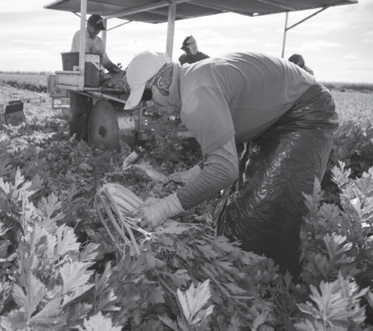

**Fig. 5**

One method of measuring the rate of transpiration is to record how long it takes a red stain to travel up the xylem tissue in a celery stalk that still has its leaves attached.

Plan an investigation to determine the effect of humidity on the rate of movement of water through leafy celery stalks.

*Source: 2018 0610/62 Q1D*

## Multiple Choice Questions (29 questions)

### Q1 — medium — 1 marks

**Q1** [1 mark]

Which of the following statements about the process of transpiration is correct?

### Q2 — hard — 1 marks

**Q2** [1 mark]

A potometer is used to measure the rate of transpiration. The table below shows the results.

| **Distance travelled by bubble (mm)** | **Time (mins)** |
|---|---|
| 0 | 0 |
| 17 | 30 |
| 29 | 60 |
| 35 | 90 |
| 44 | 120 |
| 51 | 150 |

Calculate the rate of transpiration between 30 and 120 minutes.

### Q3 — medium — 1 marks

**Q3** [1 mark]

Which environmental condition would most reduce transpiration?

|   | temperature | humidity |
|---|---|---|
| A | low | high |
| B | high | low |
| C | low | low |
| D | high | high |

### Q4 — easy — 1 marks

**Q4** [1 mark]

Which sequence correctly shows the pathway of water through a plant?

### Q5 — hard — 1 marks

**Q5** [1 mark]

The diagram shows an onion plant that has been grown from a seed. Each onion plant takes two years to flower and produce more seeds.

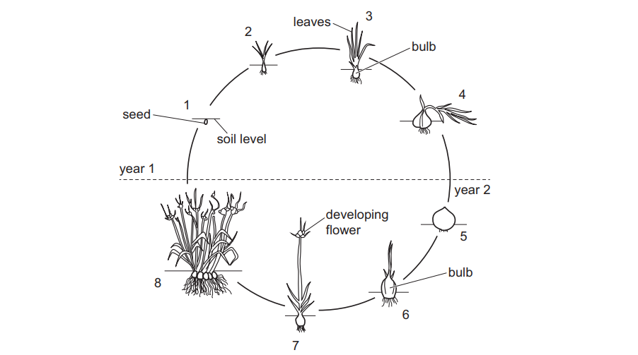

What is the onion bulb acting as in stage 3 and in stage 6?

|   | stage 3 | stage 6 |
|---|---|---|
| **A** | sink | sink |
| **B** | sink | source |
| **C** | source | sink |
| **D** | source | source |

*Source: June 2021 0970/21 Q18*

### Q6 — hard — 1 marks

**Q6** [1 mark]

The graph shows daily carbon dioxide uptake and transpiration by the plant Agave americana.

The plant is adapted to live in very dry conditions.

What can be concluded from this graph?

*Source: June 2021 0970/21 Q14*

### Q7 — hard — 1 marks

**Q7** [1 mark]

The diagram shows a cross-section through a leaf.

From which cell will most water evaporate during transpiration?

*Source: june 2022 paper 1 Q18*

### Q8 — hard — 1 marks

**Q8** [1 mark]

A non-woody plant stem is placed in water containing a red dye. It is left for one day and then a section of the stem is examined using a microscope.

Which tissue is stained red?

*Source: june 2022 paper 1  Q17*

### Q9 — medium — 1 marks

**Q9** [1 mark]

A plant shoot is placed in a solution of dye.

The dye moves up the stem.

Under which conditions will the dye move most slowly?

|   | temperature | humidity |
|---|---|---|
| **A** | high | high |
| **B** | high | low |
| **C** | low | high |
| **D** | low | low |

*Source: June 2021 0970/11 Q18*

### Q10 — easy — 1 marks

**Q10** [1 mark]

The diagram shows part of a cross-section of a root.

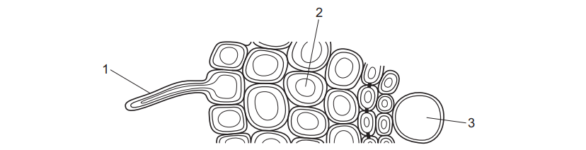

What are cells 1, 2 and 3?

|   | 1 | 2 | 3 |
|---|---|---|---|
| **A** | root cortex cell | root hair cell | mesophyll cell |
| **B** | root hair cell | root cortex cell | xylem |
| **C** | root hair cell | root cortex cell | mesophyll cell |
| **D** | root cortex cell | root hair cell | xylem |

### Q11 — hard — 1 marks

**Q11** [1 mark]

Roots and leaves both act as sources and sinks for sucrose and amino acids at different times during the year.

At which point in the year are the roots most active as a source?

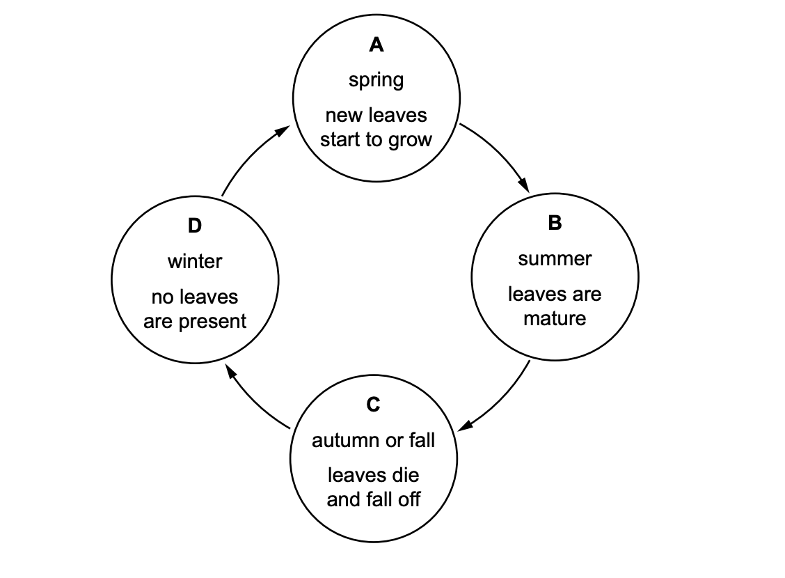

*Source: Specimen 2023 0970/02 Q17*

### Q12 — hard — 1 marks

**Q12** [1 mark]

The diagram shows two shoots at the start of an experiment on transpiration.

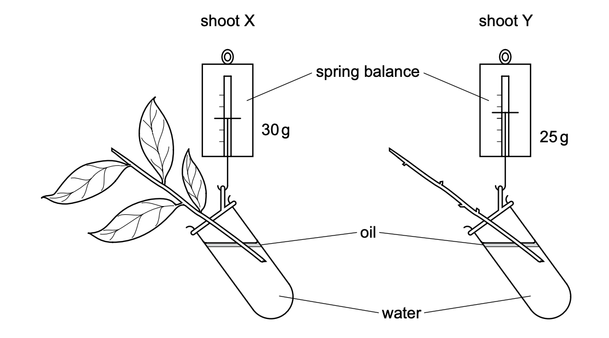

What are the likely readings on the spring balances after three days?

|   | shoot X/g | shoot Y/g |
|---|---|---|
| **A** | 25 | 30 |
| **B** | 25 | 25 |
| **C** | 30 | 25 |
| **D** | 30 | 30 |

*Source: Specimen 2023 0970/01 Q17*

### Q13 — hard — 1 marks

**Q13** [1 mark]

The photomicrograph shows a cross-section through the root of a buttercup plant.

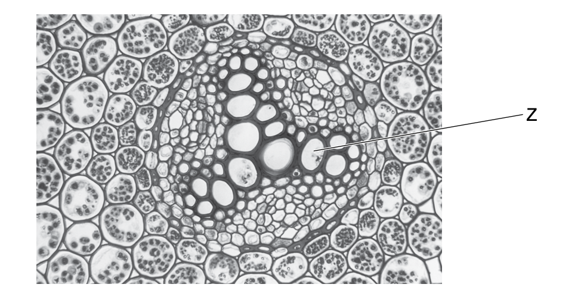

What is the main function of the tissue labelled Z?

*Source: Specimen 2023 0970/01 Q16*

### Q14 — hard — 1 marks

**Q14** [1 mark]

#### Extended only

Which row of the table below shows substances transported through the phloem and xylem, and the direction of transport, correctly?

|   | **phloem** | **direction of transport** | **xylem** | **direction of transport** |
|---|---|---|---|---|
| **A** | sucrose | bi-directional (up and down) | water and mineral ions | bi-directional (up and down) |
| **B** | sucrose | unidirectional (up) | water and mineral ions | bi-directional (up and down) |
| **C** | sucrose and amino acids | bi-directional (up and down) | water | unidirectional (up) |
| **D** | sucrose and amino acids | unidirectional (up) | water | unidirectional (up) |

### Q15 — easy — 1 marks

**Q15** [1 mark]

The diagram below shows a potted plant and the same plant 48 hours later.

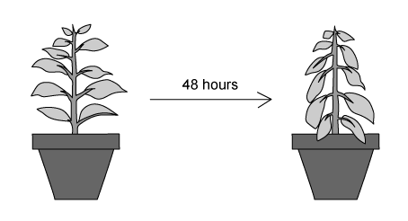

What has caused the plant’s appearance to change?

### Q16 — easy — 1 marks

**Q16** [1 mark]

#### Extended only

Which of the following is a correct explanation of the process of translocation in a plant?

### Q17 — medium — 1 marks

**Q17** [1 mark]

Which of the following processes is/are involved in the loss of water from the leaves of plants?

1. diffusion
2. osmosis
3. condensation
4. evaporation

### Q18 — easy — 1 marks

**Q18** [1 mark]

A potometer can be used to measure the rate that a piece of plant transpires under various conditions.

Part of a potometer is shown in the diagram below.

Which statement, relating to how a potometer works, is **false**?

### Q19 — hard — 1 marks

**Q19** [1 mark]

#### Extended only

The xylem has specific adaptations to allow it to transport water and mineral ions from the roots of a plant to the leaves as a result of transpiration.

Which processes produce the adaptations in xylem vessels to allow the continuous flow of water?

|   | **cell walls break down between adjacent cells ** | **cytoplasm and organelles removed from each cell** |
|---|---|---|
| **A** | **✘** | **✘** |
| **B** | **✓** | **✓** |
| **C** | **✘** | **✓** |
| **D** | **✓** | **✘** |

### Q20 — hard — 1 marks

**Q20** [1 mark]

#### Extended only

The diagram below shows two shoots at the start of an experiment set up by a group of students. Shoot A is on the left, while Shoot B is on the right.

What are the most likely readings on the spring balances after four days?

|   | **Spring balance readings / g** |   |
|---|---|---|
| **shoot A** | **shoot B** |   |
| **A** | 40 | 40 |
| **B** | 40 | 34 |
| **C** | 34 | 40 |
| **D** | 34 | 34 |

### Q21 — medium — 1 marks

**Q21** [1 mark]

Which of the following is a correct explanation of the effect of root hairs on absorption?

### Q22 — medium — 1 marks

**Q22** [1 mark]

#### Extended only

A dicot plant is placed into a bowl of water coloured with red dye.

After 1 hour, a cross section of one of the roots is cut.

After 4 hours, a cross section is cut from the stem.

Which labelled regions would be stained red in each case?

### Q23 — easy — 1 marks

**Q23** [1 mark]

The diagram shows a simplified water cycle.

Which of the processes listed below would be involved in the loss of water from the tree?

### Q24 — hard — 1 marks

**Q24** [1 mark]

#### Extended only

Which of the following graphs correctly shows the relationship between the rate of transpiration and atmospheric humidity?

### Q25 — easy — 1 marks

**Q25** [1 mark]

Which order below is correct in describing the pathway of water as it travels from the roots through a plant?

### Q26 — medium — 1 marks

**Q26** [1 mark]

A **decrease **in which of the following factors would normally cause the transpiration rate to **increase**?

### Q27 — hard — 1 marks

**Q27** [1 mark]

The table below shows some characteristics of four different plants.

The plants are growing in the same environmental conditions.

Which plant will have the **lowest **rate of transpiration?

|   | **number of leaves on plant** | **average surface area of one leaf / cm****2** | **average density of stomata on leaves / stomata per mm****2** | **average diameter of one stoma / µm** |
|---|---|---|---|---|
| **A** | 36 | 53 | 276 | 19 |
| **B** | 21 | 51 | 247 | 18 |
| **C** | 24 | 45 | 249 | 15 |
| **D** | 17 | 40 | 151 | 16 |

### Q28 — medium — 1 marks

**Q28** [1 mark]

#### Extended only

A student collected some of the solution from the phloem in the stem of a plant.

Which of the following would be present in the liquid?

### Q29 — medium — 1 marks

**Q29** [1 mark]

#### Extended only

Which environmental factor is most likely to be responsible for a plant to wilt?

## Theory Questions (18 questions)

### Q1 — hard — 13 marks

**Q1** [1 mark]

Glucose is produced in the leaves of plants during photosynthesis. This glucose is converted into a different carbohydrate for transport.

Name the carbohydrate transported in the phloem.

**Q1** [5 marks]

An experiment was conducted where a ring of bark was removed from a tree, as shown in Fig. 3.1.

This process removes the phloem but leaves the xylem intact.

**Fig. 3.1**

Explain why the area above the ring becomes swollen after 24 hours.

**Q1** [2 marks]

The terms *source* and *sink* are used to describe the movement of substances in a plant.

In early spring a potato plant begins to grow new shoots from an underground tuber (potato).

Identify the source and the sink in this specific scenario.

**Q1** [5 marks]

**Extract:**

An experiment was conducted where a ring of bark was removed from a tree, as shown in Fig. 3.1.

This process removes the phloem but leaves the xylem intact.

**Fig. 3.1**

Explain why the tree in Fig. 3.1 will eventually die, despite having functional xylem vessels.

### Q2 — medium — 13 marks

**Q2** [3 marks]

A student investigated the mass of water lost by a potted plant over one hour in different environmental conditions. The results are shown in **Table 3.1**.

**Table 3.1**

| **Condition** | **Water lost in 1 hour (g)** |
|---|---|
| Cool and still | 2.5 |
| Hot and still | 8.0 |
| Hot and windy | 14.5 |

Water is transported from the roots to the leaves before it is lost to the atmosphere.

(i) State the name of the tissue that transports water up the stem of plants.

[1]

(ii) State the name of the small openings on the underside of the leaf from which most water vapour is lost.

[1]

(iii) State the name of the cells that control the opening and closing of the openings named in (ii).

[1]

**Q2** [3 marks]

**Extract:**

A student investigated the mass of water lost by a potted plant over one hour in different environmental conditions. The results are shown in **Table 3.1**.

**Table 3.1**

| **Condition** | **Water lost in 1 hour (g)** |
|---|---|
| Cool and still | 2.5 |
| Hot and still | 8.0 |
| Hot and windy | 14.5 |

Using the results in Table 3.1, describe the effect of temperature and wind speed on the mass of water lost.

**Q2** [2 marks]

**Extract:**

A student investigated the mass of water lost by a potted plant over one hour in different environmental conditions. The results are shown in **Table 3.1**.

**Table 3.1**

| **Condition** | **Water lost in 1 hour (g)** |
|---|---|
| Cool and still | 2.5 |
| Hot and still | 8.0 |
| Hot and windy | 14.5 |

Using the data recorded for the hot and still condition in Table 3.1, calculate the rate of water loss per minute over the hour time period.

Show your working.

**Q2** [3 marks]

The loss of water vapour from the surface of leaves is a named biological process.

(i) State the name of this process.

[1]

(ii) Explain how the process of water movement named in (i) occurs.

[2]

**Q2** [2 marks]

Another student placed a potted plant on a windowsill. After one week they noticed that the stem of the plant had bent and was growing towards the window.

State the name of the plant's growth response, and explain why this response is an advantage to the plant.

### Q3 — hard — 6 marks

**Q3** [3 marks]

When yeast respires anaerobically, ethanol is produced.

Ethanol is a type of sustainable resource that can be made from a wide range of crop plants.

It can be used as a biofuel.

Table 4.1 summarises some information about crop plants that are used to make biofuel.

**Table 4.1**

| crop plant | biofuel produced | energy yield / GJ per ha | optimum growth temperature / °C | optimum annual rainfall range / mm |
|---|---|---|---|---|
| wheat | ethanol | 53–84 | 24 | 800–1200 |
| corn | ethanol | 63–76 | 18 | 360–1000 |
| sugar beet | ethanol | 110–122 | 18 | 360–1000 |
| sugarcane | ethanol | 110–140 | 28 | 800–1200 |
| oil palm | oil | 150–166 | 28 | 1100–2500 |

A country has a mean temperature range of 12 °C to 24 °C. The country has a mean annual rainfall of 1000 mm.

Suggest **and** explain which crop plant would be the most suitable crop to grow to produce biofuel in the country.

Use the information in Table 4.1 to support your choice. crop plant .................................................................................................................................. explanation ...............................................................................................................................

*Source: Specimen 2023 0970/04 Q4B*

**Q3** [3 marks]

Describe **and** explain how a reduced concentration of water vapour in the air would increase the movement of water through crop plants

*Source: Specimen 2023 0970/04 Q4C*

### Q4 — hard — 3 marks

**Q4** [3 marks]

#### Extended Only

Describe **and** explain how a reduced concentration of water vapour in the air would increase the movement of water through crop plants.

*Source: 2023 970/04 Q4C*

### Q5 — hard — 6 marks

**Q5** [3 marks]

#### Extended only

A student cut a section of a root and made an outline drawing of the distribution of tissues as shown in Fig. 1

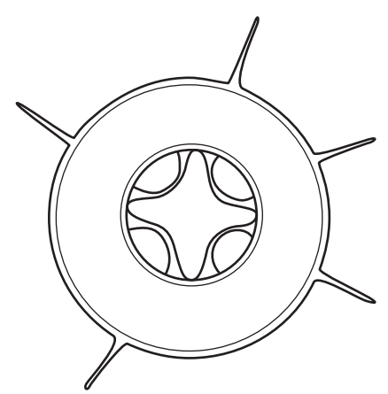

**Fig 1**

(i)

Identify the position of the xylem tissue by drawing a label line and the letter **X** on** **Fig. 1

[1]

(ii)

State why the xylem is a tissue.

[2]

*Source: 2018 0610/41 Q3A*

**Q5** [3 marks]

#### Extended Only

Water absorbed by the roots moves through the stem and enters the leaves. Most of this water is lost in transpiration.

Explain how the internal structure of leaves results in the loss of large quantities of water in transpiration.

*Source: 2018 0610/41 Q3B*

### Q6 — hard — 16 marks

**Q6** [4 marks]

Fig. 1 shows a potometer set up to measure the rate of transpiration in a piece of cut plant.

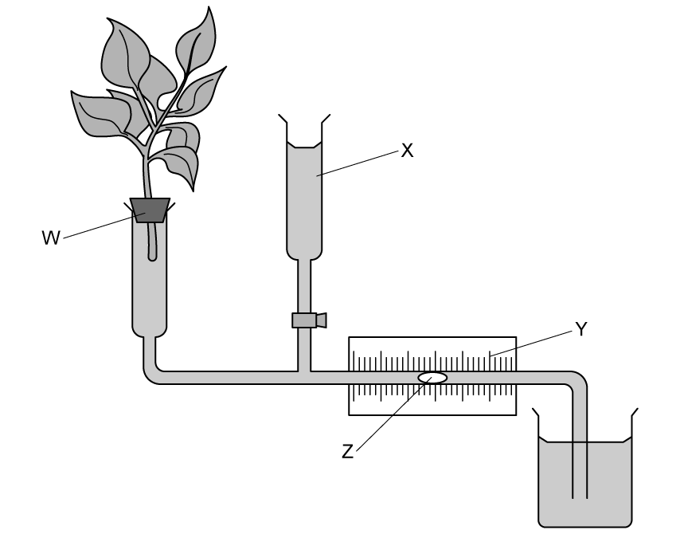

**Fig. 1**

Identify labels **W**,** X**,** Y **and **Z.**

**Q6** [4 marks]

In the experiment shown in Fig. 1, the bubble moved a distance of 23 mm in 47 minutes of experiment time.

The bore (internal diameter) of the capillary tube that the bubble is in is 1 mm.

(i)

Calculate the volume of water taken up by the plant in the time of the experiment.

[2]

(ii)

Calculate the rate of transpiration of the piece of plant.

State your answer in mm3hr-1.

[2]

**Q6** [2 marks]

**Extract:**

In the experiment shown in Fig. 1, the bubble moved a distance of 23 mm in 47 minutes of experiment time. The bore (internal diameter) of the capillary tube that the bubble is in is 1 mm.

(ii)

The rate of transpiration of the piece of plant in mm^3^hr^-1^ is:

- 18 ÷ (47÷60); [1 mark]
- 23 mm^3^hr^-1^; [1 mark]

For the experiment described in part (b), a subsequent experiment used an electric fan to blow air across the leaves of the plant throughout the experiment.

Predict the rate of transpiration that would be measured. State your answer as a number with units.

Explain your reasoning.

**Q6** [6 marks]

A different piece of the plant (from a species of tree) was measured and its transpiration rate was found to be 350 mm3hr-1.

The piece of the tree being studied contained 8 leaves whereas a mature tree of the same species would consist of an average of 65 000 leaves.

(i)

Estimate the rate of transpiration of a mature tree of this species.

Express your answer in litres per day (dm3day-1)

1dm3 = 1 000 000 mm3

[3]

(ii)

Give **three** reasons to suggest why the estimate in part (d) (i) is likely to be inaccurate.

[3]

### Q7 — hard — 10 marks

**Q7** [7 marks]

#### Extended Only

Fig.1 is a photomicrograph of some xylem vessels.

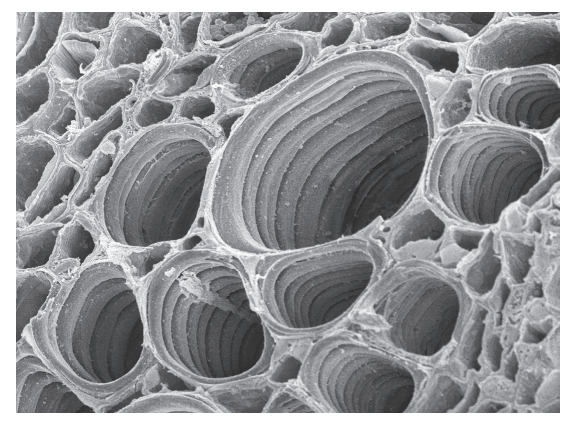

**Fig. 1**

(i)

State **one **structural feature of xylem vessels **and** explain how this is related to the function of water transport.

[2]

(ii)

Explain the mechanism that is responsible for the movement of water in xylem vessels.

[4]

(iii)

State **one **role of xylem vessels **other than** transport.

[1]

*Source: 2018 0610/42 Q3A*

**Q7** [3 marks]

#### Extended Only

The rate of transpiration is affected by several factors including the temperature and the humidity of the air.

State **and** explain the effect of an increase in temperature on the rate of transpiration.

*Source: 2018 0610/42 Q3B*

### Q8 — hard — 14 marks

**Q8** [6 marks]

#### Extended only

Aphids are insects that feed on the phloem sap in plants.

Fig. 1 shows a diagram of an aphid with its mouth parts inserted into the stem of a plant.

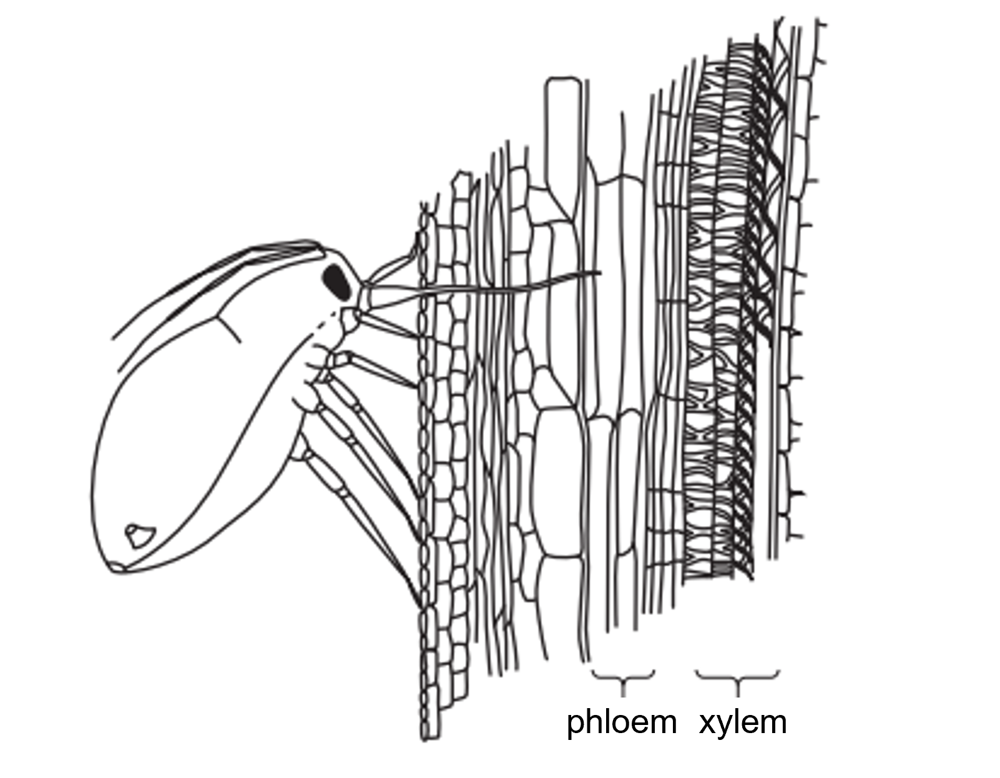

**Fig. 1**

The mouth parts of the aphid reach the phloem tissue of the stem.

(i)

State the name of the foods the aphid could suck out of the phloem tissue.

[2]

(ii)

Explain the role of phloem in plant transport. Use the words **source** and **sink** in your answer

[4]

*Source: 2018 0610/42 Q3A*

**Q8** [6 marks]

#### Extended Only

Fig. 1 shows some of the features of xylem.

Describe how xylem is adapted for its functions.

*Source: 2018 0610/42 Q3B*

**Q8** [2 marks]

Some farmers spray their crops with insecticides to kill pests such as aphids.

Explain the benefits of killing pests.

*Source: 2018 0610/42 Q3C*

### Q9 — easy — 8 marks

**Q9** [1 mark]

State the predominant process by which water is lost from the leaf.

**Q9** [2 marks]

Suggest **two** reasons why transpiration is beneficial for the plant.

**Q9** [4 marks]

#### Extended only

Fig. 1 shows the movement of water through a plant. Arrows indicate the direction of movement.

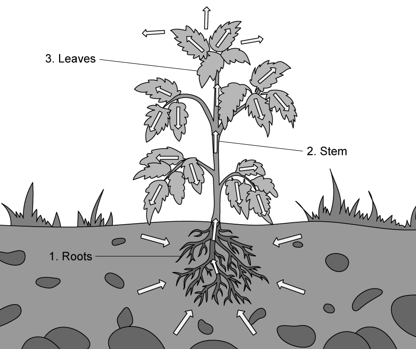

**Fig. 1**

Explain how the transpiration stream happens in plants. Use the information in** **Fig. 1.

**Q9** [1 mark]

**Extract:**

Fig. 1 shows the movement of water through a plant. Arrows indicate the direction of movement.

The transpiration stream happens in plants in the following way...
- Most transpiration occurs at the leaves
- Transpiration is caused by evaporation and diffusion of water from the surface of the leaf / spongy mesophyll cells
- Water diffuses through the stomata to the surrounding air down the concentration gradient
- Water then evaporates
- This decreases the concentration of water in the leaf or reduces pressure/tension
- Water is drawn up through the plant/roots and stem through the xylem by cohesion
- To replace the water lost from the leaf
- This results in more water being drawn up from the roots
- This causes a constant 'transpiration stream' of water

Predict what would happen to the transpiration rate of the plant in** **Fig. 1 during the night time.

### Q10 — medium — 15 marks

**Q10** [3 marks]

#### Extended Only

Fig. 1 shows a photomicrograph of a section of a root.

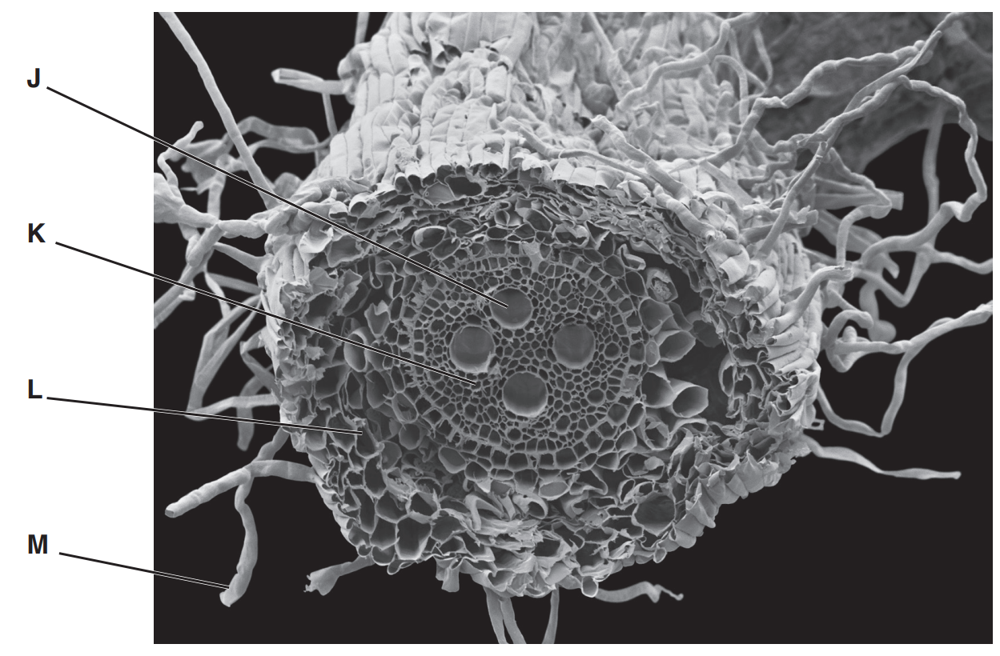

**Fig. 1**

Structure **J **is a xylem vessel.

The xylem vessels conduct water from the roots to the stems.

State the features of xylem vessels that enable them to conduct water.

*Source: 2018 (Series 1) 0610/41 Q3A*

**Q10** [5 marks]

**Extract:**

Fig. 1 shows a photomicrograph of a section of a root.

Structure J is a xylem vessel.

The xylem vessels conduct water from the roots to the stems.

Describe the pathway of water from outside the root to the xylem vessels (**J**) at the centre of the root.

Use the letters in** **Fig. 1 in your answer.

*Source: 2018 (Series 1) 0610/41 Q3B*

**Q10** [7 marks]

**Extract:**

Scientists wanted to determine the flow-rate of water in roots. They measured the flow-rate in three zones of onion roots as shown in Fig. 2. They measured the flow-rate in healthy roots and roots that had been treated with a toxic solution. Their results are shown in Table 1.

Table 1
| zone in Fig. 2 | average flow-rate of water / arbitrary units |
| healthy roots | treated roots |
| 1 | 150 | 160 |
| 2 | 230 | 200 |
| 3 | 280 | 270 |

The scientists observed that the xylem vessels nearer the root tip were narrower than the xylem vessels higher up the root.

Scientists wanted to determine the flow-rate of water in roots.

They measured the flow-rate in three zones of onion roots as shown in** **Fig. 2

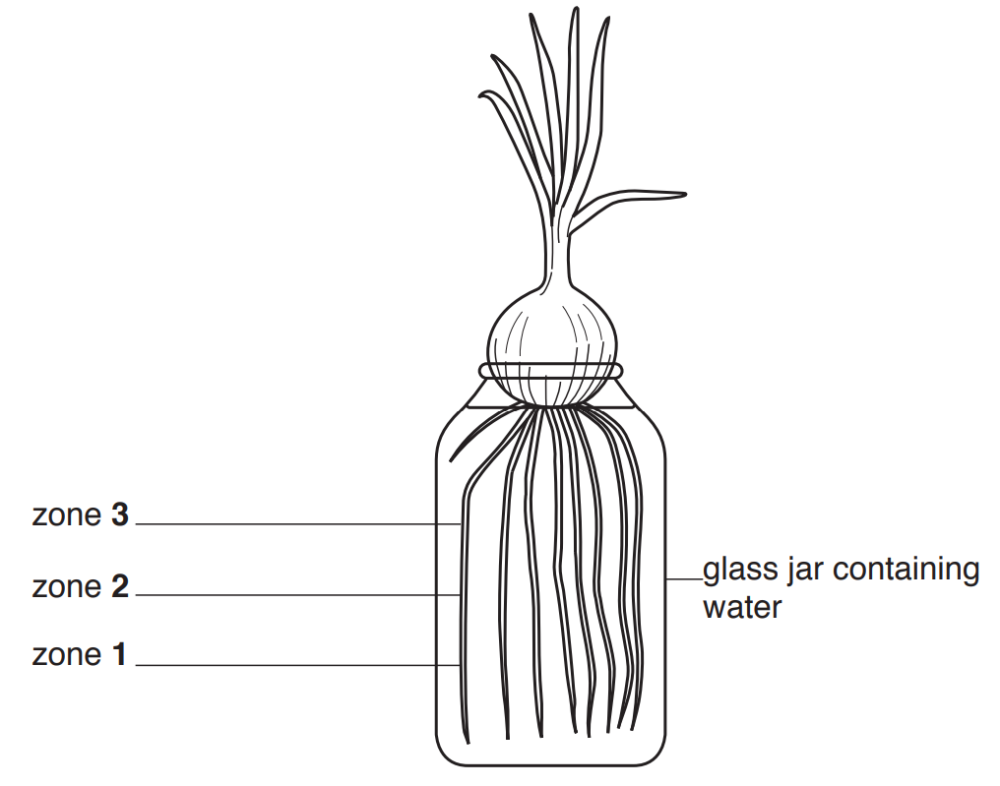

**Fig. 2**

They measured the flow-rate in healthy roots and roots that had been treated with a toxic solution.

Their results are shown in** **Table 1.

**Table 1**

| zone in Fig. 2 | average flow-rate of water / arbitrary units |   |
|---|---|---|
| healthy roots | treated roots |   |
| **1** | 150 | 160 |
| **2** | 230 | 200 |
| **3** | 280 | 270 |

(i)

Calculate the percentage increase in the average flow-rate between zone **1** and **3** for healthy roots.

Give your answer to **two** significant figures.

Show your working.

[2]

(ii)

The scientists observed that the xylem vessels nearer the root tip were narrower than the xylem vessels higher up the root.

Describe how the width of xylem vessels in different zones of a root affects the average flow-rate of water.

Use the information in Table 1 in your answer.

[3]

(iii)

Suggest why there was little difference in the flow-rate in healthy roots and in roots treated with the toxic solution.

[2]

*Source: 2018 (Series 1) 0610/41 Q3C*

### Q11 — easy — 8 marks

**Q11** [2 marks]

#### Extended only

Complete the sentence by choosing the missing words from the box below.

The __________ transports food substances such as dissolved __________ made in the __________ to the rest of the plant. This process is called __________ .

| xylem         sugars          phloem          mineral ions         translocation         water         leaves     transpiration          roots         photosynthesis |
|---|

**Q11** [2 marks]

Complete the sentences.

Choose the answers from the box below.

Water moves into the cytoplasm of root hair cells by the process of __________ .

Mineral ions move into the cytoplasm of root hair cells by the process of __________ .

| evaporation         diffusion          active transport  osmosis          translocation           transpiration |
|---|

**Q11** [2 marks]

Root hair cells possess long hair-like projections.

Explain why this is a beneficial adaptation for absorbing water and mineral ions.

**Q11** [2 marks]

The following statements are the structures that water passes through on its way through a plant.

- leaf mesophyll cell
- root cortex cell
- root hair cell
- xylem

Place the structures in the correct order in which water passes through them.

### Q12 — medium — 10 marks

**Q12** [3 marks]

Plant leaves have many adaptations to maximise the rate at which they can photosynthesise. A group of students wanted to investigate the behaviour of stomata in different plants.

Fig. 1 is a drawing of the underside of a leaf of one of the plants as visualised under a light microscope.

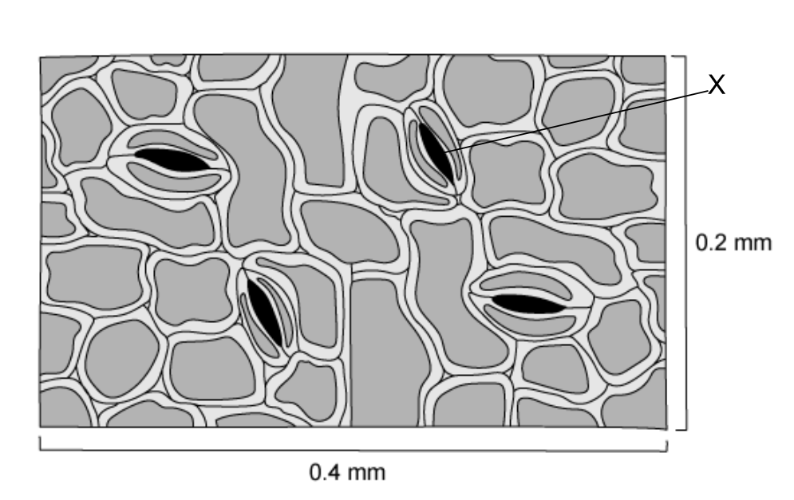

**Fig. 1**

Name cell **X** in Fig. 1 and outline its role in the leaf.

**Q12** [2 marks]

**Extract:**

4 stomata per 0.2 mm × 0.4 mm = 0.08 mm^2; 1mm^2 ÷ 0.08mm^2 = 12.5; 4 × 12.5; 50 stomata per mm^2;

Calculate the number of stomata per mm2 of this leaf surface.

**Q12** [2 marks]

Another plant species has 200 stomata per mm2 of its leaf surface.

An increased number of stomata is not always advantageous.

Explain why.

**Q12** [3 marks]

The students then measured the mean widths of the stomata from three different species of plant which had been growing under different light conditions.

Table 1 shows their results.

**Table 1**

| Condition | Time in light or dark / hours | Mean width of stomata as a percentage of their maximum width |   |   |
|---|---|---|---|---|
| Species A | Species B | Species C |   |   |
| Light | 1 | 45 | 67 | 7 |
| Light | 1 | 89 | 72 | 4 |
| Light | 1 | 98 | 78 | 2 |
| Light | 1 | 100 | 64 | 1 |
| Dark | 1 | 5 | 14 | 96 |
| Dark | 1 | 5 | 16 | 87 |
| Dark | 1 | 6 | 11 | 78 |
| Dark | 1 | 5 | 13 | 76 |
| Light | 1 | 49 | 57 | 4 |
| Light | 1 | 83 | 64 | 1 |
| Light | 1 | 100 | 79 | 0 |
| Light | 1 | 99 | 80 | 1 |

Species A is unlikely to be found growing in a hot, dry desert.

Explain why, using data from Table 1.

### Q13 — easy — 6 marks

**Q13** [1 mark]

**Fig. 1** shows a drawing of the cross-section of a plant root.

The transport tissues are labelled.

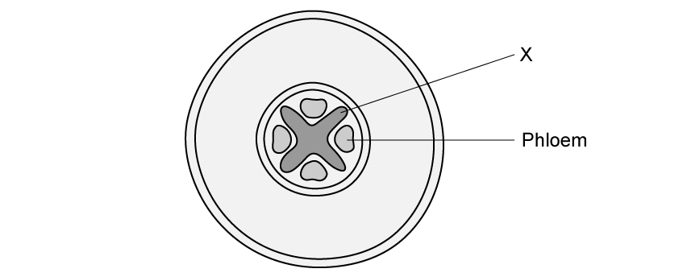

**Fig. 1**

Name the structure labelled **X.**

**Q13** [2 marks]

Name the substances that are primarily transported in the phloem.

**Q13** [2 marks]

**Extract:**

The structure labelled X is... 

- Xylem;

Complete **Table 1** below with a tick (**✓**) or ticks to represent the direction(s) of movement of substances in the phloem and structure **X**.

**Table 1**

|   | Structure X | Phloem |
|---|---|---|
| Up only |   |   |
| Up and down |   |   |

**Q13** [1 mark]

The flow of water from the roots to the leaves via the vascular network is an important process in plants.

Name this process.

### Q14 — medium — 9 marks

**Q14** [4 marks]

#### Extended only

Compare the plant processes of transpiration and translocation.

**Q14** [2 marks]

#### Extended

Name the two main products of a plant's metabolism that are carried in the phloem.

**Q14** [2 marks]

#### Extended only

Define the term 'source' when used in the context of plant biology.

**Q14** [1 mark]

**Extract:**

The term 'source' when used in the context of plant biology means:

Any two of the following from:

- (A tissue that) acts as the site of manufacture/synthesis/production of a particular nutrient/food compound/group of compounds;
- The part of a plant where a particular nutrient enters/is taken up;
- Any photosynthetically-active part of a plant;

As opposed to a sink, which is any area of active growth and/or storage.

#### Extended only

The image shows a wild banana, cut lengthways. Inside the banana, its seeds are clearly visible. Seeds are usually regarded as sinks.

Give an example of when seeds such as these act as a source.

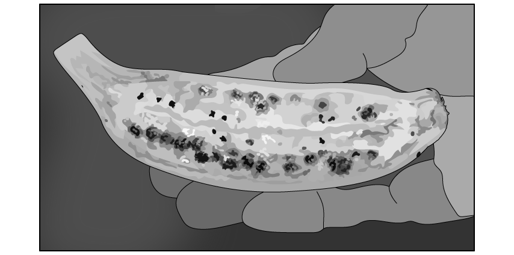

### Q15 — medium — 9 marks

**Q15** [5 marks]

Complete the sentences by placing appropriate words in the spaces to give a definition of transpiration.

In transpiration water is lost from the .............................................. of a plant.

The water .............................................. from the surface of the ..............................................  cells and water vapour is produced.

The water vapour moves by .............................................. out of the plant through pores called ..............................................

*Source: 2018 0610/32 Q7A*

**Q15** [4 marks]

Complete** **Table 1 by

- stating **two** environmental conditions that affect the rate of transpiration
- stating how a **decrease** in each environmental condition affects the rate of transpiration

**Table 1**

| Environmental condition | Effect of a decrease on the rate of transpiration |
|---|---|
|   |   |
|   |   |

*Source: 2018 0610/32 Q7B*

### Q16 — medium — 8 marks

**Q16** [2 marks]

#### Extended Only

When water is in short supply, plants can wilt as shown in Fig. 2

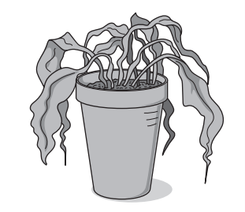

**Fig. 2**

State **two** conditions that are likely to increase the chances of wilting.

*Source: 2018 0610/43 Q3B*

**Q16** [4 marks]

#### Extended only

Explain what happens to the cells of a leaf to cause wilting.

*Source: 2018 0610/43 Q3B*

**Q16** [2 marks]

#### Extended only

Wilting may look harmful, but it is often a strategy for survival.

Suggest the advantages to a plant of wilting.

*Source: 2018 0610/43 Q3B*

### Q17 — easy — 8 marks

**Q17** [3 marks]

**Extract:**

- Accept "less/minimal resistance" or "water flows easily/smoothly" for "allows free passage of water"; accept "hollow" for "no cell contents".
- Accept "no walls between cells" for "no cross walls"; accept "allows water to move/flow continuously" or "continuous column of water" for "forms a long continuous tube", including "allowing them/it to move continuously" where the pronoun refers to the water.
- Accept "prevents collapse/breakage" or "withstands pressure/weight" for "strengthens the tubes / helps support the plant".

#### Extended only

State **three** adaptations of the xylem and for each, explain how it helps the xylem to perform its function.

**Q17** [1 mark]

Xylem and phloem vessels running side-by-side make up a recognisable structure within a plant's stem and roots.

State the name of this structure.

**Q17** [3 marks]

**Extract:**

Fig. 1 shows some data on the lignin content of various plants' stem tissues.

Lignin content: 15%, 26%, 30%
Organism: oak tree (height 20m), wheat crop (height 0.8m), rhododendron (height 3.5m)

The role of lignin is to provide strength to a plant stem, so the stem can hold up the mass of the plant as a whole. In general, taller plants such as tree have a higher lignin content in their stems than short plants like grass and short crops eg. wheat.

#### Extended only

Fig. 1 shows some data on the lignin content of various plants' stem tissues.

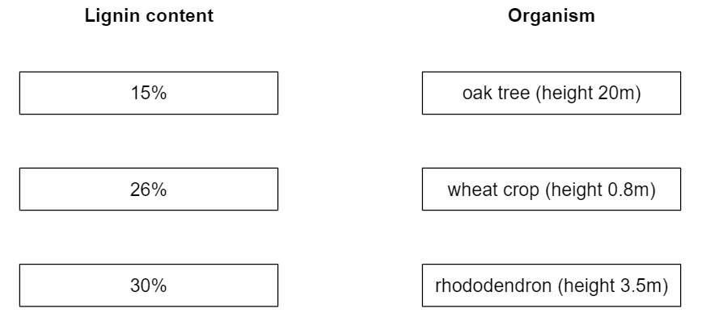

**Fig. 1**

Using your knowledge of the function of lignin, join the boxes with three straight lines to estimate the lignin content of the various species' plant stems.

**Q17** [1 mark]

**Extract:**

Cells are dead / no cell contents **AND **therefore allows free passage of water;

#### Extended only

Explain an advantage of the xylem containing dead tissue as opposed to live tissue.

Your answer should refer to the xylem's role in transporting water and minerals.

### Q18 — easy — 7 marks

**Q18** [1 mark]

State the name of the piece of equipment that can be used to measure transpiration rate.

**Q18** [2 marks]

**Extract:**

The piece of equipment that can be used to measure transpiration rate is: (A) potometer.

Using the piece of equipment referred to in part (a), explain how an experimenter might do the following:

(i)

Vary the temperature to examine the effects on the rate of transpiration.

[1]

(ii)

Vary the wind speed to examine the effects on the rate of transpiration.

[1]

**Q18** [3 marks]

#### Extended only

Table 1 shows the conditions that can be varied to cause differences in the rate of transpiration of a given piece of cut plant (stem and leaves).

The numbers of Table 1 give an expected level of the rate of transpiration, in arbitrary units on a scale 0 - 5, with 5 being the highest rate.

**Table 1**

|   | Level of each variable |   |   |
|---|---|---|---|
| Condition | High | Medium | Low |
| Wind speed |   | 2.5 |   |
| Temperature (range 10°C - 35°C) |   | 2.5 |   |
| Air humidity |   | 2.5 |   |

Complete the missing boxes in Table 1 with numbers from 0 - 5 to show your predictions for the missing sets of conditions.

**Q18** [1 mark]

#### Extended only

State the condition of a plant whose water levels have fallen so low that the plant can no longer support itself.
