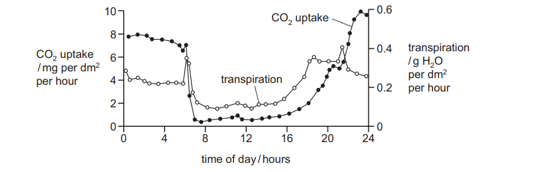
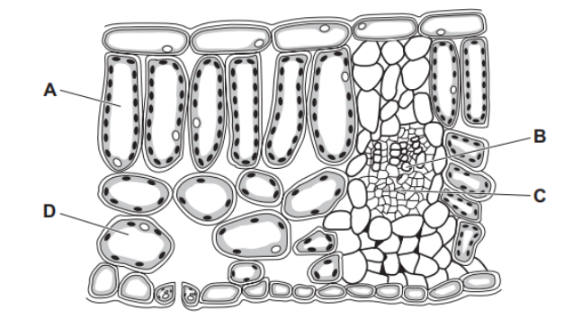
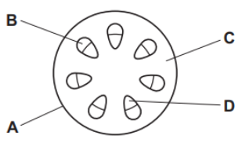
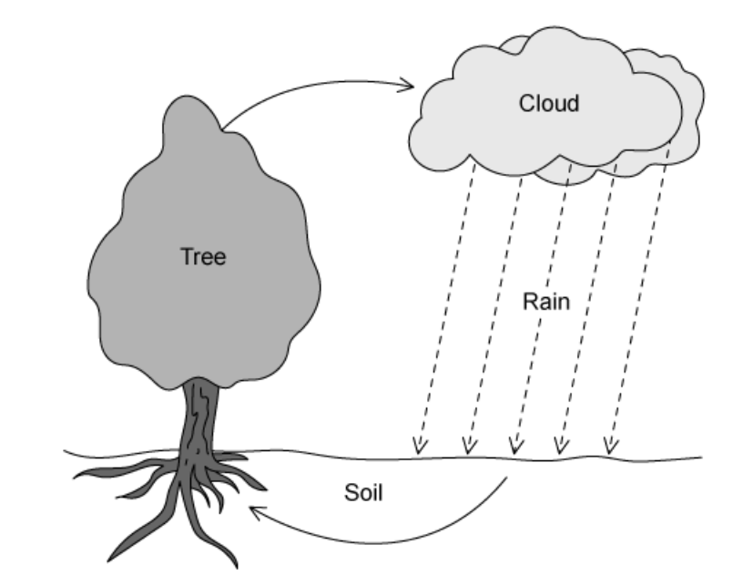

# Exam Questions — Transport in Plants
**8. Transport in Plants** · Cambridge (CIE) IGCSE biology (0610 & 0970)
> Source: [https://www.savemyexams.com/igcse/biology/cie/23/topic-questions/](https://www.savemyexams.com/igcse/biology/cie/23/topic-questions/) · 29 questions across 1 sets

## Multiple Choice Questions (29 questions)

### Q1 — medium — 1 marks

**Q1** [1 mark]

Which of the following statements about the process of transpiration is correct?

### Q2 — hard — 1 marks

**Q2** [1 mark]

A potometer is used to measure the rate of transpiration. The table below shows the results.

| **Distance travelled by bubble (mm)** | **Time (mins)** |
|---|---|
| 0 | 0 |
| 17 | 30 |
| 29 | 60 |
| 35 | 90 |
| 44 | 120 |
| 51 | 150 |

Calculate the rate of transpiration between 30 and 120 minutes.

### Q3 — medium — 1 marks

**Q3** [1 mark]

Which environmental condition would most reduce transpiration?

|   | temperature | humidity |
|---|---|---|
| A | low | high |
| B | high | low |
| C | low | low |
| D | high | high |

### Q4 — easy — 1 marks

**Q4** [1 mark]

Which sequence correctly shows the pathway of water through a plant?

### Q5 — hard — 1 marks

**Q5** [1 mark]

The diagram shows an onion plant that has been grown from a seed. Each onion plant takes two years to flower and produce more seeds.

What is the onion bulb acting as in stage 3 and in stage 6?

|   | stage 3 | stage 6 |
|---|---|---|
| **A** | sink | sink |
| **B** | sink | source |
| **C** | source | sink |
| **D** | source | source |

*Source: June 2021 0970/21 Q18*

### Q6 — hard — 1 marks

**Q6** [1 mark]

The graph shows daily carbon dioxide uptake and transpiration by the plant Agave americana.

The plant is adapted to live in very dry conditions.

What can be concluded from this graph?

*Source: June 2021 0970/21 Q14*

### Q7 — hard — 1 marks

**Q7** [1 mark]

The diagram shows a cross-section through a leaf.

From which cell will most water evaporate during transpiration?

*Source: june 2022 paper 1 Q18*

### Q8 — hard — 1 marks

**Q8** [1 mark]

A non-woody plant stem is placed in water containing a red dye. It is left for one day and then a section of the stem is examined using a microscope.

Which tissue is stained red?

*Source: june 2022 paper 1  Q17*

### Q9 — medium — 1 marks

**Q9** [1 mark]

A plant shoot is placed in a solution of dye.

The dye moves up the stem.

Under which conditions will the dye move most slowly?

|   | temperature | humidity |
|---|---|---|
| **A** | high | high |
| **B** | high | low |
| **C** | low | high |
| **D** | low | low |

*Source: June 2021 0970/11 Q18*

### Q10 — easy — 1 marks

**Q10** [1 mark]

The diagram shows part of a cross-section of a root.

What are cells 1, 2 and 3?

|   | 1 | 2 | 3 |
|---|---|---|---|
| **A** | root cortex cell | root hair cell | mesophyll cell |
| **B** | root hair cell | root cortex cell | xylem |
| **C** | root hair cell | root cortex cell | mesophyll cell |
| **D** | root cortex cell | root hair cell | xylem |

### Q11 — hard — 1 marks

**Q11** [1 mark]

Roots and leaves both act as sources and sinks for sucrose and amino acids at different times during the year.

At which point in the year are the roots most active as a source?

*Source: Specimen 2023 0970/02 Q17*

### Q12 — hard — 1 marks

**Q12** [1 mark]

The diagram shows two shoots at the start of an experiment on transpiration.

What are the likely readings on the spring balances after three days?

|   | shoot X/g | shoot Y/g |
|---|---|---|
| **A** | 25 | 30 |
| **B** | 25 | 25 |
| **C** | 30 | 25 |
| **D** | 30 | 30 |

*Source: Specimen 2023 0970/01 Q17*

### Q13 — hard — 1 marks

**Q13** [1 mark]

The photomicrograph shows a cross-section through the root of a buttercup plant.

What is the main function of the tissue labelled Z?

*Source: Specimen 2023 0970/01 Q16*

### Q14 — hard — 1 marks

**Q14** [1 mark]

#### Extended only

Which row of the table below shows substances transported through the phloem and xylem, and the direction of transport, correctly?

|   | **phloem** | **direction of transport** | **xylem** | **direction of transport** |
|---|---|---|---|---|
| **A** | sucrose | bi-directional (up and down) | water and mineral ions | bi-directional (up and down) |
| **B** | sucrose | unidirectional (up) | water and mineral ions | bi-directional (up and down) |
| **C** | sucrose and amino acids | bi-directional (up and down) | water | unidirectional (up) |
| **D** | sucrose and amino acids | unidirectional (up) | water | unidirectional (up) |

### Q15 — easy — 1 marks

**Q15** [1 mark]

The diagram below shows a potted plant and the same plant 48 hours later.

What has caused the plant’s appearance to change?

### Q16 — easy — 1 marks

**Q16** [1 mark]

#### Extended only

Which of the following is a correct explanation of the process of translocation in a plant?

### Q17 — medium — 1 marks

**Q17** [1 mark]

Which of the following processes is/are involved in the loss of water from the leaves of plants?

1. diffusion
2. osmosis
3. condensation
4. evaporation

### Q18 — easy — 1 marks

**Q18** [1 mark]

A potometer can be used to measure the rate that a piece of plant transpires under various conditions.

Part of a potometer is shown in the diagram below.

Which statement, relating to how a potometer works, is **false**?

### Q19 — hard — 1 marks

**Q19** [1 mark]

#### Extended only

The xylem has specific adaptations to allow it to transport water and mineral ions from the roots of a plant to the leaves as a result of transpiration.

Which processes produce the adaptations in xylem vessels to allow the continuous flow of water?

|   | **cell walls break down between adjacent cells ** | **cytoplasm and organelles removed from each cell** |
|---|---|---|
| **A** | **✘** | **✘** |
| **B** | **✓** | **✓** |
| **C** | **✘** | **✓** |
| **D** | **✓** | **✘** |

### Q20 — hard — 1 marks

**Q20** [1 mark]

#### Extended only

The diagram below shows two shoots at the start of an experiment set up by a group of students. Shoot A is on the left, while Shoot B is on the right.

What are the most likely readings on the spring balances after four days?

|   | **Spring balance readings / g** |   |
|---|---|---|
| **shoot A** | **shoot B** |   |
| **A** | 40 | 40 |
| **B** | 40 | 34 |
| **C** | 34 | 40 |
| **D** | 34 | 34 |

### Q21 — medium — 1 marks

**Q21** [1 mark]

Which of the following is a correct explanation of the effect of root hairs on absorption?

### Q22 — medium — 1 marks

**Q22** [1 mark]

#### Extended only

A dicot plant is placed into a bowl of water coloured with red dye.

After 1 hour, a cross section of one of the roots is cut.

After 4 hours, a cross section is cut from the stem.

Which labelled regions would be stained red in each case?

### Q23 — easy — 1 marks

**Q23** [1 mark]

The diagram shows a simplified water cycle.

Which of the processes listed below would be involved in the loss of water from the tree?

### Q24 — hard — 1 marks

**Q24** [1 mark]

#### Extended only

Which of the following graphs correctly shows the relationship between the rate of transpiration and atmospheric humidity?

### Q25 — easy — 1 marks

**Q25** [1 mark]

Which order below is correct in describing the pathway of water as it travels from the roots through a plant?

### Q26 — medium — 1 marks

**Q26** [1 mark]

A **decrease **in which of the following factors would normally cause the transpiration rate to **increase**?

### Q27 — hard — 1 marks

**Q27** [1 mark]

The table below shows some characteristics of four different plants.

The plants are growing in the same environmental conditions.

Which plant will have the **lowest **rate of transpiration?

|   | **number of leaves on plant** | **average surface area of one leaf / cm****2** | **average density of stomata on leaves / stomata per mm****2** | **average diameter of one stoma / µm** |
|---|---|---|---|---|
| **A** | 36 | 53 | 276 | 19 |
| **B** | 21 | 51 | 247 | 18 |
| **C** | 24 | 45 | 249 | 15 |
| **D** | 17 | 40 | 151 | 16 |

### Q28 — medium — 1 marks

**Q28** [1 mark]

#### Extended only

A student collected some of the solution from the phloem in the stem of a plant.

Which of the following would be present in the liquid?

### Q29 — medium — 1 marks

**Q29** [1 mark]

#### Extended only

Which environmental factor is most likely to be responsible for a plant to wilt?
