# Mark Schemes — Circulatory Systems, Heart & Blood Vessels
**9. Transport in Animals** · Cambridge (CIE) IGCSE biology (0610 & 0970)

## Alternative To Practical Questions (3 questions)

### Q1
(i)

- Both axes are** **labelled **AND** show units; **[1 mark] **

  - X axis = time (after exercise) in minutes
  - Y axis = pulse rate in beats per minute/bpm ;
- Scale is evenly distributed **AND **plots occupy at least half of the grid; **[1 mark] **
- Points are plotted correctly to within half a square; **[1 mark] **
- Line is a smooth curve through at least 4 points **OR** line is a ruled line that joins the points; **[1 mark] **

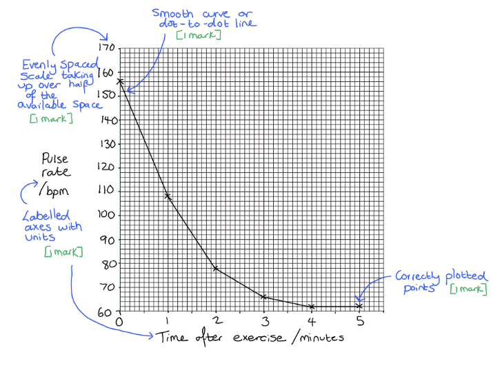

(ii)

Any two from:

- Pulse rate decreases as time increases / over time; **[1 mark] **
- The biggest decrease in pulse rate occurs in the first minute / two minutes; **[1 mark] **
- Pulse rate plateaus/levels off / returns to pre-exercise/resting rate / returns to 62 (bpm); **[1 mark] **

When describing data it is usually a good idea to consider overall trends (here this is the overall decrease in pulse rate over time), as well as details of what is happening within the trend, i.e. any periods during which the change is happening quickly/slowly, or during which the change is not taking place. It can also be a good idea to include numbers from the data.

(iii)

- 156 **AND** 62 selected from data; **[1 mark] **
- (94 ÷ 156) × 100; **[1 mark] **
- 60.26 (%); **[1 mark] **

*Award full marks for the correct answer in the absence of other calculations.*

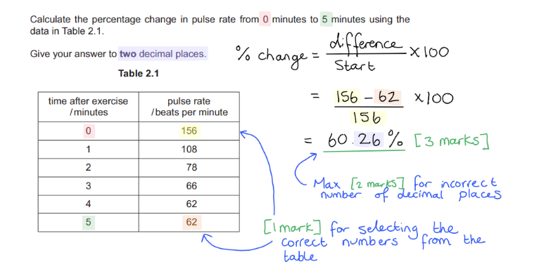

(iv)

- pulse rate; **[1 mark] **

**[Total: 10 marks]**
- 120 bpm / the pulse rate on day 2 is an anomalous result;** [1 mark]**
- Anomalous results should not be included in an average;** [1 mark]**

**[Total: 2 marks]**
*Similarity: a maximum of one from; *

- <u>Both</u> have a wall / are surrounded by layers; **[1 mark]**
- <u>Both</u> have a central space / lumen;**[1 mark]**
- <u>Both</u> contain blood; **[1 mark]**

*Differences: a maximum of two from;*

- The artery has a thick<u>er</u> wall;
- The inner surface of the artery is <u>more</u> irregular/folded / <u>less</u> smooth;
- The artery lumen is small<u>er</u>;
- The vein is bigg<u>er</u>;
- The artery is circular **WHILE** the vein is irregular (in shape);

***Accept ****converse statements, e.g. the vein has a thinner wall.*

Note that any question that involves comparing two items (i.e. giving similarities and/or differences) must contain clearly comparative statements in order to gain marks. Statements are comparative when they contain words such as ‘both’, ‘larger’, 'smaller’ and when they clearly describe how one item is different to another, e.g. ‘a is . . .  WHILE b is. . .'.

**[Total: 3 marks]**

### Q2
(i) The apparatus the students should use to accurately measure 300 cm3 of liquid is...

Any **one **from the following:

- Measuring/graduated cylinder; **[1 mark]**
- Volumetric flask; **[1 mark]**
- Burette; **[1 mark]**
- Pipette; **[1 mark]**

(ii) A method to ensure 300 cm3 of liquid is measured accurately is...

- Pour the liquid into the graduated cylinder/volumetric flask/burette/pipette to just less than 200 cm3; **[1 mark]**
- Get down to eye level to the apparatus at the 300 cm3 mark; **[1 mark]**
- Slowly pour in more liquid until the <u>meniscus</u> sits at 300 cm3; **[1 mark]**

(iii) A unit of time the students should use is...

- Seconds; **[1 mark]**
- Because this is more precise than minutes / hours; **[1 mark]**
- Because this is easy to read on a stopwatch; **[1 mark]**

(iv) A source of error that may arise from the method above and explain how to overcome this error is...

Any **pair **of answer from the following:

- Not measuring 300 cm3 of liquid; **[1 mark]**
- Get down to eye level and use the meniscus; **[1 mark]**

**OR**

- Not starting/stopping the stopwatch immediately as liquid is poured / has finished flowing; **[1 mark]**
- Use of a light gate **OR **repeat the experiment many times to spot anomalies; **[1 mark]**

**OR**

- Not pouring the liquid at a constant/continuous rate **OR** not pouring the liquid the same each repeat; [**1 mark]**
- Same person pouring the liquid each repeat;** [1 mark]**

**[Total: 9 marks]**

> *Remember sources of error from a method are not the same as mistakes that can be made such as spilling liquids. It is important you understand the difference. *
(i) The mean for 2 cm3 diameter straw is

- 2.3 ÷ 3 = 0.8; **[1 mark]**

> *Your answer should be recorded to 1 decimal place to follow the same data trend as the other two means. *

(ii) The flow rate for each straw is...

- Straw 0.5 cm diameter: 300 ÷ 2.7 = 111; **[1 mark]**
- Straw 1 cm diameter: 300 ÷ 2 = 150; **[1 mark]**
- Straw 2 cm diameter: 300 ÷ 0.8 = 375; **[1 mark]**

***Accept ****an error carried forward from part (i) for the straw with a 2 cm diameter ****Ignore ****units as they are stated in the question*

(iii) The volume of the straw with a 2 cm diameter is...

- Equation for volume of a cylinder: πr2h (accept equation in words); **[1 mark]**
- Diameter converted to radius: 2 ÷ 2 = 1 cm; **[1 mark]**
- Substitution: π x 12 x 20 = 62.8; **[1 mark]**
- 63;** [1 mark]**
- Unit cm3; **[1 mark]**

**[Total: 9 marks]**

> *It is stated in your syllabus that you should be able to recall and use the equation for calculating the volume of a cylinder, amongst other equations. So be sure to familiarise yourself with those equations that are required by the examination board. *

Part (i)

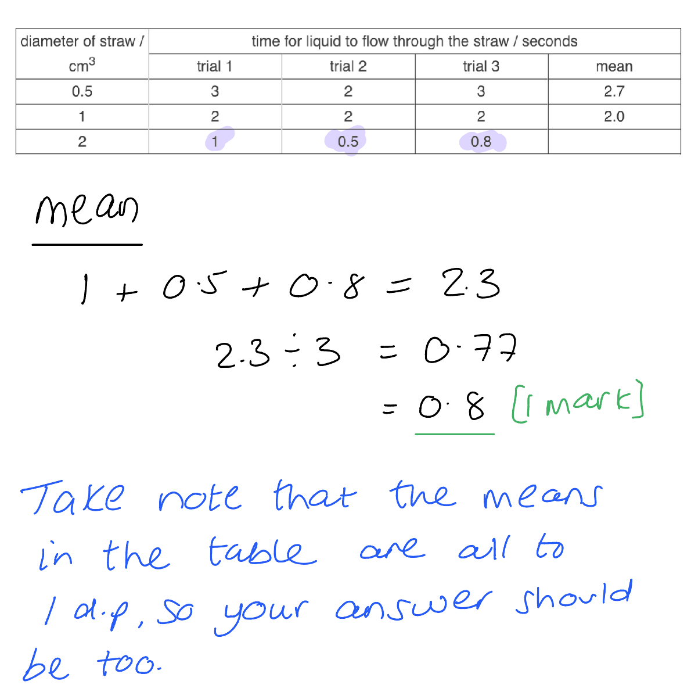

Part (ii)

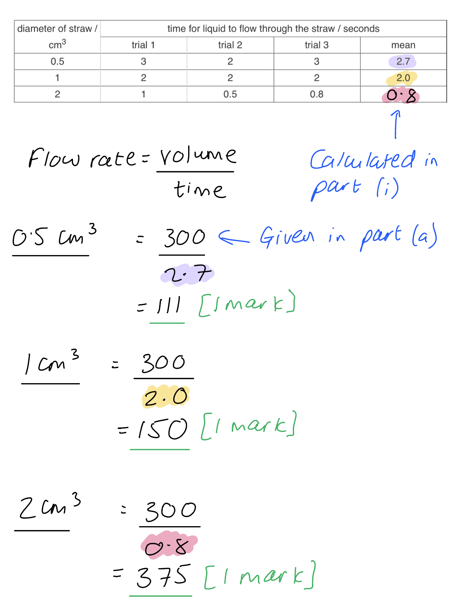

Part (iii):

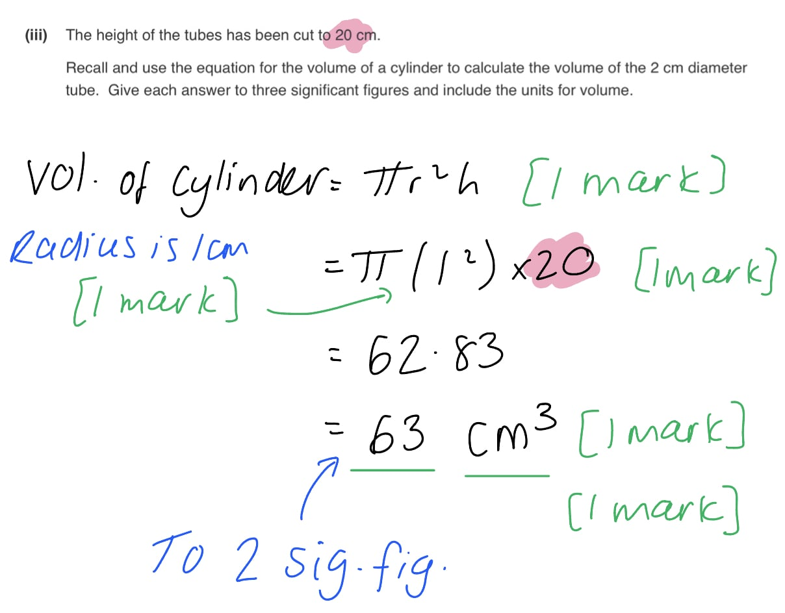

### Q3
A method to determine the effect of exercise on heart rate is...

- Measure resting heart rate by taking your pulse; **[1 mark]**
- Method to measure pulse such as count pulse for 15 seconds then multiply this by 4 to get your heart rate in 60 seconds; **[1 mark]**
- Carry out chosen exercises/named exercises for a specified time **OR **carry out chosen exercise/named exercise for a specified number of times / time period; **[1 mark]**
- Take pulse as soon as the exercise period is finished; **[1 mark]**
- Repeat the experiment at least twice more and calculate the average heart rate **OR **calculate the percentage increase in heart rate; **[1 mark]**

***Ignore ****exercise suggestions that are not possible to carry out in a school environment for marking point 3*

**[Total: 5 marks]**
(i) The stopwatch with the error and the type of error is...

- Stopwatch A; **[1 mark]**
- Zero error / the reading on the stopwatch is not zero; **[1 mark]**

(ii) To correct the error the student should...

- Subtract the zero error / start reading on the stopwatch from the measured time (at the end) to get the actual time; **[1 mark]**

(iii) The variable type the stopwatch could be is...

- Continuous variable **because **time has an infinite number of possible values that can be measured;** [1 mark]**

**OR**

- Control variable **because **the time the student exercises for needs to be the same for each repeat;** [1 mark]**

**OR**

- Independent variable **because **the time the student exercises for can be changed;** [1 mark]**

**[Total: 4 marks]**
(i) An ethical consideration that should be considered before students take part in the investigation is...

Any **one **from the following:

- Attaining student consent (to record their heart rate); **[1 mark]**
- Being sensitive to any student who finds the results upsetting; **[1 mark]**
- Offering the students a chance to opt out before beginning, or at any stage of the procedure; **[1 mark]**
- Avoid the use of the word ‘normal’ or ‘expected’ when discussing heart rate; **[1 mark]**

(ii) Two health and safety precautions that should be carried out are...

Any **two **from the following:

- Appropriate footwear and clothing worn by students / wear trainers and sports kit; **[1 mark]**
- Students with identified physical/ health conditions should not be involved; **[1 mark]**
- Carry out the activity in a large open space; **[1 mark]**
- Warm up and cool down before and after exercise; **[1 mark]**

**[Total: 3 marks]**
(i) A results table should include...

- Separate columns for the exercise type and the heart rate **AND** there is enough space for five different exercises to be recorded; **[1 mark]**
- Appropriate headings **and **units used for heart rate; **[1 mark]**
- Units in the heading only and not in the body of the table; **[1 mark]**
- Five different heart rates recorded; **[1 mark]**

(ii) The independent and dependent variables are...

- Independent variable: exercise type; **[1 mark]**
- Dependent variable: heart rate (in bpm); **[1 mark]**

(ii) The control variable is...

- The time to do the exercise (in seconds); **[1 mark]**

(iv) The student could make the results more reliable by...

- Repeating the experiment at least two more times; **[1 mark]**
- Therefore you can spot/identify anomalous data/anomalies/outliers; **[1 mark]**

(v) The percentage change for running is...

- Initial heart rate - end heart rate: 180 - 75 = 105; **[1 mark]**
- Divide by the initial heart rate: 105 ÷ 75 =  1.4; **[1 mark]**
- Convert to percentage: 1.4 x 100 = 140%; **[1 mark]**

**[Total: 11 marks]**

> *A results table for (d) (i) could look like...*

| **exercise type** | **heart rate / bpm** |
|---|---|
| running | 180 |
| walking | 80 |
| star jumps | 160 |
| skipping rope | 175 |
| press ups | 95 |

> *To calculate the percentage change:*

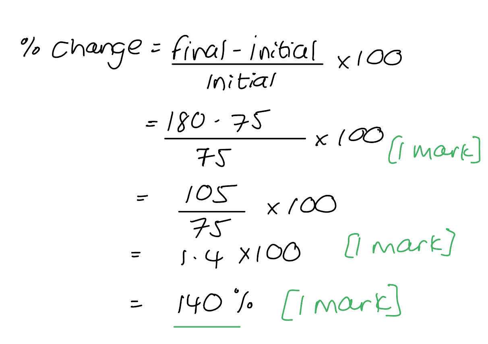

## Multiple Choice Questions (29 questions)

### Q1
**Final answer:** **The correct answer is C.**

- **Statement 1** is correct: white blood cells defend the body against pathogens by producing antibodies and carrying out phagocytosis to engulf pathogens
- **Statement 2 **is correct: red blood cells contain haemoglobin, which binds to oxygen and transports it around the body
- **Statement 4** is correct: plasma is the liquid component of blood that transports substances including carbon dioxide and urea

**Statement 3** is incorrect as it is plasma, not platelets, that transports hormones and nutrients around the body. Platelets are involved in clotting to prevent blood loss and the entry of pathogens.

### Q2
**Final answer:** **The correct answer is A.**

- Capillaries have thin walls (one cell thick) and a narrow lumen

**B** is incorrect as capillaries do not have valves; valves are found in veins

**C** is incorrect as capillaries have thin walls, not thick walls; this description applies to arteries

**D** is incorrect as capillaries have a narrow lumen, not a large lumen; this description applies to veins

### Q3
**Final answer:** **The correct answer is C.**

- The pulse rate dropped by 40 bpm in the first minute (175 to 135 bpm), which is greater than the decrease in any subsequent minute

**A** is incorrect as the pulse rate decreases by different amounts each minute: 40, 25, 21, 21, 2, 0 bpm.

**B** is incorrect as the decrease over the first two minutes is ((175−110) ÷ 175) × 100 = 37.1%, which is less than 40%.

**D** is incorrect as half of 175 bpm = 87.5 bpm, and the pulse rate at 3 minutes was 89 bpm, which is above this value.

### Q4
**Final answer:** **The correct answer is D.**

- The right side of heart receives blood from the body, so it contains deoxygenated blood
- Blood from the right ventricle travels to the lungs
- The blood travels out of the right ventricle via the pulmonary artery

### Q5
**Final answer:** **The correct answer is ****B.**

**Statement 1 is correct **because **red blood cells transport oxygen**. They contain **haemoglobin**, a protein that** binds oxygen** in the lungs and carries it to body tissues.

**Statement 2 is correct **because **plasma transports hormones and other dissolved substances** around the body. These include nutrients such as glucose, waste products such as urea, carbon dioxide and ions.

**Statement 3 is incorrect **because **destroying pathogens is mainly the role of white blood cells**. **Platelets **are involved in **blood clotting**, helping to form a clot to prevent blood loss when a blood vessel is damaged.

### Q6
**Final answer:** **The correct answer is ****C.**

- The **hepatic vein** carries blood **away from the liver** and returns it to the **vena cava**, which transports the blood back to the heart
- In the diagram, **X leads out of the organ**, which matches the position of the hepatic vein

**A** is incorrect because the hepatic artery carries oxygenated blood from the aorta into the liver, so the blood flow direction would be towards the liver.

**B** is incorrect because the hepatic portal vein also enters the liver at the bottom. It brings nutrient-rich blood from the intestines to the liver and is typically shown entering the liver alongside the hepatic artery.

**C** is incorrect because the bile duct is not a blood vessel. It carries bile away from the liver to the gall bladder or small intestine and is also located at the bottom of the liver near the vessels that enter the organ.

### Q7
**Final answer:** **The correct answer is ****B.**

- Blood leaves the heart in **arteries**, and it is pumped out from the **ventricles**
- The **left ventricle** pumps oxygenated blood into the **aorta**, and the **right ventricle** pumps deoxygenated blood into the **pulmonary artery**

**A **is incorrect because blood does not leave the heart from the atria.

**C **is incorrect because veins carry blood towards the heart, not away from it.

**D** is incorrect because although blood leaves from the ventricles, it does not leave through veins.

### Q8
**Final answer:** **The correct answer is ****A****.**

- This is because this vessel is just before the gills, where the blood will refill with oxygen during gas exchange
- When the blood is in vessel X it has passed through the body of the fish since it was last in the gills and full of oxygen

**B**, **C **and** D** are incorrect because vessel Y is after the gills and so the blood will have filled with oxygen in the gills during gas exchange.

### Q9
**Final answer:** **The correct answer is ****B****.**

- This is because the role of platelets in the blood is to aid with blood clotting and so if someone had fewer platelets it would result in them having slower blood clotting than usual

**A** is incorrect because platelets are not related to the function of antibodies in the blood, this is the role of white blood cells.

**C** is incorrect because platelets are not related to the function of oxygen transport in the blood, this is the role of red blood cells.

**D** is incorrect because platelets are not related to the process of phagocytosis, this is the role of white blood cells.

### Q10
**Final answer:** **The correct answer is ****B****.**

- This is because the labels are pointing to the left side of the heart and so P is the left atrium, Q is the valve between the heart chambers, and R is the left ventricle

**A** and **D** are incorrect because the labels are pointing to the left side of the heart and the atria are at the top of the heart and the ventricles at the bottom, with the valve in the middle separating the two chambers.

**C** is incorrect because the atria are at the top of the heart and the ventricles at the bottom, with the valve in the middle separating the two chambers.

### Q11
**Final answer:** **The correct answer is ****D****.**

- White blood cells are part of the body's defence systems that protect against pathogens. As such, some produce antibodies to fight disease
- Extended students should also know that these white blood cells are called lymphocytes and they produce specific antibodies which destroy pathogens as part of the specific immune response

**A** is incorrect because glucose is carried in the plasma, not white blood cells.

**B** is incorrect as oxygen is primarily carried by red blood cells which contain haemoglobin, a molecule that binds to oxygen for it to be transported.

**C** is incorrect because antibiotics are substances used to kill or inhibit bacterial growth.

### Q12
**Final answer:** **The correct answer is A.**

- The image shows a thick-walled vessel with a small lumen and elastic tissue, as arteries carry oxygenated blood away from the heart under high pressure.

**B** is incorrect because capillaries are very thin-walled vessels with a narrow lumen adapted for the exchange of gases, nutrients, and waste between blood and tissues.

**C **is incorrect because veins are vessels with thinner walls and a larger lumen than arteries, often with valves, as veins carry deoxygenated blood back to the heart under lower pressure.

**D** is incorrect because a ventricle refers to a chamber of the heart, not a blood vessel, and would have a muscular structure rather than a vessel-like appearance.

### Q13
**Final answer:** **The correct answer is ****C****.**

- The renal artery carries blood to the kidney and the renal vein carries blood away from the kidney

**A** and **B** are incorrect because the pulmonary artery takes blood from the heart to the lungs and the pulmonary vein takes blood from the heart to the lungs.

**D** is incorrect because the renal vein carries blood to the kidney and the renal artery carries blood from the kidney.

### Q14
**Final answer:** **The correct answer is B**

- This is because when the ventricles contract the AV valves close to prevent blood flowing backwards into the atria
- When the ventricles contract the SL valves open to allow the blood to flow out of the heart via the aorta and pulmonary arteries

**A** is incorrect because SL valves must be open to allow the blood to leave the heart

**C **is incorrect because the AV valves must be closed otherwise blood would flow backwards and SL valves must be open to allow the blood to leave the heart

**D **is incorrect because the AV valves must be closed otherwise blood would flow backwards

### Q15
**Final answer:** **The correct answer is C because:**

Haemoglobin is found in red blood cells

**A** is incorrect because plasma is the liquid which carries the blood cells and other dissolved substances.

**B** is incorrect because platelets aid with blood clotting and do not contain haemoglobin.

**D** is incorrect because white blood cells help with the immune system and fight infections by pathogens.

### Q16
**Final answer:** **The correct answer is D because:**

Vessel D is the pulmonary vein

**A** is incorrect because vessel A is the vena cava.

**B** is incorrect because vessel B is the pulmonary artery.

**C** is incorrect because vessel C is the aorta.

### Q17
**Final answer:** **The correct answer is ****D ****because:**

- **Ventricles** have much **thicker** muscle walls than atria because the **atria** are just passing the blood onto the ventricles whereas the ventricles have to generate enough force to push blood out of the heart
- The **left ventricle** has a thicker muscle wall than the right ventricle as the right ventricle pumps blood to the lungs, which are right next to the heart, whereas the left ventricle is pumping blood to the entire body and so has to generate a higher pressure to pump it a greater distance

### Q18
**Final answer:** **The correct answer is ****C.**** (To increase the pressure of blood returning from the lungs to supply cells of the body most efficiently with the reactants for respiration) because:**

- Humans have a double circulation which means the blood passes through the heart twice for every one circuit of the body
- Blood is pumped to the lungs and then returned to the heart to be pumped around the body

**A** is incorrect because the whole purpose of the double circulatory system is to increase the pressure of blood being pumped around the body.

**B** is incorrect because the pressure generated by contraction of the right ventricle to send blood to the lungs via the pulmonary artery is not as high as the pressure generated by the left ventricle, so as to not damage the delicate capillaries in the lungs.

**D** is incorrect because the purpose is not to reduce the pressure of the blood sent to the lungs, and cells need to be delivered to the reactants.

### Q19
**Final answer:** **The correct answer is ****B ****because:**

- **Semilunar** valves are found in the two arteries connected to the heart (the only arteries in the body to contain valves); they prevent the backflow of blood into the heart when it relaxes after contracting
- The **atrioventricular** (AV) valves are located between the atria and the ventricles; they prevent the backflow of blood from the ventricles to the atria when the ventricles contract. The AV valve shown by **Y** in the question image is called the **bicuspid** or **mitral** valve
- The **septum** separates the two sides of the heart; preventing the mixing of oxygenated and deoxygenated blood

### Q20
**Final answer:** **The correct answer is ****C.**** (antibody production) because:**

Lymphocytes are a type of white blood cell involved in the immune system. They respond to foreign antigens by making antibodies.

**A** is incorrect because the transport of hormones is the function of the blood plasma.

**B** is incorrect because phagocytosis is the function of phagocytes.

**D** is incorrect because blood clotting is the function of platelets.

### Q21
**Final answer:** **The correct answer is ****A ****because:**

- Cell 1 is a **red blood cell** (not named in the table)
- Cell 2 is a **phagocyte**. Phagocytes have a lobed nucleus, their job is to engulf and destroy foreign material (including pathogens)
- 3 are the **platelets**, fragments of cells that help form clots when blood vessels are damaged
- Cell 4 is a **lymphocyte**. Lymphocytes have a very large nucleus (this is because they produce antibodies which requires a number of genes to be involved in large-scale protein synthesis)

### Q22
**Final answer:** **The correct answer is ****C.**** (They have a pulse) because:**

Veins do not have a pulse. A person’s pulse is a measurement of heart rate based upon compression of an artery to feel expansion and contraction of arterial vessels as blood is forced through.

**A** is incorrect because veins return blood to the heart which has passed through the capillary network, and against the force of gravity, so blood pressure in the veins is low.

**B** is incorrect because almost all veins have valves to prevent the backflow of blood.

**D** is incorrect because veins are the blood vessels that connect the capillary network in the tissues of the body with the heart.

### Q23
**Final answer:** **The correct answer is ****D ****because:**

- The vessel can be identified as a vein as it has **valves**, a **large** **lumen** and **thin**  walls
- The direction of blood flow can be determined by looking at the valves –  these are pocket valves which the blood can push through from **T to S** but if the blood flows backwards it will get trapped in the pockets of the valve, which is then forced shut

### Q24
**Final answer:** **The correct answer is ****B.**** (X → Z → W → Y) because:**

- Stage **X** – blood enters the atria
- Stage **Z** – the walls of the atria contract and blood moves into the ventricles
- Stage **W** – the walls of the ventricles contract and blood is pushed up through the valves into the arteries
- Stage **Y** – the arteries carry blood away from the heart and more blood is carried towards the heart in the veins

### Q25
**Final answer:** **The correct answer is ****B.**** (soluble fibrinogen → insoluble fibrin → blood clot) because:**

- When a blood vessel is broken/**damaged**, a series of reactions occur within the blood **plasma**
- This results in an enzyme becoming activated which converts **soluble** **fibrinogen** (present in the blood plasma) into **insoluble** **fibrin**
- Strands of insoluble fibrin trap red blood in a **mesh**-like structure which forms a **clot** over the damaged area

### Q26
**Final answer:** **The correct answer is ****A.**** (Glucose, urea and hormones) because:**

- Plasma is mainly water with many substances dissolved in it
- Soluble nutrients such as glucose, amino acids and mineral ions, hormones, carbon dioxide, urea are all carried in plasma

**B** is incorrect because oxygen is transported by haemoglobin in red blood cells. Starch is a large, insoluble molecule that cannot be transported in the plasma (it does not dissolve in the water of blood plasma).

**C** is incorrect because haemoglobin is the pigment found in red blood cells that binds reversibly to oxygen. Carbon dioxide is transported around the body dissolved in blood plasma.

**D** is incorrect because oxygen is mainly carried by haemoglobin in the red blood cells. Carbon dioxide is transported around the body and dissolved in blood plasma.

### Q27
**Final answer:** **The correct answer is ****A.**** (pass through capillaries) because:**

- The blood in **P** (the left ventricle) is **deoxygenated** and from here will be pumped out of the right side of the heart to the **lungs**
- As it passes through the lungs it must move through the complex **capillary** networks surrounding the alveoli; as this happens **gas** **exchange** via diffusion takes place and the blood becomes **oxygenated**
- It is then returned to the **left** side of the **heart** and collects in **Q** (the left ventricle) before being pumped around the body when the **ventricles** contract

**B** is incorrect because blood travelling from the heart to the lungs and back to the heart will not go via the digestive system to absorb glucose.

**C** is incorrect because blood travelling from the heart to the lungs and back to the heart will not pass through the skin.

**D** is incorrect because blood travelling from the heart to the lungs and back to the heart will not go via the head. The blood supply to the head needs to be oxygenated!

### Q28
**Final answer:** **The correct answer is ****B. ****(pulmonary vein) because:**

- The blood pressure in **veins** is always **lower** than the blood pressure in **arteries** (as blood is being transported back to the heart in the veins, and is no longer under the direct influence of the heart beat)
- The **pulmonary** **vein** is the only vein in the body that transports **oxygenated** blood, as it’s transporting blood that has picked up oxygen and lost carbon dioxide from the **lungs** back to the **heart**. This is a feature of the double circulatory system in mammals to ensure the respiring tissues of the body receive an efficient supply of oxygen

**A** is incorrect because the pulmonary artery transports deoxygenated blood from the heart to the lungs for gas exchange.

**C** is incorrect because the aorta transports oxygenated blood from the heart towards arteries that supply the tissues at high pressure.

**D** is incorrect because the vena cava is the vein that returns deoxygenated blood from the body’s tissues to the heart.

### Q29
**Final answer:** **The correct answer is ****C.**** (vena cava, pulmonary artery, renal vein) because:**

- The vena cava is the vein that returns deoxygenated blood from the body to the right atrium of the heart
- The pulmonary artery carries deoxygenated blood from the right ventricle to the lungs. It is the only artery of the body that carries deoxygenated blood
- The renal vein carries deoxygenated blood from the kidneys back towards the heart (the renal vein joins the vein cava)

**A** is incorrect because the aorta carries oxygenated blood from the left ventricle to the body, the pulmonary vein carries oxygenated blood from the lungs back to the heart and the renal artery carries oxygenated blood to the kidneys.

**B** is incorrect because the pulmonary vein carries oxygenated blood from the lungs back to the left side of the heart (the only vein in the body which carries oxygenated blood).

**D** is incorrect because the aorta and renal artery carry oxygenated blood.

## Theory Questions (22 questions)

### Q1
> **[mark-scheme]**
> - The left ventricle pumps blood to the whole body while the right ventricle only pumps blood to the lungs **OR** the left ventricle pumps blood further than the right ventricle **[1 mark]**
> - The left ventricle needs to generate higher pressure / must contract with more force **[1 mark]**

> **[exam-tip]**
> Make sure you connect the destination of the blood (whole body vs. lungs) to the requirement for a thicker wall. Avoid vague statements such as "it needs more muscle" without explaining why.
> **[mark-scheme]**
> Any **four** from:
> 
> - Oxygenated and deoxygenated blood are kept separate
> - Higher blood pressure to body tissues is maintained
> - More efficient supply of oxygen/nutrients to body tissues
> - A higher metabolic rate / rate of respiration can be maintained
> - Lower pressure in the lungs prevents damage to capillaries
> 
> **[4 marks]**

> **[exam-tip]**
> Make sure you explain every advantage. Do not stop at "maintains a lower pressure to the lungs" — explain the effect of this, i.e. that it "prevents damage to the delicate capillaries in the lungs".

### Q2
> **[mark-scheme]**
> (i) The name of the component in the blood that carries oxygen to the muscles is:
> 
> - Red blood cells **OR** haemoglobin **[1 mark]**
> 
> (ii) The gas that is released by cells as a waste product is:
> 
> - Carbon dioxide **[1 mark]**

### Q3
> **[mark-scheme]**
> The independent variable is:
> 
> - Whether or not the student has taken part in exercise / running; **[1 mark]**
> 
> The dependent variable is:
> 
> - Heart rate; **[1 mark]**
> 
> **[Total: 2 marks]**
> **[mark-scheme]**
> The changes in heart rate can be described as follows:
> 
> Any **three** of the following:
> 
> - Heart rate increases immediately after exercise; **[1 mark]**
> - After exercise heart rate approximately doubles / increases by a factor of 2; **[1 mark]**
> - Heart rate decreases after 10 minutes of rest; **[1 mark]**
> - Heart rate does not return fully to resting levels after 10 minutes; **[1 mark]**
> 
> **[Total: 3 marks]**
> **[mark-scheme]**
> Heart rate increases during physical activity because:
> 
> Any **three** of the following:
> 
> - Muscle contraction requires energy; **[1 mark]**
> - Increased rate of aerobic respiration; **[1 mark]**
> - An increased supply of oxygen / glucose is needed (for respiration); **[1 mark]**
> - More waste carbon dioxide is produced (by respiration); **[1 mark]**
> 
> **[Total: 3 marks]**
> **[mark-scheme]**
> The validity could be improved as follows:
> 
> Any **two** of the following:
> 
> - Increase the number of students taking part in the study; **[1 mark]**
> - Ensure that the participants had similar fitness levels; **[1 mark]**
> - Standardise the intensity of exercise / asking all students to run at the same speed; **[1 mark]**
> - Repeat the investigation at least three times for each student; **[1 mark]**
> - Ensure that the environmental conditions (e.g. temperature) are the same for all students / repeats; **[1 mark]**
> - Ensure that all students consumed the same food beforehand / the same time period has passed since their last meal; **[1 mark]**
> - Ensure that all students are equally well rested prior the the experiment; **[1 mark]**
> 
> **[Total: 2 marks]**

> **[exam-tip]**
> When a question asks about *validity*, it's asking whether the experiment really measures what it’s supposed to measure.
> 
> In this case, the aim is to measure how **exercise affects heart rate**. So, to make the results valid, you need to **control other variables** that might affect heart rate—like food intake, temperature, or how much rest the student had before running.
> 
> If those factors aren’t kept the same, then any changes in heart rate might not be due to exercise alone—and that makes the results *less valid*.

### Q4
Any two from:

- ECG; **[1 mark]**
- Listening to the closing of the valves;  **[1 mark]**

*Accept any other valid suggestion e.g. blood pressure monitoring / wearing fitness trackers; * **[1 mark]**

**[Total: 2 marks]**

### Q5
(i)

Correct labelling of:

- Atrium;  **[1 mark]**
- Septum;  **[1 mark]**
- Ventricle; **[1 mark]**
- Valve;  **[1 mark]**

*Note that only one of each structure needs to be labelled to obtain * **[1 mark]**

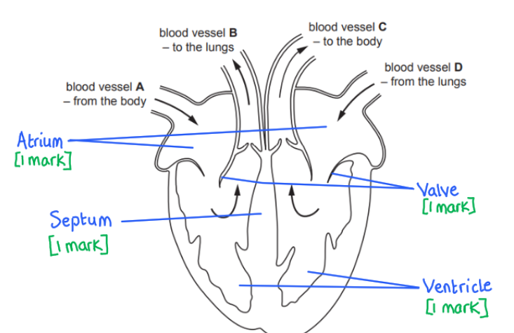

(ii)

- **B** and **C** are arteries;  **[1 mark]**
- **D** is the pulmonary vein; **[1 mark]**

**[Total: 6 marks]**
(i)

- The coronary arteries; **[1 mark]**

(ii)

Any three from:

- Diet **OR** high fat/cholesterol diet; **[1 mark]**
- Obesity; **[1 mark]**
- Stress; **[1 mark]**
- Smoking;**[1 mark]**
- Genetic predisposition / family history;**[1 mark]**
- Age; **[1 mark]**
- Sex; **[1 mark]**

*Accept any other valid suggestion e.g. physical inactivity ****OR**** excessive alcohol consumption ****OR**** diabetes; ***[1 mark]**

**[Total: 4 marks]**

### Q6
(i)

- Left ventricle; **[1 mark]**

(ii)

- Vena cava; **[1 mark]**

A maximum of two from:

- Valves are present; **[1 mark] **
- It has a wide lumen / the lumen has a large diameter; **[1 mark]**
- It has a thin wall;** [1 mark]**
- The wall is lined by a single layer of cells; **[1 mark]**
- The wall contains muscle; **[1 mark]**
- The wall contains elastic (fibres); **[1 mark]**

(iii)

- X = semilunar valve; **[1 mark]**
- It prevents backflow of blood / ensures that blood flows in one direction; **[1 mark]**
(i)

- Shading in any part of the pulmonary vein;** [1 mark]**

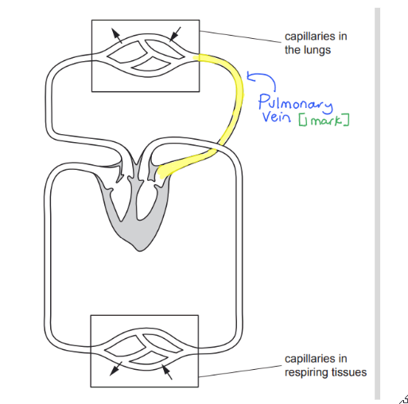

(ii)

Any two from:

- The heart has two sides / a left and a right side; **[1 mark]**
- The blood must flow through the heart twice in one circuit of the body; **[1 mark]**
- There is a pulmonary and a systemic circuit / a circuit from the heart to the lungs and from the heart to the rest of the body; **[1 mark]**

(iii)

Any four from:

- Oxygenated and deoxygenated blood are kept separate / do not mix / are separated by the septum; **[1 mark]**
- Efficient supply of oxygen (to the body;** [1 mark]**
- Efficient supply of (named) nutrients (to the body;** [1 mark]**
- Low(er) pressure in pulmonary artery / circuit; **[1 mark]**
- Prevents damage to (capillaries in the) lungs;** [1 mark]**
- Allows more time for gas exchange;** [1 ma**rk]
- Allows high(er) pressure (in body); **[1 mark] **
- Ensures efficient blood supply to body; **[1 mark]**
- Allows a high metabolic rate / rate of respiration; **[1 mark]**

### Q7
**Red blood cell: **

- *Appearance: *biconcave (disc / shape) / no nucleus / red blood cells smaller than white blood cell(s);** [1 mark]**
- *Function: *transports oxygen / carbon dioxide; **[1 mark]**

**Lymphocyte:**

- *Appearance:* little cytoplasm / large(r) nucleus / nucleus fills most of the cell; **[1 mark]**
- *Function: *active immunity / responds to antigen(s) or vaccine(s)  / produces antibodies / memory cells;** [1 mark]**

**Phagocyte: **

- *Appearance: *lobed / irregular-shaped / C-shaped nucleus; **[1 mark]**
- *Function: *engulf pathogens / phagocytosis; **[1 mark]**

**[Total: 6 marks]**

> *You cannot get more than one mark for naming more than one appearance or function of each of the types of blood cells. For example if you said that red blood cells have no nucleus and a biconcave shape you can only get a maximum of one mark for that.*
(i) Fibrinogen → Fibrin; **[1 mark]**

(ii) Prevent blood loss; **[1 mark]**

- Prevent entry of pathogens / microbes / a named example of a pathogen; **[1 mark]**

**[Total: 3 marks]**

### Q8
- ECG / listening to valves (closing); **[1 mark]**

*A mark can be awarded here for any other correct method (not measuring pulse rate)*

Listening to valves closing is what doctors do if they listen using a stethoscope.

**[Total: 1 mark]**

### Q9
(i)

- Running; **[1 mark]**

(ii)

- 125 (bpm); **[1 mark]**

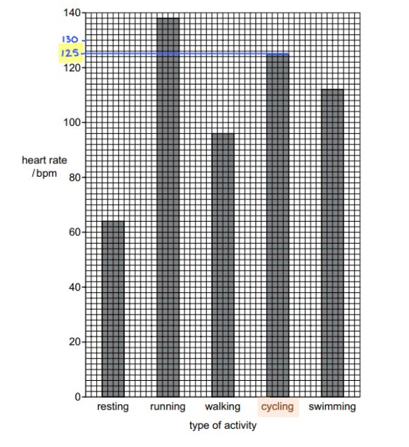

(iii)

- Identifying 64 bpm as the resting heart rate and 96 bpm as the walking heart rate; **[1 mark]**
- ((96 - 64) ÷ 64 =) 50(%);** [2 marks]**

*Full marks awarded for the correct answer with no working shown*

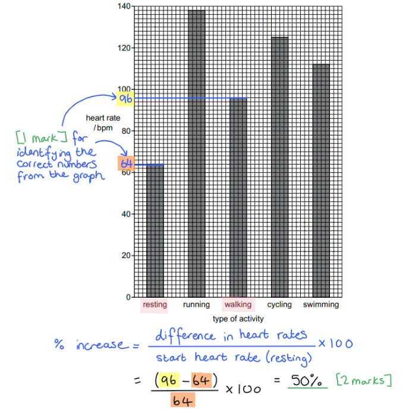

**[Total: 4 marks]**

### Q10
> **[mark-scheme]**
> The structure of the fish circulatory system can be compared to that of mammals as follows:
> 
> Any **three** of the following:
> 
> - Both fish and mammals have their blood contained in vessels / have a closed circulatory system; **[1 mark]**
> - Fish have a single circulatory system **WHILE** mammals have a double circulatory system **OR **blood passes through the heart once per circuit in fish **WHILE** it passes through twice per circuit in mammals; **[1 mark]**
> - Fish have a two-chambered heart **WHILE **mammals have a four-chambered heart **OR** fish have 1 atrium/ventricle **WHILE** mammals have 2 atria/ventricles; **[1 mark]**
> - Fish blood receives oxygen from gills **WHILE** mammal blood receives oxygen in lungs; **[1 mark]**
> 
> **[Total: 3 marks]**
> **[mark-scheme]**
> The structure of fish gills supports efficient gas exchange as follows:
> 
> Any **three** of the following:
> 
> - They have a large surface area **SO** increasing diffusion rate; **[1 mark]**
> - They have thin surfaces **SO** reducing diffusion distance; **[1 mark]**
> - They have a good blood supply **SO** maintaining a steep concentration gradient; **[1 mark]**
> - Water is constantly flowing over the gills **SO** maintaining a steep concentration gradient; **[1 mark]**
> 
> **[Total: 3 marks]**

> **[exam-tip]**
> While you are not expected to know about fish gills in any detail, your knowledge of gas exchange in the lungs should allow you to answer this question.
> **[mark-scheme]**
> The benefit of an increased heart rate in fish in response to stress can be explained as follows:
> 
> Any **three** of the following:
> 
> - Stressed fish swim around more (e.g. to escape predators); **[1 mark]**
> - More energy is needed for muscle contraction/movement; **[1 mark]**
> - Muscles require more oxygen for increased respiration **OR **higher carbon dioxide levels in blood due to increased respiration; **[1 mark]**
> - Heart rate increases to increase rate of blood circulation; **[1 mark]**
> 
> **[Total: 3 marks]**

### Q11
> **[mark-scheme]**
> (i) The letter(s) of the structure(s) that contain deoxygenated blood are:
> 
> **All** of the following:
> 
> - A, E, G, B; **[1 mark] **
> 
> (ii) The letter(s) of the structure(s) that receive blood from the lungs are:
> 
> - F (and D); **[1 mark] **
> 
> (iii) The letter(s) of the structure(s) that are veins are:
> 
> **All** of the following:
> 
> - A, D; **[1 mark]**
> 
> **[Total: 3 marks]**
> **[mark-scheme]**
> The name of the valve located between chambers F and H in Fig. 1 is:
> 
> - Atrioventricular valve; **[1 mark]**
> 
> *Accept bicuspid valve.*
> 
> **[Total: 1 mark]**
> **[mark-scheme]**
> (i) The location of the septum in the mammalian heart can be described as follows:
> 
> - The septum is located between the left and right sides of the heart / between G and H (in Fig. 1); **[1 mark]**
> 
> (ii) The importance of the septum can be explained as follows:
> 
> - It separates oxygenated and deoxygenated blood / prevents oxygenated and deoxygenated blood from mixing; **[1 mark]**
> 
> **[Total: 2 marks]**
> **[mark-scheme]**
> The heart muscle and valves function to pump blood through the heart as follows:
> 
> - Atria <u>contract</u> to push blood into the ventricles; **[1 mark]**
> - The valves prevent blood flowing from the ventricles back into the atria; **[1 mark]**
> 
> **[Total: 2 marks]**

### Q12
> **[mark-scheme]**
> A comparison of the structural features of arteries and veins should include:
> 
> Any **two** from the following:
> 
> - Arteries have thick<u>er</u> walls / veins have thinn<u>er</u> walls; **[1 mark]**
> - Veins have valves** WHILE** arteries do not; **[1 mark]**
> - Arteries have a narrow<u>er</u> lumen / veins have a wid<u>er</u> lumen; **[1 mark]**
> 
> *Accept the statement that *<u>*both*</u>* have muscle / elastic (fibres) in their walls.*
> 
> **[Total: 2 marks]**

> **[exam-tip]**
> Remember that 'compare' questions require you to identify similarities and/or differences; when describing differences, each statement must include a direct comparison, e.g. 'X has ... while Y has ...'.
> 
> Note that this question asks about structural features specifically, so statements about the role of arteries and veins will not be credited.
> **[mark-scheme]**
> The structure labelled Q is a:
> 
> - Capillary; **[1 mark]**
> 
> **[Total: 1 mark]**
> **[mark-scheme]**
> The function of the structure labelled Q is to:
> 
> - Allow exchange of substances between blood and tissues / carry blood to the cells / supply the cells with oxygen/glucose / remove waste products from the cells; **[1 mark]**
> 
> **[Total: 1 mark]**
> **[mark-scheme]**
> The structure of capillaries enables efficient exchange because:
> 
> Any **one** of the following:
> 
> - They have thin walls / walls that are one cell thick **SO** reducing diffusion distance; **[1 mark]**
> - There are gaps between the cells that line capillaries **SO **allowing substances to leak out / leave; **[1 mark]**
> - They are narrow **SO **flow of blood is slowed and there is enough time for gas exchange to occur; **[1 mark]**
> 
> **[Total: 1 mark]**

> **[exam-tip]**
> Note that core students are not expected to *know* about how the structure of capillaries is related to their function, but this is a 'suggest' question, indicating that application of knowledge is required. Core students should be aware of the principles of an efficient exchange surface from the gas exchange topic, so this question expects students to apply this knowledge to the context of capillaries.

### Q13
> **[mark-scheme]**
> Coronary heart disease affects the heart as follows:
> 
> - Blockage of coronary arteries; **[1 mark]**
> - Reduced blood flow / oxygen supply to heart cells; **[1 mark]**
> 
> **[Total: 2 marks]**
> **[mark-scheme]**
> Risk factors for coronary heart disease include:
> 
> Any **three** of the following:
> 
> - Diet; **[1 mark]**
> - Lack of exercise; **[1 mark]**
> - Stress; **[1 mark]**
> - Smoking; **[1 mark]**
> - Genetics; **[1 mark]**
> - Age; **[1 mark]**
> - (Biological) sex; **[1 mark]**
> 
> **[Total: 3 marks]**
> **[mark-scheme]**
> Lifestyle changes that can reduce the risk of coronary heart disease include:
> 
> - Balanced diet / low cholesterol diet / diet that is lower in saturated fats; **[1 mark]**
> - Regular exercise; **[1 mark]**
> 
> *Accept other correct changes, e.g. stop smoking, reduce salt intake, reduce caffeine intake.*
> 
> **[Total: 2 marks]**
> **[mark-scheme]**
> An ECG can help detect signs of coronary heart disease as follows:
> 
> - An ECG can detect abnormal heart rhythms/beats; **[1 mark]**
> 
> **[Total: 1 mark]**

> **[exam-tip]**
> You should be aware of the role of an ECG in monitoring the activity of the heart. An ECG would show changes to the normal heart beat, which could be a sign of coronary heart disease.
> 
> Note that an ECG alone is unlikely to be able to diagnose coronary heart disease, but an unusual ECG would lead to further tests.

### Q14
The correct use of ticks (✓) in Table 1 is as follows:

| **structure and function** | **arteries** |
|---|---|
| carries blood at high pressure | **Final answer:** **✓** |
| carries blood towards the heart |   |
| has a thick wall | **Final answer:** **✓** |
| has a narrow lumen | **Final answer:** **✓** |
| has valves present throughout the vessel |   |

**[1 mark]** *for each correct tick.*

**[Total: 3 marks]**
(i) The function of the red blood cells shown in Fig.1 is:

- Carries / supplies oxygen (to cells/tissues); **[1 mark]**

(ii) Other components of blood are:

Any **two **of the following:

- White blood cells / phagocytes / lymphocytes; **[1 mark]**
- Platelets; **[1 mark]**
- Plasma; **[1 mark]**

**[Total: 3 marks]**

### Q15
The blood vessel shown is:

- Capillary / capillaries; **[1 mark]**

**[Total: 1 mark]**

> *You can tell this is a capillary because the walls are only one cell thick and the red and white blood cell fill the lumen of the vessel. *
**Three** ways a red blood cell is different from white blood are:

Any** three **from the following:

**Red blood cells:**

- Have no nucleus; **[1 mark]**
- Are smaller (than white blood cells); **[1 mark]**
- Contain haemoglobin / Hb; **[1 mark]**
- Have a (bi)concave disc shape / *(accept a description here)*; **[1 mark]**
- Carry oxygen; **[1 mark]**
- Do not produce antibodies / are not involved in immunity; **[1 mark]**
- Do not carry out phagocytosis; **[1 mark]**

*Accept any other valid points such as transports carbon dioxide / there are more RBC’s than WBC's, for a maximum of ***[2 marks] ***Accept the converse for each point in relation to white blood cells*

**[Total: 3 marks]**

> *A common misconception is to think that red blood cells do not contain cytoplasm. They do in fact have cytoplasm, this is where haemoglobin can be found. *
(i) The liquid component of blood is:

- Plasma; **[1 mark]**

***Ignore ****mention of water.*

(ii) **Three** substances that are transported in the liquid component of blood are:

Any **three **from the following:

- Glucose;** [1 mark]**
- Amino acids; **[1 mark]**
- (Plasma) proteins;** [1 mark]**
- Fats / glycerol / fatty acids; **[1 mark]**
- Vitamins / one named vitamin;** [1 mark]**
- Mineral (ions) / one named mineral ion; **[1 mark]**
- Hormones; **[1 mark]**
- Urea; **[1 mark]**
- Carbon dioxide;** [1 mark]**
- Water; **[1 mark]**

**[Total: 4 marks]**

> *It is common to think you would get separate marks for "mineral" and "ion" but minerals are in fact elements (such as phosphorus or calcium or sodium) found in their ionic state within the body. You may also misread the question here and want to give three types of blood cells rather than three substances. so be sure to read the question carefully. *

### Q16
(i) The function of a red blood cell is:

- (To) transport oxygen; **[1 mark]**

(ii) Ways in which a red blood cell is adapted to its function are:

Any **two **from the following:

- Contains haemoglobin; **[1 mark]**
- Biconcave (disc shape) / large surface area to volume ratio; **[1 mark]**
- No nucleus / (named) organelle; **[1 mark]**

**[Total: 3 marks]**
The name of a component of blood that is responsible for clotting is:

- Platelet(s); **[1 mark]**

**[Total: 1 mark]**
(i) The name of the disease caused by a blockage in the arteries supplying the heart muscle is:

- Coronary heart (disease) / CHD;** [1 mark]**

(ii) Risk factors that increase the risk of a blockage in the arteries supplying the heart muscle are:

Any **three **from the following:

- High (blood) cholesterol; **[1 mark]**
- High fat diet;** [1 mark]**
- Obesity; **[1 mark]**
- High salt intake;** [1 mark]**
- (Too much) stress; **[1 mark]**
- High blood pressure; **[1 mark]**
- (Excess) alcohol consumption; **[1 mark]**
- Smoking tobacco; **[1 mark]**
- (Older) age; **[1 mark]**
- Gender; **[1 mark]**
- Genetic predisposition; **[1 mark]**
- Lack of exercise; **[1 mark]**

**[Total: 4 marks]**

> *Be careful to avoid vague phrases such as 'poor diet' and 'exercise'. It may be clear to you what you're trying to say, but your meaning has to be crystal-clear to the examiner who reads your script. Put yourself in the examiner's position and ask yourself, 'Has this candidate communicated this clearly enough?'*
Table 1 is correctly filled in as follows:

| **name of blood vessel** | **letter** |
|---|---|
| aorta | **Final answer:** **B** |
| pulmonary artery | **Final answer:** **G** |
| renal vein | **Final answer:** **E** |
| vena cava | **Final answer:** **F / D** |

*Award* **[1 mark]** *for each correct row*

**[Total: 4 marks]**

> *The vena cava has two possible answers (F and D) because it is the main vein transporting deoxygenated blood back to the heart. As deoxygenated blood leaves organs such as the kidneys, it joins other deoxygenated blood from lower-down organs such as the legs, in the vena cava. *
The structures of the circulatory system that maintain a one-way flow of blood are:

Any **four **from the following:

- Heart / ventricles / atrium, pump / contract / AW; **[1 mark]**
- Valves in the heart; **[1 mark]**
- Valves in veins;** [1 mark]**
- Valves prevent backflow (of blood); **[1 mark]**
- Valves ensure blood does not go from ventricle to atrium; **[1 mark]**
- Valves prevent blood flowing from, pulmonary artery / aorta, to ventricle; **[1 mark]**

**[Total: 4 marks]**

> *A key phrase in the question is 'one-way'. This means that your answer should focus on how a one-way flow is maintained. You may well know all the details of a double circulatory system and may wish to share your knowledge, but a detailed account of the circulatory is not required in this question. Re-read the question, stop and think for a moment to avoid launching into a futile and time-wasting long answer. *

### Q17
(i) Control variables the scientist should have ensured throughout the investigation are...

Any **two **of the following:

- Sex/(biological) gender; **[1 mark]**
- Height; **[1 mark]**
- Weight/BMI; **[1 mark]**
- Health / medical conditions / medications taken; **[1 mark]**

> *Age has also been controlled but this information is given to you in the question stem, so you will not receive a mark for mentioning this again in your answer.*

(ii) The results of the investigation are...

- Heart rate varies with different physical activity; **[1 mark]**
- Running gave the highest heart rate/pulse rate/bpm; **[1 mark]**
- Resting gave the lowest heart rate/pulse rate/bmp; **[1 mark]**

***Accept ****data/values from the graph given as part of the answer*

**[Total: 5 marks]**
The scientist could measure and record heart rate by...:

- Producing an ECG; **[1 mark]**
- Listening to the sound of the valves (opening and) closing; **[1 mark]**
- Taking a pulse; **[1 mark]**

***Accept ****other correct methods of monitoring the activity of the heart ****Accept ****a description of taking a pulse*

**[Total: 3 mark]**
The effects of swimming on heart rate is explained by...

- (An increase in heart rate would ensure that) oxygen/glucose is delivered faster (to the muscle cells); **[1 mark]**
- For (aerobic) respiration; **[1 mark]**
- Waste products/carbon dioxide can be removed faster (from the muscle cells); **[1 mark]**

**[Total: 3 marks]**

> *Read the question carefully here. You are asked to explain, not describe, the effect swimming has on heart rate. This means that you have to think of reasons why swimming would increase the heart rate of a person.*

### Q18
Structures **A** to **D** are...

- **A** = Left atrium; **[1 mark]**
- **B** = Left ventricle; **[1 mark]**
- **C **= Right ventricle
- **D** = Right atrium; **[1 mark]**

**[Total: 4 marks]**

> *Remember that when looking at a diagram of the heart it is as if you are looking in a mirror. This means that the right side of the heart in Fig. 1 represents the left side of that heart when it is located in the body and vice versa.*
The septum on Fig. 1 is identified as shown...

- Correctly identified septum; **[1 mark]**

**[Total: 1 mark]**

> *The septum is the structure of the heart that separates the left and right chambers from each other. It keeps oxygenated and deoxygenated blood separate.*

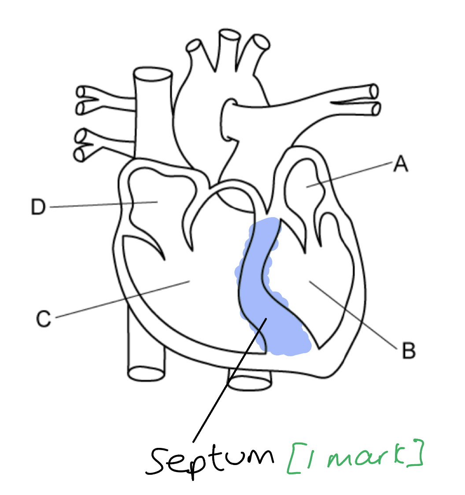
The human circulation system is described as a double circulation system because...

- (The idea that) for every one circuit of the body, the blood passes through the heart twice; **[1 mark]**

**[Total: 1 mark]**
The function of the right side of the heart is...

- To receive deoxygenated heart (from the body); **[1 mark]**
- To pump (deoxygenated) blood to the lungs; **[1 mark]**

**[Total: 2 marks]**

### Q19
The differences in appearance and the functions of the three cells labelled in Fig. 1 are as follows...

- (In appearance red blood cells are) biconcave (discs) **OR** have no nucleus **OR** are smaller than white blood cells; **[1 mark]**
- (The function of red blood cells is to) transport oxygen; **[1 mark]**
- (In appearance lymphocytes have) little cytoplasm **OR** a large nucleus / a nucleus that fills most of the cell;** [1 mark]**
- (The function of lymphocytes is to enable) active immunity / a response to (non-self) antigens / a response to vaccines **OR** to produce antibodies / form memory cells (during an immune response); **[1 mark]**
- (In appearance phagocytes have a) lobed/irregular-shaped/C-shaped nucleus; **[1 mark]**
- (The function of phagocytes is to) engulf pathogens / carry out phagocytosis; **[1 mark]**

***Accept**** transport of carbon dioxide for red blood cell function.*

**[Total: 6 marks]**

> *Make sure that you cover both appearance and function for each of the three cell types.*
(i) The empty boxes should be filled in as follows...

- Fibrinogen → fibrin; **[1 mark]**

(ii) Roles of blood clotting include...

- Prevent/reduce blood loss; **[1 mark]**
- Prevent entry of / infection by (named) pathogen/microorganism/microbe; **[1 mark]**

**[Total: 3 marks]**

### Q20
(i) The type of activity that resulted in the highest pulse rate was:

- Running; **[1 mark]**

(ii) The pulse rate of the student when she was cycling:

- 125 (bpm); **[1 mark]**

(iii) The percentage increase in pulse rate between resting and walking can be calculated as follows:

- [(98 - 64) ÷ 64] x 100; **[1 mark]**
- = 53(%); **[1 mark]**

*Full marks awarded for the correct answer only.*

**[Total: 4 marks]**

> *The calculation for (a) (iii) can be done as follows:*

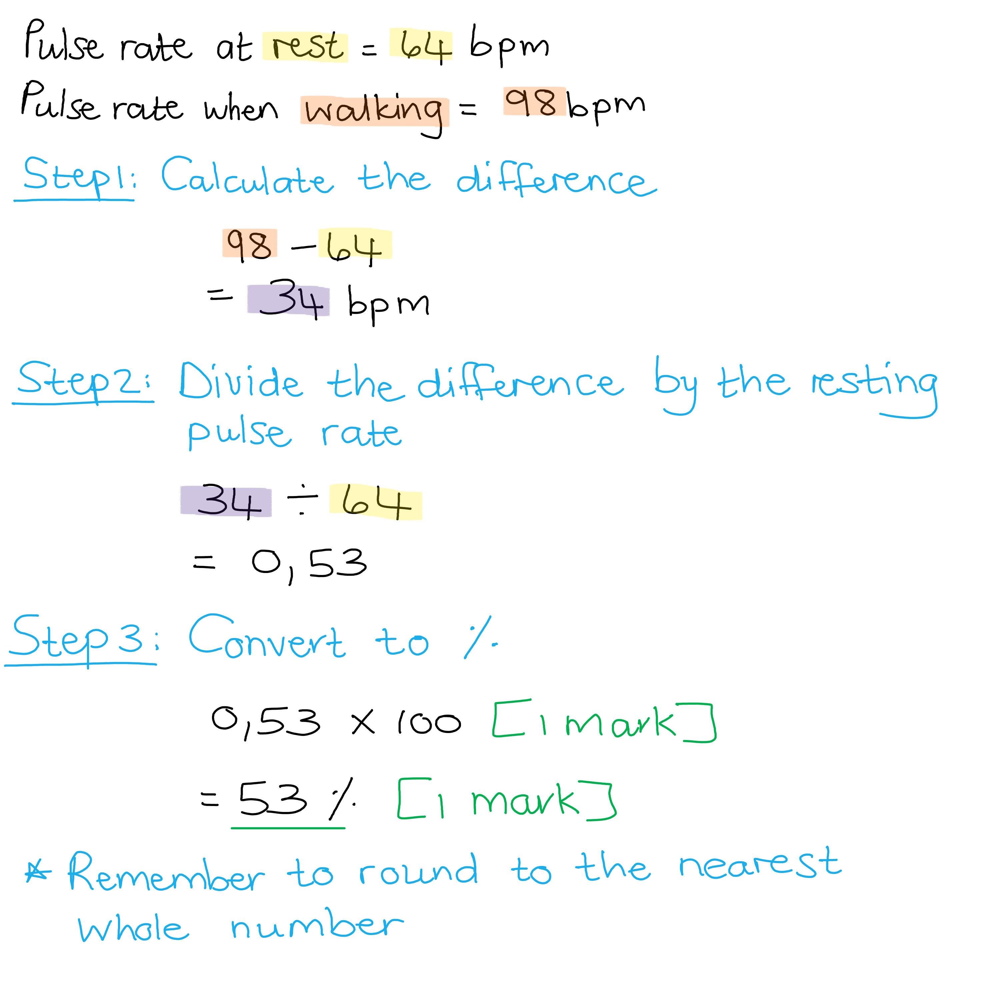
One other way of monitoring heart activity includes:

Any **one **from the following:

- ECG;** [1 mark]**
- Listening to the (sounds of the) valves (closing);** [1 mark]**

**[Total: 1 mark]**
Changes to a person's breathing during exercise includes:

- The breathing rate/frequency will increase / more breaths per minute (will be taken); **[1 mark]**
- The breathing depth increases / the volume of air inhaled / lung volume (during each breath) will increase; **[1 mark]**

**[Total: 2 marks]**

> *These changes are necessary during exercise in order to increase the oxygen supply to respiring muscle cells, while removing the increased amount of carbon dioxide produced by these cells.*

### Q21
The red and white blood cells are...

- A red blood cell correctly identified; **[1 mark]**
- A white blood cell correctly identified; **[1 mark]**

**[Total: 2 marks]**

> *A white blood cell is identified by the clearly visible, often, lobed, nucleus. A red blood cell is smaller and has no nucleus. Platelets are the smallest structure in this image, although you are not asked to label them. *

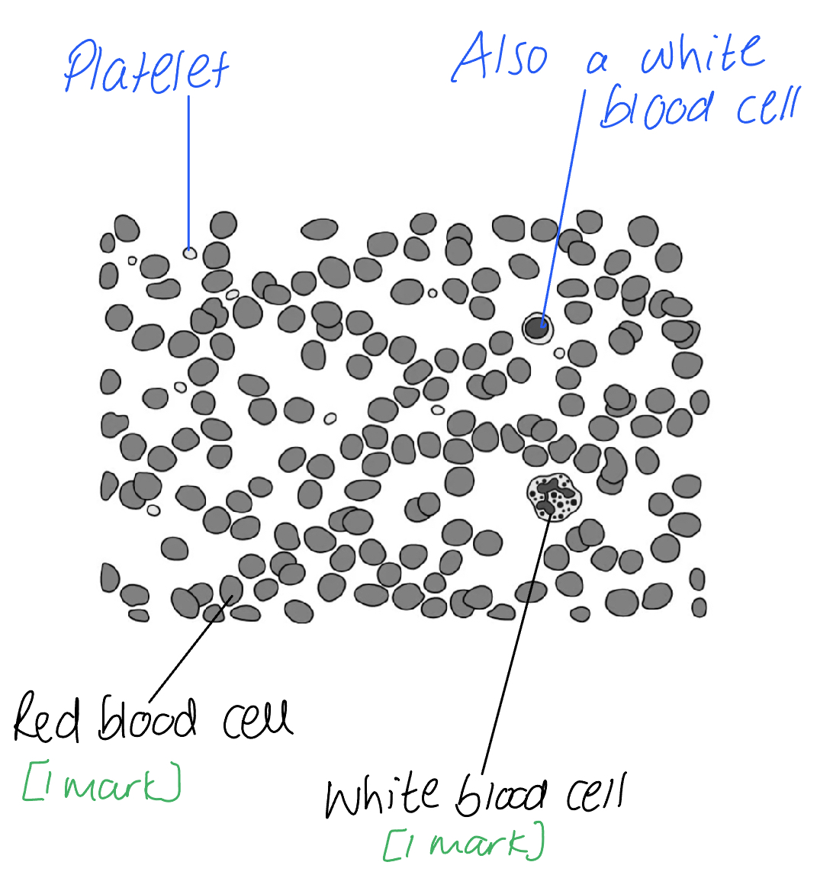
The process of blood clotting by platelets is...

- Platelets release chemicals; **[1 mark]**
- <u>Soluble fibrinogen</u> is converted into <u>insoluble fibrin</u>; **[1 mark]**
- An insoluble mesh forms **AND** traps (red) blood cells; **[1 mark]**
- (The clot develops into a scab **SO**) prevents infection / entry of pathogens / blood loss; **[1 mark]**

**[Total: 4 marks]**

> **[exam-tip]**
> Platelets trigger clotting by releasing chemicals, not by physically patching the wound.
> 
> Fibrinogen is dissolved in the plasma, not stored inside platelets.

> *It is important not to get soluble fibrinogen confused with insoluble fibrin so take some time to learn these terms and their correct order of occurrence in the process of blood clotting. *
The percentage decrease is...

- Difference in death rates = 72 - 57 = 15 ; **[1 mark]**
- Divide by original value 15 ÷ 72 = 0.208; **[1 mark]**
- 0.208 x 100 =21 (%) ; **[1 mark]**

***Accept ****values in the range of 71 to 73 for year 2001 reading, and 56 to 58 for year 2017 reading*

**[Total: 3 marks]**

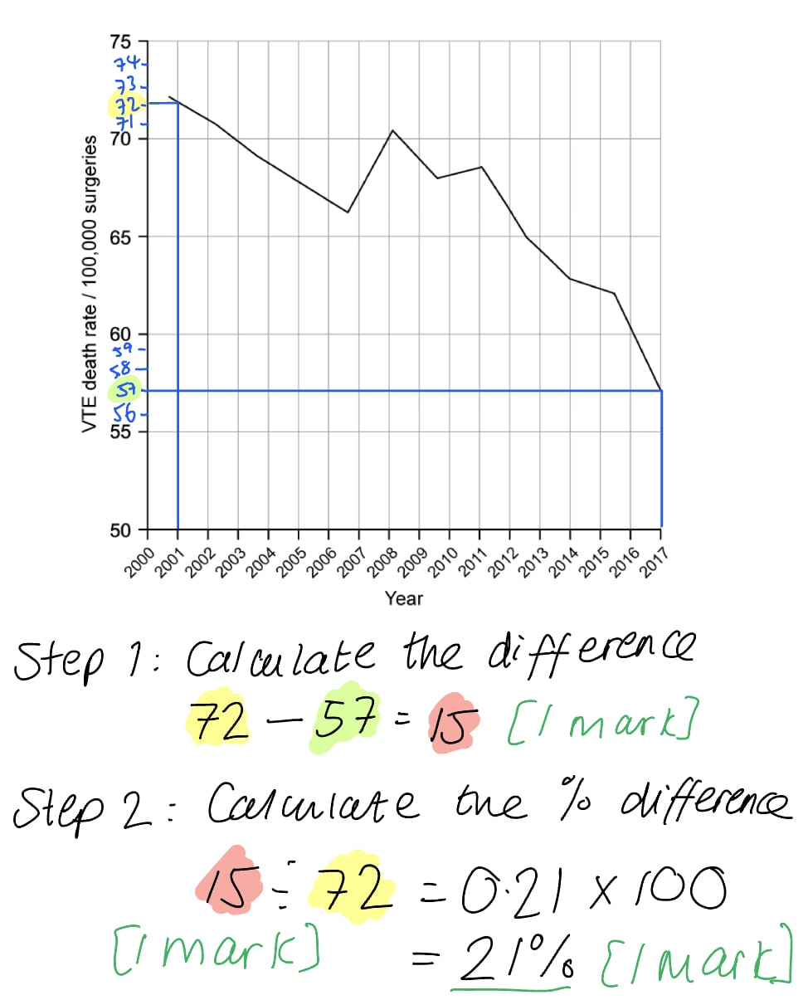
A comparison of the structure and function of veins and arteries includes:

Any **four **of the following:

- <u>Both</u> carry/circulate blood around the body; **[1 mark]**
- <u>Both</u> contain muscle and** **elastic fibres in their walls; **[1 mark]**
- Arteries have thick muscle walls **WHILE** veins have thin muscle walls; **[1 mark]**
- Arteries (mainly) carry oxygenated blood **WHILE** veins (mainly) carry deoxygenated blood; **[1 mark]**
- Arteries carry blood away from the heart **WHILE** veins carry blood toward the heart; **[1 mark]**
- Arteries carry blood at high pressure **WHILE** veins carry blood at lower pressure; **[1 mark]**
- Arteries do not have valves **WHILE** veins do; **[1 mark]**

**[Total: 4 marks]**

### Q22
The effect of the blockage on heart muscle cells is:

Any **two** from the following:

- Less blood flows to the heart muscle / cells / tissue; **[1 mark]**
- Less oxygen reaches the heart muscle / cells / tissue; **[1 mark]**
- Therefore less (aerobic) respiration occurs **OR **less energy is <u>released</u>; **[1 mark]**
- Heart cells will die; **[1 mark]**

**[Total: 2 marks]**

> *It is important when talking about energy from respiration that you use the term **released** and not produced, made or created as these terms are incorrect and will not award you marks. *
(i) The difference in blood flow in person **X** and **Y** is because...

- Person **X** arteries are narrower/blocked; **[1 mark]**

(ii) The volume of blood flowing through the coronary arteries of person **X** in 1 hour is...

- 167 x 60 (minutes) = 10 020 cm3; **[1 mark]**
- 10020 ÷ 1000 = 10.02 dm3; **[1 mark]**

**[Total: 3 marks]**
A conclusion of the treatments is...

Any **four **of the following:

- <u>**A**</u><u> + </u><u>**B**</u> is effective (treatment) / lowers risk of coronary heart disease (after treatment started); **[1 mark]**
- **D** (alone) is most effective (treatment) / lowest risk of coronary heart disease (after treatment started); **[1 mark]**
- **A** alone is more effective than **B** (alone) **OR A** alone and **B** alone increase risk of coronary heart disease; **[1 mark]**
- <u>**A**</u><u> + </u><u>**C**</u> / **B** (alone) is the least effective treatment / has the greatest risk of coronary heart disease; **[1 mark]**
- Cannot tell if **C** (alone) is effective **OR **treatment **C** alone has not been tested; **[1 mark]**

***Accept ****correct use of data for each marking point*

**[Total: 4 marks]**

> *This is a tricky graph to interpret so you need to take your time to ensure you understand the data before writing your answer. You do not need to know about the effect of statins as a treatment for CHD nor specific details about plaques to answer this question.  *
An evaluation of the claim is...

Any **three **from the following:

- The data was carried out over a long period / ten year study; **[1 mark]**
- Data is only available for one person **OR **treatments tested on only one person; **[1 mark]**
- No statistical tests have been carried out; **[1 mark]**
- Treatment **C** alone has not been tested; **[1 mark]**
- All possible combinations of statins have not been tested; **[1 mark]**
- Risk of coronary heart disease has not reached zero (so has not been cured) **OR **no treatments led to the risk of coronary heart disease being zero (so has not been cured); **[1 mark]**

***Accept ****named combinations of statin treatments for marking point 5*

**[Total: 3 marks]**

> *For questions asking you to evaluate a statement, you should pay attention to how the data support the statement as well as the ways in which it does not support the statement.*
