# Exam Questions — Circulatory Systems, Heart & Blood Vessels
**9. Transport in Animals** · Cambridge (CIE) IGCSE biology (0610 & 0970)
> Source: [https://www.savemyexams.com/igcse/biology/cie/23/topic-questions/](https://www.savemyexams.com/igcse/biology/cie/23/topic-questions/) · 54 questions across 3 sets

## Alternative To Practical Questions (3 questions)

### Q1 — hard — 15 marks

**Q1** [10 marks]

A student monitored their pulse rate after exercise. The student’s pulse rate before exercise was 62 beats per minute.

The results are shown in Table 2.1.

**Table 2.1**

| time after exercise /minutes | pulse rate /beats per minute |
|---|---|
| 0 | 156 |
| 1 | 108 |
| 2 | 78 |
| 3 | 66 |
| 4 | 62 |
| 5 | 62 |

(i) Plot a line graph on the grid of the data in Table 2.1. Include a line of best fit.

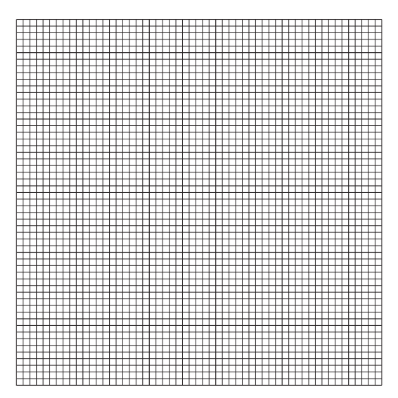

[4]

(ii) Describe the relationship shown in your graph, between pulse rate and time after exercise.

[2]

(iii) Calculate the percentage change in pulse rate from 0 minutes to 5 minutes using the data in Table 2.1.

Give your answer to two decimal places.

............................................................ % [3]

(iv) State the variable that was measured (dependent variable) in this investigation.

[1]

*Source: june 2021 paper 6 Q2A*

**Q1** [2 marks]

The student monitored their pulse rate after exercise on three separate days and calculated their average pulse rate from the data they collected.

The results are shown in Table 2.2.

**Table 2.2**

| time after exercise /minutes | pulse rate /beats per minute | average pulse rate /beats per minute |   |   |
|---|---|---|---|---|
|   | day 1 | day 2 | day 3 |   |
| 0 | 156 | 154 | 158 | 156 |
| 1 | 108 | 107 | 106 | 107 |
| 2 | 78 | 80 | 76 | 78 |
| 3 | 66 | 67 | 65 | 66 |
| 4 | 62 | 120 | 64 | 63 |
| 5 | 62 | 60 | 61 | 61 |

Explain why the student correctly calculated the average pulse rate at 4 minutes after exercise as 63 beats per minute rather than 82 beats per minute.

*Source: june 2021 paper 6 Q2B*

**Q1** [3 marks]

Fig. 2.1 shows a cross-section of an artery and a vein as seen using a light microscope.

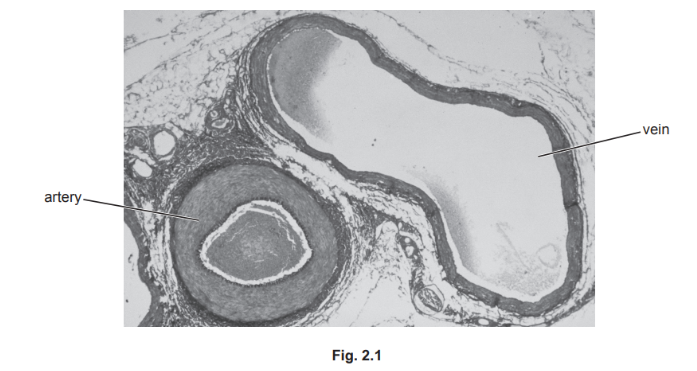

State one visible similarity and two visible differences between the artery and the vein shown in Fig. 2.1.

*Source: june 2021 paper 6 Q2C*

### Q2 — medium — 18 marks

**Q2** [9 marks]

Blood vessels can be modelled using straws of different diameters. Students investigated the flow of a viscous liquid through three different diameters of straws. Fig. 1 shows their experimental set up.

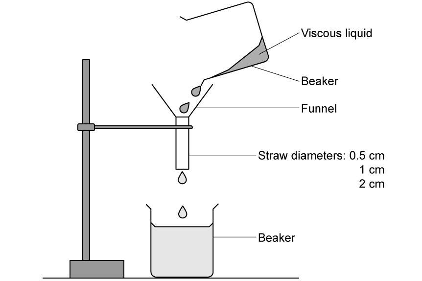

**Fig. 1**

Below is the method the students followed.

1. Place a piece of each different diameter straw securely into a clamp and stand, and position above an empty beaker.
2. Place a funnel at the top of the first tube to be tested.
3. Measure out 300 cm3 of the liquid.
4. Slowly but continuously pour the liquid into the funnel and immediately start the stopwatch.
5. Record the time taken for the entire volume of liquid to flow out of the tubing.
6. Repeat the test two more times and calculate an average time.
7. Repeat the whole experiment with the other remaining diameters of tube.

(i)

Suggest the apparatus the students should use to accurately measure 300 cm3 of liquid.

[1]

(ii)

Describe a method to ensure 300 cm3 of liquid is measured accurately.

[3]

(iii)

Suggest a unit of time the students should use to measure how long it takes for the liquid to flow through each tube and explain why this unit is most appropriate.

[3]

(iv)

Describe a source of error that may arise from the method above and explain how to overcome this error.

[2]

**Q2** [9 marks]

**Extract:**

Table 1:
| diameter of straw / cm^3 | time for liquid to flow through the straw / seconds |
| trial 1 | trial 2 | trial 3 | mean |
| 0.5 | 3 | 2 | 3 | 2.7 |
| 1 | 2 | 2 | 2 | 2.0 |
| 2 | 1 | 0.5 | 0.8 |   |

The following formula can be used to calculate the flow rate. Use the mean time for the liquid to flow through the straws to calculate the flow rate of the three straws.
Flow rate = volume ÷ time
Where flow rate is measured in cm^3/sec, volume in cm^3 and time in seconds

The height of the tubes has been cut to 20 cm.
Recall and use the equation for the volume of a cylinder to calculate the volume of the 2 cm diameter tube. Give each answer to two significant figures and include the units for volume.

From part (a):
3. Measure out 300 cm^3 of the liquid.

Table 1 shows the data collected by students when following the method described in part (a).

**Table 1**

| **diameter of straw / cm****3** | **time for liquid to flow through the straw / seconds** |   |   |   |
|---|---|---|---|---|
| **trial 1** | **trial 2** | **trial 3** | **mean** |   |
| 0.5 | 3 | 2 | 3 | 2.7 |
| 1 | 2 | 2 | 2 | 2.0 |
| 2 | 1 | 0.5 | 0.8 |   |

(i)

Calculate the mean for the 2 cm3 diameter straw.

[1]

(ii)

The following formula can be used to calculate the flow rate. Use the mean time for the liquid to flow through the straws to calculate the flow rate of the three straws.

**Flow rate = volume ÷ time**

Where flow rate is measured in cm3/sec, volume in cm3 and time in seconds

Give each answer to three significant figures.

[3]

(iii)

The height of the tubes has been cut to 20 cm.

Recall and use the equation for the volume of a cylinder to calculate the volume of the 2 cm3 diameter tube.  Give each answer to **two** significant figures and include the units for volume.

[5]

### Q3 — medium — 24 marks

**Q3** [5 marks]

A student wanted to exert themselves in light exercise and monitor their heart rate for a period afterwards.

Describe a method they could follow to determine their heart rate after exercise.

**Q3** [4 marks]

A stopwatch was used to measure how long a student exercised for.

Fig. 1 shows three stopwatches which are ready for the student to use. One of the stopwatches has an error.

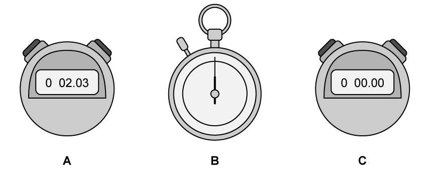

**Fig. 1**

(i)

Identify the stopwatch with the error and state the type of error the stopwatch has.

[2]

(ii)

Describe what the student should do to correct the error.

[1]

(iii)

Identify and explain **one** type of variable that the time measured by the stopwatch could be in an investigation.

[1]

**Q3** [3 marks]

Students participating in an investigation to record their heart rate are considered research subjects. Ethical procedures associated with using students in this way should be followed.

(i)

Describe an ethical consideration that should be considered before students take part in the investigation.

[1]

(ii)

Describe **two **health and safety precautions which should be adhered to as part of the investigation.

[2]

**Q3** [12 marks]

**Extract:**

A student had a resting heart rate of 75 bpm. The same student's results after completing five different exercises and recording their heart rate each time are: 
1. Exercise type: running, Heart rate: 180 bpm, Time of exercise: 120 seconds
2. Exercise type: walking, Heart rate: 80 bpm, Time of exercise: 120 seconds
3. Exercise type: star jumps, Heart rate: 160 bpm, Time of exercise: 120 seconds
4. Exercise type: skipping rope, Heart rate: 175 bpm, Time of exercise: 120 seconds
5. Exercise type: press ups, Heart rate: 95 bpm, Time of exercise: 120 seconds

A student had a resting heart rate of 75 bpm.

Fig 2. shows the same student's results after completing five different exercises and recording their heart rate each time. Each exercise was carried out for two minutes.

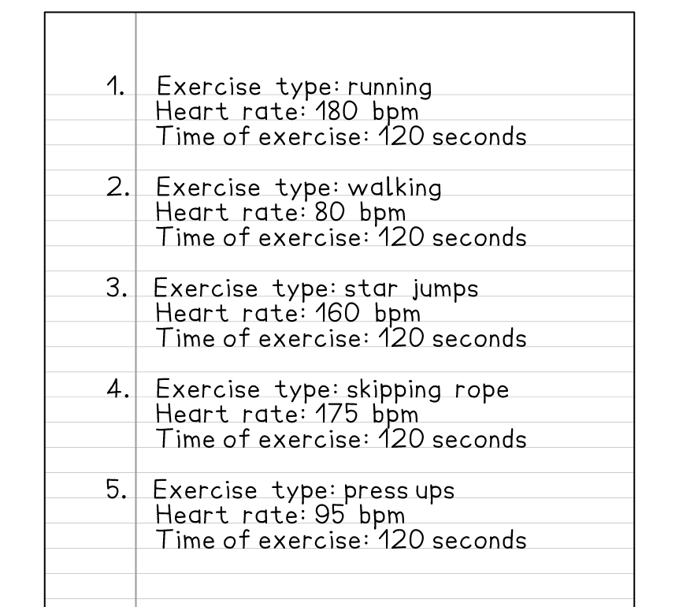

**Fig. 2**

(i)

Prepare a table to record the results shown in Fig. 2. Your table should include clear headings and units where applicable.

[4]

(ii)

Identify the independent variable **and **the dependent variable from the information given and Fig. 2.

[2]

(iii)

Use the information above and Fig. 2 to identify the variable that was kept constant during the investigation (control variable).

[1]

(iv)

Describe how the student could make their results more reliable and explain why this increases the accuracy of the data.

[2]

(v)

Calculate the percentage change in heart rate when the student carried out running.

[3]

## Multiple Choice Questions (29 questions)

### Q1 — hard — 1 marks

**Q1** [1 mark]

Below are statements about the components of blood and their functions.

1. White blood cells produce antibodies and carry out phagocytosis
2. Red blood cells transport oxygen using haemoglobin
3. Platelets transport hormones and nutrients around the body
4. Plasma transports carbon dioxide and urea

Which statements are correct?

### Q2 — medium — 1 marks

**Q2** [1 mark]

Which of the following correctly lists features of a capillary?

### Q3 — hard — 1 marks

**Q3** [1 mark]

A student recorded their pulse rate immediately after stopping exercise, and then every minute for 6 minutes. The results are shown in the table.

| **Time (min)** | **Pulse rate (bpm)** |
|---|---|
| 0 | 175 |
| 1 | 135 |
| 2 | 110 |
| 3 | 89 |
| 4 | 68 |
| 5 | 66 |
| 6 | 66 |

Which of the following statements is correct?

### Q4 — hard — 1 marks

**Q4** [1 mark]

Look at the sentences below and select the correct answer

1. The right ventricle contains ......... blood
2. Blood from the right ventricle flows to the .........
3. The blood flows out of the right ventricle via the .........

### Q5 — medium — 1 marks

**Q5** [1 mark]

The following are statements about blood.

1. Red blood cells transport oxygen.
2. Plasma transports hormones.
3. Platelets destroy pathogens.

Which statements are correct?

### Q6 — medium — 1 marks

**Q6** [1 mark]

The diagram shows the blood vessels associated with the liver.

What is the blood vessel labelled X?

### Q7 — easy — 1 marks

**Q7** [1 mark]

How does blood exit the heart?

### Q8 — medium — 1 marks

**Q8** [1 mark]

The diagram shows the circulatory system of a fish.

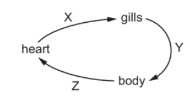

Where in the circulatory system is the oxygen concentration lowest?

*Source: june 2022 paper 2 Q17*

### Q9 — medium — 1 marks

**Q9** [1 mark]

Which process is slower than normal in a person with very few platelets?

*Source: June 2022 paper 1 Q20*

### Q10 — easy — 1 marks

**Q10** [1 mark]

The diagram shows a cross-section through the heart of a mammal.

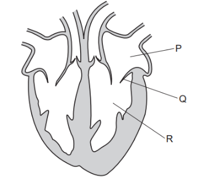

Which row correctly identifies P, Q and R?

|   | P | Q | R |
|---|---|---|---|
| **A** | valve | right atrium | right ventricle |
| **B** | left atrium | valve | left ventricle |
| **C** | right ventricle | right atrium | valve |
| **D** | right atrium | valve | right ventricle |

*Source: June 2022 paper 1 Q19*

### Q11 — easy — 1 marks

**Q11** [1 mark]

What is a function of some white blood cells?

*Source: June 2021 0970/11 Q21*

### Q12 — easy — 1 marks

**Q12** [1 mark]

The diagram shows a cross-section through a human blood vessel.

Which type of blood vessel does the diagram show?

*Source: June 2021 0970/11 Q20*

### Q13 — medium — 1 marks

**Q13** [1 mark]

What are the main vessels carrying blood to and from the kidney?

|   | to kidney | from kidney |
|---|---|---|
| **A** | pulmonary artery | pulmonary vein |
| **B** | pulmonary vein | pulmonary artery |
| **C** | renal artery | renal vein |
| **D** | renal vein | renal artery |

*Source: June 2021 0970/11 Q19*

### Q14 — medium — 1 marks

**Q14** [1 mark]

What happens to the heart valves when the ventricles contract?

|   | atrioventricular valves | semilunar valves |
|---|---|---|
| **A** | close | close |
| **B** | close | open |
| **C** | open | close |
| **D** | open | open |

*Source: Specimen 2023 0970/02 Q19*

### Q15 — easy — 1 marks

**Q15** [1 mark]

Which part of the blood contains haemoglobin?

*Source: Specimen 2023 0970/01 Q19*

### Q16 — easy — 1 marks

**Q16** [1 mark]

The diagram shows a section through a human heart.

Which blood vessel is the pulmonary vein?

*Source: Specimen 2023 0970/01 Q18*

### Q17 — easy — 1 marks

**Q17** [1 mark]

Which row of the table below shows the correct chambers of the heart, from those with the thinnest walls to those with the thickest?

| ** ** | thinnest **→** thickest |   |   |
|---|---|---|---|
| **A** | left ventricle | right ventricle | left atrium |
| **B** | left atrium | left ventricle | right ventricle |
| **C** | right ventricle | left atrium | left ventricle |
| **D** | left atrium | right ventricle | left ventricle |

### Q18 — medium — 1 marks

**Q18** [1 mark]

#### Extended

Which of the following is a correct explanation as to why mammals have a double circulatory system?

### Q19 — medium — 1 marks

**Q19** [1 mark]

#### Extended

The diagram below shows a vertical section through a human heart.

Which row of the following table has the correct names for the structures labelled in the diagram?

| ** ** | X | Y | Z |
|---|---|---|---|
| **A** | atrioventricular valve | semilunar valve | septum |
| **B** | semilunar valve | atrioventricular valve | septum |
| **C** | semilunar valve | semilunar valve | atrioventricular valve |
| **D** | atrioventricular valve | atrioventricular valve | septum |

### Q20 — easy — 1 marks

**Q20** [1 mark]

#### Extended

The blood contains lymphocytes.

What is their purpose?

### Q21 — medium — 1 marks

**Q21** [1 mark]

Some components of the blood of a mammal are shown in the image below.

Which row of the table has the correct cells from the image above assigned to their names?

| ** ** | lymphocyte | phagocyte | platelets |
|---|---|---|---|
| **A** | 4 | 2 | 3 |
| **B** | 2 | 4 | 3 |
| **C** | 1 | 2 | 1 |
| **D** | 2 | 4 | 1 |

### Q22 — easy — 1 marks

**Q22** [1 mark]

Which of the following statements would be incorrect for most of the veins in the human body?

### Q23 — medium — 1 marks

**Q23** [1 mark]

The image below shows a cross-section of a blood vessel taken from an arm.

Which type of blood vessel is shown in the image, and in which direction will blood flow?

| ** ** | type of vessel | direction of flow | oxygenation of blood |
|---|---|---|---|
| **A** | capillary | S to T | low |
| **B** | vein | T to S | high |
| **C** | artery | S to T | high |
| **D** | vein | T to S | low |

### Q24 — hard — 1 marks

**Q24** [1 mark]

#### Extended

Four different stages in one heartbeat are shown in the diagram below.

Which of the following depicts a correct order of stages?

### Q25 — hard — 1 marks

**Q25** [1 mark]

Which of the following depicts the correct order of stages in the formation of a blood clot?

### Q26 — hard — 1 marks

**Q26** [1 mark]

Which of the following would be found dissolved in the blood plasma of a human?

### Q27 — medium — 1 marks

**Q27** [1 mark]

#### Extended

The diagram below shows the human heart and some of the blood vessels associated with it.

Before blood in P reaches Q, what must it do?

### Q28 — hard — 1 marks

**Q28** [1 mark]

Which blood vessel has a relatively low carbon dioxide concentration, a high oxygen concentration and a low blood pressure?

### Q29 — hard — 1 marks

**Q29** [1 mark]

In which list of the following do all three blood vessels carry deoxygenated blood?

## Theory Questions (22 questions)

### Q1 — very_hard — 6 marks

**Q1** [2 marks]

Fig. 4.1 shows a blue whale, a marine mammal that has a heart weighing up to 600 kg.

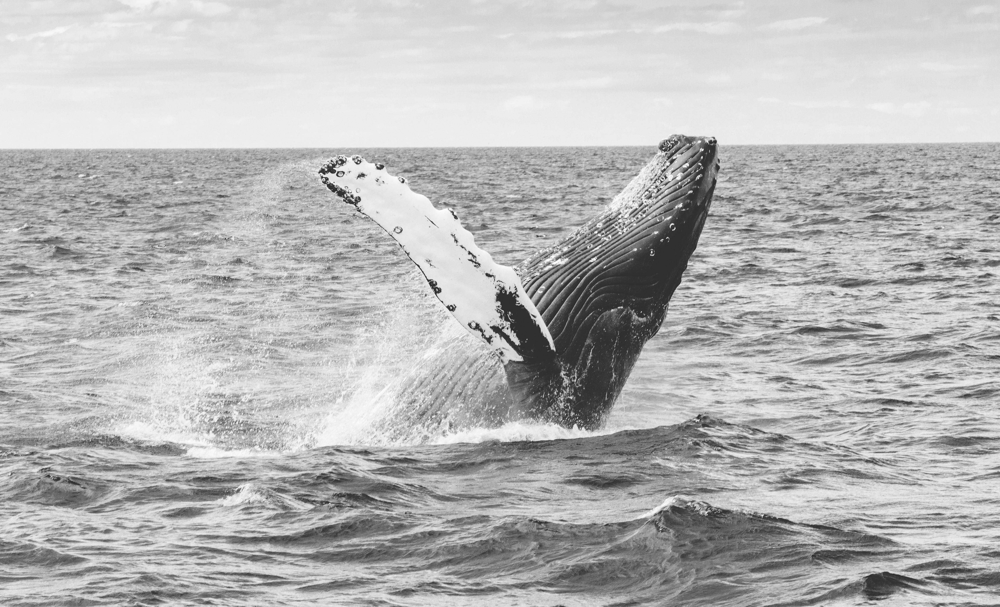

Public domain, via [rawpixel](https://www.rawpixel.com/image/3282624/free-photo-image-public-domain-fish-whale-cc0-ocean)

**Fig. 4.1**

In mammals, the wall of the left ventricle is approximately three times thicker than the wall of the right ventricle.

Explain why the muscle wall of the left ventricle is significantly thicker than the muscle wall of the right ventricle.

**Q1** [4 marks]

Blue whales have a double circulatory system.

Explain the advantages of a double circulatory system over a single circulatory system.

### Q2 — medium — 2 marks

**Q2** [2 marks]

During exercise, the heart rate also increases.

(i) Identify the component in the blood that carries oxygen to the muscles.

[1]

(ii) Identify the gas that is released by cells as a waste product.

[1]

### Q3 — hard — 10 marks

**Q3** [2 marks]

A group of 16-year-old students conducted a classroom experiment to study the effect of physical activity on heart rate.

The students selected four volunteers and measured each student's resting heart rate using a digital pulse monitor. Then, each student ran on a treadmill at a constant speed for 5 minutes. Immediately after the exercise, heart rates were measured again. The process was repeated after 10 minutes of rest to observe recovery.

Identify the independent and dependent variables in this investigation.

**Q3** [3 marks]

**Extract:**

A group of 16-year-old students conducted a classroom experiment to study the effect of physical activity on heart rate.

The students selected four volunteers and measured each student's resting heart rate using a digital pulse monitor. Then, each student ran on a treadmill at a constant speed for 5 minutes. Immediately after the exercise, heart rates were measured again. The process was repeated after 10 minutes of rest to observe recovery.

The results from the investigation in part (a) are shown in **Table 1** below:

**Table 1**

| **Student** | **Heart rate (bpm)** |   |   |
|---|---|---|---|
| **Resting** | **After 5 min run** | **10 min after exercise** |   |
| A | 72 | 145 | 80 |
| B | 68 | 150 | 92 |
| C | 74 | 162 | 110 |
| D | 70 | 138 | 76 |

Describe the changes in heart rate experienced by students immediately after exercise and after 10 minutes of rest.

**Q3** [3 marks]

**Extract:**

A group of 16-year-old students conducted a classroom experiment to study the effect of physical activity on heart rate.

The students selected four volunteers and measured each student's resting heart rate using a digital pulse monitor. Then, each student ran on a treadmill at a constant speed for 5 minutes. Immediately after the exercise, heart rates were measured again. The process was repeated after 10 minutes of rest to observe recovery.

The results from the investigation in part (a) are shown in **Table 1** below:

**Table 1**

| **Student** | **Heart rate (bpm)** |   |   |
|---|---|---|---|
| **Resting** | **After 5 min run** | **10 min after exercise** |   |
| A | 72 | 145 | 80 |
| B | 68 | 150 | 92 |
| C | 74 | 162 | 110 |
| D | 70 | 138 | 76 |

**Extended Tier Only**

Explain why the heart rate changes during physical activity.

**Q3** [2 marks]

**Extract:**

A group of 16-year-old students conducted a classroom experiment to study the effect of physical activity on heart rate. 

The students selected four volunteers and measured each student's resting heart rate using a digital pulse monitor. Then, each student ran on a treadmill at a constant speed for 5 minutes. Immediately after the exercise, heart rates were measured again. The process was repeated after 10 minutes of rest to observe recovery.

Suggest two ways to improve the validity of the results from the investigation described in part (a).

### Q4 — medium — 2 marks

**Q4** [2 marks]

The activity of the heart can be monitored by measuring the pulse rate.

State **two** other ways of monitoring the activity of the heart.

*Source: june 2021 paper 3 Q5B*

### Q5 — easy — 10 marks

**Q5** [6 marks]

Fig. 5.1 is a diagram of a human heart.

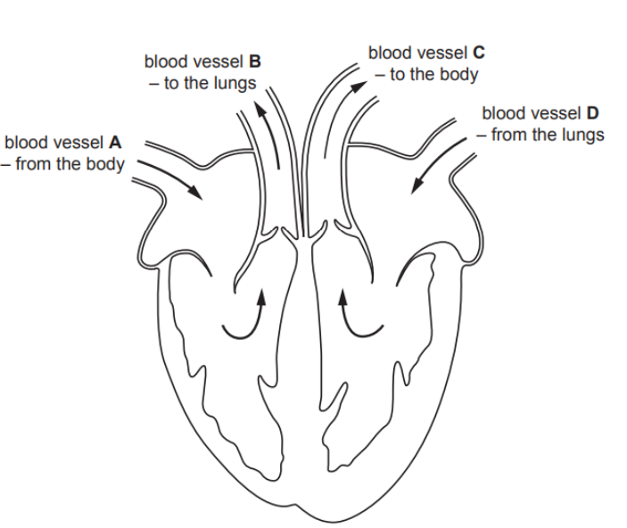

**Fig 5.1**

(i) Use label lines and labels to identify these structures on Fig. 5.1:

- atrium
- septum
- ventricle
- valve

[4]

(ii) Identify the letter or letters of all the blood vessels from Fig. 5.1, that:

are arteries .......................

is the pulmonary vein ....................... .

[2]

*Source: june 2021 paper 3 Q5A*

**Q5** [4 marks]

Coronary heart disease (CHD) is caused by a blockage of blood vessels in the heart.

(i) State the name of the blood vessels that become blocked.

[1]

(ii) State **three** risk factors for developing CHD.

[3]

*Source: june 2021 paper 3 Q5C*

### Q6 — medium — 12 marks

**Q6** [6 marks]

Mammals have a double circulation.

Fig. 2.1 is a diagram of a section through the heart of a mammal. The arrows show the direction of blood flow through the heart and blood vessels.

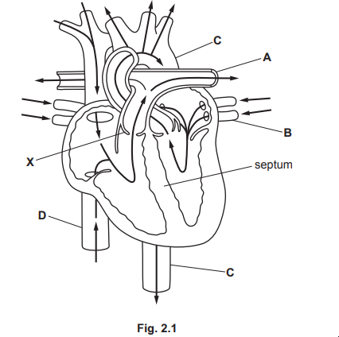

(i)

State the name of the chamber of the heart with the thickest wall.

[1]

(ii)

D is a vein. State the name of this vein and describe its structure.

name .................................................................................................

description of structure ..................................................

[3]

(iii)

Identify the structure labelled X in Fig. 2.1 and state its role in the heart.

[2]

*Source: June 2022  0610/41 Q2A*

**Q6** [6 marks]

Fig. 2.2 is a diagram that shows the double circulation of a mammal. The arrows indicate the movement of oxygen and carbon dioxide in and out of the blood.

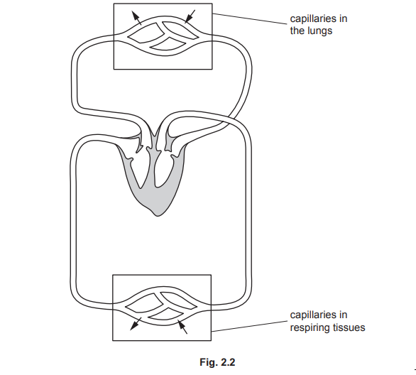

(i) Shade the blood vessel in Fig. 2.2 that transports blood with the highest oxygen concentration.

[1]

(ii) Describe the evidence shown in Fig. 2.2 that the mammal has a double circulatory system.

[2]

(iii) Explain the advantages of a double circulation.

[4]

*Source: June 2022  0610/41 Q2B*

### Q7 — medium — 9 marks

**Q7** [6 marks]

Fig. 3.1 shows a photomicrograph of human blood.

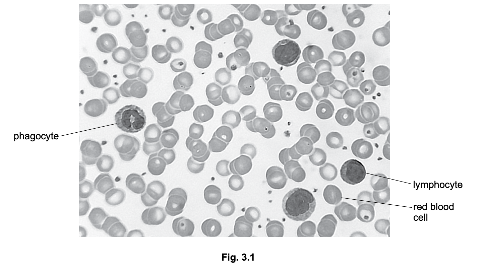

Describe the differences in appearance and the functions of the three cells labelled in Fig. 3.1.

*Source: Specimen 2023 0970/04 Q3A*

**Q7** [3 marks]

Fig. 3.2 shows some of the stages of blood clotting.

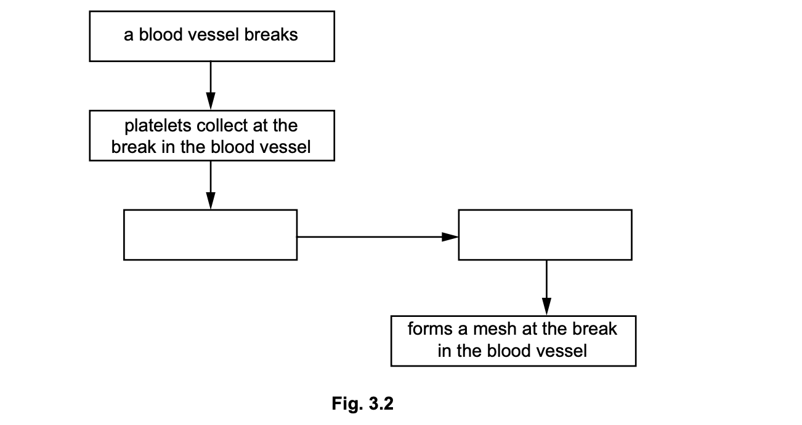

(i)

Complete Fig. 3.2 by filling in the two empty boxes.

[1]

(ii)

State two roles of blood clotting.

[2]

*Source: Specimen 2023 0970/04 Q3B*

### Q8 — easy — 1 marks

**Q8** [1 mark]

Measuring the pulse rate is one way of monitoring the activity of the heart.

State **one other **way of monitoring the activity of the heart.

*Source: Specimen 2023 0970/03 Q2B*

### Q9 — medium — 4 marks

**Q9** [4 marks]

A student performed different types of activity.

She measured her heart rate during each type of activity in beats per minute (bpm).

The results are shown in Fig. 2.1.

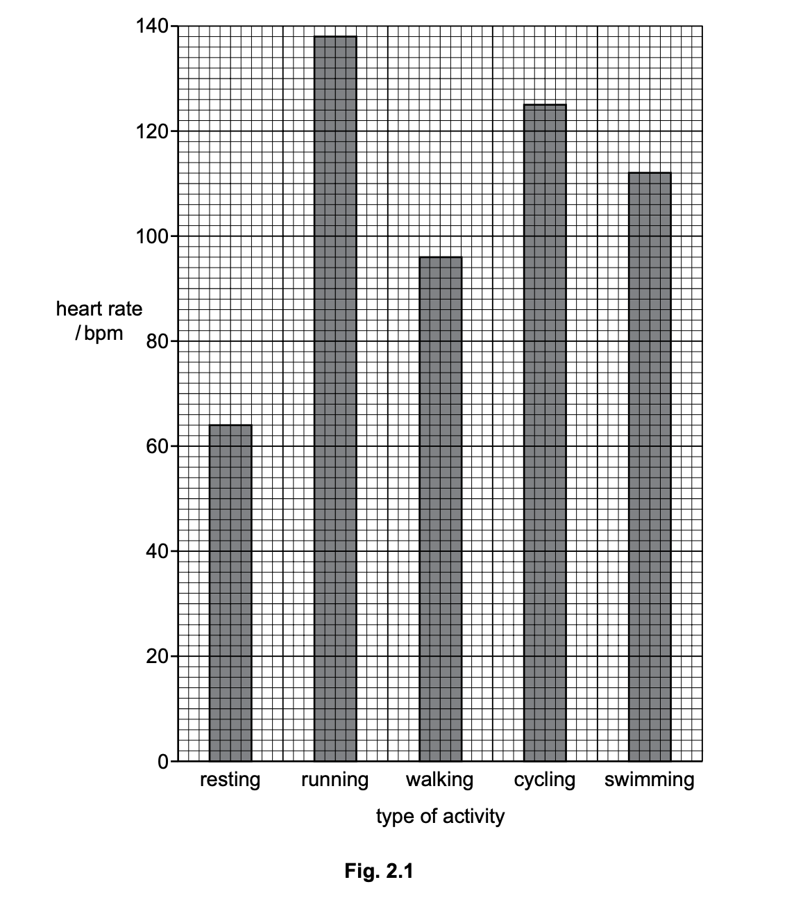

(i)

State the type of activity that results in the highest heart rate in Fig. 2.1

[1]

(ii)

State the heart rate of the student when she was cycling.

................................................... bpm [1]

(iii)

Calculate the percentage increase in her heart rate between resting and walking.

.............................................................% [2]

*Source: Specimen 2023 0970/03 Q2A*

### Q10 — hard — 9 marks

**Q10** [3 marks]

**Extended Only**

Fig. 1 below shows the circulatory system of a fish.

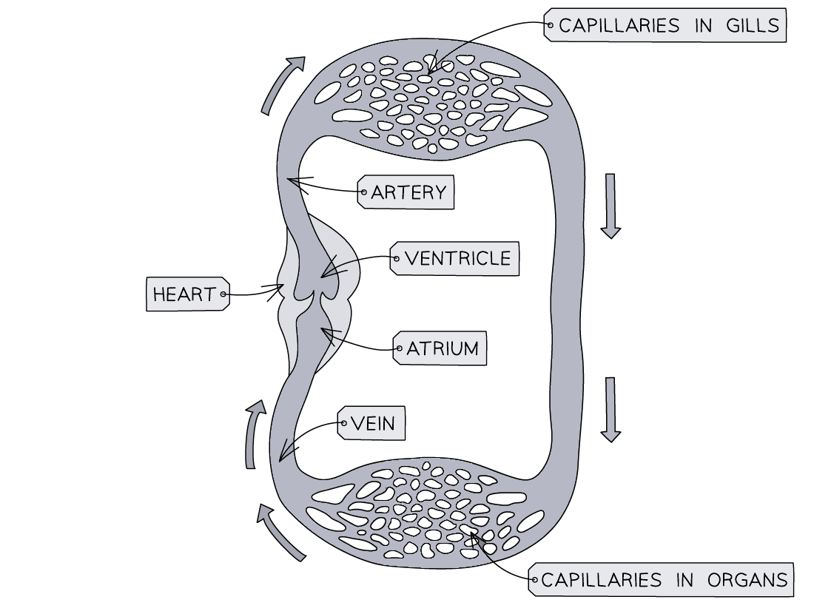

*Fig. 1*

Use Fig. 1 and your own knowledge to compare the structure of the fish circulatory system to that of mammals.

**Q10** [3 marks]

**Extract:**

Fig. 1 below shows the circulatory system of a fish.

*Fig. 1*

Use Fig. 1 and your own knowledge to compare the structure of the fish circulatory system to that of mammals.

Gas exchange in fish occurs in structures known as gills.

Suggest how fish gills support efficient gas exchange.

**Q10** [3 marks]

**Extended Only**

Researchers investigated the effect of stress on heart rate in fish. They decreased water levels in a fish tank until the fish dorsal fins were exposed to air, for a period of 5 minutes, while measuring heart rates. They found that fish heart rates increased during the stress period, and remained elevated for a period of time after water levels returned to normal.

Explain the benefit of an increased heart rate in fish in response to stress.

### Q11 — medium — 8 marks

**Q11** [3 marks]

Fig. 1 shows a diagram of the heart with letters to identify some of the structures.

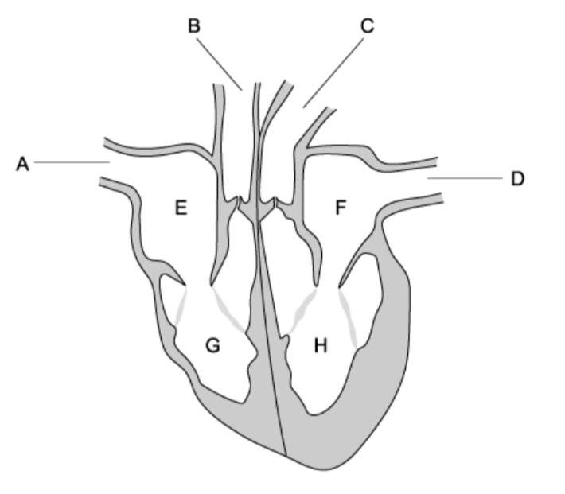

*Fig. 1*

Identify the letter(s) of the structure(s) that:

(i) contain deoxygenated blood.

[1]

(ii) receive blood from the lungs.

[1]

(iii) are veins.

[1]

**Q11** [1 mark]

**Extract:**

Fig. 1 shows a diagram of the heart with letters to identify some of the structures.

(i) contain deoxygenated blood.
(ii) receive blood from the lungs.
(iii) are veins.

Mark scheme:
(i) The letter(s) of the structure(s) that contain deoxygenated blood are: A, E, G, B.
(ii) The letter(s) of the structure(s) that receive blood from the lungs are: F (and D).
(iii) The letter(s) of the structure(s) that are veins are: A, D.

**Extended Only**

State the name of the valve located between chambers F and H in Fig. 1.

**Q11** [2 marks]

**Extract:**

Fig. 1 shows a diagram of the heart with letters to identify some of the structures.

[Diagram of a human heart cross-section, labelled A to H, showing chambers, vessels, and walls in a simplified anatomical representation.]

**Extended Only**

(i) Describe the location of the septum in the mammalian heart.

[1]

(ii) Explain the importance of the septum.

[1]

**Q11** [2 marks]

**Extended Only**

Describe how the heart muscle and valves function to pump blood through the heart.

### Q12 — medium — 5 marks

**Q12** [2 marks]

**Extract:**

Compare the structure of arteries and veins

Compare the structural features of arteries and veins.

**Q12** [1 mark]

Fig. 1 below shows a structure in the mammalian lungs. The feature labelled P is an alveolus.

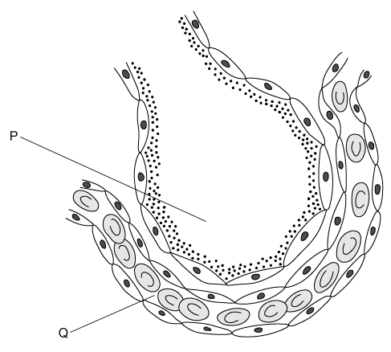

*Fig. 1*

Identify the structure labelled Q.

**Q12** [1 mark]

**Extract:**

The structure labelled Q is a:

- Capillary;

State the function of the structure labelled Q in Fig. 1.

**Q12** [1 mark]

Suggest how the structure of capillaries enables efficient exchange of substances.

### Q13 — easy — 8 marks

**Q13** [2 marks]

Describe how coronary heart disease affects the heart.

**Q13** [3 marks]

State **three** risk factors associated with coronary heart disease.

**Q13** [2 marks]

Identify **two** lifestyle changes that can reduce the risk of coronary heart disease.

**Q13** [1 mark]

Outline how an ECG can help detect signs of coronary heart disease.

### Q14 — easy — 6 marks

**Q14** [3 marks]

Blood circulates around the body in arteries, veins and capillaries.

Place ticks (✓) in the correct boxes in Table 1 to show the features of arteries.

**Table 1**

| **structure and function** | **arteries** |
|---|---|
| carries blood at high pressure |   |
| carries blood towards the heart |   |
| has a thick wall |   |
| has a narrow lumen |   |
| has valves present throughout the vessel |   |

*Source: 2019 0970/31 Q7A*

**Q14** [3 marks]

Fig. 1 shows a photomicrograph of a capillary with red blood cells passing through it.

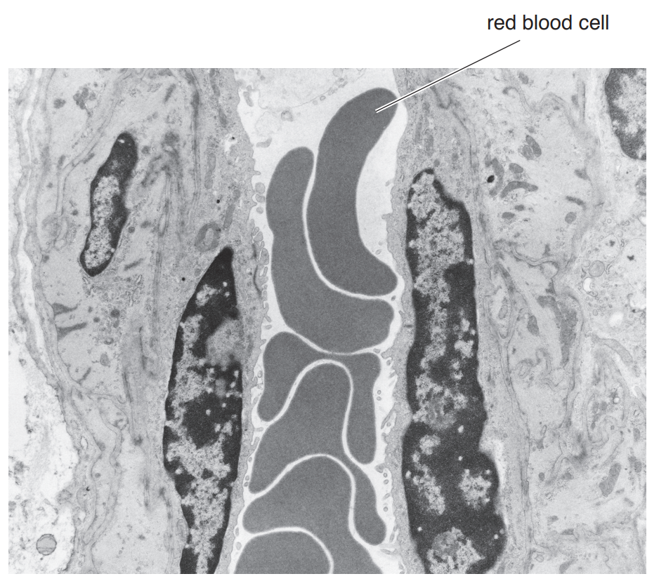

**Fig. 1**

(i)

State the function of the red blood cells shown in Fig. 1.

[1]

(ii)

Red blood cells are one component of blood.

State the names of **two **other components of blood.

[2]

*Source: 2019 0970/31 Q7B*

### Q15 — easy — 8 marks

**Q15** [1 mark]

Fig. 1 shows a section through a blood vessel.

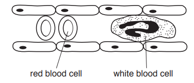

**Fig. 1**

Identify the type of blood vessel shown in Fig. 1.

*Source: 2018 0610/32 Q*

**Q15** [3 marks]

Red blood cells are different to white blood cells.

State **three** ways in which a red blood cell is different to a white blood cell.

*Source: 2018 0610/32 Q2B*

**Q15** [4 marks]

Blood has many components.

(i)

State the name of the liquid component of blood.

[1]

(ii)

State **three** substances that are transported in the liquid component of blood.

[3]

*Source: 2018 0610/32 Q2C*

### Q16 — medium — 16 marks

**Q16** [3 marks]

Fig. 1 shows a photomicrograph of some red blood cells.

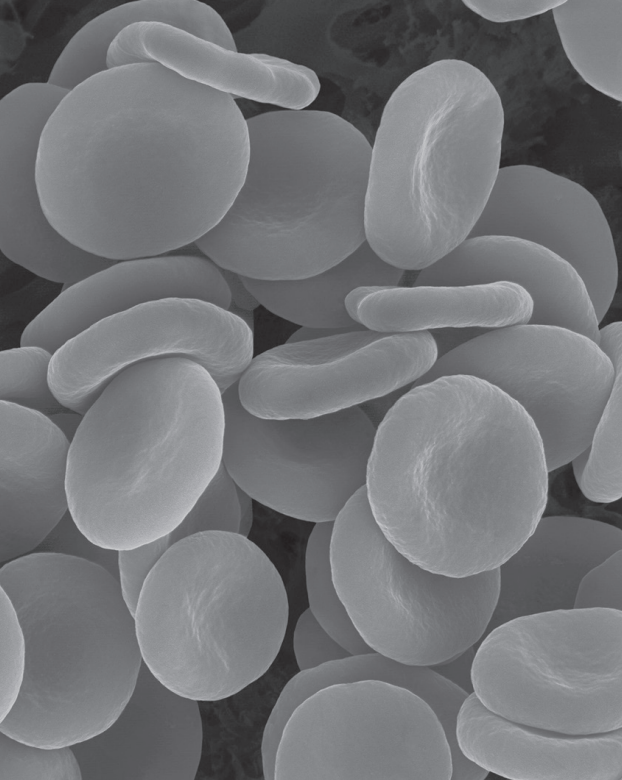

**Fig. 1**

(i) State the function of a red blood cell.

[1]

(ii) State **two** ways in which a red blood cell is adapted to its function.

[2]

*Source: 2018 0610/32 Q8A*

**Q16** [1 mark]

State the name of a component of blood that is responsible for clotting.

*Source: 2018 0610/32 Q8B*

**Q16** [4 marks]

(i) State the name of the disease caused by a blockage in the arteries supplying the heart muscle.

[1]

(ii) List **three** risk factors that increase the risk of a blockage in the arteries supplying the heart muscle.

[3]

*Source: 2018 0610/32 Q8C*

**Q16** [4 marks]

Fig. 2 is a diagram of the circulatory system. The blood vessels are labelled with letters.

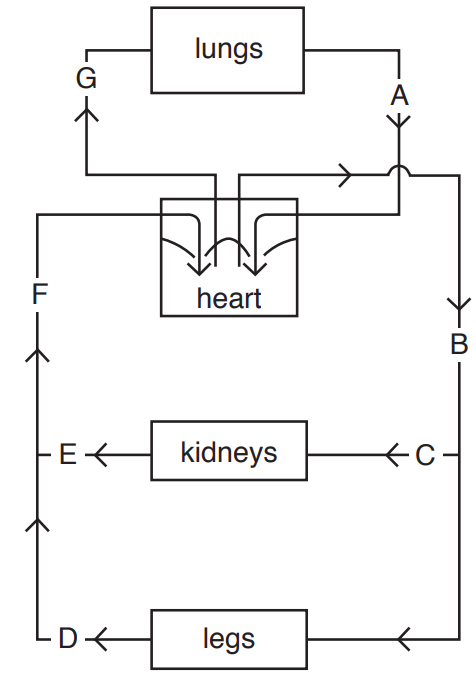

**Fig. 2**

Complete Table 1 by identifying the letter of the named blood vessel in Fig. 2.

**Table 1**

| **name of blood vessel** | **letter** |
|---|---|
| aorta |   |
| pulmonary artery |   |
| renal vein |   |
| vena cava |   |

*Source: 2018 0610/32 Q8D*

**Q16** [4 marks]

Describe how the structures of the circulatory system maintain a one-way flow of blood.

*Source: 2018 0610/32 Q8E*

### Q17 — medium — 11 marks

**Q17** [5 marks]

A scientist investigated the effect of different types of activity on heart rate of participants aged 21 after they had completed the activity for 10 minutes.

The results are shown in Fig. 1.

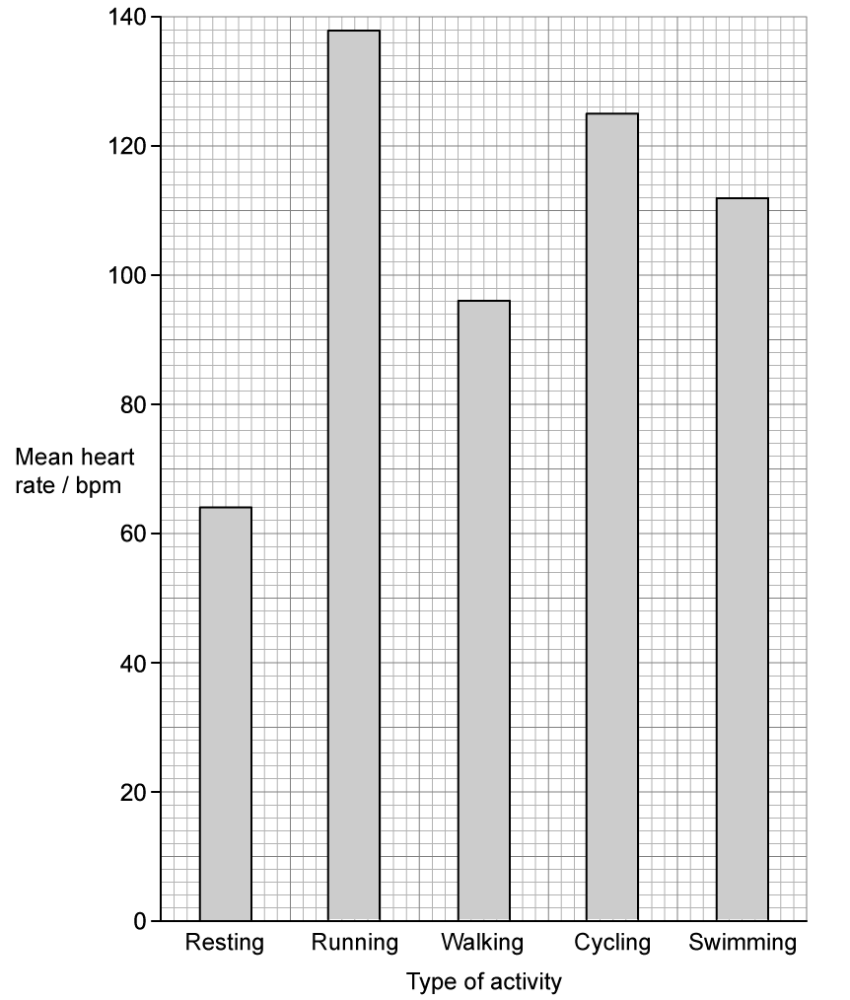

**Fig. 1**

(i) State **two **control variables the scientist should have ensured throughout the investigation.

[2]

(ii) Describe the results of the investigation.

[3]

**Q17** [3 marks]

Describe how the scientist could have measured and recorded heart rate.

**Q17** [3 marks]

#### Extended

Explain the effect swimming has on heart rate.

### Q18 — easy — 8 marks

**Q18** [4 marks]

The heart is part of the circulation system.

Fig. 1 shows a mammalian heart.

**Fig. 1**

Identify structures labelled **A** to **D** on Fig. 1.

**Q18** [1 mark]

**Extract:**

The heart is part of the circulation system.

Fig. 1 shows a mammalian heart.

**Fig. 1**

Identify structures labelled **A** to **D** on Fig. 1.

Identify the septum on Fig. 1 from part (a).

**Q18** [1 mark]

#### Extended only

Explain why the human circulation system is described as a double circulation system.

**Q18** [2 marks]

#### Extended only

Describe the function of the right side of the heart.

### Q19 — medium — 9 marks

**Q19** [6 marks]

#### Extended Only

Fig. 1 shows a photomicrograph of human blood.

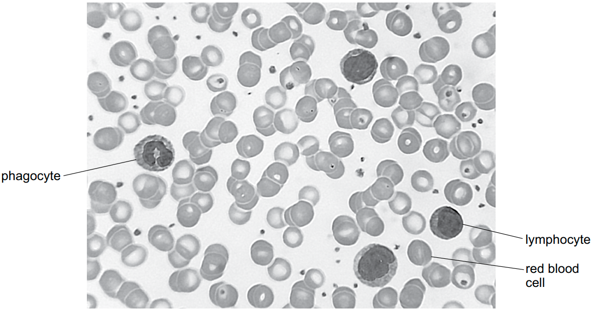

**Fig. 1**

Describe the differences in appearance and the functions of the three cells labelled in Fig. 1.

*Source: 2023 970/04 Q3A*

**Q19** [3 marks]

#### Extended Only

Fig. 2 shows some of the stages of blood clotting.

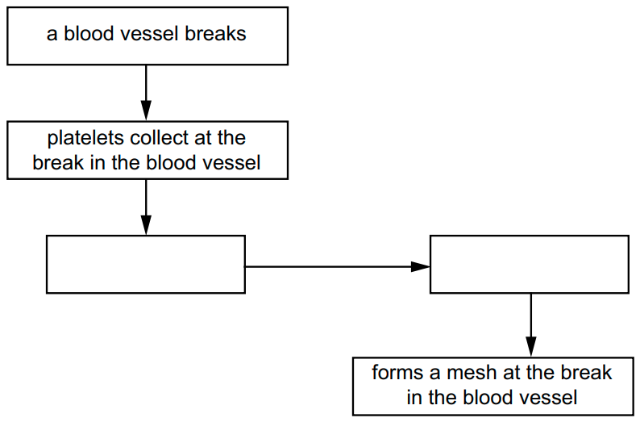

**Fig. 2**

(i) Complete Fig. 2 by filling in the two empty boxes.

[1]

(ii) State **two** roles of blood clotting.

[2]

*Source: 2023 970/04 Q3B*

### Q20 — easy — 7 marks

**Q20** [4 marks]

A student completed different types of activity.

She measured her pulse rate during each type of activity in beats per minute (bpm).

The results are shown in Fig. 1.

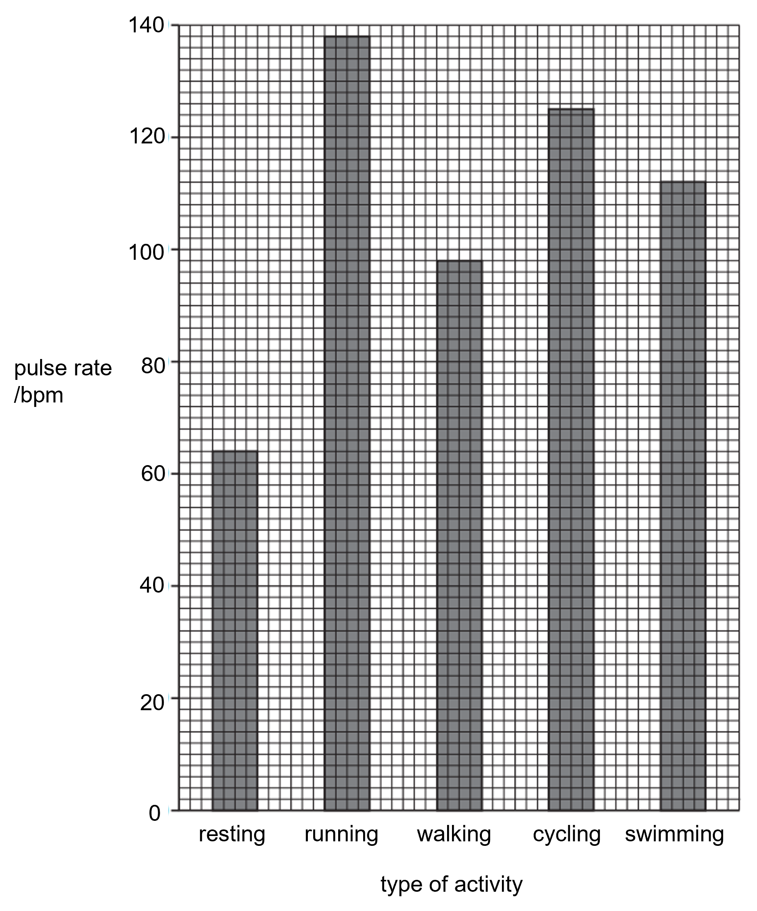

**Fig. 1**

Use Fig. 1 to answer these questions.

(i)

State the type of activity that results in the highest pulse rate.

[1]

(ii)

State the pulse rate of the student when she was cycling. Give your answer in bpm.

[1]

(iii)

Calculate the percentage increase in her pulse rate between resting and walking.

Show your working and give your answer to the nearest whole number.

[2]

*Source: 2018 (Series 1) 0610/31 Q3A*

**Q20** [1 mark]

Measuring the pulse is one way of monitoring the activity of the heart.

State **one other** way of monitoring the activity of the heart.

*Source: 2018 (Series 1) 0610/31 Q3B*

**Q20** [2 marks]

Describe the changes to a person’s breathing during exercise.

*Source: 2018 (Series 1) 0610/31 Q3C*

### Q21 — hard — 13 marks

**Q21** [2 marks]

The blood has many components.

Fig. 1 shows a micrograph of a blood smear.

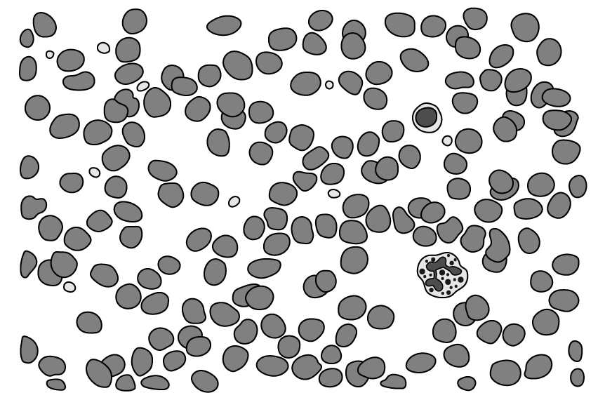

**Fig. 1**

On the diagram, identify a red blood cell **and **a white blood cell.

**Q21** [4 marks]

**Extended Tier Only**

Platelets are a component of blood that have an important role in blood clotting.

Describe the process of blood clotting by platelets. Include an explanation of the role played by the clot in protecting the body.

**Q21** [3 marks]

**Extract:**

Difference in death rates = 72 - 57 = 15 ; Divide by original value 15 ÷ 72 = 0.208; 0.208 x 100 =21 (%) ; Accept values in the range of 71 to 73 for year 2001 reading, and 56 to 58 for year 2017 reading

Blood clots can sometimes form in veins around the body. This is called a venous thromboembolism (VTE) and can be associated with postoperative complications following surgery.

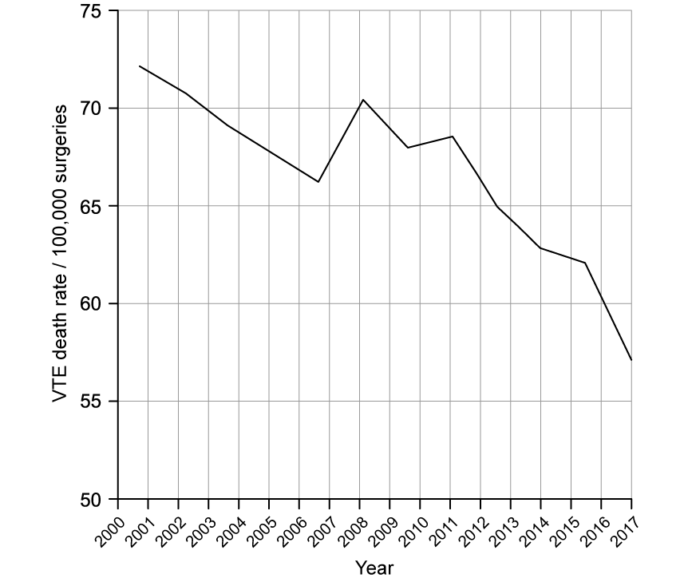

Calculate the percentage decrease in VTE death rates between 2001 and 2017.

**Q21** [4 marks]

**Extended Tier Only**

Veins are a type of blood vessel found in mammals.

Compare the structure **and** function of veins with that of arteries.

### Q22 — hard — 12 marks

**Q22** [2 marks]

The coronary arteries supply the heart muscle tissue with blood.

Fig. 1 shows a coronary artery with a blockage.

**Fig. 1**

Explain the effect this blockage could have on heart muscle cells.

**Q22** [3 marks]

A blocked coronary artery can lead to coronary heart disease.

Table 1 shows information about blood flow through coronary arteries in two people.

Person **X** was diagnosed with coronary heart disease while person **Y** does not have coronary heart disease.

**Table 1**

| **person** | **blood flow through coronary arteries /**  **cm****3**** min ****-1** |
|---|---|
| **X** | 167 |
| **Y** | 295 |

(i) Explain the difference in blood flow through the coronary arteries for persons **X** and **Y**.

[1]

(ii) Calculate the volume of blood flowing through the coronary arteries of person **X** in 1 hour.

Give your answer in dm3.

[2]

**Q22** [4 marks]

A blockage of the coronary artery can be caused by fatty deposits called ‘plaques’. Drugs called statins can be taken to help prevent a blockage.

Fig. 2 shows the effects of the treatment of one person with four different statins (**A**, **B**, **C** and **D**) over a period of 10 years. The arrows show when each new treatment was started.

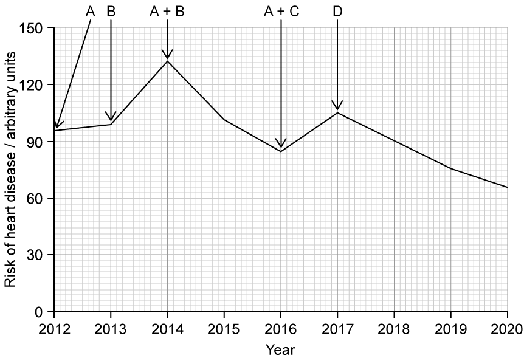

**Fig. 2**

Determine a conclusion on the effectiveness of the statin treatments in reducing the risk of coronary heart disease for this person.

**Q22** [3 marks]

**Extract:**

A blockage of the coronary artery can be caused by fatty deposits called 'plaques'. Drugs called statins can be taken to help prevent a blockage.  Fig. 2 shows the effects of the treatment of one person with four different statins (A, B, C and D) over a period of 10 years. The arrows show when each new treatment was started.  Determine a conclusion on the effectiveness of the statin treatments in reducing the risk of coronary heart disease for this person.  A conclusion of the treatments is... Any four of the following: - A + B is effective (treatment) / lowers risk of coronary heart disease (after treatment started); - D (alone) is most effective (treatment) / lowest risk of coronary heart disease (after treatment started); - A alone is more effective than B (alone) OR A alone and B alone increase risk of coronary heart disease; - A + C / B (alone) is the least effective treatment / has the greatest risk of coronary heart disease; - Cannot tell if C (alone) is effective OR treatment C alone has not been tested;

The data was used to generate a report with the claim: "Coronary heart disease can be cured by statins".

Evaluate the claim made.
