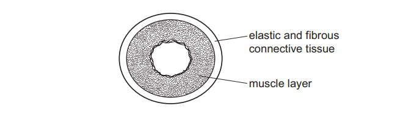
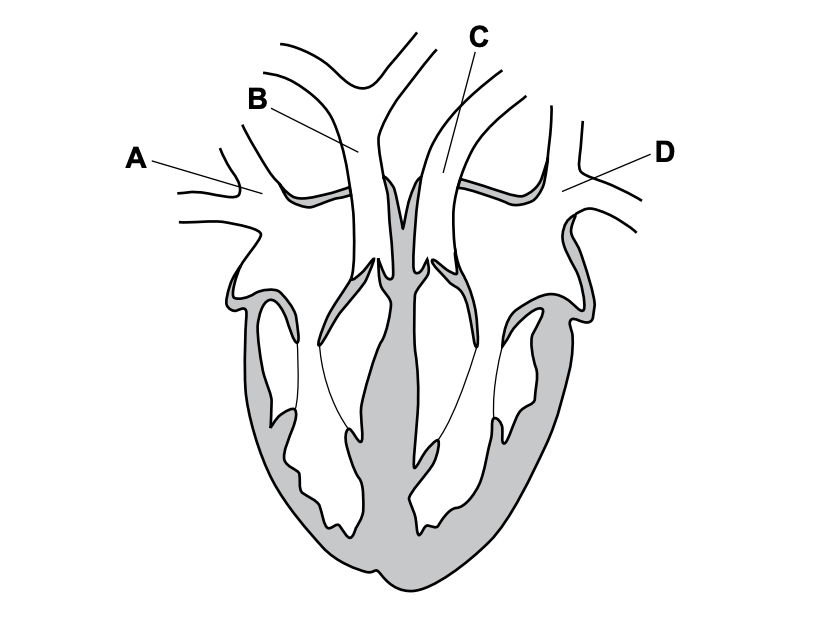

# Exam Questions — Circulatory Systems, Heart & Blood Vessels
**9. Transport in Animals** · Cambridge (CIE) IGCSE biology (0610 & 0970)
> Source: [https://www.savemyexams.com/igcse/biology/cie/23/topic-questions/](https://www.savemyexams.com/igcse/biology/cie/23/topic-questions/) · 29 questions across 1 sets

## Multiple Choice Questions (29 questions)

### Q1 — hard — 1 marks

**Q1** [1 mark]

Below are statements about the components of blood and their functions.

1. White blood cells produce antibodies and carry out phagocytosis
2. Red blood cells transport oxygen using haemoglobin
3. Platelets transport hormones and nutrients around the body
4. Plasma transports carbon dioxide and urea

Which statements are correct?

### Q2 — medium — 1 marks

**Q2** [1 mark]

Which of the following correctly lists features of a capillary?

### Q3 — hard — 1 marks

**Q3** [1 mark]

A student recorded their pulse rate immediately after stopping exercise, and then every minute for 6 minutes. The results are shown in the table.

| **Time (min)** | **Pulse rate (bpm)** |
|---|---|
| 0 | 175 |
| 1 | 135 |
| 2 | 110 |
| 3 | 89 |
| 4 | 68 |
| 5 | 66 |
| 6 | 66 |

Which of the following statements is correct?

### Q4 — hard — 1 marks

**Q4** [1 mark]

Look at the sentences below and select the correct answer

1. The right ventricle contains ......... blood
2. Blood from the right ventricle flows to the .........
3. The blood flows out of the right ventricle via the .........

### Q5 — medium — 1 marks

**Q5** [1 mark]

The following are statements about blood.

1. Red blood cells transport oxygen.
2. Plasma transports hormones.
3. Platelets destroy pathogens.

Which statements are correct?

### Q6 — medium — 1 marks

**Q6** [1 mark]

The diagram shows the blood vessels associated with the liver.

What is the blood vessel labelled X?

### Q7 — easy — 1 marks

**Q7** [1 mark]

How does blood exit the heart?

### Q8 — medium — 1 marks

**Q8** [1 mark]

The diagram shows the circulatory system of a fish.

Where in the circulatory system is the oxygen concentration lowest?

*Source: june 2022 paper 2 Q17*

### Q9 — medium — 1 marks

**Q9** [1 mark]

Which process is slower than normal in a person with very few platelets?

*Source: June 2022 paper 1 Q20*

### Q10 — easy — 1 marks

**Q10** [1 mark]

The diagram shows a cross-section through the heart of a mammal.

Which row correctly identifies P, Q and R?

|   | P | Q | R |
|---|---|---|---|
| **A** | valve | right atrium | right ventricle |
| **B** | left atrium | valve | left ventricle |
| **C** | right ventricle | right atrium | valve |
| **D** | right atrium | valve | right ventricle |

*Source: June 2022 paper 1 Q19*

### Q11 — easy — 1 marks

**Q11** [1 mark]

What is a function of some white blood cells?

*Source: June 2021 0970/11 Q21*

### Q12 — easy — 1 marks

**Q12** [1 mark]

The diagram shows a cross-section through a human blood vessel.

Which type of blood vessel does the diagram show?

*Source: June 2021 0970/11 Q20*

### Q13 — medium — 1 marks

**Q13** [1 mark]

What are the main vessels carrying blood to and from the kidney?

|   | to kidney | from kidney |
|---|---|---|
| **A** | pulmonary artery | pulmonary vein |
| **B** | pulmonary vein | pulmonary artery |
| **C** | renal artery | renal vein |
| **D** | renal vein | renal artery |

*Source: June 2021 0970/11 Q19*

### Q14 — medium — 1 marks

**Q14** [1 mark]

What happens to the heart valves when the ventricles contract?

|   | atrioventricular valves | semilunar valves |
|---|---|---|
| **A** | close | close |
| **B** | close | open |
| **C** | open | close |
| **D** | open | open |

*Source: Specimen 2023 0970/02 Q19*

### Q15 — easy — 1 marks

**Q15** [1 mark]

Which part of the blood contains haemoglobin?

*Source: Specimen 2023 0970/01 Q19*

### Q16 — easy — 1 marks

**Q16** [1 mark]

The diagram shows a section through a human heart.

Which blood vessel is the pulmonary vein?

*Source: Specimen 2023 0970/01 Q18*

### Q17 — easy — 1 marks

**Q17** [1 mark]

Which row of the table below shows the correct chambers of the heart, from those with the thinnest walls to those with the thickest?

| ** ** | thinnest **→** thickest |   |   |
|---|---|---|---|
| **A** | left ventricle | right ventricle | left atrium |
| **B** | left atrium | left ventricle | right ventricle |
| **C** | right ventricle | left atrium | left ventricle |
| **D** | left atrium | right ventricle | left ventricle |

### Q18 — medium — 1 marks

**Q18** [1 mark]

#### Extended

Which of the following is a correct explanation as to why mammals have a double circulatory system?

### Q19 — medium — 1 marks

**Q19** [1 mark]

#### Extended

The diagram below shows a vertical section through a human heart.

Which row of the following table has the correct names for the structures labelled in the diagram?

| ** ** | X | Y | Z |
|---|---|---|---|
| **A** | atrioventricular valve | semilunar valve | septum |
| **B** | semilunar valve | atrioventricular valve | septum |
| **C** | semilunar valve | semilunar valve | atrioventricular valve |
| **D** | atrioventricular valve | atrioventricular valve | septum |

### Q20 — easy — 1 marks

**Q20** [1 mark]

#### Extended

The blood contains lymphocytes.

What is their purpose?

### Q21 — medium — 1 marks

**Q21** [1 mark]

Some components of the blood of a mammal are shown in the image below.

Which row of the table has the correct cells from the image above assigned to their names?

| ** ** | lymphocyte | phagocyte | platelets |
|---|---|---|---|
| **A** | 4 | 2 | 3 |
| **B** | 2 | 4 | 3 |
| **C** | 1 | 2 | 1 |
| **D** | 2 | 4 | 1 |

### Q22 — easy — 1 marks

**Q22** [1 mark]

Which of the following statements would be incorrect for most of the veins in the human body?

### Q23 — medium — 1 marks

**Q23** [1 mark]

The image below shows a cross-section of a blood vessel taken from an arm.

Which type of blood vessel is shown in the image, and in which direction will blood flow?

| ** ** | type of vessel | direction of flow | oxygenation of blood |
|---|---|---|---|
| **A** | capillary | S to T | low |
| **B** | vein | T to S | high |
| **C** | artery | S to T | high |
| **D** | vein | T to S | low |

### Q24 — hard — 1 marks

**Q24** [1 mark]

#### Extended

Four different stages in one heartbeat are shown in the diagram below.

Which of the following depicts a correct order of stages?

### Q25 — hard — 1 marks

**Q25** [1 mark]

Which of the following depicts the correct order of stages in the formation of a blood clot?

### Q26 — hard — 1 marks

**Q26** [1 mark]

Which of the following would be found dissolved in the blood plasma of a human?

### Q27 — medium — 1 marks

**Q27** [1 mark]

#### Extended

The diagram below shows the human heart and some of the blood vessels associated with it.

Before blood in P reaches Q, what must it do?

### Q28 — hard — 1 marks

**Q28** [1 mark]

Which blood vessel has a relatively low carbon dioxide concentration, a high oxygen concentration and a low blood pressure?

### Q29 — hard — 1 marks

**Q29** [1 mark]

In which list of the following do all three blood vessels carry deoxygenated blood?
