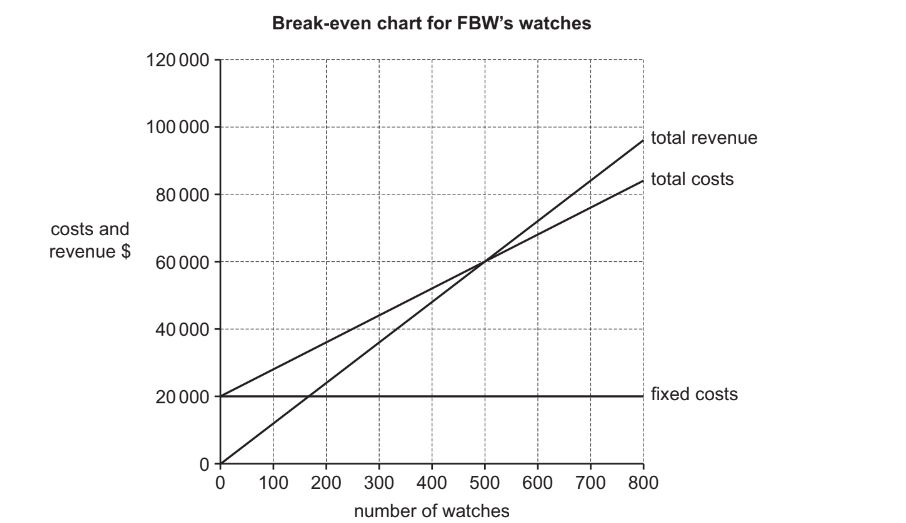

# Exam Questions — 2.3 Recruitment, Selection & Training
**2. People in Business (HR)** · Cambridge (CIE) IGCSE business (0450, 0986 & 0264, 0774)
> Source: [https://www.savemyexams.com/igcse/business/cie/23/topic-questions/](https://www.savemyexams.com/igcse/business/cie/23/topic-questions/) · 27 questions across 1 sets

## Exam Questions (27 questions)

### Q1 — easy — 4 marks

**Q1** [4 marks]

Outline **two **factors DZD should consider when deciding which applicants to recruit.

> **[case-study]**
> DZD is a large parcel delivery business. Many of its employees work part-time. DZD’s directors are planning to expand the business and have to decide on a suitable source of finance for 20 new vehicles. DZD will also recruit 60 new employees. The Human Resources Director is preparing a job description for the new employees. She is considering using Maslow’s hierarchy of needs to increase the motivation of DZD’s employees.

*Source: June 2023 0450/11 Q3C*

### Q2 — hard — 12 marks

**Q2** [12 marks]

**Extract:**

Cell Covers (CC) 

Aisha worked for several years for a company that repairs mobile (cell) phones in country Z. She had always wanted to be her own boss and decided to leave her job to set up CC to produce covers for mobile phones. She went into partnership with her brother, Aruna. He worked as an Operations Manager for a company producing children’s clothes. 

The sources of finance for the business were \$10 000 of savings from each partner and a bank loan of \$10 000. CC was also given a government grant to help the new business get started. CC leased a factory, bought some equipment and had to pay some expenses before the business had regular cash inflows. 

CC’s current product is a range of standardised phone covers which are sold in the mass market. These are sold using a competitive pricing method through mobile phone shops. CC employs 10 skilled production workers who are paid just above the legal minimum wage. These workers have been trained how to operate the equipment and work as a team on the production line. During the production process there is a lot of waste plastic produced and CC sends this to landfill sites. The business has just completed its second year of trading. 

CC is about to launch a new range of individual personalised phone covers. It will need to recruit 2 additional production workers. Aruna knows that the marketing mix for this new product may have to be different to the marketing mix used for the standardised products. The new product will be aimed at a niche market of high income consumers between the ages of 18 to 25. There are few other competitors in this market at present.

{align=center} **Appendix 1 **

{align=center} **Newspaper article in Main News**

Country Z has been in a recession but the economy is now  growing rapidly and unemployment is falling. With higher incomes the majority of people now own a mobile phone. This makes communication easier. Mobile banking is becoming more popular and it is used by a large percentage of the population.

{align=center} **Appendix 2 **

{align=center} **Advertisement for CC’s standardised mobile phone covers**

Do you want to protect your phone from damage? Then buy a phone cover from CC. Your phone will never be damaged if you use one of our high quality covers!! 

We offer a range of standardised covers at competitive prices. The CC range has many different colours and designs so you will stand out from the crowd.

{align=center} **Appendix 3 **

{align=center} **Summary of CC’s financial information from the end of the second year of trading (\$)**

{align=center} 

| Revenue | 800 000 |
| --- | ---: |
| Cost of sales | 400 000 |
| Gross profit | 400 000 |
| Expenses | 250 000 |
| Profit | 150 000 |
| Current Assets | 20 000 |
| of which: Inventory | 5 000 |
| Current liabilities | 15 000 |

Consider the advantages and disadvantages of the following **three **methods of employee selection. Which method should CC use when recruiting production workers? Justify your answer.

- Application form
- Interview
- Aptitude tests

Refer to the following [insert ](https://cdn.savemyexams.com/uploads/2024/09/nov-2020-paper-22-case-study-v2---new.pdf)when answering the question

*Source: Nov 2020 0450/22 Q2B*

### Q3 — hard — 12 marks

**Q3** [12 marks]

**Extract:**

{align=center} **Safari Adventures (SA) **

Tokumbo is a sole trader. He started SA 2 years ago in country X. Tokumbo had previously worked for a company selling holidays. SA organises safari tours which take tourists to view wild animals on a game reserve. Most of SA’s customers are tourists from other countries. Tokumbo did not have any objectives when he started SA but knows they are important for his business. 

SA uses its own vehicles for the 7 day safari tours and provides accommodation in small local hotels. Tokumbo employs 4 safari guides, 1 for each of the 4 vehicles. The safari guides drive the tourists around the game reserve. There is 1 additional employee who helps Tokumbo in the office with administration. Tokumbo thinks SA needs a website so tourists can book directly with them rather than booking through holiday companies that charge SA a fee. 

Tokumbo is considering the following three options for the future growth of SA safari tours: 

- Option 1 - increasing the number of safari guides and vehicles to increase the number of customers from the existing target market
- Option 2 – targeting young people who want to camp and sleep in a tent on their safari
- Option 3 - targeting high-income tourists who prefer to stay in luxury hotels

Information about these three options is outlined in Appendix 3. 

Tokumbo plans to provide more training for his employees whichever option he chooses. He wants his existing employees to have a wider knowledge of the wild animals on the game reserve and to be able to provide high-quality customer service. Tokumbo has to decide which method of training to use.

{align=center} **Appendix 1 **

{align=center} **Newspaper article in Main News, September 2022 **

{align=center} **Tourism takes off**

Country X is becoming a popular holiday destination for tourists from other countries.

There is an increased demand from high-income tourists who want to stay in luxury hotels whilst on safari tours. These tourists are willing to pay high prices. There is also a new trend for younger people who want cheaper holidays. They prefer to camp and sleep in tents on game reserves rather than stay in hotels. 

Are the many safari businesses in country X ready to target these new markets? 

The use of e-commerce to find and book safari tours by tourists from other countries is offering both opportunities and threats to businesses in country X. 

The inflation rate in country X has increased to 4% which may affect some of our local safari businesses.

{align=center} **Appendix 2 **

{align=center} **Email from Tokumbo’s accountant**

To: Tokumbo 

From: Accountant 

Subject: Source of finance for the new vehicles 

New vehicles will be needed whichever option you choose for the future growth of your business. 

I have considered several sources of finance you could use for the new vehicles. Interest rates on bank loans have fallen to 2% whilst interest rates on savings are 3%. I think you should choose from one of the following sources: 

- Leasing
- Bank loan
- Retained profit

We can meet to discuss these sources if that would help you to decide.

{align=center} **Appendix 3 **

{align=center} **SA’s three options for a 7 day safari tour**

|   | Option 1 More existing safari tours | Option 2 Camping safari tours | Option 3 Luxury safari tours |
| --- | :---: | :---: | :---: |
| Forecast number of tourists per week | 16 | 32 | 10 |
| Total costs per week for SA to provide these safari tours | \$12 000 | \$8000 | \$20 000 |
| Average cost per tourist | \$750 | ? | ? |
| Price per tourist | \$1000 | \$400 | \$2400 |

Consider the advantages and disadvantages of two methods of training Tokumbo could use for his existing employees. Which method should he use? Justify your answer.

Refer to the following [insert ](https://cdn.savemyexams.com/uploads/2024/09/nov-2022-paper-21-case-study---new.pdf)when answering the question

*Source: Nov 2022 0450/21 Q4B*

### Q4 — hard — 12 marks

**Q4** [12 marks]

**Extract:**

{align=center} **Cherished Chocolates (CC)**

CC is a public limited company. It employs 4000 workers in country X and many are members of a trade union. CC has manufactured chocolate bars in country X for 50 years. It imports most of its raw materials, such as cocoa beans. Over the last 10 years CC has expanded and now sells in other countries. Many of these countries have no trade restrictions. The Directors of CC know that globalisation has opportunities and threats for CC. 

CC produces a number of brands of chocolate bars, such as Tiabar, in country X. Its most popular chocolate bar, Choco, has the highest market share. The total market for chocolate bars is no longer growing in country X. CC plans to reduce the number of brands it sells in country X. It has to decide which of the two brands shown in Appendix 1 to stop selling. 

NM operates in country Z and sells its own brands of chocolate bars, including Nuttybar. NM employs 500 workers. In country Z chocolate bars are distributed through small retail outlets. The wage rates in country Z are lower than in country X. However, incomes in country Z are starting to rise. 

The Directors of CC are planning to take over NM to expand into this market rather than setting up a factory. The takeover will cost \$35 million, some of which will be financed by a bank loan. The shareholders of NM are being offered CC shares in exchange for NM shares. 

The Directors of CC know there might be diseconomies of scale after the takeover. They also have to decide who will be the Operations Manager for NM’s factory in country Z. They could keep NM’s existing Operations Manager or move CC’s Operations Manager from country X. Information about the two managers is shown in Appendix 2.

{align=center} **Appendix 1 **

{align=center} **The product life cycles of two of CC’s brands of chocolate bars in country X**

**Option 1 – stop producing Tiabar **

A brand aimed at young children which is a new target market for CC. The market research at the development stage showed positive results from test marketing and sales have been growing steadily. There are many multinational chocolate bar companies targeting this age group. 

**Option 2 – stop producing Choco** 

The market leader in country X. It is a well established brand targeting adults. Sales are high but have not been increasing for several years. No new competitors have entered this market in the last two years.

{align=center} **Appendix 2**

{align=center} **Information about the two Operations Managers for NM’s factory in country Z**

|   | **Samuel ****CC’s Operations Manager** | **Ritesh ****NM’s Operations Manager** |
| --- | :---: | :---: |
| **Qualifications/Skills** | 8 IGCSEs On-the-job training in the production of chocolate bars | 5 IGCSEs and 2 A levels Degree in Business Management |
| **Experience** | 10 years as the Operations Manager for CC Worked for CC for 20 years and knows the production and warehouse storage requirements for all of its brandsHas links with all CC’s suppliers of high-quality ingredients such as cocoa beans and milk | 2 years as the Operations Manager for NM Purchased all the ingredients, including nuts, for NM’s productsPreviously worked for 5 years for a chocolate bar manufacturing business in country Z Worked for 5 years for a small retailer in country Z |

{align=center} 

{align=center} **Appendix 3 **

{align=center} **Selected information from the financial statements for CC and NM for 2021**

{align=center} 

|   | **CC** | **NM** |
| --- | :---: | :---: |
| **Long-term bank loan** | \$10m | \$5m |
| **Total shareholders’ equity** | \$200m | \$30m |
| **Current ratio** | 2 | 1 |
| **Acid test ratio** | 1.2 | 0.33 |
|   |   |   |
| **Profit for the year** | \$42m | \$3.5m |
| **Profit margin** | 25% | 15% |
| **Return on Capital Employed (ROCE)** | 20% | 10% |

Consider the information about the **two **managers outlined in Appendix 2. Who should be chosen as the Operations Manager for the NM factory? Justify your answer.

Refer to the following [insert ](https://cdn.savemyexams.com/uploads/2024/09/nov-2022-paper-22-case-study-v2--new.pdf)when answering the question

*Source: Nov 2022 0450/22 Q3B*

### Q5 — hard — 12 marks

**Q5** [12 marks]

**Extract:**

{align=center} **Titantic Toys (TT)**

TT is a large manufacturer of toys based in country Y. It is a public limited company and has been trading for 20 years. TT’s products are designed for children up to the age of 5. 

TT has benefited from economies of scale as it has grown. The company has been able to buy specialist new equipment for the flow production line in its factory. TT’s factory uses lean production methods, such as Kaizen and just-in-time inventory control. All of its employees are well-motivated and few leave each year. The company provides training for employees in all departments of the business whenever there are any changes such as introducing new equipment or new products.

Currently, TT only sells its products in country Y but it plans to expand into country Z and become a multinational company. TT could buy a toy manufacturer located in country Z or build its own factory there. The government of country Z will need to give permission for TT to build a new factory. Either option will cost \$10 million. The directors are worried about liquidity as TT expands. 

TT has developed a new toy for children under 5. The toy is a soft, easy to hold doll which speaks 4 different languages. The Marketing Director thinks this new toy will help TT expand into country Z, as there are no other products like it in that country. TT is recruiting a new Marketing Manager for country Z. Details of the shortlisted applicants are in Appendix 3. 

The marketing department has already carried out research in country Z and some results are shown in Appendix 1.

{align=center} **Appendix 1 **

{align=center} **Market research results for country Z**

{align=center} 

{align=center} **Appendix 2 **

{align=center} **Extract from TT’s statement of financial position, 2021 and 2022 (at 31 March)**

|   | **2021 (\$m)** | **2022 (\$m)** |
| --- | :---: | :---: |
| **Inventories** | 5 | 5 |
| **Accounts receivable (debtors)** | 5 | 8 |
| **Cash** | 0 | 2 |
|   |   |   |
| **Accounts payable (creditors)** | 4 | 5 |
| **Bank overdraft** | 1 | 0 |
|   |   |   |
| **Long-term bank loans** | 5 | 10 |
|   |   |   |
| **Total Shareholder’s equity** | 40 | 50 |
|   |   |   |
| **Current ratio** | 2 | ? |
| **Acid test ratio** | 1 | ? |

{align=center} **Appendix 3 **

{align=center} **Three applicants for Marketing Manager for country Z**

|   | Labiba | Shahin | Samihah |
| --- | --- | --- | --- |
| Qualifications/Skills | 10 IGCSEs and 3 A levels Speaks 2 languages | 5 IGCSEs and 2 A levels Degree in Business Management | 8 IGCSEs Speaks 6 languages |
| Experience | 5 years working for TT as the Assistant Marketing Manager in country Y | 2 years as the Marketing Manager of a small food company in country Z | 10 years as the Marketing Manager of a large toy company in country Y |

Using Appendix 3 and other information, consider the **three **applicants for the job of Marketing Manager for country Z. Who is the best applicant for the job? Justify your answer.

Refer to the following [insert ](https://cdn.savemyexams.com/uploads/2024/09/jun-2022-paper-22-case-study-v2---new.pdf)when answering the question

*Source: June 2022 0450/22 Q3B*

### Q6 — medium — 6 marks

**Q6** [6 marks]

Do you think experience is the most important factor for a business to consider when recruiting a new manager? Justify your answer.

*Source: Nov 2020 0450/12 Q1E*

### Q7 — medium — 6 marks

**Q7** [6 marks]

Explain **two **factors UDig should consider when deciding which mines to close.

> **[case-study]**
> UDig is a large mining company based in country B. UDig is in the private sector. It supplies businesses in country B with 30% of the coal they need and the rest is imported. UDig now has eight mines but plans to close two of them. This will threaten 1800 employees with redundancy. The Managing Director said: ‘I blame the appreciation of country B’s exchange rate and new legal controls, including those to protect the environment. The Government should help private sector businesses.’

*Source: Specimen 0450/01 Q1D*

### Q8 — medium — 8 marks

**Q8** [8 marks]

**Extract:**

{align=center} **Sports Safety Equipment (SSE)**

SSE manufactures sports safety equipment in country Z. It is a public limited company which has been successful for over 30 years. The main product SSE manufactures is safety helmets for different sports, such as bicycle riding, cricket and skateboarding. SSE has one large factory making the safety helmets. The factory uses flow production. The production workers each specialise in one task on the production line. SSE’s raw materials are imported.

SSE sells its helmets in several other countries and is planning to expand into many more. It will need to carry out market research before entering new markets in other countries. Each country has different sports that are popular and the style of helmets varies from country to country.

SSE plans to build its own factories in its most important markets in other countries and will need to choose a suitable source of finance. The Human Resources Director has decided to use internal recruitment for the managers of the new factories. There will need to be effective communication between the managers of the new factories and SSE’s head office in country Z.

Most of SSE’s sales in country Z are through sports equipment shops. Customers like to try on the helmets to check they fit correctly. SSE currently sells its helmets in other countries through its website.

SSE is also increasing its product range. The latest new product being developed is a children’s cricket helmet. A break-even chart for this new product is shown in Appendix 3.

{align=center} **Appendix 1 **

{align=center} **Extract from SSE’s website **

{align=center} **If you want the best protection when playing sport then buy an SSE safety helmet!**

{align=center} We supply a wide range of safety helmets for you when playing sport. 

{align=center} Whatever the sport - SSE produces a helmet for you. 

{align=center} You can order directly from this website by entering your head measurements below. 

{align=center} Get the perfect fit for you! 

{align=center} **Appendix 2 **

{align=center} **Email from SSE’s Managing Director to SSE’s Finance Director**

To: Finance Director 

From: Managing Director 

Date: 1 September 2023 

Re: Demand for SSE’s products Demand for SSE’s products in country Z is forecast to increase. Our government has imposed import tariffs on safety helmets. We may be able to increase our prices. 

The exchange rate in country Z is expected to fall. However, other countries have introduced import quotas on safety helmets. 

We will have to consider all the likely effects of these changes.

{align=center} **Appendix 3 **

{align=center} **Projected weekly break-even chart for SSE’s new children’s cricket helmet**

{align=center} The maximum output and sales for this product is 1000 units per week.

Explain **one **advantage and **one **disadvantage to SSE of using internal recruitment for its new managers.

Refer to the following [insert ](https://cdn.savemyexams.com/uploads/2024/09/nov-2023-paper-2-case-study-v2---new.pdf)when answering the question.

*Source: Nov 2023 0450/22 Q3A*

### Q9 — medium — 8 marks

**Q9** [8 marks]

**Extract:**

{align=center} **Protective Hats (PH)**

PH is a large public limited company based in country Z. It has been operating successfully for 50 years. PH produces a range of protective hats for employees working on construction sites, in factories or mines. It has a reputation for producing high-quality products and sells its hats around the world.

PH is currently the market leader in country Z. To remain competitive PH regularly carries out market research to find out if new products are needed. PH needs to ensure its market research data is accurate, so that it can develop the best new protective hats.

PH’s only factory is in country Z. It has 100 production employees. They work on a flow production line and carry out the same tasks every day. PH pays these employees the minimum wage and there have been complaints about working conditions. Some of the employees are considering becoming members of a trade union.

PH’s directors plan to expand the company by opening factories in other countries to produce protective hats. They think there are many benefits for PH of becoming a multinational company. They are aware that there is growing demand for protective hats in many developing countries where construction and manufacturing industries are expected to continue to have strong growth in the next 10 years.

{align=center} **Appendix 1 **

{align=center} **Advertisement for PH’s products**

{align=center} PH’s protective hats will protect your employees when at work. 

{align=center} We supply many of the leading construction, manufacturing and mining companies across the world. 

{align=center} High quality is guaranteed. 

{align=center} PH’s hats can be ordered online from our website.

{align=center} **Appendix 2**

{align=center} **Email to PH’s Managing Director from PH’s Human Resources Director**

To: Managing Director 

From: Human Resources Director 

Date: 1 October 2023 

Re: Training 

After reviewing our current training, I think we need to increase the training we provide to new employees. Existing employees would also benefit from additional training as there have been issues with motivation. 

I know there are plans to introduce new equipment into the flow production line. When is this likely to happen? 

Can we please meet to discuss these issues?

{align=center} **Appendix 3 **

{align=center} **PH’s financial data for 2021 and 2022**

|   | **2021** | **2022** |
| --- | :---: | :---: |
| Revenue | \$100m | \$125m |
| Profit | \$20m | \$20m |
| Gross profit margin | 60% | 65% |
| Profit margin | 20% | 16% |

Explain **two **reasons why training is important to PH.

Refer to the following [insert ](https://cdn.savemyexams.com/uploads/2024/09/nov-2023-paper-2-case-study---new.pdf)when answering the question

*Source: Nov 2023 0450/21 Q3A*

### Q10 — medium — 6 marks

**Q10** [6 marks]

Do you think off-the-job training is the best method of training for a service sector business to use? Justify your answer.

*Source: Nov 2023 0450/12 Q4E*

### Q11 — medium — 6 marks

**Q11** [6 marks]

Explain **two **factors MRN should consider when deciding which shops to close.

> **[case-study]**
> MRN is a food retailer. It has 490 shops and 70,000 employees. MRN has announced plans to close 80 of its shops. The Human Resources Director said: ‘20% of management jobs will be removed. We want to encourage delegation. MRN will continue to follow legal controls over employment.’ MRN’s directors know it is important that businesses respond to increased competition.

*Source: Nov 2023 0450/11 Q4D*

### Q12 — medium — 6 marks

**Q12** [6 marks]

Do you think a service business should only employ part-time workers? Justify your answer.

*Source: June 2023 0450/11 Q3E*

### Q13 — medium — 6 marks

**Q13** [6 marks]

Explain **two** benefits to FBW of having full-time employees.

> **[case-study]**
> FBW manufactures watches using job production. It employs 5 full-time production employees. Each worker is offered regular training. Last year FBW sold 600 watches. The Managing Director plans to use break-even analysis to help decide whether to increase the price of its products. FBW’s current break-even chart is shown in Fig.
> 
> 

*Source: June 2023 0450/12 Q1D*

### Q14 — medium — 6 marks

**Q14** [6 marks]

Do you think an organisation should always use external recruitment when recruiting skilled employees? Justify your answer.

*Source: June 2022 0450/11 Q4E*

### Q15 — medium — 8 marks

**Q15** [8 marks]

Explain **four **effects of training on a business.

*Source: June 2022 0450/22 Q4A*

### Q16 — medium — 6 marks

**Q16** [6 marks]

Do you think it is better for a tertiary sector business to use full-time employees rather than part-time employees? Justify your answer.

*Source: June 2021 0450/12 Q2E*

### Q17 — medium — 8 marks

**Q17** [8 marks]

**Extract:**

{align=center} **Gemma’s Jewels (GJ)**

Gemma set up GJ as a sole trader 5 years ago in country Z. She started by selling rings and bracelets from a rented shop. She used her own savings to start the business. The first year was successful. After this first year Gemma decided to expand by selling more expensive items of jewellery. Gemma thinks it is important to set clear business objectives. She wants her business to increase sales by 10% each year and to increase market share.

As the business grew Gemma needed more finance for a computer, inventory and working capital to avoid liquidity problems. She decided to convert the business to a private limited company and sell shares to members of her family. Gemma still owns more than 50% of the shares in GJ.

In 2019, Gemma purchased a franchise from Beautywise Jewellery. This means GJ is now only able to sell Beautywise products in its shop. GJ has to purchase all of its inventory from Beautywise and in addition pay 20% of gross profit to Beautywise. More details about the franchise are in the advertisement in Appendix 1.

Gemma has developed a website so customers can order online. Customers can also download a mobile (cell) phone app to view and order jewellery.

Gemma plans to open a second shop as a Beautywise franchise in a nearby town. She has to decide which method of sales promotion to use. GJ needs to recruit a manager for the new shop. The manager will be responsible for operating the shop and making most of the decisions about which items of inventory to buy. The manager will also need to ensure excellent customer service is provided and that the new employees are motivated and working efficiently.

{align=center} **Appendix 1 **

{align=center} **Advertisement for Beautywise Jewellery Franchise**

**Become a franchisee to sell Beautywise Jewellery and improve your chances of success!!**

What we offer you:

- Be the only shop in your area that sells Beautywise jewellery
- Beautywise will advertise nationally on television and in newspapers
- Help and advice on decoration of the shop and training for employees and the franchisee
- Ethically sourced jewellery imported especially for Beautywise
- The franchise fee is just \$50 000 per year!

{align=center} **Appendix 2 **

{align=center} **Newspaper article- Daily News **

**External factors affecting the jewellery market in country Z**

The demand for jewellery in country Z is likely to be affected by some recent changes. Consumers are becoming more aware of the ethical issues involved in jewellery production in some countries. The exchange rate of the currency of country Z is likely to depreciate over the next 12 months. The Government is planning changes to tax rates which might reduce the effects of the current economic boom.

{align=center} **Appendix 3 **

{align=center} **Information on three possible locations for the new shop**

| **Annual costs** | **Town A** | **Town B** | **Town C** |
| --- | --- | --- | --- |
| Shop rent | \$45 000 per year for 5 years | \$35 000 per year for 10 years | \$20 000 per year for 15 years |
| Wages and salaries | \$80 000 | \$70 000 | \$60 000 |
| Heating and lighting | \$5 000 | \$5 000 | \$3 000 |
| Estimated gross profit | \$400 000 | \$300 000 | \$200 000 |

Note: Franchise fee is \$50 000 per year and 20% of gross profit is paid to Beautywise.

Explain **four **requirements for the new manager that Gemma should include in the job specification for a shop manager.

Refer to the following [insert ](https://cdn.savemyexams.com/uploads/2024/09/nov-2020-paper-2-case-study---new.pdf)when answering the question.

*Source: Nov 2020 0450/21 Q2A*

### Q18 — medium — 6 marks

**Q18** [6 marks]

Explain **two** factors SRB should consider when deciding which managers to make redundant.

> **[case-study]**
> SRB is a bank which provides loans to business customers. SRB plans to make 100 managers’ jobs redundant from its 80 branches. This would remove one level of hierarchy. This is part of its plan to save \$1m in costs over the next 2 years. The Managing Director said: ‘SRB is working with the trade union about this plan. SRB will make more use of delegation.The bank has to respond to increased competition from online banks. SRB could either advertise more or develop new products and services.’

*Source: Nov 2020 0450/11 Q1D*

### Q19 — easy — 2 marks

**Q19** [2 marks]

Define ‘redundancy’.

*Source: Specimen 0450/01 Q1B*

### Q20 — easy — 2 marks

**Q20** [2 marks]

Identify **two **legal controls over employment.

*Source: Nov 2023 0450/11 Q4B*

### Q21 — easy — 2 marks

**Q21** [2 marks]

Define ‘job description’.

*Source: June 2023 0450/11 Q3A*

### Q22 — easy — 2 marks

**Q22** [2 marks]

Identify **two **reasons why a business might offer training to its employees.

*Source: June 2023 0450/12 Q1A*

### Q23 — easy — 4 marks

**Q23** [4 marks]

State **four **factors a business should consider when deciding which employees to make redundant.

*Source: Nov 2022 0450/12 Q3C*

### Q24 — easy — 2 marks

**Q24** [2 marks]

Define ‘on-the-job training’.

*Source: Nov 2022 0450/11 Q1A*

### Q25 — easy — 2 marks

**Q25** [2 marks]

Define ‘off-the-job training’.

*Source: June 2022 0450/12 Q2A*

### Q26 — easy — 4 marks

**Q26** [4 marks]

Identify **four **stages of the recruitment process.

*Source: Nov 2021 0450/11 Q4C*

### Q27 — easy — 4 marks

**Q27** [4 marks]

Outline **one** advantage and **one **disadvantage to APB of using on-the-job training.

> **[case-study]**
> Alex started APB as a sole trader business 4 years ago. APB provide printing services for local businesses such as leaflets and brochures. Alex thinks having a good location is important to any business. All APB’s 6 employees receive on-the-job training. Alex has a democratic leadership style and uses job rotation to help keep employees motivated. To meet an increase in demand, Alex plans to buy an additional printing machine. This will cost \$1 800. Alex has to decide on an appropriate source of finance.

*Source: June 2021 0450/11 Q3C*

