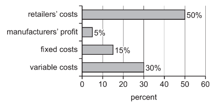

# Exam Questions — 6.3 Business & the Environment
**6. External Influences on Business Activity** · Cambridge (CIE) IGCSE business (0450, 0986 & 0264, 0774)
> Source: [https://www.savemyexams.com/igcse/business/cie/25/topic-questions/](https://www.savemyexams.com/igcse/business/cie/25/topic-questions/) · 14 questions across 1 sets

## Exam Questions (14 questions)

### Q1 — medium — 6 marks

**Q1** [6 marks]

Do you think businesses should prioritise profit over environmental responsibility? **Justify** your answer.

### Q2 — medium — 6 marks

**Q2** [6 marks]

> **[case-study]**
> Green Tech Industries manufactures chemical fertilisers. 800 people work in its production facility. All employees receive on-the-job training. GreenTech uses performance-related pay to motivate its workforce. Last year, GreenTech made a £2.3 million profit. Recent environmental monitoring has revealed that the company's operations are releasing harmful chemicals into nearby water sources. The Chief Executive said: 'We are aware of the pollution concerns and understand there will be significant implications for our business operations and stakeholder relationships.'

Explain **two **implications for GreenTech Industries of its operations polluting nearby water sources.

### Q3 — easy — 2 marks

**Q3** [2 marks]

**Identify two** advantages to a business of becoming more environmentally friendly.

### Q4 — easy — 4 marks

**Q4** [4 marks]

> **[case-study]**
> EcoManufacturing Ltd operates a chemical processing facility that produces industrial cleaning products. Recent government inspections have revealed that the company has been exceeding permitted emission levels for toxic gases and disposing of hazardous waste without proper treatment. The Environment Agency has issued formal warnings and is considering prosecution under the Environmental Protection Act. The company's insurance premiums have increased by 40% due to environmental liability concerns, and the local council is reviewing their operating licence. Legal experts estimate potential fines could reach £2 million if prosecuted successfully.

**Outline two** ways EcoManufacturing Ltd may be affected by legal controls related to the environment.

### Q5 — easy — 2 marks

**Q5** [2 marks]

**Identify two** ways a business could reduce waste.

### Q6 — easy — 4 marks

**Q6** [4 marks]

> **[case-study]**
> GreenTech Industries operates a large manufacturing plant producing electronic components. The business has recently faced significant criticism from local residents and environmental groups for polluting the nearby river with chemical waste. The company's reputation has been damaged, with several major clients threatening to cancel contracts. Market research shows that 78% of consumers now consider environmental responsibility when making purchasing decisions. The Managing Director is under pressure from shareholders to address these environmental concerns.

**Outline two** reasons why GreenTech Industries should respond to these environmental issues.

### Q7 — easy — 2 marks

**Q7** [2 marks]

**Identify two **ways a business could contribute to sustainable development.

*Source: Nov 2023 0450/12 Q2B*

### Q8 — hard — 12 marks

**Q8** [12 marks]

**Extract:**

**Cell Covers (CC) **

Aisha worked for several years for a company that repairs mobile (cell) phones in country Z. She had always wanted to be her own boss and decided to leave her job to set up CC to produce covers for mobile phones. She went into partnership with her brother, Aruna. He worked as an Operations Manager for a company producing children’s clothes.

The sources of finance for the business were \$10 000 of savings from each partner and a bank loan of \$10 000. CC was also given a government grant to help the new business get started. CC leased a factory, bought some equipment and had to pay some expenses before the business had regular cash inflows.

CC’s current product is a range of standardised phone covers which are sold in the mass market. These are sold using a competitive pricing method through mobile phone shops. CC employs 10 skilled production workers who are paid just above the legal minimum wage. These workers have been trained how to operate the equipment and work as a team on the production line. During the production process there is a lot of waste plastic produced and CC sends this to landfill sites. The business has just completed its second year of trading.

CC is about to launch a new range of individual personalised phone covers. It will need to recruit 2 additional production workers. Aruna knows that the marketing mix for this new product may have to be different to the marketing mix used for the standardised products. The new product will be aimed at a niche market of high income consumers between the ages of 18 to 25. There are few other competitors in this market at present.

**Appendix 1 **

**Newspaper article in Main News **

Country Z has been in a recession but the economy is now growing rapidly and unemployment is falling. With higher incomes the majority of people now own a mobile phone. This makes communication easier. Mobile banking is becoming more popular and it is used by a large percentage of the population.

**Appendix 2 **

**Advertisement for CC’s standardised mobile phone covers**

Do you want to protect your phone from damage? Then buy a phone cover from CC. Your phone will never be damaged if you use one of our high quality covers!!

We offer a range of standardised covers at competitive prices. The CC range has many different colours and designs so you will stand out from the crowd.

**Appendix 3 **

**Summary of CC’s financial information from the end of the second year of trading (\$)**

| Revenue | 800 000 |
|---|---|
| Cost of sales | 400 000 |
| Gross profit | 400 000 |
| Expenses | 250 000 |
| Profit | 150 000 |
| Current Assets | 20 000 |
| of which: Inventory | 5 000 |
| Current liabilities | 15 000 |

Consider how the changes in the following **three **government legal controls could affect CC.

- Increase in the minimum wage
- More controls over what can be stated in advertisements
- No waste plastic can be sent to landfill sites

Which change is likely to have the greatest effect on profit? **Justify **your answer.

Refer to the following [insert ](https://cdn.savemyexams.com/uploads/2024/09/nov-2020-paper-22-case-study-v2---new.pdf)when answering the question

*Source: Nov 2020 0450/22 Q4B*

### Q9 — hard — 12 marks

**Q9** [12 marks]

**Extract:**

**Furniture Outdoors (FO)**

FO has been a private limited company for 20 years. It is owned and run by the Chan family and is located in country Z. In country Z the secondary sector has become relatively more important as the country has developed. FO is a manufacturer of wooden furniture that is suitable for outdoor use. Its products include tables, chairs and other outdoor furniture.

Customers order online from the FO website. The furniture is then delivered to customers in country Z using FO’s own delivery vehicles. However, FO is considering changing to selling its furniture through either wholesalers or large retailers in country Z.

The Chan family have the business objective of contributing to sustainable development. FO only uses sustainably sourced wood when making furniture. This is from local forests in country Z and the wood is more expensive than imported alternatives.

For many years FO shareholders have reinvested profits to provide the finance for growth. FO recently took over 2 other furniture businesses in country Z and plans further takeovers. The Chan family plan to continue to control and manage FO after this expansion. The leadership style of these two companies is very different to that of FO and their factories are located several miles away from FO in different regions of country Z.

FO need to manage all its resources effectively. It tries to use the same components such as nails, brackets and paint for all its furniture designs. It is important to not run out of raw materials and so orders to suppliers must be carefully planned to avoid late deliveries. FO want to keep wastage of materials to a minimum. FO also need to consider how many employees are required to complete each order.

**Appendix 1 - FO website advertisement**

**FO - the only business to go to when you need new outdoor furniture for your garden. **

FO produce a range of high quality furniture to meet all your needs for fashionable, well designed outdoor furniture. Be reassured our furniture is only made from the highest quality wood from sustainable forests.

Our furniture is only available online so order today and have your furniture delivered in the next few weeks. Email any questions to us and we will reply quickly.

**Appendix 2**

**Extract of cost, selling price and sales data for one of FO’s products**

| **Fixed cost per month** | \$10 000 |
|---|---|
| **Variable cost per table** | \$125 |
| **Selling price per table** | \$250 |
| **Forecasts sales for tables per month** | 100 |

**Appendix 3 **

**Newspaper article from the Daily News April 2021 **

**Sustainable production needed to save the planet **

A report from the International Committee for the Planet states that manufacturers must find more sustainable ways to produce their products as global warming is becoming more of an issue.

The report suggests three main ways manufacturers can change:

- Only use raw materials from sources that replace what they have used. This is estimated to raise variable costs by 20%
- Only use packaging that can be recycled. Costs are estimated to increase but the selling price may not rise by more than 10%
- Only use electric vehicles to deliver products. The cost of buying electric vehicles is more than petrol or diesel vehicles. Using electric vehicles could enable variable costs to be reduced by 5%.

Refer to Appendix 2 and Appendix 3 and other information. Consider the following **three **ways FO could use to contribute to sustainable development:

- only use raw materials from sources that replace what they have used
- only use packaging that can be recycled
- only use electric vehicles to deliver products.

Which way should FO choose to maximise profit? **Justify **your answer.

Refer to the following [insert ](https://cdn.savemyexams.com/uploads/2024/09/0450-june-2021-insert-paper-2-cie-igcse-business---new.pdf)when answering the question

*Source: June 2021 0450/21 Q4B*

### Q10 — medium — 6 marks

**Q10** [6 marks]

Do you think manufacturing businesses should always respond to environmental pressures? **Justify **your answer.

*Source: June 2022 0450/11 Q2E*

### Q11 — medium — 6 marks

**Q11** [6 marks]

> **[case-study]**
> Tom started ALB 5 years ago making trainers (sneakers) out of sustainable materials such as wool. One of ALB’s objectives is to protect the environment. As part of his research, Tom calculated some costs that he could use in his break-even analysis. An extract is shown in the below figure. ALB uses retailers to distribute its products. Tom thinks a successful entrepreneur has to be a good manager.
> 
> 

**Explain one **advantage and **one **disadvantage to ALB of trying to protect the environment.

*Source: Nov 2021 0450/12 Q2D*

### Q12 — medium — 6 marks

**Q12** [6 marks]

> **[case-study]**
> RWB manufactures buses. 1,200 people work in its factory. All employees receive off-the-job training. RWB uses financial rewards to motivate its employees. Last year, RWB made a \$1.7 million loss. The Managing Director said: ‘There are many external influences affecting our business, including changes in the level of unemployment and new legal controls over business  activities which affect the environment.’

**Explain two **ways RWB might be affected by new legal controls over business activities which affect the environment.

*Source: June 2022 0450/12 Q2D*

### Q13 — easy — 2 marks

**Q13** [2 marks]

**Identify two **ways business activity could have an impact on the environment.

*Source: Nov 2023 0450/12 Q2A*

### Q14 — easy — 4 marks

**Q14** [4 marks]

> **[case-study]**
> NLR manufactures a range of branded skincare products, including hand cream. Packaging of the products is important. Like many businesses, NLR makes use of market segmentation. The Marketing Director knows the stage of the product life cycle can influence NLR’s pricing decisions. He is analysing market research data. This shows 85% of consumers expect businesses to respond to environmental pressures.

**Outline two** ways NLR might respond to environmental pressures.

*Source: June 2023 0450/11 Q4C*

