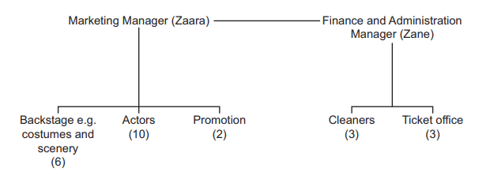

# Exam Questions — 5.5 Analysis of Accounts
**5. Financial Information & Decisions** · Cambridge (CIE) IGCSE business (0450, 0986 & 0264, 0774)
> Source: [https://www.savemyexams.com/igcse/business/cie/25/topic-questions/](https://www.savemyexams.com/igcse/business/cie/25/topic-questions/) · 26 questions across 1 sets

## Exam Questions (26 questions)

### Q1 — hard — 12 marks

**Q1** [12 marks]

**Extract:**

**SunnyShade Hats (SSH)**

SunnyShade Hats is a private limited company (Ltd) that designs and makes sun hats. It started six years ago and now has 40 production workers and 8 office staff in City M. SSH sells hats on its website and to independent clothes shops. The owners, Naila and Amir, want to expand by launching a new eco-friendly range called OceanWave.

SSH currently buys most fabric from Country T and pays in US dollars (USD). Fabric prices have been stable, but transport costs are rising. The company uses industrial sewing machines. A bank loan of £300 000 was used last year to buy new machines.

Quality is very important. Recent checks show defect rates have increased as new staff have joined. SSH plans to hire 20 more machinists. Managers are deciding how to motivate staff to increase output and reduce defects. Two ideas are:

- Piece rate (a payment per hat made)
- Job rotation with extra skills training

SSH is also reviewing its packaging for online orders. The current plastic mailer is cheap and waterproof. A supplier has offered recyclable cardboard packaging that looks premium but costs more and may be less water-resistant.

To support decision making, the finance manager prepared weekly cost data and a summary of assets and liabilities for this year and last year. The marketing team has created a simple online advert for the OceanWave launch. A news article has also highlighted changes in the economy that could affect SSH.

Appendix 1 – Online advert (draft)

**SUNNYSHADE – OCEANWAVE**
Light • durable • **made from recycled fibres**
Intro price: **£24.99**
Free head-size guide • Free returns
Follow us @SunnyShadeHats

Appendix 2 – Statement of financial position items (end of year)

| **Item** | **2025 (£)** | **2026 (£)** |
|---|---|---|
| Inventories | 120,000 | 90,000 |
| Trade receivables | 180,000 | 210,000 |
| Cash | 40,000 | 10,000 |
| Trade payables | 160,000 | 190,000 |
| Bank overdraft | 0 | 50,000 |
| Bank loan (long term) | 300,000 | 300,000 |

Appendix 3 – Business news (extract)

- The **local currency has fallen by 8%** against the USD this year.
- The **minimum wage will rise by 5%** next month.
- The **central bank cut interest rates by 1 percentage point** to support growth.

Appendix 4 – Weekly cost and output (current line)

| **Measure** | **Value** |
|---|---|
| Output (hats per week) | 3,000 |
| Fixed costs per week | £6,000 |
| Total variable costs per week | £15,000 |

Consider SSH’s financial position in 2026 compared to 2025. How might the changes affect liquidity and short-term decision making? Justify your decision.

Refer to the following [insert](https://cdn.savemyexams.com/uploads/2025/09/37160_Paper%202%20Set%20A%20Insert.pdf)  when answering the question.

### Q2 — hard — 12 marks

**Q2** [12 marks]

**Extract:**

**Titantic Toys (TT)**

TT is a large manufacturer of toys based in country Y. It is a public limited company and has been trading for 20 years. TT’s products are designed for children up to the age of 5.

TT has benefited from economies of scale as it has grown. The company has been able to buy specialist new equipment for the flow production line in its factory. TT’s factory uses lean production methods, such as Kaizen and just-in-time inventory control. All of its employees are well-motivated and few leave each year. The company provides training for employees in all departments of the business whenever there are any changes such as introducing new equipment or new products.

Currently, TT only sells its products in country Y but it plans to expand into country Z and become a multinational company. TT could buy a toy manufacturer located in country Z or build its own factory there. The government of country Z will need to give permission for TT to build a new factory. Either option will cost \$10 million. The directors are worried about liquidity as TT expands.

TT has developed a new toy for children under 5. The toy is a soft, easy to hold doll which speaks 4 different languages. The Marketing Director thinks this new toy will help TT expand into country Z, as there are no other products like it in that country. TT is recruiting a new Marketing Manager for country Z. Details of the shortlisted applicants are in Appendix 3.

The marketing department has already carried out research in country Z and some results are shown in Appendix 1.

**Appendix 1 **

**Market research results for country Z**

**Appendix 2 **

**Extract from TT’s statement of financial position, 2021 and 2022 (at 31 March)**

|   | **2021 (\$m)** | **2022 (\$m)** |
|---|---|---|
| **Inventories** | 5 | 5 |
| **Accounts receivable (debtors)** | 5 | 8 |
| **Cash** | 0 | 2 |
|   |   |   |
| **Accounts payable (creditors)** | 4 | 5 |
| **Bank overdraft** | 1 | 0 |
|   |   |   |
| **Long-term bank loans** | 5 | 10 |
|   |   |   |
| **Total Shareholder’s equity** | 40 | 50 |
|   |   |   |
| **Current ratio** | 2 | ? |
| **Acid test ratio** | 1 | ? |

**Appendix 3 **

**Three applicants for Marketing Manager for country Z**

|   | Labiba | Shahin | Samihah |
|---|---|---|---|
| Qualifications/Skills | 10 IGCSEs and 3 A levels Speaks 2 languages | 5 IGCSEs and 2 A levels Degree in Business Management | 8 IGCSEs Speaks 6 languages |
| Experience | 5 years working for TT as the Assistant Marketing Manager in country Y | 2 years as the Marketing Manager of a small food company in country Z | 10 years as the Marketing Manager of a large toy company in country Y |

Using Appendix 2 and other information, consider TT’s financial position. Do you think TT is in a good financial position to expand? **Justify **your answer using suitable calculations.

Refer to the following [insert ](https://cdn.savemyexams.com/uploads/2024/09/jun-2022-paper-22-case-study-v2---new.pdf)when answering the question

*Source: June 2022 0450/22 Q2B*

### Q3 — medium — 6 marks

**Q3** [6 marks]

> **[case-study]**
> AHG is an established business, as it has been operating for a long time. It sells garden products, including plants and flowers. AHG uses competitive pricing. The business has 4 managers and 30 other employees. All AHG’s managers use delegation. The finance manager is analysing AHG’s statement of financial position as she is interested in its liquidity. An extract is shown in Table 1.1.
> 
> **Table 1.1: Extract from AHG’s statement of financial position at 30 March 2022 (\$000)**
> 
> | Non-current assets | 800 |
> |---|---|
> | Current assets | 660 |
> | Current liabilities | 600 |

**Explain two** ways AHG's external stakeholders may use its statement of financial position.

### Q4 — medium — 6 marks

**Q4** [6 marks]

> **[case-study]**
> VCG manufactures high-quality briefcases and travel bags. VCG has 50 skilled production workers in its factory. VCG is planning to expand by building a second factory. Different locations are being considered. The Managing Director is reviewing VCG’s financial statements. An extract from its statement of financial position is shown in Table 3.1. Both internal and external stakeholder groups of VCG are interested in this information.
> 
> **Table 3.1: Extract from VCG’s 2021 statement of financial position (\$)**
> 
> | Current assets | 300,000 |
> |---|---|
> | Current liabilities | 250,000 |
> | Non-current assets | 1,500,000 |
> | Shareholders' equity | 800,000 |

**Explain two** ways VCG's internal stakeholders might use the information from its statement of financial position.

### Q5 — easy — 2 marks

**Q5** [2 marks]

> **[case-study]**
> AHG is an established business, as it has been operating for a long time. It sells garden products, including plants and flowers. AHG uses competitive pricing. The business has 4 managers and 30 other employees. All AHG’s managers use delegation. The Finance Manager is analysing AHG’s statement of financial position, as she is interested in its liquidity. An extract is shown in Table 1.1.
> 
> Table 1.1: Extract from AHG’s statement of financial position at 30 March 2022 (\$000)
> 
> | Non-current assets | 800 |
> |---|---|
> | Current assets | 660 |
> | Inventories | 360 |
> | Current liabilities | 600 |

**Calculate **AHG's acid test ratio.

Show your working.

### Q6 — hard — 12 marks

**Q6** [12 marks]

**Extract:**

**Protective Hats (PH)**

PH is a large public limited company based in country Z. It has been operating successfully for 50 years. PH produces a range of protective hats for employees working on construction sites, in factories or mines. It has a reputation for producing high-quality products and sells its hats around the world.

PH is currently the market leader in country Z. To remain competitive PH regularly carries out market research to find out if new products are needed. PH needs to ensure its market research data is accurate, so that it can develop the best new protective hats.

PH’s only factory is in country Z. It has 100 production employees. They work on a flow production line and carry out the same tasks every day. PH pays these employees the minimum wage and there have been complaints about working conditions. Some of the employees are considering becoming members of a trade union.

PH’s directors plan to expand the company by opening factories in other countries to produce protective hats. They think there are many benefits for PH of becoming a multinational company. They are aware that there is growing demand for protective hats in many developing countries where construction and manufacturing industries are expected to continue to have strong growth in the next 10 years.

**Appendix 1 **

**Advertisement for PH’s products**

PH’s protective hats will protect your employees when at work.

We supply many of the leading construction, manufacturing and mining companies across the world.

High quality is guaranteed.

PH’s hats can be ordered online from our website.

**Appendix 2**

**Email to PH’s Managing Director from PH’s Human Resources Director**

To: Managing Director

From: Human Resources Director

Date: 1 October 2023

Re: Training

After reviewing our current training, I think we need to increase the training we provide to new employees. Existing employees would also benefit from additional training as there have been issues with motivation.

I know there are plans to introduce new equipment into the flow production line. When is this likely to happen?

Can we please meet to discuss these issues?

**Appendix 3 **

**PH’s financial data for 2021 and 2022**

|   | **2021** | **2022** |
|---|---|---|
| Revenue | \$100m | \$125m |
| Profit | \$20m | \$20m |
| Gross profit margin | 60% | 65% |
| Profit margin | 20% | 16% |

Consider how the following three groups might use the financial data shown in Appendix 3:

- PH’s employees
- PH’s shareholders
- Competitor considering taking over PH

Which group will find this data most useful? **Justify **your answer.

Refer to the following [insert](https://cdn.savemyexams.com/uploads/2024/09/nov-2023-paper-2-case-study---new.pdf) when answering the question.

*Source: Nov 2023 0450/21 Q3B*

### Q7 — medium — 8 marks

**Q7** [8 marks]

**Explain **why liquidity and profitability are important to a business.

*Source: Nov 2020 0450/21 Q3A*

### Q8 — easy — 2 marks

**Q8** [2 marks]

> **[case-study]**
> Kemala makes high-quality beauty products. Demand for her best-selling hand cream is price inelastic. She advertises her products in specialist beauty magazines. Kemala is analysing her income statement. An extract is shown in the table below. She said: ‘When I started my business, I did not understand why cash is important’.
> 
> | **Extract from Kemala’s income statement 2021 (\$000)** |   |
> |---|---|
> | Revenue | 480 |
> | Gross profit | 192 |
> | Profit for the year | 72 |

**Calculate **Kemala’s profit margin.

Show your working.

*Source: Nov 2022 0450/12 Q2B*

### Q9 — easy — 2 marks

**Q9** [2 marks]

**State two **financial ratios a business can use.

### Q10 — easy — 2 marks

**Q10** [2 marks]

> **[case-study]**
> PJA make fashion clothing for 16-25 year olds. Many of its competitors are multinational companies. PJA produce new products every 3 weeks. All PJA’s products are made in a local factory because of import quotas. The Managing Director is reviewing PJA’s financial statements using ratio analysis. An extract is shown in the table below.
> 
> | **Extract from PJA’s financial statements for 2020** |   |
> |---|---|
> | Revenue (\$m) | 7 400 |
> | Gross profit (\$m) | 3 330 |
> | Profit (\$m) | 1100 |
> | Current ratio | 1.5 |
> | Return on Capital Employed (ROCE) | 8% |

**Calculate **PJA’s gross profit margin.

Show your working.

*Source: June 2021 0450/11 Q2B*

### Q11 — hard — 12 marks

**Q11** [12 marks]

**Extract:**

**Everyone Theatre (ET)**

Zane and Zaara are both actors. They plan to start up a theatre in a low-income area of Main City. Zane and Zaara believe that helping the community is as important as being successful entrepreneurs.

The theatre will be a private sector business and Zane and Zaara have to decide whether to start up as an unincorporated business (partnership) or as a limited company. Zane is planning to prepare a cash-flow forecast for the first year. Zaara knows they will need to set business objectives for the theatre and also decide on a leadership style to use when managing employees. ET will have 24 part-time employees as shown in the organisational chart in Appendix 1.

Zane and Zaara plan to put on performances in the evenings for local people and tourists. There will be 100 seats in the theatre but not all the seats will be sold if the price is too high. The Marketing Manager, Zaara, will need to decide which performances to put on, what price to charge and which refreshments to sell. Zaara will also need to decide between the two possible options for the first performance when the theatre opens. Information on the two options is shown in Appendix 2.

In the daytime the theatre building will be used by Daycare, a local social enterprise. Daycare takes care of young children up to the age of 5 so that low-income family members can go out to work. It also provides education for the children which helps their development and progress before they start school. Some of Daycare’s objectives are different to those of ET.

**Appendix 1 **

**Proposed organisational chart for the theatre**

Note: The numbers in brackets are the number of part-time employees who work in each department.

**Appendix 2**

**Forecast data for the two possible options for ET’s first performance at the theatre**

| **For each performance** | **Option 1** | **Option 2** |
|---|---|---|
| Number of actors/employees | 7 | 24 |
| Average wage cost per actor/employee | \$30 | \$10 |
| All other costs including scenery, costumes and promotion | \$1000 | \$2000 |
| Forecast revenue assuming all 100 seats are sold | \$1000 | \$2500 |

**Appendix 3 **

**Email from Zane to Zaara**

**To: Zaara **

**From: Zane **

**Date: 1 April 2023**

We want to support the local community and we need to make decisions about the following.

Should we:

- Pay fair wages even though they may be higher than those paid by competing theatres?
- Only buy costumes produced in the local community?
- Purchase all refreshments from suppliers that do not pollute the environment?

Using Appendix 2 and other information, consider the two options for the first performance at the theatre. Which is the best option for Zaara to choose? **Justify **your answer using suitable calculations.

Refer to the following [insert ](https://cdn.savemyexams.com/uploads/2024/09/jun-2023-paper-2-case-study-v2---new.pdf)when answering the question.

*Source: June 2023 0450/22 Q2B*

### Q12 — medium — 6 marks

**Q12** [6 marks]

> **[case-study]**
> Izaak owns a small fish restaurant. He employs two chefs (cooks) and three workers who serve in the restaurant.
> 
> Izaak has been trying to increase added value to improve profits. Izaak has been looking at the financial performance of his business. An extract is shown in the table below. Izaak has received a number of complaints about food and service. He knows he must improve quality but cannot decide on the best way to do this.
> 
> |   | Last year | Current year |
> |---|---|---|
> | Revenue | **X** | 300 |
> | Cost of sales | 180 | 150 |
> | Gross profit | 120 | 150 |
> | Expenses | 90 | **Y** |
> | Profit | 30 | 15 |

Do you think the profitability of Izaak’s fish restaurant has improved since last year? **Justify **your answer using appropriate ratios.

*Source: Specimen 0450/01 Q2E*

### Q13 — easy — 2 marks

**Q13** [2 marks]

**Define **'profitability'

### Q14 — easy — 2 marks

**Q14** [2 marks]

> **[case-study]**
> Kemala makes high-quality beauty products. Demand for her best-selling hand cream is price inelastic. She advertises her products in specialist beauty magazines. Kemala is analysing her income statement. An extract is shown in the below table. She said: ‘When I started my business, I did not understand why cash is important’.
> 
> | **Extract from Kemala’s income statement 2021 (\$000)** |   |
> |---|---|
> | Revenue | 480 |
> | Gross profit | 192 |
> | Profit for the year | 72 |

**Calculate **Kemala's gross profit margin in 2021.

Show your workings.

### Q15 — easy — 2 marks

**Q15** [2 marks]

**Identify two **profitability ratios

*Source: Nov 2023 0450/11 Q3B*

### Q16 — hard — 12 marks

**Q16** [12 marks]

**Extract:**

**The BB Health Spa (BB)**

Bethany owns The BB Health Spa in Main City in country X. Economic growth has been high for the last few years. The government of country X wants this growth to continue so it has reduced income tax. However, it is also worried about inflation becoming a problem so it has increased interest rates.

The BB Health Spa is very busy and Bethany is considering taking on a partner to help manage the business and give her more free time. However, she has been a sole trader for 10 years and wants the business to stay small.

The customers of The BB Health Spa are people of all ages who are interested in their health. Bethany employs two qualified workers to provide the treatments for customers. Bethany herself also provides customers with treatments. In addition, she does all the administration such as ordering inventory, accounts and paying invoices when the spa is closed.

The BB Health Spa still uses the original treatment equipment which was purchased when the business started. Some spas nearby have the latest equipment but these spas charge much higher prices than The BB Health Spa. Bethany records all the financial transactions by filling in accounts books by hand. This takes her a long time. Customers book appointments using the telephone and Bethany later telephones them to remind them when an appointment is due.

**Appendix 1**

**Advert for treatments at The BB Health Spa**

**Appendix 2 **

**Weekly forecasts for two possible additional services**

|   | Steam room | Hair cuts |
|---|---|---|
| Additional customers | 200 | 50 |
|   |   |   |
| Average price charged per customer | \$5 | \$25 |
| Wages | \$60 | \$400 |
| Cost of sales | \$40 | \$125 |
| Lease of equipment | \$400 | \$175 |

**Appendix 3**

**Daily News **

**September**

**New equipment now available in many health spas to make skin look younger**

There have been a number of changes in technology for health spas which allow the treatments to be much more effective in making skin look younger. Many people are keen to try these treatments using the latest equipment to get younger looking skin. This equipment is very expensive for health spas to buy or lease.

The news of these treatments has appeared on social media sites and on mobile phone Apps leading to higher demand. ‘Some customers will pay high prices for such treatments’, said a local health spa owner who is keen to promote his health spa as being one of the first to use the new equipment.

There have also been developments in software which make customer bookings and accounts much easier, quicker and with fewer mistakes. Automatic text (sms) messages are used to remind customers of their appointments – so no need to miss an appointment again.

Look out for these changes in health spas near you!

Consider the weekly forecasts in Appendix 2 for the two additional services Bethany could choose:

- hair cuts
- steam room.

Which additional service should Bethany choose to offer? Include a calculation of profit for the two services to **justify **your answer.

Refer to the following [insert ](https://cdn.savemyexams.com/uploads/2024/09/0450-01-specimen-2020-paper-2-insert-cie-igcse-business---new.pdf)when answering the question

*Source: Specimen 0450/02 Q3B*

### Q17 — hard — 12 marks

**Q17** [12 marks]

**Extract:**

**Cherished Chocolates (CC)**

CC is a public limited company. It employs 4000 workers in country X and many are members of a trade union. CC has manufactured chocolate bars in country X for 50 years. It imports most of its raw materials, such as cocoa beans. Over the last 10 years CC has expanded and now sells in other countries. Many of these countries have no trade restrictions. The Directors of CC know that globalisation has opportunities and threats for CC.

CC produces a number of brands of chocolate bars, such as Tiabar, in country X. Its most popular chocolate bar, Choco, has the highest market share. The total market for chocolate bars is no longer growing in country X. CC plans to reduce the number of brands it sells in country X. It has to decide which of the two brands shown in Appendix 1 to stop selling.

NM operates in country Z and sells its own brands of chocolate bars, including Nuttybar. NM employs 500 workers. In country Z chocolate bars are distributed through small retail outlets. The wage rates in country Z are lower than in country X. However, incomes in country Z are starting to rise.

The Directors of CC are planning to take over NM to expand into this market rather than setting up a factory. The takeover will cost \$35 million, some of which will be financed by a bank loan. The shareholders of NM are being offered CC shares in exchange for NM shares.

The Directors of CC know there might be diseconomies of scale after the takeover. They also have to decide who will be the Operations Manager for NM’s factory in country Z. They could keep NM’s existing Operations Manager or move CC’s Operations Manager from country X. Information about the two managers is shown in Appendix 2.

**Appendix 1 **

**The product life cycles of two of CC’s brands of chocolate bars in country X**

**Option 1 – stop producing Tiabar **

A brand aimed at young children which is a new target market for CC. The market research at the development stage showed positive results from test marketing and sales have been growing steadily. There are many multinational chocolate bar companies targeting this age group.

**Option 2 – stop producing Choco**

The market leader in country X. It is a well established brand targeting adults. Sales are high but have not been increasing for several years. No new competitors have entered this market in the last two years.

**Appendix 2**

**Information about the two Operations Managers for NM’s factory in country Z**

|   | **Samuel **  **CC’s Operations Manager** | **Ritesh **  **NM’s Operations Manager** |
|---|---|---|
| **Qualifications/Skills** | 8 IGCSEs  On-the-job training in the production of chocolate bars | 5 IGCSEs and 2 A levels  Degree in Business Management |
| **Experience** | 10 years as the Operations Manager for CC  Worked for CC for 20 years and knows the production and warehouse storage requirements for all of its brands  Has links with all CC’s suppliers of high-quality ingredients such as cocoa beans and milk | 2 years as the Operations Manager for NM  Purchased all the ingredients, including nuts, for NM’s products  Previously worked for 5 years for a chocolate bar manufacturing business in country Z  Worked for 5 years for a small retailer in country Z |

**Appendix 3 **

**Selected information from the financial statements for CC and NM for 2021**

|   | **CC** | **NM** |
|---|---|---|
| **Long-term bank loan** | \$10m | \$5m |
| **Total shareholders’ equity** | \$200m | \$30m |
| **Current ratio** | 2 | 1 |
| **Acid test ratio** | 1.2 | 0.33 |
|   |   |   |
| **Profit for the year** | \$42m | \$3.5m |
| **Profit margin** | 25% | 15% |
| **Return on Capital Employed (ROCE)** | 20% | 10% |

Using Appendix 3 and other information, consider how the financial statements might be useful to the following **three **stakeholder groups.

- NM’s shareholders
- CC’s managers
- CC’s bank manager

Which stakeholder group will find the financial information most useful? **Justify **your answer.

Refer to the following [insert ](https://cdn.savemyexams.com/uploads/2024/09/nov-2022-paper-22-case-study-v2--new.pdf)when answering the question

*Source: Nov 2022 0450/22 Q4B*

### Q18 — medium — 8 marks

**Q18** [8 marks]

**Extract:**

**Cell Covers (CC) **

Aisha worked for several years for a company that repairs mobile (cell) phones in country Z. She had always wanted to be her own boss and decided to leave her job to set up CC to produce covers for mobile phones. She went into partnership with her brother, Aruna. He worked as an Operations Manager for a company producing children’s clothes.

The sources of finance for the business were \$10 000 of savings from each partner and a bank loan of \$10 000. CC was also given a government grant to help the new business get started. CC leased a factory, bought some equipment and had to pay some expenses before the business had regular cash inflows.

CC’s current product is a range of standardised phone covers which are sold in the mass market. These are sold using a competitive pricing method through mobile phone shops. CC employs 10 skilled production workers who are paid just above the legal minimum wage. These workers have been trained how to operate the equipment and work as a team on the production line. During the production process there is a lot of waste plastic produced and CC sends this to landfill sites. The business has just completed its second year of trading.

CC is about to launch a new range of individual personalised phone covers. It will need to recruit 2 additional production workers. Aruna knows that the marketing mix for this new product may have to be different to the marketing mix used for the standardised products. The new product will be aimed at a niche market of high income consumers between the ages of 18 to 25. There are few other competitors in this market at present.

**Appendix 1 **

**Newspaper article in Main News **

Country Z has been in a recession but the economy is now growing rapidly and unemployment is falling. With higher incomes the majority of people now own a mobile phone. This makes communication easier. Mobile banking is becoming more popular and it is used by a large percentage of the population.

**Appendix 2 **

**Advertisement for CC’s standardised mobile phone covers**

Do you want to protect your phone from damage? Then buy a phone cover from CC. Your phone will never be damaged if you use one of our high quality covers!!

We offer a range of standardised covers at competitive prices. The CC range has many different colours and designs so you will stand out from the crowd.

**Appendix 3 **

**Summary of CC’s financial information from the end of the second year of trading (\$)**

| Revenue | 800 000 |
|---|---|
| Cost of sales | 400 000 |
| Gross profit | 400 000 |
| Expenses | 250 000 |
| Profit | 150 000 |
| Current Assets | 20 000 |
| of which: Inventory | 5 000 |
| Current liabilities | 15 000 |

Using the data in Appendix 3, **calculate **the following ratios for CC:

- Gross profit margin
- Profit margin
- Current ratio
- Acid test ratio

Show your workings.

Refer to the following [insert ](https://cdn.savemyexams.com/uploads/2024/09/nov-2020-paper-22-case-study-v2---new.pdf)when answering the question

*Source: Nov 2020 0450/22 Q4A*

### Q19 — medium — 6 marks

**Q19** [6 marks]

> **[case-study]**
> PJA make fashion clothing for 16-25 year olds. Many of its competitors are multinational companies. PJA produce new products every 3 weeks. All PJA’s products are made in a local factory because 2 of import quotas. The Managing Director is reviewing PJA’s financial statements using ratio analysis. An extract is shown in Table 2.1.
> 
> **Table 2.1 Extract from PJA’s financial statements for 2020 **
> 
> | Revenue (\$m) | 7,400 |
> |---|---|
> | Gross profit (\$m) | 3,330 |
> | Profit (\$m) | 1, 100 |
> | Current ratio | 1.5 |
> | Return on Capital Employed (ROCE) | 8% |

**Explain two **ways PJA’s managers can use ratio analysis.

*Source: June 2021 0450/11 Q2D*

### Q20 — medium — 6 marks

**Q20** [6 marks]

> **[case-study]**
> CPK operates 5 sports clubs. Each club offers a range of activities including gym and yoga classes. CPK uses job enrichment to keep its 60 employees well-motivated. Having the right marketing mix is important to CPK’s success. The Finance Director is analysing CPK’s financial statements. An extract is shown in the below table. He wants to know how an increase in taxation might affect CPK’s business.
> 
> | **Extract from CPK’s financial statements** |   |   |
> |---|---|---|
> |   | **2020** | **2021** |
> | Current ratio | 1.6 | 1.3 |
> | Profit margin | 12% | 10% |
> | Non-current assets | \$2m | \$2m |

Explain **one **possible effect on CPK of the change in each of the following ratios as shown in the above table.

- Current ratio
- Profit margin

*Source: Nov 2022 0450/11 Q3D*

### Q21 — medium — 6 marks

**Q21** [6 marks]

> **[case-study]**
> VCG manufactures high-quality briefcases and travel bags. VCG has 50 skilled production workers in its factory. VCG is planning to expand by building a second factory. Different locations are being considered. The Managing Director is reviewing VCG’s financial statements. An extract is shown in the below table. Both internal and external stakeholder groups of VCG are interested in this information.
> 
> | **Extract from VCG’s 2021 financial statements (\$)** |   |
> |---|---|
> | Revenue | 2 000 000 |
> | Current assets | 300 000 |
> | Current liabilities | 250 000 |
> | Shareholders’ equity (funds) | 800 000 |

**Explain one **way each of the following stakeholder groups might use VCG’s accounts:

- Shareholders
- Suppliers

*Source: June 2022 0450/11 Q3D*

### Q22 — medium — 6 marks

**Q22** [6 marks]

> **[case-study]**
> Elton is a sole trader. He sells specialist clothing and equipment for sports, including baseball and hockey. It is a niche market. Elton started his business 5 years ago and it has remained small. A wide range of inventory is important. Elton has been looking at the financial performance of his business. The profit margin for 2018 was 35%. An extract of the accounts is shown in the below table.
> 
> | **Revenue and cost information for Elton’s business for 2018 and 2019 (\$)** |   |   |
> |---|---|---|
> |   | **2018** | **2019** |
> | Revenue (\$) | 24 000 | 25 000 |
> | Cost of sales (\$) | 7 200 | **Y** |
> | Gross profit (\$) | 16 800 | 18 000 |
> | Expenses (\$) | 8 400 | 10 000 |
> | Profit (\$) | **X** | 8 000 |

Do you think Elton should be pleased with the financial performance of his business? **Justify **your answer using appropriate ratios.

*Source: Nov 2020 0450/11 Q3E*

### Q23 — easy — 2 marks

**Q23** [2 marks]

**Identify two **external users of accounts.

*Source: Nov 2023 0450/11 Q3A*

### Q24 — easy — 2 marks

**Q24** [2 marks]

**Define **‘Return on Capital Employed’

*Source: Nov 2020 0450/12 Q4B*

### Q25 — easy — 2 marks

**Q25** [2 marks]

**Identify two **financial statements a public limited company is legally required to publish each year.

*Source: June 2022 0450/11 Q3B*

### Q26 — easy — 4 marks

**Q26** [4 marks]

> **[case-study]**
> AHG is an established business as it has been operating for a long time. It sells garden products including plants and flowers. AHG uses competitive pricing. The business has 4 managers and 30 other employees. All AHG’s managers use delegation. The Finance Manager is analysing AHG’s statement of financial position as she is interested in its liquidity. An extract is shown below
> 
> | **Extract from AHG’s statement of financial position at 30 March 2022 (\$000)** |   |
> |---|---|
> | Non-current assets | 800 |
> | Current assets | 660 |
> | Current liabilities | 600 |

**Outline two **possible reasons why liquidity is important to AHG.

*Source: June 2022 0450/12 Q1C*

