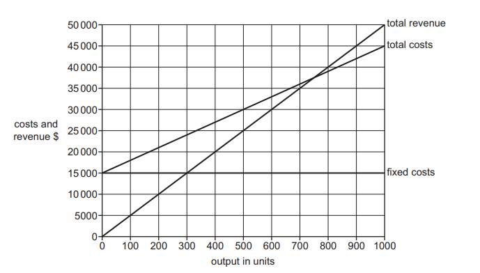

# Exam Questions — 3.4 Legal Controls
**3. Marketing** · Cambridge (CIE) IGCSE business (0450, 0986 & 0264, 0774)
> Source: [https://www.savemyexams.com/igcse/business/cie/25/topic-questions/](https://www.savemyexams.com/igcse/business/cie/25/topic-questions/) · 14 questions across 1 sets

## Exam Questions (14 questions)

### Q1 — hard — 12 marks

**Q1** [12 marks]

**Extract:**

**HealthyMunch **

HealthyMunch is a social enterprise based in Country Z that provides nutritious, affordable meals to elderly and vulnerable people. Founded 5 years ago, HealthyMunch now serves over 500 customers daily through its meal delivery service and two community cafes.

As a social enterprise, HealthyMunch reinvests all profits into expanding its services and improving meal quality. Last year, it had revenue of \$750,000 and made a profit of \$50,000. The company employs 30 full-time staff and works with 50 volunteers.

HealthyMunch markets its services through a mix of traditional and digital methods. They distribute brochures in local community centers and doctor's offices, and have partnerships with local health services for referrals. Their social media presence focuses on sharing nutritional tips and customer testimonials. They also rely heavily on word-of-mouth recommendations from satisfied customers and their families.

To better understand its market, HealthyMunch conducts regular market research. They use a combination of surveys, focus groups, and analysis of customer order data. Recent findings show that there's growing demand for specialized diets (e.g., low-sodium, diabetic-friendly meals) and interest in cooking classes for family caregivers. They've also identified a potential new market segment of busy working adults looking for healthy, ready-made meals.

HealthyMunch is considering expanding its services to include nutrition education programs in local schools. This would require hiring specialised staff and developing new educational materials. The company estimates this expansion would cost \$100,000 initially but could increase revenue by 20% within two years.

However, HealthyMunch faces some challenges. Food costs have risen by 15% in the past year due to inflation, putting pressure on its margins. The company is also experiencing increased competition from for-profit meal delivery services targeting the elderly.

The board of directors is divided on whether to pursue the school program expansion or focus on improving efficiency in its current operations. They need to make a decision soon, as government grants for school nutrition programs will be available in 3 months.

HealthyMunch prides itself on its strong relationships with customers and the local community. It regularly conducts surveys to gather feedback and has a customer satisfaction rating of 92%.

**Appendix 1: HealthyMunch Financial Data**

| **Year** | **Revenue (\$000)** | **Profit (\$000)** | **Number of meals served daily** |
|---|---|---|---|
| 2022 | 750 | 50 | 500 |
| 2021 | 650 | 45 | 450 |
| 2020 | 550 | 35 | 400 |

Consider how the following two ways could help HealthyMunch respond to accusations it has made false claims about its products in promotional materials.

- Implementing transparent communication strategies
- Strengthening product quality assurance processes

Which approach is likely to be most effective in restoring customer trust? **Justify** your answer.

Refer to the following [insert ](https://cdn.savemyexams.com/uploads/2024/10/healthymunch-case-study.pdf)when answering the question

### Q2 — hard — 12 marks

**Q2** [12 marks]

**Extract:**

Sports Safety Equipment (SSE)

SSE manufactures sports safety equipment in country Z. It is a public limited company which has been successful for over 30 years. The main product SSE manufactures is safety helmets for different sports, such as bicycle riding, cricket and skateboarding. SSE has one large factory making the safety helmets. The factory uses flow production. The production workers each specialise in one task on the production line. SSE’s raw materials are imported.

SSE sells its helmets in several other countries and is planning to expand into many more. It will need to carry out market research before entering new markets in other countries. Each country has different sports that are popular and the style of helmets varies from country to country.

SSE plans to build its own factories in its most important markets in other countries and will need to choose a suitable source of finance. The Human Resources Director has decided to use internal recruitment for the managers of the new factories. There will need to be effective communication between the managers of the new factories and SSE’s head office in country Z.

Most of SSE’s sales in country Z are through sports equipment shops. Customers like to try on the helmets to check they fit correctly. SSE currently sells its helmets in other countries through its website.

SSE is also increasing its product range. The latest new product being developed is a children’s cricket helmet. A break-even chart for this new product is shown in Appendix 3.

**Appendix 1**

**Extract from SSE’s website**

**If you want the best protection when playing sport then buy an SSE safety helmet!**

We supply a wide range of safety helmets for you when playing sport.

Whatever the sport - SSE produces a helmet for you.

You can order directly from this website by entering your head measurements below.

Get the perfect fit for you!

**Appendix 2**

**Email from SSE’s Managing Director to SSE’s Finance Director**

To: Finance Director

From: Managing Director

Date: 1 September 2023

Re: Demand for SSE’s products

Demand for SSE’s products in country Z is forecast to increase. Our government has imposed import tariffs on safety helmets. We may be able to increase our prices.

The exchange rate in country Z is expected to fall. However, other countries have introduced import quotas on safety helmets.

We will have to consider all the likely effects of these changes.

**Appendix 3**

**Projected weekly break-even chart for SSE’s new children’s cricket helmet**

The maximum output and sales for this product is 1000 units per week

Consider the advantages and disadvantages of the following two ways to ensure products comply with legal controls on marketing when SSE expands into new international markets.

- Compliance checks
- Staff training programmes

Which way should SSE prioritise to ensure compliance with legal controls on marketing? **Justify** your answer.

### Q3 — medium — 6 marks

**Q3** [6 marks]

> **[case-study]**
> Sam runs 'SafeHome Appliances', a medium-sized business that manufactures kitchen appliances in Manchester. Recently, the company has received several customer complaints about faulty products, including reports of overheating toasters and malfunctioning blenders that have caused minor injuries. These incidents have damaged the company's reputation and led to negative online reviews. Sam recognises that preventing faulty goods from leaving the business is crucial for maintaining customer trust and avoiding further complaints. He stated: 'We must implement robust systems to ensure our kitchen appliances are thoroughly checked before they reach our customers.'

**Explain two** ways SafeHome Appliances could ensure faulty goods do not reach customers.

### Q4 — medium — 6 marks

**Q4** [6 marks]

> **[case-study]**
> Marcus operates a small electronics company called 'TechSafe Solutions' that designs and manufactures smartphone accessories in the UK. His business must comply with various legal controls to ensure products are not faulty, including product safety regulations and consumer protection laws. Marcus implements rigorous quality control processes and testing procedures before any product reaches customers. He stated: 'Meeting these legal requirements for product safety requires significant investment in testing and quality systems, but I'm convinced it delivers substantial benefits to my business.'

**Explain two** advantages to Marcus's business of complying with legal controls to ensure products are not faulty.

### Q5 — medium — 8 marks

**Q5** [8 marks]

**Explain two** advantages and **two** disadvantages to a business of complying with legal controls over marketing.

### Q6 — medium — 6 marks

**Q6** [6 marks]

> **[case-study]**
> Alana runs a small organic skincare company called 'Pure Glow' that manufactures and sells face creams online. Her business operates in the UK and must comply with various legal controls over marketing, including the Advertising Standards Authority (ASA) regulations and consumer protection laws. Alana ensures all her marketing claims about the skincare products are truthful and substantiated. She said: 'Following these legal requirements might seem costly and time-consuming, but I believe it brings real advantages to my business.'

**Explain two** advantages to Alana's business of complying with legal controls over marketing.

### Q7 — medium — 6 marks

**Q7** [6 marks]

Do you think businesses always suffer if they fail to comply with legal controls on marketing? **Justify** your answer.

### Q8 — easy — 4 marks

**Q8** [4 marks]

> **[case-study]**
> Sally runs 'EcoClean', a small cleaning products company that has been operating for three years. Recently, she launched an aggressive marketing campaign claiming her products are 'completely chemical-free' and 'eliminate 99.9% of all bacteria instantly'. Sally has been advertising through social media influencers without disclosing these are paid partnerships. She also targets vulnerable elderly customers through door-to-door sales, using high-pressure tactics. Trading Standards has received several complaints about misleading claims and aggressive selling practices. Sally believes that since she is a small business, marketing regulations don't apply to her.
> 
> **Extract from recent complaints to Trading Standards**
> 
> | **Type of complaint** | Misleading health claims about bacteria elimination |
> |---|---|
> | **Sales method** | Aggressive door-to-door targeting elderly customers |
> | **Advertising issue** | Undisclosed paid influencer partnerships |
> | **Business attitude** | Believes regulations don't apply to small businesses |

**Outline two** consequences that EcoClean might face for failing to comply with legal controls on marketing.

### Q9 — easy — 2 marks

**Q9** [2 marks]

**Define** what is meant by legal controls in marketing.

### Q10 — easy — 4 marks

**Q10** [4 marks]

> **[case-study]**
> Mark is launching a new children's toy business called 'SafePlay'. He plans to market his products directly to parents through online advertising and promotional events at toy shops and nurseries. Mark has developed colourful marketing materials featuring happy children playing and claims that his toys 'are 100% safe for all ages' and 'guarantee no choking hazards'. He is also considering celebrity endorsements from popular parenting bloggers. Mark knows that marketing regulations will be important for his business.
> 
> **Extract from Mark's marketing strategy**
> 
> | **Target market** | Parents with children (25-45) |
> |---|---|
> | **Main advertising claim** | '100% safe for all ages' |
> | **Promotional locations** | Toy shops and nurseries |
> | **Marketing budget** | USD 12,000 |

**Outline two** reasons why legal controls on marketing will be important for Mark's business.

### Q11 — easy — 4 marks

**Q11** [4 marks]

> **[case-study]**
> Sarah is launching a new energy drink business called 'PowerBoost'. She plans to market her products directly to teenagers and young adults through social media advertising and promotional events at schools and universities. Sarah has developed bold marketing materials featuring extreme sports imagery and claims that her drink 'increases energy levels by 300%' and 'guarantees improved athletic performance'. She is also considering celebrity endorsements from popular fitness influencers. Sarah knows that marketing regulations will be important for her business.
> 
> **Extract from Sarah's marketing strategy**
> 
> | **Target market** | Teenagers and young adults (16-25) |
> |---|---|
> | **Main advertising claim** | 'Increases energy levels by 300%' |
> | **Promotional locations** | Schools and universities |
> | **Marketing budget** | £15,000 |

**Outline two** reasons why legal controls on marketing will be important for Sarah's business.

### Q12 — easy — 2 marks

**Q12** [2 marks]

**State two** examples of misleading promotion that businesses might use in their marketing.

### Q13 — easy — 2 marks

**Q13** [2 marks]

**State two** implications for a business that fails to comply with legal controls in marketing.

### Q14 — easy — 2 marks

**Q14** [2 marks]

**State two **areas of business behaviour in relation to marketing that are regulated.
