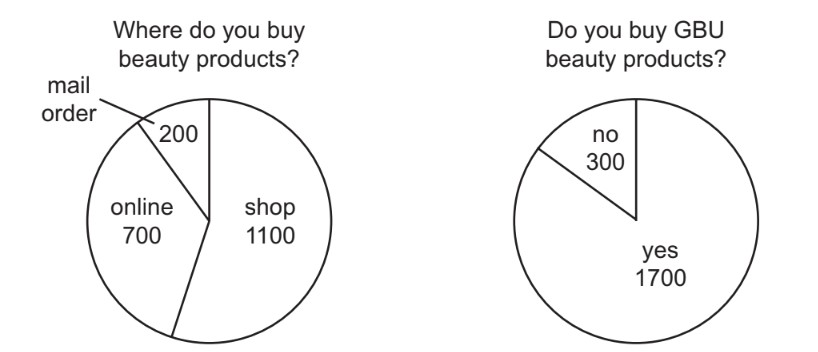
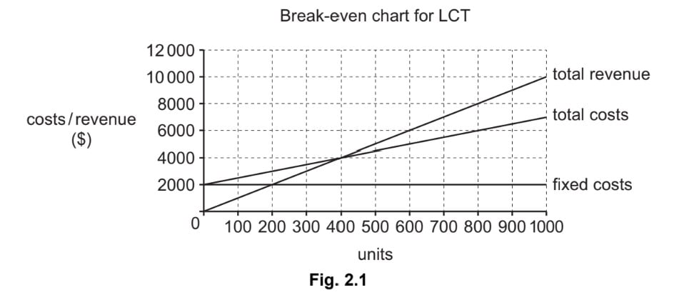
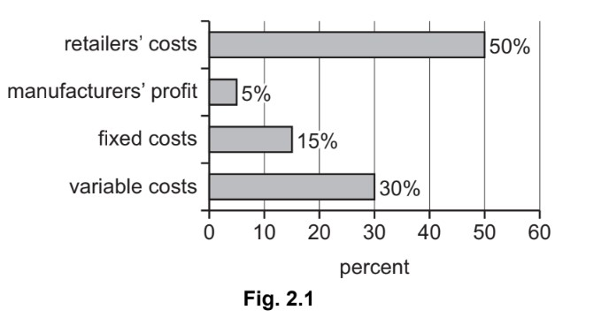

# Exam Questions — 3.3 Marketing Mix
**3. Marketing** · Cambridge (CIE) IGCSE business (0450, 0986 & 0264, 0774)
> Source: [https://www.savemyexams.com/igcse/business/cie/25/topic-questions/](https://www.savemyexams.com/igcse/business/cie/25/topic-questions/) · 44 questions across 1 sets

## Exam Questions (44 questions)

### Q1 — easy — 4 marks

**Q1** [4 marks]

> **[case-study]**
> FreshFizz is a multinational soft-drinks business known for low-sugar flavours. It is thinking about entering **Country Z** by opening physical outlets and selling online. Local competitors are strong. A **sugar tax** on high-sugar drinks is being discussed by the government. Youth groups in Country Z often run online campaigns about healthy lifestyles.
> 
> **Table 4.1 – Market indicators for Country Z**
> 
> | **Indicator** | **Country Z** |
> |---|---|
> | Average monthly household  income | **£650** |
> | Population aged 15–24 | **27%** |
> | Internet users (share of population) | **84%** |
> | Import tariff on drinks | **10%** |

Using Table 4.1, outline **two** reasons why online promotion could work well in Country Z.

### Q2 — medium — 6 marks

**Q2** [6 marks]

> **[case-study]**
> BikeFix is a mobile bicycle repair service in a large city. Demand is higher in spring and summer. The owner wants to buy an electric van to reach more customers at weekends. BikeFix currently advertises with leaflets and social media. The owner is considering dynamic pricing (higher prices at peak times). Two finance options are being considered: a bank loan or leasing the van.
> 
> **Table 2.1 – Extract from BikeFix cash flow forecast (first quarter) \$s**
> 
> |   | **January** | **February** | **March** |
> |---|---|---|---|
> | Opening balance | 2 000 | 3 500 | 2 800 |
> | Cash inflows (sales) | 6 000 | 5 400 | 7 200 |
> | Cash outflows (wages, fuel, parts, ads) | 4 500 | 6 100 | 5 900 |
> | **Net cash flow** | **1 500** | **X** | **1 300** |
> | **Closing balance** | **3 500** | 2 800 | **Y** |

Explain **two** possible advantages to BikeFix of using dynamic pricing.

### Q3 — medium — 1 marks

**Q3** [1 mark]

**Extract:**

**TGR Electronics**

TGR Electronics is a medium-sized manufacturer of smart home devices based in Country X. The company has been operating for 15 years and has grown steadily, now employing 250 people. TGR's main products include smart thermostats, security cameras, and voice-controlled lighting systems. The company uses a combination of automated production lines and skilled technicians to manufacture its products.

TGR's annual revenue last year was £50 million, with a profit of £5 million. The company currently sells its products primarily in Country X through a network of electronics retailers and its own website. However, TGR is now considering expanding into international markets, particularly in neighbouring countries.

The smart home device market is becoming increasingly competitive, with new entrants and rapidly changing technology. TGR's management team is debating whether to invest heavily in research and development (R&D) to create innovative new products or to focus on reducing costs to compete on price.

TGR is also facing challenges related to its supply chain. The company imports many of its components from overseas, and recent fluctuations in exchange rates have increased costs. Additionally, there is growing consumer concern about the environmental impact of electronic devices.

The company's Human Resources department is considering implementing a new training programme to upskill its workforce, particularly in the areas of software development and data analysis. However, this would require a significant investment.

TGR's management must make decisions about international expansion, product development strategy, and workforce training while navigating external challenges such as increased competition, supply chain issues, and environmental concerns.

**Explain two **advantages and two disadvantages to TGR of expanding into international markets,

Refer to the following [insert](https://cdn.savemyexams.com/uploads/2024/10/tgr-electronics-case-study.pdf) when answering the question.

### Q4 — easy — 4 marks

**Q4** [4 marks]

> **[case-study]**
> Car manufacturer OVI is based in Country X. Over the years, technology has changed production methods. NSN's sales in Country X have declined.
> 
> OVI plans to open a new factory and showrooms in country Z, creating 7,000 jobs. Country Z’s government has offered a \$60m grant to OVI . A spokesperson for OVI said: ‘Governments should support business activity. There were also other factors that influenced our decision to build the new factory there, including the possible effects of economic growth.’

**Outline two** benefits to OVI of entering overseas markets.

### Q5 — medium — 8 marks

**Q5** [8 marks]

**Extract:**

**GNP Sportswear **

GNP Sportswear is a medium-sized clothing manufacturer based in Country X that specialises in producing high-quality sportswear and athletic shoes. GNP has been in business for 15 years and employs 250 people. Its main factory uses batch production methods to manufacture products. GNP sources raw materials locally and imports some specialised fabrics from neighbouring countries.

GNP Sportswear sells its products primarily through sports retailers in Country X. The company has a small but growing online presence, with 10% of its sales now coming from its e-commerce website. GNP is considering expanding its online sales channel to reach more customers directly.

The company's annual revenue last year was \$30 million, with a net profit of \$2.4 million. However, rising costs of raw materials and increased competition from cheaper imported brands have put pressure on GNP's profit margins. The management team is exploring ways to reduce costs and increase efficiency.

GNP Sportswear is also facing challenges related to changing consumer preferences. There is a growing demand for environmentally friendly and sustainable products in the sportswear market. The company is considering investing in new production methods and materials to create a line of eco-friendly sportswear.

Country X is a developing economy. The government of Country X has recently announced plans to reduce import tariffs on textiles and finished garments. This change could lead to increased competition from foreign brands but also potentially lower costs for some of GNP's imported materials.

GNP's Human Resources department has noticed an increase in employee turnover in the past year. The company is looking at ways to improve employee retention and motivation.

**Appendix 1: Extract from GNP Sportswear's website **

| At GNP Sportswear, we're passionate about creating high-quality sportswear that helps you perform at your best.  Our products are designed for comfort, durability, and style.  Shop our range of athletic wear and shoes for all your sporting needs.  Free shipping on orders over \$100! |
|---|

**Appendix 2: GNP Sportswear's Annual Sales Data **

| Year 1 | \$25 million |
|---|---|
| Year 2 | \$27 million |
| Year 3 | \$30 million |
| Year 4 | \$32 million (forecast) |

**Explain two **reasons why GNP should expand its online sales channel rather than seek new retailers to stock its products.

Refer to the following [insert](https://cdn.savemyexams.com/uploads/2024/10/gnp-sportswear-case-study.pdf) when answering the question.

### Q6 — medium — 6 marks

**Q6** [6 marks]

Do you think the rewards of entering a foreign market always outweigh the risks? **Justify** your answer.

### Q7 — medium — 6 marks

**Q7** [6 marks]

Do you think promoting the brand image is the most important role of packaging? **Justify **your answer.

*Source: June 2023 0450/11 Q4E*

### Q8 — medium — 6 marks

**Q8** [6 marks]

Do you think advertising in specialist magazines is the best way for a business to promote high-quality products? **Justify **your answer.

*Source: Nov 2022 0450/12 Q2E*

### Q9 — hard — 12 marks

**Q9** [12 marks]

**Extract:**

**Playsafe Playground Equipment (PPE)**

Kaari has always been creative and made wooden toys for her two children when they were young. Her children are now at school, so Kaari decided to start her own business making wooden playground equipment.

Kaari started PPE as a sole trader business three years ago in country Z. She wants an income from the business but also wants to spend time with her children. Kaari wants the business to remain small. However, if the business grows Kaari may need to change to another type of business organisation. Kaari carries out all the management roles in the business.

Kaari uses job production to produce high quality, individually designed playground equipment. Kaari designs all the equipment herself and she employs 3 skilled workers to help her make the products. PPE currently makes both large and small items of playground equipment each week.

Kaari uses cost-plus pricing as every item of playground equipment uses different quantities of raw materials. She sells small items of playground equipment to retailers and large items of playground equipment to the Government. There are many competitors in this market.

Kaari plans to obtain new machinery which will cost \$20 000. She is considering using crowd-funding as this is one way to raise capital for new business investment. Other options include leasing the machinery or asking the bank for a loan.

Kaari has developed a new unique product this year. There are no other similar products in the market.

**Appendix 1**

**Advertisement for PPE**

Buy your playground equipment from us.

At PPE we manufacture high quality playground equipment and have better designs than our competitors.

All our equipment has been fully tested and is guaranteed to meet legal safety standards. We are the main supplier of playground equipment to the Government for public parks - so you know our equipment can be trusted!

Contact us today for a price list.

**Appendix 2**

**Cost and revenue information for PPE in 2021**

|   | **Small item of playground**  **equipment** | **Large item of playground**  **equipment** |
|---|---|---|
| Average selling price | \$100 | \$1 000 |
| Average cost of manufacture | \$25 | \$500 |
| Output each week | 15 | 3 |

**Appendix 3**

**Newspaper article – Main News 1st October 2021**

**Children need to get more exercise and play outside**

Research suggests that playing outside helps children relax after school and improves their health.

The Government in country Z has allocated \$10m to spend on improving children’s playgrounds in public places. This means there will be \$5 000 to spend on equipment for each public playground.

Retailers have reported increasing demand for small items of playground equipment as parents want to have these products at home. This trend is expected to continue.

Consider the following **three **pricing methods PPE could use when launching its new product.

- Cost-plus
- Penetration
- Skimming

Which pricing method should it use? **Justify **your answer.

Refer to the following [insert ](https://cdn.savemyexams.com/uploads/2024/09/jun-2021-paper-2-case-study-v2---new.pdf)when answering the question

*Source: June 2021 0450/22 Q3B*

### Q10 — easy — 4 marks

**Q10** [4 marks]

**Outline two** possible threats to Pamela’s business of using e-commerce.

> **[case-study]**
> Pamela is a successful entrepreneur. She is the owner of a gift shop selling celebration cards, toys and candy (sweets). When Pamela started her business 30 years ago she had no help to manage  the shop. She now has 5 employees. Pamela knows maintaining customer loyalty is important. She uses competitive pricing. Most of her marketing budget is spent on sales promotion. Pamela does not use e-commerce.

*Source: June 2022 0450/11 Q1C*

### Q11 — easy — 2 marks

**Q11** [2 marks]

**Define **‘marketing mix’.

*Source: June 2021 0450/12 Q1B*

### Q12 — hard — 12 marks

**Q12** [12 marks]

**Extract:**

**Cell Covers (CC) **

Aisha worked for several years for a company that repairs mobile (cell) phones in country Z. She had always wanted to be her own boss and decided to leave her job to set up CC to produce covers for mobile phones. She went into partnership with her brother, Aruna. He worked as an Operations Manager for a company producing children’s clothes.

The sources of finance for the business were \$10 000 of savings from each partner and a bank loan of \$10 000. CC was also given a government grant to help the new business get started. CC leased a factory, bought some equipment and had to pay some expenses before the business had regular cash inflows.

CC’s current product is a range of standardised phone covers which are sold in the mass market. These are sold using a competitive pricing method through mobile phone shops. CC employs 10 skilled production workers who are paid just above the legal minimum wage. These workers have been trained how to operate the equipment and work as a team on the production line. During the production process there is a lot of waste plastic produced and CC sends this to landfill sites. The business has just completed its second year of trading.

CC is about to launch a new range of individual personalised phone covers. It will need to recruit 2 additional production workers. Aruna knows that the marketing mix for this new product may have to be different to the marketing mix used for the standardised products. The new product will be aimed at a niche market of high income consumers between the ages of 18 to 25. There are few other competitors in this market at present.

**Appendix 1 **

**Newspaper article in Main News **

Country Z has been in a recession but the economy is now growing rapidly and unemployment is falling. With higher incomes the majority of people now own a mobile phone. This makes communication easier. Mobile banking is becoming more popular and it is used by a large percentage of the population.

**Appendix 2 **

**Advertisement for CC’s standardised mobile phone covers**

Do you want to protect your phone from damage? Then buy a phone cover from CC. Your phone will never be damaged if you use one of our high quality covers!!

We offer a range of standardised covers at competitive prices. The CC range has many different colours and designs so you will stand out from the crowd.

**Appendix 3 **

**Summary of CC’s financial information from the end of the second year of trading (\$)**

| Revenue | 800 000 |
|---|---|
| Cost of sales | 400 000 |
| Gross profit | 400 000 |
| Expenses | 250 000 |
| Profit | 150 000 |
| Current Assets | 20 000 |
| of which: Inventory | 5 000 |
| Current liabilities | 15 000 |

Consider the following three elements of a suitable marketing mix for CC’s new range of personalised mobile phone covers.

- Pricing method
- Method of promotion
- Place - distribution channel

**Justify **which element is the most important.

Refer to the following [insert](https://cdn.savemyexams.com/uploads/2024/09/nov-2020-paper-22-case-study-v2---new.pdf) when answering the question.

*Source: Nov 2020 0450/22 Q3B*

### Q13 — hard — 12 marks

**Q13** [12 marks]

**Extract:**

**Sports Safety Equipment (SSE)**

SSE manufactures sports safety equipment in country Z. It is a public limited company which has been successful for over 30 years. The main product SSE manufactures is safety helmets for different sports, such as bicycle riding, cricket and skateboarding. SSE has one large factory making the safety helmets. The factory uses flow production. The production workers each specialise in one task on the production line. SSE’s raw materials are imported.

SSE sells its helmets in several other countries and is planning to expand into many more. It will need to carry out market research before entering new markets in other countries. Each country has different sports that are popular and the style of helmets varies from country to country.

SSE plans to build its own factories in its most important markets in other countries and will need to choose a suitable source of finance. The Human Resources Director has decided to use internal recruitment for the managers of the new factories. There will need to be effective communication between the managers of the new factories and SSE’s head office in country Z.

Most of SSE’s sales in country Z are through sports equipment shops. Customers like to try on the helmets to check they fit correctly. SSE currently sells its helmets in other countries through its website.

SSE is also increasing its product range. The latest new product being developed is a children’s cricket helmet. A break-even chart for this new product is shown in Appendix 3.

**Appendix 1 **

**Extract from SSE’s website **

**If you want the best protection when playing sport then buy an SSE safety helmet!**

We supply a wide range of safety helmets for you when playing sport.

Whatever the sport - SSE produces a helmet for you.

You can order directly from this website by entering your head measurements below.

Get the perfect fit for you!

**Appendix 2 **

**Email from SSE’s Managing Director to SSE’s Finance Director**

To: Finance Director

From: Managing Director

Date: 1 September 2023

Re: Demand for SSE’s products Demand for SSE’s products in country Z is forecast to increase. Our government has imposed import tariffs on safety helmets. We may be able to increase our prices.

The exchange rate in country Z is expected to fall. However, other countries have introduced import quotas on safety helmets.

We will have to consider all the likely effects of these changes.

**Appendix 3 **

**Projected weekly break-even chart for SSE’s new children’s cricket helmet**

The maximum output and sales for this product is 1000 units per week.

Consider the advantages and disadvantages of the following **two **options for SSE to distribute its products in the new markets in other countries.

- Sell direct to customers using SSE’s website
- Sell to large sports retailers in other countries

Which option should SSE choose? **Justify **your answer.

Refer to the following [insert](https://cdn.savemyexams.com/uploads/2024/09/nov-2023-paper-2-case-study-v2---new.pdf) when answering the question.

*Source: Nov 2023 0450/22 Q2B*

### Q14 — hard — 12 marks

**Q14** [12 marks]

**Extract:**

**Safari Adventures (SA) **

Tokumbo is a sole trader. He started SA 2 years ago in country X. Tokumbo had previously worked for a company selling holidays. SA organises safari tours which take tourists to view wild animals on a game reserve. Most of SA’s customers are tourists from other countries. Tokumbo did not have any objectives when he started SA but knows they are important for his business.

SA uses its own vehicles for the 7 day safari tours and provides accommodation in small local hotels. Tokumbo employs 4 safari guides, 1 for each of the 4 vehicles. The safari guides drive the tourists around the game reserve. There is 1 additional employee who helps Tokumbo in the office with administration. Tokumbo thinks SA needs a website so tourists can book directly with them rather than booking through holiday companies that charge SA a fee.

Tokumbo is considering the following three options for the future growth of SA safari tours:

- Option 1 - increasing the number of safari guides and vehicles to increase the number of customers from the existing target market
- Option 2 – targeting young people who want to camp and sleep in a tent on their safari
- Option 3 - targeting high-income tourists who prefer to stay in luxury hotels

Information about these three options is outlined in Appendix 3.

Tokumbo plans to provide more training for his employees whichever option he chooses. He wants his existing employees to have a wider knowledge of the wild animals on the game reserve and to be able to provide high-quality customer service. Tokumbo has to decide which method of training to use.

**Appendix 1 **

**Newspaper article in Main News, September 2022 **

**Tourism takes off**

Country X is becoming a popular holiday destination for tourists from other countries.

There is an increased demand from high-income tourists who want to stay in luxury hotels whilst on safari tours. These tourists are willing to pay high prices. There is also a new trend for younger people who want cheaper holidays. They prefer to camp and sleep in tents on game reserves rather than stay in hotels.

Are the many safari businesses in country X ready to target these new markets?

The use of e-commerce to find and book safari tours by tourists from other countries is offering both opportunities and threats to businesses in country X.

The inflation rate in country X has increased to 4% which may affect some of our local safari businesses.

**Appendix 2 **

**Email from Tokumbo’s accountant**

To: Tokumbo

From: Accountant

Subject: Source of finance for the new vehicles

New vehicles will be needed whichever option you choose for the future growth of your business.

I have considered several sources of finance you could use for the new vehicles. Interest rates on bank loans have fallen to 2% whilst interest rates on savings are 3%. I think you should choose from one of the following sources:

- Leasing
- Bank loan
- Retained profit

We can meet to discuss these sources if that would help you to decide.

**Appendix 3 **

**SA’s three options for a 7 day safari tour**

|   | Option 1 More existing safari tours | Option 2 Camping safari tours | Option 3 Luxury safari tours |
|---|---|---|---|
| Forecast number of tourists per week | 16 | 32 | 10 |
| Total costs per week for SA to provide these safari tours | \$12 000 | \$8000 | \$20 000 |
| Average cost per tourist | \$750 | ? | ? |
| Price per tourist | \$1000 | \$400 | \$2400 |

Using Appendix 3 and other information, consider the three options for the future growth of SA. Which option should Tokumbo choose? **Justify **your answer using appropriate calculations.

Refer to the following[ insert](https://cdn.savemyexams.com/uploads/2024/09/nov-2022-paper-21-case-study---new.pdf) when answering the question.

*Source: Nov 2022 0450/21 Q3B*

### Q15 — hard — 12 marks

**Q15** [12 marks]

**Extract:**

**Cherished Chocolates (CC) **

CC is a public limited company. It employs 4000 workers in country X and many are members of a trade union. CC has manufactured chocolate bars in country X for 50 years. It imports most of its raw materials, such as cocoa beans. Over the last 10 years CC has expanded and now sells in other countries. Many of these countries have no trade restrictions. The Directors of CC know that globalisation has opportunities and threats for CC.

CC produces a number of brands of chocolate bars, such as Tiabar, in country X. Its most popular chocolate bar, Choco, has the highest market share. The total market for chocolate bars is no longer growing in country X. CC plans to reduce the number of brands it sells in country X. It has to decide which of the two brands shown in Appendix 1 to stop selling. NM operates in country Z and sells its own brands of chocolate bars, including Nuttybar.

NM employs 500 workers. In country Z chocolate bars are distributed through small retail outlets. The wage rates in country Z are lower than in country X. However, incomes in country Z are starting to rise.

The Directors of CC are planning to take over NM to expand into this market rather than setting up a factory. The takeover will cost \$35 million, some of which will be financed by a bank loan. The shareholders of NM are being offered CC shares in exchange for NM shares.

The Directors of CC know there might be diseconomies of scale after the takeover. They also have to decide who will be the Operations Manager for NM’s factory in country Z. They could keep NM’s existing Operations Manager or move CC’s Operations Manager from country X. Information about the two managers is shown in Appendix 2.

**Appendix 1 **

**The product life cycles of two of CC’s brands of chocolate bars in country X**

Tiabar - Growth stage

Choco - Late maturity stage

**Option 1 – stop producing Tiabar **

A brand aimed at young children which is a new target market for CC. The market research at the development stage showed positive results from test marketing and sales have been growing steadily. There are many multinational chocolate bar companies targeting this age group.

**Option 2 – stop producing Choco **

The market leader in country X. It is a well established brand targeting adults. Sales are high but have not been increasing for several years. No new competitors have entered this market in the last two years.

**Appendix 2 **

**Information about the two Operations Managers for NM’s factory in country Z**

|   | **Samuel **  **CC’s Operations Manager** | **Ritesh **  **NM’s Operations Manager** |
|---|---|---|
| **Qualifications/Skills** | 8 IGCSEs  On-the-job training in the production of chocolate bars | 5 IGCSEs and 2 A levels  Degree in Business Management |
| **Experience** | 10 years as the Operations Manager for CC  Worked for CC for 20 years and knows the production and warehouse storage requirements for all of its brands  Has links with all CC’s suppliers of high-quality ingredients such as cocoa beans and milk | 2 years as the Operations Manager for NM  Purchased all the ingredients, including nuts, for NM’s products  Previously worked for 5 years for a chocolate bar manufacturing business in country Z  Worked for 5 years for a small retailer in country Z |

**Appendix 3 **

**Selected information from the financial statements for CC and NM for 2021**

|   | **CC** | **NM** |
|---|---|---|
| **Long-term bank loan** | \$10m | \$5m |
| **Total shareholders’ equity** | \$200m | \$30m |
| **Current ratio** | 2 | 1 |
| **Acid test ratio** | 1.2 | 0.33 |
|   |   |   |
| **Profit for the year** | \$42m | \$3.5m |
| **Profit margin** | 25% | 15% |
| **Return on Capital Employed (ROCE)** | 20% | 10% |

Consider the advantages and disadvantages of the two CC brands. Which brand should CC stop producing?

**Justify **your answer.

Refer to the following[ insert](https://cdn.savemyexams.com/uploads/2024/09/nov-2022-paper-22-case-study-v2--new.pdf) when answering the question.

*Source: Nov 2022 0450/22 Q2B*

### Q16 — hard — 12 marks

**Q16** [12 marks]

**Extract:**

**Safari Adventures (SA) **

Tokumbo is a sole trader. He started SA 2 years ago in country X. Tokumbo had previously worked for a company selling holidays. SA organises safari tours which take tourists to view wild animals on a game reserve. Most of SA’s customers are tourists from other countries. Tokumbo did not have any objectives when he started SA but knows they are important for his business.

SA uses its own vehicles for the 7 day safari tours and provides accommodation in small local hotels. Tokumbo employs 4 safari guides, 1 for each of the 4 vehicles. The safari guides drive the tourists around the game reserve. There is 1 additional employee who helps Tokumbo in the office with administration. Tokumbo thinks SA needs a website so tourists can book directly with them rather than booking through holiday companies that charge SA a fee.

Tokumbo is considering the following three options for the future growth of SA safari tours:

- Option 1 - increasing the number of safari guides and vehicles to increase the number of customers from the existing target market
- Option 2 – targeting young people who want to camp and sleep in a tent on their safari
- Option 3 - targeting high-income tourists who prefer to stay in luxury hotels

Information about these three options is outlined in Appendix 3.

Tokumbo plans to provide more training for his employees whichever option he chooses. He wants his existing employees to have a wider knowledge of the wild animals on the game reserve and to be able to provide high-quality customer service. Tokumbo has to decide which method of training to use.

**Appendix 1 **

**Newspaper article in Main News, September 2022 **

**Tourism takes off**

Country X is becoming a popular holiday destination for tourists from other countries.

There is an increased demand from high-income tourists who want to stay in luxury hotels whilst on safari tours. These tourists are willing to pay high prices. There is also a new trend for younger people who want cheaper holidays. They prefer to camp and sleep in tents on game reserves rather than stay in hotels.

Are the many safari businesses in country X ready to target these new markets?

The use of e-commerce to find and book safari tours by tourists from other countries is offering both opportunities and threats to businesses in country X.

The inflation rate in country X has increased to 4% which may affect some of our local safari businesses.

**Appendix 2 **

**Email from Tokumbo’s accountant**

To: Tokumbo

From: Accountant

Subject: Source of finance for the new vehicles

New vehicles will be needed whichever option you choose for the future growth of your business.

I have considered several sources of finance you could use for the new vehicles. Interest rates on bank loans have fallen to 2% whilst interest rates on savings are 3%. I think you should choose from one of the following sources:

- Leasing
- Bank loan
- Retained profit

We can meet to discuss these sources if that would help you to decide.

**Appendix 3 **

**SA’s three options for a 7 day safari tour**

|   | Option 1 More existing safari tours | Option 2 Camping safari tours | Option 3 Luxury safari tours |
|---|---|---|---|
| Forecast number of tourists per week | 16 | 32 | 10 |
| Total costs per week for SA to provide these safari tours | \$12 000 | \$8000 | \$20 000 |
| Average cost per tourist | \$750 | ? | ? |
| Price per tourist | \$1000 | \$400 | \$2400 |

Consider the opportunities and threats of e-commerce for SA. Which is likely to have the greatest effect on SA? **Justify **your answer.

Refer to the following [insert](https://cdn.savemyexams.com/uploads/2024/09/nov-2022-paper-21-case-study---new.pdf) when answering the question.

*Source: Nov 2022 0450/21 Q1B*

### Q17 — hard — 12 marks

**Q17** [12 marks]

**Extract:**

**Furniture Outdoors (FO)**

FO has been a private limited company for 20 years. It is owned and run by the Chan family and is located in country Z. In country Z the secondary sector has become relatively more important as the country has developed. FO is a manufacturer of wooden furniture that is suitable for outdoor use. Its products include tables, chairs and other outdoor furniture.

Customers order online from the FO website. The furniture is then delivered to customers in country Z using FO’s own delivery vehicles. However, FO is considering changing to selling its furniture through either wholesalers or large retailers in country Z.

The Chan family have the business objective of contributing to sustainable development. FO only uses sustainably sourced wood when making furniture. This is from local forests in country Z and the wood is more expensive than imported alternatives.

For many years FO shareholders have reinvested profits to provide the finance for growth. FO recently took over 2 other furniture businesses in country Z and plans further takeovers. The Chan family plan to continue to control and manage FO after this expansion. The leadership style of these two companies is very different to that of FO and their factories are located several miles away from FO in different regions of country Z.

FO need to manage all its resources effectively. It tries to use the same components such as nails, brackets and paint for all its furniture designs. It is important to not run out of raw materials and so orders to suppliers must be carefully planned to avoid late deliveries. FO want to keep wastage of materials to a minimum. FO also need to consider how many employees are required to complete each order.

Appendix 1 - FO website advertisement

FO - the only business to go to when you need new outdoor furniture for your garden.

FO produce a range of high quality furniture to meet all your needs for fashionable, well designed outdoor furniture. Be reassured our furniture is only made from the highest quality wood from sustainable forests.

Our furniture is only available online so order today and have your furniture delivered in the next few weeks. Email any questions to us and we will reply quickly

**Appendix 2**

**Extract of cost, selling price and sales data for one of FO’s products**

| **Fixed cost per month** | \$10 000 |
|---|---|
| **Variable cost per table** | \$125 |
| **Selling price per table** | \$250 |
| **Forecasts sales for tables per month** | 100 |

**Appendix 3**

**Newspaper article from the Daily News April 2021**

**Sustainable production needed to save the planet**

A report from the International Committee for the Planet states that manufacturers must find more sustainable ways to produce their products as global warming is becoming more of an issue

The report suggests three main ways manufacturers can change:

- Only use raw materials from sources that replace what they have used. This is estimated to raise variable costs by 20%
- Only use packaging that can be recycled. Costs are estimated to increase but the selling price may not rise by more than 10%
- Only use electric vehicles to deliver products. The cost of buying electric vehicles is more than petrol or diesel vehicles. Using electric vehicles could enable variable costs to be reduced by 5%.

Consider the advantages and disadvantages to FO of using a wholesaler, retailer or selling direct to the customer when distributing its products. Which channel of distribution should FO use? **Justify **your answer.

Refer to the following [insert](https://cdn.savemyexams.com/uploads/2024/09/0450-june-2021-insert-paper-2-cie-igcse-business---new.pdf) when answering the question.

*Source: June 2021 0450/21 Q3B*

### Q18 — hard — 12 marks

**Q18** [12 marks]

**Extract:**

**Gemma’s Jewels (GJ)**

Gemma set up GJ as a sole trader 5 years ago in country Z. She started by selling rings and bracelets from a rented shop. She used her own savings to start the business. The first year was successful. After this first year Gemma decided to expand by selling more expensive items of jewellery. Gemma thinks it is important to set clear business objectives. She wants her business to increase sales by 10% each year and to increase market share.

As the business grew Gemma needed more finance for a computer, inventory and working capital to avoid liquidity problems. She decided to convert the business to a private limited company and sell shares to members of her family. Gemma still owns more than 50% of the shares in GJ.

In 2019, Gemma purchased a franchise from Beautywise Jewellery. This means GJ is now only able to sell Beautywise products in its shop. GJ has to purchase all of its inventory from Beautywise and in addition pay 20% of gross profit to Beautywise. More details about the franchise are in the advertisement in Appendix 1.

Gemma has developed a website so customers can order online. Customers can also download a mobile (cell) phone app to view and order jewellery.

Gemma plans to open a second shop as a Beautywise franchise in a nearby town. She has to decide which method of sales promotion to use. GJ needs to recruit a manager for the new shop. The manager will be responsible for operating the shop and making most of the decisions about which items of inventory to buy. The manager will also need to ensure excellent customer service is provided and that the new employees are motivated and working efficiently.

**Appendix 1 **

**Advertisement for Beautywise Jewellery Franchise**

**Become a franchisee to sell Beautywise Jewellery and improve your chances of success!!**

What we offer you:

- Be the only shop in your area that sells Beautywise jewellery
- Beautywise will advertise nationally on television and in newspapers
- Help and advice on decoration of the shop and training for employees and the franchisee
- Ethically sourced jewellery imported especially for Beautywise
- The franchise fee is just \$50 000 per year!

**Appendix 2 **

**Newspaper article- Daily News **

**External factors affecting the jewellery market in country Z**

The demand for jewellery in country Z is likely to be affected by some recent changes. Consumers are becoming more aware of the ethical issues involved in jewellery production in some countries. The exchange rate of the currency of country Z is likely to depreciate over the next 12 months. The Government is planning changes to tax rates which might reduce the effects of the current economic boom.

**Appendix 3 **

**Information on three possible locations for the new shop**

| **Annual costs** | **Town A** | **Town B** | **Town C** |
|---|---|---|---|
| Shop rent | \$45 000 per year for 5 years | \$35 000 per year for 10 years | \$20 000 per year for 15 years |
| Wages and salaries | \$80 000 | \$70 000 | \$60 000 |
| Heating and lighting | \$5 000 | \$5 000 | \$3 000 |
| Estimated gross profit | \$400 000 | \$300 000 | \$200 000 |

Note: Franchise fee is \$50 000 per year and 20% of gross profit is paid to Beautywise.

Consider the advantages and disadvantages of the following **three **sales promotion methods Gemma could use for the new shop.

- Buy one, get 50% off second purchase
- 10% off everything in the shop for one week after opening
- Pay a celebrity to open the shop

Recommend which method Gemma should choose to maximise revenue. **Justify **your answer.

Refer to the following [insert](https://cdn.savemyexams.com/uploads/2024/09/nov-2020-paper-2-case-study---new.pdf) when answering the question.

*Source: Nov 2020 0450/21 Q3B*

### Q19 — medium — 6 marks

**Q19** [6 marks]

> **[case-study]**
> Gino owns a fast-food restaurant selling fried chicken and potato fries. He employs 5 full-time chefs and 12 part-time workers to serve the food. Communication is important and Gino has regular meetings with his part-time employees to keep them informed about any changes in the menu. It took 3 years before Gino’s business was able to break-even. He aims to achieve a Return on Capital Employed (ROCE) of 10%. Gino is always looking for ways to increase the number of customers. Inflation may be a problem for Gino’s business.

**Explain two** ways Gino could increase the number of customers.

*Source: Nov 2020 0450/12 Q4D*

### Q20 — medium — 6 marks

**Q20** [6 marks]

> **[case-study]**
> GBU is a public limited company. It makes a range of beauty products including shampoo and soaps for the mass market.
> 
> Last year GBU’s revenue fell. The Marketing Director has been looking at some results from its primary market research. It was based on a sample of 2000 people, see Fig. 4.1. She believes maintaining customer loyalty is more important than attracting new customers.
> 
> 
> 
> *Fig 4.1*

**Explain two** advantages to GBU of using shops as a channel of distribution.

*Source: Specimen 0450/01 Q4D*

### Q21 — medium — 8 marks

**Q21** [8 marks]

**Explain two** limitations and** two** benefits to a business of developing new products.

*Source: Nov 2023 0450/21 Q2A*

### Q22 — medium — 6 marks

**Q22** [6 marks]

Do you think social media is the best method of advertising for a small business to use? **Justify **your answer.

*Source: Nov 2023 0450/11 Q2E*

### Q23 — medium — 6 marks

**Q23** [6 marks]

Do you think selling to a wholesaler is the best channel of distribution for a start-up business to use? **Justify **your answer.

*Source: Nov 2023 0450/12 Q1E*

### Q24 — medium — 6 marks

**Q24** [6 marks]

> **[case-study]**
> NLR manufactures a range of branded skincare products including hand cream. Packaging of the products is important. Like many businesses, NLR makes use of market segmentation. The Marketing Director knows the stage of the product life cycle can influence NLR’s pricing decisions. He is analysing market research data. This shows 85% of consumers expect businesses to respond to environmental pressures.

**Explain **how NLR’s pricing decisions might be affected at **two** different stages of the product life cycle.

*Source: June 2023 0450/11 Q4D*

### Q25 — medium — 6 marks

**Q25** [6 marks]

Do you think retailers are the best channel of distribution for a manufacturing business to use? **Justify **your answer.

*Source: June 2023 0450/12 Q3E*

### Q26 — medium — 8 marks

**Q26** [8 marks]

**Extract:**

**Cherished Chocolates (CC) **

CC is a public limited company. It employs 4000 workers in country X and many are members of a trade union. CC has manufactured chocolate bars in country X for 50 years. It imports most of its raw materials, such as cocoa beans. Over the last 10 years CC has expanded and now sells in other countries. Many of these countries have no trade restrictions. The Directors of CC know that globalisation has opportunities and threats for CC.

CC produces a number of brands of chocolate bars, such as Tiabar, in country X. Its most popular chocolate bar, Choco, has the highest market share. The total market for chocolate bars is no longer growing in country X. CC plans to reduce the number of brands it sells in country X. It has to decide which of the two brands shown in Appendix 1 to stop selling. NM operates in country Z and sells its own brands of chocolate bars, including Nuttybar.

NM employs 500 workers. In country Z chocolate bars are distributed through small retail outlets. The wage rates in country Z are lower than in country X. However, incomes in country Z are starting to rise.

The Directors of CC are planning to take over NM to expand into this market rather than setting up a factory. The takeover will cost \$35 million, some of which will be financed by a bank loan. The shareholders of NM are being offered CC shares in exchange for NM shares.

The Directors of CC know there might be diseconomies of scale after the takeover. They also have to decide who will be the Operations Manager for NM’s factory in country Z. They could keep NM’s existing Operations Manager or move CC’s Operations Manager from country X. Information about the two managers is shown in Appendix 2.

**Appendix 1 **

**The product life cycles of two of CC’s brands of chocolate bars in country X**

Tiabar - Growth stage

Choco - Late maturity stage

**Option 1 – stop producing Tiabar **

A brand aimed at young children which is a new target market for CC. The market research at the development stage showed positive results from test marketing and sales have been growing steadily. There are many multinational chocolate bar companies targeting this age group.

**Option 2 – stop producing Choco **

The market leader in country X. It is a well established brand targeting adults. Sales are high but have not been increasing for several years. No new competitors have entered this market in the last two years.

**Appendix 2 **

**Information about the two Operations Managers for NM’s factory in country Z**

|   | **Samuel **  **CC’s Operations Manager** | **Ritesh **  **NM’s Operations Manager** |
|---|---|---|
| **Qualifications/Skills** | 8 IGCSEs  On-the-job training in the production of chocolate bars | 5 IGCSEs and 2 A levels  Degree in Business Management |
| **Experience** | 10 years as the Operations Manager for CC  Worked for CC for 20 years and knows the production and warehouse storage requirements for all of its brands  Has links with all CC’s suppliers of high-quality ingredients such as cocoa beans and milk | 2 years as the Operations Manager for NM  Purchased all the ingredients, including nuts, for NM’s products  Previously worked for 5 years for a chocolate bar manufacturing business in country Z  Worked for 5 years for a small retailer in country Z |

**Appendix 3 **

**Selected information from the financial statements for CC and NM for 2021**

|   | **CC** | **NM** |
|---|---|---|
| **Long-term bank loan** | \$10m | \$5m |
| **Total shareholders’ equity** | \$200m | \$30m |
| **Current ratio** | 2 | 1 |
| **Acid test ratio** | 1.2 | 0.33 |
|   |   |   |
| **Profit for the year** | \$42m | \$3.5m |
| **Profit margin** | 25% | 15% |
| **Return on Capital Employed (ROCE)** | 20% | 10% |

**Explain four** roles of packaging for CC’s products.

Refer to the following [insert](https://cdn.savemyexams.com/uploads/2024/09/nov-2022-paper-22-case-study-v2--new.pdf) when answering the question.

*Source: Nov 2022 0450/22 Q2A*

### Q27 — medium — 6 marks

**Q27** [6 marks]

Do you think adding new features to a product is the best extension strategy for a manufacturing business to use? **Justify **your answer.

*Source: Nov 2022 0450/11 Q1E*

### Q28 — medium — 8 marks

**Q28** [8 marks]

**Extract:**

**MainCity Bakery (MB) **

MB is a small bakery that produces bread. Yasin started the bakery 6 months ago with help from the government. Yasin needed a business plan to support his application for government help. An extract from the business plan Yasin produced is shown in Appendix 1. The market research was carried out by Yasin. He asked a small sample of family and friends to fill in a questionnaire. Yasin’s business plan also contained forecast data.

MB’s bread is freshly-made every day in the bakery, which is located at the back of MB’s small shop. The bread is then sold the same day. Yasin has 2 employees to help him produce the bread and 1 employee to serve customers in the shop. All employees work 5 days a week and are paid the legal minimum wage. Yasin uses a democratic leadership style.

Yasin needs to keep costs low to be competitive. He uses packaging that cannot be recycled. Yasin also buys the cheapest ingredients, most of which are imported. He is planning to use lean production in the bakery but he has to decide which method to use.

MB’s main competitors advertise that they only use ingredients from local suppliers. Yasin is thinking of changing the suppliers he uses for ingredients and packaging. He wants MB to have a good ethical image which he could use in advertising.

Yasin plans to start making cakes. He is considering two options as outlined in Appendix 2. MB’s fixed costs will increase as there will be additional expenses whichever option he chooses.

**Appendix 1 **

**Extract from Yasin’s business plan for MB**

| Section | Details |
|---|---|
| Market research | Questionnaire results are as follows:  - Bread is eaten by all age groups - Of the sample asked: - 85% want products made using ingredients from local suppliers - 70% want to purchase cakes as well as bread from a bakery |
| Resources | - \$10 000 to buy bakery equipment - Rent for the bakery and shop each month - \$3000 for start-up supplies and ingredients |

**Appendix 2 **

**Forecast data for MB’s cake options**

|   | **Option 1 **  **Small cupcakes** | **Option 2 **  **Large birthday cakes** |
|---|---|---|
| Monthly sales of cakes | 4000 | 100 |
| Variable cost per cake | \$0.50 | \$10 |
| Additional fixed cost per month | \$3000 | \$3000 |
| Price per cake | \$2 per cupcake | \$60 per birthday cake |
| Gross profit margin | 75% | 83.33% |
| Sales growth | Low | High |

**Appendix 3 **

**Packaging supplier advertisement**

We only supply packaging made from sustainable sources.

This will keep your products fresh and protect the environment.

We can deliver your packaging when you need it

**Explain **four ways Yasin can advertise MB’s products.

Refer to the following [insert ](https://cdn.savemyexams.com/uploads/2024/09/jun-2022-paper-2-case-study---new.pdf)when answering the question.

*Source: June 2022 0450/21 Q3A*

### Q29 — medium — 6 marks

**Q29** [6 marks]

> **[case-study]**
> CHW manufactures electrical products including cameras. The business is developing new products. The Managing Director knows that the stage of the product life cycle can influence CHW’s marketing decisions about promotion. He is analysing data for one of its products. An extract is shown in the table below. The business would also like to introduce flow production into the factory.
> 
> | **Extract from CHW’s data for one type of camera (2021)** |   |
> |---|---|
> | Selling price per unit (\$) | 120 |
> | Variable cost per unit (\$) | 40 |
> | Fixed costs (\$) | 200 000 |
> | Margin of safety (units) | 500 |

**Explain two** ways in which the stage of the product life cycle might affect CHW’s marketing decisions about promotion.

*Source: June 2022 0450/12 Q3D*

### Q30 — medium — 6 marks

**Q30** [6 marks]

Do you think competitive pricing is the best method for an established business to use? **Justify **your answer.

*Source: June 2022 0450/12 Q1E*

### Q31 — medium — 6 marks

**Q31** [6 marks]

Do you think using wholesalers is the best way for a large business to distribute its products? **Justify **your answer.

*Source: Nov 2021 0450/11 Q3E*

### Q32 — medium — 6 marks

**Q32** [6 marks]

Do you think giving out free samples is the best method of sales promotion for a business to use when promoting a new food product? **Justify **your answer.

*Source: Nov 2021 0450/11 Q1E*

### Q33 — medium — 6 marks

**Q33** [6 marks]

Do you think cost-plus is the best pricing method for a new business to use when selling products to a niche market? **Justify **your answer.

### Q34 — medium — 8 marks

**Q34** [8 marks]

**Extract:**

**Playsafe Playground Equipment (PPE)**

Kaari has always been creative and made wooden toys for her two children when they were young. Her children are now at school, so Kaari decided to start her own business making wooden playground equipment.

Kaari started PPE as a sole trader business three years ago in country Z. She wants an income from the business but also wants to spend time with her children. Kaari wants the business to remain small. However, if the business grows Kaari may need to change to another type of business organisation. Kaari carries out all the management roles in the business.

Kaari uses job production to produce high quality, individually designed playground equipment. Kaari designs all the equipment herself and she employs 3 skilled workers to help her make the products. PPE currently makes both large and small items of playground equipment each week.

Kaari uses cost-plus pricing as every item of playground equipment uses different quantities of raw materials. She sells small items of playground equipment to retailers and large items of playground equipment to the Government. There are many competitors in this market.

Kaari plans to obtain new machinery which will cost \$20 000. She is considering using crowd-funding as this is one way to raise capital for new business investment. Other options include leasing the machinery or asking the bank for a loan.

Kaari has developed a new unique product this year. There are no other similar products in the market.

**Appendix 1**

**Advertisement for PPE**

Buy your playground equipment from us.

At PPE we manufacture high quality playground equipment and have better designs than our competitors.

All our equipment has been fully tested and is guaranteed to meet legal safety standards. We are the main supplier of playground equipment to the Government for public parks - so you know our equipment can be trusted!

Contact us today for a price list.

**Appendix 2**

**Cost and revenue information for PPE in 2021**

|   | **Small item of playground**  **equipment** | **Large item of playground**  **equipment** |
|---|---|---|
| Average selling price | \$100 | \$1 000 |
| Average cost of manufacture | \$25 | \$500 |
| Output each week | 15 | 3 |

**Appendix 3**

**Newspaper article – Main News 1st October 2021**

**Children need to get more exercise and play outside**

Research suggests that playing outside helps children relax after school and improves their health.

The Government in country Z has allocated \$10m to spend on improving children’s playgrounds in public places. This means there will be \$5 000 to spend on equipment for each public playground.

Retailers have reported increasing demand for small items of playground equipment as parents want to have these products at home. This trend is expected to continue.

**Explain one** cost and **one** benefit for PPE of developing a new product.

Refer to the following [insert](https://cdn.savemyexams.com/uploads/2024/09/jun-2021-paper-2-case-study-v2---new.pdf) when answering the question.

*Source: June 2021 0450/22 Q3A*

### Q35 — medium — 6 marks

**Q35** [6 marks]

> **[case-study]**
> Raul owns a small farm that grows oranges. His farm is based in country Z. Like all primary sector activities, farming creates external costs and external benefits. Raul sells all 600 tonnes of his oranges directly to a drinks manufacturer in country E. The government of country E plans to introduce either import tariffs or quotas. Raul said: ‘This might help country E’s Government achieve one of its economic objectives but how will it affect companies that export to country E?’

**Explain two** advantages to Raul’s business of selling direct to a manufacturer.

*Source: June 2021 0450/12 Q4D*

### Q36 — easy — 2 marks

**Q36** [2 marks]

**Define **‘brand image’.

*Source: Nov 2020 0450/12 Q2B*

### Q37 — easy — 4 marks

**Q37** [4 marks]

> **[case-study]**
> LCT manufactures cooking pots. It has 16 employees. As a small business, LCT uses social media as its method of advertising. The owner, Carole, knows having a good brand image is important. She is analysing LCT’s break-even chart. This is shown in Fig. 2.1. Carole is considering possible ways to lower LCT’s break-even level of output.
> 
> 

Outline **two** possible benefits to LCT of having a good brand image.

*Source: Nov 2023 0450/11 Q2C*

### Q38 — easy — 4 marks

**Q38** [4 marks]

> **[case-study]**
> Paolo wants to start up a business making cakes. He plans to sell all of his products to a wholesaler. Paolo knows the packaging for his products will be important. He has prepared some financial and sales data. An extract from this data is shown in the below table. Paolo is considering using crowdfunding as a source of finance. He knows the business will also need working capital.
> 
> | **Extract from Paolo’s financial and sales data** |   |
> |---|---|
> | Average price per cake | \$6 |
> | Average cost per cake | \$4 |
> | Forecast average number of cake sales per day | 50 |

**Outline two** reasons why packaging will be important for Paolo’s business.

*Source: Nov 2023 0450/12 Q1C*

### Q39 — easy — 2 marks

**Q39** [2 marks]

**State two** elements of the marketing mix.

*Source: Nov 2022 0450/11 Q3B*

### Q40 — easy — 2 marks

**Q40** [2 marks]

**Define **‘competitive pricing’.

*Source: June 2022 0450/11 Q1A*

### Q41 — easy — 2 marks

**Q41** [2 marks]

**Identify one** benefit and **one** cost to a business of developing new products.

*Source: June 2022 0450/12 Q3A*

### Q42 — easy — 4 marks

**Q42** [4 marks]

> **[case-study]**
> Tom started ALB 5 years ago making trainers (sneakers) out of sustainable materials such as wool. One of ALB’s objectives is to protect the environment. As part of his research, Tom calculated some costs that he could use in his break-even analysis. An extract is shown in Figure 2.1. ALB uses retailers to distribute its products. Tom thinks a successful entrepreneur has to be a good manager.
> 
> 

**Outline two** possible advantages to ALB of using retailers to distribute its products.

*Source: Nov 2021 0450/12 Q2C*

### Q43 — easy — 4 marks

**Q43** [4 marks]

> **[case-study]**
> PJA make fashion clothing for 16-25 year olds. Many of its competitors are multinational companies. PJA produce new products every 3 weeks. All PJA’s products are made in a local factory because of import quotas. The Managing Director is reviewing PJA’s financial statements using ratio analysis. An extract is shown in the table below.
> 
> | **Extract from PJA’s financial statements for 2020** |   |
> |---|---|
> | Revenue (\$m) | 7 400 |
> | Gross profit (\$m) | 3 330 |
> | Profit (\$m) | 1 100 |
> | Current ratio | 1.5 |
> | Return on Capital Employed (ROCE) | 8% |

**Outline one** benefit and **one** limitation to PJA of developing new products.

*Source: June 2021 0450/11 Q2C*

### Q44 — easy — 2 marks

**Q44** [2 marks]

**Define **‘cost-plus pricing’.

*Source: June 2021 0450/12 Q1A*

