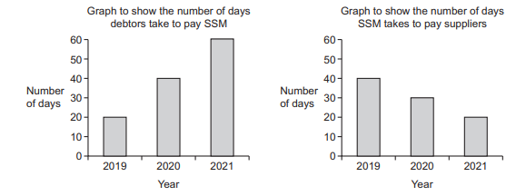
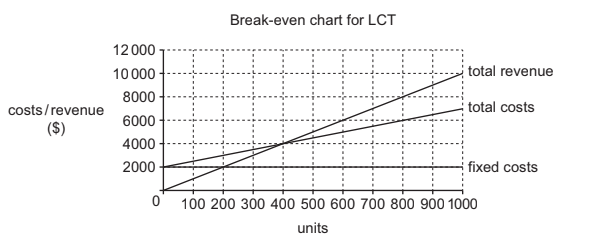
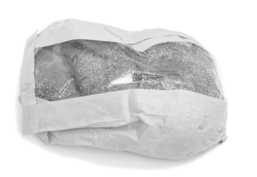
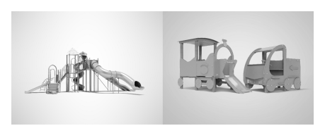
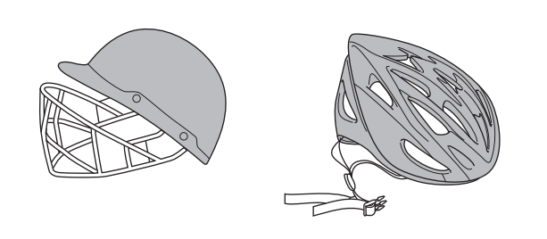

# Exam Questions — 4.4 Costs, Scale of Production & Break-even Analysis
**4. Operations Management** · Cambridge (CIE) IGCSE business (0450, 0986 & 0264, 0774)
> Source: [https://www.savemyexams.com/igcse/business/cie/25/topic-questions/](https://www.savemyexams.com/igcse/business/cie/25/topic-questions/) · 31 questions across 1 sets

## Exam Questions (31 questions)

### Q1 — hard — 12 marks

**Q1** [12 marks]

**Extract:**

**Soapy Sudds Manufacturer (SSM)**

SSM is a public limited company that was set up 25 years ago. SSM manufacture soap powder in country Y. The soap powder is used for washing clothes. SSM sells all its soap powder to large retailers in country Y. SSM’s sales have been increasing for many years in country Y but sales in the last year have remained the same. The directors of SSM are considering ways to increase sales.

SSM has a total of 100 employees with 60 in the Operations Department. It uses flow production in the factory and has 10 production lines with 5 workers and 1 supervisor for each line. The Operations Manager is aware that production workers are unhappy and often complain about their jobs being boring. These workers have always been paid by an hourly rate. The Human Resources Manager has recommended changes to ensure fewer workers leave each year to work for other businesses.

The directors of SSM have decided to expand the factory. They will need \$15m to do this. The directors have also considered taking over a competitor. SSM is likely to benefit from economies of scale as it grows.

The Marketing Director thinks SSM should start selling soap powder in markets in other countries. SSM will need to carry out either primary market research or secondary market research to forecast the potential total sales in these new markets. There are many existing manufacturers in these countries. SSM need to consider the problems when entering new markets in other countries such as tariffs or quotas.

**Appendix 1**

**Manufacturing process to make soap powder**

All the different types of soap powder are manufactured on production lines using flow production. SSM makes use of specialisation.

Each production line has the following stages:

Each of these stages uses machinery controlled by a production worker

Appendix 2

Email from the SSM Finance Director to the Managing Director

SSM has a cash-flow problem which may get worse. Please see charts below

**Appendix 3**

**Newspaper article from Main News 1 October 2021**

Retailers have reported increased sales for most types of products such as sales of washing machines which have increased by 15%. Economic growth in country Y is predicted to increase.

Many businesses have been recruiting additional employees and there are now shortages of some skilled workers. The government in country Y has recorded an increase in inflation to 8% so far this year, which is a worry.

Consider how SSM could benefit from the following three methods to achieve break even.

- Reducing variable costs
- Increasing selling price
- Reducing fixed costs

Which method is likely to have the greatest effect on SSM achieving break even? **Justify** your answer.

Refer to the following [insert](https://cdn.savemyexams.com/uploads/2024/09/nov-2021-paper-2-case-study---new.pdf) when answering the question.

### Q2 — easy — 8 marks

**Q2** [2 marks]

**Extract:**

**SunnyShade Hats (SSH)**

SunnyShade Hats is a private limited company (Ltd) that designs and makes sun hats. It started six years ago and now has 40 production workers and 8 office staff in City M. SSH sells hats on its website and to independent clothes shops. The owners, Naila and Amir, want to expand by launching a new eco-friendly range called OceanWave.

SSH currently buys most fabric from Country T and pays in US dollars (USD). Fabric prices have been stable, but transport costs are rising. The company uses industrial sewing machines. A bank loan of £300 000 was used last year to buy new machines.

Quality is very important. Recent checks show defect rates have increased as new staff have joined. SSH plans to hire 20 more machinists. Managers are deciding how to motivate staff to increase output and reduce defects. Two ideas are:

- Piece rate (a payment per hat made)
- Job rotation with extra skills training

SSH is also reviewing its packaging for online orders. The current plastic mailer is cheap and waterproof. A supplier has offered recyclable cardboard packaging that looks premium but costs more and may be less water-resistant.

To support decision making, the finance manager prepared weekly cost data and a summary of assets and liabilities for this year and last year. The marketing team has created a simple online advert for the OceanWave launch. A news article has also highlighted changes in the economy that could affect SSH.

### Appendix 1 – Online advert (draft)

**SUNNYSHADE – OCEANWAVE**
Light • durable • **made from recycled fibres**
Intro price: **£24.99**
Free head-size guide • Free returns
Follow us @SunnyShadeHats

### Appendix 2 – Statement of financial position items (end of year)

| **Item** | **2025 (£)** | **2026 (£)** |
|---|---|---|
| Inventories | 120,000 | 90,000 |
| Trade receivables | 180,000 | 210,000 |
| Cash | 40,000 | 10,000 |
| Trade payables | 160,000 | 190,000 |
| Bank overdraft | 0 | 50,000 |
| Bank loan (long term) | 300,000 | 300,000 |

### Appendix 3 – Business news (extract)

The economy is facing mixed news this month. The local currency has dropped 8% against the US dollar since January, making imports more expensive. At the same time, the government announced a 5% rise in the minimum wage to help workers cope with higher living costs. Meanwhile, the central bank cut interest rates by one percentage point in a bid to boost economic growth and encourage more borrowing and investment.

### Appendix 4 – Weekly cost and output (current line)

| **Measure** | **Value** |
|---|---|
| Output (hats per week) | 3,000 |
| Fixed costs per week | £6,000 |
| Total variable costs per week | £15,000 |

Calculate the average cost per hat. Show your working.

Refer to the following [insert](https://cdn.savemyexams.com/uploads/2025/09/37160_Paper%202%20Set%20A%20Insert.pdf)  when answering the question.

**Q2** [2 marks]

**Extract:**

**SunnyShade Hats (SSH)**

SunnyShade Hats is a private limited company (Ltd) that designs and makes sun hats. It started six years ago and now has 40 production workers and 8 office staff in City M. SSH sells hats on its website and to independent clothes shops. The owners, Naila and Amir, want to expand by launching a new eco-friendly range called OceanWave.

SSH currently buys most fabric from Country T and pays in US dollars (USD). Fabric prices have been stable, but transport costs are rising. The company uses industrial sewing machines. A bank loan of £300 000 was used last year to buy new machines.

Quality is very important. Recent checks show defect rates have increased as new staff have joined. SSH plans to hire 20 more machinists. Managers are deciding how to motivate staff to increase output and reduce defects. Two ideas are:

- Piece rate (a payment per hat made)
- Job rotation with extra skills training

SSH is also reviewing its packaging for online orders. The current plastic mailer is cheap and waterproof. A supplier has offered recyclable cardboard packaging that looks premium but costs more and may be less water-resistant.

To support decision making, the finance manager prepared weekly cost data and a summary of assets and liabilities for this year and last year. The marketing team has created a simple online advert for the OceanWave launch. A news article has also highlighted changes in the economy that could affect SSH.

### Appendix 1 – Online advert (draft)

**SUNNYSHADE – OCEANWAVE**

Light • durable • **made from recycled fibres**

Intro price: **£24.99**

Free head-size guide • Free returns

Follow us @SunnyShadeHats

### Appendix 2 – Statement of financial position items (end of year)

| **Item** | **2025 (£)** | **2026 (£)** |
| --- | :---: | :---: |
| Inventories | 120,000 | 90,000 |
| Trade receivables | 180,000 | 210,000 |
| Cash | 40,000 | 10,000 |
| Trade payables | 160,000 | 190,000 |
| Bank overdraft | 0 | 50,000 |
| Bank loan (long term) | 300,000 | 300,000 |

### Appendix 3 – Business news (extract)

The economy is facing mixed news this month. The local currency has dropped 8% against the US dollar since January, making imports more expensive. At the same time, the government announced a 5% rise in the minimum wage to help workers cope with higher living costs. Meanwhile, the central bank cut interest rates by one percentage point in a bid to boost economic growth and encourage more borrowing and investment.

### Appendix 4 – Weekly cost and output (current line)

| **Measure** | **Value** |
| --- | :---: |
| Output (hats per week) | 3,000 |
| Fixed costs per week | £6,000 |
| Total variable costs per week | £15,000 |

Calculate SSH's break-even point per week if each hat is sold for £25.

Refer to the following [insert](https://cdn.savemyexams.com/uploads/2025/09/37160_Paper%202%20Set%20A%20Insert.pdf)  when answering the question.

**Q2** [4 marks]

**Extract:**

**SunnyShade Hats (SSH)**

SunnyShade Hats is a private limited company (Ltd) that designs and makes sun hats. It started six years ago and now has 40 production workers and 8 office staff in City M. SSH sells hats on its website and to independent clothes shops. The owners, Naila and Amir, want to expand by launching a new eco-friendly range called OceanWave.

SSH currently buys most fabric from Country T and pays in US dollars (USD). Fabric prices have been stable, but transport costs are rising. The company uses industrial sewing machines. A bank loan of £300 000 was used last year to buy new machines.

Quality is very important. Recent checks show defect rates have increased as new staff have joined. SSH plans to hire 20 more machinists. Managers are deciding how to motivate staff to increase output and reduce defects. Two ideas are:

- Piece rate (a payment per hat made)
- Job rotation with extra skills training

SSH is also reviewing its packaging for online orders. The current plastic mailer is cheap and waterproof. A supplier has offered recyclable cardboard packaging that looks premium but costs more and may be less water-resistant.

To support decision making, the finance manager prepared weekly cost data and a summary of assets and liabilities for this year and last year. The marketing team has created a simple online advert for the OceanWave launch. A news article has also highlighted changes in the economy that could affect SSH.

### Appendix 1 – Online advert (draft)

**SUNNYSHADE – OCEANWAVE**
Light • durable • **made from recycled fibres**
Intro price: **£24.99**
Free head-size guide • Free returns
Follow us @SunnyShadeHats

### Appendix 2 – Statement of financial position items (end of year)

| **Item** | **2025 (£)** | **2026 (£)** |
|---|---|---|
| Inventories | 120,000 | 90,000 |
| Trade receivables | 180,000 | 210,000 |
| Cash | 40,000 | 10,000 |
| Trade payables | 160,000 | 190,000 |
| Bank overdraft | 0 | 50,000 |
| Bank loan (long term) | 300,000 | 300,000 |

### Appendix 3 – Business news (extract)

The economy is facing mixed news this month. The local currency has dropped 8% against the US dollar since January, making imports more expensive. At the same time, the government announced a 5% rise in the minimum wage to help workers cope with higher living costs. Meanwhile, the central bank cut interest rates by one percentage point in a bid to boost economic growth and encourage more borrowing and investment.

### Appendix 4 – Weekly cost and output (current line)

| **Measure** | **Value** |
|---|---|
| Output (hats per week) | 3,000 |
| Fixed costs per week | £6,000 |
| Total variable costs per week | £15,000 |

State four ways SSH's managers could use cost figures when making decisions.

Refer to the following [insert](https://cdn.savemyexams.com/uploads/2025/09/37160_Paper%202%20Set%20A%20Insert.pdf)  when answering the question.

### Q3 — medium — 6 marks

**Q3** [6 marks]

Do you think break-even analysis is always useful to managers in decision making? **Justify** your answer.

### Q4 — medium — 6 marks

**Q4** [6 marks]

> **[case-study]**
> Green Leaf Café is a small independent coffee shop with 8 employees. The business serves speciality coffee and homemade pastries to local customers. The owner, Sarah, has calculated that Green Leaf Café needs to sell 300 cups of coffee per month to break even. Each cup of coffee sells for £3.50, with variable costs of £1.20 per cup. The café's monthly fixed costs are £690. Sarah is concerned about the high break-even point and wants to explore options to reduce it to improve the business's profitability.

Explain **two **ways GreenLeaf Café might lower its break-even level of output.

### Q5 — easy — 2 marks

**Q5** [2 marks]

**Extract:**

**Furniture Outdoors (FO)**

FO has been a private limited company for 20 years. It is owned and run by the Chan family and is located in country Z. In country Z the secondary sector has become relatively more important as the country has developed. FO is a manufacturer of wooden furniture that is suitable for outdoor use. Its products include tables, chairs and other outdoor furniture.

Customers order online from the FO website. The furniture is then delivered to customers in country Z using FO’s own delivery vehicles. However, FO is considering changing to selling its furniture through either wholesalers or large retailers in country Z.

The Chan family have the business objective of contributing to sustainable development. FO only uses sustainably sourced wood when making furniture. This is from local forests in country Z and the wood is more expensive than imported alternatives.

For many years FO shareholders have reinvested profits to provide the finance for growth. FO recently took over 2 other furniture businesses in country Z and plans further takeovers. The Chan family plan to continue to control and manage FO after this expansion. The leadership style of these two companies is very different to that of FO and their factories are located several miles away from FO in different regions of country Z.

FO need to manage all its resources effectively. It tries to use the same components such as nails, brackets and paint for all its furniture designs. It is important to not run out of raw materials and so orders to suppliers must be carefully planned to avoid late deliveries. FO want to keep wastage of materials to a minimum. FO also need to consider how many employees are required to complete each order.

Appendix 1 - FO website advertisement

FO - the only business to go to when you need new outdoor furniture for your garden.

FO produce a range of high quality furniture to meet all your needs for fashionable, well designed outdoor furniture. Be reassured our furniture is only made from the highest quality wood from sustainable forests.

Our furniture is only available online so order today and have your furniture delivered in the next few weeks. Email any questions to us and we will reply quickly

{align=center} **Appendix 2**

{align=center} **Extract of cost, selling price and sales data for one of FO’s products**

| **Fixed cost per month** | \$10 000 |
| --- | --- |
| **Variable cost per table** | \$125 |
| **Selling price per table** | \$250 |
| **Forecasts sales for tables per month** | 100 |

{align=center} **Appendix 3**

{align=center} **Newspaper article from the Daily News April 2021**

{align=center} **Sustainable production needed to save the planet**

A report from the International Committee for the Planet states that manufacturers must find more sustainable ways to produce their products as global warming is becoming more of an issue

The report suggests three main ways manufacturers can change:

- Only use raw materials from sources that replace what they have used. This is estimated to raise variable costs by 20%
- Only use packaging that can be recycled. Costs are estimated to increase but the selling price may not rise by more than 10%
- Only use electric vehicles to deliver products. The cost of buying electric vehicles is more than petrol or diesel vehicles. Using electric vehicles could enable variable costs to be reduced by 5%.

**Calculate **the margin of safety per month for tables.

Refer to the following [insert ](https://cdn.savemyexams.com/uploads/2024/09/0450-june-2021-insert-paper-2-cie-igcse-business---new.pdf)when answering the question

*Source: June 2021 0450/21 Q4A(II)*

### Q6 — easy — 4 marks

**Q6** [4 marks]

> **[case-study]**
> FBW manufactures watches using job production. It employs 5 full-time production employees. Each worker is offered regular training. Last year FBW sold 600 watches. The Managing Director plans to use break-even analysis to help decide whether to increase the price of its products. FBW’s current break-even chart is shown below.
> 
> 

**Outline two **possible effects on FBW’s break-even chart if the 
prices of its products are increased.

*Source: June 2023 0450/12 Q1C*

### Q7 — easy — 2 marks

**Q7** [2 marks]

> **[case-study]**
> LCT manufactures cooking pots. It has 16 employees. As a small business LCT uses social media as its method of advertising. The owner, Carole, knows having a good brand image is important. She is analysing LCT’s break-even chart. This is shown in Fig. 2.1. Carole is considering possible ways to lower LCT’s break-even level of output.
> 
> 

**Calculate **LCT’s profit if it sells 800 units. Show your working.

*Source: Nov 2023 0450/11 Q2B*

### Q8 — easy — 2 marks

**Q8** [2 marks]

**Extract:**

**Furniture Outdoors (FO)**

FO has been a private limited company for 20 years. It is owned and run by the Chan family and is located in country Z. In country Z the secondary sector has become relatively more important as the country has developed. FO is a manufacturer of wooden furniture that is suitable for outdoor use. Its products include tables, chairs and other outdoor furniture.

Customers order online from the FO website. The furniture is then delivered to customers in country Z using FO’s own delivery vehicles. However, FO is considering changing to selling its furniture through either wholesalers or large retailers in country Z.

The Chan family have the business objective of contributing to sustainable development. FO only uses sustainably sourced wood when making furniture. This is from local forests in country Z and the wood is more expensive than imported alternatives.

For many years FO shareholders have reinvested profits to provide the finance for growth. FO recently took over 2 other furniture businesses in country Z and plans further takeovers. The Chan family plan to continue to control and manage FO after this expansion. The leadership style of these two companies is very different to that of FO and their factories are located several miles away from FO in different regions of country Z.

FO need to manage all its resources effectively. It tries to use the same components such as nails, brackets and paint for all its furniture designs. It is important to not run out of raw materials and so orders to suppliers must be carefully planned to avoid late deliveries. FO want to keep wastage of materials to a minimum. FO also need to consider how many employees are required to complete each order.

Appendix 1 - FO website advertisement

FO - the only business to go to when you need new outdoor furniture for your garden.

FO produce a range of high quality furniture to meet all your needs for fashionable, well designed outdoor furniture. Be reassured our furniture is only made from the highest quality wood from sustainable forests.

Our furniture is only available online so order today and have your furniture delivered in the next few weeks. Email any questions to us and we will reply quickly

{align=center} **Appendix 2**

{align=center} **Extract of cost, selling price and sales data for one of FO’s products**

| **Fixed cost per month** | \$10 000 |
| --- | --- |
| **Variable cost per table** | \$125 |
| **Selling price per table** | \$250 |
| **Forecasts sales for tables per month** | 100 |

{align=center} **Appendix 3**

{align=center} **Newspaper article from the Daily News April 2021**

{align=center} **Sustainable production needed to save the planet**

A report from the International Committee for the Planet states that manufacturers must find more sustainable ways to produce their products as global warming is becoming more of an issue

The report suggests three main ways manufacturers can change:

- Only use raw materials from sources that replace what they have used. This is estimated to raise variable costs by 20%
- Only use packaging that can be recycled. Costs are estimated to increase but the selling price may not rise by more than 10%
- Only use electric vehicles to deliver products. The cost of buying electric vehicles is more than petrol or diesel vehicles. Using electric vehicles could enable variable costs to be reduced by 5%.

Using the information in Appendix 2, **calculate **the break-even level of output per month.

Refer to the following [insert ](https://cdn.savemyexams.com/uploads/2024/09/0450-june-2021-insert-paper-2-cie-igcse-business---new.pdf)when answering the question.

*Source: June 2021 0450/21 Q4A(I)*

### Q9 — medium — 8 marks

**Q9** [8 marks]

**Extract:**

**MainCity Bakery (MB) **

MB is a small bakery that produces bread. Yasin started the bakery 6 months ago with help from the government. Yasin needed a business plan to support his application for government help. An extract from the business plan Yasin produced is shown in Appendix 1. The market research was carried out by Yasin. He asked a small sample of family and friends to fill in a questionnaire. Yasin’s business plan also contained forecast data.

MB’s bread is freshly-made every day in the bakery, which is located at the back of MB’s small shop. The bread is then sold the same day. Yasin has 2 employees to help him produce the bread and 1 employee to serve customers in the shop. All employees work 5 days a week and are paid the legal minimum wage. Yasin uses a democratic leadership style.

Yasin needs to keep costs low to be competitive. He uses packaging that cannot be recycled. Yasin also buys the cheapest ingredients, most of which are imported. He is planning to use lean production in the bakery but he has to decide which method to use.

MB’s main competitors advertise that they only use ingredients from local suppliers. Yasin is thinking of changing the suppliers he uses for ingredients and packaging. He wants MB to have a good ethical image which he could use in advertising.

Yasin plans to start making cakes. He is considering two options as outlined in Appendix 2. MB’s fixed costs will increase as there will be additional expenses whichever option he chooses.

**Appendix 1 **

**Extract from Yasin’s business plan for MB**

| Section | Details |
|---|---|
| Market research | Questionnaire results are as follows:  - Bread is eaten by all age groups - Of the sample asked: - 85% want products made using ingredients from local suppliers - 70% want to purchase cakes as well as bread from a bakery |
| Resources | - \$10 000 to buy bakery equipment - Rent for the bakery and shop each month - \$3000 for start-up supplies and ingredients |

**Appendix 2 **

**Forecast data for MB’s cake options**

|   | **Option 1 **  **Small cupcakes** | **Option 2 **  **Large birthday cakes** |
|---|---|---|
| Monthly sales of cakes | 4000 | 100 |
| Variable cost per cake | \$0.50 | \$10 |
| Additional fixed cost per month | \$3000 | \$3000 |
| Price per cake | \$2 per cupcake | \$60 per birthday cake |
| Gross profit margin | 75% | 83.33% |
| Sales growth | Low | High |

**Appendix 3 **

**Packaging supplier advertisement**

We only supply packaging made from sustainable sources.

This will keep your products fresh and protect the environment.

We can deliver your packaging when you need it

**Explain one** benefit and **one** limitation to Yasin of using a break-even chart.

Refer to the following [insert](https://cdn.savemyexams.com/uploads/2024/09/jun-2022-paper-2-case-study---new.pdf) when answering the question.

*Source: June 2022 0450/21 Q2A*

### Q10 — easy — 4 marks

**Q10** [4 marks]

> **[case-study]**
> FBW manufactures watches using job production. It employs 5 full-time production employees. Each worker is offered regular training. Last year FBW sold 600 watches. The Managing Director plans to use break-even analysis to help decide whether to increase the price of its products. FBW’s current break-even chart is shown below.
> 
> 

**Outline two **possible effects on FBW’s break-even chart if the 
prices of its products are increased.

*Source: June 2023 0450/12 Q1C*

### Q11 — easy — 4 marks

**Q11** [4 marks]

> **[case-study]**
> CHW manufactures electrical products, including cameras. The business is developing new products. The Managing Director knows that the stage of the product life cycle can influence CHW’s marketing decisions about promotion. He is analysing data for one of its products. An extract is shown in the table below. The business would also like to introduce flow production into the factory.
> 
> | **Extract from CHW’s data for one type of camera (2021)** |   |
> |---|---|
> | Selling price per unit (\$) | 120 |
> | Variable cost per unit (\$) | 40 |
> | Fixed costs (\$) | 200,000 |
> | Margin of safety (units) | 500 |

**Outline two **ways CHW could increase its margin of safety.

*Source: June 2022 0450/12 Q3C*

### Q12 — easy — 2 marks

**Q12** [2 marks]

> **[case-study]**
> GHT is a public limited company. It produces steel products, including gates and garage doors. GHT has a flat organisational structure and a short chain of command. GHT has many stakeholder groups, including 600 employees. The Managing Director is considering introducing job rotation to improve employee motivation. He has also been analysing some financial data. An extract is shown in Table 3.1.
> 
> Table 3.1: Extract of revenue and cost data for one of GHT’s products (product X)
> 
> | Units sold in 2020 | 30,000 |
> |---|---|
> | Price per unit | \$100 |
> | Variable costs per unit | \$60 |
> | Fixed costs | \$900,000 |
> | Break even output (units) | 22,500 |

**Calculate **the margin of safety for product X in 2020. Show your working.

*Source: June 2021 0450/12 Q3B*

### Q13 — hard — 12 marks

**Q13** [12 marks]

**Extract:**

MainCity Bakery (MB)

MB is a small bakery that produces bread. Yasin started the bakery 6 months ago with help from the government. Yasin needed a business plan to support his application for government help. An extract from the business plan Yasin produced is shown in Appendix 1. The market research was carried out by Yasin. He asked a small sample of family and friends to fill in a questionnaire. Yasin’s business plan also contained forecast data.

MB’s bread is freshly-made every day in the bakery, which is located at the back of MB’s small shop. The bread is then sold the same day. Yasin has 2 employees to help him produce the bread and 1 employee to serve customers in the shop. All employees work 5 days a week and are paid the legal minimum wage. Yasin uses a democratic leadership style.

Yasin needs to keep costs low to be competitive. He uses packaging that cannot be recycled. Yasin also buys the cheapest ingredients, most of which are imported. He is planning to use lean production in the bakery but he has to decide which method to use.

MB’s main competitors advertise that they only use ingredients from local suppliers. Yasin is thinking of changing the suppliers he uses for ingredients and packaging. He wants MB to have a good ethical image which he could use in advertising.

Yasin plans to start making cakes. He is considering two options as outlined in Appendix 2. MB’s fixed costs will increase as there will be additional expenses whichever option he chooses.

**Appendix 1**

**Extract from Yasin’s business plan for MB**

| Section | Details |
|---|---|
| Market research | Questionnaire results are as follows:  - Bread is eaten by all age groups - Of the sample asked: - 85% want products made using ingredients from local suppliers 70% want to purchase cakes as well as bread from a bakery |
| Resources | - \$10 000 to buy bakery equipment - Rent for the bakery and shop each month - \$3000 for start-up supplies and ingredients |

**Appendix 2**

**Forecast data for MB’s cake options**

|   | Option 1  Small cupcakes | Option 2  Large birthday cakes |
|---|---|---|
| Monthly sales of cakes | 4000 | 100 |
| Variable cost per cake | \$0.50 | \$10 |
| Additional fixed cost per month | \$3000 | \$3000 |
| Price per cake | \$2 per cupcake | \$60 per birthday cake |
| Gross profit margin | 75% | 83.33% |
| Sales growth | Low | High |

**Appendix 3**

**Packaging supplier advertisement**

We only supply packaging made from sustainable sources.

This will keep your products fresh and protect the environment.

We can deliver your packaging when you need it.

Consider the **two **options outlined in Appendix 2. Which option should Yasin choose? **Justify **your answer using appropriate calculations.

Refer to the following [insert ](https://cdn.savemyexams.com/uploads/2024/09/jun-2022-paper-2-case-study---new.pdf)when answering the question.

*Source: June 2022 0450/21 Q3B*

### Q14 — hard — 12 marks

**Q14** [12 marks]

**Extract:**

**Soapy Sudds Manufacturer (SSM)**

SSM is a public limited company that was set up 25 years ago. SSM manufacture soap powder in country Y. The soap powder is used for washing clothes. SSM sells all its soap powder to large retailers in country Y. SSM’s sales have been increasing for many years in country Y but sales in the last year have remained the same. The directors of SSM are considering ways to increase sales.

SSM has a total of 100 employees with 60 in the Operations Department. It uses flow production in the factory and has 10 production lines with 5 workers and 1 supervisor for each line. The Operations Manager is aware that production workers are unhappy and often complain about their jobs being boring. These workers have always been paid by an hourly rate. The Human Resources Manager has recommended changes to ensure fewer workers leave each year to work for other businesses.

The directors of SSM have decided to expand the factory. They will need \$15m to do this. The directors have also considered taking over a competitor. SSM is likely to benefit from economies of scale as it grows.

The Marketing Director thinks SSM should start selling soap powder in markets in other countries. SSM will need to carry out either primary market research or secondary market research to forecast the potential total sales in these new markets. There are many existing manufacturers in these countries. SSM need to consider the problems when entering new markets in other countries such as tariffs or quotas.

**Appendix 1**

**Manufacturing process to make soap powder**

All the different types of soap powder are manufactured on production lines using flow production. SSM makes use of specialisation.

Each production line has the following stages:

Each of these stages uses machinery controlled by a production worker

Appendix 2

Email from the SSM Finance Director to the Managing Director

SSM has a cash-flow problem which may get worse. Please see charts below

**Appendix 3**

**Newspaper article from Main News 1 October 2021**

Retailers have reported increased sales for most types of products such as sales of washing machines which have increased by 15%. Economic growth in country Y is predicted to increase.

Many businesses have been recruiting additional employees and there are now shortages of some skilled workers. The government in country Y has recorded an increase in inflation to 8% so far this year, which is a worry.

Consider how SSM could benefit from the following three economies of scale.

- Purchasing
- Financial
- Managerial

Which economy of scale is likely to have the greatest effect on SSM? **Justify **your answer.

Refer to the following [insert ](https://cdn.savemyexams.com/uploads/2024/09/nov-2021-paper-2-case-study---new.pdf)when answering the question.

*Source: Nov 2021 0450/21 Q3B*

### Q15 — hard — 12 marks

**Q15** [12 marks]

**Extract:**

Playsafe Playground Equipment (PPE)

Kaari has always been creative and made wooden toys for her two children when they were young. Her children are now at school, so Kaari decided to start her own business making wooden playground equipment.

Kaari started PPE as a sole trader business three years ago in country Z. She wants an income from the business but also wants to spend time with her children. Kaari wants the business to remain small. However, if the business grows Kaari may need to change to another type of business organisation. Kaari carries out all the management roles in the business.

Kaari uses job production to produce high quality, individually designed playground equipment. Kaari designs all the equipment herself and she employs 3 skilled workers to help her make the products. PPE currently makes both large and small items of playground equipment each week.

Kaari uses cost-plus pricing as every item of playground equipment uses different quantities of raw materials. She sells small items of playground equipment to retailers and large items of playground equipment to the Government. There are many competitors in this market.

Kaari plans to obtain new machinery which will cost \$20 000. She is considering using crowd-funding as this is one way to raise capital for new business investment. Other options include leasing the machinery or asking the bank for a loan.

Kaari has developed a new unique product this year. There are no other similar products in the market.

**Appendix 1**

**Advertisement for PPE**

Buy your playground equipment from us.

At PPE we manufacture high quality playground equipment and have better designs than our competitors.

All our equipment has been fully tested and is guaranteed to meet legal safety standards. We are the main supplier of playground equipment to the Government for public parks - so you know our equipment can be trusted!

Contact us today for a price list.

**Appendix 2**

**Cost and revenue information for PPE in 2021**

|   | Small item of playground equipment | Large item of playground equipment |
|---|---|---|
| Average selling price | \$100 | \$1 000 |
| Average cost of manufacture | \$25 | \$500 |
| Output each week | 15 | 3 |

**Appendix 3**

**Newspaper article – Main News 1st October 2021**

**Children need to get more exercise and play outside**

Research suggests that playing outside helps children relax after school and improves their health.

The Government in country Z has allocated \$10m to spend on improving children’s playgrounds in public places. This means there will be \$5 000 to spend on equipment for each public playground.

Retailers have reported increasing demand for small items of playground equipment as parents want to have these products at home. This trend is expected to continue.

Using Appendix 2 and other information, consider whether PPE should produce only large items of playground equipment or produce only small items of playground equipment. **Justify **your answer using suitable calculations.

Refer to the following [insert ](https://cdn.savemyexams.com/uploads/2024/09/jun-2021-paper-2-case-study-v2---new.pdf)when answering the question.

*Source: June 2021 0450/22 Q4B*

### Q16 — medium — 8 marks

**Q16** [8 marks]

**Extract:**

Sports Safety Equipment (SSE)

SSE manufactures sports safety equipment in country Z. It is a public limited company which has been successful for over 30 years. The main product SSE manufactures is safety helmets for different sports, such as bicycle riding, cricket and skateboarding. SSE has one large factory making the safety helmets. The factory uses flow production. The production workers each specialise in one task on the production line. SSE’s raw materials are imported.

SSE sells its helmets in several other countries and is planning to expand into many more. It will need to carry out market research before entering new markets in other countries. Each country has different sports that are popular and the style of helmets varies from country to country.

SSE plans to build its own factories in its most important markets in other countries and will need to choose a suitable source of finance. The Human Resources Director has decided to use internal recruitment for the managers of the new factories. There will need to be effective communication between the managers of the new factories and SSE’s head office in country Z.

Most of SSE’s sales in country Z are through sports equipment shops. Customers like to try on the helmets to check they fit correctly. SSE currently sells its helmets in other countries through its website.

SSE is also increasing its product range. The latest new product being developed is a children’s cricket helmet. A break-even chart for this new product is shown in Appendix 3.

**Appendix 1**

**Extract from SSE’s website**

**If you want the best protection when playing sport then buy an SSE safety helmet!**

We supply a wide range of safety helmets for you when playing sport. 
Whatever the sport - SSE produces a helmet for you. 
You can order directly from this website by entering your head measurements below. 
Get the perfect fit for you!

Appendix 2

Email from SSE’s Managing Director to SSE’s Finance Director

To: Finance Director

From: Managing Director

Date: 1 September 2023

Re: Demand for SSE’s products

Demand for SSE’s products in country Z is forecast to increase. Our government has imposed import tariffs on safety helmets. We may be able to increase our prices.

The exchange rate in country Z is expected to fall. However, other countries have introduced import quotas on safety helmets.

We will have to consider all the likely effects of these changes.

**Appendix 3**

** Projected weekly break-even chart for SSE’s new children’s cricket helmet**

The maximum output and sales for this product is 1000 units per week.

**Explain four **ways the break-even chart in Appendix 3 might be helpful to SSE.

Refer to the following [insert ](https://cdn.savemyexams.com/uploads/2024/09/nov-2023-paper-2-case-study-v2---new.pdf)when answering the question.

*Source: Nov 2023 0450/22 Q4A*

### Q17 — medium — 6 marks

**Q17** [6 marks]

> **[case-study]**
> LCT manufactures cooking pots. It has 16 employees. As a small business, LCT uses social media as its method of advertising. The owner, Carole, knows having a good brand image is important. She is analysing LCT’s break-even chart. This is shown in Fig. 2.1. Carole is considering possible ways to lower LCT’s break-even level of output.
> 
> 

**Explain two **ways LCT might lower its break-even level of output.

*Source: Nov 2023 0450/11 Q2D*

### Q18 — easy — 2 marks

**Q18** [2 marks]

**Define **‘break-even’.

*Source: Nov 2020 0450/12 Q4A*

### Q19 — easy — 4 marks

**Q19** [4 marks]

> **[case-study]**
> TBX manufactures high-quality steel which is used to build railways. The method of production used allows TBX to benefit from economies of scale. The business holds a high level of inventory including iron ore. The Managing Director knows business activity could have an impact on the environment and is considering ways the business can contribute to sustainable development.

**Outline two **possible economies of scale TBX might benefit from.

*Source: Nov 2023 0450/12 Q2C*

### Q20 — easy — 2 marks

**Q20** [2 marks]

> **[case-study]**
> Paolo wants to start up a business making cakes. He plans to sell all of his products to a wholesaler. Paolo knows the packaging for his products will be important. He has prepared some financial and sales data. An extract from this data is shown in the table below. Paolo is considering using crowdfunding as a source of finance. He knows the business will also need working capital.
> 
> | **Extract from Paolo’s financial and sales data** |   |
> |---|---|
> | Average price per cake | \$6 |
> | Average cost per cake | \$4 |
> | Forecast average number of cake sales per day | 50 |

**Calculate **the average revenue per day. Show your working.

*Source: Nov 2023 0450/12 Q1B*

### Q21 — easy — 2 marks

**Q21** [2 marks]

> **[case-study]**
> FBW manufactures watches using job production. It employs 5 full-time production employees. Each worker is offered regular training. Last year FBW sold 600 watches. The Managing Director plans to use break-even analysis to help decide whether to increase the price of its products. FBW’s current break-even chart is shown below.
> 
> 

**Identify **the following values using FBW's break-even chart:

- Break-even output
- Break-even revenue

*Source: June 2023 0450/12 Q1B*

### Q22 — easy — 2 marks

**Q22** [2 marks]

**Identify two **examples of fixed costs.

*Source: Nov 2022 0450/12 Q4B*

### Q23 — easy — 2 marks

**Q23** [2 marks]

**Define **‘revenue’.

*Source: Nov 2022 0450/12 Q2A*

### Q24 — easy — 2 marks

**Q24** [2 marks]

> **[case-study]**
> SSG manufactures mobile (cell) phones using batch production. Quality control is important. SSG has 130 employees who all receive on-the-job training. The Marketing Manager is analysing cost and output data for product X. An extract is shown in the table below. As product X is in the maturity stage of the product life cycle, SSG is considering possible extension strategies.
> 
> | **Extract from SSG’s cost and output data for product X** |   |
> |---|---|
> | Rent and other expenses per month | \$300,000 |
> | Variable cost per unit | \$80 |
> | Output per month | 12,000 |

**Calculate **total variable cost per month. Show your working.

*Source: Nov 2022 0450/11 Q1B*

### Q25 — easy — 2 marks

**Q25** [2 marks]

> **[case-study]**
> CTF is a public limited company. It manufactures beds using batch production. The Operations Director is using break-even analysis to calculate the margin of safety for children’s beds. An extract from CTF’s output data is in the table below. The Operations Director wants to know how an increase in inflation might affect CTF. She knows there are many environmental pressures that a manufacturing business could respond to.
> 
> | **Extract from CTF’s output data (children’s beds per month)** |   |
> |---|---|
> | Break-even output | 14,000 |
> | Current level of output | 18,000 |
> | Maximum factory output | 25,000 |

**Calculate **the margin of safety for CTF’s children’s beds. Show your working.

*Source: June 2022 0450/11 Q2B*

### Q26 — easy — 2 marks

**Q26** [2 marks]

> **[case-study]**
> CHW manufactures electrical products, including cameras. The business is developing new products. The Managing Director knows that the stage of the product life cycle can influence CHW’s marketing decisions about promotion. He is analysing data for one of its products. An extract is shown in the table below. The business would also like to introduce flow production into the factory.
> 
> | **Extract from CHW’s data for one type of camera (2021)** |   |
> |---|---|
> | Selling price per unit (\$) | 120 |
> | Variable cost per unit (\$) | 40 |
> | Fixed costs (\$) | 200,000 |
> | Margin of safety (units) | 500 |

**Calculate **the break-even level of output for 2021. Show your working.

*Source: June 2022 0450/12 Q3B*

### Q27 — easy — 2 marks

**Q27** [2 marks]

**Identify two **limitations of break-even analysis.

*Source: Nov 2021 0450/12 Q2B*

### Q28 — easy — 2 marks

**Q28** [2 marks]

**Define **‘variable costs’.

*Source: Nov 2021 0450/12 Q2A*

### Q29 — easy — 4 marks

**Q29** [4 marks]

> **[case-study]**
> After identifying a gap in the soft drinks market, Jerome developed a low sugar drink. He borrowed \$5,000 from family and friends to start-up a business and to provide working capital. Jerome operates as a sole trader. To promote his product, Jerome handed out free samples in the town centre. In the first year, Jerome’s business sold 10,000 units. This is 200 units more than his break-even output. Jerome is considering ways to increase added value.

**Outline two **ways that break-even information can help Jerome’s business.

*Source: Nov 2021 0450/11 Q1C*

### Q30 — easy — 4 marks

**Q30** [4 marks]

**Identify four **limitations of using break-even analysis.

*Source: June 2021 0450/21 Q4A(III)*

### Q31 — easy — 2 marks

**Q31** [2 marks]

**Define **‘fixed costs’.

*Source: June 2021 0450/12 Q3A*

