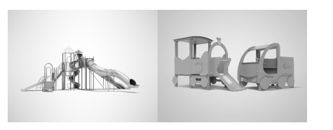

# Exam Questions — 4.3 Sustainable Production of Goods and Services
**4. Operations Management** · Cambridge (CIE) IGCSE business (0450, 0986 & 0264, 0774)
> Source: [https://www.savemyexams.com/igcse/business/cie/25/topic-questions/](https://www.savemyexams.com/igcse/business/cie/25/topic-questions/) · 15 questions across 1 sets

## Exam Questions (15 questions)

### Q1 — medium — 8 marks

**Q1** [8 marks]

**Extract:**

**SunnyShade Hats (SSH)**

SunnyShade Hats is a private limited company (Ltd) that designs and makes sun hats. It started six years ago and now has 40 production workers and 8 office staff in City M. SSH sells hats on its website and to independent clothes shops. The owners, Naila and Amir, want to expand by launching a new eco-friendly range called OceanWave.

SSH currently buys most fabric from Country T and pays in US dollars (USD). Fabric prices have been stable, but transport costs are rising. The company uses industrial sewing machines. A bank loan of £300 000 was used last year to buy new machines.

Quality is very important. Recent checks show defect rates have increased as new staff have joined. SSH plans to hire 20 more machinists. Managers are deciding how to motivate staff to increase output and reduce defects. Two ideas are:

- Piece rate (a payment per hat made)
- Job rotation with extra skills training

SSH is also reviewing its packaging for online orders. The current plastic mailer is cheap and waterproof. A supplier has offered recyclable cardboard packaging that looks premium but costs more and may be less water-resistant.

To support decision making, the finance manager prepared weekly cost data and a summary of assets and liabilities for this year and last year. The marketing team has created a simple online advert for the OceanWave launch. A news article has also highlighted changes in the economy that could affect SSH.

### Appendix 1 – Online advert (draft)

**SUNNYSHADE – OCEANWAVE**
Light • durable • **made from recycled fibres**
Intro price: **£24.99**
Free head-size guide • Free returns
Follow us @SunnyShadeHats

### Appendix 2 – Statement of financial position items (end of year)

| **Item** | **2025 (£)** | **2026 (£)** |
|---|---|---|
| Inventories | 120,000 | 90,000 |
| Trade receivables | 180,000 | 210,000 |
| Cash | 40,000 | 10,000 |
| Trade payables | 160,000 | 190,000 |
| Bank overdraft | 0 | 50,000 |
| Bank loan (long term) | 300,000 | 300,000 |

### Appendix 3 – Business news (extract)

The economy is facing mixed news this month. The local currency has dropped 8% against the US dollar since January, making imports more expensive. At the same time, the government announced a 5% rise in the minimum wage to help workers cope with higher living costs. Meanwhile, the central bank cut interest rates by one percentage point in a bid to boost economic growth and encourage more borrowing and investment.

### Appendix 4 – Weekly cost and output (current line)

| **Measure** | **Value** |
|---|---|
| Output (hats per week) | 3,000 |
| Fixed costs per week | £6,000 |
| Total variable costs per week | £15,000 |

SSH is thinking of switching to recyclable cardboard packaging for online orders. Explain two advantages and two disadvantages of this change for SSH.

Refer to the following [insert](https://cdn.savemyexams.com/uploads/2025/09/37160_Paper%202%20Set%20A%20Insert.pdf) when answering the question.

### Q2 — hard — 12 marks

**Q2** [12 marks]

**Extract:**

**Furniture Outdoors (FO)**

FO has been a private limited company for 20 years. It is owned and run by the Chan family and is located in country Z. In country Z the secondary sector has become relatively more important as the country has developed. FO is a manufacturer of wooden furniture that is suitable for outdoor use. Its products include tables, chairs and other outdoor furniture.

Customers order online from the FO website. The furniture is then delivered to customers in country Z using FO’s own delivery vehicles. However, FO is considering changing to selling its furniture through either wholesalers or large retailers in country Z.

The Chan family have the business objective of contributing to sustainable development. FO only uses sustainably sourced wood when making furniture. This is from local forests in country Z and the wood is more expensive than imported alternatives.

For many years FO shareholders have reinvested profits to provide the finance for growth. FO recently took over 2 other furniture businesses in country Z and plans further takeovers. The Chan family plan to continue to control and manage FO after this expansion. The leadership style of these two companies is very different to that of FO and their factories are located several miles away from FO in different regions of country Z.

FO need to manage all its resources effectively. It tries to use the same components such as nails, brackets and paint for all its furniture designs. It is important to not run out of raw materials and so orders to suppliers must be carefully planned to avoid late deliveries. FO want to keep wastage of materials to a minimum. FO also need to consider how many employees are required to complete each order.

**Appendix 1 - FO website advertisement**

**FO - the only business to go to when you need new outdoor furniture for your garden. **

FO produce a range of high quality furniture to meet all your needs for fashionable, well designed outdoor furniture. Be reassured our furniture is only made from the highest quality wood from sustainable forests.

Our furniture is only available online so order today and have your furniture delivered in the next few weeks. Email any questions to us and we will reply quickly.

**Appendix 2**

**Extract of cost, selling price and sales data for one of FO’s products**

| **Fixed cost per month** | \$10 000 |
|---|---|
| **Variable cost per table** | \$125 |
| **Selling price per table** | \$250 |
| **Forecasts sales for tables per month** | 100 |

**Appendix 3 **

**Newspaper article from the Daily News April 2021 **

**Sustainable production needed to save the planet **

A report from the International Committee for the Planet states that manufacturers must find more sustainable ways to produce their products as global warming is becoming more of an issue.

The report suggests three main ways manufacturers can change:

- Only use raw materials from sources that replace what they have used. This is estimated to raise variable costs by 20%
- Only use packaging that can be recycled. Costs are estimated to increase but the selling price may not rise by more than 10%
- Only use electric vehicles to deliver products. The cost of buying electric vehicles is more than petrol or diesel vehicles. Using electric vehicles could enable variable costs to be reduced by 5%.

Consider the following **three** sustainable production methods FO could implement:

- use renewable energy sources (solar panels) to power all manufacturing equipment
- implement a zero-waste production system where all wood offcuts are recycled into smaller products
- adopt lean manufacturing techniques to reduce material waste by 30%.

Which production method should FO choose to maximise profit? **Justify** your answer.

Refer to the following [insert ](https://cdn.savemyexams.com/uploads/2024/09/0450-june-2021-insert-paper-2-cie-igcse-business---new.pdf)when answering the question.

### Q3 — hard — 12 marks

**Q3** [12 marks]

**Extract:**

**Playsafe Playground Equipment (PPE)**

Kaari has always been creative and made wooden toys for her two children when they were young. Her children are now at school, so Kaari decided to start her own business making wooden playground equipment.

Kaari started PPE as a sole trader business three years ago in country Z. She wants an income from the business but also wants to spend time with her children. Kaari wants the business to remain small. However, if the business grows Kaari may need to change to another type of business organisation. Kaari carries out all the management roles in the business.

Kaari uses job production to produce high quality, individually designed playground equipment. Kaari designs all the equipment herself and she employs 3 skilled workers to help her make the products. PPE currently makes both large and small items of playground equipment each week.

Kaari uses cost-plus pricing as every item of playground equipment uses different quantities of raw materials. She sells small items of playground equipment to retailers and large items of playground equipment to the Government. There are many competitors in this market.

Kaari plans to obtain new machinery which will cost \$20 000. She is considering using crowd-funding as this is one way to raise capital for new business investment. Other options include leasing the machinery or asking the bank for a loan.

Kaari has developed a new unique product this year. There are no other similar products in the market.

**Appendix 1**

**Advertisement for PPE**

Buy your playground equipment from us.

At PPE we manufacture high quality playground equipment and have better designs than our competitors.

All our equipment has been fully tested and is guaranteed to meet legal safety standards. We are the main supplier of playground equipment to the Government for public parks - so you know our equipment can be trusted!

Contact us today for a price list.

**Appendix 2**

**Cost and revenue information for PPE in 2021**

|   | **Small item of playgroundequipment** | **Large item of playgroundequipment** |
|---|---|---|
| Average selling price | \$100 | \$1 000 |
| Average cost of manufacture | \$25 | \$500 |
| Output each week | 15 | 3 |

**Appendix 3**

**Newspaper article – Main News 1st October 2021**

**Children need to get more exercise and play outside**

Research suggests that playing outside helps children relax after school and improves their health.

The Government in country Z has allocated \$10m to spend on improving children’s playgrounds in public places. This means there will be \$5 000 to spend on equipment for each public playground.

Retailers have reported increasing demand for small items of playground equipment as parents want to have these products at home. This trend is expected to continue.

Consider the advantages and disadvantages to PPE of investing in the following **three** types of sustainable production technology to improve their manufacturing process:

- Solar-powered machinery
- Recycled material processing equipment
- Energy-efficient LED lighting systems

Which sustainable technology investment should PPE prioritise? **Justify** your answer.

Refer to the following[ insert](https://cdn.savemyexams.com/uploads/2024/09/jun-2021-paper-2-case-study-v2---new.pdf) when answering the question.

### Q4 — medium — 6 marks

**Q4** [6 marks]

Do you think it is always possible for a manufacturing business to reduce its resource use? **Justify** your answer.

### Q5 — medium — 6 marks

**Q5** [6 marks]

Do you think sustainable production methods are the best approach for a manufacturing business to adopt? **Justify** your answer.

### Q6 — medium — 8 marks

**Q6** [8 marks]

**Extract:**

Playsafe Playground Equipment (PPE)

Kaari has always been creative and made wooden toys for her two children when they were young. Her children are now at school, so Kaari decided to start her own business making wooden playground equipment.

Kaari started PPE as a sole trader business three years ago in country Z. She wants an income from the business but also wants to spend time with her children. Kaari wants the business to remain small. However, if the business grows Kaari may need to change to another type of business organisation. Kaari carries out all the management roles in the business.

Kaari uses job production to produce high quality, individually designed playground equipment. Kaari designs all the equipment herself and she employs 3 skilled workers to help her make the products. PPE currently makes both large and small items of playground equipment each week.

Kaari uses cost-plus pricing as every item of playground equipment uses different quantities of raw materials. She sells small items of playground equipment to retailers and large items of playground equipment to the Government. There are many competitors in this market.

Kaari plans to obtain new machinery which will cost \$20 000. She is considering using crowd-funding as this is one way to raise capital for new business investment. Other options include leasing the machinery or asking the bank for a loan.

Kaari has developed a new unique product this year. There are no other similar products in the market.

Appendix 1

Advertisement for PPE

Buy your playground equipment from us.

At PPE we manufacture high quality playground equipment and have better designs than our competitors.

Contact us today for a price list.

**Appendix 2**

**Cost and revenue information for PPE in 2021**

|   | **Small item of playground equipment** | **Large item of playground equipment** |
|---|---|---|
| Average selling price | \$100 | \$1 000 |
| Average cost of manufacture | \$25 | \$500 |
| Output each week | 15 | 3 |

**Appendix 3**

**Newspaper article – Main News 1st October 2021**

**Children need to get more exercise and play outside**

Research suggests that playing outside helps children relax after school and improves their health.

The Government in country Z has allocated \$10m to spend on improving children’s playgrounds in public places. This means there will be \$5 000 to spend on equipment for each public playground.

Retailers have reported increasing demand for small items of playground equipment as parents want to have these products at home. This trend is expected to continue.

**Explain two** advantages and **two** disadvantages to PPE of using sustainable materials such as wood in the production of play equipment.

Refer to the following [insert ](https://cdn.savemyexams.com/uploads/2024/09/jun-2021-paper-2-case-study-v2---new.pdf)when answering the question

### Q7 — medium — 6 marks

**Q7** [6 marks]

> **[case-study]**
> **EcoWrap Solutions** is a UK company producing biodegradable packaging from recycled cardboard and plant-based polymers. It operates a sustainable system where production waste is composted and reused as raw material. The business has invested £2.8m in advanced processing equipment and environmental certification. Each year, its facility handles 650 tonnes of recycled material, turning it into eco-friendly packaging for retail and e-commerce. According to the sustainability director, the company’s green commitment brings operational benefits but also demands major investment in specialised technology and strict environmental standards.

**Explain** **two** advantages to EcoWrap Solutions of using environmentally friendly packaging materials in production.

### Q8 — medium — 6 marks

**Q8** [6 marks]

> **[case-study]**
> GreenCycle Manufacturing is a UK-based company that produces garden furniture from 100% recycled aluminium and plastic materials. The company has developed an innovative circular production model where all manufacturing waste is collected, reprocessed, and integrated back into new products. GreenCycle has invested £3.2m in state-of-the-art recycling technology and quality assurance systems. The facility processes 750 tonnes of recycled materials annually, transforming them into premium outdoor furniture collections. The operations manager stated: 'Our focus on reusing and recycling materials has created significant operational benefits, though it demands substantial investment in advanced processing capabilities and stringent quality management.'

**Explain** **two **advantages to GreenCycle Manufacturing of reusing and recycling materials in production.

### Q9 — easy — 2 marks

**Q9** [2 marks]

**Identify two** ways a business can reduce its resource use.

### Q10 — easy — 4 marks

**Q10** [4 marks]

> **[case-study]**
> EcoLoop Ltd is a UK-based manufacturing company that specialises in producing furniture from 100% recycled plastic waste. The company operates a closed-loop production system where all waste materials are collected, processed, and reused in manufacturing new products. EcoLoop has invested GBP2.5m in advanced sorting and processing equipment to ensure high-quality recycled materials. The company's production facility processes 500 tonnes of plastic waste monthly, converting it into durable outdoor furniture. A spokesperson commented: 'Our commitment to reusing and recycling materials has transformed waste streams into valuable resources, though it requires significant investment in specialised technology and quality control systems.'

**Outline one** advantage and **one** disadvantage to EcoLoop Ltd of focusing on reusing and recycling materials in production.

### Q11 — easy — 2 marks

**Q11** [2 marks]

**Define** 'greenwashing'

### Q12 — easy — 4 marks

**Q12** [4 marks]

> **[case-study]**
> GTM is a multinational company that produces electric vehicles using sustainable production methods. The company has implemented renewable energy sources across all its facilities and uses recycled materials in 80% of its components. GTM is planning to expand operations to country Y, which will create 5,000 new jobs. The government of country Y has offered a £60m incentive package to support the expansion. A company representative stated: 'Sustainable production is not just about environmental responsibility, but also about long-term business viability. Our commitment to green manufacturing processes has influenced our decision to establish operations in country Y, particularly given the region's focus on environmental regulations.'

**Outline two** advantages to GTM of producing goods sustainably.

### Q13 — easy — 2 marks

**Q13** [2 marks]

**Identify two** ways a business can make sure its packaging is sustainable.

### Q14 — easy — 2 marks

**Q14** [2 marks]

**Define** 'renewable energy'

### Q15 — easy — 2 marks

**Q15** [2 marks]

**Define **'sustainable production'
