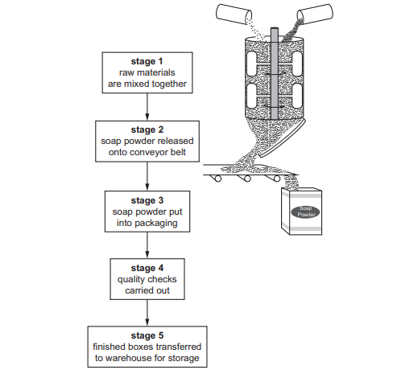
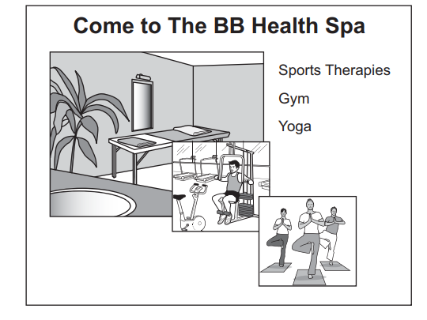

# Exam Questions — 4.2 Technology and the Production of Goods & Services
**4. Operations Management** · Cambridge (CIE) IGCSE business (0450, 0986 & 0264, 0774)
> Source: [https://www.savemyexams.com/igcse/business/cie/25/topic-questions/](https://www.savemyexams.com/igcse/business/cie/25/topic-questions/) · 15 questions across 1 sets

## Exam Questions (15 questions)

### Q1 — medium — 6 marks

**Q1** [6 marks]

> **[case-study]**
> BeanWave Coffee (BWC) is a small roaster in country L. It buys green coffee beans from Brazil and pays in US dollars (USD). BWC sells roasted coffee to local cafés. The owner is considering buying a new semi-automatic roasting machine to improve quality and reduce roasting time. The machine costs L\$150 000. Staff would need training. Packaging is currently non-recyclable, and energy costs are rising.
> 
> **Table 1.1 – Exchange rate change and recent invoice**
> 
> | Item | Value |
> |---|---|
> | Last month’s bean invoice | **USD 12 000** |
> | Exchange rate before | **1 USD = L\$4.5** |
> | Exchange rate now | **1 USD = L\$5.0** |

Explain **two** possible disadvantages to BWC of buying the new roasting machine.

### Q2 — hard — 12 marks

**Q2** [12 marks]

**Extract:**

**Playsafe Playground Equipment (PPE)**

Kaari has always been creative and made wooden toys for her two children when they were young. Her children are now at school, so Kaari decided to start her own business making wooden playground equipment.

Kaari started PPE as a sole trader business three years ago in country Z. She wants an income from the business but also wants to spend time with her children. Kaari wants the business to remain small. However, if the business grows Kaari may need to change to another type of business organisation. Kaari carries out all the management roles in the business.

Kaari uses job production to produce high quality, individually designed playground equipment. Kaari designs all the equipment herself and she employs 3 skilled workers to help her make the products. PPE currently makes both large and small items of playground equipment each week.

Kaari uses cost-plus pricing as every item of playground equipment uses different quantities of raw materials. She sells small items of playground equipment to retailers and large items of playground equipment to the Government. There are many competitors in this market.

Kaari plans to obtain new machinery which will cost \$20 000. She is considering using crowd-funding as this is one way to raise capital for new business investment. Other options include leasing the machinery or asking the bank for a loan.

Kaari has developed a new unique product this year. There are no other similar products in the market.

**Appendix 1**

**Advertisement for PPE**

Buy your playground equipment from us.

At PPE we manufacture high quality playground equipment and have better designs than our competitors.

All our equipment has been fully tested and is guaranteed to meet legal safety standards. We are the main supplier of playground equipment to the Government for public parks - so you know our equipment can be trusted!

Contact us today for a price list.

**Appendix 2**

**Cost and revenue information for PPE in 2021**

|   | **Small item of playgroundequipment** | **Large item of playgroundequipment** |
|---|---|---|
| Average selling price | \$100 | \$1 000 |
| Average cost of manufacture | \$25 | \$500 |
| Output each week | 15 | 3 |

**Appendix 3**

**Newspaper article – Main News 1st October 2021**

**Children need to get more exercise and play outside**

Research suggests that playing outside helps children relax after school and improves their health.

The Government in country Z has allocated \$10m to spend on improving children’s playgrounds in public places. This means there will be \$5 000 to spend on equipment for each public playground.

Retailers have reported increasing demand for small items of playground equipment as parents want to have these products at home. This trend is expected to continue.

Consider the advantages and disadvantages to PPE of investing in the following **three** types of technology to improve their manufacturing process:

- Automated cutting machinery
- Computer-aided design (CAD) software
- Quality control sensors

Which technology investment should PPE prioritise? **Justify** your answer.

Refer to the following[ insert](https://cdn.savemyexams.com/uploads/2024/09/jun-2021-paper-2-case-study-v2---new.pdf) when answering the question.

### Q3 — hard — 12 marks

**Q3** [12 marks]

**Extract:**

**Soapy Sudds Manufacturer (SSM)**

SSM is a public limited company that was set up 25 years ago. SSM manufacture soap powder in country Y. The soap powder is used for washing clothes. SSM sells all its soap powder to large retailers in country Y. SSM’s sales have been increasing for many years in country Y but sales in the last year have remained the same. The directors of SSM are considering ways to increase sales.

SSM has a total of 100 employees with 60 in the Operations Department. It uses flow production in the factory and has 10 production lines with 5 workers and 1 supervisor for each line. The Operations Manager is aware that production workers are unhappy and often complain about their jobs being boring. These workers have always been paid by an hourly rate. The Human Resources Manager has recommended changes to ensure fewer workers leave each year to work for other businesses.

The directors of SSM have decided to expand the factory. They will need \$15m to do this. The directors have also considered taking over a competitor. SSM is likely to benefit from economies of scale as it grows.

The Marketing Director thinks SSM should start selling soap powder in markets in other countries. SSM will need to carry out either primary market research or secondary market research to forecast the potential total sales in these new markets. There are many existing manufacturers in these countries. SSM need to consider the problems when entering new markets in other countries such as tariffs or quotas.

**Appendix 1**

**Manufacturing process to make soap powder**

All the different types of soap powder are manufactured on production lines using flow production. SSM makes use of specialisation.

Each production line has the following stages:

Each of these stages uses machinery controlled by a production worker

Appendix 2

Email from the SSM Finance Director to the Managing Director

SSM has a cash-flow problem which may get worse. Please see charts below

**Appendix 3**

**Newspaper article from Main News 1 October 2021**

Retailers have reported increased sales for most types of products such as sales of washing machines which have increased by 15%. Economic growth in country Y is predicted to increase.

Many businesses have been recruiting additional employees and there are now shortages of some skilled workers. The government in country Y has recorded an increase in inflation to 8% so far this year, which is a worry.

Consider how SSM could benefit from implementing the following three types of technology in production.

- Automation technology
- Digital monitoring systems
- Artificial intelligence (AI) in quality control

Which technology implementation is likely to have the greatest effect on SSM? **Justify** your answer.

Refer to the following [insert](https://cdn.savemyexams.com/uploads/2024/09/nov-2021-paper-2-case-study---new.pdf) when answering the question.

### Q4 — medium — 6 marks

**Q4** [6 marks]

Do you think new technology in production always improves quality? **Justify** your answer.

### Q5 — medium — 8 marks

**Q5** [8 marks]

**Extract:**

**The BB Health Spa (BB)**

Bethany owns The BB Health Spa in Main City in country X. Economic growth has been high for the last few years. The government of country X wants this growth to continue so it has reduced income tax. However, it is also worried about inflation becoming a problem so it has increased interest rates.

The BB Health Spa is very busy and Bethany is considering taking on a partner to help manage the business and give her more free time. However, she has been a sole trader for 10 years and wants the business to stay small.

The customers of The BB Health Spa are people of all ages who are interested in their health. Bethany employs two qualified workers to provide the treatments for customers. Bethany herself also provides customers with treatments. In addition, she does all the administration such as ordering inventory, accounts and paying invoices when the spa is closed.

The BB Health Spa still uses the original treatment equipment which was purchased when the business started. Some spas nearby have the latest equipment but these spas charge much higher prices than The BB Health Spa. Bethany records all the financial transactions by filling in accounts books by hand. This takes her a long time. Customers book appointments using the telephone and Bethany later telephones them to remind them when an appointment is due.

**Appendix 1**

**Advert for treatments at The BB Health Spa**

**Appendix 2**

**Weekly forecasts for two possible additional services**

|   | Steam room | Hair cuts |
|---|---|---|
| Additional customers | 200 | 50 |
| Average price charged per customer | \$5 | \$25 |
| Wages | \$60 | \$400 |
| Cost of sales | \$40 | \$125 |
| Lease of equipment | \$400 | \$175 |

**Appendix 3**

**Daily News                                                                                                            September**

**New equipment now available in many health spas to make skin look younger**

There have been a number of changes in technology for health spas which allow the treatments to be much more effective in making skin look younger. Many people are keen to try these treatments using the latest equipment to get younger looking skin. This equipment is very expensive for health spas to buy or lease.

The news of these treatments has appeared on social media sites and on mobile phone Apps leading to higher demand. ‘Some customers will pay high prices for such treatments’, said a local health spa owner who is keen to promote his health spa as being one of the first to use the new equipment.

There have also been developments in software which make customer bookings and accounts much easier, quicker and with fewer mistakes. Automatic text (sms) messages are used to remind customers of their appointments – so no need to miss an appointment again.

Look out for these changes in health spas near you!

**Explain** **two **advantages and **two **disadvantages for employees of the new technology identified in Appendix 3.

Refer to the following [insert ](https://cdn.savemyexams.com/uploads/2024/09/0450-01-specimen-2020-paper-2-insert-cie-igcse-business---new.pdf)when answering the question

### Q6 — easy — 2 marks

**Q6** [2 marks]

**State two** advantages of technology in production for employees.

### Q7 — easy — 2 marks

**Q7** [2 marks]

**Define** 'chatbot'.

### Q8 — easy — 2 marks

**Q8** [2 marks]

**State two** common uses of CAM (Computer Aided Manufacturing).

### Q9 — easy — 2 marks

**Q9** [2 marks]

**State** two advantages of 3D printing.

### Q10 — easy — 2 marks

**Q10** [2 marks]

**Define** 'computer aided manufacture'.

### Q11 — easy — 2 marks

**Q11** [2 marks]

**State two** advantages of using technology in production.

### Q12 — medium — 8 marks

**Q12** [8 marks]

**Extract:**

**The BB Health Spa (BB)**

Bethany owns The BB Health Spa in Main City in country X. Economic growth has been high for the last few years. The government of country X wants this growth to continue so it has reduced income tax. However, it is also worried about inflation becoming a problem so it has increased interest rates.

The BB Health Spa is very busy and Bethany is considering taking on a partner to help manage the business and give her more free time. However, she has been a sole trader for 10 years and wants the business to stay small.

The customers of The BB Health Spa are people of all ages who are interested in their health. Bethany employs two qualified workers to provide the treatments for customers. Bethany herself also provides customers with treatments. In addition, she does all the administration such as ordering inventory, accounts and paying invoices when the spa is closed.

The BB Health Spa still uses the original treatment equipment which was purchased when the business started. Some spas nearby have the latest equipment but these spas charge much higher prices than The BB Health Spa. Bethany records all the financial transactions by filling in accounts books by hand. This takes her a long time. Customers book appointments using the telephone and Bethany later telephones them to remind them when an appointment is due.

**Appendix 1**

**Advert for treatments at The BB Health Spa**

**Appendix 2**

**Weekly forecasts for two possible additional services**

|   | Steam room | Hair cuts |
|---|---|---|
| Additional customers | 200 | 50 |
| Average price charged per customer | \$5 | \$25 |
| Wages | \$60 | \$400 |
| Cost of sales | \$40 | \$125 |
| Lease of equipment | \$400 | \$175 |

**Appendix 3**

**Daily News                                                                                                            September**

**New equipment now available in many health spas to make skin look younger**

There have been a number of changes in technology for health spas which allow the treatments to be much more effective in making skin look younger. Many people are keen to try these treatments using the latest equipment to get younger looking skin. This equipment is very expensive for health spas to buy or lease.

The news of these treatments has appeared on social media sites and on mobile phone Apps leading to higher demand. ‘Some customers will pay high prices for such treatments’, said a local health spa owner who is keen to promote his health spa as being one of the first to use the new equipment.

There have also been developments in software which make customer bookings and accounts much easier, quicker and with fewer mistakes. Automatic text (sms) messages are used to remind customers of their appointments – so no need to miss an appointment again.

Look out for these changes in health spas near you!

**Explain **four ways the new technology identified in Appendix 3 could help Bethany improve her business.

Refer to the following [insert ](https://cdn.savemyexams.com/uploads/2024/09/0450-01-specimen-2020-paper-2-insert-cie-igcse-business---new.pdf)when answering the question

*Source: Specimen 0450/02 Q4A*

### Q13 — medium — 6 marks

**Q13** [6 marks]

> **[case-study]**
> TYA is a limited company which manufactures 300 000 cars a year. It has 600 employees. TYA has high fixed costs. The Managing Director wants to improve efficiency in the factory. He said: ‘Globalisation is changing how businesses operate. Many manufacturing businesses are considering whether to relocate their operations to other countries.’

Explain **two **methods TYA could use to increase efficiency.

*Source: Nov 2022 0450/12 Q4D*

### Q14 — medium — 6 marks

**Q14** [6 marks]

Do you think the ways technology has changed production methods benefit all employees? **Justify **your answer.

*Source: Nov 2021 0450/11 Q2E*

### Q15 — easy — 2 marks

**Q15** [2 marks]

**State two **ways a business can increase productivity.

*Source: June 2021 0450/12 Q2B*

