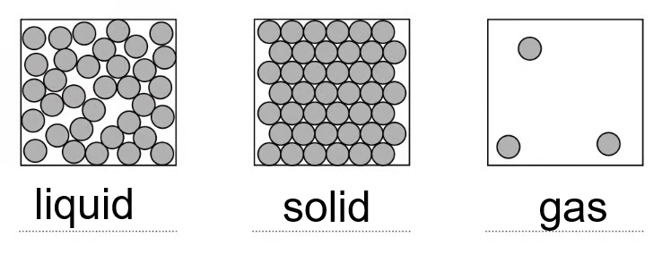
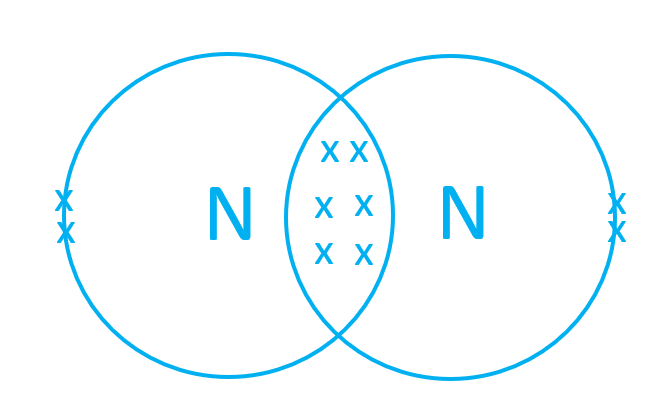
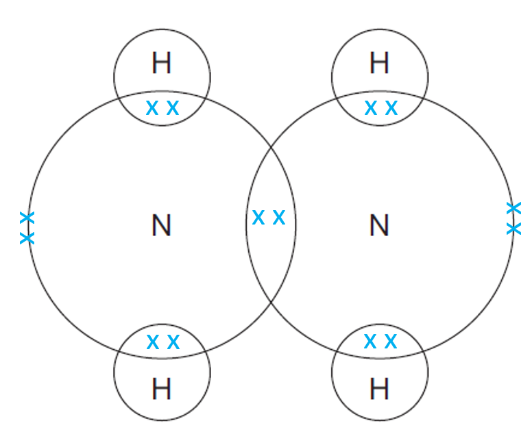
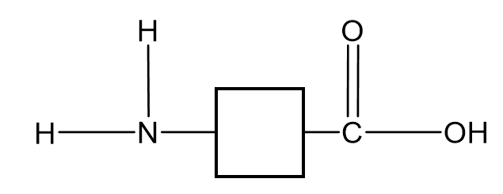
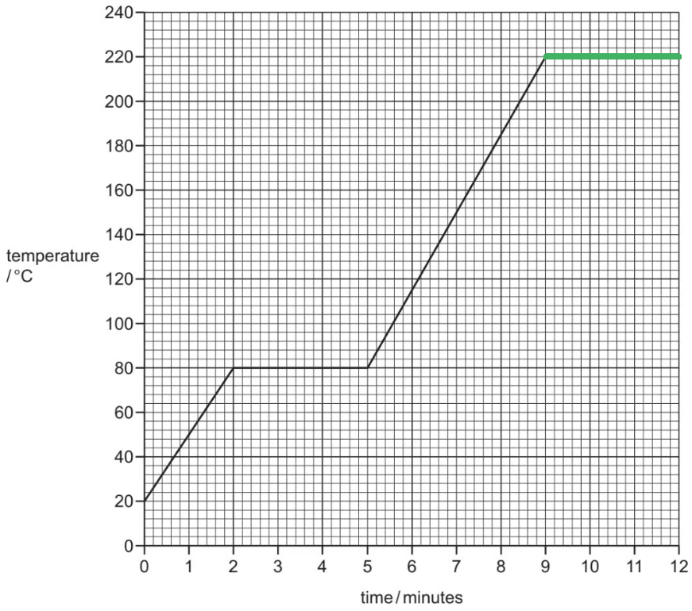
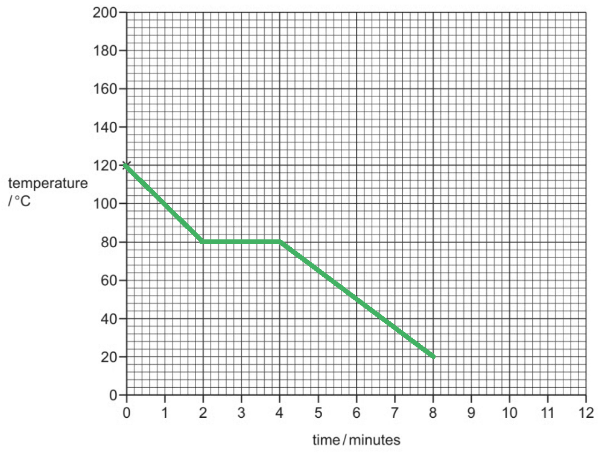

# Mark Schemes — Solids, liquids & gases
**1. States of Matter** · Cambridge (CIE) IGCSE chemistry (0620 & 0971)

## Multiple Choice Questions (26 questions)

### Q1
**Final answer:** **The correct answer is A**

- The rate of diffusion for gases depends on the relative molecular mass for each gas
- The higher the relative molecular mass, the particles diffuse with more difficulty, and the the rate of diffusion is slower
- Use the Periodic Table to calculate the relative molecular mass (*M*r) of all the gases (the relative atomic mass in the case of Ne since it is a monoatomic gas)

  - Ne $M_{r}=20$
  - HCl $M_{r}=1\timesH+1\times\mathrm{Cl}$ $M_{r}=1\times1+1\times35.5$ $M_{r}=36.5$
  - NH3 $M_{r}=3\timesH+1\timesN$ $M_{r}=3\times1+1\times14$ $M_{r}=17$
  - O2 $M_{r}=2\timesO$ $M_{r}=2\times16$ $M_{r}=32$
- In order of increasing mass,

  - NH3 → Ne → O2 → HCl
- The heavier the gas, the slowest the rate

  - Therefore, the order should be inversed to have the gases ordered from slowest to fastest diffusion rate:
  
    - HCl → O2 → Ne → NH3

### Q2
**Final answer:** **The correct answer is D**

- Region S represents boiling
- The temperature is constant, therefore, the thermal energy supplied is used entirely to **overcome the attractive forces** between the liquid particles
- This allows them to escape and move far apart as a gas

**A **is incorrect as region P represents a solid. The particles gain kinetic energy, but they **vibrate in fixed positions within a regular lattice**; they do not move around each other

**B **is incorrectas region Q represents melting. The temperature is constant, which means the **kinetic energy of the particles remains constant**. The thermal energy is instead being used to overcome the attractive forces

**C **is incorrect as region R represents heating a liquid. The thermal energy is primarily causing the particles to gain kinetic energy (temperature rises), not to overcome forces to change state

### Q3
**Final answer:** **The correct answer is D**

- Diffusion involves the random movement of particles, resulting in an **overall (net)** movement down the concentration gradient

**B** & **C** are incorrect because they are opposites to the diffusion definition

**A **is incorrect because diffusion is a physical change since it does not involve a change in the bonds of the substance that diffuses

### Q4
**Final answer:** **The correct answer is B**

- Steam is water in **gaseous state**
- The particles of a gas move randomly at high speeds

**A **&** D** are incorrect because gases have a random arrangement of particles that are far apart between each other

**C** is incorrect because the forces of attraction are the weakest between the three states of matter

### Q5
**Final answer:** **The correct answer is**** D**** **

- Particles which are **close together **but can **move **slowly past each other are in the **liquid **state.

**A **is incorrect as ice is a solid so the particles cannot move.

**B **and** C **are incorrect as air is a mixture of **gaseous **particles, and steam is water in the gaseous state, which move **faster **and are also **further **apart than particles in a liquid.

### Q6
**Final answer:** **The correct answer is ****A**

- Diffusion is the process by which particles move from a region of **higher** concentration towards a region of **lower **concentration.
- It occurs much **faster **in gases than in liquids as there is more resistance in  liquids.

**B** is incorrect as during melting, particles do move slowly but **not** from an area of high concentration to an area of low concentration.

**C** is incorrect as during freezing particles change from moving to being in fixed positions.

**D** is incorrect as diffusion in air occurs faster as gaseous particles move much quicker than particles in the liquid state.

### Q7
**Final answer:** **The correct answer is ****A**** because:**

- The bleach first evaporates which is the change in state from a liquid to a gas.
- Diffusion then explains how the entire kitchen smells of bleach as the bleach particles have spread throughout the entire kitchen.
- Both processes must occur to explain the observation.

**B** is incorrect as **distillation** is a technique used to separate a pure liquid from a solution or from a mixture of liquids.

**C** is incorrect as **evaporation** alone does not explain how the bleach particles have spread out throughout the kitchen

**D** is incorrect as **diffusion** alone does not explain how the bleach particles have spread out throughout the kitchen

### Q8
**Final answer:** **The correct answer is ****B**** **

- A fixed mass of liquid at room temperature has a **definite volume**.

**A** is incorrect as gases diffuse and occupy different **volumes** depending on the **temperature** and **pressure**.

**C** is incorrect as **concentrations **of either the liquid or gas can change this relationship.

**D** is incorrect as liquid particles have the ability to **move **and **slide **around each other which gives them the ability to **flow**.

### Q9
**Final answer:** **The correct answer is ****B ****because:**

- As the air warms up the particles move faster and further apart
- The volume of air increases and the pressure decreases

**A** is incorrect as when volume increases pressure decreases

**C** is incorrect as when temperature increases volume increase and pressure decreases

**D** is incorrect as an increase in volume is caused by an increase in temperature

### Q10
**Final answer:** **The correct answer is ****B**** because:**

- Diffusion is the process by which particles move from a region of higher concentration towards a region of lower concentration
- It explains how the ammonia particles are able to spread out throughout the laboratory

**A **is incorrect as although the concept sounds similar to diffusion, **dispersion** means scattering and usually refers to the scattering of light or seeds from a plant

**C **is incorrect as **evaporation** is the change of state from a liquid to a gas which occurs below the boiling point of a liquid

**D **is incorrect as **distillation** is a technique used to separate a pure liquid from a solution or from a mixture of liquids

### Q11
**Final answer:** **The correct answer is ****A**** because:**

- The **kinetic energy** of the air particles inside the container increases with increasing temperature.
- This causes the **pressure **to **increase** which pushes outwards against the walls of the container.

**B **is incorrect as the container was heated for a **short time **only.

**C **is incorrect as the container actually slightly **increased** in size.

**D **is incorrect as the container was **sealed **so no air particles could get in or out.

### Q12
**Final answer:** **The correct answer is ****A**** because:**

- The rate of diffusion is dependent on **molecular mass.**
- A molecule with a **smaller** *M*r value will diffuse faster than one with a larger *M*r.
- Since ammonia gas has a much smaller *M*r  (17 g/mole) compared to HC*l* (36.5  g/mole) it will diffuse more **quickly** and move further along the tube.
- The two gases will meet on the furthest left hand side line which is A.

**B, C and D are incorrect because the HCl would not have reached this point before the ammonia.**

### Q13
**Final answer:** **The correct answer is ****B**** because:**

- The rate of diffusion of a gas depends on its **relative molecular mass**.
- The *M*r of methane is 16 g/mole whereas the *M*r of propene is 42 g/mole.
- Methane is **lighter** and thus diffuses **faster**.

**A** is incorrect as propene is heavier than methane so the molecules move** more slowly**

**C** is incorrect as the reactivity of propene is irrelevant in this experiment as diffusion is a physical process.

**D** is incorrect as both molecules can fit through the hole.

### Q14
**Final answer:** **The correct answer is ****C**** because:**

- Vaporising is when a liquid changes into a gas
- The particles in a liquid are packed closely together whereas in a gas the particles are spread out and can move around
- The increase in distance between particles during vaporising is larger than in the other state changes

**A** is incorrect as even though melting causes an increase in distance between particles, the increase is smaller than in vaporisation

**B **and** D** are incorrect as these processes cause the distance in between the particles to decrease

### Q15
**Final answer:** **The correct answer is ****B ****because:**

- The water particles in the air above the cup are in the **gaseous** state.
- Gaseous particles move **faster **and are **further apart **than liquid particles.

**A **is incorrect as the water particles above the cup are **not **closer together.

**C** and **D** are incorrect as gas particles move **faster **than liquid particles

### Q16
**Final answer:** **The correct answer is ****B**** because:**

- Particle theory shows that particles in a solid are arranged in** rows** forming a **regular pattern.**
- The particles cannot move in a solid but they do **vibrate.**

**A** is incorrect as particles in a solid cannot move as described in statement 1.

**C** is incorrect as particles in a solid cannot move as described in statements 1 and 3

**D** is incorrect as statement 4 also applies to particles in a solid.

### Q17
**Final answer:** **The correct answer is ****C**** because:**

- The particles in state 3 are in rows forming a **regular pattern**, indicating that it is in the **solid** state.
- Particles in the solid state cannot move and the volume of a solid is **fixed** and does not change.

**A** is incorrect as state 1 shows a liquid.

**B** is incorrect as evaporation occurs on going from state 1 to state 2.

**D** is incorrect as sublimation occurs on going from state 3 to state 2.

### Q18
**Final answer:** **The correct answer is ****D**** because:**

- Change 1: a **gas** changes into the **liquid** state (condenses) so particles come **closer** together.
- Change 2: a **liquid** freezes and becomes **solid** so particles come **closer** together.

**A** and **B** are incorrect as in change 3 a **liquid** evaporates to the **gaseous** state as particles move **further** apart. In change 4 **a solid** melts and the particles also move **further** apart.

**C** is incorrect as in change 4 **a solid** melts and the particles move **further** apart.

### Q19
**Final answer:** **The correct answer is ****D**** because:**

- Both **diffusion** and **dissolving** occur, explaining the result.
- The solid **first** dissolves in the solvent, which is the water, creating a **solution.**
- Once the particles are dissolved they **diffuse** throughout the liquid.

**A** and **C** are incorrect as **no** chemical reaction occurs, only **physical** changes.

**B** is incorrect as incorrect as dissolution does occur before diffusion.

## Theory Questions (25 questions)

### Q1
> **[mark-scheme]**
> - Bauxite **[1 mark]**
> **[mark-scheme]**
> - Aluminium is more reactive than carbon / aluminium is higher in the reactivity series / carbon is less reactive than aluminium / carbon is lower in the reactivity series **[1 mark]**
> - (Therefore), carbon cannot displace/reduce aluminium **[1 mark]**

> **[exam-tip]**
> In displacement reactions, remember: an element higher in the series will displace an element lower down. If it's lower, no reaction.
> **[mark-scheme]**
> - Substance oxidised: Carbon monoxide/CO **[1 mark]**
> - Reason: It gains oxygen / oxidation number of carbon increases / carbon loose electrons **[1 mark]**

> **[exam-tip]**
> If asked about a substance oxidised or reduced, you must always look at the **reactants**! Always track what changes from reactants to products to identify oxidation or reduction correctly.
> **[mark-scheme]**
> - Add excess iron (to the acid) **[1 mark]**
> - Filter (to remove the unreacted iron) **[1 mark]**
> - Heat the filtrate to the point of crystallisation / heat to concentrate the solution / heat to evaporate the solvent / heat to form a saturated solution **[1 mark]**
> - Filter crystals after cooling / leave to cool/crystallise **AND** dry the crystals with filter paper / dry on filter paper / dry between sheets of filter paper / dry in a desiccator **[1 mark]**
> 
> *Drying in an oven (iron(II) chloride is sensitive and can oxidise to iron(III) or dehydrate in high heat)*

> **[exam-tip]**
> When answering salt preparation questions, you **must** stick to the three golden rules.
> 
> - Use an **excess of the insoluble reactant** so all the acid reacts.
> - Stop heating at the **point of crystallisation**, never heat to dryness.
> - Dry the crystals **between filter papers**, not in an oven.
> 
> These steps are commonly assessed in points in both **Theory (Paper 3 or 4) and the Alternative to Practical Papers (Paper 6)**

### Q2
Over time, the bromine spreads throughout the gas jar because:

- The particles move randomly and spread out due to kinetic energy; **[1 mark]**
- They diffuse from an area of high concentration to low concentration; **[1 mark]**

**[Total: 2 marks]**

Even though bromine starts at the bottom, its particles spread out and mix because they are always moving in all directions

At the start:

- The bottom of the gas jar is in an area of high bromine concentration
- The top of the gas jar is in an area of low bromine concentration

Diffusion moves particles from an area of high concentration to low concentration. This means that the bromine spreads upward and mixes with the air.

It’s important to remember that diffusion depends on concentration difference, not gravity. Particles spread because of random motion, not because they rise or fall.
When the experiment is repeated with chlorine gas:

- The rate of diffusion is faster; **[1 mark]**
- Because chlorine has a lower relative molecular mass than bromine, so its particles move more quickly; **[1 mark]**

**[Total: 2 marks]**

To compare how fast gases diffuse, look at the mass of their particles. Lighter gas particles move faster because they have higher average speeds at the same temperature.

Since chlorine particles are lighter than bromine particles, chlorine diffuses more quickly.

Just remember: the smaller the relative molecular mass, the faster the gas will spread.

> **[exam-tip]**
> Use the term relative molecular mass, not mass number, or you may lose the explanation mark
> 
> Remember heavier particles diffuse more slowly, not faster

### Q3
The states of matter represented by each diagram are:

- Diagram 1 = liquid; **[1 mark]**
- Diagram 2 = solid; **[1 mark]**
- Diagram 3 = gas; **[1 mark]**

**[Total: 3 marks]**

Use the clues in each diagram to help you decide the state:

- For solids, look for tight, regular packing
- Liquids are still close together but not neatly arranged
- Gases have lots of space between particles and move freely.
When a solid is heated until it becomes a gas:

- The particles gain energy and vibrate faster;** [1 mark]**
- (At the melting point,) the particles gain enough energy to overcome their forces of attraction and become a liquid; **[1 mark]**
- Further heating gives the particles enough energy to move apart and become a gas;** [1 mark]**

**[Total: 3 marks]**

The particles gain more and more energy as you heat them

They change from vibrating in place (solid) to sliding past each other (liquid), and then finally to moving freely (gas)

Don’t forget to include all stages and energy changes
i) When the temperature decreases:

- The volume of the balloon decreases; **[1 mark]**
- Because the gas particles move more slowly and exert less pressure on the balloon walls; **[1 mark]**

ii) When the atmospheric pressure is lower:

- The volume of the balloon increases; **[1 mark]**
- Because the external pressure is lower, so gas particles push outward more; **[1 mark]**

**[Total: 4 marks]**

This question tests your understanding of how gas particles behave when conditions change

For part (i), remember that temperature affects particle energy:

- When a gas gets colder, its particles move more slowly

  - They have less kinetic energy
- The particles collide with the container walls less often and with less force
- So, the volume decreases

For part (ii), focus on how external pressure affects a gas:

- At higher altitudes, the pressure outside the balloon is lower
- This means that there is:

  - Less pressure squeezing it from the outside
  - Less resistance to the particles inside pushing outward
- So, the volume increases

### Q4
a)

i)  The electronic structure of a nitrogen molecule with only the outer electron shells:

- There should be 6 electrons between two nitrogen atoms;** [1 mark]**
- 1 lone pair on each nitrogen atom; **[1 mark]**

ii)  Comparing the movement and arrangement of the molecules in solid nitrogen to those in nitrogen gas:

|   | solid | gas |
|---|---|---|
| pattern | regular / lattice | random / irregular/ no pattern |
| distance | close | far apart /  spread out |
| movement | vibrate / fixed position | moving |

- Each correct row;** [1 mark]**

**[Total: 5 marks]**

- *Nitrogen is in group 5, so it has five outer electrons*
- *Each atom needs an additional three electrons to complete the shell*
- *This is achieved by sharing three pairs of electrons, creating a triple bond between the atoms*
- *You can use any combination of dots or crosses for the diagram*

b)  Explaining why the pressure increases when the temperature is increased:

- The particles / molecules have more energy / move faster; **[1 mark]**
- They collide harder / more frequently / with more force
**OR**
There are more collisions; **[1 mark]**

**[Total: 2 marks]**

- *Increasing the temperature means that the particles have greater kinetic energy*
- *This means that they are moving faster resulting in more collisions with the side of the container*
- *These increased collisions will also be more forceful due to having more energy*
- *When the temperature increases, the particles will also spread out but this is not the reason for the increased pressure*

  - *Pressure requires a force, which is the particles pushing against the wall of the container*

> **[exam-tip]**
> Gas particles move faster when heated, they do not vibrate more, that describes particles in a solid
> 
> Always name the particles or molecules, and link them to collisions with the container walls
c)

i)  Explaining why nitrogen gas diffuses faster than chlorine:

- Nitrogen has a smaller *M**r*; **[1 mark]**
- Nitrogen (molecules) move faster (than chlorine molecules); **[1 mark]**

ii)  Explaining why the nitrogen diffuses faster at the higher temperature:

- At higher temperatures, the molecules move faster / have more energy; **[1 mark]**

**[Total: 3 marks]**

- *Check the values of the masses of each element in the periodic table*

  - *They are both diatomic, and nitrogen is 14, so the **M**r** is 28*
  - *Chlorine is 35.5 so the **M**r**  is 71*
- *A comparison must be made between nitrogen and chlorine to score the mark in the first part*

### Q5
a) The arrangement and the type of motion of the molecules are:

Solid chlorine:

- Arrangement: the particles are arranged regularly / ordered
**OR**
The particles are arranged in a lattice; **[1 mark]**
- Motion: The particles are (only) vibrating / are moving about a fixed position; **[1 mark]**

Chlorine gas:

- Arrangement: the particles are not arranged regularly
**OR**
The particles are arranged irregularly / randomly; **[1 mark]**
- Motion: the particles are moving fast / randomly / in any direction; **[1 mark]**

**[Total: 4 marks]**

- *Arrangement is about the actual positioning of the particles in space*

  - *Careful: It is easy to mistakenly talk about separation, which is about the closeness of the particles / the space between the particles*
- *Motion is about the movement, which means that you can comment on the type, speed and direction of movement*

  - *Different states are more suited to talking about different motions*
  - *e.g. Solids are more suited to the type of movement as they are vibrating about a fixed point*
  - *e.g. Gases are more suited to speed and direction of movement as they move rapidly and randomly in all directions *

> **[exam-tip]**
> Arrangement means the pattern (regular/ordered vs random), not how close or far apart the particles are
> 
> Never say solid particles do not move because they vibrate about fixed positions
> 
> Describe gas motion as fast and random in all directions, not just moving freely
b) How the pressure of the chlorine gas changes with temperature:

- Increasing the temperature increases the pressure 
**OR **
The pressure is proportional to temperature; **[1 mark]**

**[Total: 1 mark]**

- *The exam command word is 'describe' so you simply have to say what is happening*
- *Tip:** Starting your answer with the word 'AS' can really help*

  - *It makes you compare what's happening with your two variables*
  - *e.g. As the temperature increases, the pressure of the chlorine gas increases*
- *You can also talk about how the pressure of the chlorine gas and temperature are proportional because it is a straight-line graph*
c) The physical state of pure S at 100 oC is:

- Solid; **[1 mark]**
- (Because,) 100 ºC is lower than the melting point / the melting point is higher than 100 ºC; **[1 mark]**

**[Total: 2 marks]**

- *100 **o**C is below the melting point of pure S, which is 159 **o**C*
- *This means that pure S has not melted from a solid into a liquid *

### Q6
a)

i) The arrangement and movement of the molecules in the region A–B is:

- (Particles / molecules are) close or tightly packed; **[1 mark]**
- They are ordered 
**OR** 
Arranged in a lattice; **[1 mark]**
- They vibrate (around fixed positions); **[1 mark]**

ii) The change that occurs in the region B–C is:

- Melting  
**OR** 
Freezing; **[1 mark]**

**[Total: 4 marks]**

- *You need to be able to describe the arrangement and movement of particles in a solid, liquid and a gas*
- *Yellow crystals indicate that the substance is a solid*
- *On this type of graph, a horizontal line indicates a change of state is occurring*
- *If the yellow crystals form a yellow liquid this would be melting*
b)

i) Oxides of nitrogen are formed by:

- Oxygen and nitrogen (in air); **[1 mark]**
- Reacting at high temperatures; **[1 mark]**

ii) They are removed from exhaust gases by:

Any **two **from:

- (A) catalytic converter; **[1 mark]**
- (They are) reacted with carbon monoxide or hydrocarbons; **[1 mark]**
- They form nitrogen;** [1 mark]**

**[Total: 4 marks]**

- *Be careful with part (i) - the nitrogen is from the air and **not** the fuel*

  - *It reacts with oxygen at high temperatures in a car engine*
- *Reference to nitrogen impurities being found in the fuel may negate marks for any correct points *
- *Oxides of nitrogen cause acid rain, so it is important to remove them*
- *A catalytic converter will reduce oxides of nitrogen to nitrogen *

  - *2NO + 2CO → N**2** + 2CO**2*
c) Lead nitrate crystals are prepared by:

- Add excess / lots of lead oxide to nitric acid; **[1 mark]**
- Filter; **[1 mark]**
- Evaporate or heat solution; **[1 mark]**

**[Total: 3 marks]**

- *Lead oxide is insoluble and is added in excess to nitric acid to ensure all of the acid reacts *
- *The excess lead oxide is removed by filtration and the remaining solution is heated and left to cool to obtain crystals*
- *You would not get the second mark if you identify the residue as lead nitrate*
- *You can expect to be asked how to prepare both a soluble and insoluble salt*

### Q7
i) The three substances that are solids at room temperature are:

- **A**, **B** and **D**; **[1 mark]**

ii) The ionic compound is:

- **D**; **[1 mark]**

iii) The one that is a gas at room temperature is:

- **F**; **[1 mark]**

iv) Two substances that are liquids at room temperature are:

- **C** and **E**; **[1 mark]**

v) The metal is:

- **A**; **[1 mark]**

v) The impure substance is:

- **E**; **[1 mark]**

**[Total: 6 marks]**

- *The three substances are solids at room temperature are:*

  - *A**, **B** and **D:** Room temperature is 20** o**C, and all three substances have melting points above this*
- *The ionic compound is:*

  - *D: **Ionic compounds do not conduct when solid but do when they are molten or dissolved in solution because the ions can move and carry a charge *
- *The one that is a gas at room temperature is:*

  - *F**: The boiling point is below room temperature (20 **o**C)*
- *Two substances that are liquids at room temperature are:*

  - *C** and **E:** They both have a melting point below room temperature and a boiling point above room temperature *
- *The metal is:*

  - *A**: Metals have high melting and boiling points and can conduct electricity but do not dissolve in water*
- *The  impure substance is:*

  - *E**: Impure substances do not have specific melting / boiling points and instead melt / boil over a range of temperatures *

### Q8
a)

i)  The change that occurs in the region D to E. is:

- Boiling; **[1 mark]**

ii)  The difference in the region B to C if an impure sample had been used is:

- Lower temperature 
**OR** 
over temperature range 
**OR **
no plateau; **[1 mark]**

iii)  The graph if the acid was heated to a higher temperature:

- Direct continuation of E to F; **[1 mark]**

iv)  The table that compares the separation and movement of the molecules in regions C to D with those in E to F:

|   | **C **to **D** | **E** to **F** |
|---|---|---|
| separation (distance between particles) | **close or touching**;** [1 mark]** | **far apart**; **[1 mark]** |
| movement of particles | random and slow | **fast and random**;** [1 mark]** |
| Can particles move apart to fill any volume? | **cannot move apart**; **[1 mark]** | **can move apart**; **[1 mark]** |

**[Total: 8 marks]**

- *Remember: **Boiling and evaporation are not the same things*

  - *Evaporation occurs over a range of temperatures up to the boiling point*
- *Impurities generally lower the melting point of a solid and extend the melting range*

  - *So, not only will the line on the graph be lower but it is likely to slope rather than be horizontal*
b) The word equations for the reactions of ethanoic acid are:

- Calcium + ethanoic acid → <u>calcium ethanoate</u> + <u>hydrogen;</u>** [1 mark]**
- <u>Zinc oxide or hydroxide</u> +  ethanoic acid   →  zinc ethanoate + water; **[1 mark]**

**[Total: 2 marks]**

- *Metals and acids give the salt and hydrogen*
- *Salts of ethanoic acid are ethanoates*
- *Bases which are oxides or hydroxides always give a salt and water when neutralised*
c)  The symbol equation for the reaction between ethanoic acid and sodium hydroxide is:

CH3COOH + NaOH → CH3COONa + H2O

- Correct reactants; **[1 mark] **
- Correct products; **[1 mark]**

**[Total: 2 marks]**

- *State symbols are not usually required for balancing equations at this level*
- *Make sure you know the formulas of all the common acids and bases*
- *You could write the salt with the metal first, i.e. NaCH**3**COO, but it is not usually done this way, as the way it is written suggests the sodium is bonding to the carbon which is not correct*

### Q9
The rate of most reactions increases at higher temperatures because:

- The particles gain more kinetic energy / move faster; **[1 mark]**
- The frequency / rate of collisions increases
**OR**
The particles collide more often / more frequently 
**OR**
There are  more collisions per second / frequency of successful collisions increases; **[1 mark]**
- A higher proportion (or percentage/fraction) of the collisions have energy equal to or greater than the activation energy *E*a
**OR**
More of the particles have sufficient energy to react 
**OR**
There are more successful collisions; **[1 mark]**

*Do not accept "more collisions" without a time or frequency reference*

**[Total: 3 marks]**

- *This question links changing temperature with rates of reaction*
- *You must make three distinct points for full marks:*

  1. *Particles gain kinetic energy / move faster*
  2. *Collisions happen more frequently *
  
    1. *You must include a time reference such as "rate", "frequency", "per second", or "more often" - simply saying "more collisions" is not enough*
  3. *A higher proportion of collisions have enough energy to overcome the activation energy (or more particles have sufficient energy to react)*
- *Questions about rates of reactions always need to refer to particles, energy and collisions to receive full credit*
Explaining why a liquid has a fixed volume but takes up the shape of the container and a gas takes up the shape of the container but does not have a fixed volume:

- The particles move in all directions / randomly in both liquids and gases;** [1 mark]**

Plus, for gases:

- There are no bonds / are very weak forces between particles in gases; **[1 mark]**
- The molecules can move apart / separate (to fill the entire volume); **[1 mark]**

**OR **For liquids:

- There are bonds / forces / intermolecular forces between particles in liquids; **[1 mark]**
- The molecules cannot move apart / separate (so there is a fixed volume in liquids); **[1 mark]**

**[Total: 3 marks]**

- *Careful:** There doesn't appear to be an actual question here because the overall question started with the command sentence asking you to explain*
- *Make sure you address both aspects of this question in your answer*

  - *The liquid having a fixed volume (forces between particles) and the ability to flow (movement of particles)*
  - *The gas taking the shape of a container and the lack of a fixed volume (weaker forces between particles) *

### Q10
a) The separation between the molecules and the type of motion of the molecules is:

Solid iodine:

- Separation: the particles are touching / close together; **[1 mark]**
- Motion: The particles are (only) vibrating / are not moving from place to place; **[1 mark]**

Iodine gas:

- Separation: the particles are far apart; **[1 mark]**
- Motion: the particles are moving fast / randomly / in any direction; **[1 mark]**

**[Total: 4 marks]**

- *Separation is about the closeness of the particles / the space between the particles*
- *Motion is about the movement, which means that you can comment on the type, speed and direction of movement*

  - *Different states are more suited to talking about different motions*
  - *e.g. Solids are more suited to type of movement as they are vibrating about a fixed point*
  - *e.g. Gases are more suited to speed and direction of movement as they move rapidly and randomly in all directions *
b) How the volume of iodine gas changes with pressure:

- As the pressure increases, the volume decreases / as the pressure decreases, the volume increases 
**OR **
The higher the volume, the lower the pressure  
**OR **
The higher the pressure, the lower the volume; **[1 mark]**

**[Total: 1 mark]**

- *The exam command word is 'describe' so you simply have to say what is happening*
- *Tip:** Starting your answer with the word 'AS' can really help*

  - *It makes you compare what's happening with your two variables*
c) The physical state of sulfur dioxide at –20 °C is:

- Liquid; **[1 mark]**
- (Because,) –20 °C is between the melting and boiling point 
**OR **
(Because,) –20 °C is above melting point but lower than boiling point; **[1 mark]**

**[Total: 2 marks]**

- *Careful:** There may be a temptation to automatically write gas as your answer*

  - *This is because you are used to the idea that sulfur dioxide is a gas that contributes to acid rain*
- *You have to use the information to deduce the state of sulfur dioxide*
- *At –73 °C, solid sulfur dioxide melts into a liquid*

  - *–20 °C is above this temperature so sulfur dioxide has definitely melted into a liquid*
- *At –10 °C, liquid sulfur dioxide boils into a gas*

  - *–20 °C is below this temperature so sulfur dioxide has not boiled into a gas*
- *Therefore, at –20 °C sulfur dioxide must be a gas*

### Q11
a)  Explaining why the bromine molecules have spread uniformly to occupy the whole container:

Evaporation explanation:

Any **one** from:

- The particles (or molecules) with a lot of energy leave the liquid;** [1 mark]**
- The bromine particles break free from each other; **[1 mark]**
- The forces or bonds between bromine molecules are broken; **[1 mark]**
- The molecules (in the liquid) have weak forces holding them together;** [1 mark]**
- There are weak intermolecular forces / Van der Waals forces between molecules; **[1 mark]**

Diffusion explanation

- Diffusion / diffuse / movement of particles;** [1 mark]**
- <u>Random</u> movement of molecules / particles <u>move in all direction</u>; **[1 mark]**

**[Total: 3 marks]**

- *You can also get credit in the evaporation part for mentioning that the (bromine) molecules escape from the liquid*
- *You don't need to state that the intermolecular forces are weak between the molecules to get the mark*
b)  Completing the following explanations for the diagrams:

Diagram 2

- Air more dense / heavier / higher *M**r* than hydrogen;** ****[1 mark]**
- Hydrogen diffuses in faster (than air diffuses out); **[1 mark]**
- The pressure inside the pot is greater (than outside); **[1 mark]**

Diagram 3

- Air less dense / lighter / lower *M**r* than carbon dioxide; **[1 mark]**
- Air diffuses / moves faster (than carbon dioxide); **[1 mark]**
- The pressure inside the pot is less (than outside); **[1 mark]**

**[Total: 6 marks]**

- *The air is a mixture of oxygen and nitrogen so the average **M**r **will be between 28 and 32 which is considerably more than hydrogen*
- *You can also get credit for stating that diffusion in is faster than out (without naming gases) in diagram 2 or the other way around in diagram 3.*

### Q12
a) At 20 °C, X is a:

- Liquid; **[1 mark]**

**[Total: 1 mark]**

- *From the graph, you can see that the flat parts correspond to the melting and boiling points, which are 15 **o**C and 80 **o**C, respectively*
- *This means that at 20 **o**C X has already melted, but it has not yet boiled, so it must be a liquid*
b)  An equation for the equilibrium which exists in region BC is:

X (l) $\rightleftharpoons$ X (s)   **OR**   X (s) $\rightleftharpoons$  X (l)

- Correct state symbols and equilibrium sign;** [1 mark]**

**[Total: 1 mark]**

- *The region BC represents the compound melting or solidifying*
- *Liquid and solid must both be present*
c)  The change of state which occurs in region DE is:

- Boiling / evaporation / vapourisation 
**OR** 
Condensation;** [1 mark]**

**[Total: 1 mark]**

- *Remember: **Evaporation occurs at all temperatures, so strictly speaking it is not limited to region DE*
- *However, it would be acceptable in an exam to give this answer*
d)  Explaining how the curve shows that a pure sample of compound X was used:

- In the region BC the solid melts 
**OR **
In the region DE the liquid boils;** [1 mark]**
- At one / fixed / sharp / single / specific temperature; **[1 mark]**

**[Total: 2 marks]**

- *A pure substance has a sharp melting point and boiling point*
- *This would be seen as a horizontal line on the graph*
- *Any impurities tend to lower the melting point and broaden the range over which the solid melts*

### Q13
a)

i)  The equation for the equilibrium present in the region BC is:

- X (s) $\rightleftharpoons$ X (l); **[1 mark]**

ii)  The significance of temperature t °C is:

- It is the melting / freezing point of X; **[1 mark]**

iii)  The physical state of compound X in the region EF is:

- It is a gas / gaseous / vapour; **[1 mark]**

iv)   The difference in the region BC if an impure sample of X had been used would be:

- The line would not be horizontal 
**OR **
The line slopes 
**OR **
The line is lower; **[1 mark]**

**[Total: 4 marks]**

- *The two flat parts of a change of state diagram are the melting and boiling of the substance*
- *At the melting point, the solid will be in equilibrium with the liquid*

  - *This is where the first flat section occurs *
- *Above the boiling point, the substance will be entirely gaseous*
- *An impurity lowers the melting point of a solid and extends the melting range, so it would cause the line to slope and be lower than that of the pure substance*
b)

i)  The percentage of hydrogen in the compound is:

- 100 - 85.7 = 14.3% ;** [1 mark]**

ii)  The empirical formula of X is

- 85.7 ÷ 12 **AND **14.3 ÷ 1 
**OR **
7.14 **AND **14.3; ** [1 mark]**
- The simplest ratio is 1:2; ** [1 mark]**
- The empirical formula is CH2; ** [1 mark]**

**ALTERNATIVE SOLUTION**

- 84 g x 85.7% = 72 g 
**AND **
84g x 14.3% = 12 g ; ** [1 mark]**
- 72 g ÷ 12 g = 6 
**AND **
12 g ÷ 1 g =12 
**AND **
6:12  or a ratio of 1:2; ** [1 mark]**
- The empirical formula is CH2; ** [1 mark]**

iii)   The molecular formula of compound X is:

- C6H12 ;** [1 mark]**

**[Total: 5 marks]**

- *To find the empirical formula you need to divide the percentage by the relative atomic mass*
- *You then divide both numbers by the lowest to get the simplest ratio*
- *Since the mass of 1 mole is stated as 84 g, you can calculate the empirical mass and use it to determine the molecular formula*

  - *Empirical formula mass = CH**2** = 12 + (2 x 1) = 14*
  - *Number of empirical formula fragments = *$\frac{\mathrm{molecular} \mathrm{mass}}{\mathrm{empirical} \mathrm{formula} \mathrm{mass}}=\frac{84}{14}=6$
  - *So, the molecular formula contains 6 x CH**2*
  - *Therefore, the molecular formula is C**6**H**12*

### Q14
a)

i)  What is meant by the term weak base:

- A* base* is a proton acceptor; **[1 mark]**
- A *weak* base does not accept (protons) readily / less able to accept protons (than strong bases); **[1 mark]**

ii)  How could you ensure a ‘fair’ comparison between the two solutions of different bases:

- You need to use the same concentration of both bases; **[1 mark]**

Plus **one **of the following alternatives:

*ALTERNATIVE 1*

- You measure their pH with <u>universal indicator / pH paper / pH meter</u>;** [1 mark]**
- The one with the higher pH is the stronger base** **
**OR **
NaOH is a dark blue **AND** ethylamine is green-blue; **[1 mark]**

*ALTERNATIVE 2*

- Measure the conductivity; **[1 mark]**
- The stronger base / NaOH has the higher conductivity; **[1 mark]**

*ALTERNATIVE 3*

- Add aluminium; **[1 mark]**
- The stronger base / NaOH gives more / faster bubbling (effervescence); **[1 mark]**

**[Total: 5 marks]**

- *In part i) you can use alternative words to ‘acceptor’ e.g. ‘receiver’*
- *You can use H**+** or hydrogen ion as an alternative to proton references as they are the same thing*
- *In part ii) unless solutions of bases or acids are the same concentration you cannot make comparisons of their strength, so this is often the first mark in these type of questions*
- *You should mention how the pH is measured to gain the mark*
b)

i)   The equation for the reaction between sulfuric acid and ethylamine and the salt formed is:

2CH3CH2NH2 + H2SO4 → (CH3CH2NH3 )2SO4

- Correct species; **[1 mark]**
- Balancing; **[1 mark]**
- The salt is ethylammonium sulfate; **[1 mark]**

ii)  A reagent that could be used to displace the weak base, ethylamine, from its salt ethylammonium chloride is:

- Sodium hydroxide / calcium hydroxide / NaOH / Ca(OH)2; **[1 mark]**

**[Total: 4 marks]**

- *You can get credit for calling the product diethyl ammonium sulfate*
- *State symbols are not necessary and will be ignored even if they are wrong*
- *Any Group 1 or Group 2 hydroxide or oxide can be used to displace ethylamine*
c)

i)  Explaining, using kinetic particle theory, why gases diffuse:

Any **two** from:** **

- The particles move in random motion; **[1 mark]**
- The particles collide; **[1 mark]**
- The particles move from a region of high concentration to low concentration; **[1 mark]**

ii)  Predicting the position of the white solid and why:

- Position C; **[1 mark]**
- CH3CH2NH2 has a lower (relative) molecular mass (than HBr); **[1 mark]**
- Therefore ethylamine moves / diffuses faster (than HBr); **[1 mark]**

**[Total: 5 marks]**

- *You can get credit for talking about ethylamine molecules being less dense or lighter *

  - *You can use the converse argument that HBr has a higher relative molecular mass *
- *You can get an error carried forward in this question, if you chose the wrong position but gave the correct explanation for that position*
- *For example, if you chose 'A' but said HBr is a lighter molecule and diffuses faster you could get two marks*
- *If you chose 'B' but said the molecules weigh the same and diffuse at the same rate you could get two marks*

### Q15
a)

i)  The chemical equation for the reaction of ammonia with hydrogen chloride is:

- NH3 + HCl → NH4Cl; **[1 mark]**

ii)  The process by which the ammonia and hydrogen chloride gases move in the tube is:

- Diffusion; **[1 mark]**

iii)  The point at which the white solid forms and why is:

- The solid forms at point A; **[1 mark]**
- The ammonia molecules / particles have a smaller mass; **[1 mark]**
- The molecules move/ diffuse faster; **[1 mark]**

iv) How the results of the experiment would be different at a higher temperature:

- The solid forms in less time/ faster/ quicker; **[1 mark]**
- The particles / molecules have more energy; **[1 mark]**
- The particles move faster/ diffuse faster; **[1 mark]**

**[Total: 8 marks]**

- *Make sure you know the formula of common molecules like ammonia and hydrogen chloride*
- *To get more credit in your answers when talking about diffusion you need to mention both the energy and speed of the particles*
b)

i) Testing for ammonium ions:

- Add sodium hydroxide (solution and warm); **[1 mark]**
- Test the gas /ammonia with (red) litmus /Universal Indicator/pH paper; **[1 mark]**
- The indicator turns blue/ ammonia produced; **[1 mark]**

ii)  Testing for chloride ions:

- Add silver nitrate (solution); **[1 mark]**
- Add (dilute) nitric acid; **[1 mark]**
- A white precipitate is seen; **[1 mark]**

**[Total: 6 marks]**

- *You need to be specific about the choice of indicator: litmus/Universal/pH rather than just use 'indicator' or  you might not get the mark*
- *Some students miss the need to acidify the solution when testing with silver nitrate. This prevents false positive results from other ions present like carbonate. You have to use the acid which contains the same anion.*
c)

i)  The type of bonding in ammonia is:

- Covalent bonding; **[1 mark]**

ii)  The diagram of hydrazine showing only outer shell electrons:

The diagram must show:

- One shared pair of electrons between each N and H; **[1 mark]**
- One shared pair of electrons between the N atoms; **[1 mark]**
- One lone pair on each N and no additional electrons anywhere; **[1 mark]**

**[Total: 4 marks]**

- *Ammonia consists only of non-metal atoms so it must have covalent bonding*
- *The completed diagram of hydrazine is*

d)

i)  The linkages found in the polymers of nylon and protein is

- Amide linkage; **[1 mark]**

ii)  One difference in the structures of nylon and protein.

- Proteins are made from more than two monomers; **OR** 
Nylon is made from 1 or 2 monomers (only); **[1 mark]**

iii)   The general name given to the products of hydrolysis of proteins is:

- Amino acids; **[1 mark]**

**[Total: 3 marks]**

- *You might be tempted to use the term peptide linkage, however, this would be incorrect for nylon, as the term refers to the linkage formed when two amino acids come together to form a protein. The two linkages are chemically the same, but their origins are not.*
- *Hydrolysis means breaking down in the presence of water.*
e)   The structure of the monomer used to make the polymer shown is:

- ; **[1 mark]**

**[Total: 1 mark]**

- *The repeat unit shown contains one nitrogen and one C=O group and an amide linkage, so you know it was made from an amino acid, rather than a diamine and a dicarboxylic acid *
- *Remember that when a condensation polymer(protein in this case) is made a molecule of water is eliminated, so you need to replace the H and OH to make the monomer*
- *The H goes onto the nitrogen to make an amine and the OH onto the C=O to make a carboxylic acid*

### Q16
a) The numbered physical changes are:

- 1 = melting; **[1 mark]**
- 2 = condensing
**OR**
condensation; **[1 mark]**
- 3 = freezing; **[1 mark]**
- 4 = boiling 
**OR **
evaporation; **[1 mark]**

**[Total: 4 marks]**

- *Careful:** Take your time to make sure that you are writing the correct chemical change with the correct number*
- *You should know the physical changes between solids, liquids and gases*
- *It can help to think of **X** as water, so:*

  - *Solid **X** is ice*
  - *Liquid **X **is water*
  - *Gaseous **X** is water vapour / steam*
- *This means that:*

  - *Physical change 1: Ice to water = melting*
  - *Physical change 2: Water vapour / steam to water = condensing*
  - *Physical change 3: Water to ice = freezing*
  - *Physical change 4: Water to water vapour / steam = boiling / evaporation*
b) One other difference between boiling and evaporation is:

Any **one **from:

- Boiling happens at a specific temperature; **[1 mark]**
- Evaporation happens over a range of temperatures; **[1 mark]**
- Evaporation is a surface process / evaporation happens at the surface of a liquid; **[1 mark]**
- Boiling happens throughout the liquid; **[1 mark]**

**[Total: 1 mark]**

- *When a kettle is boiled, the water temperature is around 100 **o**C as this is water's boiling point*

  - *You know that water is boiling because you can see bubbles happening inside and throughout the liquid*
- *Puddles of water on the ground don't boil*

  - *This is evident because there are no bubbles inside the puddle and the temperature is not 100 **o**C*
  - *Puddles evaporate from the surface in contact with air and this happens at temperatures much lower than the 100 **o**C boiling point of water*
c) The separation, arrangement and motion of particles of element X in the solid state are:

- Separation: the particles are touching; **[1 mark]**
- Arrangement: the particles have a <u>regular</u> arrangement  
**OR **
The particles are arranged in a lattice 
**OR **
The particles are arranged in rows and columns; **[1 mark]**
- Motion: the particle are vibrating (around a fixed point); **[1 mark]**

**[Total: 3 marks]**

- *This wording of this question may be off-putting but you are being asked to describe the structure of a solid:*

  - *Solids have a fixed volume and shape and they have a high density*
  - *The atoms vibrate in position but can’t change location*
  - *The particles are packed very closely together in a fixed and regular pattern*
- *The question asking specifically about the key points that the examiner is looking for in terms of the structure of a solid *
- *You should also be able to describe the structure (separation, arrangement and motion) of liquids and gases*

### Q17
a)

i) The term *diffusion* means:

- Particles spread to fill the total available volume 
**OR **
Particles move from high concentration to low concentration / down a concentration gradient; **[1 mark]**

ii) The property of a gas molecule affects the speed at which it diffuses is:

- Mass / relative molecular mass / *M*r /  relative atomic mass / Ar;** [1 mark]**

**[Total: 2 marks]**

- *You should know the definition of diffusion*
- *The speed at which diffusion happens depends on the mass / **M**r** of the particles*

  - *Lighter particles move faster*
  - *This is commonly seen in exam questions with the use of ammonia and hydrochloric acid*
  - *Ammonia has an **M**r** of 17, while hydrochloric acid has an **M**r** of 36.5*
  - *Therefore, ammonia moves faster*
  - *Think of the difference between a bowling ball and a ping pong ball - if you pushed both with the same force, the ping pong ball would travel a lot quicker than the bowling ball!*
b)

i) The air on the other side of the barrier contains more helium because:

- Helium atoms / molecules are lighter than molecules in air or N2 and O2 
**OR** 
Helium is less dense than air or N2 and O2 
**OR** 
Helium diffuses (through the porous barrier) faster than air / N2 **AND **O2; **[1 mark]**

ii) It is an advantage to have the air at a high temperature because:

- There is a faster rate of diffusion (at high temperatures) 
**OR **
Molecules move faster (at high temperatures);** [1 mark]**

**[Total: 2 marks]**

- To get the mark in part (i) you must mention

  - Air 
  **OR **Nitrogen **AND** oxygen
c)

i) An equation for the complete combustion of methane is:

- CH4 + 2O2 → CO2 + 2H2O; **[1 mark]**

ii) This would not be a suitable method to obtain the helium because:

Any **one **from:

- Would get a mixture of helium and carbon dioxide; **[1 mark]**
- Would get a mixture of gases; **[1 mark]**
- It is a waste of methane / natural gas / fossil fuel; **[1 mark]**

iii)  Another method by which helium could be separated from the mixture of gases in natural gas is:

- Fractional distillation; **[1 mark]**

**[Total: 3 marks]**

- *The products of the combustion of alkanes are carbon dioxide and water*
- *Part (ii) uses the command word 'suggest' which implies that you are not expected to know this but you will need to apply your knowledge to an unfamiliar context *
- *We often just think of fractional distillation for the separation of mixtures of liquids that are at room temperature*
- *However, if air is liquified it is a mixture of liquids and when the liquid air is slowly increased in temperature the lower boiling point components will evaporate first allowing separation to be achieved*

### Q18
a) The complete **Table 1.1** about solids, liquids and gases is:

|   | particle separation | particle arrangement | type of motion |
|---|---|---|---|
| solid | **touching**; **[1 mark]** | regular | vibrate only |
| liquid | some touching | **random**; **[1 mark]** | random |
| gas | apart | random | **random**; **[1 mark]** |

** **** [Total: 3 marks]**

- *Make sure you know the structures of solids, liquids and gases*
- *Questions will sometimes specifically ask for their structures in terms of separation, arrangement and motion*
The change of state taking place between A and B is:

- Condensing / condensation / condense; **[1 mark]**

**[Total: 1 mark]**

- *The horizontal sections on the graph relate to changes in state*
- *Since the temperature is decreasing, you must be starting with a gas *

  - *You are also told this in the question *
- *This means that the horizontal section between A and B is changing / cooling from a gas to a liquid*

  - *Gas → liquid is condensing (also called condensation)*
c) Two physical processes taking place are:

- Evaporation; **[1 mark]**
- Diffusion; **[1 mark]**

**[Total: 2 marks]**

- *Perfumes easily vapourise, which means that they turn from a liquid into a gas*

  - *This does not require any heating, so it is not boiling*
  - *This process is evaporation*
- *The bottle of perfume is an area of high concentration *
- *The room is an area of low concentration*

  - *The perfume moves from areas of high concentration to areas of low concentration, which is a description of diffusion*

### Q19
The substance which has a macromolecular structure, similar to that of silicon(IV) oxide is:

- **E**; **[1 mark]**

**[Total: 1 mark]**

- *Substance E has a very high melting and boiling point and does not conduct in any form, which is characteristic of silicon(IV)oxide*
The substances which are solids at room temperature are:

- **A**  **AND** **C** **AND E**; **[1 mark]**

**[Total: 1 mark]**

- *All three are needed to get the mark*
- *The melting points are above room temperature (20 **o**C)*
The substance which could be a metal is:

- **A**;** [1 mark]**

**[Total: 1 mark]**

- *To be a metal a substance must be a good conductor in all states*
- *It must have a (relatively) high melting point*
The substance could be aqueous sodium chloride is:

- **F**; **[1 mark]**

**[Total: 1 mark]**

- *Aqueous sodium chloride conducts as a liquid(solution), but not as a solid*
- *The boiling point of water is elevated by the presence of sodium chloride and the melting point is depressed, which matches the data in the table*
The substance which is an ionic compound is:

- **C**;** [1 mark]**

**[Total: 1 mark]**

- *An ionic compound conducts when liquid but not when solid*
- *The melting and boiling point should be high, which matches C*
The substances which are liquids at room temperature are:

- **D** **AND** **F**; **[1 mark]**

**[Total: 1 mark]**

- *To be a liquid at room temperature the melting point must be below 20 **o**C and the boiling point must be above 20 **o**C, which matches D and F*
- *Any more answers will result in you losing the mark*

### Q20
The process that occurs when a gas turns into a liquid is:

- Condensation / condensing / condense; **[1 mark]**

**[Total: 1 mark]**

- *Think about the question in terms of water*

  - *As a gas, it is water vapour / steam*
  - *As a liquid, it is water*
- *The physical change from water vapour / steam to water is, therefore, condensation*
The process that occurs when a solid turns into a gas without first forming a liquid is:

- Sublimation / subliming; **[1 mark]**

**[Total: 1 mark]**

- *You can use to the different states of water to help with melting, freezing, boiling and condensing*
- *Sublimation is a physical change that you simply have to learn*
To explain the observations:

Any **three **from:

- The crystal dissolves; **[1 mark]**
- (The cobalt(II) chloride) particles (go from close together to) spread out / evenly distrubuted
**OR **
(The cobalt(II) chloride) particles go into solution / water; **[1 mark]**
- (The process is) diffusion / diffusing; **[1 mark]**
- There is random movement of the particles 
**OR **
The particles move anywhere / in all directions (in the liquid); **[1 mark]**
- The particles collide / bounce off each other; **[1 mark]**
- There is (bulk) movement of particles from higher to lower concentration 
**OR **
There particles move down a concentration gradient; **[1 mark]**

*Accept diffused / diffuses for "(the process is) diffusion / diffusing"*

**[Total: 3 marks]**

- *Questions asking for descriptions of diffusion are usually well answered with statements like:*

  - *The particles spread out and move from an area of high concentration to an area of low concentration*
- *The most common mistake is to talk about particles expanding rather than spreading out*

  - *If particles expand, then each particle should be getting physically bigger (almost like it in inflating)*
  - *When particles spread out, they move further apart from each other*
  - *You can talk about materials expanding but it is not recommended, just in case you make the "particles expand" mistake*

### Q21
The arrangement and the type of motion of the molecules are:

Liquid bromine:

- Arrangement: the particles are not arranged regularly / are randomly arranged 
**OR **
The particles have an irregular arrangement ; **[1 mark]**
- Motion: The particles are sliding over each other / particles moving randomly ; **[1 mark]**

Bromine gas:

- Arrangement: the particles not arranged regularly 
**OR **
The particles are arranged irregularly / randomly
**OR**
The particles have an irregular arrangement / structure; **[1 mark]**
- Motion: the particles are moving fast / randomly / in any direction; **[1 mark]**

**[Total: 4 marks]**

- *Arrangement is about the positioning of particles in space (regular or irregular) *

  - *It is not about how close together or far apart they are *
- *Separation is about the closeness / distance between particles *
- *Separation is often confused this with arrangement*

  - *Saying particles are "close together" or "far apart" describes separation, NOT arrangement.*
  - *You need to say they are "irregularly arranged" or "not arranged regularly"*
- *Motion is about how particles move, e.g. type, speed and direction *

  - *For liquids: particles slide over each other / move randomly *
  - *For gases: particles move fast / randomly / in all directions*
How the volume of the bromine gas changes with temperature:

- Increasing the temperature increases the volume 
**OR **
The volume is proportional to temperature; **[1 mark]**

**[Total: 1 mark]**

- *The exam command word is 'describe' so you simply have to say what is happening*
- *Tip:** Starting your answer with the word 'AS' can really help*

  - *It makes you compare what's happening with your two variables*
  - *e.g. As the temperature increases, the volume of the bromine gas increases*
- *You can also talk about how the volume of bromine and temperature are proportional because it is a straight line graph*
The physical state of calcium at 1600 oC is:

- Gas / gasesous; **[1 mark]**

**[Total: 1 mark]**

- *Careful:** It can be tempting to put 'solid' out of habit but you have to use the information given in the question*
- *1600 **o**C is above the boiling point of calcium, which is 1484 **o**C*
- *This means that calcium has boiled and turned from a liquid into a gas*

### Q22
The melting point of pure Z is:

- 80 (°C); **[1 mark]**

**[Total: 1 mark]**

- *Horizontal sections on these graphs represent where a substance is changing physical state*
- *You are told that Z is a solid*
- *This means that the horizontal line represents solid Z melting to form liquid Z*
- *The horizontal line is at 80 **o**C, so this is the melting point of pure Z *
The sketch for how the temperature of the sample of pure Z changed after 9 minutes is:

- A horizontal line at 220 oC starting at minute 9 and continuing to minute 12; **[1 mark]**

**[Total: 1 mark]**

- *Remember: **Changes in physical state are represented by horizontal lines*
- *You are told that Z starts to boil at 9 minutes and was boiled for 3 minutes*
- *This means that you should draw a horizontal line at 220 **o**C between 9 and 12 minutes*
In terms of attractive forces, there is no increase in the temperature of the sample of pure Z between 2 minutes and 5 minutes because:

- The energy is being used to overcome / break / weaken the forces of attraction; **[1 mark]**
- Between molecules / particles
**OR**
Intermolecular forces; **[1 mark]**

**[Total: 2 marks]**

- *Before 2 minutes, the heat energy is used to make the particles vibrate more*
- *At 2 minutes, enough particles have gained the energy to start melting*
- *Melting does not break bonds in covalent substances, it overcomes the forces of attraction between molecules *
- *Do not say "energy is used to break bonds" without specifying these are forces between molecules, not covalent bonds within molecules*

  - *If you think about ice, you know that bonds aren't broken when ice because it melts to form water*
  - *If the bonds broke then the ice would turn into hydrogen and oxygen atoms*
d) How the motion of particles of pure Z changes from 0 minutes to 2 minutes:

- The vibrations; **[1 mark]**
- Increase; **[1 mark]**

**[Total: 2 marks]**

- *Scoring one mark is common on this question*

  - *This is done by saying 'the particles move more' or 'the movement of the particles increases'*
- *The type of movement / motion is almost a hidden mark*
- *Between 0 and 2 minutes, Z is solid*

  - *This means that the movement is Z is vibration*
e) The differences, if any, in the melting point and boiling point of the sample of impure Z compared to the sample of pure Z are:

- The melting point decreases; **[1 mark]**
- The boiling point increases; **[1 mark]**

**[Total: 2 marks]**

- *Pure chemicals have a sharp, defined temperature for their melting and boiling point*
- *You need to know that impurities **decrease** the melting point and **increase **the boiling point*
f) The sketch to show how the temperature of the sample of pure Z changed between 0 minutes and 8 minutes is:

- Decrease from 120 °C to 80 °C 
**AND **
A horizontal line at 80 °C; **[1 mark]**
- Decrease from the horizontal line to finish at 20 °C at 8 mins; **[1 mark]**

**[Total: 2 marks]**

- *The question states that the sketch has to start at 120 **o**C and finish at a time of 8 minutes / temperature of 20 **o**C*
- *From the previous parts of his question, you should know that the melting / freezing point of Z is 80 **o**C*

  - *This means that there must be a horizontal line at 80 **o**C*
- *So, the first line starts at 120 **o**C and decreases to 80 **o**C*
- *It then levels out at 80 **o**C before cooling to 20 **o**C at 8 minutes*
- *Careful:** Make sure that your sketch finishes at 20 **o**C and 8 minutes or you will lose a mark*
