# Exam Questions — Solids, liquids & gases
**1. States of Matter** · Cambridge (CIE) IGCSE chemistry (0620 & 0971)
> Source: [https://www.savemyexams.com/igcse/chemistry/cie/23/topic-questions/](https://www.savemyexams.com/igcse/chemistry/cie/23/topic-questions/) · 41 questions across 2 sets

## Multiple Choice Questions (26 questions)

### Q1 — hard — 1 marks

**Q1** [1 mark]

The rate of diffusion of four gases, neon (Ne), hydrogen chloride (HCl), ammonia (NH3), and oxygen (O2), is measured in a sealed container.

What is the order of the rate of diffusion of the gases from slowest to fastest?

### Q2 — medium — 1 marks

**Q2** [1 mark]

The graph shows the heating curve for substance B. The regions are labelled P, Q, R and S.

Using the kinetic particle model, which statement is correct?

### Q3 — easy — 1 marks

**Q3** [1 mark]

Which statement about diffusion is correct?

### Q4 — easy — 1 marks

**Q4** [1 mark]

Water boils at 100 °C to form steam.

Which statement about the particles of steam is correct?

### Q5 — easy — 1 marks

**Q5** [1 mark]

Four substances are shown below.

In which of these substances are the particles close together and moving slowly past each other?

### Q6 — easy — 1 marks

**Q6** [1 mark]

A student noted the following observation in his laboratory notebook:

“The particles moved slowly from an area of high concentration to an area of low concentration.”

Which process is being described?

### Q7 — easy — 1 marks

**Q7** [1 mark]

#### Extended Only

A small amount of bleach was accidentally spilled on a kitchen floor. After a while it was observed that the floor appeared to be dry and the whole kitchen smelled of bleach.

Which processes have occurred?

### Q8 — easy — 1 marks

**Q8** [1 mark]

Many chemical processes involve substances in either the liquid or the gaseous state.

Which of the following statements is correct?

### Q9 — easy — 1 marks

**Q9** [1 mark]

Which words complete the gaps 1 & 2 in these sentences?

As the temperature of air in a balloon ............1.............. the volume increases. When the volume of air in a balloon increases the pressure ...............2...................

| ** ** | 1 | 2 |
|---|---|---|
| ** A** | increases | increases |
| ** B** | increases | decreases |
| ** C** | decreases | increases |
| ** D** | decreases | decreases |

### Q10 — hard — 1 marks

**Q10** [1 mark]

A student accidentally left a bottle of ammonia open in the corner of a laboratory. After a few minutes the entire laboratory smelled of ammonia.

Which process has occurred?

### Q11 — hard — 1 marks

**Q11** [1 mark]

A student closed the lid tightly on an empty metal container which was used for paint. She heated the container over a Bunsen burner on a low flame for a few moments and observed the sides and top of the container bend outwards slightly.

She then turned off the burner and allowed the container to cool.

Which statement explains her observations?

### Q12 — hard — 1 marks

**Q12** [1 mark]

#### Extended Only

Hydrogen chloride and ammonia are gases which are given off by cotton wool soaked in concentrated solutions and placed at either end of a glass tube as shown.

When the gases react together they produce ammonium chloride, a white solid.

Which line on the diagram correctly shows where the ammonium chloride is formed?

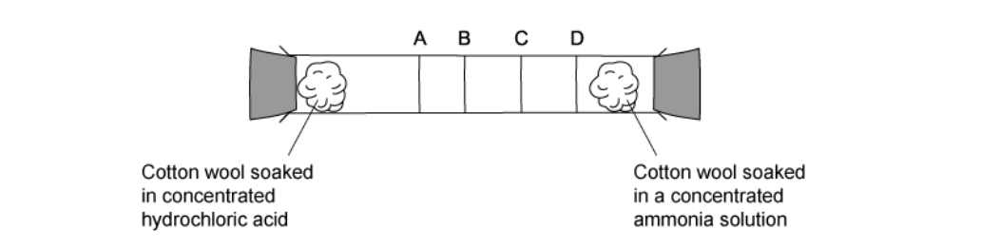

### Q13 — hard — 1 marks

**Q13** [1 mark]

#### Extended Only

The rate of diffusion of two gases, methane, CH4, and propene, C3H6, is measured using the apparatus shown.

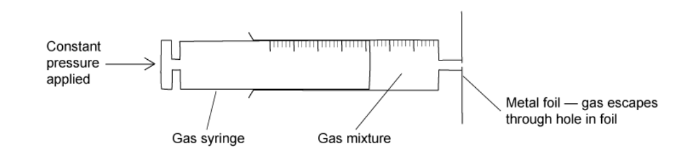

Which gas diffuses at a faster rate and why?

|   | Fastest gas | Reason |
|---|---|---|
| **A** | Propene | Propene molecules are heavier and so move faster. |
| **B** | Methane | Methane is a lighter molecule. |
| **C** | Propene | Propene is unsaturated so is more reactive. |
| **D** | Methane | Methane molecules are smaller so fit through the hole more easily. |

### Q14 — hard — 1 marks

**Q14** [1 mark]

The kinetic theory of matter explores the spatial relationship between the particles in solids, liquids and gases.

Which of the following processes causes the distance between particles to increase by the most?

### Q15 — medium — 1 marks

**Q15** [1 mark]

The diagram shows a cup of hot chocolate  which was prepared by mixing boiling water with chocolate powder.

Which row correctly describes the particles of water in the air above the cup compared to those in the hot chocolate drink inside the cup?

|   | Particles move faster | Particles are closer together |
|---|---|---|
| **A** | `✓` | `✓` |
| **B** | `✓` | $\times$ |
| **C** | $\times$ | `✓` |
| **D** | $\times$ | $\times$ |

### Q16 — medium — 1 marks

**Q16** [1 mark]

The following four statements describe the arrangement of particles in a substance.

| **1** | Particles are moving in all directions |
|---|---|
| **2** | Particles are arranged in neat rows |
| **3** | Particles can move past each other |
| **4** | Particles vibrate about their positions |

Which of the four statements describe the arrangement of particles in a solid?

### Q17 — medium — 1 marks

**Q17** [1 mark]

Substance X can occur in three different physical states as shown in the diagram.

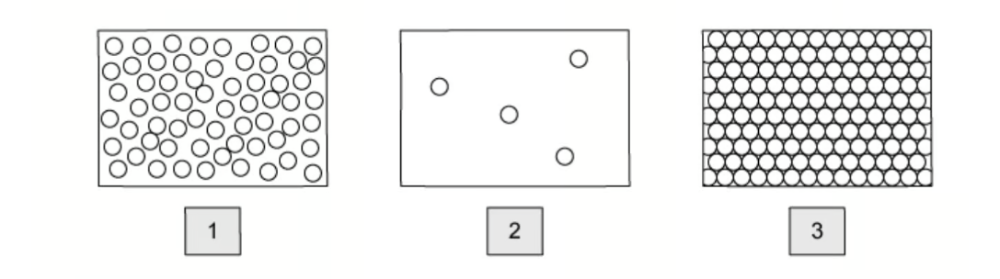

Which statement is correct?

### Q18 — medium — 1 marks

**Q18** [1 mark]

Matter exists in three states which are solid, liquid and gas. Phase changes occur when matter changes from one state to another.

In which changes do the particles move closer together?

gas   `rightwards harpoon over leftwards harpoon from 3 to 1 of`  liquid   `rightwards harpoon over leftwards harpoon from 4 to 2 of`  solid

### Q19 — medium — 1 marks

**Q19** [1 mark]

The diagram shows what happens when a blue soluble crystal is placed in a beaker of water.

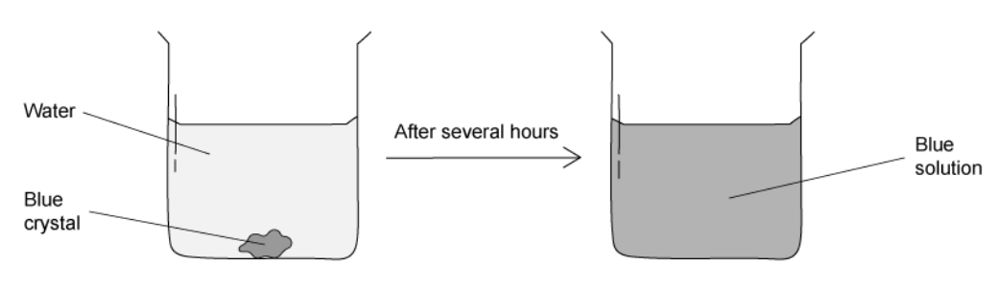

Which row correctly describes the processes taking place?

|   | Chemical process | Dissolving | Diffusion |
|---|---|---|---|
| **A** | `✓` | `✓` | `✓` |
| **B** | $\times$ | $\times$ | `✓` |
| **C** | `✓` | $\times$ | `✓` |
| **D** | $\times$ | `✓` | `✓` |

## Theory Questions (25 questions)

### Q1 — medium — 9 marks

**Q1** [1 mark]

Iron is extracted from its ore in a blast furnace. Aluminium is extracted from its ore by electrolysis.

State the name of the main ore of aluminium.

**Q1** [2 marks]

**Extract:**

Iron is extracted from its ore in a blast furnace. Aluminium is extracted from its ore by electrolysis.

Explain why aluminium **cannot** be extracted by heating its oxide with carbon in a blast furnace.

**Q1** [2 marks]

The following equation shows a reaction occurring in the blast furnace for extracting iron from its ore.

Fe2O3 + 3CO → 2Fe + 3CO2

Identify the substance that is **oxidised** in this reaction. Give a reason for your answer.

Substance oxidised:

Reason:

**Q1** [4 marks]

Iron reacts with dilute hydrochloric acid to form iron(II) chloride, which is a soluble salt. Describe the steps a student should use to prepare **pure, dry crystals of iron(II) chloride** from excess iron powder and dilute hydrochloric acid.

### Q2 — medium — 4 marks

**Q2** [2 marks]

The diagram shows a gas jar that initially contains bromine gas at the bottom and air above it. After a few minutes, the two gases have mixed more evenly.

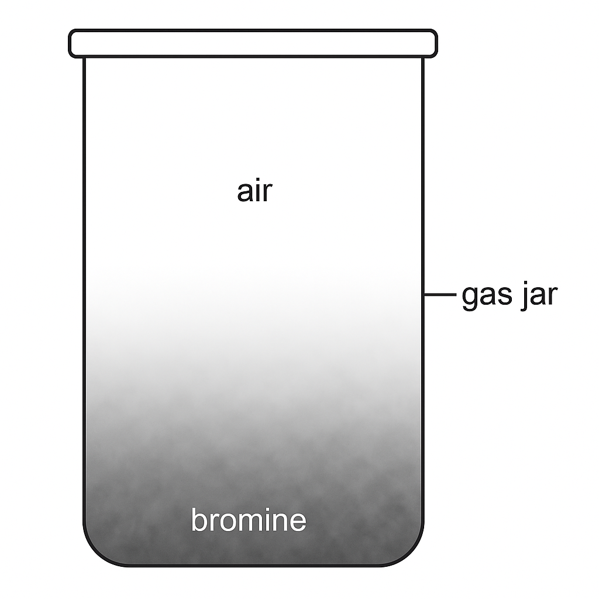

Describe and explain what has happened to the bromine gas in the jar over time.

**Q2** [2 marks]

**Extract:**

The diagram shows a gas jar that initially contains bromine gas at the bottom and air above it. After a few minutes, the two gases have mixed more evenly. Describe and explain what has happened to the bromine gas in the jar over time.

#### Extended Only

The experiment is repeated with chlorine gas instead of bromine.

State and explain whether diffusion is faster, slower or the same.

### Q3 — medium — 10 marks

**Q3** [3 marks]

Some physical properties of matter can be explained using the kinetic particle theory.

The diagrams show the arrangement of particles in three different substances.

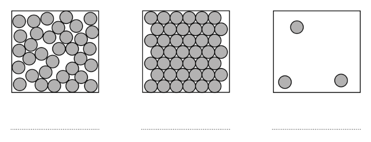

Identify the state of matter represented by each diagram.

**Q3** [3 marks]

#### Extended Only

Explain, in terms of particles, what happens when a solid is heated until it becomes a gas.

**Q3** [4 marks]

A student investigates how changing the temperature and pressure affects the volume of a gas.

The student fills a balloon with helium gas and places it in a freezer.

i) Predict what happens to the volume of the balloon as the temperature decreases. Explain your answer using the kinetic particle theory.

[2]

ii) The balloon is removed from the freezer and taken to a mountain where the atmospheric pressure is lower.

Predict what happens to the volume of the balloon and explain your answer.

[2]

### Q4 — hard — 10 marks

**Q4** [5 marks]

#### Extended Only

Kinetic theory explains the properties of matter in terms of the arrangement and movement of particles.

Nitrogen is a gas at room temperature. Nitrogen molecules, N2, are spread far apart and move in a random manner at high speed.

i) Draw the electronic structure of a nitrogen molecule. Show only the outer electron shells.

[2]

ii) Compare the movement and arrangement of the molecules in solid nitrogen to those in nitrogen gas.

[3]

*Source: 2016 specimen4 Q3A*

**Q4** [2 marks]

#### Extended Only

A sealed container contains nitrogen gas. The pressure of the gas is due to the molecules of the gas hitting the walls of the container.

Use the kinetic theory to explain why the pressure inside the container increases when the temperature is increased.

*Source: 2016 specimen4 Q3B*

**Q4** [3 marks]

#### Extended Only

The following apparatus can be used to measure the rate of diffusion of a gas.

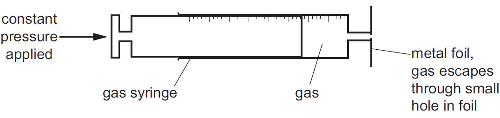

The following results were obtained.

| gas | temperature/ oC | rate of diffusion in cm3 / min |
|---|---|---|
| nitrogen | 25 | 1.00 |
| chlorine | 25 | 0.63 |
| nitrogen | 50 | 1.05 |

i) Explain why nitrogen gas diffuses faster than chlorine gas.

[2]

ii) Explain why the nitrogen gas diffuses faster at the higher temperature.

[1]

*Source: 2016 Specimen4 Q3C*

### Q5 — easy — 7 marks

**Q5** [4 marks]

This question is about chlorine and compounds of chlorine.

Use the kinetic particle model to describe the arrangement and type of motion of the molecules in:

Solid chlorine:

Chlorine gas:

*Source: 2019 Ju33 Q4A*

**Q5** [1 mark]

The graph shows how the pressure of chlorine gas changes when temperature increases. The volume is kept constant.

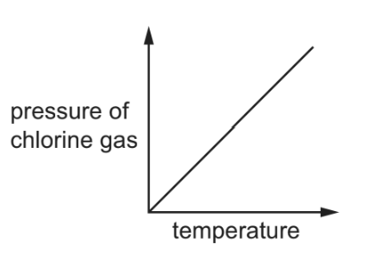

Describe how the pressure of the chlorine gas changes with temperature.

*Source: 2019 Ju33 Q4B*

**Q5** [2 marks]

The structure of compound S is shown.

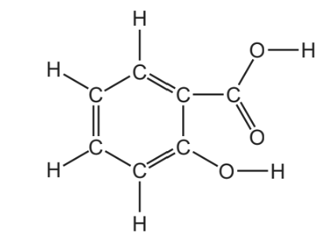

The melting point of pure S is 159 °C.

The boiling point of pure S is 200 °C.

What is the physical state of pure S at 100 °C?

Explain your answer.

*Source: 2019 Ju33 Q4C*

### Q6 — hard — 11 marks

**Q6** [4 marks]

Nitrogen dioxide, NO2, is a dark brown gas.

When nitrogen dioxide is cooled, it forms a yellow liquid and then pale yellow crystals.

These crystals are heated and the temperature is measured every minute. The following graph can be drawn.

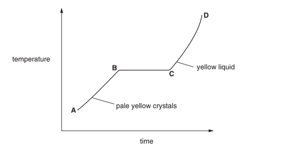

i) Describe the arrangement and movement of the molecules in the region A–B.

[3]

ii) Name the change that occurs in the region B–C.

[1]

*Source: 2003 Ju31 Q4*

**Q6** [4 marks]

#### Extended Only

Nitrogen dioxide and other oxides of nitrogen are formed in car engines.

i) Explain how these oxides are formed.

[2]

ii) How are they removed from the exhaust gases?

[2]

*Source: 2003 Ju31 Q4*

**Q6** [3 marks]

#### Extended Only

Nitrogen dioxide, oxygen and water react to form dilute nitric acid.

Describe how lead(II) nitrate crystals could be prepared from dilute nitric acid and lead(II) oxide.

*Source: 2003 jU31 Q4*

### Q7 — easy — 6 marks

**Q7** [6 marks]

The table shows the melting points, boiling points and electrical properties of the six substances **A** to **F**.

| substance | melting point / oC | boiling point / oC | electrical conductor at room temperature | electrical conductor of substance dissolved in water |
|---|---|---|---|---|
| **A** | 961 | 2193 | good | does not dissolve |
| **B** | 113 | 444 | does not conduct | does not dissolve |
| **C** | 0 | 100 | very poor | very poor |
| **D** | 803 | 1465 | does not conduct | good |
| **E** | -5 to-1 | 102-105 | good | good |
| **F** | -8 | -6 | does not conduct | does not dissolve |

i) Which **three **substances are solids at room temperature?

[1]

ii) Which **one **is an ionic compound?

[1]

iii) Which **one **is a gas at room temperature?

[1]

iv) Which **two **substances are liquids at room temperature?

[1]

v) Which **one **substance is a metal?

[1]

vi) Which **one **is an impure substance?

[1]

*Source: 2006 O31 Q2*

### Q8 — medium — 12 marks

**Q8** [8 marks]

#### Extended Only

Ethanoic acid is a colourless liquid at room temperature. It has the typical acid properties and forms compounds called ethanoates.

A pure sample of ethanoic acid is slowly heated from 0 oC to 150 oC and its temperature is measured every minute. The results are represented on the graph below.

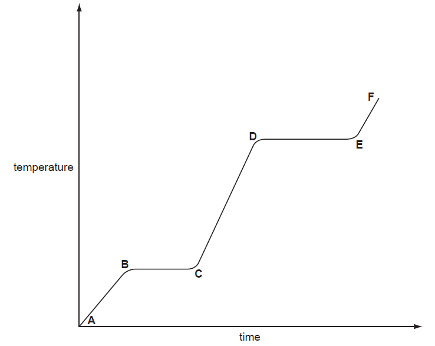

i) Name the change that occurs in the region D to E.

[1]

ii) What would be the difference in the region B to C if an impure sample had been used?

[1]

iii) Sketch on the graph how the line would continue if the acid was heated to a higher temperature.

[1]

iv) Complete the following table that compares the separation and movement of the molecules in regions C to D with those in E to F.

|   | **C **to **D** | **E** to **F** |
|---|---|---|
| separation (distance between particles) |   |   |
| movement of particles | random and slow |   |
| Can particles move apart to fill any volume? |   |   |

[5]

*Source: 2005 O13 Q2A*

**Q8** [2 marks]

Complete the word equations for the reactions of ethanoic acid.

calcium + ethanoic acid → ................................................ +  .........................................

................................................  +  ethanoic acid   →  zinc ethanoate + water

*Source: 2015 O13 Q2B*

**Q8** [2 marks]

Write the symbol equation for the reaction between ethanoic acid and sodium hydroxide.

*Source: 2015 O13 Q2C*

### Q9 — easy — 6 marks

**Q9** [3 marks]

#### Extended Only

Explain the following in terms of the kinetic particle theory.

The rate of most reactions increases at higher temperatures.

*Source: 2014 Ju33 Q2*

**Q9** [3 marks]

#### Extended Only

Explain the following in terms of the kinetic particle theory.

A liquid has a fixed volume but takes up the shape of the container. A gas takes up the shape of the container but it does not have a fixed volume.

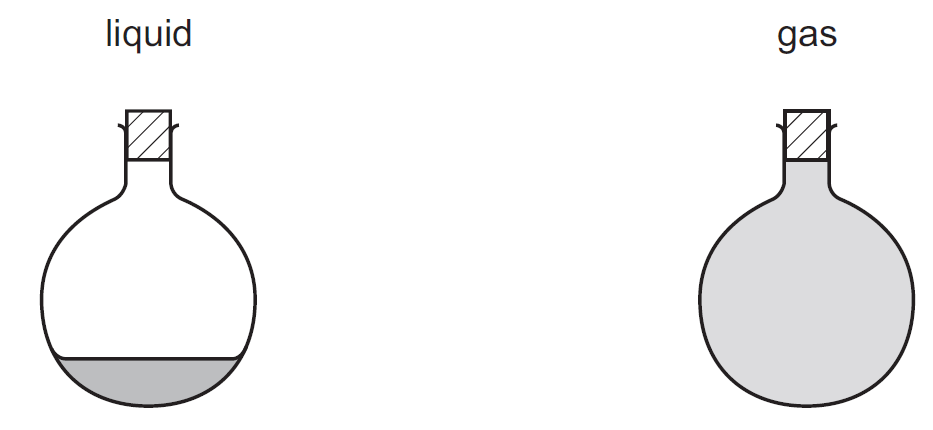

*Source: 2014 Ju33 Q2*

### Q10 — medium — 7 marks

**Q10** [4 marks]

This question is about iodine and compounds of iodine.

Use the kinetic particle model to describe the separation between the molecules and the type of motion of the molecules in:

Solid iodine:

Iodine gas:

*Source: 2019 Ju31 Q4A*

**Q10** [1 mark]

The graph shows how the volume of iodine gas changes with pressure. The temperature is kept constant.

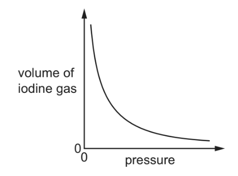

Describe how the volume of iodine gas changes with pressure.

*Source: 2019 Ju31 Q4B*

**Q10** [2 marks]

Sulfur dioxide melts at –73 °C and boils at –10 °C.

What is the physical state of sulfur dioxide at –20 °C?

Explain your answer.

*Source: 2019 Ju31 Q4C*

### Q11 — hard — 9 marks

**Q11** [3 marks]

A small amount of liquid bromine is added to a container which is then sealed.

Br2(l) → Br2(g)

Use the ideas of the Kinetic Theory to explain why, after about an hour, the bromine molecules have spread uniformly to occupy the whole container.

*Source: 2012 O33 Q3A*

**Q11** [6 marks]

#### Extended Only

The diagrams below show simple experiments on the speed of diffusion of gases.

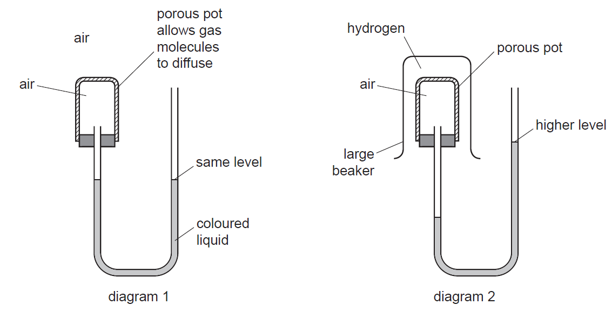

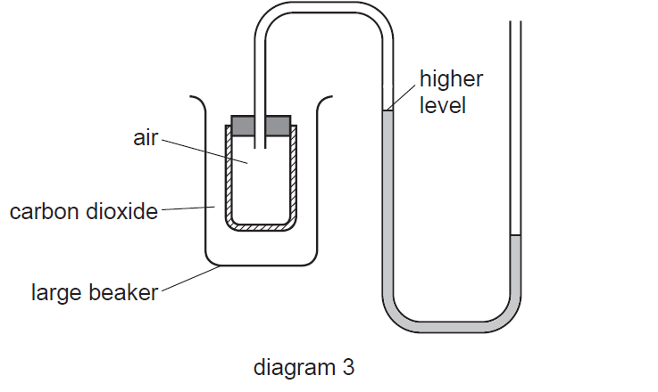

Complete the following explanations. Diagram 1 has been done for you.

**Diagram 1** There is air inside and outside the porous pot so the rate of diffusion of air into the pot is the same as the rate of diffusion of air out of the pot. The pressure inside and outside the pot is the same so the coloured liquid is at the same level on each side of the tube.

**Diagram 2.**

................................

**Diagram 3**

................................

*Source: 2012 O33 Q3B*

### Q12 — medium — 5 marks

**Q12** [1 mark]

#### Extended Only

The diagram shows a heating curve for a sample of compound X.

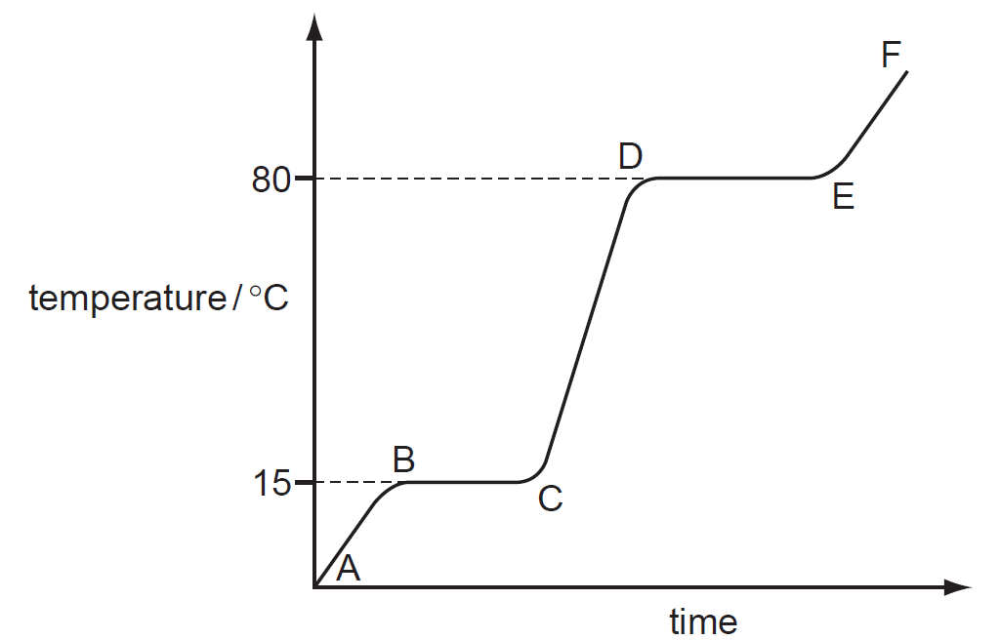

Is X a solid, a liquid or a gas at room temperature, 20 °C?

*Source: 2012 O32 Q2A*

**Q12** [1 mark]

**Extract:**

The diagram shows a heating curve for a sample of compound X.
From the graph, the flat parts correspond to the melting and boiling points, which are 15 °C and 80 °C, respectively.

#### Extended Only

Write an equation for the equilibrium which exists in region BC.

*Source: 2012 O32 Q2B*

**Q12** [1 mark]

**Extract:**

The diagram shows a heating curve for a sample of compound X. ![cie-igcse-sq-1-1-q6a] From the graph, the flat parts correspond to the melting and boiling points, which are 15 °C and 80 °C, respectively.

#### Extended Only

Name the change of state which occurs in region DE.

*Source: 2012 O32 Q2C*

**Q12** [2 marks]

**Extract:**

The diagram shows a heating curve for a sample of compound X. 
Region BC: the solid melts.
Region DE: the liquid boils.

#### Extended Only

Explain how the curve shows that a pure sample of compound X was used.

*Source: 2012 O32 Q2D*

### Q13 — medium — 9 marks

**Q13** [4 marks]

#### Extended Only

Compound X is a colourless liquid at room temperature.

A sample of pure X was slowly heated from –5.0 °C, which is below its melting point, to 90 °C, which is above its boiling point. Its temperature is measured every minute and the results are represented on the graph.

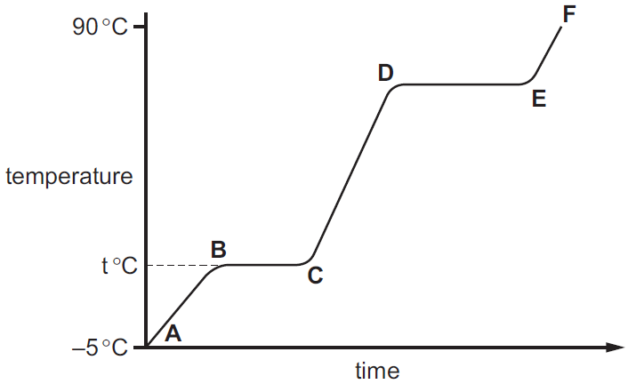

i) Complete the equation for the equilibrium present in the region BC.

X (s) $\rightleftharpoons$....................

[1]

ii) What is the significance of temperature t °C?

[1]

iii) What is the physical state of compound X in the region EF?

[1]

iv) What would be the difference in the region BC if an impure sample of X had been used?

[1]

*Source: 2014 O33 Q2A*

**Q13** [5 marks]

#### Separate: Chemistry and Extended Only

Compound X is a hydrocarbon. It contains 85.7% of carbon. The mass of one mole of X is 84 g.

i) What is the percentage of hydrogen in the compound ?

[1]

ii) Calculate the empirical formula of X. Show your working.

[3]

iii) What is the molecular formula of compound X?

[1]

*Source: 2014 O33 Q2B*

### Q14 — hard — 14 marks

**Q14** [5 marks]

#### Separate: Chemistry and Extended Only

Acid-base reactions are examples of proton transfer.

Ethylamine is a weak base and sodium hydroxide is a strong base.

i) In terms of proton transfer, explain what is meant by the term *weak base*.

[2]

ii) Given aqueous solutions of both bases, describe how you could show that sodium hydroxide is the stronger base. How could you ensure a ‘fair’ comparison between the two solutions?

[3]

*Source: 2015 Ju31 Q6A*

**Q14** [4 marks]

Ethylamine reacts with acids to form salts.

CH3CH2NH2      +     HCl    →   CH3CH2NH3Cl

ethylammonium chloride

i) Complete the equation for the reaction between sulfuric acid and ethylamine. Name the salt formed.

......  CH3CH2NH2       +       ............     →     .........................

Name of salt ........................................................................

[3]

ii) Amines and their salts have similar chemical properties to ammonia and ammonium salts.

Suggest a reagent that could be used to displace the weak base, ethylamine, from its salt ethylammonium chloride.

[1]

*Source: 2015 Ju31 Q6B*

**Q14** [5 marks]

#### Extended Only

Gases diffuse, which means that they move to occupy the total available volume.

i) Explain, using kinetic particle theory, why gases diffuse.

[2]

ii) When the colourless gases hydrogen bromide and ethylamine come into contact, a white solid is formed.

CH3CH2NH2 (g) + HBr (g)     →     CH3CH2NH3Br (s)

white solid

The following apparatus can be used to compare the rates of diffusion of the two gases ethylamine and hydrogen bromide.

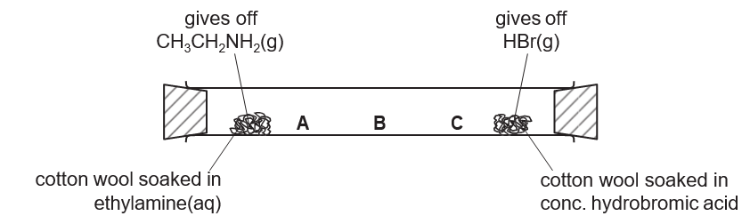

Predict at which position, A, B or C, the white solid will form. Explain your choice.

[3]

*Source: 2015 Ju31 Q6C*

### Q15 — medium — 22 marks

**Q15** [8 marks]

#### Extended Only

Concentrated ammonia solution gives off ammonia gas. Concentrated hydrochloric acid gives off hydrogen chloride gas. Ammonia, NH3, and hydrogen chloride, HCl, are both colourless gases. Ammonia reacts with hydrogen chloride to make the white solid ammonium chloride.

Apparatus is set up as shown.

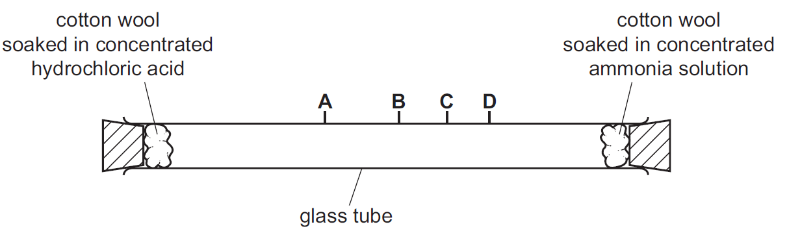

After ten minutes a white solid forms in the tube where the gases meet.

i) Write the chemical equation for the reaction of ammonia with hydrogen chloride.

[1]

ii) Name the process by which the ammonia and hydrogen chloride gases move in the tube.

[1]

iii) At which point, A, B, C or D, does the white solid form? Explain why the white solid forms at that point.

[3]

iv) The experiment was repeated at a higher temperature. Predict how the results of the experiment would be different. Explain your answer.

[3]

*Source: 2016 Ju43 Q6A*

**Q15** [6 marks]

**Extract:**

Concentrated ammonia solution gives off ammonia gas. Concentrated hydrochloric acid gives off hydrogen chloride gas. Ammonia, NH~3~, and hydrogen chloride, HCl, are both colourless gases. Ammonia reacts with hydrogen chloride to make the white solid ammonium chloride.

After ten minutes a white solid forms in the tube where the gases meet.

Some of the white solid is removed from the tube and dissolved in water.

Describe how the white solid could be tested to show it contains:

i) Ammonium ions.

Test ...........................

Result .......................

[3]

ii) Chloride ions.

Test .........................

Result .....................

[3]

*Source: 2016 Ju43 Q6B*

**Q15** [4 marks]

#### Extended Only

The diagram shows the electron arrangement in a molecule of ammonia, showing only outer shell electrons.

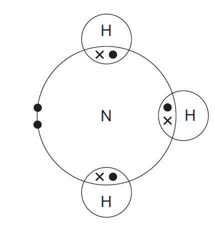

i) State the type of bonding in ammonia.

[1]

ii) Hydrazine, N2H4, is another compound of nitrogen and hydrogen. Complete the diagram to show the electron arrangement in a molecule of hydrazine, showing only outer shell electrons.

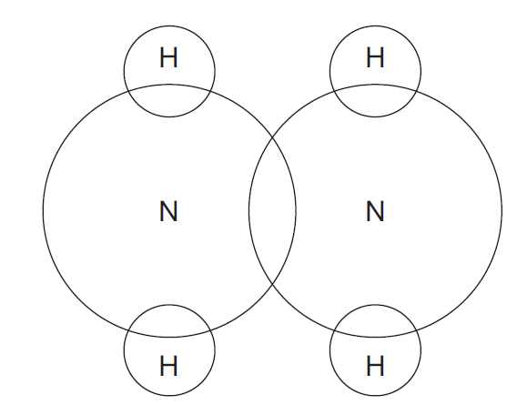

[3]

*Source: 2016 Ju43 Q6C*

**Q15** [3 marks]

#### Separate: Chemistry and Extended Only

Nylon and proteins are both polymers containing nitrogen.

i) Name the linkages found in the polymers of nylon and protein.

[1]

ii) Describe one difference in the structures of nylon and protein.

[1]

iii) What is the general name given to the products of hydrolysis of proteins?

[1]

*Source: 2016 Ju43 Q6D*

**Q15** [1 mark]

#### Extended Only

Suggest the structure of the monomer used to make the polymer shown.

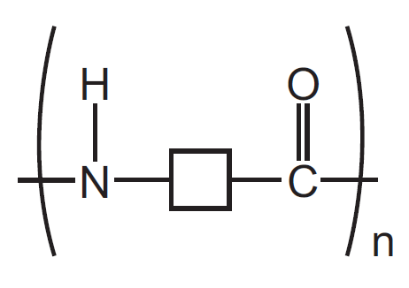

*Source: 2016 Ju43 Q6E*

### Q16 — medium — 8 marks

**Q16** [4 marks]

Element X can undergo the following physical changes.

**Figure 1.1**

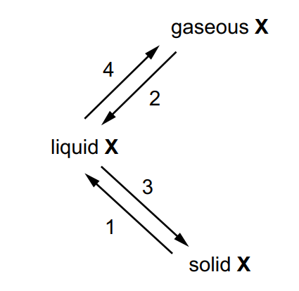

Name each of the numbered physical changes shown in **Figure 1**.

*Source: Specimen 0620/04 Q1A*

**Q16** [1 mark]

One difference between boiling and evaporation is the rate at which the processes occur.

State one other difference between boiling and evaporation.

*Source: Specimen 0620/04 Q1B*

**Q16** [3 marks]

Element X can undergo the following physical changes.

**Figure 1.1**

Describe the separation, arrangement and motion of particles of element X in the solid state.

Separation: ..................................................

Arrangement: ..................................................

Motion: ..................................................

*Source: Specimen 0620/04 Q1C*

### Q17 — hard — 7 marks

**Q17** [2 marks]

#### Extended Only

Different gases diffuse at different speeds.

i) What is meant by the term *diffusion*?

[1]

ii) What property of a gas molecule affects the speed at which it diffuses?

[1]

*Source: 2014 Ju31 Q3A*

**Q17** [2 marks]

**Extract:**

The term *diffusion* means:
- Particles spread to fill the total available volume 
**OR**
Particles move from high concentration to low concentration / down a concentration gradient; [1 mark]

The property of a gas molecule affects the speed at which it diffuses is:
- Mass / *M*~r~; [1 mark]

- Lighter particles move faster
- The speed at which diffusion happens depends on the mass / *M*~r~ of the particles

#### Extended Only

Helium is a gas used to fill balloons. It is present in the air in very small quantities. Diffusion can be used to separate it from the air. Air at 1000°C is on one side of a porous barrier. The air which passes through the barrier has a larger amount of helium in it.

i) Why does the air on the other side of the barrier contain more helium?

[1]

ii) Why is it an advantage to have the air at a high temperature?

[1]

*Source: 2014 Ju31 Q3*

**Q17** [3 marks]

Most helium is obtained from natural gas found in the USA. Natural gas contains methane and 7% helium. One possible way to obtain the helium would be to burn the methane.

i) Write an equation for the complete combustion of methane.

[1]

ii) Suggest why this would not be a suitable method to obtain the helium.

[1]

iii) Suggest another method, other than diffusion, by which helium could be separated from the mixture of gases in natural gas.

[1]

*Source: 2014 Ju31 Q3*

### Q18 — easy — 6 marks

**Q18** [3 marks]

Complete **Table 1.1** about solids, liquids and gases.

**Table 1.1**

|   | particle separation | particle arrangement | type of motion |
|---|---|---|---|
| solid |   | regular | vibrate only |
| liquid | some touching |   | random |
| gas | apart | random |   |

*Source: 2020 Ju43 Q5A*

**Q18** [1 mark]

#### Extended Only

The graph shows the change in temperature as a sample of a gas is cooled.

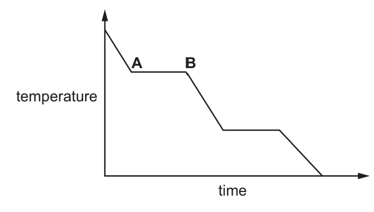

Name the change of state taking place between A and B.

*Source: 2020 Ju43 Q5B*

**Q18** [2 marks]

A bottle of liquid perfume is left open at the front of a room.

After some time, the perfume is smelt at the back of the room.

Name the two physical processes taking place.

*Source: 2020 Ju43 Q5C*

### Q19 — easy — 6 marks

**Q19** [1 mark]

**Extract:**

Additional Marking Context:

This is a 1-mark identification question. Award the mark for the correct letter (E) regardless of any reasoning the student provides. Do not deny the mark because the student's explanation is incorrect.

Accept both uppercase and lowercase letters. "f" is equivalent to "F".

#### Separate: Chemistry and Extended Only

The following table gives information about six substances.

| Substance | melting point / °C | boiling point /°C | electrical conductivity as a solid | electrical conductivity as a liquid |
|---|---|---|---|---|
| A | 839 | 1484 | good | good |
| B | -210 | -196 | poor | poor |
| C | 776 | 1497 | poor | good |
| D | -117 | 78 | poor | poor |
| E | 1607 | 2227 | poor | poor |
| F | -5 | 102 | poor | good |

Which substance could have a macromolecular structure, similar to that of silicon(IV) oxide?

*Source: 2010 O32 Q1A*

**Q19** [1 mark]

**Extract:**

The following table gives information about six substances.

| Substance | melting point / °C | boiling point /°C | electrical conductivity as a solid | electrical conductivity as a liquid |
| :---: | :---: | :---: | :---: | :---: |
| A | 839 | 1484 | good | good |
| B | -210 | -196 | poor | poor |
| C | 776 | 1497 | poor | good |
| D | -117 | 78 | poor | poor |
| E | 1607 | 2227 | poor | poor |
| F | -5 | 102 | poor | good |

Additional Marking Context:

Accept both uppercase and lowercase letters. "f" is equivalent to "F".

Which substances are solids at room temperature?

**Q19** [1 mark]

**Extract:**

The following table gives information about six substances.

| Substance | melting point / °C | boiling point /°C | electrical conductivity as a solid | electrical conductivity as a liquid |
| :---: | :---: | :---: | :---: | :---: |
| A | 839 | 1484 | good | good |
| B | -210 | -196 | poor | poor |
| C | 776 | 1497 | poor | good |
| D | -117 | 78 | poor | poor |
| E | 1607 | 2227 | poor | poor |
| F | -5 | 102 | poor | good |

Additional Marking Context:

Accept both uppercase and lowercase letters. "f" is equivalent to "F".

#### Extended Only

Which substance could be a metal?

*Source: 2011 O32 Q1C*

**Q19** [1 mark]

**Extract:**

The following table gives information about six substances.

| Substance | melting point / °C | boiling point /°C | electrical conductivity as a solid | electrical conductivity as a liquid |
| :---: | :---: | :---: | :---: | :---: |
| A | 839 | 1484 | good | good |
| B | -210 | -196 | poor | poor |
| C | 776 | 1497 | poor | good |
| D | -117 | 78 | poor | poor |
| E | 1607 | 2227 | poor | poor |
| F | -5 | 102 | poor | good |

Additional Marking Context:

Accept both uppercase and lowercase letters. "f" is equivalent to "F".

#### Extended Only

Which substance could be aqueous sodium chloride?

*Source: 2011 O32 Q1D*

**Q19** [1 mark]

**Extract:**

The following table gives information about six substances.

| Substance | melting point / °C | boiling point /°C | electrical conductivity as a solid | electrical conductivity as a liquid |
| :---: | :---: | :---: | :---: | :---: |
| A | 839 | 1484 | good | good |
| B | -210 | -196 | poor | poor |
| C | 776 | 1497 | poor | good |
| D | -117 | 78 | poor | poor |
| E | 1607 | 2227 | poor | poor |
| F | -5 | 102 | poor | good |

Additional Marking Context:

Accept both uppercase and lowercase letters. "f" is equivalent to "F".

#### Extended Only

Which substance is an ionic compound?

*Source: 2011 O32 Q1E*

**Q19** [1 mark]

**Extract:**

The following table gives information about six substances.

| Substance | melting point / °C | boiling point /°C | electrical conductivity as a solid | electrical conductivity as a liquid |
| :---: | :---: | :---: | :---: | :---: |
| A | 839 | 1484 | good | good |
| B | -210 | -196 | poor | poor |
| C | 776 | 1497 | poor | good |
| D | -117 | 78 | poor | poor |
| E | 1607 | 2227 | poor | poor |
| F | -5 | 102 | poor | good |

Additional Marking Context:

Accept both uppercase and lowercase letters. "f" is equivalent to "F".

Which substances are liquids at room temperature?

*Source: 2011 O32 Q1F*

### Q20 — easy — 5 marks

**Q20** [1 mark]

Give the name of the process that occurs when a gas turns into a liquid.

*Source: 2020 Ju42 Q1A*

**Q20** [1 mark]

Give the name of the process that occurs when a solid turns into a gas without first forming a liquid.

*Source: 2020 Ju42 Q1B*

**Q20** [3 marks]

**Figure 1.2** shows a coloured crystal of cobalt(II) chloride is placed at the bottom of a beaker containing water.

After two days, the colour has spread throughout the water.

**Figure 1.2**

** **

Explain these observations.

*Source: 2020 Ju42 Q1C*

### Q21 — easy — 6 marks

**Q21** [4 marks]

This question is about bromine and compounds of bromine.

Use the kinetic particle model to describe the arrangement and type of motion of the molecules in:

Liquid bromine:

Bromine gas:

*Source: 2019 Ju32 Q4A*

**Q21** [1 mark]

The graph shows how the volume of bromine gas changes with temperature. The pressure is kept constant.

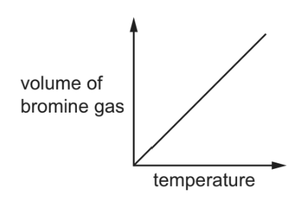

Describe how the volume of the bromine gas changes with temperature.

*Source: 2019 Ju32 Q4B*

**Q21** [1 mark]

Calcium melts at 839 °C and boils at 1484 °C.

What is the physical state of calcium at 1600 °C?

*Source: 2019 Ju32  Q4C*

### Q22 — hard — 10 marks

**Q22** [1 mark]

#### Extended Only

Z is a covalent substance. In an experiment, a sample of pure solid Z was continually heated for 12 minutes.

The graph shows how the temperature of the sample of pure Z changed during the first 9 minutes.

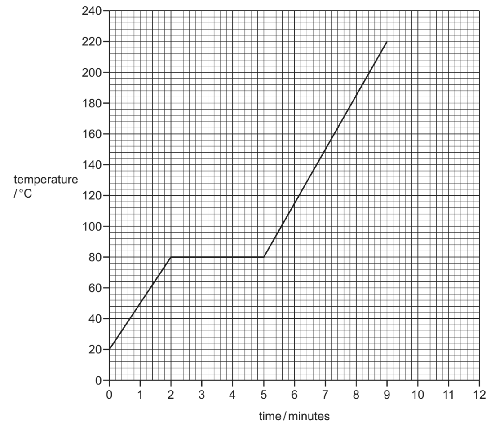

What is the melting point of pure Z?

*Source: 2019 Ju41 Q2A*

**Q22** [1 mark]

**Extract:**

Z is a covalent substance. In an experiment, a sample of pure solid Z was continually heated for 12 minutes. The graph shows how the temperature of the sample of pure Z changed during the first 9 minutes. [Graph shows temperature rising from 20°C, plateau at 80°C between 2 and 5 minutes, then rising to 220°C at 9 minutes.]

#### Extended Only

The sample of pure Z began to boil at 9 minutes. It was boiled for 3 minutes.   Use this information to sketch on the grid, in part (a), how the temperature of the sample of pure Z changed after 9 minutes.

*Source: 2019 Ju41 Q2B*

**Q22** [2 marks]

**Extract:**

Z is a covalent substance. In an experiment, a sample of pure solid Z was continually heated for 12 minutes. The graph shows how the temperature of the sample of pure Z changed during the first 9 minutes.

#### Extended Only

The sample of pure Z was continually heated between 2 minutes and 5 minutes.

Explain, in terms of attractive forces, why there was no increase in the temperature of the sample of pure Z between 2 minutes and 5 minutes.

*Source: 2019 Ju41 Q2C*

**Q22** [2 marks]

**Extract:**

Z is a covalent substance. In an experiment, a sample of pure solid Z was continually heated for 12 minutes. The graph shows how the temperature of the sample of pure Z changed during the first 9 minutes.

#### Extended Only

Describe how the motion of particles of pure Z changed from 0 minutes to 2 minutes.

*Source: 2019 Ju41 Q2D*

**Q22** [2 marks]

**Extract:**

Z is a covalent substance. In an experiment, a sample of pure solid Z was continually heated for 12 minutes. What is the melting point of pure Z? - 80 (°C)
The sample of pure Z began to boil at 9 minutes. It was boiled for 3 minutes. - A horizontal line at 220 °C starting at minute 9 and continuing to minute 12

The experiment was repeated using a solid sample of impure Z.

Suggest the differences, if any, in the melting point and boiling point of the sample of impure Z compared to the sample of pure Z.

melting point:

boiling point:

*Source: 2019 Ju41 Q2E*

**Q22** [2 marks]

**Extract:**

Z is a covalent substance. In an experiment, a sample of pure solid Z was continually heated for 12 minutes. The graph shows how the temperature of the sample of pure Z changed during the first 9 minutes. What is the melting point of pure Z? The melting point of pure Z is 80 (°C).

#### Extended Only

A sample of pure Z was allowed to cool from 120 °C to 20 °C. The total time taken was 8 minutes.

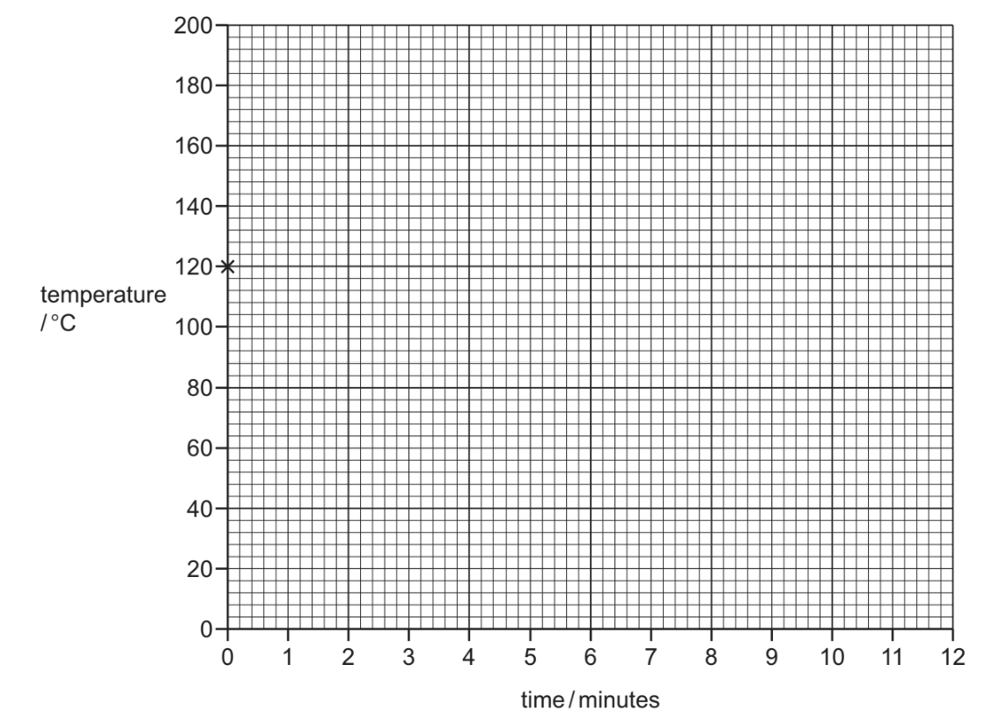

Starting from point ×, sketch on the grid how the temperature of the sample of pure Z changed between 0 minutes and 8 minutes.

*Source: 2019 Ju41 Q2F*

