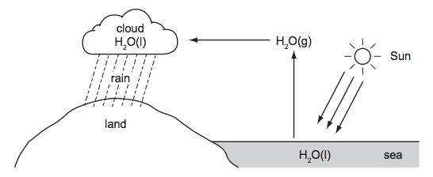

# Exam Questions — Water & Water Pollution
**10. Chemistry of the Environment** · Cambridge (CIE) IGCSE chemistry (0620 & 0971)
> Source: [https://www.savemyexams.com/igcse/chemistry/cie/23/topic-questions/](https://www.savemyexams.com/igcse/chemistry/cie/23/topic-questions/) · 33 questions across 2 sets

## Multiple Choice Questions (23 questions)

### Q1 — easy — 1 marks

**Q1** [1 mark]

Four substances that may be found in water from natural sources are listed.

1. dissolved oxygen
2. metal compounds such as calcium and magnesium ions
3. microplastics
4. nitrates and phosphates

Which substances are beneficial to aquatic life?

### Q2 — easy — 1 marks

**Q2** [1 mark]

Four compounds are listed below

1. Ca3N2
2. K3PO4
3. Ca3(PO4)2
4. NH4NO3

Which pair of compounds provides the soil with the essential elements nitrogen and potassium?

### Q3 — easy — 1 marks

**Q3** [1 mark]

Water from a reservoir contains insoluble solids and harmful microbes. The water must be treated to make it safe for the domestic water supply.

Which row shows the correct order of the stages used to treat the water?

### Q4 — easy — 1 marks

**Q4** [1 mark]

Which of the following statements regarding the uses of water are correct?

| **1** | Water in industry is used as a solvent and as a coolant. |
|---|---|
| **2** | All water used in industry is safe for human consumption. |
| **3** | Water in the household may contain dissolved salts. |
| **4** | Water in the household is used for sanitation and cooking. |

### Q5 — easy — 1 marks

**Q5** [1 mark]

There are many steps involved when treating water.

Which statement describing a treatment step and its purpose is **incorrect**?

### Q6 — easy — 1 marks

**Q6** [1 mark]

#### Separate: Chemistry Only

What essential plant nutrients do fertilisers supply?

| **A** | phosphorus | calcium | nitrogen |
|---|---|---|---|
| **B** | iron | nitrogen | magnesium |
| **C** | nitrogen | potassium | phosphorus |
| **D** | potassium | calcium | nitrogen |

### Q7 — easy — 1 marks

**Q7** [1 mark]

A student added anhydrous copper(II) sulfate to a test tube containing an aqueous solution.

Which row correctly describes the colour change the student observed?

|   | **before addition** | **after addition** |
|---|---|---|
| **A** | white | pink |
| **B** | white | blue |
| **C** | blue | white |
| **D** | pink | blue |

### Q8 — easy — 1 marks

**Q8** [1 mark]

During the treatment of ground water, large insoluble particles are allowed to settle to the bottom of a tank.

What is this process called?

### Q9 — hard — 1 marks

**Q9** [1 mark]

#### Separate: Chemistry Only

Four water samples, **W**, **X**, **Y** and **Z**, were analysed in the laboratory to measure pH, boiling point, and the amount of dissolved solids.

The sources of water were:

- pure water
- tap water
- acidic rain
- sea water

The results are shown in the table below.

| **Water sample** | **pH** | **Boiling point / °C** | **Mass of dissolved solids in 20 cm****3**** of water / g** |
|---|---|---|---|
| **W** | 8.2 | 101.3 - 101.5 | 0.72 |
| **X** | 4.2 | 100.2 - 100.3 | 0.03 |
| **Y** | 7.0 | 100.0 | 0.00 |
| **Z** | 6.3 | 100.5 - 100.6 | 0.02 |

Which are the correct identities of water samples **W**,** X**, **Y **and **Z**?

|   | **W** | **X** | **Y** | **Z** |
|---|---|---|---|---|
| **A** | acidic rain | pure water | tap water | sea water |
| **B** | pure water | tap water | sea water | acidic rain |
| **C** | tap water | sea water | acidic rain | pure water |
| **D** | sea water | acidic rain | pure water | tap water |

### Q10 — hard — 1 marks

**Q10** [1 mark]

#### Separate: Chemistry Only

Which substances lead to deoxygenation of water?

1   NH4NO3

2   Pb

3   Mg

4   Ca3(PO4)2

### Q11 — hard — 1 marks

**Q11** [1 mark]

Fertilisers provide three essential elements required for plant growth.

Which substances will make a salt that will contain two of these essential elements?

1   ammonia and nitric acid

2   potassium hydroxide and sulfuric acid

3   ammonia and phosphoric acid

4   potassium hydroxide and nitric acid

### Q12 — hard — 1 marks

**Q12** [1 mark]

#### Separate: Chemistry and Extended Only

Different fertilisers contain the essential elements needed for plant growth in varying quantities.

Which fertiliser compound contains the highest percentage by mass of the essential elements needed for growth?

[Relative atomic masses, *A*r: H = 1; N = 14; O = 16; P = 31; S = 32; K = 39; Ca = 40]

### Q13 — hard — 1 marks

**Q13** [1 mark]

Which row correctly identifies the substance based on the experiment and observations carried out?

|   | **Experiment ** | **Observations** | **Identity of bold substance** |
|---|---|---|---|
| **A** | **Pink crystals **are heated | The crystals turn blue and steam is given off | anhydrous cobalt(II) chloride |
| **B** | Water is added to a **white** **solid ** | The white solid turns blue | anhydrous copper(II) sulfate |
| **C** | **Blue crystals** are heated | The crystals turn white and steam is given off | anhydrous cobalt(II) chloride |
| **D** | Water is added to a **blue solid** | The blue solid turns pink | hydrated copper(II) sulfate |

### Q14 — medium — 1 marks

**Q14** [1 mark]

Which is the correct reason for carrying out each step when treating water?

|   | ** Adding carbon** | ** Chlorination** | **Sedimentation** |
|---|---|---|---|
| **A** | kill microbes | remove salts | remove solids |
| **B** | remove salts | remove odours | kill microbes |
| **C** | remove odours | kill microbes | remove solids |
| **D** | remove odours | remove solids | remove salts |

### Q15 — medium — 1 marks

**Q15** [1 mark]

Which pair of substances would make an NPK fertiliser?

### Q16 — medium — 1 marks

**Q16** [1 mark]

Ammonia and sulfuric acid can react in the lab to make ammonium sulfate fertiliser.

What is the formula of the product?

### Q17 — medium — 1 marks

**Q17** [1 mark]

Mineral water contains dissolved salts such as magnesium chloride. Which one of the following statements about mineral water is correct?

### Q18 — medium — 1 marks

**Q18** [1 mark]

Potable water is produced from a water source near a country spring as shown in the flow diagram.

Which processes occur at P and Q?

|   | **P** | **Q** |
|---|---|---|
| **A** | chlorination | filtration |
| **B** | chlorination | distillation |
| **C** | filtration | distillation |
| **D** | filtration | chlorination |

## Theory Questions (15 questions)

### Q1 — hard — 12 marks

**Q1** [4 marks]

Groundwater can contain fertilisers washed from fields. An example of a fertiliser that can be found is ammonium nitrate.

i) Write a balanced equation, including state symbols, to show how ammonium nitrate can be made by a student via a neutralisation reaction.

[2]

ii) Describe how the student could perform a chemical test for the presence of nitrate ions.

[2]

**Q1** [3 marks]

#### Separate: Chemistry and Extended Only

Drinking water extracted from rivers in agricultural areas often contain nitrates. The first legal standard for nitrate in drinking water was set in 1980. The current UK drinking water standard is 50 mg / dm3 to safeguard against cases of methaemoglobinaemia or blue baby syndrome.

Calculate the maximum mass in grams of nitrate that would be safe in a 240 cm3 glass of water. Give your answer to two significant figures.

**Q1** [2 marks]

#### Separate: Chemistry Only

An alternative fertiliser is ammonium phosphate.

i) Give the formula for ammonium phosphate.

[1]

ii) Which ion that plants need is missing from this fertiliser?

[1]

**Q1** [3 marks]

#### Separate: Chemistry and Extended Only

Phosphates can be found in reservoirs from which drinking water is obtained. A maximum of 0.025 mg / dm3 of phosphate ions is allowed by water companies.

A sample of reservoir water has a concentration of 0.00014 mol / dm3.

Calculate the percentage of the maximum mass allowed of phosphate ions in the sample of reservoir water.

### Q2 — medium — 6 marks

**Q2** [4 marks]

Water is needed for industry and in the home.

i) Rain water is collected in reservoirs. How is it treated before entering the water supply?

[2]

ii) State **two** uses of water in the home.

[2]

*Source: 2014 Ju31 Q1*

**Q2** [2 marks]

In many regions, drinking water is obtained by the distillation of sea-water. Explain how distillation separates the water from sea-water.

*Source: 2014 Ju31 Q1*

### Q3 — hard — 14 marks

**Q3** [6 marks]

A scientist finds an unlabelled bottle on a shelf.

She thinks the bottle contains a solution of ammonium sulfate, (NH4)2SO4.

Describe tests the scientist could do to show that the solution is ammonium sulfate.

*Source: 2021 Ju1C Q8A*

**Q3** [2 marks]

Ammonium sulfate is often used as a fertiliser.

It is prepared by reacting ammonia (NH3) with sulfuric acid (H2SO4).

i) Name the type of reaction that occurs between ammonia and sulfuric acid.

[1]

ii) Write a chemical equation for the reaction of ammonia with sulfuric acid.

[1]

*Source: 2021 Ju1C Q8B*

**Q3** [3 marks]

#### Separate: Chemistry and Extended Only

A common test for water is to use anhydrous copper(II) sulfate. If water is present an exothermic reaction takes place and the solid turns from white to blue and becomes hydrated copper(II) sulfate. This reaction is reversible.

6.25 g of blue hydrated copper(II) sulphate, CuSO4.*x*H2O was gently heated in a crucible until the mass remaining was 4.00 g. This is the white anhydrous copper(II) sulphate.

Use this information to calculate a value for *x* in CuSO4.*x*H2O.

*A*r's Cu = 64, S = 32, O = 16, H = 1

x = ..............

**Q3** [3 marks]

#### Separate: Chemistry Only

Cobalt(II) chloride paper is used to test for water as well. Hydrated cobalt chloride has the formula CoCl2**∙**6H2O.

i) State the colour change when cobalt chloride paper is added to water.

[1]

ii) When hydrated cobalt chloride is heated, water is given off. Write the balanced symbol equation for this reaction.

[2]

### Q4 — easy — 3 marks

**Q4** [1 mark]

Fertilisers are concentrated forms of plant nutrients

Which of the following ions do plants need for growth?

Tick **one **box.

| Cu2+ |   |
|---|---|
|   |   |
| PO43– |   |
|   |   |
| SO42- |   |
|   |   |
| OH–  |   |

**Q4** [1 mark]

Potassium nitrate is used as a fertiliser. The potassium ion has the formula K+ and the nitrate ion has the formula NO3–.

Give the formula for potassium nitrate.

**Q4** [1 mark]

**Extract:**

Fertilisers are concentrated forms of plant nutrients

What property must fertilisers have in order for plants to take up the ions through their roots.

### Q5 — easy — 4 marks

**Q5** [1 mark]

The flow chart shows stages in producing drinking water.

**reservoir**
**↓**
**sedimentation tank**
**↓**
**filtration tank**
**↓**
**antibacterial treatment tank**
**↓**
**storage tank**
**↓**
**mains**

At which stage is chlorine added to the water.

**Q5** [1 mark]

Chlorine is a toxic substance. Suggest why it is safe to be added to drinking water.

**Q5** [1 mark]

**Extract:**

The flow chart shows stages in producing drinking water. reservoir → sedimentation tank → filtration tank → antibacterial treatment tank → storage tank → mains. At which stage is chlorine added to the water. Answer: Anti-bacterial tank.

Suggest another use for which chlorinated water is required.

**Q5** [1 mark]

**Extract:**

The flow chart shows stages in producing drinking water.

reservoir → sedimentation tank → filtration tank → antibacterial treatment tank → storage tank → mains

Describe what happens in the sedimentation tank.

### Q6 — medium — 11 marks

**Q6** [2 marks]

Waste water like this needs to be treated before being released into the environment. Waste water may require removal of organic matter and harmful chemicals. The three main steps are sedimentation, filtration and chlorination.

Explain what happens in sedimntation.

**Q6** [3 marks]

**Extract:**

Waste water like this needs to be treated before being released into the environment. Waste water may require removal of organic matter and harmful chemicals. The three main steps are sedimentation, filtration and chlorination.

Explain why chlorination is required.

**Q6** [3 marks]

**Extract:**

| Year | Used as fertiliser | Sent to landfill | Other | Total |
| 2000 | 56 | 22 | 54 | 132 |
Calculate the percentage of treated solid sludge that was sent to landfill in 2000.

**Table 5.1** shows some information about how the treated solid sludge was disposed of from one sewage treatment plant in 2000 and 2020.

**Table 5.1**

| **Mass of treated solid sludge in tonnes** |
|---|

| **Year** | **Used as fertiliser** | **Sent to landfill** | **Other** | **Total** |
|---|---|---|---|---|
| 2000 | 56 | 22 | 54 | 132 |
| 2020 | 152 | 2 | 39 | 193 |

Calculate the percentage of treated solid sludge that was sent to landfill in 2000.

Give your answer to 3 significant figures.

**Q6** [3 marks]

**Extract:**

**Table 5.1** shows some information about how the treated solid sludge was disposed of from one sewage treatment plant in 2000 and 2020.

**Table 5.1**

Mass of treated solid sludge in tonnes

| Year | Used as fertiliser | Sent to landfill | Other | Total |
| 2000 | 56 | 22 | 54 | 132 |
| 2020 | 152 | 2 | 39 | 193 |

The total mass of treated solid sludge increased from 2000 to 2020 and the proportions of how the sludge was disposed of changed.

Suggest **one **reason for the increase in the total mass of treated solid sludge and **two **reasons for the changes in the proportions of the disposal methods.

Use **Table 5.1** to help you answer.

### Q7 — easy — 5 marks

**Q7** [1 mark]

This question is about the testing and purification of water

Which** **of these statements describes the correct test for water? Tick **one **box.

| Hydrated copper(II) sulfate stays white |   |
|---|---|
|   |   |
| Hydrate copper(II) sulfate turns pink |   |
|   |   |
| Cobalt chloride paper turns pink |   |
|   |   |
| Cobalt chloride paper turns white |   |

**Q7** [1 mark]

When water is added to hydrated copper(II) sulfate heat is produced. What type of reaction is this?

**Q7** [2 marks]

Untreated water contains soluble and insoluble impurities.

Name the **two **processes that remove insoluble impurities during the treatment of water.

**Q7** [1 mark]

Complete the following sentence using the words from the list

| **chlorine** | **carbon** | **sand** |
|---|---|---|

In order to remove odours and tastes water is passed through ........................

### Q8 — medium — 11 marks

**Q8** [3 marks]

The diagram below shows part of the Water Cycle.

i) State the name of each of the following changes of state.

H2O (l) → H2O (g)

name ..................................................

H2O (g) → H2O (l)

name ..................................................

[2]

ii) Which one of the above changes of state is exothermic? Explain your choice.

[1]

*Source: 2012 Ju31 Q1*

**Q8** [2 marks]

The rain drains into rivers and then into reservoirs. Describe how water is treated before it enters the water supply.

*Source: 2012 Ju31 Q1*

**Q8** [6 marks]

**Extract:**

The diagram below shows part of the Water Cycle.

#### Separate: Chemistry Only

i) Explain how acid rain is formed.

[4]

ii) Fish live in water which is neutral (neither acidic nor alkaline). Acid rain decreases the pH of water in lakes and rivers. Both of the bases, calcium oxide and calcium carbonate, can neutralise this acid and increase the pH.

Explain why calcium carbonate is a better choice.

[2]

*Source: 2012 Ju31 Q1*

### Q9 — easy — 7 marks

**Q9** [2 marks]

This question is about water:

State **two** industrial uses of water.

**Q9** [2 marks]

**Extract:**

This question is about water:

State **two** uses of water in the home.

**Q9** [2 marks]

Before water is used in industrial processes and in the home it must be purified. Give **two **substances which are found in natural water before purification.

**Q9** [1 mark]

State the term that describes a rock that store water.

### Q10 — medium — 6 marks

**Q10** [3 marks]

This question is about water.

Describe a chemical test which shows the presence of water.

test ..................................................

colour change if water is present  ..................................................

*Source: 2015 O33 Q1*

**Q10** [1 mark]

How could you show that a sample of water is pure?

*Source: 2015 O33 Q1*

**Q10** [2 marks]

Describe how water is treated before it is supplied to homes and industry.

*Source: 2015 O33 Q1*

### Q11 — hard — 11 marks

**Q11** [3 marks]

Fertilisers are used to promote plant growth.

Two fertilisers are ammonium phosphate, (NH4)3PO4, and calcium dihydrogenphosphate,Ca(H2PO4)2.

Describe a test to distinguish between these two fertilisers.

test ..................................................

result ..................................................

*Source: 2011 O33 Q3*

**Q11** [4 marks]

#### Separate: Chemistry and Extended Only

Many fertilisers are manufactured from ammonia.

Describe how ammonia is made in the Haber process. Give the essential conditions and an equation for the process.

*Source: 2011 o33 Q3*

**Q11** [1 mark]

**Extract:**

Fertilisers are used to promote plant growth. Two fertilisers are ammonium phosphate, (NH~4~)~3~PO~4~, and calcium dihydrogenphosphate, Ca(H~2~PO~4~)~2~.

#### Separate: Chemistry Only

State the essential plant nutrient not supplied by ammonium phosphate.

*Source: 2011 O33 Q3*

**Q11** [3 marks]

#### Separate: Chemistry and Extended Only

The soluble compound, calcium dihydrogenphosphate is made by heating the insoluble mineral rock phosphate, Ca3(PO4)2, with sulfuric acid.

i) Why would rock phosphate not be effective as a fertiliser?

[1]

ii) The phosphate ion, PO43–, from the rock phosphate is changed into the dihydrogenphosphate ion, H2PO4–.

PO43– + 2H2SO4→ H2PO4–+ 2HSO4–

What type of reagent is the phosphate ion? Give a reason for your choice.

[2]

*Source: 2011 O33 Q3*

### Q12 — easy — 10 marks

**Q12** [4 marks]

This question is about chemical tests for water.

Complete these sentences about the test for water using the words from the list.

| **hydrated ** | **green ** | **anhydrous** | **white** |
|---|---|---|---|
| **blue** | **sulfur** | **yellow** | **sulfate** |

Cobalt chloride paper will turn from .......................... to pink in the presence of water.

.............................. copper ........................ will turn from ........................... to blue in the presence of water.

**Q12** [4 marks]

Describe how a student could test to see if a sample of water is pure.

**Q12** [2 marks]

Explain why tap water is not used for chemical reactions.

### Q13 — hard — 9 marks

**Q13** [3 marks]

Water from reservoirs is treated to make it suitable for drinking. Even though the water has been treated it is not pure. One method to purify water is de-ionisation.

Describe another method which will produce pure water.

**Q13** [2 marks]

**Extract:**

Water from reservoirs is treated to make it suitable for drinking. Even though the water has been treated it is not pure. One method to purify water is de-ionisation.

#### Separate: Chemistry Only

Explain why it is beneficial to drink water that is not deionized.

**Q13** [1 mark]

Chlorine is added to drinking water in order to make it safe to drink. The chlorine kills miro-organisms that can cause illnesses such as cholera and typhoid.

Suggest a concern with adding chlorine to drinking water.

**Q13** [3 marks]

#### Separate: Chemistry and Extended Only

When chlorine is added to water it undergoes a reaction which forms hydrogen chloride and chloric(I) acid. The chloric(I) acid is the compound that kills the bacteria.

Cl2 + H2O → HCl + HClO

In this reaction chlorine is both oxidised and reduced. Explain why.

### Q14 — medium — 8 marks

**Q14** [3 marks]

#### Separate: Chemistry Only

Plants require three main elements for healthy growth which be provided by fertilisers.

Give the formulae of **three **ions used to make fertilisers which provide the three required elements.

**Q14** [1 mark]

Calcium nitrate is used as a fertiliser to help prevent blossom end rot in tomatoes which causes browning of the bottom of the fruit. It provides both calcium and nitrogen.

Write the formula for calcium nitrate.

**Q14** [2 marks]

**Extract:**

Calcium nitrate is used as a fertiliser to help prevent blossom end rot in tomatoes which causes browning of the bottom of the fruit. It provides both calcium and nitrogen. Write the formula for calcium nitrate.
The formula for calcium nitrate is: Ca(NO~3~)~2~

#### Separate: Chemistry and Extended Only

Using your answer to part (b) calculate the percentage by mass of nitrogen in calcium nitrate.

(*A*r: Ca = 40, N = 14, O = 16)

**Q14** [2 marks]

#### Separate: Chemistry Only

Explain why salts from fertilisers end up in bodies in groundwater.

### Q15 — hard — 9 marks

**Q15** [4 marks]

#### Separate: Chemistry Only

The Atacama desert in Chile has deposits of the salt sodium nitrate.

Very large amounts of this salt were exported to Europe for use as a fertiliser. After the introduction of the Haber process in 1913, this trade rapidly diminished.

i) Explain why the introduction of the Haber process reduced the demand for sodium nitrate.

[2]

ii) Suggest why surface deposits of sodium nitrate only occur in areas with very low rainfall such as desert areas.

[1]

iii) The desert has smaller surface deposits of potassium nitrate. Suggest why potassium nitrate is a better fertiliser than the sodium salt.

[1]

*Source: 2015 Ju32 Q6*

**Q15** [5 marks]

#### Extended Only

The equation for the decomposition of copper(II) nitrate is given below.

2Cu(NO3)2 → 2CuO + 4NO2 + O2

Copper(II) nitrate forms a series of hydrates with the formula Cu(NO3)2.xH2O.

All these hydrates decompose to form copper(II) oxide.

1 mole of Cu(NO3)2.xH2O forms 1 mole of CuO.

i) What is meant by 1 mole of a substance?

[1]

ii) 7.26 g of a hydrate, Cu(NO3)2.xH2O, formed 2.4 g copper(II) oxide.

number of moles of CuO formed = ...................... number of moles of Cu(NO3)2.xH2O in 7.26 g = ...................... mass of 1 mole of Cu(NO3)2.xH2O = ...................... g mass of 1 mole of Cu(NO3)2 is 188 g the value of x in this hydrate = ......................

[4]

*Source: 2015 Ju32 Q6*

