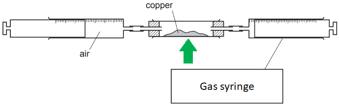
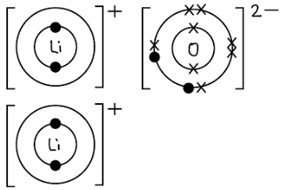

# Mark Schemes — Air Quality & Climate
**10. Chemistry of the Environment** · Cambridge (CIE) IGCSE chemistry (0620 & 0971)

## Alternative To Practical Questions (1 questions)

### Q1
a) The completed diagram is:

i) The label should be:

- Gas syringe; **[1 mark]**

ii) The heat / arrow should be:

- Pointing upwards to / heating the copper; **[1 mark]**

**[Total: 2 marks]**

- *The copper is heated *
- *The air is blown from one gas syringe to another, passing over the hot copper*
- *The oxygen in the air oxidises the copper as it passes over*
- *This causes the volume of air in the syringes to decrease as the oxygen is used up*
b) The piece of equipment that should be used to transfer the copper from a bottle to the apparatus is a:

- Spatula; **[1 mark]**

**[Total: 1 mark]**

- *You need a piece of equipment that allows you to place the copper into the centre of the middle tube*
c) The copper changed colour from brown to:

- Black; **[1 mark]**

**[Total: 1 mark]**

- *During this reaction, the orangey copper reacts with colourless oxygen to form black copper oxide*
d) The apparatus was left to cool before measuring the final volume of gas so:

- The equipment can cool / return to room (or initial) temperature; **[1 mark]**
- The correct volume of gas is measured 
**OR **
To get the correct volume of gas; **[1 mark]**

**[Total: 2 marks]**

- *When the equipment is heated, the gas particles inside the equipment gain energy and spread out more*
- *This causes the equipment to expand slightly*
- *When the reaction is complete, you need to let the equipment cool so that you get the correct measurement for the volume of gas once it has contracted back to its correct volume at room temperature*

## Multiple Choice Questions (29 questions)

### Q1
**Final answer:** **The correct answer is C**

- In a car engine, incomplete combustion produces toxic **carbon monoxide**, and high temperatures cause nitrogen and oxygen to react, forming **oxides of nitrogen** (such as nitrogen monoxide)
- In the catalytic converter, these gases react to form less harmful **carbon dioxide** and **nitrogen** gas

  - The equation: 2CO + 2NO → 2CO2 + N2
- **Platinum** is a transition element, and transition elements are characteristically used as catalysts

**A** is incorrect because the gases entering the converter are carbon dioxide and nitrogen which are harmless products

**B** & **D** are incorrect because aluminium is a main-group metal (Group III) and is not typically used as a catalyst

### Q2
**Final answer:** **The correct answer is C**

The question asks you to identify the **incorrect** statement.

- **C is the incorrect statement (and therefore the right answer)**

  - The specific greenhouse gases that cause global warming by absorbing, reflecting, and emitting thermal energy are **carbon dioxide** and **methane**
  - Oxides of nitrogen are primarily responsible for acid rain, photochemical smog, and respiratory problems

**A** is incorrect** **as it is** **a **true statement.** Carbon dioxide is a greenhouse gas formed by complete (with enough oxygen) combustion, and higher levels lead to increased global warming and climate change

**B** is incorrect as it is** **a **true statement.** Carbon monoxide is explicitly classified as a toxic gas produced during the incomplete combustion of carbon-containing fuels (like gasoline)

**D **is incorrect as it is** **a** true statement. **Sulfur dioxide (formed from the combustion of fossil fuels containing sulfur) causes acid rain, which lowers the pH of lakes and rivers, damaging aquatic life

### Q3
**Final answer:** **The correct answer is A**

- Photosynthesis uses **carbon dioxide** and **water** as **reactants**
- It produces **glucose **and **oxygen** as **products**
- The process requires **light** and **chlorophyll**

  - Light is obtained from the sun and chlorophyll is found in the chloroplasts of the leaves
- Therefore, X is carbon dioxide, Y is oxygen, and Z is light

**B** is incorrect because heat is not the condition for photosynthesis, light is required. Heat is the most common distractor used by IGCSE examiners

**C **& **D **are incorrect because oxygen is not a reactant and carbon dioxide is not a product

### Q4
**Final answer:** **The correct answer is A**

- Clean, dry air is made up of about 78% nitrogen
- It contains about 21% oxygen
- The remaining ~1% is other gases such as argon, carbon dioxide, and noble gases
- Chart A matches these known approximate percentages

**B **is incorrect because it swaps nitrogen and oxygen. Oxygen is not the main component of air

**C **is incorrect because it shows carbon dioxide at 21%, but carbon dioxide is only about 0.04% of air

**D **is incorrect because it greatly overestimates other gases. They do not make up 10% of air

### Q5
**Final answer:** **The correct answer is**** C ****because:**

- Cattle farming contributes to rising methane levels in the atmosphere because methane is a waste gas produced from digestion in animals
- Sending rubbish to landfill also produces methane due to the decomposition of vegetation

**A**, **B **and **D **are incorrect as deforestation and burning fossil fuels contribute to rising carbon dioxide levels

### Q6
**Final answer:** **The correct answer is ****D ****because:**

- The word equation for photosynthesis is:

  - carbon dioxide + water → glucose + oxygen

**A** is incorrect as hydrogen is not produced in photosynthesis

**B** is incorrect as the reactant and product are the wrong way round

**C** is incorrect as neither hydrogen or carbon monoxide are a reactant or product in photosynthesis

### Q7
**Final answer:** **The correct answer is ****C ****because:**

- Oxides of nitrogen cause photochemical smog and acid rain
- Sulfur dioxide causes acid rain
- Carbon dioxide causes global warming
- Option **C** is the only option where the pollutant corresponds with these effects

**A**, **B **and** D** are incorrect as the effects do not correspond with the effects of each pollutant

### Q8
**The correct answer is**** B**** because **clean unpolluted air is about 21% oxygen, 78% nitrogen with the remaining 1% being composed of a mixture of carbon dioxide and noble gases.

**A**, **C **and **D** are incorrect as these options do not correctly describe the composition of clean air.

### Q9
**Final answer:** **The correct answer is ****D**** because:**

- NO2 is formed by the **heat** and **pressure **in car engines which causes nitrogen and oxygen in the air to react together.
- SO2 is formed by the combustion of impure fossil fuels in** power stations** which contain sulfur impurities.
- CO is a product of incomplete combustion of fuels which occurs in the confined spaces of **car engines** where oxygen supply can be limited.

**A**, **B** and **C **are incorrect as these options incorrectly state the sources of each pollutant. Respiration produces carbon dioxide and water.

### Q10
**Final answer:** **The correct answer is ****D**** because:**

- 1 is incorrect as sulfur will form an acidic oxide because sulfur is a non-metal
- 2 is correct as sulfur dioxide will dissolve in rain to form acid rain
- 3 is correct as calcium oxide is a basic oxide so will react with acids to form a salt and water
- 4 is correct as when fuels containing sulfur burn, they produce sulfur dioxide

  - The less sulfur the fuel contains, the less sulfur dioxide they emit when burned

### Q11
**Final answer:** **The correct answer is ****A ****because:**

- The number of moles of carbon dioxide gas = volume (cm3) ÷ 24000 = 40 ÷ 24000 = 1.67 x 10-3 moles
- You need to use the balanced symbol equation to work out how many moles of glucose this will produce - this is an equation that you are expected to know:

  - 6CO2 + 6H2O → C6H12O6 + 6O2
- For every 1 mole of carbon dioxide, there will be 6 times less glucose:

  - Number of moles of glucose = 1.67 x 10-3 ÷ 6 = 2.78 x 10-4 mol
- Mass of glucose = moles x *M*r
- To calculate *M*r of glucose: (6 x 12) + (12 x 1) + (6 x 16) = 180
- Therefore, mass = 2.78 x 10-4 x 180 = 0.05 g

**B** is incorrect as the moles of carbon dioxide has not been divided by 6

**C** is incorrect as the volume of gas was divided by 24

**D** is incorrect as the volume of gas was divided by 24 and the moles of CO2 hasn't been divided by 6

### Q12
**Final answer:** **The correct answer is ****B ****because:**

- A catalytic converter oxidises carbon monoxide and reduces oxides of nitrogen to carbon dioxide and nitrogen
- Option** B **shows the reverse of this equation
- The overall equation inside a catalytic converter is:

  - 2NO + 2CO → N2 + 2CO2

**A** is incorrect as nitrogen monoxide is reduced to nitrogen and oxygen in a catalytic converter

**C** is incorrect as nitrogen dioxide is reduced to nitrogen and oxygen in a catalytic converter

**D** is incorrect as carbon monoxide is oxidised to carbon dioxide in a catalytic converter

### Q13
**Final answer:** **The correct answer is ****B ****because:**

- Car exhausts release oxides of nitrogen (NO and NO2) and carbon monoxide, CO
- Power stations release carbon dioxide, CO2, sulfur dioxide, SO2, and carbon monoxide, CO
- Therefore all of these XO could be nitrogen oxide or carbon monoxide
- YO2 could be carbon dioxide, nitrogen dioxide, or sulfur dioxide

### Q14
**Final answer:** **The correct answer is ****D**** because:**

- Oxides of nitrogen, NOx are **reduced** to N2 by catalytic converters.
- **Reduction** occurs as the molecules** lose oxygen.**
- Catalytic converters work by providing a large honeycombed surface area with metal catalysts.
- The oxygen from NOx forms CO2 from CO, removing harmful CO from the gases.

**A **and **B** are incorrect as oxides of nitrogen are formed by the reaction of oxygen and nitrogen from the air in the hot and cramped conditions in engines.

**C** is incorrect as **reduction** occurs in the catalytic converters.

### Q15
**Final answer:** **The correct answer is**** A**** because**

- Reactions 1, 2 and 3 all produce **carbon dioxide** which is a Greenhouse Gas and contributes to global warming:

  - Reaction 1: MgCO3 + 2HCl → MgCl2 + H2O + **CO****2**
  - Reaction 2: C3H8 +5O2 → **3CO****2** + 4H2O
  - Reaction 3: CaCO3 → CaO + **CO****2**

**B, C and D are incorrect as reacting sodium hydroxide and magnesium carbonate would not produce CO****2**** as carbonates are alkaline substances, so will not react with other alkalis.**

### Q16
**Final answer:** **The correct answer is**** C**** because:**

- Carbon monoxide is a product of the **incomplete combustion** of a hydrocarbon.
- Incomplete combustion occurs when there is a lack of oxygen, which can occur in the confined spaces of a car engine.
- An example of incomplete combustion is methane:

  - 2 CH4(g) + 3 O2(g) → 2 CO(g) + 4 H2O(g)

**A **is incorrect as nitrogen and oxygen from the air react in the hot and cramped conditions in engines.

**B** and** D** are incorrect as these statements accurately describe the processes that occur inside a catalytic converter.

### Q17
**Final answer:** **The correct answer is ****C**** because:**

- Climate change is driven by increasing levels of greenhouse gases, in particular, carbon dioxide and methane
- Effective methods to reduce climate change will reduce carbon dioxide and methane levels in the atmosphere
- Catalytic convertors remove oxides of nitrogen which are responsible for acid rain
- They do not remove any greenhouse gases

**A** is incorrect as reducing the amount of livestock farming decreases methane emissions produced from the digestion in animals

**B** is incorrect as trees remove carbon dioxide from the atmosphere through photosynthesis

**D** is incorrect as using renewable energy resources would mean less fossil fuels are burnt which release carbon dioxide

### Q18
**Final answer:** **The correct answer is ****C**** because:**

- The percentage of each gas on Earth is:

  - Nitrogen - 78%
  - Oxygen - 21%
  - Carbon dioxide - 0.04%
- The only one at a lower percentage is nitrogen

### Q19
**Final answer:** **The correct answer is ****C ****because:**

- When fuels containing sulfur are burnt, they emit sulfur dioxide

  - Acid rain is caused by sulfur dioxide
  - Reducing the emissions of sulfur dioxide will reduce the amount of acid rain formed
- Oxides of nitrogen are formed in a car engine

  - Catalytic convertors remove the oxides of nitrogen which causes acid rain
  - Reducing the emissions of the oxides of nitrogen will reduce the amount of acid rain formed

**A**, **B** and **D** are incorrect as planting more trees removes carbon dioxide from the atmosphere. Reducing the amount of livestock farming decreases methane emissions. Carbon dioxide and methane are both greenhouse gases that cause climate change

## Theory Questions (20 questions)

### Q1
i) The chemical which diffuses more slowly is:

- Chloromethane; **[1 mark]**
- (Because) It has the biggest molecular mass/ It is the heaviest molecule/ Has the highest density; **[1 mark]** *Accept atomic mass if correct numerical value given* *Ignore it is the heaviest *

ii) The compounds in the environment from which seaweed might have obtained the following elements:

- Carbon dioxide; **[1 mark]**
- Water; **[1 mark]**
- Sodium chloride / brine / sea water; **[1 mark]**

iii) Chloromethane is made from methane by:

- (Reagent) chlorine; **[1 mark] ***Not chlorine water *
- (Condition) Light/ UV / sunlight / high temperature (if value given above 200 oC); **[1 mark]**

iv) Oxides of nitrogen are formed by:

- Oxygen and nitrogen (in the air); **[1 mark]** *Not from fuel, negates mark 1 *
- React at high temperatures; **[1 mark]** *Not combustion, negates mark 2*

**[Total: 9 marks]**

- *This question requires a bit of application*
- *You might not have specifically studied the rate of diffusion of different gases but should be able to deduce that those with the largest molecular mass will travel the slowest*
- *To determine where seaweed might have got the elements from think about its environment*

  - *Hydrogen will come from water, H**2**O*
  - *Carbon will come from CO**2*
  - *Chlorine will come from salty sea water, NaCl*
- *Chlorine reacts with methane via a substitution reaction, where a hydrogen atom on the methane is swapped for a chlorine atom*
- *The UV light provides the energy for this reaction *
- *You will see the question about forming oxides of nitrogen come up frequently so make sure you learn it*

  - *This happens in car engines, when oxygen and nitrogen **in the air** react at high temperatures*
  - *The oxides of nitrogen release can cause acid rain and respiratory problems*

### Q2
a)

i) A different fossil fuel is:

Any **one** fossil fuel from

- Crude oil; **[1 mark] **
- Petroleum; **[1 mark] **
- Natural gas; **[1 mark] **
- Methane; **[1 mark] **
- Petrol; **[1 mark] **
- Gasoline; **[1 mark] **
- Kerosene; **[1 mark] **
- Paraffin; **[1 mark] **
- Diesel (oil); **[1 mark] **
- Gas oil; **[1 mark] **
- Fuel oil; **[1 mark] **
- Refinery gas; **[1 mark] **
- LPG; **[1 mark] **
- Propane; **[1 mark] **
- Butane; **[1 mark] **

ii) A fossil fuel is:

- (Burn to) release energy; **[1 mark] **
- Take a long time to form (from organic material);** [1 mark] **

**[Total: 3 marks] **

- *A fuel is a substance which when burned, releases heat energy*
- *Fossil fuels are formed over millions of years - dead plants and animals decompose to form them*
b)

i) The combustion of coal can form sulfuric acid by:

- Oxygen / air and sulfur (from fuel) react; **[1 mark] **
- (Forms) sulfur (di)oxide;** [1 mark] **
- (Sulfur dioxide) reacts with oxygen / air and water (to form sulfuric acid) 
**OR **
Sulfur trioxide reacts with water (to form sulfuric acid) 
**OR** 
Sulfurous acid reacts with oxygen (to form sulfuric acid); **[1 mark] **

ii) High temperatures generated by the combustion of fossil fuels can lead to the formation of nitric acid by:

- Oxygen and nitrogen react; **[1 mark] **
- Making oxides of nitrogen; **[1 mark] **
- (Oxides of nitrogen) react with water (making nitric acid); **[1 mark] **

iii) A test for nitrate ions is:

- Add sodium hydroxide (solution) and aluminium; [**1 mark] **
- (Warm) and ammonia made; **[1 mark] **

iv) You could determine which one of two samples of acid rain had the higher concentration of hydrogen ions by:

Alternative 1

- Measure pH/ describe how to measure pH (such as using universal indicator); **[1 mark] **
- Lower pH greater concentration of H+; **[1 mark] **

Alternative 2

- Add Ca, Mg, Zn, Fe; **[1 mark] **
- Faster reaction / more bubbles (during the same time) / more hydrogen (during the same time) = greater concentration of H+; **[1 mark] **

Alternative 3

- Rate of reaction with (metal) carbonate; **[1 mark] **
- Faster reaction / more bubbles (during the same time) / more carbon dioxide (during the same time) = greater concentration of H+; **[1 mark] **

Alternative 4

- Electrical conductivity; **[1 mark] **
- Greater conductivity greater concentration of H+; **[1 mark] **

Alternative 5

- Titrate with (named) alkali; **[1 mark]**
- Correct result; **[1 mark] **

**[Total: 10 marks] **

- *All of the above questions in part b) are very common and also give an insight of how different topics can cover one question*
- *The testing for the higher concentration of hydrogen ions is a very common question and you only need to be able to state one method*
- *Make sure you learn at least two, in case one is given in the question and you are asked to provide an alternative method *

### Q3
a)

i) Carbon dioxide and carbon monoxide are formed in motor vehicle engines because:

- Combustion / burning of a fuel;** [1 mark]**
- Complete combustion forms carbon dioxide; ** [1 mark]**
- Incomplete combustion forms carbon monoxide; ** [1 mark]**

ii) One adverse effect of each of these gases is:

- Carbon dioxide causes global warming / the greenhouse effect / climate change; ** [1 mark]**
- Carbon monoxide is toxic / poisonous; ** [1 mark]**

iii) Nitrogen monoxide is formed in motor vehicle engines because:

- Nitrogen and oxygen react or combine; **[1 mark]**
- At high temperatures / in presence of a spark; **[1 mark]**

iv) When nitrogen monoxide is released into the atmosphere, nitrogen dioxide / NO2 is formed because:

- It reacts with oxygen 
**OR** 
NO + 1⁄2O2 → NO2 / 2NO + O2 → 2NO2; **[1 mark]**

**[Total: 8 marks]**

- *The question for part i) being 3 marks indicates that you need to indicate the specific type of combustion that will form each compound*
- *Do not be thrown by part iii) asking you how nitrogen monoxide is formed, this is an oxide of nitrogen that is formed by the high temperatures in a car engine allowing nitrogen and oxygen from the air to react*
- *You can tell from the formula of nitrogen dioxide, NO**2,** compared to nitrogen monoxide, NO, that additional oxygen has been added which helps answer part iv)*
b) The possible adverse effect on the environment when this non-metal oxide, NO2, reacts with water and oxygen are:

Any **two** from:

- Acid rain is formed;** [1 mark]**
- Lowers pH or acidifies lakes / rivers or kills fish / aquatic animals; ** [1 mark]**
- Changes composition of soils or reduces the fertility of soil; ** [1 mark]**
- Reduces crop yields / deforestation; ** [1 mark]**
- Kills / damages crops / trees / plants / leaves; ** [1 mark]**
- Lowers pH of soil / increases acidity of soil; ** [1 mark]**
- Attacks (limestone) buildings or statues; ** [1 mark]**
- Attacks metal (structures)/ bridges; ** [1 mark]**

**[Total: 2 marks]**

- *The question does not tell you to give two adverse effects but the question is worth 2 marks which should indicate this to you *
- *Any effect of acid rain is accepted as well as stating that acid rain is formed*
c) The amounts of carbon monoxide and nitrogen monoxide emitted by modern motor vehicles are reduced by:

- The use of a catalytic converter; **[1 mark]**

2NO + 2CO → 2CO2 + N2

- Correct species; **[1 mark]**
- Correct balancing; **[1 mark]**

**[Total: 3 marks]**

- *In a catalytic converter *

  - *Carbon monoxide is oxidised to carbon dioxide: 2CO + O**2** → 2CO**2*
  - *Oxides of nitrogen are reduced to N**2** gas: 2NO → N**2** + O**2*
  - *This gives the overall equation: 2NO + 2CO → 2CO**2** + N**2*
  - *Oxygen does not need to be included *

### Q4
a)

i) Another gaseous element in unpolluted air is:

- Argon 
**OR** 
Krypton 
**OR** 
Helium; **[1 mark]** 
*Accept xenon and radon even though percentages are very small* *Do not accept hydrogen *

ii) Two compounds in unpolluted air are:

- Water; **[1 mark]**
- Carbon dioxide; **[1 mark]**

**[Total: 3 marks]**

- *The key here is making sure you don't answer with the name of a pollutant such as sulfur dioxide *
- *You should know the composition of unpolluted air, air is approximately 78% nitrogen, 21% oxygen, 0.9% argon, and 0.04% carbon dioxide with small amounts of water vapour*
b)

i) Another pollutant in air is:

- Sulfur dioxide  
**OR** 
Lead compounds 
**OR** 
CFCs 
**OR** 
Methane 
**OR** 
Particulates 
**OR ** 
Unburnt hydrocarbons; **[1 mark]**

ii) Carbon monoxide is formed by:

- Incomplete combustion; **[1 mark]**
- Of a fossil fuel / fuel that contains carbon; **[1 mark]** *Accept named fossil fuel *

iii) Oxides of nitrogen are formed by:

- Nitrogen and oxygen reacting; **[1 mark]**
- At high temperatures 
**OR** 
Inside an engine; **[1 mark]**

iv) A catalytic converter reduces the emission of these two gases by:

- Changing the carbon monoxide to carbon dioxide; **[1 mark]**
- Changing oxides of nitrogen to nitrogen; **[1 mark]** 
*Accept symbol or word equation including  2NO + 2CO → CO**2** + N**2* 
*Accept explanation in terms of redox - the oxides of nitrogen oxidise carbon monoxide to carbon dioxide, and they are reduced to nitrogen *

**[Total: 7 marks]**

- *These are all very common exam questions to be asked*
- *You should know the effect of each pollutant and how it is formed *
- *Carbon monoxide is formed due to insufficient oxygen levels in incomplete combustion and is poisonous*
- *Oxides of nitrogen are formed from oxygen and nitrogen reacting at high temperatures and cause acid rain *
- *Catalytic converters reduce the effects of these pollutants by converting them into less harmful gases *

### Q5
a)

i) The equation for complete combustion of methane is:

CH4  +    2O2   →   CO2 +  2H2O

- Correct species; **[1 mark]**
- Correctly balanced; **[1 mark]**

ii) It is dangerous to use a gas fire in a poorly ventilated room because:

- Carbon monoxide is formed; **[1 mark]**
- Which is poisonous / toxic; **[1 mark]**

**[Total: 4 marks]**

- *Complete combustion occurs when there is a plentiful supply of oxygen with carbon dioxide and water being produced*
- *When completing combustion equations, balance the carbon atoms first, then the hydrogen atoms and finally the oxygen atoms*
- *Incomplete combustion will occur if there is insufficient amounts of oxygen *
- *Carbon monoxide instead of carbon dioxide is made*

  - *Carbon monoxide is toxic as it irreversibly binds to the haemoglobin in the blood*
b) This is an advantage to the environment because:

- (When sulfur burns) it forms sulfur dioxide; **[1 mark]**
- Which causes acid rain; **[1 mark]** *Allow respiratory diseases*

**[Total: 2 marks]**

- *When the fuel burns, the sulfur in the fuel reacts with oxygen to form sulfur dioxide*
- *This is released and reacts with rainwater to form sulfuric acid*
- *Acid rain has lots of adverse affects such as killing aquatic life and damaging limestone*
c)

i) Rhodium, platinum and palladium are:

- <u>Transition</u> metals; **[1 mark]**

ii) Carbon monoxide and unburnt hydrocarbons are made into less harmful substances by:

- Carbon monoxide is oxidised to carbon dioxide; **[1 mark]**
- Hydrocarbons are oxidised to carbon dioxide and water; **[1 mark]**

**[Total:  3 marks]**

- *The carbon monoxide is reacted with oxygen to form carbon dioxide*

  - *2CO + O**2** → 2CO**2*
- *The hydrocarbons are oxidised to form carbon dioxide and water, e.g. *

  - *C**8**H**18** + 12½O**2** → 8CO**2** + 9H**2**O*
- *If oxides of nitrogen are present, they will be converted to nitrogen and oxygen*

  - *2NO → N**2** + O**2*
  - *2NO → N**2** + O**2*

### Q6
a) Oxides of nitrogen are formed when:

- Nitrogen and oxygen react; **[1 mark]**
- At high temperatures (in engine); **[1 mark]**

**[Total: 2 marks]**

- *Some students incorrectly state that the nitrogen is an impurity in the fuel but it is from the air *
- *This question is always 2 marks and the answer always identical so make sure you learn it*
b) A catalytic converter reduces these emissions because:

- Carbon monoxide is converted / oxidised to carbon dioxide
**OR** 
2CO + O2 → 2CO2; **[1 mark]**
- Oxides of nitrogen are converted / reduced to nitrogen  
**OR** 
2NO → N2 + O2 
**OR** 
2NO2 → N2 + 2O2 ; **[1 mark]**
- Hydrocarbons burn producing water; **[1 mark]**
- Any two correct products named (carbon dioxide, water, nitrogen); **[1 mark]**

**[Total: 4 marks]**

- *The question about which pollutants the catalytic converter reduces is at the beginning of the question *
- *Other questions will ask you about the equations directly*

  - *So as well as being able to explain that carbon monoxide is converted to carbon dioxide etc. make sure you know the equations *
- *The last mark is a summary mark, and awarded if you have stated at least two correct products made in a catalytic converter *

  - *You do not need to have added these as a separate point, they should just appear in your answer somewhere*

### Q7
a) The toxic gas formed from incomplete combustion of methane is:

- Carbon monoxide; **[1 mark]**

**[Total: 1 mark]**

- *Incomplete combustion occurs when there is insufficient amounts of oxygen for the fuel to burn in*
- *Both carbon monoxide and particulates can be produced but carbon monoxide is a toxic gas *
b) The gas formed in cars and removed using catalytic converters is:

- Oxides of nitrogen 
**OR** 
Carbon monoxide; **[1 mark]**

**[Total: 1 mark]**

- *In a car engine, the nitrogen and oxygen react at high temperatures to form oxides of nitrogen *
- *A catalytic converter will remove the oxides of nitrogen by reducing it to nitrogen gas and oxygen:*

  - *E.g. 2NO → N**2** + O**2*
- *Carbon monoxide would also be accepted as it can also be formed in cars by the incomplete combustion of fuel and it can be removed from the atmosphere by a catalytic converter by converting it to carbon dioxide:*

  - *E.g. 2CO + O**2** → 2CO**2*
c) The substance which increases the risk of cancer is:

- Particulates; **[1 mark]**

**[Total: 1 mark]**

- *Particulates are solid carbon particles (C) or soot, which are formed from incomplete combustion of a fuel *
- *They can increase the risk of cancer and cause respiratory problems *
d) The gas which causes acid rain is:

- Sulfur dioxide **AND** Oxides of nitrogen; **[1 mark]**

**[Total: 1 mark]**

- *You must state both to achieve the mark *
- *Both gases dissolve in rain water to form acid rain which can destroy buildings and damage aquatic life *
- *They can also both cause respiratory problems *

### Q8
a) The gas that when burned in oxygen, the only product is water is:

- Hydrogen / H2; **[1 mark]**

**[Total: 1 mark]**

- *The word equation for the reaction is:*

  - *hydrogen + oxygen → water*
- *The balanced symbol equation is:*

  - *2H**2** + O**2** → 2H**2**O*
b) The gas that can polymerise is:

- Ethene / C2H4; **[1 mark]**

**[Total: 1 mark]**

- *Ethene is the monomer that undergoes addition polymerisation to form poly(ethene)*
- *One of the bonds in each C=C bond breaks and forms a bond with the adjacent monomer with the polymer being formed containing single bonds only*
c) The gas that, when reacted with oxygen, the only product is carbon dioxide is:

- Carbon monoxide / CO; **[1 mark]**

**[Total: 1 mark]**

- *The word equation for the reaction is: *

  - *carbon monoxide + oxygen → carbon dioxide*
- *The balanced symbol equation is:*

  - *2CO + O**2** → 2CO**2*
d) The gas that is produced by the decay of vegetation in the absence of oxygen is:

- Methane / CH4; **[1 mark]**

**[Total: 1 mark]**

- *Decomposition of vegetation is a major source of methane gas*
- *Methane is a greenhouse gas*
- *Increasing levels of methane and other greenhouse gases increase global warming which causes climate change*

### Q9
a)

i) The Haber Process:

- Pressure 150 – 300 atmospheres / atm; **[1 mark]**
- Temperature accept in range 370 to 470 °C; **[1 mark]**
- Iron (catalyst); **[1 mark]**
- Balanced equation N2 + 3H2 $\rightleftharpoons$ 2NH3 ; **[1 mark]**
- Equilibrium / reversible; **[1 mark]**

ii) The other two elements essential for plant growth commonly found in fertilisers are:

- Potassium / K; **[1 mark]**
- Phosphorus / P; **[1 mark]**

**[Total: 7 marks]**

- *Ammonia is made from hydrogen (from natural gas) and nitrogen (from the air) *
- *The temperature and pressure are both compromise conditions, taking into account the yield of ammonia produced, the rate of reaction, and the cost / safety of the equipment *
- *The catalyst will speed up the rate of the reaction*
- *It is important you learn these conditions as they are frequently asked *
b)

i) Acid rain is formed by:

Method 1

- Burning fossil fuels;  
**OR** 
Burning fuels containing sulfur; **[1 mark]**
- To form sulfur dioxide;** [1 mark]**
- Which forms sulfuric acid (when sulfur dioxide reacts with water); **[1 mark]**

Method 2

- Nitrogen and oxygen react at high temperatures / in engines; **[1 mark]**
- To form oxides of nitrogen; **[1 mark]**
- Which form nitric acid (when oxides of nitrogen react with water); **[1 mark]**

ii)  Two bases which are used to increase the pH of acidic soils are:

- Calcium oxide / lime / quicklime / CaO; **[1 mark]**
- Calcium hydroxide/Ca(OH)2 / lime/ slaked lime/ limewater; **[1 mark]**
- Calcium carbonate / CaCO3 / limestone / chalk / marble; **[1 mark]**

**[Total: 5 marks]**

- *Both oxides of nitrogen and sulfur dioxide cause acid rain so your explanation can be for either pollutant*
- *Careful: **Oxides of nitrogen are not formed due to the combustion of a nitrogen impurity in a fuel*

  - *The nitrogen is from the air which reacts with oxygen from the air at high temperatures in a car engine*

### Q10
a) A photochemical reaction is a reaction that:

- Uses light / UV / sun / sunlight / solar energy; **[1 mark]**
- To speed up the reaction / initiate the reaction; **[1 mark]**

**[Total: 2 marks]**

- *Photo- comes from the Greek word meaning 'light' indicating light is required for the reaction to start*
b)

i) The approximate percentages are:

- Carbon dioxide= 0.03- 1%; **[1 mark]** *Accept less than 1%*
- Oxygen= 20-21% ; **[1 mark]**

ii) The green plant-like bacteria changed the composition of the atmosphere by:

- Removing carbon dioxide from the atmosphere; **[1 mark]**
- Producing oxygen; **[1 mark]**

Any** two **from:

- Photosynthesis; **[1 mark]**
- Chlorophyll / chloroplast; **[1 mark]**
- Light / sun / sunlight / UV / photochemical; **[1 mark]**
- Formed carbohydrates / glucose / sugar(s); **[1 mark]**

**[Total: 6 marks]**

- *Don't let the fact the question mentions bacteria throw you off with this question - you are told they are green and plant-like which indicates that your answer should respond in terms of photosynthesis*
- *The equation for photosynthesis is:*

> *carbon dioxide + water     →       Glucose + oxygen *

- *Light is absorbed and provides energy for the reaction so photosynthesis is a photochemical reaction *
- *Due to energy being taken in it is also an example of an endothermic reaction*

### Q11
a) Combustion alters the percentage of carbon dioxide in the atmosphere because:

- Complete combustion / combustion in excess oxygen;** [1 mark]**
- Of fuels containing carbon / fossil fuels / hydrocarbon (fuels); ** [1 mark]**
- Produce carbon dioxide / increase percentage of CO2 in atmosphere; ** [1 mark]**

**[Total: 3 marks]**

- *You can deduce this is complete combustion because carbon dioxoide, not carbon monoxide is produced *
- *There is therefore a plentiful supply of oxygen *
- *The carbon in the fuel is oxidised *
b)

i) The word equation for photosynthesis is:

- carbon dioxide + water → .glucose; **[1 mark] **+ oxygen. ; **[1 mark]**

ii) Two essential conditions for the above reaction to occur are:

- Light / sunlight / sun / UV; **[1 mark]**
- Chlorophyll accept: chloroplast; **[1 mark]**

**[Total: 4 marks]**

- *There is an overlap with the biology specification for this, so make sure you learn it!*
- *Photosynthesis is an example of an endothermic reaction because energy is taken in for the reaction*

### Q12
a)  Two other gases that are in clean dry air are:

- Carbon dioxide; **[1 mark]**
- Any named noble gas; **[1 mark]**

**[Total: 2 marks]**

- *You should know the composition of the current atmosphere, in terms of the names of the substances found and the approximate percentages of each one*
b) Common pollutants and how they are formed are:

Any **three **combinations from:

- Carbon monoxide; **[1 mark]**
- From incomplete combustion (of carbon-containing fuel); **[1 mark]**

- Sulfur dioxide; **[1 mark]**
- From burning fossil fuels / roasting ores which contain sulfur / volcanoes; **[1 mark]**

- Oxides of nitrogen; **[1 mark]**
- Nitrogen reacting with oxygen in car engines / lightning; **[1 mark]**

- Methane; **[1 mark]** From anaerobic decomposition / anaerobic decay; **[1 mark]**
- Particulates; **[1 mark]**
- From incomplete combustion of fuel;** [1 mark]**

**[Total: 6 marks]**

- *Incomplete combustion occurs when there is not enough oxygen for the fuel to burn in*
- *Carbon monoxide is a toxic gas, and particulates can cause respiratory issues and cancer *
- *Sometimes you are asked specifically about one pollutant so you need to be familiar with how each of the above are formed, as well as their effects *

### Q13
a)

i) Another element in air is:

- Any named noble gas; **[1 mark]**

ii) The formula of a compound in unpolluted air is:

- H2O; 
**OR** 
CO2; **[1 mark]** *Do not accept names *

**[Total: 2 marks]**

- *Make sure you read the question, you must specify the formula for the compound, and cannot name it *
b)

i) Oxides of nitrogen are formed by:

- Oxygen and nitrogen (in air) (react); **[1 mark]**
- At high temperature; **[1 mark]**

ii) Sulfur dioxide is formed by:

- Fossil fuels which contain sulfur; **[1 mark]**
- Burn / combust; **[1 mark]**

iii) Two harmful effects of acid rain are:

Any **two** from:

- Damage buildings; **[1 mark]**
- Soil acidification; **[1 mark]**
- Leaching from soil; **[1 mark]**
- Soil nutrients become unavailable; **[1 mark]**
- Acidify lakes; **[1 mark]**
- Kill fish / aquatic animals; **[1 mark]**
- Damage trees; **[1 mark]**
- Reduction in plant growth / crop loss; **[1 mark]**

**[Total: 6 marks]**

- *Part i) and ii) are always two marks and appear frequently as exam questions*
- *Do not get them confused - oxides of nitrogen are formed in car engines (where temperatures are high) due to nitrogen and oxygen from the air reacting, whereas sulfur dioxide is formed due to the burning / combustion of a fuel which contains sulfur impurities *
c)

i) The copper in the large pile turns black because:

- <u>Oxygen</u> reacts with copper; ** [1 mark]**
- To form copper oxide (which is black); ** [1 mark]**

ii) The gas be allowed to cool before its volume is measured because:

- Measure volume at room temperature 
**OR** 
Gas has different volumes at different temperatures 
**OR** 
Volume of gas depends on temperature; ** [1 mark]**

iii) The copper in the small pile did not turn black because:

- No oxygen is left 
**OR** 
All the oxygen has reacted; ** [1 mark]**

iv) The approximate volume of the gas left in the apparatus is:

- 39 - 40 cm3 ;** [1 mark]**

**[Total: 5 marks]**

- *Heat causes the expansion of a gas*

  - *So, at higher temperatures, the gas would have a higher volume *
- *The volume of air reduces because the oxygen within the air has reacted with the copper to form copper oxide*

  - *Oxygen makes up approximately 20% of the air and 20% of 50 cm**3** is 10 cm**3*
  - *Therefore 10 cm**3** of the air will react with copper reducing the volume to 40 cm**3*

### Q14
a) Two other fossil fuels are:

Any **two **from:

- Crude oil / petroleum; **[1 mark]**
- Natural gas / methane; **[1 mark]**
- Petrol / gasoline; **[1 mark]**
- Kerosene / paraffin; **[1 mark]**
- Diesel (oil) / gas oil; **[1 mark]**
- Fuel oil; **[1 mark]**
- Refinery gas / LPG; **[1 mark]**
- Propane; **[1 mark]**
- Butane; **[1 mark]**
*Ignore ethane / oil / naphtha / coal / gas* *Do NOT allow coke / bitumen / lubricating oil / wood*

**[Total: 2 marks]**
b) **Three **other elements present in this sample of coal are:

Hydrogen, oxygen, nitrogen

- All three correct; **[2 marks]**
- Two correct; **[1 mark]**

**[Total: 2 marks]**

- *Think of the formulae of the products formed: H**2**O, NH**3** and hydrocarbons which contain hydrogen and carbon only*
- *As the coal was heated in the absence of oxygen, the oxygen present in water must have been present in the coal*
- *The other elements in these products are hydrogen, nitrogen and carbon*
- *You have already been told in the question that carbon is present in coal so the correct three are hydrogen, oxygen and nitrogen*
c)

i) High temperatures in vehicle engines are another cause of acid rain because:

- Oxygen and nitrogen (from air) react; **[1 mark]**
- Oxides of nitrogen / nitrogen oxide(s) are formed; **[1 mark]**
- Oxides of nitrogen / nitrogen oxide(s) react with water (to form acid); **[1 mark]**

ii) Two harmful effects of acid rain are:

Any **two **from:

- Lowers pH or acidifies lakes / rivers or kills fish; **[1 mark]**
- Changes composition of soils or reduces fertility of soil or reduces crop yields deforestation or kills crops / trees / plants / leaves; **[1 mark]**
- Attacks (limestone) buildings or statues; **[1 mark]**
- Attacks metal (structures)/ bridges; **[1 mark]** *Do NOT allow ‘global warming / greenhouse effect’ or ‘increases pH of lakes so kills fish’ * *Allow removes nutrients / leaches the soil* *Allow alternative words for ‘attacks’ e.g. damages / reacts with / corrode / erode * *Ignore rusting but allow ‘enhances rusting’ for last mark* *Ignore toxicity to humans*

**[Total: 5 marks]**

- *It is high temperatures that allow oxygen and nitrogen to react to form oxides of nitrogen*
- *This can happen where high temperatures are reached, e.g. when lightening strikes *
d) The combustion of wood rather than coal can reduce the effect of the emissions from this power station on the level of carbon dioxide in the atmosphere because:

Any **three **from:

- Wood burns to produce (less) carbon dioxide; **[1 mark]**
- Trees (wood) take in carbon dioxide; **[1 mark]**
- By photosynthesis; **[1 mark]**
- Wood is a carbon neutral fuel; **[1 mark]**

**[Total: 3 marks]**

- *The difference is the use of wood as a fuel (alongside coal)*
- *Therefore, the question is really asking about how the use of wood releases less carbon dioxide than the use of coal*

  - *Wood is renewable, therefore it is releasing the carbon dioxide that it absorbed whilst growing*
  - *Coal is non-renewable, therefore it is releasing carbon dioxide that was "locked up" millions of years ago*

### Q15
a)

i) The arrangement and movement of the molecules in the region A–B are:

- Close / tightly packed; **[1 mark]**
- Ordered / lattice; **[1 mark] **
- Vibrating; **[1 mark]**

ii) The change that occurs in the region B–C is:

- Melting / freezing / fusion / solidification; **[1 mark]**

**[Total: 4 marks]**

- *The region A-B is labelled as pale yellow crystals*

  - *This means that you are being asked to describe the arrangement of particles in a solid*
- *The region B-C is where it changes from pale yellow crystals (solid) to a yellow liquid*

  - *The most common correct answer to this question is melting*
b)

i) These oxides of nitrogen are formed by:

- Oxygen and nitrogen (in air);** [1 mark]**
- Reacting at high temperatures (and high pressure);** [1 mark]**
*If nitrogen in the fuel is mentioned then no marks can be awarded*

ii) They are removed from the exhaust gases by:

Any **two **of the following:

- Use of a catalytic converter; **[1 mark]**
- Reacting with carbon monoxide / hydrocarbons;** [1 mark]**
- Forming nitrogen; **[1 mark]**

**[Total: 4 marks]**

- *Oxides of nitrogen are common questions around combustion and the use of catalytic converters*
c) Lead(II) nitrate crystals could be prepared from dilute nitric acid and lead(II) oxide by:

- Adding excess lead oxide to nitric acid;** [1 mark]**
- Filtering / filtration; **[1 mark] ***Filtering is not accepted if the residue is identified as lead nitrate*
- Evaporating / heating the solution;** [1 mark]**

**[Total: 3 marks]**

- *As soon as you see the question asking how crystals can be prepared, you should automatically be thinking:*

  1. *Adding an excess of solid to an acid*
  2. *Filtering the resulting mixture*
  3. *Evaporating / heating the filtrate solution *

### Q16
a) The percentage of each gas in unpolluted air is:

| Gas | % in unpolluted air |
|---|---|
| nitrogen | 78; **[1 mark]** |
| oxygen | 21;** [1 mark]** |

**[Total: 2 marks]**

- *You will score the mark for giving answers between:*

  - *Nitrogen: 78-80%*
  - *Oxygen: 20-22% *
  - *The remainder of unpolluted air consists of argon, carbon dioxide and small amounts of water vapour and noble gases*
b) Two greenhouse gases are:

- Carbon dioxide;** [1 mark]**
- Methane;** [1 mark]**

**[Total: 2 marks]**

- *Although it is not on the specification, water vapour is an acceptable answer as it is also a greenhouse gas*
c) **Two **effects of global warming are:

Any **two** from:

- Climate change; **[1 mark]**
- Flooding; **[1 mark]**
- Rising sea levels;** [1 mark]**
- Melting ice caps; **[1 mark]**
- Habitat destruction / extinction;** [1 mark]**
- Coastal erosion in low lying areas;** ****[1 mark]**
- Migration of species; **[1 mark]**
- Spread of disease;** ****[1 mark]**

**[Total: 2 marks]**
d) The  strategies will reduce the effects of climate change are:

| Use of catalytic converters |   |
|---|---|
| Planting trees | **✓; ****[1 mark]** |
| Deforestation |   |
| Reduced livestock farming | **✓; ****[1 mark]** |
| Increased use of landfill |   |

**[Total: 2 marks]**

### Q17
a)

i) Another greenhouse gas is:

- Methane 
**OR **
Water vapour 
**OR **
Oxides of nitrogen; **[1 mark]**

ii) The combustion of waste crop material should not alter the percentage of carbon dioxide in the atmosphere because:

- The crop removed carbon dioxide by photosynthesis; **[1 mark]**
- Combustion returned the carbon dioxide; **[1 mark]**

iii) Carbon dioxide levels increased because:

- Increased combustion; **[1 mark]**
- Of fossil fuels; **[1 mark]**

**OR**

- Deforestation; **[1 mark]**
- (So) less photosynthesis; **[1 mark]**

**[Total: 5 marks]**

- *As part of this specification, you need to be able to name methane and carbon dioxide as greenhouse gases*
- *When there is no overall gain or loss of carbon dioxide in the atmosphere, we use the phrase carbon neutral *

  - *This is what happens when waste crop material is burned - there is no overall loss or gain of carbon dioxide in the atmosphere as the crops were taking in carbon dioxide prior to being burnt*

### Q18
a) Two oxides responsible for acid rain are:

- Sulfur dioxide; **[1 mark]**
- (Formed by) burning fossil fuels containing sulfur / volcanoes; **[1 mark]**
- Nitrogen dioxide; **[1 mark]**
- (Formed from) the reaction of oxygen and nitrogen; **[1 mark]**
- At high temperatures; **[1 mark]** 
*Not exhaust*

**[Total: 5 marks]**

- *When combustion of a fuel containing sulfur impurities occurs, sulfur dioxide is formed *
- *This reacts with water vapour to form sulfuric acid which causes acid rain *
- *Similarly, nitrogen dioxide will react with water as well to form nitric acid *
- *The explanations for the formation of these pollutants are always the same so make sure you learn them*

  - *The fact that nitrogen and oxygen react to form nitrogen dioxide seems very obvious but this is often the part missed out by students *
b)

i) Another ionic compound is:

- Strontium oxide; **[1 mark]** 
*Accept aluminium oxide*

ii) The correct diagram should be:

- Correct formula with charges on the ions; [**[1 mark]**
- 6 x and 2o around the oxygen; **[1 mark]** 
*gnore electrons around Li*

**[Total: 3 marks]**

- *Ionic compounds are formed from metals and non-metals, so use your periodic table to help you deduce which compound contains each of these*
- *You should be confident completing dot and cross diagrams for these compounds*
- *Be careful on this one, the question says to draw a diagram which shows the formula for lithium oxide*

  - *The formula of lithium oxide is Li**2**O so therefore two lithium ions must be shown, each with a positive charge *
  - *Remember: **Make sure the outer shell is full for each atom once the electrons have been transferred, each lithium should have two in the outer shell, and oxygen eight*
  - *The oxygen atom should have a 2- charge as it gained two negative electrons *
  - *The lithium ion should have a 1+ charge as it has one more positive proton than electron *

### Q19
a) The condition needed for incomplete combustion is:

- A limited supply of oxygen; **[1 mark]**

**[Total: 1 mark]**
b)  **One** adverse effect of carbon monoxide on health:

- Carbon monoxide is toxic or poisonous; **[1 mark]**

**[Total: 1 mark]**

- *Carbon monoxide is similar in size to an oxygen molecule and is able to bind to haemoglobin in place of oxygen*
- *Unlike oxygen, carbon monoxide binds irreversibly and quickly becomes life threatening*
