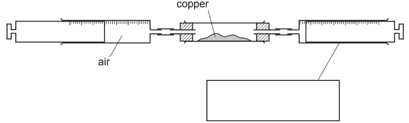
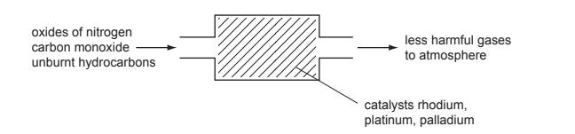
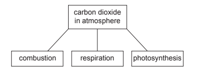
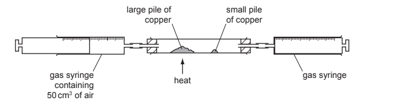
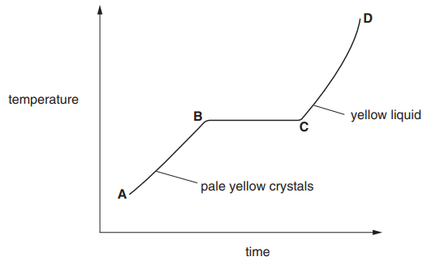
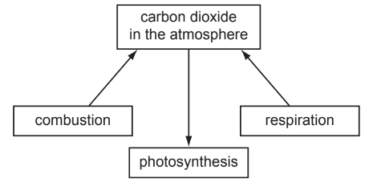

# Exam Questions — Air Quality & Climate
**10. Chemistry of the Environment** · Cambridge (CIE) IGCSE chemistry (0620 & 0971)
> Source: [https://www.savemyexams.com/igcse/chemistry/cie/23/topic-questions/](https://www.savemyexams.com/igcse/chemistry/cie/23/topic-questions/) · 39 questions across 3 sets

## Alternative To Practical Questions (1 questions)

### Q1 — medium — 6 marks

**Q1** [2 marks]

A student investigated the reaction of air with copper. 100cm3 of air was passed continuously over heated copper using the apparatus below. When the volume remained constant, the apparatus was left to cool and the volume of gas was measured.

a) i) Complete the box to show the apparatus labelled.

[1]

ii) Indicate on the diagram, with an arrow, where heat is applied.

[1]

*Source: 2011 61 Q1*

**Q1** [1 mark]

**Extract:**

A student investigated the reaction of air with copper. 100cm^3^ of air was passed continuously over heated copper using the apparatus below. When the volume remained constant, the apparatus was left to cool and the volume of gas was measured.

b) What should be used to transfer the copper from a bottle to the apparatus?

[1]

*Source: 2011 61 Q1*

**Q1** [1 mark]

**Extract:**

A student investigated the reaction of air with copper. 100cm^3 of air was passed continuously over heated copper using the apparatus below. When the volume remained constant, the apparatus was left to cool and the volume of gas was measured.

c) The copper changed colour from brown to ..............................

[1]

*Source: 2011 61 Q1*

**Q1** [2 marks]

**Extract:**

A student investigated the reaction of air with copper. 100cm^3^ of air was passed continuously over heated copper using the apparatus below. When the volume remained constant, the apparatus was left to cool and the volume of gas was measured.

d) Why was the apparatus left to cool before measuring the final volume of gas?

[2]

*Source: 2011 61 Q1*

## Multiple Choice Questions (29 questions)

### Q1 — medium — 1 marks

**Q1** [1 mark]

Many cars are fitted with catalytic converters to treat the exhaust gases produced by the engine.

Which row identifies the gases entering the converter, the gases leaving the converter, and a suitable metal used as the catalyst?

|   | gases entering the converter | gases leaving the converter | catalyst |
|---|---|---|---|
| **A** | carbon dioxide and nitrogen | carbon monoxide and nitrogen monoxide | platinum |
| **B** | carbon monoxide and nitrogen monoxide | carbon dioxide and nitrogen | aluminium |
| **C** | carbon monoxide and nitrogen monoxide | carbon dioxide and nitrogen | platinum |
| **D** | carbon dioxide and nitrogen dioxide | carbon monoxide and nitrogen | aluminium |

### Q2 — easy — 1 marks

**Q2** [1 mark]

Which statement about polluting gases is **not** correct?

### Q3 — easy — 1 marks

**Q3** [1 mark]

The word equation of photosynthesis is incomplete.

X + water `-> from chlorophyll to Z of` Y + glucose

Which row correctly identifies the substances X, Y and the condition Z?

|   | X | Y | Z |
|---|---|---|---|
| **A** | carbon dioxide | oxygen | light |
| **B** | carbon dioxide | oxygen | heat |
| **C** | oxygen | carbon dioxide | light |
| **D** | oxygen | carbon dioxide | heat |

### Q4 — easy — 1 marks

**Q4** [1 mark]

Which bar chart shows the approximate composition of clean, dry air?

### Q5 — easy — 1 marks

**Q5** [1 mark]

Human activities are contributing to the increase of greenhouse gases in the atmosphere.

Which **two** human activities contribute to the release of methane?

### Q6 — easy — 1 marks

**Q6** [1 mark]

#### Separate: Chemistry Only

Which words complete the gaps 1 & 2 in the word equation for photosynthesis?

carbon dioxide +  <u>               1               </u> →  <u>               2               </u> + oxygen

| ** ** | **1** | **2** |
|---|---|---|
| ** A** | water | hydrogen |
| ** B** | glucose | water |
| ** C** | hydrogen | carbon monoxide |
| ** D** | water | glucose |

### Q7 — easy — 1 marks

**Q7** [1 mark]

Human activities increase the level of nitrogen oxides, sulfur dioxide and carbon dioxide in our atmosphere.

Which row correctly shows the effect of each of these gases in our atmosphere?

|   | **Oxides of nitrogen** | **Sulfur dioxide** | **Carbon dioxide** |
|---|---|---|---|
| **A** | global warming | respiratory problems | photochemical smog |
| **B** | acid rain | photochemical smog | respiratory problems |
| **C** | photochemical smog | acid rain | global warming |
| **D** | respiratory problems | global warming | acid rain |

### Q8 — easy — 1 marks

**Q8** [1 mark]

Clean air contains oxygen, nitrogen, carbon dioxide and some noble gases. Which row correctly states the percentages of each gas present in clean, unpolluted air?

|   | **% O****2**** ** | **% N****2 ** | **% CO****2**** & noble gases ** |
|---|---|---|---|
| **A** | 20 | 78 | 2 |
| **B** | 21 | 78 | 1 |
| **C** | 19 | 79 | 2 |
| **D** | 20 | 79 | 1 |

### Q9 — easy — 1 marks

**Q9** [1 mark]

Nitrogen dioxide, sulfur dioxide and carbon monoxide are all air pollutants. Which row correctly describes the major source of each pollutant?

|   | **NO****2**** ** | **SO****2**** ** | **CO** |
|---|---|---|---|
| **A** | car engines | power stations | respiration |
| **B** | power stations | car engines | car engines |
| **C** | respiration | power stations | car engines |
| **D** | car engines | power stations | car engines |

### Q10 — hard — 1 marks

**Q10** [1 mark]

Flue gas desulfurisation uses calcium oxide to reduce the emissions of sulfur dioxide.

Which statements are correct?

| 1 | Sulfur dioxide is a basic oxide |
|---|---|
| 2 | Sulfur dioxide is responsible for the production of acid rain |
| 3 | Calcium oxide reacts with acids |
| 4 | Sulfur dioxide emissions can also be reduced by using low sulfur fuels |

### Q11 — hard — 1 marks

**Q11** [1 mark]

#### Separate: Chemistry and Extended Only

Photosynthesis is an endothermic reaction in which carbon dioxide and water react to form glucose and oxygen

What is the maximum mass of glucose that can be produced from 40 cm3 of carbon dioxide?

### Q12 — hard — 1 marks

**Q12** [1 mark]

#### Extended Only

Which of the following equations would **not **occur inside a catalytic converter?

### Q13 — hard — 1 marks

**Q13** [1 mark]

Oxides, XO and YO2 are released into the air from power stations and car exhausts.

What are X and Y?

|   | **X** | **Y** |
|---|---|---|
| **A** | carbon and nitrogen | carbon and nitrogen only |
| **B** | carbon and nitrogen | carbon, nitrogen, and sulfur |
| **C** | carbon only | sulfur only |
| **D** | carbon only | sulfur and nitrogen only |

### Q14 — hard — 1 marks

**Q14** [1 mark]

Internal combustion engines produce oxides of nitrogen which are pollutants. Which statement about oxides of nitrogen is correct?

### Q15 — medium — 1 marks

**Q15** [1 mark]

Four chemical processes are described below. Which reactions contribute to global warming?

| **1** | Reacting hydrochloric acid with magnesium carbonate. |
|---|---|
| **2** | The complete combustion of propane. |
| **3** | Heating calcium carbonate. |
| **4** | Reacting sodium hydroxide with magnesium carbonate. |

### Q16 — medium — 1 marks

**Q16** [1 mark]

Petrol engines produce pollutants as a by-product of internal combustion. Catalytic converters are fitted to cars to reduce the level of pollution they produce in their exhaust gases.

Which statement about this process is **not** correct?

### Q17 — medium — 1 marks

**Q17** [1 mark]

Which strategy for reducing the effect of environmental issues would **not **help reduce climate change?

### Q18 — medium — 1 marks

**Q18** [1 mark]

The table below shows the composition of the atmosphere found on a new planet.

| **gas** | **percentage by volume** |
|---|---|
| nitrogen | 74 |
| carbon dioxide | 4 |
| oxygen | 22 |

Which gases are present in the atmosphere of the planet in a lower percentage than they are in the Earth's atmosphere?

### Q19 — medium — 1 marks

**Q19** [1 mark]

Which row correctly shows two ways of reducing the formation of acid rain?

| **A** | Use a catalytic convertor | Reduce the amount of livestock farming |
|---|---|---|
| **B** | Plant more trees | Use fuels containing low levels of sulfur |
| **C** | Use fuels containing low levels of sulfur | Use a catalytic convertor |
| **D** | Reduce the amount of livestock farming | Plant more trees |

## Theory Questions (20 questions)

### Q1 — medium — 9 marks

**Q1** [9 marks]

#### Separate: Chemistry and Extended Only

Ozone is a form of oxygen. Ozone is present in the upper atmosphere and it prevents dangerous solar radiation from reaching the Earth’s surface. Some of the chemicals that diffuse into the upper atmosphere decompose ozone. Chemicals that have this effect are methane (CH4), chloromethane (CH3Cl) and an oxide of nitrogen (NO2).

i) Which of these three chemicals diffuses the most slowly? Give a reason for your choice.

[2]

ii) Chloromethane is formed when seaweed decomposes. Name the compounds in the environment from which seaweed might have obtained the following elements:

carbon; ..........................................................................................................hydrogen; ..........................................................................................................chlorine. ..........................................................................................................

[3]

iii) How can chloromethane be made from methane?

reagent ........................................................................................... condition ........................................................................................

[2]

iv) The oxides of nitrogen are atmospheric pollutants. Describe how they are formed.

[2]

*Source: 2010 Ju31 Q2*

### Q2 — hard — 13 marks

**Q2** [3 marks]

i) Coal is a solid fossil fuel. Name another fossil fuel.

[1]

ii) Explain what is meant by the term* fossil fuel.*

[2]

*Source: 2015 Ju33 Q4A*

**Q2** [10 marks]

The burning of fossil fuels is largely responsible for the formation of acid rain. Two of the acids in acid rain are sulfuric acid and nitric acid.

i) Explain how the combustion of coal can form sulfuric acid.

[3]

ii) High temperatures generated by the combustion of fossil fuels can lead to the formation of nitric acid. Explain.

[3]

iii) Nitric acid contains nitrate ions.

Describe a test for nitrate ions.

[2]

iv) Explain how you could determine which one of two samples of acid rain had the higher concentration of hydrogen ions.

[2]

*Source: 2015 Ju33 Q4B*

### Q3 — hard — 13 marks

**Q3** [8 marks]

Polluted air contains two oxides of carbon and two oxides of nitrogen. A major source of these pollutants is motor vehicles.

i) Describe how carbon dioxide and carbon monoxide are formed in motor vehicle engines.

[3]

ii) State one adverse effect of each of these gases.

[2]

iii) Nitrogen monoxide, NO, is released by motor vehicle exhausts. Explain how nitrogen monoxide is formed in motor vehicle engines.

[2]

iv) When nitrogen monoxide is released into the atmosphere, nitrogen dioxide, NO2, is formed. Suggest an explanation why this happens.

[1]

*Source: 2015 O32 Q2*

**Q3** [2 marks]

**Extract:**

Polluted air contains two oxides of carbon and two oxides of nitrogen. A major source of these pollutants is motor vehicles.
iii) Nitrogen monoxide, NO, is released by motor vehicle exhausts.
iv) When nitrogen monoxide is released into the atmosphere, nitrogen dioxide, NO~2~, is formed.

Predict the possible adverse effect on the environment when this non-metal oxide, NO2, reacts with water and oxygen.

*Source: 2015 O32 Q2*

**Q3** [3 marks]

**Extract:**

Polluted air contains two oxides of carbon and two oxides of nitrogen. A major source of these pollutants is motor vehicles.

How are the amounts of carbon monoxide and nitrogen monoxide emitted by modern motor vehicles reduced?

Include an equation in your answer.

*Source: 2015 O32 Q2*

### Q4 — medium — 10 marks

**Q4** [3 marks]

The major gases in unpolluted air are 79% nitrogen and 20% oxygen.

i) Name another gaseous element in unpolluted air.

[1]

ii) Name two compounds in unpolluted air.

[2]

*Source: 2009 O31 Q1*

**Q4** [7 marks]

#### Extended Only

Two common pollutants in air are carbon monoxide and the oxides of nitrogen.

i) Name another pollutant in air.

[1]

ii) Describe how carbon monoxide is formed.

[2]

iii) How are the oxides of nitrogen formed?

[2]

iv) Explain how a catalytic converter reduces the emission of these two gases.

[2]

*Source: 2009 O31 Q1*

### Q5 — medium — 9 marks

**Q5** [4 marks]

Minimising air pollution is essential for health and for the environment.

Natural gas is methane.

i) Write the equation for complete combustion of methane.

[2]

ii) Explain why it is dangerous to use a gas fire in a poorly ventilated room.

[2]

*Source: 2006 O31 Q4*

**Q5** [2 marks]

Low sulfur fuels are being introduced. Ordinary diesel contains 500 ppm of sulfur but low sulfur diesel contains less than 50 ppm. Why is this an advantage to the environment?

*Source: 2006 O31 Q4*

**Q5** [3 marks]

#### Extended Only

Catalytic converters reduce pollution from motor vehicles, as shown in the following diagram.

i) What type of elements are the metals rhodium, platinum and palladium?

[1]

ii) Rhodium catalyses the decomposition of the oxides of nitrogen.

2NO → N2 + O2

Two other pollutants are carbon monoxide and unburnt hydrocarbons. Describe how carbon monoxide and unburnt hydrocarbons are converted into less harmful products in a catalytic converter.

[2]

*Source: 2006 O31 Q4*

### Q6 — hard — 6 marks

**Q6** [2 marks]

Three common pollutants in the air are carbon monoxide, the oxides of nitrogen, NO and NO2 and unburnt hydrocarbons. They are all emitted by motor vehicles.

Describe how the oxides of nitrogen are formed.

*Source: 2014 O31 Q5*

**Q6** [4 marks]

**Extract:**

Three common pollutants in the air are carbon monoxide, the oxides of nitrogen, NO and NO~2~ and unburnt hydrocarbons. They are all emitted by motor vehicles.

Describe how a catalytic converter reduces the emission of these three pollutants.

*Source: 2014 o31 Q5*

### Q7 — easy — 4 marks

**Q7** [1 mark]

The following can all be found in air.

For each question choose a gas. A gas may be chosen once, more than once or not at all.

| **carbon monoxide** | **sulfur dioxide** | **carbon dioxide** | **nitrogen** |
|---|---|---|---|

| **oxides of nitrogen** | **particulates** | **argon** |
|---|---|---|

Which gas is toxic and formed from incomplete combustion of methane?

**Q7** [1 mark]

**Extract:**

The following can all be found in air. For each question choose a gas. A gas may be chosen once, more than once or not at all. | carbon monoxide | sulfur dioxide | carbon dioxide | nitrogen | | oxides of nitrogen | particulates | argon |

#### Extended Only

Which gas is formed in cars and removed using catalytic converters?

**Q7** [1 mark]

**Extract:**

The following can all be found in air. For each question choose a gas. A gas may be chosen once, more than once or not at all. | carbon monoxide | sulfur dioxide | carbon dioxide | nitrogen | | oxides of nitrogen | particulates | argon |

Which substance increases the risk of cancer?

**Q7** [1 mark]

**Extract:**

The following can all be found in air. For each question choose a gas. A gas may be chosen once, more than once or not at all. Gases: carbon monoxide, sulfur dioxide, carbon dioxide, nitrogen, oxides of nitrogen, particulates, argon.

Which **two **gases cause acid rain?

### Q8 — easy — 4 marks

**Q8** [1 mark]

Choose from the following list of gases. A gas may be chosen once, more than once or not at all.

| **sulfur dioxide** | **hydrogen** | **methane** | **argon** |
|---|---|---|---|
| **ethene** | **butane** | **carbon monoxide** |   |

When burned in oxygen, the only product is water.

*Source: 2015 O33 Q2*

**Q8** [1 mark]

**Extract:**

Choose from the following list of gases. A gas may be chosen once, more than once or not at all.

| sulfur dioxide | hydrogen | methane | argon |
| ethene | butane | carbon monoxide |

#### Extended Only

It can polymerise.

*Source: 2015 O33 Q2*

**Q8** [1 mark]

**Extract:**

Choose from the following list of gases. A gas may be chosen once, more than once or not at all.

| sulfur dioxide | hydrogen | methane | argon |
| ethene | butane | carbon monoxide |

When reacted with oxygen, the only product is carbon dioxide.

*Source: 2015 O33 Q2*

**Q8** [1 mark]

**Extract:**

Choose from the following list of gases. A gas may be chosen once, more than once or not at all.

| sulfur dioxide | hydrogen | methane | argon |
| ethene | butane | carbon monoxide |

It is produced by the decay of vegetation in the absence of oxygen.

*Source: 2015 O33 Q2*

### Q9 — hard — 12 marks

**Q9** [7 marks]

Plant growth is improved by the availability of essential elements, such as nitrogen, and by the soil having a suitable pH.

Nitrogen-based fertilisers are made from ammonia. Ammonia is manufactured by the Haber process.

i) Describe the Haber process giving reaction conditions and a balanced equation. (Do not discuss reaction rate and yield.)

[5]

ii) Fertilisers contain nitrogen. Name the other two elements essential for plant growth commonly found in fertilisers.

[2]

*Source: 2014 Ju32 Q3*

**Q9** [5 marks]

Crops do not grow well if the soil is too acidic.

i) One cause of acidity in soil is acid rain. Explain how acid rain is formed.

[3]

ii) Name two bases which are used to increase the pH of acidic soils.

[2]

*Source: 2014 Ju32 Q3*

### Q10 — medium — 8 marks

**Q10** [2 marks]

#### Separate: Chemistry and Extended Only

The reactions in this question are all examples of photochemical reactions.

Explain the phrase *photochemical reaction*.

*Source: 2011 O33 Q5*

**Q10** [6 marks]

#### Separate: Chemistry Only

Many millions of years ago, the Earth’s atmosphere was rich in carbon dioxide and contained negligible amounts of oxygen. After the appearance of green plant-like bacteria, the proportions of these two gases in the atmosphere changed.

i) What are the approximate percentages of these two gases in the atmosphere now?

carbon dioxide = .....................................

oxygen = ..................................................

[2]

ii) Explain how the green plant-like bacteria changed the composition of the atmosphere.

[4]

*Source: 2011 O33 Q5*

### Q11 — easy — 7 marks

**Q11** [3 marks]

The diagram shows some of the processes which determine the percentage of carbon dioxide in the atmosphere.

Explain how combustion alters the percentage of carbon dioxide in the atmosphere.

*Source: 2013 Ju32 Q3*

**Q11** [4 marks]

Separate: Chemistry Only

Photosynthesis reduces the percentage of carbon dioxide in the atmosphere.

i)

Complete the word equation for photosynthesis.

carbon dioxide + water → ........................ + ........................

[2]

ii)

State two essential conditions for the above reaction to occur.

[2]

*Source: 2013 Ju32 Q3*

### Q12 — hard — 8 marks

**Q12** [2 marks]

Clean dry air contains mainly nitrogen and oxygen.

Name two other gases that are in clean dry air.

*Source: 2016 J43 Q3*

**Q12** [6 marks]

Air often contains pollutants. Identify three common gaseous pollutants in air and state how each of these pollutants are produced.

pollutant gas 1 ..................................................

how it is produced ..................................................

pollutant gas 2 ..................................................

how it is produced ..................................................

pollutant gas 3 ..................................................

how it is produced ..................................................

*Source: 2016 J43 Q3*

### Q13 — hard — 13 marks

**Q13** [2 marks]

Air is a mixture of gases.

The main constituents are the elements oxygen and nitrogen.

i) Name another element in air.

[1]

ii) Give the formula of a compound in unpolluted air.

[1]

*Source: 2013 Ju32 Q1*

**Q13** [6 marks]

Common pollutants present in air are the oxides of nitrogen and sulfur dioxide.

i) How are the oxides of nitrogen formed?

[2]

ii) How is sulfur dioxide formed?

[2]

iii) These oxides are largely responsible for acid rain.

State **two **harmful effects of acid rain.

[2]

*Source: 2013 JU32 Q1*

**Q13** [5 marks]

The percentage of oxygen in air can be determined by the following experiment.

The gas syringe contains 50 cm3 of air. The large pile of copper is heated and the air is passed from one gas syringe to the other over the hot copper. The large pile of copper turns black. The gas is allowed to cool and its volume measured. The small pile of copper is heated and the remaining gas passed over the hot copper. The copper does not turn black. The final volume of gas left in the apparatus is less than 50 cm3.

i) Explain why the copper in the large pile turns black.

[2]

ii) Why must the gas be allowed to cool before its volume is measured?

[1]

iii) Explain why the copper in the small pile did not turn black.

[1]

iv) What is the approximate volume of the gas left in the apparatus?

[1]

.

*Source: 2013 Ju32 Q1*

### Q14 — medium — 12 marks

**Q14** [2 marks]

Coal is a solid fossil fuel.

Name two other fossil fuels.

*Source: 2015 Ju31 Q1*

**Q14** [2 marks]

Two of the elements present in a sample of coal are carbon and sulfur.

A sample of coal was heated in the absence of air and the products included water, ammonia and hydrocarbons.

Name **three **other elements present in this sample of coal.

*Source: 2015 Ju31 Q1*

**Q14** [5 marks]

Sulfur, present in coal, is one major cause of acid rain. Sulfur burns to form sulfur dioxide which reacts with rain water to form sulfuric acid.

i) Describe how the high temperatures in vehicle engines are another cause of acid rain.

[3]

ii) Give two harmful effects of acid rain.

[2]

*Source: 2015 Ju31 Q1*

**Q14** [3 marks]

In 2010, a large coal-burning power station in the UK was converted to burn both coal and wood.

Explain why the combustion of wood rather than coal can reduce the effect of the emissions from this power station on the level of carbon dioxide in the atmosphere.

*Source: 2015 Ju31 Q1*

### Q15 — medium — 11 marks

**Q15** [4 marks]

#### Extended Only

When nitrogen dioxide is cooled, it forms a yellow liquid and then pale yellow crystals. These crystals are heated and the temperature is measured every minute. The following graph can be drawn.

i) Describe the arrangement and movement of the molecules in the region A–B.

ii)  Name the change that occurs in the region B–C

*Source: 2003 Ju31 Q4*

**Q15** [4 marks]

#### Extended Only

Nitrogen dioxide and other oxides of nitrogen are formed in car engines.

i) Explain how these oxides are formed.

ii) How are they removed from the exhaust gases?

*Source: 2003 Ju31 Q4*

**Q15** [3 marks]

Nitrogen dioxide, oxygen and water react to form dilute nitric acid.

Describe how lead(II) nitrate crystals could be prepared from dilute nitric acid and lead(II) oxide.

*Source: 2003 Ju31 Q4*

### Q16 — easy — 8 marks

**Q16** [2 marks]

Oxygen and nitrogen are the two main gases in unpolluted air.

State the percentage of each gas.

| Gas | % in unpolluted air |
|---|---|
| nitrogen |   |
| oxygen |   |

**Q16** [2 marks]

#### Extended Only

Greenhouse gases can be released into the atmosphere.

Name **two** greenhouse gases.

**Q16** [2 marks]

#### Extended Only

Increasing amounts of greenhouse gases lead to global climate change.

Give **two** effects of global warming.

**Q16** [2 marks]

Which strategies will reduce the effects of climate change?

Tick (**✓**) **two** boxes.

| Use of catalytic converters |   |
|---|---|
| Planting trees |   |
| Deforestation |   |
| Reduced livestock farming |   |
| Increased use of landfill |   |

### Q17 — easy — 5 marks

**Q17** [5 marks]

#### Extended Only

The diagram shows part of the carbon cycle. This includes some of the processes which determine the percentage of carbon dioxide in the atmosphere.

i) Carbon dioxide is one greenhouse gas. Name another one.

[1]

ii) Explain why the combustion of waste crop material should not alter the percentage of carbon dioxide in the atmosphere.

[2]

iii) In 1960 the percentage of carbon dioxide in the atmosphere was 0.032% and in 2008 it was 0.038%. Suggest an explanation for this increase.

[2]

*Source: 2010 O31  Q1*

### Q18 — medium — 8 marks

**Q18** [5 marks]

This question is concerned with the following oxides.

sulfur dioxide 
carbon monoxide 
lithium oxide 
aluminium oxide 
nitrogen dioxide 
strontium oxide

Two of the oxides are responsible for acid rain.

Identify the two oxides and explain their presence in the atmosphere.

*Source: 2011 O31 Q1*

**Q18** [3 marks]

**Extract:**

This question is concerned with the following oxides. sulfur dioxide, carbon monoxide, lithium oxide, aluminium oxide, nitrogen dioxide, strontium oxide

Lithium oxide is an ionic compound.

i) Identify another ionic oxide in the list in part a).

[1]

ii) Draw a diagram which shows the formula of lithium oxide, the charges on the ions and the arrangement of the valency electrons around the negative ion.

Use x to represent an electron from an atom of oxygen. Use o to represent an electron from an atom of lithium.

[2]

*Source: 2011 O31 Q1*

### Q19 — medium — 2 marks

**Q19** [1 mark]

The properties of five alkenes at room temperature are shown in the table.

| alkene | number of carbon atoms in a molecule | state at room temperature | density in g / cm3 | boiling point / °C |
|---|---|---|---|---|
| ethene | 2 | gas | 0.0012 | –104 |
| propene | 3 | gas | 0.0018 | –47 |
| butene | 4 | gas | 0.0024 |   |
| pentene | 5 | liquid | 0.64 | 30 |
| hexene | 6 | liquid | 0.67 | 63 |

When propene undergoes incomplete combustion, carbon monoxide is formed.

What condition is needed for incomplete combustion?

*Source: 2020 Ju31 Q4C*

**Q19** [1 mark]

Give **one** adverse effect of carbon monoxide on health.

*Source: 2020 Ju31 Q4C*

