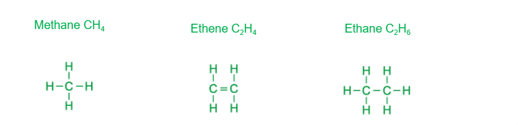
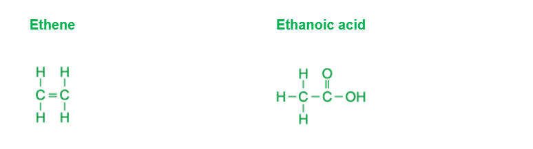

# Mark Schemes — Formulae, Functional Groups & Terminology
**11. Organic Chemistry** · Cambridge (CIE) IGCSE chemistry (0620 & 0971)

## Multiple Choice Questions (23 questions)

### Q1
**Final answer:** **The correct answer is A**

- To solve this, you must apply a key rule of homologous series: **as the relative molecular mass (***M*r**) increases, the boiling point increases**

  - This occurs because the intermolecular forces between the larger molecules become stronger

- The question asks for the order of **decreasing** boiling point, which means we must order the substances from the **highest ***M*r** to the lowest ***M*r

  - Highest *M*r: **X (88)** – This is butanoic acid
  - Second highest *M*r: **Z (74)** – This is propanoic acid
  - Third highest Mr: **W (60)** – This is ethanoic acid
  - Lowest* M*r: **Y (46)** – This is methanoic acid

The correct sequence from highest to lowest is therefore X → Z → W → Y

### Q2
**Final answer:** **The correct answer is B**

To name an organic compound correctly,  you must apply IUPAC naming rules:

**Step 1: Count the carbon chain**

- The longest continuous chain contains 4 carbon atoms, so the prefix is **but-**

**Step 2: Identify the functional group**

- The molecule contains an **–OH** group, which means it is an alcohol and takes the suffix **-ol**

**Step 3: Number the position**

- You must number the carbon chain from the end closest to the –OH group to give it the lowest possible number
- Numbering from the correct side puts the –OH on carbon number 2
- Therefore, the number **2** must be included

The correct name is **butan-2-ol**.

**A  **is incorrect because even if it is a 4-carbon chain, the alcohol group is not on carbon 1

**C **is incorrect because the carbon chain was numbered from left-to-right automatically, rather than numbering from the side closest to the functional group (**which would give the lower number, 2**).

**D **is incorrect because the position of the alcohol group is not specified

### Q3
**Final answer:** **The correct answer is C**

- Butanoic acid is a carboxylic acid, so it must contain the** –COOH** functional group
- The –COOH group means the last (or first) carbon has no hydrogens, is double bonded to O, and single bonded to –OH
- Butanoic acid has 4 carbons in a chain ending in –COOH
- Option C shows a 4-carbon chain where carbon 4 (from left to right) has C=O and C–O–H, with no H on carbon 4 (from left to right), so it is butanoic acid

**A **is incorrect because it contains a **C=C double bond** and ends with –OH, so it is not a carboxylic acid

**B **is incorrect because it ends with **–OH only** and carbon 4  (from left to right) is full of hydrogen, so it is an alcohol (butanol), not a carboxylic acid

**D **is incorrect because carbon 4 (from left to right)   has an extra **hydrogen**. Carbon is forming 5 bonds, so the structure is incorrect. Carbon is in Group IV, so it can only form four covalent bonds

### Q4
**Final answer:** **The correct answer is C**

- **Statement 1 is incorrect** because propane is an **alkane**, while propanol is an **alcohol**, so they belong to different homologous series

  - Propane (C3H8) is an alkane, meaning it contains only single C–C bonds with enough C-H bonds to complete four bonds per carbon
  - Propanol (C3H7OH) is an alcohol because it contains the –OH functional group
  - Substances in the same homologous series must have the same functional group, so propane and propanol are not in the same homologous series
- **Statement 2 is correct **because propanol has the **prefix prop-**, which means it contains three carbon atoms in the main carbon chain
- **Statement 3 is incorrect** because propane is a **saturated** hydrocarbon, not unsaturated

  - A hydrocarbon is unsaturated only if it contains a carbon–carbon double bond (C=C)
  - Propane contains only single bonds because it is an alkane, so it is a saturated hydrocarbon
- Therefore, only **statement 2 is correct**

### Q5
**Final answer:** **The correct answer is ****B**** because:**

- Displayed formula shows all of the atoms and the bonds between them
- Diagram B does not show the covalent bonds linking the atoms together
- The displayed formula of B is:

**A**, **C** and **D** are correct as these are all correct displayed formulas as all bonds are shown

### Q6
**Final answer:** **The correct answer is ****C**** because: **

- This is the only structure with a **carbon-carbon double bond**. **Alkenes** have a carbon-carbon double bond.

- A **homologous** series is a family of chemicals with **similar properties** that share the same general formula and which have the same **functional group**.
- Octane is from a homologous series called **alkanes.**
- Alkanes are **saturated** hydrocarbons, which means that they only have single bonds in their structure and have the general formula CnH2n+2.
- Molecules **A**, **B** and **D** are all alkanes.

### Q7
**Final answer:** **The correct answer is ****A**** because **

- A **homologous** series is a family of chemicals with **similar properties** that share the same general formula and which have the same **functional group**.
- The molecules shown in A have a carbon carbon double bond which is the same as ethene..
- The functional group of the alkene series is a carbon carbon double bond.

**B **and** C **are incorrect as both of these structures show an alkane.

**D **is incorrect as this structure shows an alcohol.

### Q8
**Final answer:** **The correct answer is ****B**** because:**

- Compounds in the same homologous series demonstrate a graduation in their physical properties
- This means there are small differences in physical properties, this happens as the size of the organic molecule increases

**A** is incorrect as compounds in the same homologous series have the same functional group. For example alcohols have an -OH group

**C** is incorrect as compounds in the same homologous series have the same general formula. For example alkenes have the same general formula CnH2n

**D** is incorrect as compounds in the same homologous series have similar chemical properties

### Q9
**Final answer:** **The correct answer is ****C**** because: **

- Alkanes are **saturated hydrocarbons**, which means that they only have **single bonds** and have the general formula **C*****n*****H*****2n+2***.
- Two carbons

  - *n* = 2
  - 2*n *+ 2 = 6
  - The alkane formula would be C2H6
- Four carbons

  - *n* = 4
  - If this was an alkane, then 2*n *+ 2 = 10
  - The alkane formula would be C4H10
  - This matches **C**
- Five carbons

  - *n* = 5
  - If this was an alkane, then 2*n *+ 2 = 12
  - The alkane formula would be C5H12

**A **is incorrect as this is **ethene,** an alkene.

**B **is incorrect as this is **butene,** an alkene.

**D **is incorrect as this is **pentene,** an alkene.

Revision Tip

Use this mnemonic to memorise the first 4 hydrocarbon prefixes:

**M**onkeys - **Meth**-

**E**at - **Eth**-

**P**eeled - **Prop**-

**B**ananas - **But**-

### Q10
**Final answer:** **The correct answer is ****D**** because:**

- Structure 1 is dibromoethane, it is an alkane with 2 bromine atoms attached
- Structure 3 is ethanol, it is a 2-carbon alkane with the alcohol functional group (R-OH)
- Structure 2 is named incorrectly as this is a 2-carbon hydrocarbon with a carbon-carbon double bond / C=C

  - This means that its name should be ethene

**A**, **B** and **C** are incorrect as these do not identify the correct structure-name combinations

### Q11
**Final answer:** **The correct answer is ****B**** because:**

- Butane is cracked to make an alkane and an alkene
- When you react an alkene with steam, you make an alcohol
- When an alcohol is oxidised, it produces a carboxylic acid 
- P is ethane as there is a carbon-carbon single bond
- Q is ethene as there is a carbon-carbon double bond
- R is ethanol as it has the -OH functional group for an alcohol
- S is ethanoic acid as it has the -COOH functional group for a carboxylic acid

**A**, **C** and **D** are incorrect as these do not identify the correct structure-name combinations

### Q12
**Final answer:** **The correct answer is ****C**** because:**

- A homologous series is a family of chemicals with **similar properties** that share the same general formula and which have the same **functional group**.
- Each atom in the series has an oxygen atom with a double bond to a carbon. This is a series called **aldehydes. **This is not a group that you need to be able to draw or recall, but you must be able to look at a structure and see the pattern in a series and recognise it as a functional group.

**A **is incorrect as this would be the definition of a **hydrocarbon**

**B **is incorrect as the molecules shown have saturated carbon-carbon bonds, but this does not make a homologous series.

**D **is incorrect as a homologous series will have similar chemical properties.

### Q13
**Final answer:** **The correct answer is ****A**** because**

- A **homologous** series is a family of chemicals with **similar properties** that share the same general formula and which have the same **functional group**.
- The molecules shown in A are all alcohols.
- Alcohols have the functional group of R-OH

**B **is incorrect as as this group contains alkanes, alkenes and alcohols.

**C **is incorrect as as this group contains alkanes and alkenes.

**D **is incorrect as as this group contains carboxylic acids and alcohols.

### Q14
**Final answer:** **The correct answer is ****B**** because: **

- A **homologous** series is a family of chemicals with **similar properties** that share the same general formula and which have the same **functional group**.
- The molecules shown in **B** are both alkanes.
- Alkanes are saturated hydrocarbons, which means that they only have single bonds in their structure and have the general formula CnH2n+2.

**A **is incorrect as the first molecule is an alcohol, with the functional group OH and the second molecule is a carboxylic acid, with the functional group COOH.

**C **is incorrect as the first molecule is an alkane and the second is an alkene, with the carbon carbon double bond as the functional group.

**D **is incorrect as the first molecule is an alkene with the functional group of a carbon carbon double bond and the second molecule is a polymer.

### Q15
**Final answer:** **The correct answer is ****A**** because: **

- The number of atoms in methane is **5**, in ethene it is **6 **and in ethane it is **8**.
- The question states that as the number of atoms increases in a hydrocarbon, the amount of energy released when it is burnt increases.

The other possible answers in this question are not in the correct order.

### Q16
**The correct answer is ****B**** because **the structure has two saturated carbons making it ethan- prefix and the functional group of OH so the suffix of -ol.

**A **is incorrect as this molecule has 3 carbon atoms and a carbon double bond; so the correct name for this is **propene**.

**C **is incorrect as this molecule has two carbon atoms and is saturated so the correct name is **ethane.**

**D** is incorrect as this molecule has 3 carbon atoms and a carboxylic acid group (-COOH), hence the correct name is **propanoic acid**.

Revision Tip

Use this mnemonic to memorise the first 4 hydrocarbon prefixes:

**M**onkeys - **Meth**-

**E**at - **Eth**-

**P**eeled - **Prop**-

**B**ananas - **But**-

### Q17
**Final answer:** **The correct answer is ****B**** because:**

- There are two **saturated** carbons in this molecule.
- There are no **double bonds** in this molecule.
- The **functional group** contains OH, this makes the molecule an alcohol

**A **is incorrect as **ethane** is a **hydrocarbon**, a molecule that contains hydrogen and carbon only.

**C **is incorrect as **ethanoic acid** has two carbons and the **functional group** of **COOH**

**D **is incorrect as **ethene **is an **unsaturated hydrocarbon** with a **carbon carbon double bond.**

### Q18
**Final answer:** **The correct answer is ****B**** because: **

- Compounds with names ending in** -ene** and **-ioic** acid both have double bonds in their structure:

  - The **-ene** series all have at least one carbon double bond making them unsaturated.
  - The **-oic** acid series have a carbon/oxygen double bond in the carboxylic acid functional group (-COOH)

The **-ane** (**alkane**) series are saturated and do not have any double bonds in their structure. The **-ol** series have the functional group of **-OH** and are called **alcohols**.

It is common to forget to include the double bond in the carboxylic acid functional group!

### Q19
**Final answer:** **The correct answer is ****C**** because:**

- Isomers have the same molecular formula but different displayed formula
- **C** and **F** both have the molecular formula C5H12  but their atoms are arranged differently

**A**, **B **and **D** are incorrect as the compounds do not have the same molecular formula.
