# Mark Schemes — Formulae, Functional Groups & Terminology
**11. Organic Chemistry** · Cambridge (CIE) IGCSE chemistry (0620 & 0971)

## Alternative To Practical Questions (1 questions)

### Q1
a) The line of best fit is:

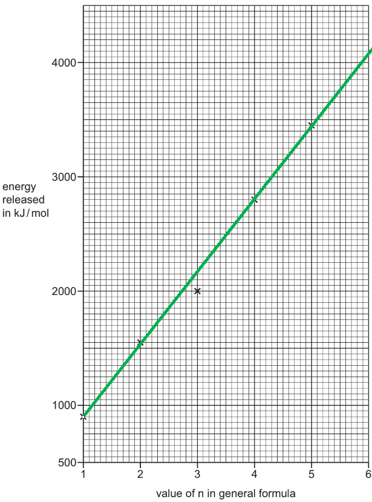

- Straight line missing the point at n = 3; **[1 mark] **
*The line must be drawn with a ruler*

**[Total: 1 mark]**

- *When you are asked to draw a line of best fit make sure that you are using a ruler*
- *The line should go through as many points as possible **OR** aim to have an equal number of points on either side of the line of best fit*
- *If there is a point that doesn't seem to fit the pattern (outlier / anomaly), e.g. the point at n = 3, then you should ignore it when you are drawing your line of best fit*
b) **Two **reasons why not all of the points lie on the line of best fit are:

Any **two **of the following:

- Measuring / recording error / anomalous result;** [1 mark]**
- Equal amounts not burnt; **[1 mark]**
- Heat losses; **[1 mark]**
- Incomplete combustion; **[1 mark]** *Human error is not an accepted answer Impurities is an ignore answer*

**[Total: 2 marks]**

- *Although the phrase **fair test** will not get you any marks in an exam nowadays, the idea of the experiment being a fair test can help you answer this question*
- *This will involve the following:*

  - *Independent variable = the alkane / fuel being burned*
  - *Dependent variable = the energy released when burned*
  
    - *This can lead to a measuring error*
  - *Control variables = the amount (mass or volume) of fuel / the amount of oxygen / heat losses*
c) The amount of energy released when the same amount of hexane, C6H14, is burned is:

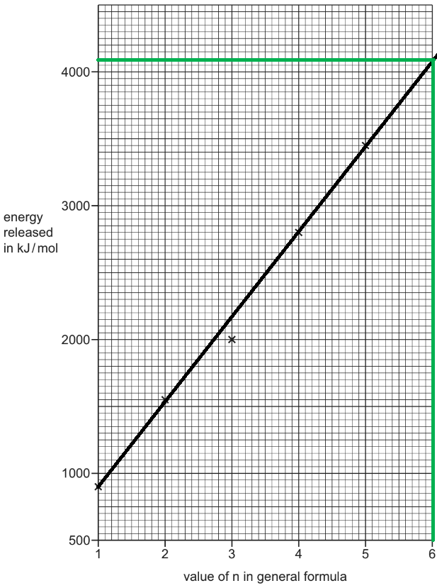

- Indication of extrapolation from the graph; **[1 mark]**
- Reading from the graph (expected answer = 4100 ± 50);** [1 mark]**

**[Total: 2 marks]**

- *This question wants you to read off the graph at n = 6 for hexane to get the amount of energy released*
- *The question very clearly states to use our graph and show how you worked out your answer*

  - *This means that is very likely that one mark will be for some working being visible on your graph*
d) The student made this prediction because:

- Butane has a value of n = 4  
**AND**
Ethane has a value of n = 2; **[1 mark]**

Comparing the values for these two alkanes:

- Value for ethane = 1550;** [1 mark]**
- Value for butane = 2800 / (about) twice the value of ethane; **[1 mark] **

**[Total: 3 marks]**

- *The question states to compare the values for the energy released by butane and ethane*
- *This clearly suggests that you need to consider the amount of energy released as well as the value of n in the general formula*

  - *When n =2, the energy released = 1550 kJ / mol*
  - *When n = 4, the energy released = 2800 kJ / mol*
  
    - *The number n has doubled*
    - *The energy released has almost doubled *

## Multiple Choice Questions (23 questions)

### Q1
**Final answer:** **The correct answer is A**

- To solve this, you must apply a key rule of homologous series: **as the relative molecular mass (***M*r**) increases, the boiling point increases**

  - This occurs because the intermolecular forces between the larger molecules become stronger

- The question asks for the order of **decreasing** boiling point, which means we must order the substances from the **highest ***M*r** to the lowest ***M*r

  - Highest *M*r: **X (88)** – This is butanoic acid
  - Second highest *M*r: **Z (74)** – This is propanoic acid
  - Third highest Mr: **W (60)** – This is ethanoic acid
  - Lowest* M*r: **Y (46)** – This is methanoic acid

The correct sequence from highest to lowest is therefore X → Z → W → Y

### Q2
**Final answer:** **The correct answer is B**

To name an organic compound correctly,  you must apply IUPAC naming rules:

**Step 1: Count the carbon chain**

- The longest continuous chain contains 4 carbon atoms, so the prefix is **but-**

**Step 2: Identify the functional group**

- The molecule contains an **–OH** group, which means it is an alcohol and takes the suffix **-ol**

**Step 3: Number the position**

- You must number the carbon chain from the end closest to the –OH group to give it the lowest possible number
- Numbering from the correct side puts the –OH on carbon number 2
- Therefore, the number **2** must be included

The correct name is **butan-2-ol**.

**A  **is incorrect because even if it is a 4-carbon chain, the alcohol group is not on carbon 1

**C **is incorrect because the carbon chain was numbered from left-to-right automatically, rather than numbering from the side closest to the functional group (**which would give the lower number, 2**).

**D **is incorrect because the position of the alcohol group is not specified

### Q3
**Final answer:** **The correct answer is C**

- Butanoic acid is a carboxylic acid, so it must contain the** –COOH** functional group
- The –COOH group means the last (or first) carbon has no hydrogens, is double bonded to O, and single bonded to –OH
- Butanoic acid has 4 carbons in a chain ending in –COOH
- Option C shows a 4-carbon chain where carbon 4 (from left to right) has C=O and C–O–H, with no H on carbon 4 (from left to right), so it is butanoic acid

**A **is incorrect because it contains a **C=C double bond** and ends with –OH, so it is not a carboxylic acid

**B **is incorrect because it ends with **–OH only** and carbon 4  (from left to right) is full of hydrogen, so it is an alcohol (butanol), not a carboxylic acid

**D **is incorrect because carbon 4 (from left to right)   has an extra **hydrogen**. Carbon is forming 5 bonds, so the structure is incorrect. Carbon is in Group IV, so it can only form four covalent bonds

### Q4
**Final answer:** **The correct answer is C**

- **Statement 1 is incorrect** because propane is an **alkane**, while propanol is an **alcohol**, so they belong to different homologous series

  - Propane (C3H8) is an alkane, meaning it contains only single C–C bonds with enough C-H bonds to complete four bonds per carbon
  - Propanol (C3H7OH) is an alcohol because it contains the –OH functional group
  - Substances in the same homologous series must have the same functional group, so propane and propanol are not in the same homologous series
- **Statement 2 is correct **because propanol has the **prefix prop-**, which means it contains three carbon atoms in the main carbon chain
- **Statement 3 is incorrect** because propane is a **saturated** hydrocarbon, not unsaturated

  - A hydrocarbon is unsaturated only if it contains a carbon–carbon double bond (C=C)
  - Propane contains only single bonds because it is an alkane, so it is a saturated hydrocarbon
- Therefore, only **statement 2 is correct**

### Q5
**Final answer:** **The correct answer is ****B**** because:**

- Displayed formula shows all of the atoms and the bonds between them
- Diagram B does not show the covalent bonds linking the atoms together
- The displayed formula of B is:

**A**, **C** and **D** are correct as these are all correct displayed formulas as all bonds are shown

### Q6
**Final answer:** **The correct answer is ****C**** because: **

- This is the only structure with a **carbon-carbon double bond**. **Alkenes** have a carbon-carbon double bond.

- A **homologous** series is a family of chemicals with **similar properties** that share the same general formula and which have the same **functional group**.
- Octane is from a homologous series called **alkanes.**
- Alkanes are **saturated** hydrocarbons, which means that they only have single bonds in their structure and have the general formula CnH2n+2.
- Molecules **A**, **B** and **D** are all alkanes.

### Q7
**Final answer:** **The correct answer is ****A**** because **

- A **homologous** series is a family of chemicals with **similar properties** that share the same general formula and which have the same **functional group**.
- The molecules shown in A have a carbon carbon double bond which is the same as ethene..
- The functional group of the alkene series is a carbon carbon double bond.

**B **and** C **are incorrect as both of these structures show an alkane.

**D **is incorrect as this structure shows an alcohol.

### Q8
**Final answer:** **The correct answer is ****B**** because:**

- Compounds in the same homologous series demonstrate a graduation in their physical properties
- This means there are small differences in physical properties, this happens as the size of the organic molecule increases

**A** is incorrect as compounds in the same homologous series have the same functional group. For example alcohols have an -OH group

**C** is incorrect as compounds in the same homologous series have the same general formula. For example alkenes have the same general formula CnH2n

**D** is incorrect as compounds in the same homologous series have similar chemical properties

### Q9
**Final answer:** **The correct answer is ****C**** because: **

- Alkanes are **saturated hydrocarbons**, which means that they only have **single bonds** and have the general formula **C*****n*****H*****2n+2***.
- Two carbons

  - *n* = 2
  - 2*n *+ 2 = 6
  - The alkane formula would be C2H6
- Four carbons

  - *n* = 4
  - If this was an alkane, then 2*n *+ 2 = 10
  - The alkane formula would be C4H10
  - This matches **C**
- Five carbons

  - *n* = 5
  - If this was an alkane, then 2*n *+ 2 = 12
  - The alkane formula would be C5H12

**A **is incorrect as this is **ethene,** an alkene.

**B **is incorrect as this is **butene,** an alkene.

**D **is incorrect as this is **pentene,** an alkene.

Revision Tip

Use this mnemonic to memorise the first 4 hydrocarbon prefixes:

**M**onkeys - **Meth**-

**E**at - **Eth**-

**P**eeled - **Prop**-

**B**ananas - **But**-

### Q10
**Final answer:** **The correct answer is ****D**** because:**

- Structure 1 is dibromoethane, it is an alkane with 2 bromine atoms attached
- Structure 3 is ethanol, it is a 2-carbon alkane with the alcohol functional group (R-OH)
- Structure 2 is named incorrectly as this is a 2-carbon hydrocarbon with a carbon-carbon double bond / C=C

  - This means that its name should be ethene

**A**, **B** and **C** are incorrect as these do not identify the correct structure-name combinations

### Q11
**Final answer:** **The correct answer is ****B**** because:**

- Butane is cracked to make an alkane and an alkene
- When you react an alkene with steam, you make an alcohol
- When an alcohol is oxidised, it produces a carboxylic acid 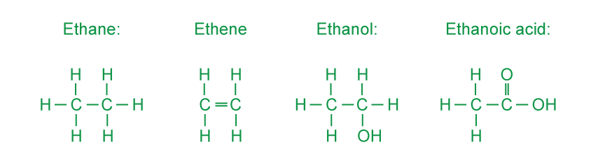
- P is ethane as there is a carbon-carbon single bond
- Q is ethene as there is a carbon-carbon double bond
- R is ethanol as it has the -OH functional group for an alcohol
- S is ethanoic acid as it has the -COOH functional group for a carboxylic acid

**A**, **C** and **D** are incorrect as these do not identify the correct structure-name combinations

### Q12
**Final answer:** **The correct answer is ****C**** because:**

- A homologous series is a family of chemicals with **similar properties** that share the same general formula and which have the same **functional group**.
- Each atom in the series has an oxygen atom with a double bond to a carbon. This is a series called **aldehydes. **This is not a group that you need to be able to draw or recall, but you must be able to look at a structure and see the pattern in a series and recognise it as a functional group.

**A **is incorrect as this would be the definition of a **hydrocarbon**

**B **is incorrect as the molecules shown have saturated carbon-carbon bonds, but this does not make a homologous series.

**D **is incorrect as a homologous series will have similar chemical properties.

### Q13
**Final answer:** **The correct answer is ****A**** because**

- A **homologous** series is a family of chemicals with **similar properties** that share the same general formula and which have the same **functional group**.
- The molecules shown in A are all alcohols.
- Alcohols have the functional group of R-OH

**B **is incorrect as as this group contains alkanes, alkenes and alcohols.

**C **is incorrect as as this group contains alkanes and alkenes.

**D **is incorrect as as this group contains carboxylic acids and alcohols.

### Q14
**Final answer:** **The correct answer is ****B**** because: **

- A **homologous** series is a family of chemicals with **similar properties** that share the same general formula and which have the same **functional group**.
- The molecules shown in **B** are both alkanes.
- Alkanes are saturated hydrocarbons, which means that they only have single bonds in their structure and have the general formula CnH2n+2.

**A **is incorrect as the first molecule is an alcohol, with the functional group OH and the second molecule is a carboxylic acid, with the functional group COOH.

**C **is incorrect as the first molecule is an alkane and the second is an alkene, with the carbon carbon double bond as the functional group.

**D **is incorrect as the first molecule is an alkene with the functional group of a carbon carbon double bond and the second molecule is a polymer.

### Q15
**Final answer:** **The correct answer is ****A**** because: **

- The number of atoms in methane is **5**, in ethene it is **6 **and in ethane it is **8**.
- The question states that as the number of atoms increases in a hydrocarbon, the amount of energy released when it is burnt increases.

The other possible answers in this question are not in the correct order.

### Q16
**The correct answer is ****B**** because **the structure has two saturated carbons making it ethan- prefix and the functional group of OH so the suffix of -ol.

**A **is incorrect as this molecule has 3 carbon atoms and a carbon double bond; so the correct name for this is **propene**.

**C **is incorrect as this molecule has two carbon atoms and is saturated so the correct name is **ethane.**

**D** is incorrect as this molecule has 3 carbon atoms and a carboxylic acid group (-COOH), hence the correct name is **propanoic acid**.

Revision Tip

Use this mnemonic to memorise the first 4 hydrocarbon prefixes:

**M**onkeys - **Meth**-

**E**at - **Eth**-

**P**eeled - **Prop**-

**B**ananas - **But**-

### Q17
**Final answer:** **The correct answer is ****B**** because:**

- There are two **saturated** carbons in this molecule.
- There are no **double bonds** in this molecule.
- The **functional group** contains OH, this makes the molecule an alcohol

**A **is incorrect as **ethane** is a **hydrocarbon**, a molecule that contains hydrogen and carbon only.

**C **is incorrect as **ethanoic acid** has two carbons and the **functional group** of **COOH**

**D **is incorrect as **ethene **is an **unsaturated hydrocarbon** with a **carbon carbon double bond.**

### Q18
**Final answer:** **The correct answer is ****B**** because: **

- Compounds with names ending in** -ene** and **-ioic** acid both have double bonds in their structure:

  - The **-ene** series all have at least one carbon double bond making them unsaturated.
  - The **-oic** acid series have a carbon/oxygen double bond in the carboxylic acid functional group (-COOH)

The **-ane** (**alkane**) series are saturated and do not have any double bonds in their structure. The **-ol** series have the functional group of **-OH** and are called **alcohols**.

It is common to forget to include the double bond in the carboxylic acid functional group!

### Q19
**Final answer:** **The correct answer is ****C**** because:**

- Isomers have the same molecular formula but different displayed formula
- **C** and **F** both have the molecular formula C5H12  but their atoms are arranged differently

**A**, **B **and **D** are incorrect as the compounds do not have the same molecular formula.

## Theory Questions (26 questions)

### Q1
a) **Two **general characteristics of a homologous series are:

Any **two **of the following:

- Same general formula; **[1 mark]**
- Similar chemical properties; **[1 mark]**
- Same functional group; **[1 mark]**
- Physical properties vary in a predictable way; **[1 mark]**
- Common methods of preparation; **[1 mark]**
- Consecutive members differ by CH2; **[1 mark] ***Mark the first two points made and ignore any others unless they contradict an awarded mark*

**[Total: 2 marks]**

- *You need to know what a homologous series is and the general characteristics*
b)

i) The completed equation is:

2HCOOH + CaCO3 → Ca(HCOO)2 + CO2 + H2O

- CO2 and H2O products; **[1 mark]**
- Correct balancing; **[1 mark] **

ii) The completed word equation is:

zinc + methanoic acid → zinc methanoate + hydrogen

- Zinc methanoate product; **[1 mark]**
- Hydrogen product; **[1 mark]**

**[Total: 4 marks]**

- *There are some standard reactions that you should be aware of:*

  - *Metal carbonate + acid → metal salt + carbon dioxide + water*
  - *Metal + acid → metal salt + hydrogen*
  - *These 2 general equations indicate the answers for parts (i) and (ii)*
c) The name, molecular formula and empirical formula of the fourth acid in the homologous series are:

- Name: butanoic acid;** [1 mark]**
- Molecular formula: CH3CH2CH2COOH / C4H8O2 / C3H7COOH / C4H7OOH;** [1 mark]**
- Empirical formula: C2H4O;** [1 mark]**

**[Total: 3 marks]**

- *The fourth member of the carboxylic acids will have four carbons *

  - *This means that it will be butanoic acid*
- *The functional group of a carboxylic acid is -COOOH*

  - *If you draw four carbons in a chain and make the last one be the COOH, then you can add the remaining hydrogens to complete the molecule, e.g. C-C-C-COOH → CH**3**CH**2**CH**2**COOH*

### Q2
a) The term *fraction* means:

- The distillate collected; **[1 mark]**
- In the stated range; **[1 mark] ***Accept between 40 – 100 **o**C as given in the question*

**[Total: 2 marks]**

- *A fraction is the chemical that collects during the process of fractional distillation*
- *The distillation process forms distillates at various temperature ranges *
b)

i) The equation for the complete combustion of octane is:

C8H18 + 12.5O2 → 8CO2 + 9H2O

- Correct products; **[1 mark]**
- Correct balancing; **[1 mark]**

ii) Another reason why leaded petrol is no longer used is because:

- It is poisonous / toxic 
**OR **
It damages health / brain / kidneys; **[1 mark]** *Harmful is not sufficient for the mark*

iii) The parts of the dibromoethane name tell you:

Dibromo = 2 bromine atoms

Eth = 2 carbon atoms

Ane = single bonds / C-C / no double bonds / no C=C / saturated

- All three points correct; **[2 marks]**
- Only two points correct; **[1 mark]**

iv) The additional information that is needed to draw the structural formula of dibromoethane is:

- The position of the bromine atom(s); **[1 mark]**

**[Total: 6 marks]**

- *For part (i), you are told that the reaction is complete combustion which means that the products will be carbon dioxide and water*

  - *To balance the equation:*
  
    - *8 carbons in octane will form 8 carbon dioxide / CO**2*
    - *18 hydrogens in octane will form 9 water / H**2**O*
    - *This gives a total of 25 oxygen atoms on the products side*
    - *Therefore, 12.5 oxygen / O**2** will be needed as there are two oxygen atoms per molecule*
- *Part (ii) is a general question about the known hazards of lead*
- *Parts (iii) and (iv) test your understanding of how chemicals are named so be sure you understand the answer to this specific question*
c) The value of n is:

- $\frac{0.104}{0.026}$; **[1 mark]**
- n = 4; **[1 mark]**

**[Total: 2 marks]**

- *This question is an application of your knowledge of moles calculations and has an aspect of empirical formula calculations*
- *You can assume the reaction is: Pb + nC**2**H**5** → Pb(C**2**H**5**)**n** *
- *The reaction equation shows a 1 : n ratio and the question gives you a 0.026 : 0.104 ratio*

  - *0.026 : 0.104 simplifies to 1 : 4*
d) A catalytic converter reduces emissions of these gases by:

- (Oxides of nitrogen) changing carbon monoxide into carbon dioxide 
**OR **
2NO + 2CO → N2 + 2CO2; **[1 mark]**
- The oxides of nitrogen then become nitrogen 
**OR **
2NO → N2 + O2; **[1 mark]**
- (Oxides of nitrogen) change hydrocarbons into carbon dioxide and water 
**OR **
A balanced symbol equation showing the oxidation of hydrocarbons, e.g. C8H18 + 12.5O2 → 8CO2 + 9H2O; **[1 mark]**

**[Total: 3 marks]**

- *Your exam technique should help you identify that there are three marks and three pollutants*
- *This means that you need to make one comment per pollutant*
- *The main issue is that the reduction of carbon monoxide and unburnt hydrocarbons emissions by a catalytic converter produces carbon dioxide which is still a pollutant*

### Q3
a)

i) **Three **other general characteristics of a homologous series are:

Any **three **of the following:

- Same general formula; **[1 mark]**
- Consecutive members differ by CH2; **[1 mark]**
- Same functional group; **[1 mark]**
- Common (allow similar) methods of preparation; **[1 mark]**
- Similar chemical properties / reactions; **[1 mark]**

ii) The molecular formula of a hydrocarbon shows whether it is an alkane or an alkene:

- CnH2n alkene; **[1 mark]**
- CnH2n+2 alkane; **[1 mark]**

iii) The way(s) that alkanes and alkenes differ in their molecular structures is / are:

- Alkanes have all or only (C–C) single bonds / no double bonds / no multiple bonds; **[1 mark]**
- Alkenes have (at least one) C=C / double bond / multiple bond; **[1 mark]**

**[Total: 7 marks]**

- *Part (i) is a standard question asking for the general characteristics of a homologous series*
- *Part (ii) is basically asking for the general formulae of alkanes and alkenes but it is worded in a strange way that doesn't necessarily make you think of the answer*
- *Part (iii) is about the differences between alkanes and alkenes*

  - *A surprisingly large number of people will miss one of these marks because they will only talk about alkanes and forget to make a similar statement for the alkenes because they think it's obvious / implied*
b)

i) **Two **conditions required for the cracking of an alkane are:

Any **two **of the following

- Heat / high temperature / temperature between 450 °C and 800 °C; **[1 mark]**
- Catalyst / named catalyst, e.g. zeolites, alumina, aluminium oxide, aluminosilicate, silica or oxides of chromium; **[1 mark]**
- High pressure/ pressure in the range of 2 – 70 atm; **[1 mark]**
- Steam; **[1 mark]**
- Absence of air/ oxygen; **[1 mark]**

ii) An equation for the cracking of heptane into an alkane and an alkene is:

- C7H16 → CH4 + C6H12 
**OR **
C7H16 → C2H6 + C5H10 
**OR **
C7H16 → C3H8 + C4H8 
**OR **
C7H16 → C4H10 + C3H6 
**OR **
C7H16 → C5H12 + C2H4; **[1 mark]**

iii) An equation for the cracking of heptane into hydrogen and two other products is:

- C7H16 → C2H4 + C5H10 + H2 
**OR **
C7H16 → C3H6 + C4H8 + H2; **[1 mark]**

iv) **One **reason why cracking is important is:

Any **one **of the following:

- Alkenes are more useful than alkanes; **[1 mark]**
- Alkenes are used to make polymers / plastics; **[1 mark]**
- Alkenes are used to make chemicals / petrochemicals; **[1 mark]**
- Shorter alkanes / smaller molecules are used as fuels; **[1 mark]**
- Cracking produces more petrol (fraction) or hydrogen; **[1 mark]**
- Cracking produces lighter fractions from heavier fractions or suitable example, e.g. naphtha to gasoline; **[1 mark]**
- Cracking produces more useful smaller molecules; **[1 mark]**
- There is more demand for smaller molecules / fractions; **[1 mark]**
- Hydrogen produced from cracking is used to make ammonia / in Haber process / to hydrogenate vegetable oils / to make HCl; **[1 mark]**

**[Total: 5 marks]**

- *You need to know how cracking happens in terms of:*

  - *The conditions *
  - *Writing cracking equations*
  
    - *Make sure that the products of your equations add up to the number of carbons and hydrogens in the reactant*
  - *The need for cracking, which is generally to form more useful, smaller fractions*

### Q4
a) The missing volumes are:

2C4H10 (g) +  13O2 (g)  →  8CO2 (g)  +  10H2O (g)

volume of gas / cm3    10;** [1 mark]**        65; **[1 mark]**  40

**[Total: 2 marks]**

- *In this question, 8 moles of carbon dioxide gas occupy 40 cm**3*

  - *Therefore, one mole of gas occupies 5 cm**3*
  - *There are 2 moles of butane gas, 2 x 5 = 10 cm**3*
  - *There are 13 moles of oxygen, 13 x 5 = 65 cm**3**  *
b)

i) The type of reaction is:

- Chlorination / halogenation  
**OR **
Substitution 
**OR **
Photochemical 
**OR **
Exothermic 
**OR **
Free radical; **[1 mark]**

ii) The term isomer means compounds with:

- The same molecular formula; **[1 mark]**
- Different structural formula / structure / arrangement of atoms; **[1 mark]**

iii) The structural formulae of these two chlorobutanes are:

- CH3–CH2–CH2–CH2–Cl; **[1 mark]**
- CH3–CH2–CH(Cl)–CH3; **[1 mark]**

**[Total: 5 marks]**

- *Alkanes are relatively unreactive chemicals *

  - *They can react by a photochemical reaction *
  - *The hydrogens of butane are swapped with chlorine atoms, so this reaction can also be described as substitution or chlorination / halogenation*
- *As soon as you see the prefix iso-, you should think about same and different:*

  - *Isomer - same molecular formula but different structural formula*
  - *Isotope - same number of protons but different number of neutrons*
- *If a hydrogen atom in butane is substituted by a chlorine atom, it can only happen on carbon 1 or carbon 2*

  - *Substitution on carbon 3 is the mirror image of carbon 2*
  - *Substitution on carbon 4 is the mirror image of carbon 1*
c)

i) A reagent, other than oxygen, which will oxidise butan-1-ol to a carboxylic acid is:

- Potassium manganate(VII) / Potassium dichromate(VI) / Copper(II) oxide; **[1 mark] **
*Oxidation numbers / roman numerals are not required, however they ****must**** be correct if used*

ii) The carboxylic acid formed is:

- Butanoic acid;; **[1 mark]**

iii) The name and structural formula of the ester formed when butan-1-ol reacts with ethanoic are:

Name:

- Butyl ethanoate; **[1 mark]**

Structural formula:

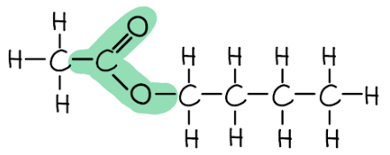

- Correct ester linkage (as highlighted); **[1 mark]**
- Correct overall structure; **[1 mark]**

**[Total: 5 marks]**

- *The most common reagent to oxidise an alcohol is (acidified) potassium dichromate(VI)*

  - *Depending on the reaction conditions and the type of alcohol used, an aldehyde or ketone or carboxylic acid will be formed*
- *The carboxylic acid formed will be based on the butan-1-ol used*

  - *Therefore, the acid is butanoic acid*
- *Naming and drawing esters is challenging*

  - *The alcohol provides the first name and the acid provides the surname*
  
    - *Therefore, using butan-1-ol and ethanoic acid we get the ester butyl ethanoate*
  - *When drawing:*
  
    - *The alcohol forms the portion after the -COO-*
    - *The acid forms the portion before the -COO- but also includes the carbon of the -COO-*

### Q5
a)  The two structural isomers of compounds with the formula C3H7Cl:

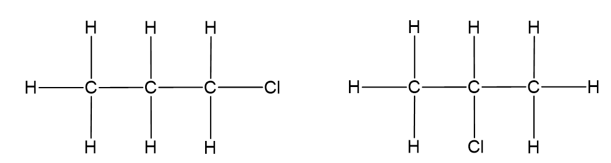

- Each correct structure; **[1 mark]**

**[Total: 2 marks]**

- *Structural isomers are compounds with the same molecular formula, but different structural formulae*
b) The homologous series of compounds that contains the following structures:

- Alkene; **[1 mark]**
- Alcohols / alkanols;** [1 mark]**
- Carboxylic acids / alkanoic acids;** [1 mark]**

**[Total: 3 marks]**
a) One repeat unit of the addition polymer formed from compound A:

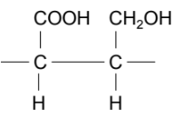

- Only one C-C shown in the chain; **[1 mark]**
- Each C bonded to:

–CH2OH / –COOH and H with no other atoms + extension bonds; **[1 mark]**

**[Total: 2 marks]**

### Q6
a)

i) A hydrocarbon is:

- A compound containing carbon and hydrogen **only**; **[1 mark]**

ii) The general formulae are:

- Alkanes: CnH2n+2; **[1 mark]**
- Alkenes: CnH2n;** [1 mark]**

**[Total: 3 marks]**

- *The word 'only' is very important when defining hydrocarbons, you will not gain the mark if you do not include it!*
- *This is because there are many compounds that contain carbon and hydrogen and other elements which are not classed as hydrocarbons*
b)

i) The empirical formula of compound X is found by:

- (Moles of) C = 54.54/12 **OR **4.5 
**AND** 
(Moles of) H = 9.09/1 **OR **9.09 
**AND** 
(Moles of) O = 36.37/16 **OR **2.27; **[1 mark]**
- Empirical formula: C2H4O; **[1 mark]**

ii) The molecular formula of compound X is found by:

- *M*r of C2H4O = 44;** [1 mark]**
- (88/44 = 2 therefore molecular formula is) C4H8O2;** [1 mark]**

**[Total: 4 marks]**

- *To calculate the empirical formula when given percentages, it is easiest to assume that you have 100 g of the sample, then you can work out the number of moles of each element in 100 g by using the **M**r**:*

|   | > *C* | > *H* | > *O* |
|---|---|---|---|
| > *Calculate the number of moles of each element in 100g (%/**M**r**)* | $\frac{54.54}{12}\,=4.5$ | $\frac{9.09}{1}\,=9.09$ | $\frac{36.37}{16}\,=2.27$ |
| > *Divide by the smallest number to find the smallest ratio* | > * 4.5/2.27 = 2* | > * 9.09/2.27 = 4* | > * 2.27/2.27 = 1* |

- *The empirical formula is therefore C**2**H**4**O*
- *Compound X has twice the** M**r** of the empirical formula, therefore compound X must contain twice the number of atoms that appears in the empirical formula*
c) The names and structural formulae of two esters with the molecular formula C3H6O2 are:

| **Name of ester** | methyl ethanoate; **[1 mark]** | ethyl methanoate;** [1 mark]** |
|---|---|---|
| **Structural formula** | CH3COOCH3;** [1 mark]** | HCOOC2H5; **[1 mark]** |

**[Total: 4 marks]**

- *Esters are produced from the reaction between an alcohol and a carboxylic acid (water is also formed)*
- *There are two possibilities of producing an ester with 3 carbons:*

  - *Where the alcohol provides 1 carbon (methanol) and the carboxylic acid provides 2 carbons (ethanoic acid), resulting in methyl ethanoate*
  - *Where the alcohol provides 2 carbons (ethanol) and the carboxylic acid provides 1 carbon (methanoic acid), resulting in ethyl methanoate*
- *The name of the ester takes the first part from the alcohol used and the second part from the carboxylic acid*
d) The ester produced from the reaction of propanoic acid and methanol is:

- Methyl propanoate; **[1 mark]**

**[Total: 1 mark]**

- *The name of the ester takes the first part from the alcohol used and the second part from the carboxylic acid*

  - *The alcohol is methanol, therefore the first part of the name is methyl*
  - *The carboxylic acid is propanoic acid, therefore the second part of the name is propanoate*
e)

i) The type of polymerisation used for the production of polyesters is:

- Condensation;** [1 mark]**

ii) The simple molecule removed when the polyester is formed is:

- Water / H2O; **[1 mark]**

iii) The correct diagrams to show the structures of the monomers used to produce the polyester are:

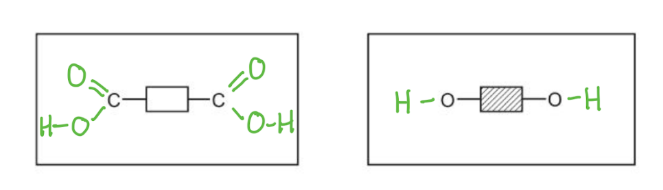

- Dicarboxylic acid;** [1 mark]** *Allow diacyl chloride for 1 mark*
- Diol; **[1 mark]**

**[Total: 4 marks]**

- *Polyesters are made from dicarboxylic acid monomers (a carboxylic with a -COOH group at either end) and diols (alcohol with an -OH group at either end)*
- *Remember:** Show the bonds between the O and H as the question asks you to show all of the bonds*
- *Diacyl chlorides (similar to dicarboxylic acids but the -OH groups are replaced with -Cl) can also be used but these are not covered at this level*

### Q7
a) The completed table is:

| formula | $C_{2}H_{2}$ | $C_{3}H_{4}$ | C4H6; **[1 mark]** |
|---|---|---|---|
| structure | $H-C\equivC-H$ | $H-C\equivC-\mathrm{CH}_{3}$ | $H-C\equivC-\mathrm{CH}_{2}-\mathrm{CH}_{3}$ |
| names | ethyne | propyne; **[1 mark]** | but-1-yne |

**[Total: 2 marks]**

- *Alkynes take their name from the pattern alkan+ yne*
- *A three carbon alkane would be propane, so the stem is prop*
- *Although you are not expected to recall information about alkynes, all the information in this question can be deduced from your knowledge of alkenes*
b) Two **other **characteristics of members of a homologous series:

Any **two **of the following:

- Contain the same functional group; **[1 mark]**
- Contain the same functional group; **[1 mark]**
- Differ from one member to the next by a –CH2– unit; **[1 mark]**
- Trend in physical properties; **[1 mark]**
- Similar chemical properties; **[1 mark]**

**[Total: 2 marks]**
c)  The general formula of alkynes is:

- CnH2n–2; **[1 mark]**

**[Total: 1 mark]**
d) Describing a test for unsaturation:

- Test: Add a few drops of bromine water / aqueous bromine;** [1 mark]**
- Result: Changes to colourless / decolourises;** [1 mark]**

**[Total: 2 marks]**

- *Bromine water is orange or yellow*
- *When added to an unsaturated compound the bromine breaks the double bond and adds across the bond*
- *The result is a colourless compound*
e) The displayed formula of but-2-ene.

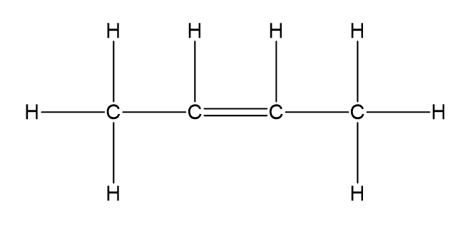

- A structure showing all the bonds for C4H8; **[1 mark]**
- The double bond lies between the second and third carbon; **[1 mark]**

**[Total: 2 marks]**

- *There must be four carbon atoms and the double bond must be between the second and third carbons*
f)  A dot-and-cross diagram to show a molecule of ethene, CH2=CH2:

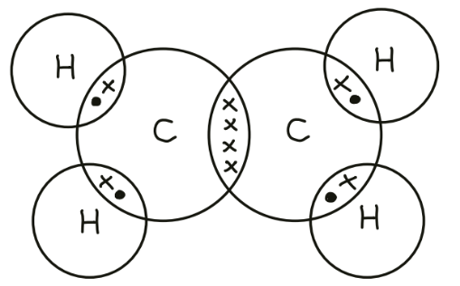

- One shared pair of electrons between each H and a C atom; **[1 mark]**
- Two shared pairs of electrons between the C atoms and no other unpaired electrons; **[1 mark]**

**[Total: 2 marks]**

- *Carbon is in Group 4, so it must have four outer electrons and four bonds*
- *Hydrogen has one outer electron*

### Q8
a) **Two **general characteristics of a homologous series are:

Any **two** from:

- (Same) general (molecular) formula; **[1 mark]**
- Same functional group; **[1 mark]**
- Consecutive members differ by –CH2; **[1 mark]**
- Common methods of preparation; **[1 mark]**
- Physical properties vary in a predictable way; **[1 mark]**
- Similar / same chemical properties;** [1 mark]**

**[Total: 2 marks]**

- *Remember: **Chemicals in a homologous series have the same general formula but are slightly different in terms of how they are produced, their actual structure and their chemical properties *
b)

i) The completed equation is:

**2**HCOOH + CaCO3 → Ca(HCOO)2 + **CO****2** + **H****2****O**

- Correct species; **[1 mark]**
- Correct balancing; **[1 mark]**

ii) The completed word equation is:

zinc + methanoic acid → **zinc methanoate** +** hydrogen**

- Zinc methanoate; **[1 mark]**
- Hydrogen; **[1 mark]**

iii) Methanoic acid does not react with an aluminium kettle because:

- (Aluminium is) protected by <u>oxide</u> layer; **[1 mark]**

**[Total: 5 marks]**

- *Carboxylic acids will undergo typical acidic reactions, so the general equations for acids will apply*

  - *metal carbonate + acid → salt + carbon dioxide + water*
  - *metal + acid → salt + hydrogen*
- *Carboxylic acids form salts which end in '-anoate'*
- *Aluminium will not react despite it being high in the reactivity series because it reacts readily with oxygen, forming a protective layer of aluminium oxide which is very thin *
- *This layer prevents reaction with water and dilute acids, so aluminium can behave as if it is unreactive*
c) The name, molecular formula and empirical formula of the fourth acid in this series are:

- Name: butanoic acid; **[1 mark]**
- Molecular formula: CH3CH2CH2COOH / C4H8O2 / C3H7COOH / C4H7OOH; **[1 mark]**
- Empirical formula: C2H4O; **[1 mark] ***Mark ecf to molecular formula*

**[Total: 3 marks]**

- *The molecular formula is the formula that shows the number and type of each atom in a molecule*
- *The empirical formula is the simplest whole number ratio of the atoms of each element present in one molecule or formula unit of the compound*
- *If the number of all of the atoms in the molecular formula are all divisible by the same whole number, then you can simplify the molecular formula:*

  - *In C**4**H**8**O**2**, all the numbers can be divided by 2 to give the empirical formula of C**2**H**4**O*

### Q9
a)

i) The name and structural formula of the fourth member of this series are:

- Name: butanoic acid / butyric acid; **[1 mark]**
- Structural formula:

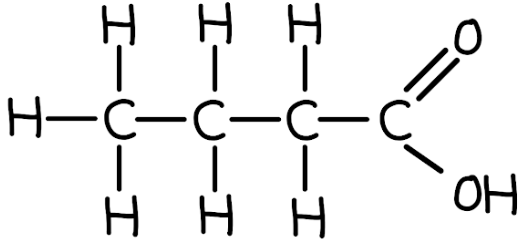

;** [1 mark]**

ii) **Three **characteristics of a homologous series are:

Any **three **of the following:

- Same general formula; **[1 mark]**
- Same functional group; **[1 mark]**
- Successive / consecutive members differ by CH2; **[1 mark]**
- Same or similar chemical properties; **[1 mark]**
- A gradual change / trend in physical properties
**OR**
An example of a gradual change / trend in a physical property i.e. melting point / boiling point / volatility; **[1 mark]**

iii) The term *weak acid* means:

- A proton / hydrogen ion / H+ donor; **[1 mark]**
- That partially / incompletely / slightly 
**OR**
Does not fully; **[1 mark]**
- Dissociate / ionise / split up in aqueous solution / water; **[1 mark]**

**[Total: 9 marks]**

> **[exam-tip]**
> For part (i), the carbon in the -COOH group counts as one of the four carbons in butanoic acid. A common mistake is drawing five carbons by adding four carbons to the functional group carbon.
> 
> When asked for a structural formula, draw every bond line explicitly. It is good practice as sometimes writing -OH instead of -O-H will lose you a mark.
> 
> For part (ii), write "similar chemical properties," not "same." Members undergo the same types of reactions but rates vary with molecular size. Write "gradual change" or "trend" for physical properties, not just "different physical properties."
> 
> For part (iii), "partially dissociates" scores 2 of the 3 marks on its own. To get the third, you must state that it is a proton / H⁺ donor. Do not confuse "weak" with "dilute" — dilute refers to concentration, weak refers to incomplete ionisation.
b)

i) The name and formula of the ester which is formed from methanol and propanoic acid are:

- Name: methyl propanoate; **[1 mark]**
- Formula: CH3CH2COOCH3 / CH3CH2CO2CH3 / C2H5COOCH3 / C2H5CO2CH3; **[1 mark]**

ii) The name of the ester which has the formula CH3COOCH3 is:

- Methyl ethanoate; **[1 mark]**

**[Total: 3 marks]**

- *Naming esters is always challenging*

  - *The alcohol provides the first name and the acid provides the surname, for example:*
  - *Methanol becomes methyl*
  - *Propanoic acid becomes propanoate*
  - *The ester is called methyl propanoate*
- *When you are given the formula of an ester:*

  - *The number of carbons after the COO is the first name*
  - *The number of carbon before the COO is the surname but make sure you include the carbon in the COO*
  - *In  the CH**3**COOCH**3** example:*
  
    - *There is a CH**3** after the COO - 1 carbon = methyl*
    - *There are 2 carbons before (and including) the COO = ethyl*
    - *The ester is called methyl ethanoate*
c)

i) The balanced equation for the oxidation of butane to propanoic acid is:

- 3C4H10 + **5.5**O2 → 4C2H5COOH + **3**H2O; **[1 mark] **

ii) Another compound which can be oxidised to propanoic acid is:

- Propanol / propan-1-ol **OR **Propanal; **[1 mark] **

**[Total: 2 marks]**

- *Balancing equations is a skill that you should practice because it often comes up in exams*

  - *A balanced equation can also be the starting point of several calculations*
- *The method given to form propanoic acid in this question is quite unusual*

  - *It is more common to use an oxidising agent such as acidified potassium dichromate(VI) to form the acid from either the alcohol or aldehyde*

### Q10
a) The formula of myrcene showing the number of atoms of carbon and hydrogen is:

- C10H16; **[1 mark]**

**[Total: 1 mark]**
b)  A chemical test to distinguish between a saturated and an unsaturated hydrocarbon:

- Bromine / bromine water / aqueous bromine; **[1 mark]**
- With saturated hydrocarbon: no colour change / stays orange; **[1 mark]**
- With unsaturated hydrocarbon: decolourised / (goes) colourless; **[1 mark]**

**[Total: 3 marks]**
c) The homologous series to which butane belongs:

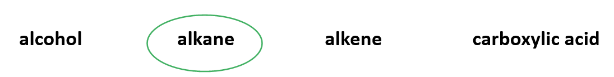

- Correct homologous series circled; **[1 mark]**

**[Total: 1 mark]**

### Q11
a) The general formula of alkene:

- CnH2n; **[1 mark]**

**[Total: 1 mark]**

- *Choose any of the structures and work out the C to H ratio, then check the answer against one of the others to be sure you have it right*
b) The structures of the **two **alcohols:

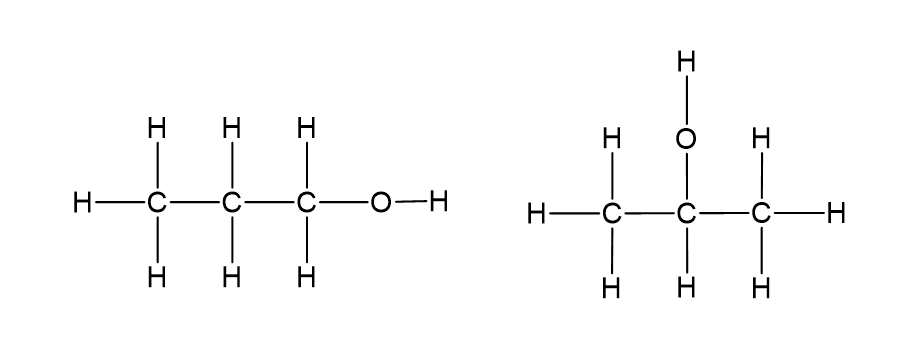

- Correct structure of propan-1-ol; **[1 mark]**
- Correct structure of propan-2-ol;** [1 mark]**

**[Total: 2 marks]**

### Q12
a)

i) The formulae of this compound are:

- Molecular: C4H8; **[1 mark]**
- Empirical: CH2; **[1 mark]**

ii) The structural formula of an isomer of the hydrocarbon is:

Any **one **of the following:

- Structural formula of methyl cyclopropane, e.g. (CH2)2CHCH3 **OR**  ; **[1 mark]  **
- Structural formula of but-1-ene, e.g. CH2CHCH2CH3 **OR**  ;** [1 mark]  **
- Structural formula of but-2-ene, e.g. CH3CHCHCH3 **OR** 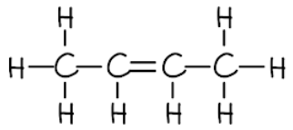 ; **[1 mark]  **
- Structural formula of methylpropene, e.g. CH2CH(CH3)CH2 **OR**  ; **[1 mark]**

iii) These two hydrocarbons are isomers because:

- They have the same molecular formula; **[1 mark]**
- But different structural formulae / different structures / different arrangement of atoms; **[1 mark]**

iv) Explanation of whether these two hydrocarbons belong to the same homologous series:

If but-1-ene, but-2-ene or methylpropene is given in part (iii):

- No **AND **one is an alkane while the other is an alkene
**OR **
No **AND **one if saturated / has single bonds while the other is unsaturated / has a double bond;** [1 mark]**

If methyl cyclopropane is given in part (iii):

- Yes **AND **both are alkanes  
**OR **
Yes **AND **both are saturated / have single bonds;** [1 mark]**

**[Total: 6 marks]**

- *This question relies on your knowledge of certain facts:*

  - *Molecular formulae show the actual ratio of different atoms in a chemical*
  - *Empirical formulae show the simplest ratio of different atoms in a chemical*
  - *Structural formulae show the atoms in such a way that the structure is shown, they can be simple or displayed*
  - *Isomers are chemicals with the same molecular formula but a different arrangement of atoms / structural formula*
  - *Homologous series is a series of chemicals that have the same functional groups / features and undergo similar reactions*
b)

i) Cracking is:

- Using heat / catalyst to breakdown an alkane 
**OR **
Thermal decomposition of an alkane; **[1 mark]** 
*Steam and pressure are ignored*
- Long-chained molecules / alkanes form smaller molecules / alkanes / alkenes; **[1 mark]** 
*Smaller fraction is not accepted*

ii) The molecular formula of the original alkane is:

- C10H22; **[1 mark]**

**[Total: 3 marks]**

- *Cracking is the process of producing more useful / shorter chain / higher demand hydrocarbons from longer chain hydrocarbons*
- *Hexane has the formula C**6**H**14** and ethene has the formula C**2**H**4*

  - *You are told that the original alkane cracks to form one hexane and two ethenes*
  - *C**6**H**14** + C**2**H**4** + C**2**H**4** → C**10**H**22*
c)

i) The structural formula of the product formed by the addition polymerisation of but-2-ene is:

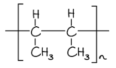

- Correct repeat unit structure; **[1 mark]**
- Continuation bonds;** [1 mark]**
- Brackets and subscript ‘n’; **[1 mark]**

ii) The name and structural formula of the addition product formed from ethene and bromine are:

- Name: dibromoethane / 1,2-dibromoethane; **[1 mark]**
- Structural formula: 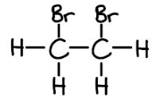 ; **[1 mark]**

**[Total: 5 marks]**

- *Remember:** The C=C double bond breaks open to form a C-C single bond and continuation bonds on either side*
- *Bromine adds "across" the C=C double bond which means that each carbon will have a bromine atom and a C-C single bond *

### Q13
a)  The carboxylic acid functional group in this structure:

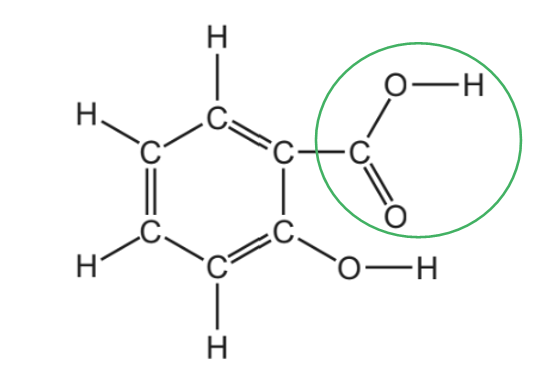

- Circle around COOH group only;** [1 mark]**

**[Total: 1 mark]**
b) The number of different **types **of atom that are shown in this structure is:

- 3; **[1 mark]**

**[Total: 1 mark]**

- *The three different types of atom are carbon, hydrogen and oxygen*
c) The structure of a molecule of ethanol:

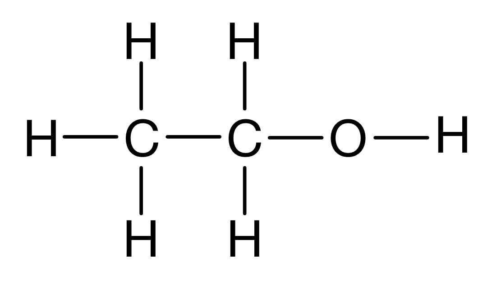

- Correct structure showing all the bonds; **[1 mark]**

**[Total: 1 mark]**

- *Don't forget the O-H bond here- it's an easy mark to lose if you are not careful*

### Q14
a)  Completing the table about aldehydes:

| name | methanal;** [1 mark]** | ethanal | propanal | butanal;** [1 mark]** |
|---|---|---|---|---|
| molecular formula | CH2O | C2H4O | C3H6O | C4H8O |

**[Total: 2 marks]**

- *Aldehydes are not a specific organic group that you have to learn, but in this question you can use you knowledge of a homologous series to deduce the answers*
- *You can see the formula increases by one carbon and two hydrogens each time*
- *This is sometimes called the homologous increment*
b) The general formula of aldehydes:

- CnH2nO; **[1 mark]**

**[Total: 1 mark]**

- *The general formula means expressing the number of atoms with respect to the number of carbons, which is given the symbol, n*
- *You can see from the table that the number of hydrogen is always double the number of carbons in aldehydes*
c)  The name given to the reactive part of any organic molecule:

- Functional group; **[1 mark]**

**[Total: 1 mark]**
d) The term is used to describe molecules with different structures but with the same molecular formula?

- (Structural) isomers; **[1 mark]**

**[Total: 1 mark]**

- *The word structural is not needed to score the mark*
e)  The structure of propanone, C3H6O. Show all of the atoms and all of the bonds.

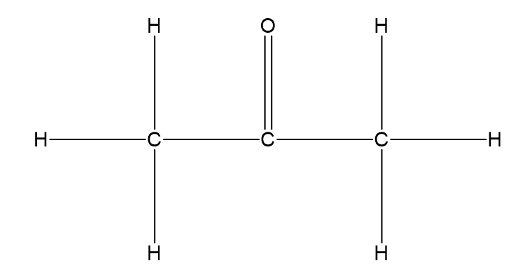

- Any structure with correct number of bonds on each atom and formula of C3H6O; **[1 mark]**
- The C=O bond is on second carbon (of a chain of 3); **[1 mark]**

**[Total: 2 marks]**

> *Make sure you learn the number of bonds that should be around each atom ( also called the valencies)*

### Q15
a)

i) The completed table is:

| alcohol | formula | heat of combustion in kJ / mol |
|---|---|---|
| methanol | CH3OH | 730 |
| ethanol | CH3–CH2–OH | 1380 |
| propan-1-ol | **CH****3****–CH****2****–CH****2****–OH**; **[1 mark]** | **Value in the range of 2030 - 2050**; **[1 mark]** |
| butan-1-ol | CH3–CH2–CH2–CH2–OH | 2680 |
| pentan-1-ol | CH3–CH2–CH2–CH2–CH2–OH | 3350 |

ii) The completed equation for the combustion of pentan-1-ol in excess oxygen is:

- C5H11OH + 7.5O2 → 5CO2 + 6H2O;** [1 mark]**

**[Total: 3 marks]**

- *The mark for the missing formula can be achieved by spotting the pattern in the formula, which is gaining a CH**2** as you move down the alcohols*
- *The heat of combustion should be a value in between the values for ethanol and butan-1-ol, e.g. *$\frac{(1380+2680)}{2}$* = 2030 kJ / mol*
- *To balance the equation:*

  - *You are told that it is excess oxygen, which means that you are looking at complete combustion*
  - *5 carbons on the reactants side will form 5 carbon dioxide*
  
    - *C**5**H**11**OH + .......O**2** → 5CO**2** + ..........*
  - *12 hydrogens on the reactants side will form 6 waters*
  
    - *C**5**H**11**OH + .......O**2** → 5CO**2** + 6H**2**O*
  - *This means that you now have 16 oxygen atoms on the product side There is one oxygen atom in the alcohol, which means that 15 more oxygen atoms need to be accounted for The "missing" oxygen atoms come from the O**2** / oxygen molecule, which means that you need *$\frac{15}{2}$* or 7.5 oxygen molecules*
  
    - *C**5**H**11**OH + 7.5O**2** → 5CO**2** + 6H**2**O*
b) **Three **characteristics of a homologous series other than the variation of physical properties down the series are:

Any **three** of the following:

- Same general formula; **[1 mark]**
- Same functional group; **[1 mark]**
- Similar chemical properties; **[1 mark]**
- Same methods of preparation; **[1 mark]**
- Consecutive members differ by CH2; **[1 mark]**

**[Total: 3 marks]**

- *Remember: **Chemicals in a homologous series have the same general formula but are slightly different in terms of how they are produced, their actual structure and their chemical properties *
c)

i) They are isomers because they:

- Have the same molecular formula; **[1 mark]**
- But, different structures / different structural formulae / different arrangements of atoms; **[1 mark]**

ii) The structural formula of another isomer is:

- CH3–CH2–CH(OH)–CH3  
**OR **
(CH3)3C–OH;** [1 mark]**

**[Total: 3 marks]**

- *You should know and be able to apply the definition of an isomer*
- *Tip: **When you are looking for isomers, it can help to draw the molecule out and look at moving the OH functional group or seeing if you can form an alternative carbon backbone *
d)

i) The maximum mass of ethanol that can be obtained from 72 g of glucose is:

Option 1:

- Moles of glucose: $\frac{72}{180}$ = 0.4; **[1 mark]**
- Maximum number of moles ethanol: 0.8; **[1 mark]**
- Maximum mass of ethanol *M*r = 46 g 
**AND ** 0.8 × 46 = 36.8 g; **[1 mark]**

Option 2:

- 180 (g) produces 2 × 46 = 92 (g); **[1 mark]**
- (72 (g) produces) $\frac{72}{180}$ × 92; **[1 mark]**
- 36.8 (g); **[1 mark]**

ii) Ethanol is made from petroleum by:

- Cracking (petroleum or alkane); **[1 mark]**
- Then reacting the ethene formed with water / hydrate (ethene to make ethanol); **[1 mark]**

Conditions:

**   One **of the following conditions for cracking:

- Temperature of 450 oC - 800 oC; **[1 mark]**

  - (Catalyst) zeolites / aluminosilicates / silica / aluminium oxide / alumina / china / broken pot / chromium oxide; **[1 mark]**

**   OR**

**One** of the following conditions for hydration:

- Temperature of 300 oC; **[1 mark] **

  - Pressure of 60 atmospheres; **[1 mark]**
  - Phosphoric acid (catalyst); **[1 mark]**

**[Total: 6 marks]**

- *To calculate the maximum mass of ethanol that can be produced, you need to determine the number of moles of ethanol that can be produced by 72 g of glucose*

  - *This can be done by working out the number of moles in 72 g of glucose *
  - *Then you use the equation to see that 1 glucose reacts to form 2 ethanol*
  - *Therefrore, the number of moles of ethanol will be double the number of moles of glucose*
  - *Finally, you multiply the number of moles of ethanol by the **M**r** of ethanol*
- *Part (ii) requires you to recognise that the first reaction is cracking to form ethene and the second step is hydration of ethene*

  - *Since this question is for 3 marks, you need to add some more information so the conditions for cracking or hydration would be a sensible idea*

### Q16
a) **Three **characteristics of a homologous series are:

Any **three **of the following:

- Same general formula; **[1 mark]**
- Consecutive members differ by CH2; **[1 mark]**
- Similar chemical properties; **[1 mark]**
- Same functional group; **[1 mark]**
- Physical properties vary in a predictable way / give trends such as mp increases with n; **[1 mark]**

**[Total: 3 marks]**

- *You need to know what a homologous series is and how this affects the properties of the chemicals within  a homologous series*
b)

i) They are isomers because:

- They have the same molecular formula; **[1 mark]** *General formula is not accepted*
- But different structures / structural formulae / different arrangement of atoms;** [1 mark]**

ii) The structural formula of another alcohol which is an isomer of these alcohols is:

- CH3-CH2-CH(OH)-CH3 
**OR **
(CH3)3-C-OH; **[1 mark]** *The names butan-2-ol and 2-methylpropan-2-ol are accepted*

**[Total: 3 marks]**

- *You must know the definition of an isomer*
- *To identify isomers you should look at moving the functional group to another carbon, e.g. butan-2-ol, or seeing if you break and branch the chain, e.g. 2-methylpropan-2-ol*
c)

i) The name of another reagent which can oxidise butanol is:

- (Acidified) potassium manganate(VII) 
**OR **
Oxygen / air 
**OR** 
(Acidified) potassium chromate(VI); **[1 mark]**

ii) The homologous series that liquid **X** belongs to is:

- Carboxylic acid;** [1 mark] ***Aldehyde / ketone are acceptable answers*

iii) The formula of liquid **X** is:

- CH3CH2CH2COOH / C3H7COOH / C4H8O2 / C4H7OOH; **[1 mark] ***Error carried forward from part (ii) is allowed, so the chemical formulae of butanal and butanone are accepted answers*

**[Total: 3 marks]**

- *Alcohols are oxidised to aldehydes / ketones and can be further oxidised to carboxylic acids *

  - *Since the parent alcohol is butanol:*
  
    - *The aldehyde will be butanal / CH**3**CH**2**CH**2**CHO*
    - *The ketone will be butanone / CH**3**COCH**2**CH**3*
    - *The carboxylic acid will be butanoic acid / CH**3**CH**2**CH**2**COOH*
- *The most common reagents for this oxidation are acidified potassium manganate(VII) solution and acidified potassium dichromate(VI) solution *
d)

i) A method of measuring the rate of this reaction is:

- Measure the volume of gas released; **[1 mark]**
- Measure time; **[1 mark]**

ii) The rate initially increases because:

- Of an increase in temperature 
**OR **
Of more yeast present 
**OR **
The yeast multiplies; **[1 mark]**

iii) **Two **reasons why the rate eventually decreases are:

- The glucose is all used up; **[1 mark]**
- The concentration of ethanol gets high enough to kill the yeast; **[1 mark]**

**[Total: 5 marks]**

- *Since the reaction produces carbon dioxide, you can measure the amount of gas produced over time to get the rate of reaction*

  - *Theoretically, you could measure the mass lost from the reaction vessel but this was not a given answer in the official mark scheme*
- *Parts (ii) and (iii) focus on fermentation as a method to produce ethanol but you need to be aware of the fermentation method and hydration of then method*

### Q17
a) The name of **F** is:

- Butane; **[1 mark]**

**[Total: 1 mark]**

- *The main carbon chain / backbone contains 4 carbons*

  - *This means that the name will be based on "but-"*
- *There are only single bonds and no other atoms apart from hydrogens*

  - *Therefore, the name will be "-ane" based*
- *This leads to the overall name being butane*
b) The **two **compounds that are members of the same homologous series are:

Option 1:

- Compounds: **A** and **B**
**OR**
But(-2-)ene and ethene; **[1 mark]**
- General formula: CnH2n; **[1 mark]**

Option 2:

- Compounds: **E** and **F**
**OR**
1-methyl propane and butane; **[1 mark]**
- General formula: CnH2n+2; **[1mark]**

**[Total: 2 marks]**

- *For questions like these, most of the compounds will have carbon atoms, hydrogen atoms and single carbon-carbon / carbon-hydrogen bonds*
- *This means that you need to look at the other features of the compounds: *

  - *A** has one double bond between carbons / C=C*
  - *B** has one double bond between carbons / C=C*
  
    - *Therefore **A** and **B** belong to the same homologous series*
  - *C** has oxygen atoms, one double bond between carbon and oxygen / C=O, one single bond between carbon and oxygen / C-O and one single bond between oxygen and hydrogen / O-H *
  - *D** has one oxygen atom, one single bond between carbon and oxygen / C-O and one single bond between oxygen and hydrogen / O-H *
  - *E** has no "interesting chemistry", only carbon and hydrogen atoms with all single bonds *
  - *F** has no "interesting chemistry", only carbon and hydrogen atoms with all single bonds*
  
    - *Therefore **E** and **F** belong to the same homologous series*
c) The **two **compounds that are isomers of each other are:

- Compounds: **E** and **F**; **[1 mark]**
- Explanation: They have the same molecular formula / contain the same number of atoms of each element;** [1 mark]**
- But they have different structures / different structural formulae / a different arrangement of atoms;** [1 mark]**

**[Total: 3 marks]**

- *Remember: **Isomers are compounds with the same molecular formula but a different arrangement of atoms*

  - *A **has the general formula C**4**H**8** *
  - *B **has the general formula C**2**H**4** *
  - *C **has the general formula C**2**H**4**O**2** *
  - *D **has the general formula C**2**H**6**O*
  - *E **has the general formula C**4**H**10** *
  - *F **has the general formula C**4**H**10** *
  
    - *E** and **F **are the only compounds with the same molecular formula and can, therefore, be the only ones that could be isomers of each other*
d) **B** is an unsaturated hydrocarbon because it contains:

- A double bond / not all bonds are single bonds;** [1 mark]**
- Contains C and H only;** [1 mark] **

**[Total: 2 marks]**

- *You can use the **S** of **S**aturated compounds to help you remember that they contain only **S**ingle bonds*
- *The standard definition of a hydrocarbon is a compound that contains **only** hydrogen and carbon*
e) **D** is manufactured from **B** using:

Any **two** of the following:

- High temperature / 220 °C – 350 °C;** [1 mark]**
- High pressure / 60 atm – 70 atm; **[1 mark]**
- Phosphoric acid catalyst; **[1 mark]**

The chemical equation for the reaction is:

- C2H4 + H2O → C2H5OH; **[1 mark]**

**[Total: 3 marks]**

- *By looking at compounds **B** and **D**, you should be able to see that a water molecule has been added to **B** to form **D** *
- *The reaction conditions are facts that you will need to learn  *
f) The addition polymer of compound **A** showing **two **repeat units is:

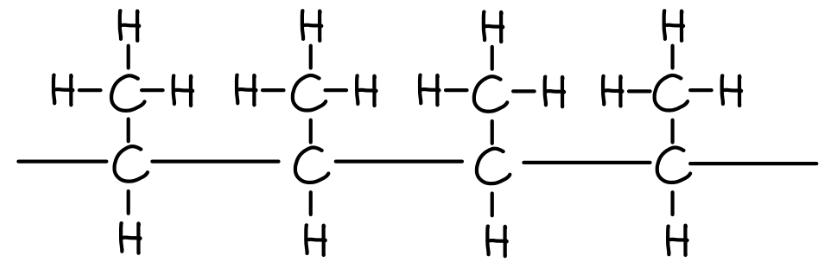

- Correct carbon structure with only single bonds; **[1 mark] ***The CH**3** groups can be all up, all down or alternating up and down*
- Continuation bonds; **[1 mark]**

**[Total: 2 marks]**

- *The best way to draw a polymer is:*

  1. *Start with the carbon=carbon double bond*
  2. *Add the atoms / groups of atoms above and below the C=C*
  3. *Replace the C=C with -C-C-* 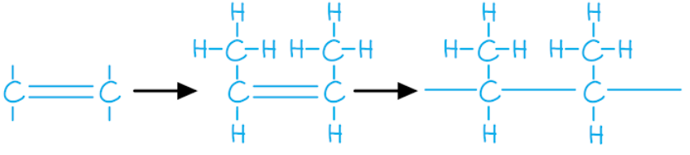
  4. *If you require more than one repeat unit to be shown, like this question, then draw another molecule (as you have just drawn) and connect them together*

### Q18
a)

i) The name and structural formula of the fourth member of this series are:

- Name: butanoic acid
**OR**
Butyric acid; **[1 mark]**
- Formula: CH3CH2CH2COOH
**OR**
C2H5CH2COOH; **[1 mark]**

ii) **Three **other characteristics of a homologous series are:

Any **three **of the following:

- (Same) general / molecular formula; **[1 mark]**
- (Consecutive members) differ by CH2; **[1 mark]**
- Same functional group; **[1 mark]**
- Common methods of preparation; **[1 mark]**
- Physical properties vary in predictable manner / show trends / gradually change
**OR**
An example of a physical property variation i.e. melting point / boiling point / volatility; **[1 mark]**

**[Total: 5 marks]**

- *You need to know the prefixes for the first six hydrocarbons:*

1. *Meth-*
2. *Eth-*
3. *Prop- *
4. *But-*
5. *Pent-*
6. *Hex-*

- *You also need to know what a homologous series is and how this affects the properties of the chemicals within  a homologous series*

> **[exam-tip]**
> Remember the carbon in COOH counts, so butanoic acid needs only three more carbons before it, not four
b)

i) The structural formula of the alcohol which can be oxidised to propanoic acid is:

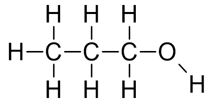

- ; **[1 mark]**

ii) A reagent, other than oxygen, which can oxidise alcohols to carboxylic acids is:

- Acidified; **[1 mark]**
- Potassium manganate(VII) / potassium permanganate / KMnO4 **OR **Potassium dichromate(VI) / K2Cr2O7 / potassium dichromate; **[1 mark]**

**[Total: 3 marks]**

- *Alcohols can be oxidised to carboxylic acids*
- *The name of the acid will reflect the original alcohol, e.g. ethanoic acid from ethanol, propanoic acid from propanol*
- *The most common reagent given as an answer is potassium dichromate but it must be **acidified*
c) The completed equations are:

i) Zinc + propanoic acid → **zinc propanoate **+ hydrogen; **[1 mark]**

ii) Calcium oxide + propanoic acid → **calcium propanoate + water**;** [1 mark]**

iii) LiOH + CH3CH2COOH → **CH****3****CH****2****COOLi + H****2****O**; **[1 mark]**

**[Total: 3 marks]**

- *There are some standard reactions with acids that you are expected to know:*

  - *Metal + acid → Metal salt + hydrogen*
  - *Metal oxide + acid → Metal salt + water*
  - *Metal hydroxide + acid → Metal salt + water*
  - *Metal carbonate + acid → Metal salt + carbon dioxide + water*
d)

i) The rate in experiment **C** is slower than the rate in experiment **A** because:

- The concentration (of acid in **C**) is less / halved 
**OR **
The concentration of **A** is more / doubled; **[1 mark]**
- Therefore, there are less <u>frequent</u> (successful) collisions in **C**
**OR **
Therefore, there are more <u>frequent</u> (successful) collisions in **A**; **[1 mark]**

ii) The rate in experiment **B** is faster than the rate in experiment **A** because:

- The particles in **B** move faster / have more energy / more have *E*a 
**OR **
The particles in **A** move slower / have less energy / less have *E*a; **[1 mark]** 
*Accept molecules or atoms in place of the word particles*
- Therefore, there are less <u>frequent</u> (successful) collisions in **A OR **
Therefore, there are more <u>frequent</u> (successful) collisions in **B**; **[1 mark] **

iii) The rate in experiment **D** is faster than the rate in experiment **A** because:

- **D** is a strong acid **AND **A is a weak acid 
**OR **
**D** is a stronger acid / **A **is a weaker acid 
**OR **
**D** ionises / dissociates more 
**OR **
**A** ionises / dissociates less;** [1 mark]**
- **D **has a higher concentration of hydrogen ions 
**OR **
**A** has a lower concentration of hydrogen ions; **[1 mark]**
- Therefore, there are less <u>frequent</u> (successful) collisions in **A OR **
Therefore, there are more <u>frequent</u> (successful) collisions in **D**; **[1 mark] **

**[Total: 7 marks]**

- *The key to this question is recognising what each row of information is actually telling you and then linking that change to the appropriate collision theory explanation*

  - *Rows **A **and **B** have different temperatures*
  
    - *This should lead you to ideas about the energy of the particles and the frequency of collisions*
  - *Rows **A** and **C** have different acid concentrations*
  
    - *This should lead you to ideas about the number of particles and the frequency of collisions*
  - *Rows **A **and **D **have different acid strengths*
  
    - *This is more subtle than rows **A **and **C **because it is still about the concentration of the particles but this is changing due to the strength of the acid and how much it dissociates into its ions*

### Q19
a)

i) **Two **general characteristics of a homologous series are:

Any **two **of the following:

- General molecular formula; **[1 mark]**
- Same functional group; **[1 mark]**
- Physical properties show trend — bp increase with n; **[1 mark]**
- Similar chemical properties; **[1 mark]**
- Common methods of preparation; **[1 mark]**

ii) The mass of one mole of the C8 alcohol is:

- C8H17OH; **[1 mark]**
- Mass of one mole = 130 (g);** [1 mark]**

**[Total: 4 marks]**

- *The general characteristics of a homologous series are just a set of facts that you need to know*

  - *This can be for 2 or 3 marks*
- *To calculate the mass of one mole of the C**8** alcohol, you first have to deduce the formula of the alcohol*

  - *Once you have deduced that the alcohol is C**8**H**17**OH, you can use the periodic table to calculate the mass of one mole (8 x 12) + (17 x 1) + 16 + 1 = 130 g*
b) The name and structural formula of the third member of this series are:

Alternative 1:

- Name: propan-1-ol; **[1 mark]**
- Structural formula: 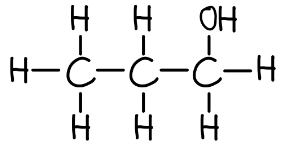 ; **[1 mark] **
*Accept CH**3**-CH**2**-CH**2**-OH*

**OR **
Alternative 2

- Name: propan-2-ol; **[1 mark]**
- Structural formula: 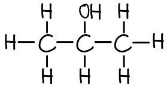 ; **[1 mark]**  
*Accept CH**3**-CH(-OH)-CH**3** *

**[Total: 2 marks]**

- *Third member of the homologous series of alcohols will contain 3 carbons and an -OH group*

  - *This gives 2 options:*
  
    - *C-C-C-OH*
    - *C-C(-OH)-C*
  - *You can then add the hydrogens to complete the molecules*
  
    - *CH**3**-CH**2**-CH**2**-OH*
    - *CH**3**-CH(-OH)-CH**3** *
- *The alcohol that contains 3 carbons will have a prop- based name*

  - *It is propan-1-ol or propan-2-ol*
  
    - *Prop = 3 carbons*
    - *an = single bonds*
    - *1-ol or 2-ol = an OH group on carbon 1 or 2*
c)

i) The structural formula of an isomer of pentan-1-ol is:

- CH3CH2CH2CHOHCH3 
**OR **
CH3CH2CHOHCH2CH3  
**OR **
CH3CH2CH(CH3)CH2OH 
**OR **
CH3CH(CH3)CH2CH2OH 
**OR **
CH3CH2C(CH3)OHCH3; **[1 mark] **
*Displayed formulae are also acceptable *

ii) The names of the product(s) formed when pentan-1-ol undergoes the following reactions are:

- Reacts with an excess of oxygen = <u>carbon dioxide</u> and <u>water</u>; **[1 mark]**
- Dehydrated to form an alkene = pent-1-ene 
**OR **
Pentene;** [1 mark]**
- Oxidation by acidified potassium dichromate(VI) = pentanal  **OR** 
Pentanoic acid; **[1 mark]**

**[Total: 4 marks]**

- *The easiest way to draw one of the isomers is to essentially "snap" the OH group off carbon 1 and swap it with a hydrogen atom from carbon 2 or 3*
- *Pentan-1-ol can be used as a fuel*

  - *So the reaction with excess oxygen will be complete combustion resulting in carbon dioxide and water*
- *Dehydration means removing water*

  - *This means that the OH group will be removed from carbon 1 and a hydrogen atom will be removed from carbon 2*
  - *This will form a carbon=carbon double bond on carbon 1 resulting in pentene / pent-1-ene*
- * Alcohols can oxidise to form aldehydes, ketones and carboxylic acids*

  - *Since the OH group is attached to carbon 1, only aldehydes or carboxylic acids are possible, meaning that ther product will be either pentanal or pentanoic acid*

### Q20
Which one of these structures, A, B, C, D or E is an alcohol:

- A / methanol / CH3OH;** [1 mark]**

**[Total: 1 mark]**

- *An alcohol must contain an -OH group*

### Q21
a) Drawing a circle around the carboxylic acid functional group on the structure:

- Correct group circled;** [1 mark]**

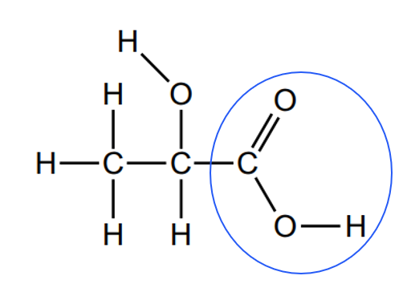

**[Total: 1 mark]**
b) The molecular formula of lactic acid is:

- C3H6O3; **[1 mark]**

**[Total: 1 mark]**

### Q22
a) The gas which is an alkane:

- Methane; **[1 mark]**

**[Total: 1 mark]**
b)  The structure of a molecule of ethene:

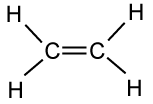

- **Correct structure; [1 mark]**

**[Total: 1 mark]**

> *You can show the bonds at right angles and still score the mark*

### Q23
a) The structure of a molecule of ethane:

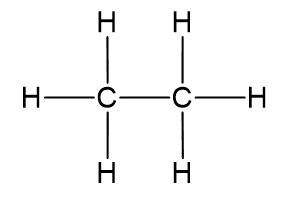

- Correct structure;** [1 mark]**

**[Total: 1 mark]**
b)  The compound which belongs to the same homologous series as methane:

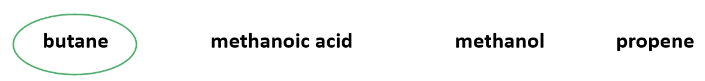

- Correct compound circled; **[1 mark]**

**[Total: 1 mark]**
c) The structural feature of this molecule that shows it is unsaturated is:

- The carbon-carbon double bond / C=C bond;** [1 mark]**

**[Total: 1 mark]**
d) A test to show that this compound is unsaturated:

- Add drops of aqueous bromine / bromine water / bromine; **[1 mark]**
- It is decolourised / turns colourless; **[1 mark]**

**[Total: 1 mark]**

- *It is important not to add too much bromine as the colour may only fade and not turn colourless*

### Q24
The feature of the nerol molecule shows that it is an unsaturated compound?

- C=C bond / carbon-carbon double bond;** [1 mark]**

**[Total: 1 mark]**

- *In your answer you must state carbon-carbon double bonds*
- *This is to ensure it is clear which atoms the bond is between*

### Q25
The term unsaturated means:

Any **one** from:

- Not all (C–C) bonds are single
- Contains / has a carbon-carbon double bond / C=C double bond
- Contains / has double or triple bond(s) between carbon atoms
- Contains at least one carbon-carbon double bond or triple bond

**[1 mark]**

*Do not accept "contains a double bond" without specifying carbon-carbon*

**[Total: 1 mark]**

- *Make sure you specify that the double or triple bond is between carbon atoms, not just "a double bond"*

### Q26
The alcohol functional group in nerol:

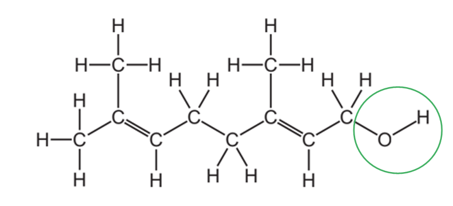

- Correct functional group circled;** [1 mark]**

**[Total: 1 mark]**

- Alcohols contain an OH group
- Therefore, your answer must circle the OH on the structure
