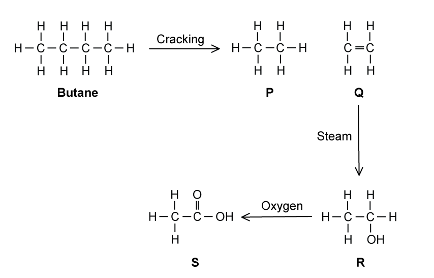
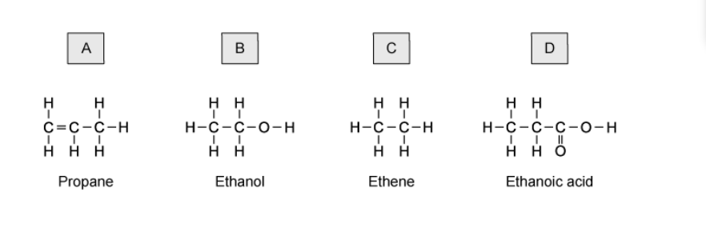

# Exam Questions — Formulae, Functional Groups & Terminology
**11. Organic Chemistry** · Cambridge (CIE) IGCSE chemistry (0620 & 0971)
> Source: [https://www.savemyexams.com/igcse/chemistry/cie/23/topic-questions/](https://www.savemyexams.com/igcse/chemistry/cie/23/topic-questions/) · 19 questions across 1 sets

## Multiple Choice Questions (23 questions)

### Q1 — hard — 1 marks

**Q1** [1 mark]

W, X, Y and Z are the first four members of the carboxylic acid homologous series, but not necessarily in that order.

The table shows their relative molecular masses, *M*r.

| substance | relative molecular mass, *M*r |
|---|---|
| W | 60 |
| X | 88 |
| Y | 46 |
| Z | 74 |

Which sequence shows the substances in order of **decreasing** boiling point?

### Q2 — hard — 1 marks

**Q2** [1 mark]

The displayed formula of an organic compound is shown.

What is the name of this compound?

### Q3 — easy — 1 marks

**Q3** [1 mark]

Which diagram shows the correct displayed formula for butanoic acid?

### Q4 — medium — 1 marks

**Q4** [1 mark]

Three statements about propane and propanol are listed below.

1. Propane and propanol belong to the same homologous series
2. Propanol is a compound that contains three carbon atoms
3. Propane is an unsaturated hydrocarbon

Which statements are correct?

### Q5 — easy — 1 marks

**Q5** [1 mark]

The structures of four organic compounds are shown.

Which one does **not** show the displayed formula of the compound?

### Q6 — easy — 1 marks

**Q6** [1 mark]

Which of the following structures shows a compound that belongs to a different homologous series to octane?

### Q7 — easy — 1 marks

**Q7** [1 mark]

The diagram shows the structure of ethene.

Which of these compounds has similar chemical properties of ethene?

### Q8 — easy — 1 marks

**Q8** [1 mark]

#### Extended Only

Which of the following is **not** a feature of a homologous series?

### Q9 — easy — 1 marks

**Q9** [1 mark]

Which of the following formulae shows an alkane?

### Q10 — hard — 1 marks

**Q10** [1 mark]

#### Extended Only

The diagram below shows some simple hydrocarbons and the products of two reactions.

Which of these structures are named correctly?

|   | ** Structure 1** | **Structure 2** | **Structure 3** |
|---|---|---|---|
| **A** | x | ✔ | ✔ |
| **B** | ✔ | ✔ | ✔ |
| **C** | x | ✔ | x |
| **D** | ✔ | x | ✔ |

### Q11 — hard — 1 marks

**Q11** [1 mark]

#### Extended Only

The diagram below shows a reaction scheme. What are the names of all of the compounds?

|   | **P** | **Q** | **R** | **S** |
|---|---|---|---|---|
| **A** | ethene | ethane | ethanoic acid | ethanol |
| **B** | ethane | ethene | ethanol | ethanoic acid |
| **C** | ethene | ethane | ethanol | ethanoic acid |
| **D** | ethane | ethene | ethanoic acid | ethanol |

### Q12 — hard — 1 marks

**Q12** [1 mark]

The first three members of a homologous series are shown.

Why do these molecules represent a homologous series?

### Q13 — hard — 1 marks

**Q13** [1 mark]

Which group of compounds is from a homologous series?

### Q14 — hard — 1 marks

**Q14** [1 mark]

Which pair of the following structures shows a homologous series?

### Q15 — medium — 1 marks

**Q15** [1 mark]

When the number of atoms in a molecule of a hydrocarbon increases, the amount of energy released when it burns increases.

What is the correct order?

|   | **less energy** | **→** | **more energy released** |
|---|---|---|---|
| **A** | methane | ethene | ethane |
| **B** | ethene | ethane | methane |
| **C** | ethene | methane | ethane |
| **D** | methane | ethane | ethene |

### Q16 — medium — 1 marks

**Q16** [1 mark]

Which one of the following structures is correctly named?

### Q17 — medium — 1 marks

**Q17** [1 mark]

The diagram below represents the molecule of a compound.

What is the name of this compound?

### Q18 — medium — 1 marks

**Q18** [1 mark]

Organic compounds can have names that have the suffixes of -ane, -ene, -ol or -oic acid.

How many of these have at least one double bond in their structure

### Q19 — medium — 1 marks

**Q19** [1 mark]

#### Separate: Chemistry and Extended Only

The structures of six organic compounds compound **A** are shown.

Which two compounds are isomers of one another?
