# Exam Questions — Formulae, Functional Groups & Terminology
**11. Organic Chemistry** · Cambridge (CIE) IGCSE chemistry (0620 & 0971)
> Source: [https://www.savemyexams.com/igcse/chemistry/cie/23/topic-questions/](https://www.savemyexams.com/igcse/chemistry/cie/23/topic-questions/) · 46 questions across 3 sets

## Alternative To Practical Questions (1 questions)

### Q1 — medium — 8 marks

**Q1** [1 mark]

The alkanes are a homologous series of hydrocarbons which are used as fuels. Their general formula is CnH2n+2.

The energy released when equal amounts of the first five alkanes were burned was measured. The results are shown plotted on the grid below.

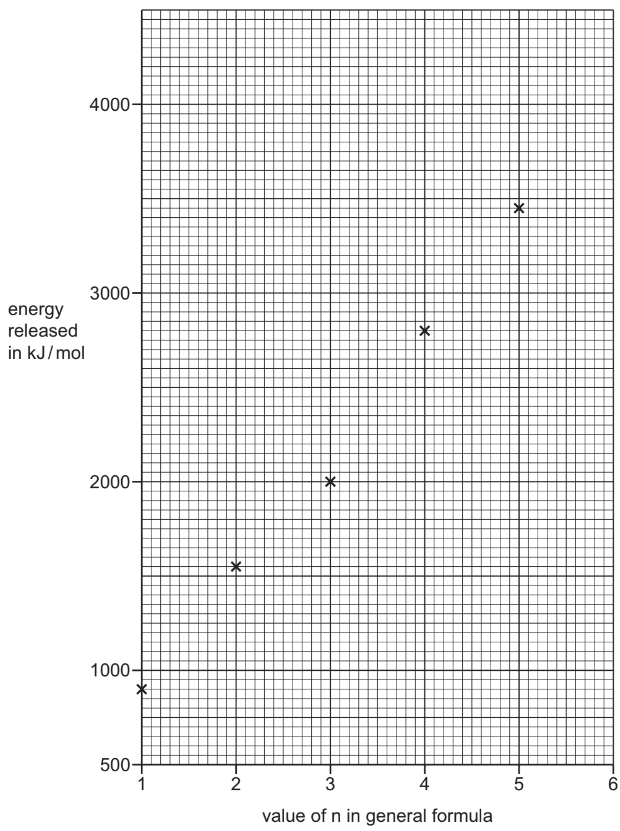

Draw a line of best fit on the grid.

*Source: 2015 O61 Q2A*

**Q1** [2 marks]

**Extract:**

The alkanes are a homologous series of hydrocarbons which are used as fuels. Their general formula is CnH2n+2. The energy released when equal amounts of the first five alkanes were burned was measured. The results are shown plotted on the grid below. Draw a line of best fit on the grid.

Suggest **two **reasons why not all of the points lie on the line of best fit.

1 ....................................................................................................

2 ....................................................................................................

*Source: 2015 O61 Q2B*

**Q1** [2 marks]

**Extract:**

The alkanes are a homologous series of hydrocarbons which are used as fuels. Their general formula is C~n~H~2n+2~. The energy released when equal amounts of the first five alkanes were burned was measured. The results are shown plotted on the grid below. (graph of energy released in kJ/mol against value of n in general formula)

**Use your graph **to work out the amount of energy released when the same amount of hexane, C6H14, is burned. Show clearly how you worked out your answer.

*Source: 2015 O61 Q2C*

**Q1** [3 marks]

**Extract:**

The alkanes are a homologous series of hydrocarbons which are used as fuels. Their general formula is C~n~H~2n+2~. The energy released when equal amounts of the first five alkanes were burned was measured. The results are shown plotted on the grid below.

A student predicted that the energy released by burning butane would be two times the energy produced by burning ethane.

Suggest why she made this prediction and compare the values obtained for these two alkanes.

*Source: 2015 O61 Q2D*

## Multiple Choice Questions (23 questions)

### Q1 — hard — 1 marks

**Q1** [1 mark]

W, X, Y and Z are the first four members of the carboxylic acid homologous series, but not necessarily in that order.

The table shows their relative molecular masses, *M*r.

| substance | relative molecular mass, *M*r |
|---|---|
| W | 60 |
| X | 88 |
| Y | 46 |
| Z | 74 |

Which sequence shows the substances in order of **decreasing** boiling point?

### Q2 — hard — 1 marks

**Q2** [1 mark]

The displayed formula of an organic compound is shown.

What is the name of this compound?

### Q3 — easy — 1 marks

**Q3** [1 mark]

Which diagram shows the correct displayed formula for butanoic acid?

### Q4 — medium — 1 marks

**Q4** [1 mark]

Three statements about propane and propanol are listed below.

1. Propane and propanol belong to the same homologous series
2. Propanol is a compound that contains three carbon atoms
3. Propane is an unsaturated hydrocarbon

Which statements are correct?

### Q5 — easy — 1 marks

**Q5** [1 mark]

The structures of four organic compounds are shown.

Which one does **not** show the displayed formula of the compound?

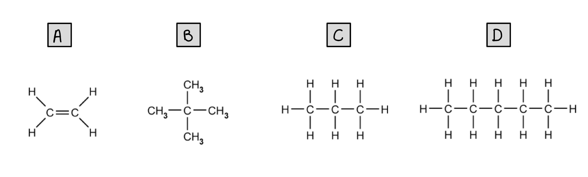

### Q6 — easy — 1 marks

**Q6** [1 mark]

Which of the following structures shows a compound that belongs to a different homologous series to octane?

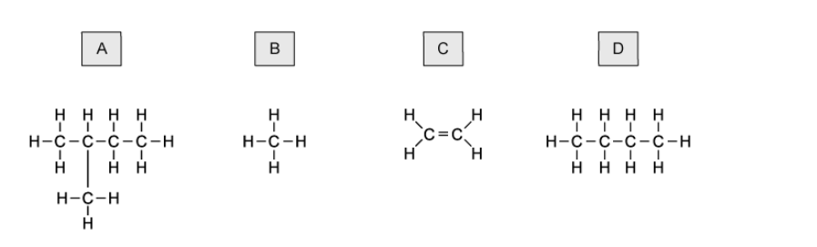

### Q7 — easy — 1 marks

**Q7** [1 mark]

The diagram shows the structure of ethene.

Which of these compounds has similar chemical properties of ethene?

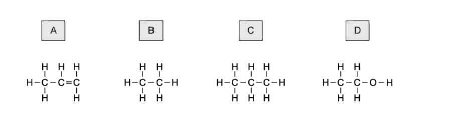

### Q8 — easy — 1 marks

**Q8** [1 mark]

#### Extended Only

Which of the following is **not** a feature of a homologous series?

### Q9 — easy — 1 marks

**Q9** [1 mark]

Which of the following formulae shows an alkane?

### Q10 — hard — 1 marks

**Q10** [1 mark]

#### Extended Only

The diagram below shows some simple hydrocarbons and the products of two reactions.

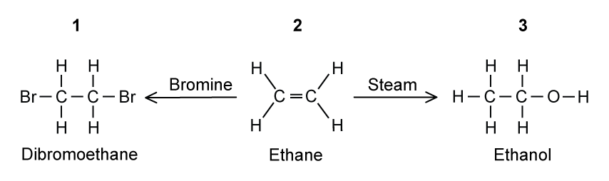

Which of these structures are named correctly?

|   | ** Structure 1** | **Structure 2** | **Structure 3** |
|---|---|---|---|
| **A** | x | ✔ | ✔ |
| **B** | ✔ | ✔ | ✔ |
| **C** | x | ✔ | x |
| **D** | ✔ | x | ✔ |

### Q11 — hard — 1 marks

**Q11** [1 mark]

#### Extended Only

The diagram below shows a reaction scheme. What are the names of all of the compounds?

|   | **P** | **Q** | **R** | **S** |
|---|---|---|---|---|
| **A** | ethene | ethane | ethanoic acid | ethanol |
| **B** | ethane | ethene | ethanol | ethanoic acid |
| **C** | ethene | ethane | ethanol | ethanoic acid |
| **D** | ethane | ethene | ethanoic acid | ethanol |

### Q12 — hard — 1 marks

**Q12** [1 mark]

The first three members of a homologous series are shown.

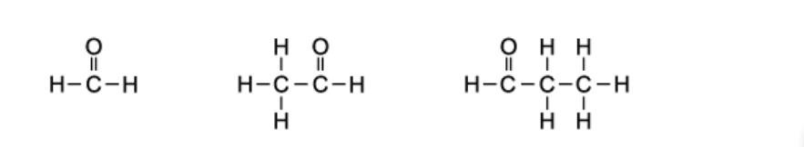

Why do these molecules represent a homologous series?

### Q13 — hard — 1 marks

**Q13** [1 mark]

Which group of compounds is from a homologous series?

### Q14 — hard — 1 marks

**Q14** [1 mark]

Which pair of the following structures shows a homologous series?

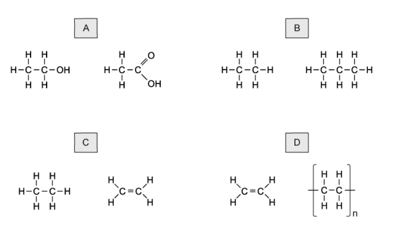

### Q15 — medium — 1 marks

**Q15** [1 mark]

When the number of atoms in a molecule of a hydrocarbon increases, the amount of energy released when it burns increases.

What is the correct order?

|   | **less energy** | **→** | **more energy released** |
|---|---|---|---|
| **A** | methane | ethene | ethane |
| **B** | ethene | ethane | methane |
| **C** | ethene | methane | ethane |
| **D** | methane | ethane | ethene |

### Q16 — medium — 1 marks

**Q16** [1 mark]

Which one of the following structures is correctly named?

### Q17 — medium — 1 marks

**Q17** [1 mark]

The diagram below represents the molecule of a compound.

What is the name of this compound?

### Q18 — medium — 1 marks

**Q18** [1 mark]

Organic compounds can have names that have the suffixes of -ane, -ene, -ol or -oic acid.

How many of these have at least one double bond in their structure

### Q19 — medium — 1 marks

**Q19** [1 mark]

#### Separate: Chemistry and Extended Only

The structures of six organic compounds compound **A** are shown.

Which two compounds are isomers of one another?

## Theory Questions (26 questions)

### Q1 — medium — 9 marks

**Q1** [2 marks]

#### Extended Only

Methanoic acid is the first member of the homologous series of carboxylic acids.

Give **two **general characteristics of a homologous series.

*Source: 2010 Ju32 Q8A*

**Q1** [4 marks]

#### Extended Only

In some areas when water is boiled, the inside of kettles become coated with a layer of calcium carbonate. This can be removed by adding methanoic acid.

i) Complete the equation.

............ HCOOH + CaCO3 → Ca(HCOO)2 + ................. + .................

[2]

ii) Methanoic acid reacts with most metals above hydrogen in the reactivity series.

Complete the word equation.

zinc + methanoic acid → ................................. + ..................................

[2]

*Source: 2010 Ju32 Q8B*

**Q1** [3 marks]

**Extract:**

Methanoic acid is the first member of the homologous series of carboxylic acids.

#### Separate: Chemistry and Extended Only

Give the name, molecular formula and empirical formula of the fourth acid in this series.

name ..................................................

[1]

molecular formula ..................................................

[1]

empirical formula ..................................................

[1]

*Source: 2010 Ju32 Q8C*

### Q2 — medium — 13 marks

**Q2** [2 marks]

Petrol is a mixture of hydrocarbons and additives. The combustion of petrol in car engines is a major source of air pollution. This is reduced by catalytic converters.

Petrol is obtained from the gasoline fraction, boiling point range 40 °C to 100 °C, from the distillation of petroleum.

Explain the term *fraction*.

*Source: 2011 O32 Q7*

**Q2** [6 marks]

#### Extended Only

In many countries, a lead compound of the type Pb(C2H5)n used to be added to petrol to improve its combustion. After combustion, lead oxide was formed.

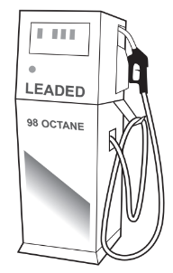

i) Octane is a constituent of petrol. Write the equation for the complete combustion of octane.

C8H18 + .......... O2 → .......... + ..........

[2]

ii) Dibromoethane was added to petrol to remove the lead oxide from inside the engine. Lead bromide was formed which escaped into the environment through the exhaust. Leaded petrol cannot be used with a catalytic converter.

Give another reason why leaded petrol is no longer used.

[1]

iii) What does each of the following tell you about the structure of dibromoethane?

dibromo ..........................................................................................................

eth ..........................................................................................................

ane ..........................................................................................................

[2]

iv) What additional information is needed to draw the structural formula of dibromoethane?

[1]

*Source: 2011 O32 Q7*

**Q2** [2 marks]

#### Extended Only

An analysis of the compound, Pb(C2H5)n, showed that 0.026 moles of Pb was combined with 0.104 moles of C2H5 groups.

What is the value of n? Show how you arrived at your answer.

*Source: 2011 O32 Q7*

**Q2** [3 marks]

#### Extended Only

Some of the pollutants emitted by vehicle exhausts are carbon monoxide, oxides of nitrogen and unburnt hydrocarbons. Explain how the emission of these gases is reduced by a catalytic converter.

*Source: 2011 O32 Q7*

### Q3 — medium — 12 marks

**Q3** [7 marks]

#### Extended Only

Two homologous series of hydrocarbons are the alkanes and the alkenes.

One general characteristic of a homologous series is that the physical properties vary in a predictable way.

i) State **three **other general characteristics of a homologous series.

[3]

ii) How can the molecular formula of a hydrocarbon show whether it is an alkane or an alkene?

[2]

iii) How do alkanes and alkenes differ in their molecular structures?

[2]

*Source: 2015 O33 Q4*

**Q3** [5 marks]

Cracking is the thermal decomposition of alkanes into smaller hydrocarbons and possibly hydrogen.

i) State **two **conditions required for the cracking of an alkane.

[2]

ii) One type of cracking produces an alkane and an alkene.

Complete an equation for the cracking of heptane into an alkane and an alkene.

C7H16 → ................ + ................

[1]

iii) Complete an equation for the cracking of heptane into hydrogen and two other products.

C7H16 → ................ + ................ + H2

[1]

iv) Suggest **one **reason why cracking is important.

[1]

*Source: 2015 O33 Q4*

### Q4 — hard — 12 marks

**Q4** [2 marks]

Butane is an alkane. It has the following structural formula

The equation for the complete combustion of butane is given below. Insert the two missing volumes.

2C4H10 (g) +  13O2 (g)  →  8CO2 (g)  +  10H2O (g)

volume of gas / cm3 ..........  ..........  40

*Source: 2012 Ju31 Q6*

**Q4** [5 marks]

Butane reacts with chlorine to form two isomers of chlorobutane.

i) What type of reaction is this?

[1]

ii) Explain the term *isomer*.

[2]

iii) Draw the structural formulae of these two chlorobutanes.

[2]

*Source: 2012 Ju31 Q6*

**Q4** [5 marks]

One of the chlorobutanes reacts with sodium hydroxide to form butan-1-ol. Butan-1-ol can be oxidised to a carboxylic acid.

i) State a reagent, other than oxygen, which will oxidise butan-1-ol to a carboxylic acid.

[1]

ii) Name the carboxylic acid formed.

[1]

iii) Butan-1-ol reacts with ethanoic acid to form an ester. Name this ester and give its structural formula showing all the individual bonds.

name ..........................................................................................................

[1]

structural formula

[2]

*Source: 2012 Ju31 Q6*

### Q5 — medium — 7 marks

**Q5** [2 marks]

#### Separate: Chemistry and Extended Only

Propane reacts with chlorine in a photochemical reaction as shown.

$C_{3}H_{8}+\mathrm{Cl}\rightarrowC_{3}H_{7}\mathrm{Cl}+\mathrm{HCl}$

Draw two structural isomers of compounds with the formula C3H7Cl.

Show all of the atoms and all of the bonds.

|   |   |
|---|---|

*Source: 2020 Ju42 Q6C*

**Q5** [3 marks]

There are three functional groups in compound A.

Name the homologous series of compounds that contains the following structures.

C=C       ............................... 
–OH       .............................. 
–COOH ...............................

*Source: 2020 Ju42 Q6D*

**Q5** [2 marks]

**Extract:**

There are three functional groups in compound A. Name the homologous series of compounds that contains the following structures: C=C, –OH, –COOH. The structure shows: COOH and CH2OH groups attached to carbons: — C(COOH)(H) — C(CH2OH)(H) —

#### Extended Only

Compound A can be used as a single monomer to produce two different polymers.

Draw one repeat unit of the addition polymer formed from compound A.

*Source: 2020 Ju43 Q1A*

### Q6 — hard — 16 marks

**Q6** [3 marks]

Alkanes and alkenes are examples of hydrocarbons.

i) What is meant by the term hydrocarbon?

[1]

ii) Give the general formula of straight-chain

alkanes.

alkenes.

[2]

*Source: 2016 Ja42 Q7*

**Q6** [4 marks]

A compound X contains carbon, hydrogen and oxygen only.

X contains 54.54% of carbon by mass, 9.09% of hydrogen by mass and 36.37% of oxygen by mass.

i) Calculate the empirical formula of compound X.

[2]

ii) Compound X has a relative molecular mass of 88.

Deduce the molecular formula of compound X.

[2]

*Source: 2016 Ja42 Q7*

**Q6** [4 marks]

#### Extended Only

An ester has the molecular formula C3H6O2.

Name and give the structural formulae of two esters with the molecular formula C3H6O2.

| **Name of ester** |   |   |
|---|---|---|
| **Structural formula** |   |   |

*Source: 2016 Ja42 Q7*

**Q6** [1 mark]

#### Separate: Chemistry and Extended Only

Name the ester produced from the reaction of propanoic acid and methanol.

*Source: 2016 Ja42 Q7*

**Q6** [4 marks]

#### Separate: Chemistry and Extended Only

A polyester is represented by the structure shown.

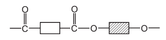

i) What type of polymerisation is used for the production of polyesters?

[1]

ii) Which simple molecule is removed when the polyester is formed?

[1]

iii) Complete the diagrams below to show the structures of the monomers used to produce the polyester. Show all atoms and bonds.

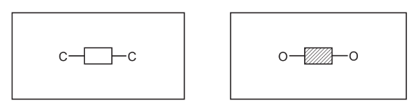

[2]

*Source: 2016 Ja42 Q7*

### Q7 — medium — 11 marks

**Q7** [2 marks]

Alkynes and alkenes are homologous series of unsaturated hydrocarbons. All alkynes contain a C≡C triple bond.

Complete Table 10.1 showing information about the first **three **alkynes.

**Table 10.1**

| formula | $C_{2}H_{2}$ | $C_{3}H_{4}$ |   |
|---|---|---|---|
| structure |   | $H-C\equivC-\mathrm{CH}_{3}$ | $H-C\equivC-\mathrm{CH}_{2}-\mathrm{CH}_{3}$ |
| names | ethyne |   | but-1-yne |

*Source: 2016 Specimen4 Q6A*

**Q7** [2 marks]

#### Extended Only

Compounds in the same homologous series have the same general formula.

Give two **other **characteristics of members of a homologous series.

*Source: 2016 Specimen4 Q6B*

**Q7** [1 mark]

**Extract:**

Alkynes and alkenes are homologous series of unsaturated hydrocarbons. All alkynes contain a C≡C triple bond. Table 10.1 showing information about the first three alkynes: formula: C2H2, C3H4, C4H6; structure: H-C≡C-H, H-C≡C-CH3, H-C≡C-CH2-CH3; names: ethyne, propyne, but-1-yne.

#### Separate: Chemistry Only

Deduce the general formula of alkynes. Use the information from Table 10.1 to help you.

*Source: 2016 Specimen4 Q6B*

**Q7** [2 marks]

Alkynes are unsaturated.

Describe a test for unsaturation.

test   ........................

result ........................

*Source: 2016 Specimen4 Q6B*

**Q7** [2 marks]

#### Separate: Chemistry and Extended Only

Ethene and but-2-ene are alkenes. Draw the displayed formula of but-2-ene.

*Source: 2016 Specimen4 Q6*

**Q7** [2 marks]

#### Extended Only

Draw a dot-and-cross diagram to show a molecule of ethene, CH2=CH2. Show outer shell electrons only.

*Source: 2016 Specimen4 Q6*

### Q8 — medium — 10 marks

**Q8** [2 marks]

#### Extended Only

Methanoic acid is the first member of the homologous series of carboxylic acids.

Give **two **general characteristics of a homologous series.

*Source: 2010 Ju31 Q8*

**Q8** [5 marks]

#### Extended Only

In some areas when water is boiled, the inside of kettles become coated with a layer of calcium carbonate. This can be removed by adding methanoic acid.

i) Complete the equation.

............ HCOOH + CaCO3 → Ca(HCOO)2 + ................. + .................

[2]

ii) Methanoic acid reacts with most metals above hydrogen in the reactivity series. Complete the word equation.

zinc + methanoic acid → ............................................ + ............................................

[2]

iii) Aluminium is also above hydrogen in the reactivity series.

Why does methanoic acid not react with an aluminium kettle?

[1]

*Source: 2010 Ju31 Q8*

**Q8** [3 marks]

**Extract:**

Methanoic acid is the first member of the homologous series of carboxylic acids.

#### Separate: Chemistry and Extended Only

Give the name, molecular formula and empirical formula of the fourth acid in this series.

name ..........................................................................................................

[1]

molecular formula .......................................................................................................

[1]

empirical formula ........................................................................................................

[1]

*Source: 2010 Ju31 Q8*

### Q9 — hard — 14 marks

**Q9** [9 marks]

Butane is oxidised to a mixture of carboxylic acids by oxygen in the presence of a catalyst. The acids formed are methanoic acid, ethanoic acid and propanoic acid – the first three members of the carboxylic acid homologous series.

i) Give the name and structural formula of the fourth member of this series.

name ..........................................................................................................

structural formula showing all the atoms and bonds

[3]

ii) State **three **characteristics of a homologous series.

[3]

iii) All members of this series are weak acids.

What is meant by the term *weak acid*?

[3]

*Source: 2014 O33 Q7*

**Q9** [3 marks]

Carboxylic acids react with alcohols to form esters. Ethanol reacts with ethanoic acid to form the ester ethyl ethanoate, CH3COOCH2CH3.

i) Give the name and formula of the ester which is formed from methanol and propanoic acid.

name ..........................................................................................................

formula ..........................................................................................................

[2]

ii) What is the name of the ester which has the formula CH3COOCH3?

[1]

*Source: 2014 O33 Q7*

**Q9** [2 marks]

i) Complete the equation for the oxidation of butane to propanoic acid.

3C4H10 + .........O2 → 4C2H5COOH + .......H2O

[1]

ii) Name another compound which can be oxidised to propanoic acid.

[1]

*Source: 2014 O33 Q7*

### Q10 — medium — 5 marks

**Q10** [1 mark]

The structure of myrcene is shown.

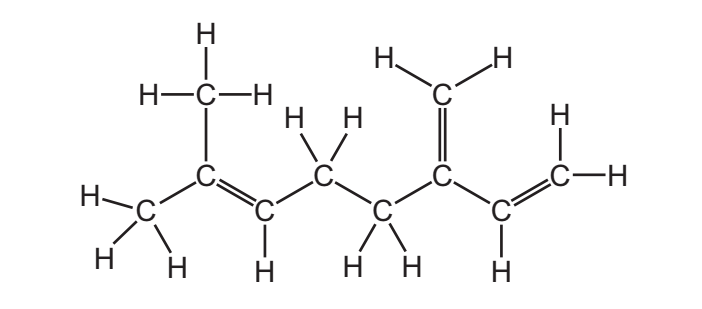

Deduce the formula of myrcene to show the number of atoms of carbon and hydrogen.

*Source: 2020 Ju31 Q7D*

**Q10** [3 marks]

Myrcene is an unsaturated hydrocarbon. Describe a chemical test to distinguish between a saturated and an unsaturated hydrocarbon.

test ................................... 
observations with saturated hydrocarbon ............................................. 
observations with unsaturated hydrocarbon .........................................

*Source: 2020 Ju31 Q7D*

**Q10** [1 mark]

Butane is a saturated hydrocarbon.

To which homologous series does butane belong?

Draw a circle around the correct answer.

**alcohol                    alkane                   alkene                   carboxylic acid**

*Source: 2020 Ju31 Q7D*

### Q11 — medium — 3 marks

**Q11** [1 mark]

The structures of five alkenes, A, B, C, D and E, are shown.

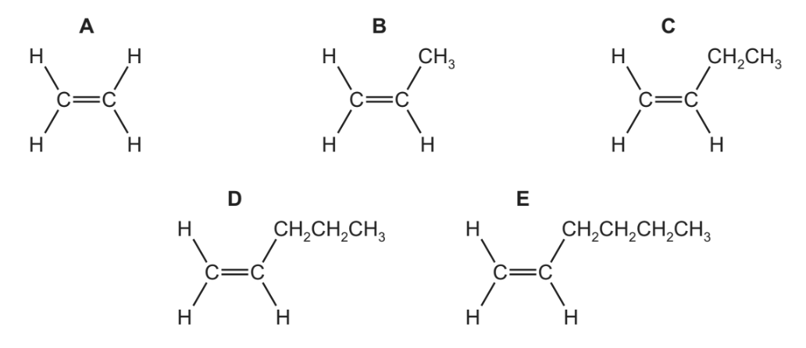

What is the general formula of alkenes?

*Source: 2019 Ju41 Q5F*

**Q11** [2 marks]

**Extract:**

The structures of five alkenes, A, B, C, D and E, are shown. ![q5-0620_s19_qp_41]

#### Extended Only

Two different alcohols can be produced from alkene **B** by an addition reaction.

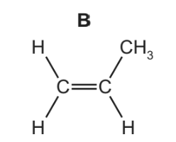

Draw the structures of the **two **alcohols. Show all of the atoms and all of the bonds.

*Source: 2019 Ju31 Q7A*

### Q12 — medium — 14 marks

**Q12** [6 marks]

#### Separate: Chemistry and Extended Only

A hydrocarbon has the following structural formula.

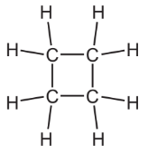

i) State the molecular formula and the empirical formula of this hydrocarbon.

molecular formula ........................................................

empirical formula ........................................................

[2]

ii) Draw the structural formula of an isomer of the above hydrocarbon.

[1]

iii) Explain why these two hydrocarbons are isomers.

[2]

iv) Are these two hydrocarbons members of the same homologous series? Give a reason for your choice.

[1]

*Source: 2014 O32 Q3A*

**Q12** [3 marks]

Alkenes can be made from alkanes by cracking.

i) Explain the term *cracking*.

[2]

ii) One mole of an alkane, when cracked, produced one mole of hexane, C6H14, and two moles of ethene.

What is the molecular formula of the original alkane?

[1]

*Source: 2014 O32 Q3B*

**Q12** [5 marks]

#### Extended Only

Alkenes are used in polymerisation reactions and addition reactions.

i) Draw the structural formula of the product formed by the addition polymerisation of but-2-ene. Its formula is given below.

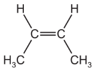

[3]

ii) Give the name and structural formula of the addition product formed from ethene and bromine.

name ..............................................................

structural formula ..............................................................

[2]

*Source: 2014 O32 Q3C*

### Q13 — medium — 3 marks

**Q13** [1 mark]

The structure of compound S is shown.

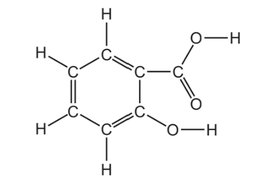

Draw a circle around the carboxylic acid functional group in this structure.

**Q13** [1 mark]

**Extract:**

The structure of compound S is shown.

How many different **types **of atom are shown in this structure?

*Source: 2019 Ju33 Q5A*

**Q13** [1 mark]

Ethanol can be converted into ethene by passing ethanol vapour over a catalyst of aluminium oxide.

$C_{2}H_{5}\mathrm{OH}\rightarrowC_{2}H_{4}+X$

Draw the structure of a molecule of ethanol. Show all of the atoms and all of the bonds.

*Source: 2019 Ju41 Q5A*

### Q14 — hard — 7 marks

**Q14** [2 marks]

The table shows some information about aldehydes.

Complete the table.

| name | .......................... | ethanal | propanal | butanal |
|---|---|---|---|---|
| molecular formula | CH2O | C2H4O | C3H6O | ................... |

*Source: 2020 Ju41 Q5D*

**Q14** [1 mark]

**Extract:**

The table shows some information about aldehydes.

| name | methanal | ethanal | propanal | butanal |
| molecular formula | CH2O | C2H4O | C3H6O | C4H8O |

Deduce the general formula of aldehydes.

*Source: 2020 Ju41 Q5E*

**Q14** [1 mark]

The structural formula of ethanal is shown.

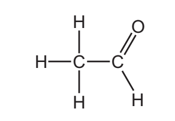

The C=O group in aldehydes is at the end of the carbon chain. This is a reactive part of the molecule.

What is the name given to the reactive part of any organic molecule?

*Source: 2020 Ju41 Q5F*

**Q14** [1 mark]

Propanone belongs to a homologous series called ketones. Ketones have the same C=O group as aldehydes but the C=O group is not at the end of the carbon chain. Propanone has the same molecular formula as propanal, C3H6O.

What term is used to describe molecules with different structures but with the same molecular formula?

*Source: 2020 Ju41 Q5F*

**Q14** [2 marks]

**Extract:**

Propanone belongs to a homologous series called ketones. Ketones have the same C=O group as aldehydes but the C=O group is not at the end of the carbon chain. Propanone has the same molecular formula as propanal, C~3~H~6~O.

Suggest the structure of propanone, C3H6O. Show all of the atoms and all of the bonds.

*Source: 2020 Ju42 Q6C*

### Q15 — medium — 15 marks

**Q15** [3 marks]

#### Extended Only

The alcohols form a homologous series. The first five members are given in the table below.

| alcohol | formula | heat of combustion in kJ / mol |
|---|---|---|
| methanol | CH3OH | 730 |
| ethanol | CH3–CH2–OH | 1380 |
| propan-1-ol |   |   |
| butan-1-ol | CH3–CH2–CH2–CH2–OH | 2680 |
| pentan-1-ol | CH3–CH2–CH2–CH2–CH2–OH | 3350 |

i) Complete the table.

[2]

ii) Complete the equation for the combustion of pentan-1-ol in excess oxygen.

C5H11OH + .......O2 → ..................... + .....................

[1]

*Source: 2013 O33 Q6A*

**Q15** [3 marks]

#### Extended Only

State **three **characteristics of a homologous series other than the variation of physical properties down the series.

*Source: 2013 O33 Q6B*

**Q15** [3 marks]

#### Separate: Chemistry and Extended Only

The following alcohols are isomers.

CH3–CH2–CH2–CH2–OH   and   (CH3)2CH–CH2–OH

i) Explain why they are isomers.

[2]

ii) Draw the structural formula of another isomer of the above alcohols.

[1]

*Source: 2013 O33 Q6C*

**Q15** [6 marks]

#### Extended Only

Alcohols can be made by fermentation and from petroleum.

i) Ethanol is made from sugars by fermentation.

C6H12O6 → 2C2H5OH + 2CO2

The mass of one mole of glucose, C6H12O6, is 180 g.

Calculate the maximum mass of ethanol which could be obtained from 72 g of glucose.

[3]

ii) Describe how ethanol is made from petroleum.

**petroleum (alkanes) → ethene → ethanol**

** **[3]

*Source: 2013 O33 Q6D*

### Q16 — medium — 14 marks

**Q16** [3 marks]

#### Extended Only

The alcohols form a homologous series.

Give **three **characteristics of a homologous series.

*Source: 2016 Sp4 Q8A*

**Q16** [3 marks]

#### Separate: Chemistry and Extended Only

The following two alcohols are members of an homologous series and they are isomers.

CH3―CH2―CH2―CH2―OH   and   (CH3)2CH―CH2―OH

i) Explain why they are isomers.

[2]

ii) Deduce the structural formula of another alcohol which is also an isomer of these alcohols.

[1]

*Source: 2016 Sp4 Q8B*

**Q16** [3 marks]

**Extract:**

Copper(II) oxide can oxidise butanol to liquid X, whose pH is 4.

The name of another reagent which can oxidise butanol is:
- (Acidified) potassium manganate(VII) 
OR
Oxygen / air 
OR
(Acidified) potassium chromate(VI)

The homologous series that liquid X belongs to is:
- Carboxylic acid; *Aldehyde / ketone are acceptable answers*

The formula of liquid X is:
- CH3CH2CH2COOH / C3H7COOH / C4H8O2 / C4H7OOH; *Error carried forward from part (ii) is allowed, so the chemical formulae of butanal and butanone are accepted answers*

Alcohols are oxidised to aldehydes / ketones and can be further oxidised to carboxylic acids. Since the parent alcohol is butanol:
- The aldehyde will be butanal / CH3CH2CH2CHO
- The ketone will be butanone / CH3COCH2CH3
- The carboxylic acid will be butanoic acid / CH3CH2CH2COOH
- The most common reagents for this oxidation are acidified potassium manganate(VII) solution and acidified potassium dichromate(VI) solution

#### Separate: Chemistry and Extended Only

Copper(II) oxide can oxidise butanol to liquid **X**, whose pH is 4.

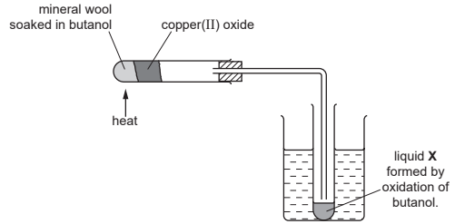

i) Give the name of another reagent which can oxidise butanol.

[1]

ii) Which homologous series does liquid **X** belong to?

[1]

iii) State the formula of liquid **X**.

[1]

*Source: 2016 Sp4 Q8C*

**Q16** [5 marks]

#### Separate: Chemistry and Extended Only

The alcohol ethanol can be made by fermentation. Yeast is added to aqueous glucose.

C6H12O6 (aq) → 2C2H5OH (aq) + 2CO2 (g)

Carbon dioxide is given off and the mixture becomes warm, as the reaction is exothermic. The graph shows how the rate of reaction varies over several days.

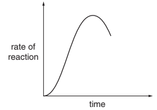

i) Suggest a method of measuring the rate of this reaction.

[2]

ii) Why does the rate initially increase?

[1]

iii) Suggest **two **reasons why the rate eventually decreases.

[2]

*Source: 2016 O31 Q8D*

### Q17 — medium — 13 marks

**Q17** [1 mark]

The structures of six organic compounds are shown.

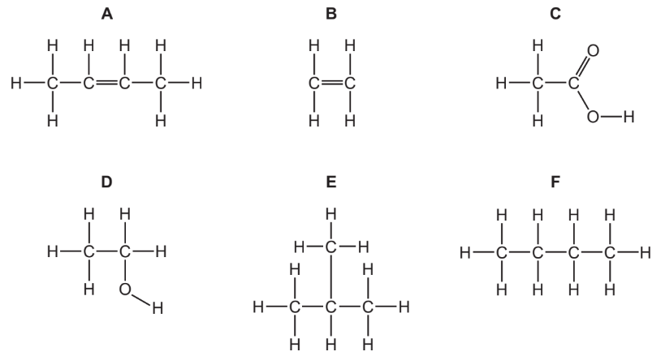

Give the name of **F**.

*Source: 2016 Ju43 Q2A*

**Q17** [2 marks]

**Extract:**

The structures of six organic compounds are shown.

#### Separate: Chemistry Only

Identify **two **of the compounds that are members of the same homologous series.

Give the general formula of this homologous series.

compounds ..................................................

general formula ..................................................

*Source: 2016 Ju43 Q2B*

**Q17** [3 marks]

**Extract:**

The structures of six organic compounds are shown.

#### Separate: Chemistry and Extended Only

Which **two **compounds are isomers of each other?

Explain why they are isomers.

compounds ........................................................................

explanation ........................................................................

*Source: 2016 Ju43 Q2C*

**Q17** [2 marks]

**Extract:**

The structures of six organic compounds are shown. [6-compounds-cie-igcse image]

B is ethene; B has one double bond between carbons / C=C; B contains only carbon and hydrogen atoms.

Explain why **B** is an unsaturated hydrocarbon.

*Source: 2016 Ju43 Q2D*

**Q17** [3 marks]

**Extract:**

The structures of six organic compounds are shown. [6-compounds-cie-igcse]

B is ethene, general formula C~2~H~4~.

B has the general formula C~2~H~4~
D has the general formula C~2~H~6~O

#### Extended Only

Describe how **D** is manufactured from **B**. Give a chemical equation for the reaction.

*Source: 2016 Ju43 Q2E*

**Q17** [2 marks]

**Extract:**

But(-2-)ene and ethene; General formula: C~n~H~2n~ (A and B belong to same homologous series, A has one double bond between carbons / C=C)
A has the general formula C~4~H~8~

#### Extended Only

Compound **A** forms an addition polymer.

Draw **two **repeat units of the addition polymer formed from **A**.

*Source: 2016 Ju43 Q2F*

### Q18 — hard — 18 marks

**Q18** [5 marks]

Propanoic acid is a carboxylic acid. Its formula is CH3–CH2–COOH.

Propanoic acid is the third member of the homologous series of carboxylic acids.

i) Give the name and structural formula of the fourth member of this series.

name ...............................................................

formula ...............................................................

[2]

ii) Members of a homologous series have very similar chemical properties.

State **three **other characteristics of a homologous series.

[3]

*Source: 2014 Ju32 Q4A*

**Q18** [3 marks]

**Extract:**

Propanoic acid is a carboxylic acid. Its formula is CH~3~–CH~2~–COOH. Propanoic acid is the third member of the homologous series of carboxylic acids.

Carboxylic acids can be made by the oxidation of alcohols.

i) Draw the structural formula of the alcohol which can be oxidised to propanoic acid. Show all atoms and bonds.

[1]

ii) Name a reagent, other than oxygen, which can oxidise alcohols to carboxylic acids.

[2]

*Source: 2014 Ju32 Q4B*

**Q18** [3 marks]

**Extract:**

Propanoic acid is a carboxylic acid. Its formula is CH~3~–CH~2~–COOH.

Complete the following equations for some of the reactions of propanoic acid.

The salts of this acid are called propanoates.

i) zinc + propanoic acid → .................... .................... + hydrogen

[1]

ii) calcium oxide + propanoic acid → .................... .................... + ...........................

[1]

iii) LiOH + CH3CH2COOH → .................... + ....................

[1]

*Source: 2014 Ju32 Q4C*

**Q18** [7 marks]

A piece of magnesium was added to 100 cm3 of an aqueous acid. The time taken for the metal to react completely was measured. This experiment was repeated using different aqueous acids. The same volume of acid was used in each experiment and the pieces of magnesium used were identical. In one experiment the reaction was carried out at a different temperature.

| experiment | acid | concentration in mol / dm3 | temperature / oC | time / minutes |
|---|---|---|---|---|
| A | propanoic | 1.0 | 20 | 5 |
| B | propanoic | 1.0 | 30 | 3 |
| C | propanoic | 0.5 | 20 | 8 |
| D | hydrochloric | 1.0 | 20 | 1 |

Explain the following in terms of collision rate between reacting particles.

i) Why is the rate in experiment **C** slower than the rate in experiment **A**?

[2]

ii) Why is the rate in experiment **B** faster than the rate in experiment **A**?

[2]

iii) Why is the rate in experiment **D** faster than the rate in experiment **A**?

[3]

*Source: 2014 Ju32 Q4D*

### Q19 — hard — 10 marks

**Q19** [4 marks]

The alcohols form a homologous series. The first member is methanol and the fourth is butanol.

| CH3–OH  methanol | CH3–CH2–CH2–CH2–OH butanol |
|---|---|

i) Give **two **general characteristics of a homologous series.

[2]

ii) Calculate the mass of one mole of the C8 alcohol.

[2]

*Source: 2005 O31 Q4*

**Q19** [2 marks]

**Extract:**

The alcohols form a homologous series. The first member is methanol and the fourth is butanol. CH~3~–OH methanol | CH~3~–CH~2~–CH~2~–CH~2~–OH butanol

Give the name and structural formula of the third member of this series.

name ..................................................

[1]

structural formula ..................................................

[1]

*Source: 2005 O31 Q4B*

**Q19** [4 marks]

The structural formula of the fifth member, pentan-1-ol, is drawn below.

CH3–CH2–CH2–CH2–CH2–OH

i) Draw the structural formula of an isomer of this alcohol.

[1]

ii)Predict the names of the product(s) formed when pentan-1-ol

- reacts with an excess of oxygen,

....................................... and .......................................

[1]

- is dehydrated to form an alkene,

..................................................

[1]

- is oxidised by acidified potassium dichromate(VI).

..................................................

[1]

*Source: 2005 O31 Q4A*

### Q20 — easy — 1 marks

**Q20** [1 mark]

The diagrams show part of the structures of five substances, A, B, C, D and E.

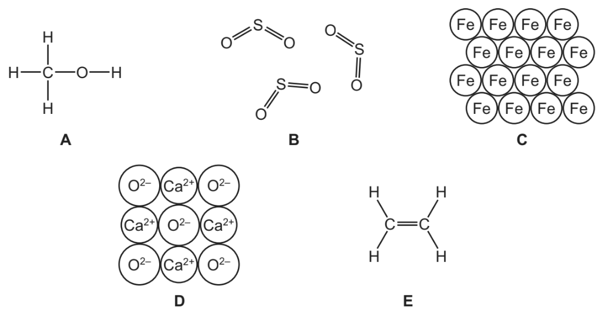

Which one of these structures, A, B, C, D or E is an alcohol?

*Source: 2019 Ju32 Q5A*

### Q21 — easy — 2 marks

**Q21** [1 mark]

One of the organic acids present in milk is lactic acid.

The displayed formula of lactic acid is shown in Fig. 2.2.

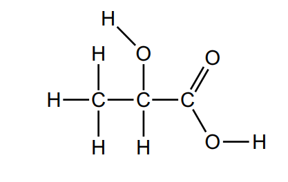

**Fig. 2.2**

Draw a circle around the carboxylic acid functional group on the structure.

*Source: 2016 Specimen3 Q2C*

**Q21** [1 mark]

**Extract:**

One of the organic acids present in milk is lactic acid. The displayed formula of lactic acid is shown in Fig. 2.2.

Deduce the molecular formula of lactic acid.

*Source: 2016 Specimen3 Q2C*

### Q22 — easy — 2 marks

**Q22** [1 mark]

Coal gas is made by heating coal in the absence of air. The list shows the main gases present in coal gas.

**carbon dioxide** 
**carbon monoxide** 
**ethene** 
**hydrogen** 
**methane** 
**nitrogen**

Which one of these gases is an alkane?

*Source: 2019 Ju31 Q5A*

**Q22** [1 mark]

Draw the structure of a molecule of ethene. Show all of the atoms and all of the bonds.

*Source: 2019 Ju32 Q1A*

### Q23 — easy — 5 marks

**Q23** [1 mark]

Methane, ethane and ethene are hydrocarbons.

Draw the structure of a molecule of ethane. Show all of the atoms and all of the bonds.

*Source: 2019 Ju32 Q5B*

**Q23** [1 mark]

Which one of these compounds belongs to the same homologous series as methane?

Draw a circle around the correct answer.

**butane                    methanoic acid                    methanol              propene**

*Source: 2019 Ju32 Q5F*

**Q23** [1 mark]

The structure of a monomer used to make a polymer is shown.

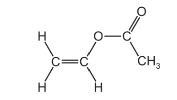

What structural feature of this molecule shows that it is unsaturated?

*Source: 2019 Ju32 Q5F*

**Q23** [2 marks]

**Extract:**

The structure of a monomer used to make a polymer is shown. [image q5f-0620_s19_qp_32] What structural feature of this molecule shows that it is unsaturated?

Describe a test to show that this compound is unsaturated. test                     .................................................... observations     ....................................................

*Source: 2019 Ju33 Q5A*

### Q24 — easy — 1 marks

**Q24** [1 mark]

The structure of nerol is shown.

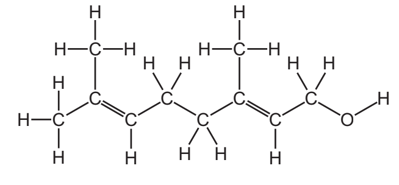

What feature of the nerol molecule shows that it is an unsaturated compound?

*Source: 2020 Ju32 Q7B*

### Q25 — easy — 1 marks

**Q25** [1 mark]

Sulfur dioxide, SO2, is used in the manufacture of sulfuric acid.

When propan-1-ol is heated with concentrated sulfuric acid as a catalyst an unsaturated hydrocarbon of relative molecular mass 42 is formed and one other product.

What is meant by the term unsaturated?

*Source: 2020 Ju41 Q3D*

### Q26 — easy — 1 marks

**Q26** [1 mark]

The structure of nerol is shown below:

Draw a circle around the alcohol functional group in nerol.

*Source: 2020 Ju31 Q7C*

