# Mark Schemes — Organic Families
**11. Organic Chemistry** · Cambridge (CIE) IGCSE chemistry (0620 & 0971)

## Alternative To Practical Questions (5 questions)

### Q1
a)

i) The piece of apparatus labelled is:

- Flask; **[1 mark]**

ii) The labelled arrows are:

- Both arrows labelled water; **[1 mark]**

**[Total: 2 marks]**

- *You should be able to name the flask*
- *This is an older question so it is more likely that you would have to label the bottom / lowest arrow as water in and the top / uppermost arrow as water out to imply that the condenser is filled with water*
b)

i) An electric heater is used to heat this reaction, not a Bunsen burner, because:

- To prevent fire 
**OR **
Correct reference to safety 
**OR **
To control the heating;** [1 mark]**
- (Because,) ethanol is flammable; **[1 mark]**

ii) A condenser is necessary to:

- Prevent evaporation / loss of reactants / ethanol; **[1 mark]**

**[Total: 3 marks]**

- *You should know that ethanol is a flammable alcohol*

  - *So, the use of a Bunsen burner could cause a fire*
- *This reaction is done under reflux to ensure that the contents of the flask react to completion*

  - *If there was no condenser then the mixture would be heated and then could evaporate out of the flask *
c) The completed table to show the difference in smell between ethanol and ethanoic acid is:

|   | smell |
|---|---|
| ethanol | sweet / nail varnish remover / alcohol / spirit; **[1 mark]** |
| ethanoic acid | vinegar / sour / acid / sharp / pungent; **[1 mark]** |

** ****[Total: 2 marks]**

- *It is unlikely that you will be asked to comment on the smell of chemicals (with the possible exception of esters) due to the potentially hazardous nature of such an activity *

### Q2
a) The heat is applied to:

- One arrow pointing to the liquid alkane on mineral wool;** [1 mark]**
- One arrow pointing to the aluminium oxide; **[1 mark]**

**[Total: 2 marks]**

- *The aluminium oxide catalyst is heated until it glows *
- *The liquid alkane on the mineral wool is then gently heated*
- *This vapourises the liquid alkane so that it passes over the aluminum oxide where it can be cracked*
b) The test to show the presence of ethene is:

- Test: bromine water; **[1 mark]**
- Result: Turns colourless / decolourises;** [1 mark]** *Correct colour changes are accepted Turns clear is not accepted *

**[Total: 2 marks]**

- *The most common answer to this question is that bromine water turns from orange-brown to colourless*
c) The delivery tube should be removed from the water before the heat is turned off because:

- Of the suck-back problem; **[2 marks] ***Allow descriptions of the water being sucked back up the delivery tube as the test tube cools which can lead to breaking glass*

**[Total: 2 marks]**

- *When the heat is removed, the gases inside in the test tube will start to cool and contract*
- *This means that the delivery tube will suck in air if it has already been removed from the water*
- *But it will suck the cold water back if it is still in the water which makes the glass of the test tube suddenly cool and cause breakages *

### Q3
a) The purpose of the mineral wool is:

- To absorb / hold / contain the liquid; **[1 mark]**

**[Total: 1 mark]**

- *Use the diagram to help you with this one- the alkane is a  liquid and so must be contained in the test tube, the mineral wool does that*
b) This reaction is called:

- Cracking; **[1 mark]**

**[Total: 1 mark]**

- *The diagram shows a test tube containing liquid alkane being heated and forming ethene *
- *Cracking is the use of high temperatures and a catalyst (the aluminium oxide) to break down long chain alkanes into smaller, more useful alkanes and an alkene*
- *This is how cracking is carried out in a lab*
c) A test and result for ethene is:

- Test: bromine water; **[1 mark]**
- Result: turns colourless; **[1 mark]**

**[Total: 2 marks]**

- *You must know this test! *
- *When orange bromine water is added to an alkane, it does not react and so the solution remains orange*
- *When the bromine water is added to an alkene, they react and bromine is added across the carbon carbon double bond resulting in dibromoethene, which is colourless*
- *Make sure you **don't say clear**, this is not an acceptable answer. *
d) The precaution that should be taken in the experiment when the heat is removed is:

- Remove the delivery tube from the water; ** [1 mark]**
- To prevent suck back or similar effect;** [1 mark]**

**[Total: 2 marks]**

- *If the heat is taken away the gas inside the tube with alkane cools down quickly *
- *This reduces the pressure in that tube causing some of the water to be sucked up the delivery tube and into the tube with alkane in which can cause a vigorous reaction*

### Q4
a) The purpose of the airlock in the apparatus is:

- To prevent air / oxygen entering the jar / fermenting mixture **OR **To prevent bacteria entering the jar / fermenting mixture; **[1 mark]**

**[Total: 1 mark]**

- *For fermentation to occur, the reaction needs to proceed without oxygen*
- *The airlock stops air / oxygen entering the fermenting mixture*
b) The apparatus that could be used in Step 1 is:

- Mortar and pestle; **[1 mark]**

**[Total: 1 mark]**

- *You should automatically think of a pestle and mortar when you are being asked to name some laboratory equipment that can be used to crush something*
c) The labelled diagram of the apparatus used to separate the crushed elderberries from the mixture in Step 2 is:

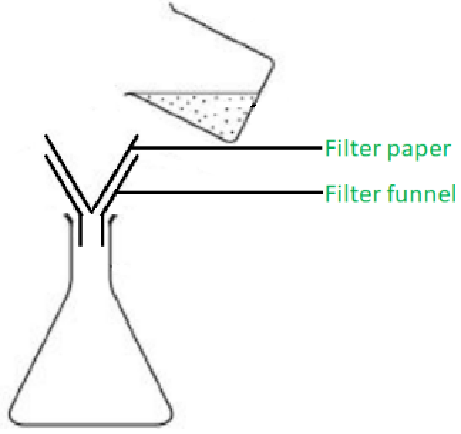

- Filter paper; **[1 mark]**
- Filter funnel; **[1 mark]**

**[Total: 2 marks]**

- *In step 2, the solid residue of crushed berries is removed from the mixture to produce a solution*
- *Removing a solid from a liquid-based mixture requires filtration *
d) The yeast in Step 3 is not added until the liquid was at room temperature because:

- Yeast does not work at high temperature 
**OR **
Yeast is killed / denatured at high temperature; **[1 mark]** *Accept the word enzyme in place of yeast*

**[Total: 1 mark]**

- *There is overlap here with Biology but you should know that yeast does not work at high temperatures because it has been killed / denatured*
e)

i) **One **observation during the fermentation is:

- Bubbles / froth; **[1 mark]** *Do not accept gas / carbon dioxide released or turns cloudy*

ii) The rate of the fermentation reaction could be measured by:

- Measuring the volume of gas released 
**OR **
Counting the bubbles; **[1 mark]**
- Over a set amount of time;** [1 mark]**

**[Total: 3 marks]**

- *A common mistake in this type of question is to suggest measuring the volume of gas / number of bubbles but forgetting to mention time*

  - *You cannot measure / calculate rate without a measurement of time*
f) The method that could be used to separate ethanol from the fermented mixture is:

- <u>Fractional</u> distillation; **[1 mark]**

**[Total: 1 mark]**

- *The fermented mixture will contain water (b.p. = 100 **O**C) and ethanol (b.p. = 78 **o**C)*
- *Since both of these chemicals have relatively close boiling points, they are separated by fractional distillation*

### Q5
a) **Two **mistakes in the diagram are:

- The heat is being applied in the wrong position 
**OR **
It should be heating the aluminium oxide;** [1 mark]**
- There is no water in the trough / container; **[1 mark]**

**[Total: 2 marks]**

- *The heat is pointing at / being applied to the rubber bung - this is not a good idea*
- *Ethene gas should be being collected under water and bubbling into the test tube *
b) The test to show the presence of ethene is:

- Test: bromine water / iodine water; **[1 mark]**
- Result: Turns colourless / decolourises;** [1 mark]** *Correct colour changes are accepted Turns clear is not accepted *

**[Total: 2 marks]**

- *The most common answer to this question is that bromine water turns from orange-brown to colourless*
- *It is not very common (nowadays) to see iodine water as an answer*

## Multiple Choice Questions (41 questions)

### Q1
**Final answer:** **The correct answer is D**

- To identify the reactants that formed an ester, you must split the ester linkage (−COO−) as shown in the image below

- The part of the molecule containing the carbonyl group (*C*=*O*) originates from the **carboxylic acid**
- In butyl methanoate (the ester above), this part contains only 1 carbon atom, meaning the parent acid is **methanoic acid**

- The part of the molecule attached to the single-bonded oxygen atom originates from the **alcohol**
- In this ester, that carbon chain contains 4 carbon atoms, meaning the parent alcohol is **butan-1-ol**

### Q2
**Final answer:** **The correct answer is B**

- **Products**

  - Alkanes undergo substitution reactions with halogens
  - One chlorine atom replaces one hydrogen atom on the alkane chain to form chloropropane (C3H7Cl )
  - The displaced hydrogen atom bonds with the remaining chlorine atom to form** **hydrogen chloride (HCl) gas
- **Condition**

  - This is a photochemical reaction, which means it requires **ultraviolet (UV) light** to provide the activation energy needed to break the bonds in the chlorine molecules

**A **& **D **are incorrect because hydrogen gas (H2) is not a product during the substitution reaction

**C **is incorrect because the condition for the reaction is the presence of ultraviolet light, high temperature and a catalyst are conditions for other common organic reactions from the syllabus

### Q3
**Final answer:** **The correct answer is B**

- **Statement 1 is correct**

  - The ethene used in hydration is obtained from the cracking of fractions of petroleum (crude oil), which is a finite, **non-renewable** resource
  - Fermentation uses glucose obtained from crops like sugar cane or maize, which are **renewable** raw materials
- **Statement 2 is incorrect**

  - Hydration is a **continuous process**, which is very fast and efficient
  - Fermentation is a **batch process** which is slow and inefficient because the reaction vessel must be emptied and cleaned after every batch
- **Statement 3 is correct**

  - Hydration requires high temperatures (300 °C) and high pressures (60 atm)
  - Fermentation requires a low, controlled temperature (typically 25–35 °C) because higher temperatures would denature the yeast enzymes acting as the catalyst

### Q4
**Final answer:** **The correct answer is A**

- The bromine water test is used to distinguish between alkenes and other organic compounds
- Substances that decolourise bromine water are unsaturated hydrocarbons (alkenes)
- This is because the bromine diatomic (Br2) can react via an **addition reaction **across C=C double bond, turning the orange bromine water into colourless

  - Since Y and Z can decoulourise bromine water, Y and Z must be alkenes
  - X does not decolourise bromine water, so X is not an alkene
- X and Z have the same number of carbon atoms
- Y has one more carbon atom than X and Z

  - By checking the rows of the table, if Z is ethene (2 carbons), then Y must be propene (3 carbons)
  - If Z is ethene then X must start with the prefix **eth-**
- X is manufactured by the hydration of Z with steam
- Hydration is the process of adding water (steam) to the C=C double bond
- One hydrogen of water will bond to one carbon, while the OH group will bond to the other carbon

  - The hydration of ethene produces ethanol
  - Therefore Z = ethene and X = ethanol
- Putting it all together:

  - X = ethanol
  - Y = propene
  - Z = ethene

**B **& **D **is incorrect because Y is not butene. Butene has two more carbons than ethene, not one

**C **is incorrect Z is not ethanol. Ethanol is not an unsaturated hydrocarbon and it does not decolourise bromine water

### Q5
**Final answer:** **The correct answer is C**

- Crude oil (petroleum) is a mixture of hydrocarbons with different chain lengths
- In **fractional distillation**, crude oil is heated so that most of it vaporises
- The vapours enter a **fractionating column**, which is **hot at the bottom and cooler at the top**

  - Hydrocarbons with **high boiling points** (long-chain molecules) **condense low down** in the column
  - Hydrocarbons with **low boiling points** (short-chain molecules) **rise higher** before condensing
- As chain length increases, hydrocarbons have **stronger intermolecular forces**

  - Stronger intermolecular forces mean **higher boiling points**, **higher viscosity**, and **lower volatility**
  - This explains why fractions with longer carbon chains are more viscous liquids
- Therefore, the viscosity of the fractions increases as chain length increases, so C is correct

**A **is incorrect because fractions with more carbon atoms have higher boiling points, not lower. This is because larger molecules have strong intermolecular forces of attraction

**B **is incorrect because fractions with small molecules have low boiling points and rise to the top of the fractionating column

**D **is incorrect because refinery gases contain short-chain hydrocarbons, which are more volatile than long-chain hydrocarbons

### Q6
**The correct answer is ****C**** because**** **ethanol is formed by the **fermentation** of **glucose** by organisms such as yeast and plants.

**A **is incorrect as **combustion **of ethane would not produce ethanol.

**B **is incorrect as **combustion **of glucose would not produce ethanol.

**D **is incorrect as **fermentation** of ethane would not produce ethanol.

### Q7
**Final answer:** **The correct answer is ****D**** because:**

- A **homologous** series is a family of chemicals with **similar properties** that share the same general formula and which have the same **functional group**.
- Butene, C4H8 and octene, C8H16, each have a **carbon-carbon double bond**. This is the functional group of the **alkenes**.

**A, B** and **C ** are incorrect because each of these properties will be different between each member of a homologous series.

### Q8
**The correct answer is ****A**** because **ethanol is formed by the **catalytic hydration** of **ethene,** not ethane.

**B **is incorrect as the complete combustion of **ethanol** in excess oxygen produces carbon dioxide and water and heat, so it can be used as a fuel:

C2H5OH +3O2 → 2CO2 + +3H2O

**C **is incorrect as **ethanol **is an important solvent in many industrial processes.

**D **is incorrect as the **functional group** of alcohol is -OH

### Q9
**Final answer:** **The correct answer is ****C**** because:**

- The industrial process is **fractional** **distillation**.
- Fractional distillation separates the hydrocarbons in crude oil based on the **boiling points**. The boiling points are different due to the molecular mass.
- The product that is used as aircraft fuel is **paraffin** (this is also known as **kerosene**.)

**A **is incorrect as the substance is not petrol, petrol is not used in aircraft as a fuel.

**B **and** D  **are incorrect as the industrial process is not thermal decomposition. Fractional distillation does not break the molecules but separates the mixture based on boiling point.

### Q10
**Final answer:** **The correct answer is ****B**** because:**

- **Incomplete combustion** of **alkanes** in general produces carbon and/or carbon monoxide along with water

  - hydrocarbon + oxygen → carbon monoxide + carbon + water
- Carbon dioxide is formed with a plentiful supply of oxygen, during complete combustion
- Carbon monoxide is formed with a limited supply of oxygen
- Carbon is formed with a **very** limited supply of oxygen

  - Exam questions will sometimes indicate if the product of incomplete combustion is carbon monoxide or carbon

**A **is incorrect as this is the balanced symbol equation for the **complete** **combustion** of methane

**C **is incorrect as hydrogen is not a product of the combustion of alkanes

**D **is incorrect as this is not a balanced equation and has hydrogen gas as a product.

### Q11
**The correct answer is ****D**** because **the products of a reaction between a **carboxylic acid** and an **alcohol, **in the presence of a catalyst, are an **ester** and water.

**A, B** and **C **are incorrect as they are not the products from this type of reaction.

### Q12
**Final answer:** **The correct answer is ****B**** because:**

- Aqueous ethanoic acid is a **weak acid.**
- A weak acid only partially dissociates in an aqueous solution. Remember pH is a measure of the concentration of hydrogen ions in solution.
- **Methyl orange **is an **indicator** that changes from orange to yellow in the pH range of 3.1 - 4.4.
- The pH of ethanoic acid is higher than the range detected by methyl orange.

**A, C** and **D **are incorrect as all of the statements correctly describe carboxylic acids.

### Q13
**Final answer:** **The correct answer is ****D**** because:**

- **Fermentation** is a metabolic process that produces **ethanol **from **glucose **and other sugars.
- The sugars used in fermentation are from plants and so are a renewable resource.
- **Ethene** is extracted from petroleum (crude oil) and so is non-renewable.

**A, B** and **C **are incorrect as all of the processes are features of **ethanol** production from **ethene.**

### Q14
**Final answer:** **The correct answer is ****C**** because:**

- Gas **Y **is an alkene as it has a **carbon carbon** **double bond.**
- The double bond in the alkene breaks and bromine is added to the molecule, this causes the **discolouration** of the bromine water.
- This reaction shows **halogenation.**

**A, B **and** D **are incorrect as none of these compounds have a **carbon carbon double bond.**

### Q15
**Final answer:** **The correct answer is ****D**** because:**

- **P** is **cracking. **The process of **cracking** involves breaking large **hydrocarbon ** molecules into smaller molecules.
- **Cracking **of butane creates ethane and ethene:

- **Q** is the **hydration **of ethene, water is added as steam in the presence of a **catalyst** and **ethanol** is produced.

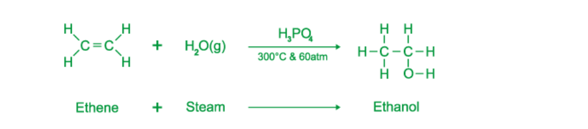

- **R** is the complete **combustion** of **ethanol** which produces carbon dioxide and water

  - C2H5OH + 3 O2     →   2 CO2 + 3 H2O

**A **is incorrect as **distillation **is the separation of substances based on boiling point. **Fermentation **is a metabolic process carried out by organisms such as plants and yeast. **Respiration ** is a metabolic process carried out by many organisms to release energy.

**B** is incorrect as process P is incorrectly labelled as distillation.

**C** is incorrect as process Q and R are incorrectly labelled as fermentation and respiration.

### Q16
**Final answer:** **The correct answer is ****D**** because:**

- **Halogenation **is the replacement of one or more hydrogen atoms in an organic molecule by a **halogen** (fluorine, chlorine, bromine or iodine).
- The **halogenation** of an alkane is an example of a **substitution reaction.**

**A **is incorrect as the combination of **alkanes** with oxygen, generating heat is known as **combustion.**

**B **is incorrect as **polymerisation** is the joining of simple single repeating units into a **polymer.**

**C **is incorrect as **thermal decomposition** is the breakdown of a molecule using heat.

### Q17
**Final answer:** **The correct answer is ****A**** because:**

The process of **cracking** involves breaking large **hydrocarbon ** molecules into smaller molecules.

**Cracking **alkanes can produce; a shorter chain **alkane** or **alkene** or 1 or more shorter **alkenes** and **hydrogen**.

The molecule C4H8 has one more carbon and the original molecule of propane C3H8.

**B, C** and **D **are incorrect as all of these molecules could be a product of **cracking **of propane.

### Q18
**Final answer:** **The correct answer is ****C**** because:**

- The structure shown is **ethanoic acid**.
- Ethanoic acid is a colourless, aqueous solution that has a pungent smell.

**A, B** and** D **are incorrect as they do not correctly identify the properties of ethanoic acid.

### Q19
**Final answer:** **The correct answer is ****A**** because**

- The boiling point of the hydrocarbon depends on the **molecular** **mass**. The **larger** the molecular **mass** the **higher** the **boiling** **point**.
- Larger molecules have more **intermolecular** **forces** which hold the molecules together, so more energy is needed to overcome these forces for a state change.
- Smaller molecules have less intermolecular forces between the molecules so need less energy to overcome these forces.

**B, C** and **D ** are incorrect because they all have boiling points above A and therefore bigger molecules.

### Q20
**The correct answer is ****B**** because **ethanol is formed by the **catalytic hydration** of **ethene** with steam.

**A, C** and **D **are incorrect as these substances are not used to make ethanol.

### Q21
**Final answer:** **The correct answer is ****A**** because**

- The Motor vehicle industry requires large quantities of **gasoline** (petrol) and **diesel**.
- The table shows that North Sea has the largest percentage of these two products

The other compositions do not contain as much gasoline and diesel as North Sea so are not correct answers.

### Q22
**Final answer:** **The correct answer is ****C**** because:**

- **R** will decolourise bromine water.
- Compound **R** is an **alkene** with a **carbon carbon double bond**.
- This will react with the **bromine water** in a **halogenation** reaction.
- **P** has** 7** carbon atoms:

  - The process of **cracking** involves breaking large **hydrocarbon ** molecules into smaller molecules.
  - The total number of carbon atoms in the two smaller molecules is **7**. Carbon atoms are not lost in the reaction.

**A, B** and **D **are incorrect as Q is not unsaturated, this has no **carbon carbon double bonds**. Q will be an alkane, butane.

### Q23
**Final answer:** **The correct answer is ****B**** because:**

- Petroleum (crude oil) is a mixture of different hydrocarbons with different chain lengths and physical properties.
- Petroleum is separated through **fractional distillation**, which separates the molecules with similar boiling points called fractions.
- The fractions have a boiling point range; the boiling point depends on the molecular mass of the molecules.
- The **larger** the molecular **mass** the **higher** the **boiling** **point**; therefore larger molecules with high boiling points are separated at the bottom of the column.
- The shorter, lighter chains are separated at the top of the column.

**A, C** and **D ** are incorrect because chemical reactivity and solubility in water does vary with each fraction but these properties are not used to separate the mixture into fractions.

## Theory Questions (47 questions)

### Q1
> **[mark-scheme]**
> i)
> 
> - CnH2n+1OH **[1 mark]**
> 
> ii)
> 
> - butan-1-ol **[1 mark]**
> 
> **Accept** butan-2-ol **OR** butanol

**[2 marks]**

> **[mark-scheme]**
> 1 mark for a continuous chain of 3 carbon atoms with the −OH group attached to the middle (second) carbon atom
> 
> 1 mark for the fully correct displayed formula of propan-2-ol showing all atoms and all bonds **(including the bond between O and H)**
> **[mark-scheme]**
> Any **two** from:
> 
> - temperature of 300 °C / high temperature
> - pressure of 6000 kPa / 60 atm / high pressure
> - (phosphoric) acid catalyst
> 
> **[2 marks]**
> **[mark-scheme]**
> Any **two** from:
> 
> - uses renewable raw materials (or sugar cane / crops)
> - requires a lower temperature / less heat energy
> - requires lower pressure
> - cheaper
> - simple equipment needed
> 
> **[2 marks]**
> **[mark-scheme]**
> - compound X: propanoic acid **[1 mark]**
> - compound Y: water **[1 mark]**

> **[exam-tip]**
> For ester questions, split the name into two parts. The **first part** (e.g. ethyl) comes from the **alcohol** (ethanol), and the **second part** (e.g. propanoate) comes from the **carboxylic acid** (propanoic acid). Remember that **water is always formed as the by-product** in esterification.
For determining the empirical formula, you must follow these simple steps:

**Step 1: **Calculate the amount of moles using the percentages as the amount of grams in the sample

$\mathrm{moles}=\frac{\mathrm{mass}}{M_{r}}$

Carbon (C):

$n=\frac{37.5}{12}=3.125$

Hydrogen (H):

$n=\frac{12.5}{1}=12.5$

Oxygen (O):

$n=\frac{50}{16}=3.125$

**[1 mark]**

**Step 2: **Divide each number of moles by the smallest number among them

- In this case, the smallest number of moles is **3.125**

Carbon (C):

$n=\frac{3.125}{3.125}=1$

Hydrogen (H):

$n=\frac{12.5}{3.125}=4$

Oxygen (O):

$n=\frac{3.125}{3.125}=1$

**[1 mark]**

**Step 3: **Use the calculated whole numbers as the subscripts for each element, indicating the amount of atoms in the empirical formula

The empirical formula of **A** is **CH****4****O ****[1 mark]**

> **[mark-scheme]**
> 1 mark for calculating the amount of moles correctly
> 
> 1 mark for dividing the number of moles by the smallest among them
> 
> 1 mark for reporting the correct answer

> **[exam-tip]**
> In empirical formula calculations, keep **up to three decimal places in intermediate steps** (such as when calculating moles). Only round at the end. If the final ratios end in **0.5**, multiply all values by **2**; if they end in **0.33 or 0.67**, multiply all values by **3** to obtain whole-number ratios.
To determine the molecular formula from the empirical formula, follow these steps:

**Step 1: **Add the relative atomic masses of the atoms in the empirical formula.

For **CH****2****O**:

*M*r empirical formula = C + 2 ×  H + O

*M*r empirical formula  = 12 + 2 + 16

*M*r empirical formula  =** 30** **[1 mark]**

**Step 2: **Divide the molecular mass by the empirical formula mass to obtain a whole number

Molecular mass =** **60

whole number = 60 ÷ 30 = 2

**Step 3: **Multiply all atoms in the empirical formula times the calculated whole number

(CH2O) × 2

The molecular formula is **C****2****H****4****O****2 ****[1 mark]**

> **[mark-scheme]**
> 1 mark for calculating relative molecular mass of the empirical formula
> 
> 1 mark for reporting the correct answer

### Q2
> **[mark-scheme]**
> Any **two** from:
> 
> - Same functional group
> - Same general formula
> - Similar chemical properties
> - Trend in physical properties
> - Each member differs by –CH2
> 
> **[2 marks]**
i)

| type of atom | number of atoms | relative atomic mass |   |
|---|---|---|---|
| carbon | 6 | 12 | 6 x 12 = 72 |
| hydrogen | **Final answer:** **12** | 1 | **Final answer:** **12 x 1 = 12** |
| oxygen | **Final answer:** **2** | 16 | **Final answer:** **2 x 16 = 32** |

relative molecular mass = **116**

**[2 marks]**

> **[mark-scheme]**
> - **2 marks** for correctly calculating the relative molecular mass as 116
> 
> If your final answer is not 116, **you can still gain 1 method mark** for:
> 
> - Correctly calculating 12 × 1 = 12 for hydrogen **OR**
> 
>   - This is the contribution of hydrogen to the relative molecular mass of hexanoic acid
> - Correctly calculating 2 × 16 = 32 for oxygen
> 
>   - This is the contribution of oxygen to the relative molecular mass of hexanoic acid

> **[exam-tip]**
> Do not just write the final *M*r! Fill in the table and show each multiplication (e.g. 12 x 1, 2 x 16).
> 
> If you make a calculator slip at the end, c**lear working can still earn you the method mark**

ii)

- The **empirical formula** show the smallest ratio between the atoms in a molecule
- Start by counting the atoms directly from the displayed formula, do not guess.
- For hexanoic acid: C6H12O2
- Now simplify the ratio by dividing all numbers by 2: 6 : 12 : 2 → 3 : 6 : 1
- So the empirical formula is **C****3****H****6****O** **[1 mark]**

> **[exam-tip]**
> Double check! If there greatest common factor between all the atoms is 1, **the molecular formula is the same as the empirical formula**
> **[mark-scheme]**
> - pH 4 **[1 mark]**
> **[mark-scheme]**
> i) If the temperature of the dilute acid is decreased:
> 
> - Time increases / takes longer **[1 mark]**
> 
> ii) If large lumps of calcium carbonate are used instead of powder:
> 
> - Time increases / takes longer  **[1 mark]**
> 
> iii) If 10 cm3 of water is added to the dilute acid:
> 
> - Time increases / takes longer **[1 mark]**

> **[exam-tip]**
> Make sure you answer in terms of **time taken**, not rate.
> 
> If you are thinking “the rate decreases,” you must write **“the time taken increases.”**
> If the rate increases, write **“the time taken decreases.”**
> 
> Answer exactly what is asked, you  lose marks by giving the right idea in the wrong form.
> **[mark-scheme]**
> i) The term monomer is:
> 
> - Small molecules/units that join together to form a polymer/long chain **[1 mark]**
> 
> ii) One pollution problem caused by non-biodegradable plastic:
> 
> Any **one **from:
> 
> - Fills up landfill sites
> - Animals ingest them
> - Release toxic gases when burnt
> - Block drains
> 
> Accept any other valid **consequence generated directly by plastics**. Do not accept "global warming" unless linked to burning them
> 
> **[1 mark]**

### Q3
a)

i) The empirical formula can be found by:

- 82.76 / 12 **AND **17.2(4) (/1) 
**OR** 
Evaluation: 6.897 / 6.9(0) **AND **17.2(4); **[1 mark]**
- Empirical formula: C2H5;** [1 mark]**

**OR**

- 82.76 / 100 x 58 = 48 **AND **17.24 / 100 x 58 = 10 
**OR** 
Evaluation i.e. 48 **AND **10; **[1 mark]**
- Empirical formula: C2H5;** [1 mark]**

ii) The molecular formula of compound **X** can be found by:

- (*M*r of C2H5 =) 29; **[1 mark]**
- (58 / 29 = 2) C4H10;** [1 mark]**

**OR**

- 82.76 / 100 × 58 = 48 **AND **17.24 / 100 × 58 = 10 
**OR** 
Evaluation i.e. 48 **AND **10; **[1 mark]**
- 48 / 12 = 4 **AND** 10 / 1 = 10 (therefore) C4H10; **[1 mark]**

**[Total: 4 marks]**

- *To calculate the empirical formula when given percentages, it is easiest to assume that you have 100 g of the sample, then you can work out the number of moles of each element in 100 g by using the **M**r**:*

|   | > *C* | > *H* |
|---|---|---|
| > *Calculate the number of moles of each element in 100g (% / **M**r**)* | $\frac{82.76}{12}\,=6.897$ | $\frac{17.24}{1}\,=17.24$ |
| > *Divide by the smallest number to find the smallest ratio* | > *6.897/6.897 = 1* | > * 17.24/6.897 = 2.5* |
| > *Multiply both by the same number to give a whole number ratio* | > *1 x 2 = 2* | > *2.5 x 2 = 5* |

- *The empirical formula is therefore C**2**H**5*
- *M**r** of compound X  = (2 x 12) + (5 x 1) = 29*
- *M**r** of compound X = 59*
- *59 / 29 = 2*
- *Therefore the molecular formula is 2 x C**2**H**5 **= C**4**H**10*
b)

i) The general formula of alkenes is:

- CnH2n; **[1 mark]**

ii) The empirical formula of alkenes is:

- CH2; **[1 mark]**

**[Total: 2 marks]**

- *The empirical formula is the simplest whole number ratio of atoms in a compound*
- *In an alkene, there is one carbon atom for every 2 hydrogen atoms*
c) The term *unsaturated *means:

- (Contains) double bond / triple bond / multiple bond(s) / not all bonds are single; **[1 mark]**

The term *hydrocarbon *means:

- (Contains) carbon and hydrogen only; **[1 mark]**

**[Total: 2 marks]**

- *Remember: **S**aturated compounds contain **S**ingle bonds, **U**nsaturated compounds contain do**U**ble bonds*
- *When defining the **hydrocarbons**, the word 'only' is very important as there are lots of compounds that contain carbon, hydrogen and atoms of other elements that are not classed as hydrocarbons*
d) A suitable reagent and observations to distinguish between saturated and unsaturated hydrocarbons is:

- Reagent: bromine/ bromine water; **[1 mark]**
- Observation (saturated hydrocarbon): no change/ stays brown/ orange/ yellow/red-brown or only changes in UV; **[1 mark]**
- Observation (unsaturated hydrocarbon): (brown/ orange/ yellow) to colourless / decolourised;** [1 mark]** 'Clear'  is not an acceptable answer

**[Total: 3 marks]**

- *When bromine water is an orange solution*
- *When it is added to an alkane no reaction occurs so the colour remains the same*
- *When it is added to an alkene, the bromine atoms add across the C=C double bond, hence the solution no longer contains the orange coloured bromine and the solution decolourises*

  - *Remember, clear is not an acceptable answer, you must state colourless*
e)

i) One repeat can be shown as:

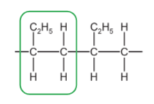

- Circle / brackets around any 2 consecutive carbon atoms in the main chain **AND **all attached atoms; **[1 mark]**

ii) The structure and name of the monomer used to make this polymer are:

- Structure: CH3CH2CH=CH2 / C2H5CH=CH2 (double bond must be shown); **[1 mark]**
- Name: butene / but-1-ene; **[1 mark]**

iii) The structure of an isomer of the alkene in (e)(ii) is:

Any **one** from:

- (CH3)2C=CH2; **[1 mark]**
- CH3CH=CHCH3: **[1 mark]**
- (CH2)2CHCH3 / (CH2)4; **[1 mark]**

**[Total: 4 marks]**

- *To determine the structure of the monomer:*

- *This is butene as the carbon chain contains 4 carbon atoms - don't forget to include the carbons in C**2**H**5** attached to one of the carbons involved in the C=C double bond*
- *Isomers of C**4**H**8** are:*

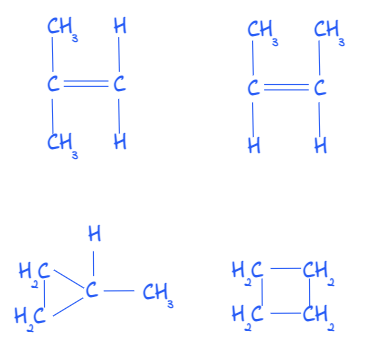

- *The bottom two structures are types of cycloalkanes which include a closed ring of carbons atoms*
- *These are beyond the scope of the course so you are not expected to know these but they are correct so you would be given credit for them*

### Q4
a)  Two chemicals that could be used to make this ester and draw their structural formulae are:

- Butanol; **[1 mark]** 
*No number needed but if one is given it has to be 1*
- Structural formula (all bonds shown); **[1 mark]** 
*Accept –OH NOT –HO*
- Ethanoic acid; **[1 mark]**
- Structural formula (all bonds shown); **[1 mark]** 
*Accept –OH NOT –HO* *No conseq marking* 
*if all bonds are not shown ( CH**3**–CH**2**–), penalise once*

**[Total: 4 marks]**

- *Esters have the functional group -COO-*
- *The carbon chain on the left hand side that forms part of the COO group is from the carboxylic acid used: *

  - *There are a total of two carbon atoms and so ethanoic acid was used *
- *The carbon chain on the right hand side bonded to the oxygen atom of the C-O bond is from the alcohol used:*

  - *There are a total of four carbon atoms and so butanol was used *
- *To name this ester, the first part of the name comes from the alcohol and the second part from the carboxylic acid *

  - *So the ester formed from** but**anol** **and **ethan**oic acid is called **butyl ethan**oate*
b)

i) The structural formula of a polyester such as Terylene  is:

- Must have correct ester linkage; **[1 mark]**
- Bond continuation and a group on either side of the ester group; **[1 mark] **
Accept –COO-

ii) A use for this polymer is:

Any **one** from:

- Ropes; **[1 mark]**
- Clothing; **[1 mark]**
- Bottles; **[1 mark]**
- Packaging; **[1 mark]**
- Bags; **[1 mark]** 
*Accept any reasonable suggestion*

**[Total: 3 marks]**

- *Terylene is the trade name for PET*
- *You do not need to know the detailed structure of PET but should be able to draw the alternating blocks containing the carbon chains, and the linking ester groups as shown below:*

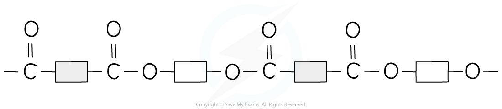

### Q5
a)

i) A different equation for the cracking of octane is:

- Any correct equation; **[1 mark]** 
E.g C8H18 → C6H14 + C2H4

ii) The structural formulae of two of these isomers are:

Any** two** from:

- Structural formulae of but-1-ene; [**1 mark]**
- Structural formula of but-2-ene; **1 mark]**
- Structural formula of methylpropene; **1 mark]**
- Structural formula of cyclobutane; **1 mark]**

**[Total: 3 marks]**

- *As with any symbol equations, the number of atoms for each element need to be balanced on both sides*
- *Cracking produces an alkane and alkene so the formula for these also need to be correct according to their general formulas C**n**H**2n+2** and C**n**H**2n** respectively*
- *Equations you could have include:*

  - *C**8**H**18** → C**7**H**16 **+ C**3**H**6*
  - *C**8**H**18** → C**6**H**14** + C**2**H**4*
  - *C**8**H**18** → C**5**H**12** + C**3**H**6*
- *Structural isomers will have the same molecular formula (C**4**H**8**) but their atoms arranged differently *
- *The easiest isomers to do in this case are but-1-ene and but-2-ene where you can just place the double bond in a different position but methylpropene and cyclobutane are also accepted:*

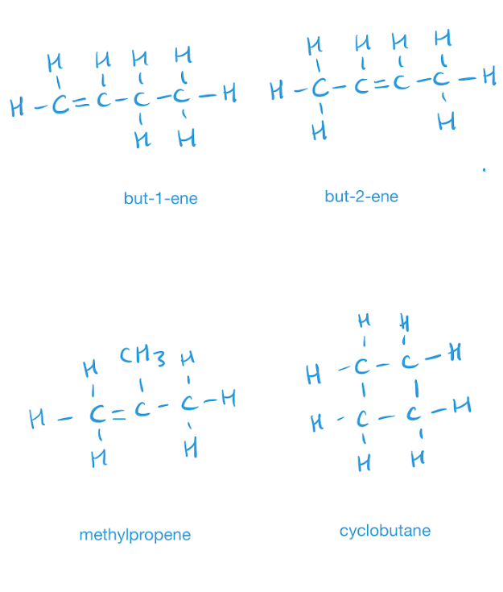
b)

i) The essential condition for the reaction between chlorine and butane is:

- Light / UV / 200°C; **[1 mark]**

ii) This type of reaction is:

- Substitution  
**OR** 
Photochemical  
**OR** 
Chlorination 
**OR** 
Free radical 
**OR** 
Halogenation; **[1 mark]**

iii) The names of **two** products that contain four carbon atoms per molecule are:

Any **two **from:

- 1-chlorobutane; **[1 mark]**
- 2-chlorobutane; **[1 mark]**
- Dichlorobutane; **[1 mark]** 
*Accept any other correct product *

**[Total: 4 marks]**

- *Part i) and ii) should be very familiar by now as they appear a lot, make sure you learn these!*
- *Two chlorine atoms could be substituted onto the alkane to form dichlorobutane*
- *One chlorine atom could be substituted to form either 1-chlorobutane or 2-chlorobutane*
- *Remember: **There will be no 3 or 4-chlorobutane as when naming organic compounds you number your carbon atoms from the end which produces the lowest number *
c)

i) The structural formula of the addition product when propene reacts with water is:

- CH3CH2CH2OH 
**OR** 
CH3CH(OH)CH3; **[1 mark]**

ii) The structural formula of the addition product when propene reacts with bromine is:

- CH3CH(Br)CH2Br; **[1 mark]** 
*NOT 1,3-dibromopropane*

**[Total: 2 marks]**

- *When determining the structural formula of addition products it is helpful to identify the name of the product first *
- *Alkenes react with water to form alcohol*
- *Alkenes react with halogens to form haloalkanes*
- *The prefix of the product remains the same*

  - *Ethene reacts with water to form ethanol*
  - *Propene reacts with water to form propanol*
  - *Ethene reacts with bromine to form dibromoethane*
  - *Propene reacts with bromine to form dibromopropane *
d) To calculate the percentage yield:

- Moles of CH3-CH = CH2 reacted = $\frac{1.4}{42}$ = 0.033 mol; **[1 mark]**
- Maximum moles of CH3-CH(I)-CH3 that could be formed = 0.033 mol; **[1 mark]**
- Maximum mass of 2-iodopropane that could be formed = 5.61 g; **[1 mark]** 
*Accept 170 x 0.033 = 5.61 and 170 x 0.033333 = 5.67*
- Percentage yield $\frac{4.0}{5.61}$ x 100 = 70.5%; **[1 mark]**

**[Total: 4 marks]**

- *To calculate percentage yield we use: *$\frac{\mathrm{actual} \mathrm{yield}}{\mathrm{theoretical} \mathrm{yield}}\times100$
- *We therefore need to calculate first the theoretical yield of 2-iodopropane *
- *The moles of CH**3**–CH=CH**2** reacted are determined by using: *$\frac{\mathrm{mass}}{\mathrm{molar} \mathrm{mass}}\mathrm{so}\frac{1.4}{4.2}=0.033\mathrm{mol}$
- *Using the equation, we can see the molar ratio of CH**3**–CH=CH**2** to CH**3**−CHI−CH**3 **is 1:1 and so the number of moles are the same= 0.033 mol*
- *The maximum (theoretical) mass of 2-iodopropane that could be formed = number of moles x molar mass = 0.033 x 170 = 5.61 g*
- *Then calculate percentage yield: *$\frac{4.0}{5.61} = 70.5 \%$

### Q6
a)

i) Enzymes are:

- Biological / protein catalysts; **[1 mark]** *Allow biocatalyst/ living biological catalyst*

ii) A suitable method of measuring the rate of this reaction is:

Any **one** from:

- The time taken for lime water to turn milky; **[1 mark]**
- The time taken for bubbling to stop / gas stop being evolved; **[1 mark]**
- Count the number of bubbles per minute; **[1 mark]**
- Measure the temperature (change) with time; **[1 mark]** 
*Allow other sensible suggestion in accordance with extra guidance*

***Extra guidance to marking:*** *The answer must include both measuring the time and measuring a relevant quantity*
***OR ***
*Alternatively measuring the time taken for something to happen *

*Alternatives to time are: units of time/ apparatus to measure time/regular intervals / how long* *Examples of relevant quantities are: (Increase in/ decrease in) amount/ mass / volume/ bubbles of carbon* *dioxide/ bubbles of gas ****OR ****(Increase in/decrease in) mass of apparatus;*

*Do NOT allow the time taken for the reaction to end or measure carbon dioxide / gas with time (no reference to amount)*

**[Total: 2 marks]**

- *Rate is calculated by the *$\frac{\mathrm{change} \mathrm{in} \mathrm{the} \mathrm{quantity} \mathrm{of} \mathrm{reactants} \mathrm{or} \mathrm{products}}{\mathrm{time}}$* so to monitor rate, you need to measure both a change in the quantity of reactants or products **AND **the time taken for the change to occur*
- *In this reaction, CO**2** is produced so you could think of ways to monitor the amount of gas produced*
- *Collecting the gas using a gas syringe or an inverted measuring cylinder over water is another method of monitoring the volume of gas that is collected which would be an alternative answer you could give*
b)

i) The reaction rate increased because:

- Temperature increase / heat increase / warmer / high temperature / exothermic 
**OR **
Yeast reproduces / increases / multiplies / more yeast; **[1 mark]**

ii) An explanation for the increase in cloudiness of the solution is:

- Yeast reproduces / increases / multiplies / more yeast; **[1 mark]**

iii) **Two **reasons why the fermentation stopped are:

- <u>All</u> glucose / reactant(s) reacted 
**OR **
No glucose / reactant(s) left; 
**OR **
Glucose / reactant(s) used up / finished / runs out / reacted completely /fully reacted; **[1 mark] ***Ignore* glucose / reactants reacted / stopped reacting
- Yeast (cells) dies 
**OR **
Enzymes denatured 
**OR **
Ethanol is toxic to yeast / ethanol kills yeast; **[1 mark]** 
*Do NOT allow enzyme dies / yeast denatures / yeast is used up*

**[Total: 4 marks]**

- *As enzymes are biological catalysts, they do not get used up in the reaction and they will speed up a reaction; adding more enzymes will speed the reaction further*
- *Be careful with terminology in part (iii), yeast are cells that contain enzymes*
- *Yeast cells can die but enzymes are denatured when the concentration of ethanol gets to around 14-15%*
- *Enzymes are also denatured by high temperatures*
c) Two other uses of ethanol are:

Any **two** from:

- Fuel; **[1 mark]**
- Petrol additive; **[1 mark]**
- Solvent / tinctures; **[1 mark]**
- (Making) perfumes; **[1 mark]**
- Varnishes; **[1 mark]**
- Preserving biological specimens / preserving food; **[1 mark]**
- Essence / flavourings; **[1 mark]**
- Antiseptic / kill bacteria (in medicine) / steriliser; **[1 mark]**
- Antitussive agent; **[1 mark]**
- (In) disinfectant/ hand sanitiser; **[1 mark]**
- To make esters / esterification; **[1 mark]**
- To make ether(s); **[1 mark]**
- To make amines; **[1 mark]**
- To make carboxylic acid(s) / vinegar / ethanoic acid; **[1 mark]**
- Thermometers; **[1 mark]**
- Alcohol lamp / spirit burners; **[1 mark]**
- Any other suitable use; **[1 mark]**

**[Total: 2 marks]**

- *There are a LOT of uses of ethanol, but you do not need to know all of these!*
- *You do need to know that ethanol is used as a fuel and as a solvent*
- *You should also know that they it is used, together with carboxylic acids, to form esters and that ethanol can be oxidised using acidified aqueous potassium manganate(VII) to form ethanoic acid*
d) A description of the manufacture of ethanol from hexane, C6H14, is:

- Cracking / crack; **[1 mark]** *Ignore fractional distillation*
- (Hexane to obtain) ethene / C2H4; **[1 mark]** *This mark can be awarded if C**2**H**4** is seen in either equation whether the equation is otherwise correct or not*
- C6H14 → C2H4 + C4H10; **[1 mark] ***Allow any correct equations in which carbon is produced e.g. C**6**H**14** → 2C**2**H**4** + 2C + 3H**2*
- Hydration (of ethene) / hydrate / hydrated or add(ition of) water / add(ition of) steam / addition(al); **[1 mark] ***Do NOT allow react with water*
- C2H4 + H2O → C2H5OH; **[1 mark]**

**[Total: 5 marks]**

- *Cracking is used to break longer chain alkanes to more useful shorter chain alkanes, and alkenes, Hydrogen may also be produced*
- *Make sure the equation to show cracking is balanced by containing the number of carbon and hydrogen atoms on each side of the equation*
- *Make sure that you have an alkane and an alkene present*

### Q7
i) The term hydrocarbon means:

- A chemical / compound / molecule / substance that contains hydrogen and carbon only;** [1 mark]**

*The word "only" must be included to achieve this mark*

ii) The term saturated means:

- Contains only single bonds
**OR**
Contains only single C-C bonds / only single carbon-carbon bonds
**OR**
All (C-C) bonds are single;** [1 mark]**

*"Has a single bond" is not an accepted answer as this implies one bond, not all bonds are single*

**[Total: 2 marks]**

- *For hydrocarbon, you must state that it contains hydrogen and carbon only*

  - *The word "only" is essential *
- *For saturated, you must make clear that all bonds are single *

  - *Saying "has a single bond" suggests just one bond and will not be credited*
- *You can refer to either "single bonds" generally or "single C-C bonds" specifically as both are accepted*
i) The general formula for the homologous series of alkanes is:

- CnH2n+2; **[1 mark]**

ii) The mass of one mole of an alkane with 14 carbon atoms is:

- C14H30; **[1 mark]**
- (14 × 12) + 30 = 198 (g) **[1 mark]**

**[Total: 3 marks]**

- *This question tests your ability to apply the C**n**H**2n+2** general formula to an alkane with 14 carbons*
- *If n = 14, then 2n + 2 = 30 which gives the molecular formula for this alkane as C**14**H**30** *
- *You can now use the periodic table to calculate the mass of one mole of the alkane as shown in the answer*
i) Uses for each of the three products listed are:

- Short-chain alkanes: petrol / fuel / solvent; **[1 mark]**
- Alkenes: to make alcohols / plastics / polymers / solvents; **[1 mark]**
- Hydrogen: to make ammonia / fuel / fuel cells; **[1 mark]**

ii) The equation for the cracking of decane, C10H22, which produces two different alkenes and hydrogen as the only products is:

- A correctly balanced equation; **[1 mark]** For example: C10H22 → C8H16 + C2H4 + H2

**[Total: 4 marks]**

- *Uses of certain chemicals is something that you will have to know because they can be scattered in various questions to check your knowledge*
- *The key parts of part (ii) are:*

  - *That the number of reactant carbon and hydrogen atoms equals the number of product carbon and hydrogen atoms*
  - *The two alkenes that you give in your answer must be different and agree with the C**n**H**2n** general formula for an alkene*
i) The essential condition for the reaction is:

Any **one **from:

- UV light / sunlight
- Lead tetraethyl
- Catalyst
- High temperature

**[1 mark]*** *

ii) The structural formula of a different product is:

- CH3–CHCl–CH3; **[1 mark]**

**[Total: 2 marks]**

- *The equation shows that one of the hydrogen atoms is being substituted by a chlorine atom*
- *This is a standard substitution / photochemical reaction for alkanes *

  - *This means that light (specifically UV or sunlight) is needed*
- *To make a different product, the only place that a chlorine atom can substitute is on the middle carbon*

### Q8
a)

i) A different equation for the cracking of octane is:

- C8H18 → CH4 + C7H14 
**OR **
C8H18 → C2H6 + C6H12 
**OR **
C8H18 → C3H8 + C5H10 
**OR **
C8H18 → C5H12 + C3H6  
**OR **
C8H18 → C6H14 + C2H4; **[1 mark]**

ii)The structural formulae of the two isomers with the molecular formula C4H8 formed during the cracking of octane  are:

Any **two **of the following:

- 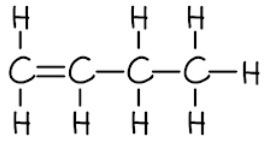 ; **[1 mark]**
-  ; **[1 mark]**
- 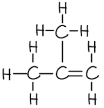 ; **[1 mark]**
-  ; **[1 mark]**

**[Total: 3 marks]**

- *Careful: **The number of carbons and number of hydrogens **must **be the same on both sides of the equation that you write*

  - *Often the number of hydrogens is incorrect because people only focus on the carbons*
- *Remember: **The smallest alkene that can be formed is ethene / C**2**H**4** *
- *In the question, you are told that it is C**4**H**8** / butene that has structural isomers*

  - *By drawing out the carbon chain and adding the correct number of hydrogens, you should see that a carbon=carbon double bond is required*
  - *This C=C can be between carbons 1 and 2 or between carbons 2 and 3*
  
    - *Having the C=C between carbons 3 and 4 is the mirror image of having it between carbons 1 and 2*
  - *This means that you have your two isomers*
  
    - *Methylpropene and cyclobutane are other possible isomers but deducing these is a little harder*
b)

i) The essential condition for the reaction between chlorine and butane is:

- Light  / UV / sunlight  
**OR **
200 °C 
**OR **
Lead tetraethyl;** [1 mark]**

ii) This reaction is:

- Substitution 
**OR **
Photochemical 
**OR **
Chlorination / halogenation 
**OR **
Free radical;** [1 mark]**

iii) The names of the **two** products that contain four carbon atoms per molecule are:

Any **two **of the following:

- 1-chlorobutane; **[1 mark]**
- 2-chlorobutane; **[1 mark]**
- Dichlorobutane; **[1 mark]**

**[Total: 4 marks]**

- *The reaction of relatively unreactive alkanes with halogens:*

  - *Requires energy, which is most commonly given as ultraviolet light / sunlight *
  - *Is a free radical substitution / chlorination / halogenation reaction*
  - *Can form different isomers depending on which hydrogen(s) is/are substituted*
  
    - *The easiest option for isomers is putting the chlorine / halogen on different carbons in the chain *
c)

i) The structural formula of the addition product when propene reacts with water is:

- CH3CH2CH2OH 
**OR **
CH3CH(OH)CH3;** [1 mark]**

ii) The structural formula of the addition product when propene reacts with bromine is:

- CH3CH(Br)CH2Br; **[1 mark]** 
*CH**2**BrCH**2**CH**2**Br is not accepted*

**[Total: 2 marks]**

- *Remember: **In addition reactions, the molecule being added is essentially being spilt into two pieces and added on either side of the carbon=carbon double bond / C=C, which changes to become a carbon-carbon single bond / C-C*

  - *When water is added, a hydrogen atom and an OH group will be added on either side of the C=C*
  - *When bromine / Br**2** is added, a bromine atom will be added on either side of the C=C*
d) To calculate the percentage yield:

- Moles of CH3–CH=CH2 reacted = $\frac{1.4}{42}$ = 0.0333;** [1 mark]**
- Maximum moles of CH3–CHI–CH3 that could be formed = 0.0333; **[1 mark]**
- Maximum mass of 2- iodopropane that could be formed = (170 x 0.0333) = 5.66 g; **[1 mark]** 
*Use of the retained calculator value gives a mass of approximately 5.67 g for ***1 mark**
- Percentage yield = $\frac{4.05}{5.66}\times100$ = 71.5 %; **[1 mark]**

**[Total: 4 marks]**

- *To calculate the theoretical number of moles of the 2-iodopropane product, you have to determine the number of moles of the propene reactant*
- *This allows you to calculate the theoretical / maximum mass of 2-iodopropane that can be formed*
- *Then you can use the equation percentage yield = *$\frac{\mathrm{actual} \mathrm{yield}}{\mathrm{theoretical} \mathrm{yield}}\times100$* to get the final answer*

### Q9
a)

i)  Three other general characteristics of a homologous series.

Any **three** from:

- (Same) general (molecular) formula; **[1 mark]**
- (Consecutive members) differ by CH2; **[1 mark]**
- Same functional group; **[1 mark]**
- Common (allow similar) methods of preparation; **[1 mark]**
- Same/ similar chemical properties /(chemical) reactions; **[1 mark]**

ii)  The molecular formula of a hydrocarbon shows whether it is an alkane or an alkene because:

- CnH2n alkene; **[1 mark]**
- CnH2n+2 alkane; **[1 mark]**

iii) Alkanes and alkenes differ in their molecular structures because:

- Alkanes all or only (C–C) single bonds /no double bonds / no multiple bonds; **[1 mark]**
- Alkenes (at least one) C=C/ double bond/ multiple bond; **[1 mark]**

**[Total: 7 marks]**

- *Remember**: Alkanes are **S**aturated so have only **S**ingle bonds*
- *Alkenes are unsaturated and have a double bond*
b)

i) **Two** conditions required for the cracking of an alkane are:

- Heat/high temperature/ temperature between 450 °C and 800 °C; **[1 mark]**
- Catalyst / named catalyst, e.g. zeolites or alumina or aluminium oxide or aluminosilicates or silica or oxides of chromium; 
**OR** 
High pressure/ pressure in range of 2–70 atm; 
**OR** 
Steam / absence of air/ oxygen; **[1 mark]**

ii) An equation for the cracking of heptane into an alkane and an alkene is:

- Any correct equation producing an alkane and an alkene adding up to seven carbon atoms in the products; **[1 mark] **E.g C7H16 →  C5H12 + C2H4

iii) An equation for the cracking of heptane into hydrogen and two other products is:

- Any correct equation producing two alkenes and hydrogen: **[1 mark]** e.g.  C7H16  → C2H4 + C5H10 + H2  e.g.  C7H16  → C3H6 + C4H8 + H2

iv) **One** reason why cracking is important is:

- Alkenes: more useful than alkanes / used to make polymers or plastics / used to make chemicals / petrochemicals 
**OR** 
Alkanes: (balance the demand for different) fuels / increase petrol (fraction) or hydrogen / produce lighter fractions from heavier fractions or suitable example e.g naphtha to gasoline; **[1 mark]**

**[Total: 5 marks]**

- *Cracking results in the breakdown of a long chain alkane into a short chain alkane and alkene *
- *The two main conditions you should know for the current specification are that a high temperature and catalyst are required*
- *Any combination of alkane and alkene could be given in ii) here provided that the number of carbon atoms on the left hand side of the equation balances with those on the right hand side, and that your formula for the alkane and alkene are correct*
- *Some examples you could write for ii) are:*

  - *C**7**H**16** →  C**5**H**12 **+ .C**2**H**4*
  - *C**7**H**16**→ C**4**H**10** + C**3**H**6 *
- *Consider the same factors for part iii) taking into consideration you also have H**2** to account for*
c)

i) The volume of the oxygen used is:

- 150 cm3; **[1 mark]**

ii) The volume of the carbon dioxide formed is:

- 100 cm3; **[1 mark]**

**[Total: 2 marks]**

- *The question tells you that an excess of oxygen, 200 cm**3** was used with 50 cm**3**of oxygen produced*

  - *200 - 50 = 150 cm**3*
- *The volume of the gas produced is 150 cm**3**, of which 50 cm**3** is oxygen *

  - *Carbon dioxide is the only other gas produced (as the other product is water) so 150 - 50 = 100 cm**3*

### Q10
a)

i) The name and structural formula of the fourth member of this series are:

- Butanoic / butyric acid; **[1 mark]**
- CH3CH2CH2COOH / C2H5CH2COOH; **[1 mark]**

ii) Three other characteristics of a homologous series:

Any **three** from:

- (Same) general formula; **[1 mark]**
- (Consecutive members) differ by CH2;** [1 mark]**
- Same functional group; **[1 mark]**
- They have common methods of preparation; **[1 mark]**
- Physical properties vary in predictable manner / show trends / gradually change 
**OR** 
Example of a physical property variation i.e. melting point / boiling point / volatility**; [1 mark]**

**[Total: 5 marks]**

- *Butanoic acid is the IUPAC name for the acid and so this is the one you should use in preference*
- *There are a number of different features in common across members of the same homologous series, try to recall a range of physical and chemical ones so that you can answer whatever style of question is given to you*
b)

i) The structural formula of the alcohol which can be oxidised to propanoic acid is:

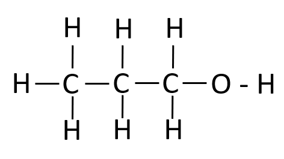

- Displayed formula of propan-1-ol, all bonds shown separately; **[1 mark]**

ii) A reagent, other than oxygen, which can oxidise alcohols to carboxylic acid:

- Acidified;** [1 mark]**
- Potassium manganate(VII) / potassium permanganate / KMnO4 
**OR **
Potassium dichromate(VI) / K2Cr2O7 / potassium dichromate; **[1 mark]**

**[Total: 3 marks]**

- *Propanoic acid has to be formed from a primary alcohol, and the oxidation of alcohols does not involve chain lengthening, so the alcohol has to be propan-1-ol*
- *Strong oxidising agents such as manganate or dichromate ions can be used for this reaction, but both have to be acidified in order to work. The more common reagent is potassium dichromate (VI)*
i) The completed equation is:

Zinc + propanoic acid → zinc propanoate + hydrogen

- Zinc** **propanoate; **[1 mark]**

ii) The completed equation is:

Calcium oxide + propanoic acid → calcium propanoate + water

- Calcium propanoate + water; **[1 mark]**

iii) The completed equation is:

LiOH + CH3CH2COOH → CH3CH2COOLi + H2O

- CH3CH2COOLi + H2O; **[1 mark]**

**[Total: 3 marks]**

- *The reactions between organic acids and bases follow the same pattern as the reactions of inorganic acids do:*
- *The salt is named with the metal first and then the 'surname' from the organic acid, with an ending of -ate added. *
- *This naming rule applies to the salt names in parts i and ii*
- *However, in the formula for part iii the carboxylate group is written first (CH**3**CH**2**COO) with Li placed last*

> **[exam-tip]**
> When writing the formula of a carboxylate salt, place the metal after the carboxylate group (CH3CH2COOLi), not at the front — the 'metal first' rule applies only to the salt's name, not its formula.
d)

i) The rate in experiment C is slower than the rate in experiment A as:

- Concentration (of acid in C) is less / halved or concentration of A is more / doubled; **[1 mark]**
- Less frequent collisions in C / more frequent collisions in A (than in C); **[1 mark]**

ii) The rate in experiment B is faster than the rate in experiment as:

- Higher temperature in B particles / molecules / atoms move faster/ have more energy / more have Ea 
**OR** 
Particles / molecules / atoms in A move slower / have less energy / less have Ea; **[1 mark]**
- More frequent collisions in reaction B / less frequent collisions in A (than in B); **[1 mark]**

iii) The rate in experiment D is faster than the rate in experiment A as:

- It (D) has strong (acid) and A has weak acid / (D) stronger / (D) ionises more/ (D) dissociates more 
**OR** 
A is weaker / A ionises less /A dissociates less; **[1 mark]**
- It (D) has a higher concentration of hydrogen ions / A has a lower concentration of hydrogen ions; **[1 mark]**
- More frequent collisions (in D) or fewer collisions in A; **[1 mark]**

**[Total: 7 marks]**

- *The frequency of the collisions is key to rate; more frequent collisions that arise as a result of increased concentration, surface area, temperature or pressure will all increase the rate*
- *Temperature also increases the energy of the particles and therefore the number of collisions that has enough energy to successfully react*
- *Stronger acids have greater concentrations of H**+** available, and therefore this acts in the same way as increasing the concentration of any other reactant*

### Q11
a) The completed table is:

| name | formula | mass of one mole / g | boiling point / oC |
|---|---|---|---|
| methanol | CH3 –OH | 32 | 64 |
| ethanol | CH3 –CH2 –OH | 46 | 78 |
| propan-1-ol | CH3 –CH2 –CH2 –OH | 60 | 98 |
| butan-1-ol | CH3 –CH2 –CH2 –CH2 –OH | 74 | 118 |
| pentan-1-ol | **CH****3**** –CH****2**** –CH****2**** –CH****2**** –CH****2**** –OH; ****[1 mark]** | **88**; **[1 mark]** | 138 |
| hexan-1-ol | CH3 –CH2 –CH2 –CH2 –CH2 –CH2 –OH | 102 | **156 to 159;** **[1 mark]** |

**[Total: 3 marks]**

- *The mass of one mole can be found by adding up the Ar of all of the atoms in pentan-1-ol:*

  - *(5 x 12) + (12 x 1) + (1 x 16) = 88*
- *Alternatively, you can see that each member in the homologous series differs by CH**2** which has a **M**r** = 12 + (2 x 1) = 14*

  - *The alcohol before pentan-1-ol in the homologous series has a mass of one mole of 74 g, so you can just add 14 onto this: 74 + 14 = 88 g*
- *As the carbon chain length gets longer, the boiling point increases*
- *There is a difference of 14** o**C between methanol and ethanol and a difference of 20** o**C between the other alcohols that are next to each other in the series*
- *A good approximation would therefore be 138 + 20 = 158 **o**C*
b) **Two **other characteristics of a homologous series are:

Any **two** from:

- (Same) general (molecular) formula; **[1 mark]**
- Same functional group; **[1 mark]**
- Consecutive members differ by –CH2; **[1 mark]**
- Common methods of preparation; **[1 mark]**
- Similar chemical properties;** [1 mark]**

**[Total: 2 marks]**

- *Remember: **Chemicals in a homologous series have the same general formula but are slightly different in terms of how they are produced, their actual structure and their chemical properties *
c) A diagram showing the arrangement of the outer (valency) electrons in one molecule of methanol is:

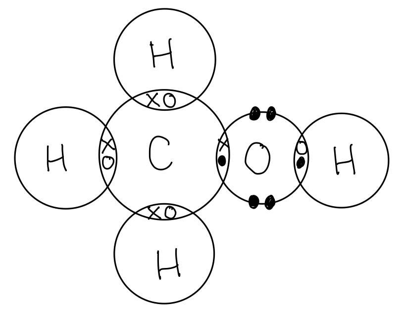

- Correct structure **AND **8 bonded electrons around C; **[1 mark]**
- 2 bonded electrons on each hydrogen; **[1 mark]**
- 4 bonded electrons and 4 non-bonded electrons on oxygen; **[1 mark]**

**[Total: 3 marks]**

- *When drawing the dot and cross diagram, check that all the electron shells are complete*

  - *Carbon and oxygen should have 8 electrons in their shell*
  - *Hydrogen should have 2 electrons*
d)

i) The structural formula of the carboxylic acid formed by the oxidation of propan-1-ol, showing all the bonds, is:

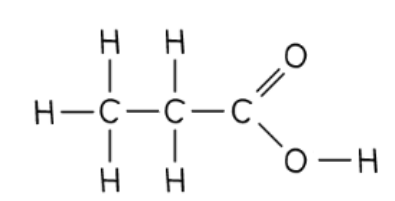

- Correct structural formula for propanoic acid;** [1 mark]** 
*Allow: OH but all other bonds to be shown*

ii) Ethanol can be oxidised to ethanoic acid by fermentation by:

- Air / oxygen; **[1 mark]**
- Bacteria / microbes / micro-organisms; **[1 mark]** 
*Accept: mother of vinegar* 
*Do NOT accept: yeast*

**[Total: 3 marks]**

- *Carboxylic acids can be prepared from alcohols by two methods, don't get confused between the two*

  - *One method is from fermentation (or microbial oxidation)*
  - *The other is using an oxidising agent, such as acidified potassium manganate(VII) *
- *The products formed in both methods of production are the same*
- *Another source of confusion is to think about the fermentation of glucose to produce alcohols using yeast as the biological catalyst*

  - *To convert alcohols to carboxylic acids using fermentation, microbes are required - not yeast*
e) Propan-1-ol and ethanoic acid react together to form an ester. Give its name and structural formula.

- Propyl ethanoate; **[1 mark]**
- CH3COOC3H7 / CH3COOCH2CH2CH3 / CH3COO(CH2)2CH3; **[1 mark] ***Do NOT accept: C**5**H**10**O**2*

**[Total: 2 marks]**

- *The first part of the name of an ester indicates the length of the carbon chain in the alcohol, and it ends with the letters ‘- yl’*
- *The second part of the name indicates the length of the carbon chain in the carboxylic acid, and it ends with the letters ‘- oate’*

  - *So the ester formed from** prop**an-1-ol and **ethan**oic acid is called **prop**yl **ethan**oate*
- *The structural formula here does not require all of the bonds to be shown, so omit the covalent bonds*

### Q12
a)

i) The correct equations are:

Mg + **2**CH3COOH →** (CH****3****COO)****2****Mg** + **H****2**

- Correct formula of magnesium ethanoate; **[1 mark]**
- Rest of equation and balancing; **[1 mark]**

sodium hydroxide + ethanoic acid → **sodium ethanoate **+ **water**

- Sodium ethanoate **AND **water; **[1 mark]**

ii) The name of the ester, and its structural formula showing all bonds is:

- Ethyl ethanoate; **[1 mark]**
- Correct structural formula with all bonds showing; **[1 mark]**

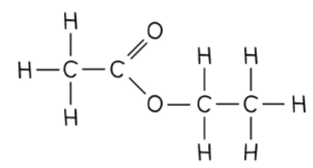

**[Total: 5 marks]**

- *Ethanoic acid will react with metals and alkalis according to the general equations of acids*
- *Whilst usually in structural formula most of the actual covalent bonds are omitted, in this question, they have specifically asked you to show all of the bonds, so HCOOH would not gain the mark in this instance*

  - *This type of formula is usually referred to as the displayed formula*
- *When naming esters, the first part of the name indicates the length of the carbon chain in the alcohol, and it ends with the letters ‘- yl’*
- *The second part of the name indicates the length of the carbon chain in the carboxylic acid, and it ends with the letters ‘- oate’*

  - *In this case, the ester formed from** eth**anol and **ethan**oic acid is called **eth**yl **ethan**oate*
b)

i) You know that the acid contained only carbon, hydrogen and oxygen because:

- Their masses add up to 5.8 g ; **[1 mark]**

ii) The empirical formula of maleic acid is calculated by:

Number of moles of carbon atoms = 2.4/12 = 0.2

Number of moles of hydrogen atoms = 0.2/1 = 0.2

Number of moles of oxygen atoms = 3.2/16 = 0.2

- All three correct = **[2 marks]** 
Two correct = **[1 mark]**
- The empirical formula is CHO; **[1 mark]**

iii) The molecular formula of maleic acid is:

- 116/29 = 4; **[1 mark]**
- C4H4O4; **[1 mark]** 
*Correct formula with no working scores both marks.*

iv) The structural formula of maleic acid is:

HOOCCH=CHCOOH / CH2=C(COOH)2

- Double bond present;** [1 mark]**
- Correct number of C, H and O atoms and rest of structural formula correct;** [1 mark]**

**[Total: 8 marks]**

- *To calculate the empirical formula:*

|   | > *C* | > *H* | > *O* |
|---|---|---|---|
| > *Calculate the number of moles of each element (mass/**M**r**)* | $\frac{2.4}{12}\,=0.2$ | $\frac{0.2}{1}\,=0.2$ | $\frac{3.2}{16}\,=0.2$ |
| > *Divide by the smallest number to find the smallest ratio* | > * 0.2/0.2 = 1* | > *0.2/0.2 = 1 * | > *0.2/0.2 = 1 * |

- *The empirical formula is therefore CHO*
- *The **M**r** of the empirical formula is 12 + 1 + 16 = 29*
- *The** M**r** of the compound is 116/29 = 4 times greater than the **M**r** of the empirical formula therefore the molecular formula of maliec acid must contain 4 times the number of atoms than appears in the empirical formula*
- *As maliec acid is dibasic, it must contain 2 -COOH groups so that it can donate 2 moles of H**+** ions for every 1 mole of acid*
- *The **M**r ** of the two  -COOH groups is 2 x (12 + (2 x 16) + 1 = ) = 90*
- *This leaves 116 - 90 = 26 which must come from C and H atoms*
- *This must be from 2 C atoms and 2 H atoms: (2 x 12) + (2 x 1) = 26*
- *This means that maliec acid must contain a double bond, otherwise there would be 2 more hydrogen atoms present*

### Q13
a)

i) These two hydrocarbons are isomers because:

- Have same molecular formula / both are C5H12; **[1 mark]**
- They have different structural formulae / different structures; **[1 mark]**

ii)  The structural formula of another hydrocarbon which is isomeric with the above is:

- CH3-CH2-CH=CH-CH3 / any other correct isomer; **[1 mark]**

**[Total: 3 marks]**

- *Remember:** The molecular formulae is the actual number of atoms of each element in a compound but the structural formula is how the atoms are arranged*
- *In the question, the names of the two isomers are 3-methylbutene and pent-1-ene*
- *Their atoms are arranged differently but they both have the same molecular formula of C**5**H**12*
- *A quick way of working out another isomer is to simply move the position of the double bond *
b)

i) The structural formula and name of each of the products for the reaction between ethene and bromine are:

- CH2-(Br)-CH2Br; **[1 mark] **
*NOT: C**2**H**4**Br**2*
- Dibromoethane; **[1 mark]** 
NOTE: numbers not required but if given must be 1, 2

ii) The structural formula and name of each of the products for the reaction between propene and hydrogen are:

- CH3-CH2-CH3; **[1 mark]** 
*NOT: C**3**H**8*
- Propane; **[1 mark]**

iii) The structural formula and name of each of the products for the reaction between but-1-ene and water are:

- CH3-CH2-CH2-CH2-OH / CH3-CH2-CH(OH)-CH3; **[1 mark]**
- butanol; **[1 mark]** 
*numbers not required but if given must be correct and match formula*

**[Total: 6 marks]**

- *When alkenes undergo addition reactions, the double bond will break to create a saturated compound*
- *When alkenes reaction with:*

  - *Halogens they form haloalkane*
  - *Water/steam they form alcohols*
  - *Hydrogen they form alkanes*
- *Remember: **when a halogen is added onto an alkene, you must represent the fact there are two halogen atoms in the name of the new compound- so **di**bromoethane as opposed to bromoethane*
- *It sometimes help to draw out the displayed formula for the reactants and products before answering the question*
c)

i)  The formulae of the alkenes which would form when those carboxylic acids are oxidised are:

- CH3-CH=CH-CH2-CH3; **[1 mark]**
- CH3-CH=CH-CH3; **[1 mark]**

ii) The colour change you would observe when an alkene is oxidised with acidified potassium manganate(VII) is:

- pink / purple; **[1 mark]**
- colourless; **[1 mark]** 
***NOT: clear***

**[Total: 4 marks]**

- *The information for part i) of this question should help you answer it*

  - *You are told the following:*
  
    - *Propene, CH**3** –CH=CH**2**, would produce ethanoic acid, CH**3** –COOH, and methanoic acid, H–COOH.*
    - *If you look at the formula of each substance, the number of carbon atoms from the two carboxylic acids equals that of the alkene*
    - *If you have ethanoic acid and propanoic acid, the total of carbon atoms is five, as ethanoic acid has two, and propanoic acid three. *
    - *The alkene must therefore have five carbon atoms which is pentene *
    - *If only ethanoic acid present, there must be two molecules of this, totalling four carbon atoms and so butene is formed *
d) The structural formula of poly(cyanoethene), include at least two monomer units is:

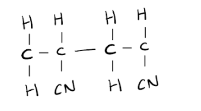

- Correct repeat unit CH2-CH(CN)**; [1 mark]**
- Bonds to show continuation;  **[1 mark]**

**[Total: 2 marks]**

- *Remember: **When drawing polymers, the double bond in the alkene breaks and the monomers join together*
- *You must show bonds extending from each monomer as if it were joining to another monomer to obtain the second mark as a polymer is **many** monomers joined together*

### Q14
a)

i) The structural formula of the ester ethyl ethanoate is:

- CH3COOCH2CH3 / CH3CO2CH2CH3 / CH3COOC2H5 / CH3CO2C2H5 / C2H5OOCCH3 / CH3CH2OOCCH3; **[1 mark]** *Do NOT allow –OCO– linkage * *Note: formulae can be displayed or semi-displayed* 
*Note: penalise sticks (i.e. any missing atoms)*

ii) The name of the ester formed from methanoic acid and butanol is:

- Butyl methanoate; **[1 mark]**

**[Total: 2 marks]**

- *The first part of the name indicates the length of the carbon chain in the alcohol, and it ends with the letters ‘- yl’*
- *The second part of the name indicates the length of the carbon chain in the carboxylic acid, and it ends with the letters ‘- oate’*

  - *So, the ester formed from** but**anol and **methan**oic acid is called **but**yl **methan**oate*
b) The structural formula of the polyester formed from the given monomers is:

-OOCC6H4COOCH2CH2- **OR **-OCC6H4COOCH2CH2O-

- Two correct ester linkages, e.g. –OOC / –O2C and –COO / –CO2;**[1 mark] ***Allow the one ester linkage to be split so shown at either end*
- Contents of the ‘boxes’ being C6H4 and C2H4 or CH2CH2; **[1 mark]**
- Continuation bonds at both ends; **[1 mark]**

**[Total: 3 marks]**

- *You need to remove 2 x H**2**O from the structural formula of the two monomers:*
- *Remove OH from either end  of the carboxylic acid and an H from with end of the alcohol, then join them together*
- *This gives -OCC**6**H**4**COOCH**2**CH**2**O- which has the displayed formula shown below where the left-hand box represents C**6**H**4** and the right-hand box represents C**2**H**4*

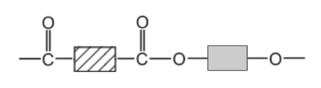

- *You can show the ester linkage together by moving the O from one end to the other:*
- *-OOCC**6**H**4**COOCH**2**CH**2**- *
c)

i) It was necessary to spray the chromatogram to:

- To make colourless / invisible (spots); **[1 mark]**
- Visible / coloured / seen / position made clear / indicate; **[1 mark]**

ii) The *R*f value of a sample means:

- $R_{f} = \frac{distance \text{travelled} \text{by} sample}{distance \text{travelled} \text{by} \text{solvent} ( \text{front} )}$; **[1 mark]**

iii) The *R*f values of the two samples and their identities are:

- Sample 1: *R*f = 0.20 to 0.24 **AND **tartaric (acid); **[1 mark]**
- Sample 2: *R*f = 0.44 to 0.48 **AND **malic (acid); **[1 mark]**

**[Total: 5 marks]**

- *To calculate the **R**f** value, measure the distance from the baseline to the cross which represents the centre of the spots - this is the 'distance travelled by sample'*
- *Measure the distance from the baseline to the solvent front - this is the 'distance travelled by the solvent (front)'*
- *Then use these distances in the equation above to calculate the **R**f **value for each sample*
- *Compare these to the values in the table, the **R**f** value should be very similar to one of the acids *
- *Remember**: **R**f** values cannot be greater than 1, so if you calculated it to be more than 1 you have probably divided the distance travelled by the solvent by the distance travelled by the sample*

### Q15
a)

i) An isomer of 1-chloropropane is:

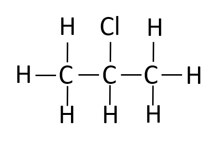

- A correct structure of an isomer e.g. 2-chloropropane;** [1 mark]**

ii) Propane could be made into 1-chloropropane by:

- Adding chlorine;** [1 mark]**
- In the presence of light / heat / lead tetraethyl; **[1 mark]**

iii) A pure sample of 1-chloropropane is not made in i) as:

- The reaction could produce 2-chloropropane; **[1 mark]**
- The reaction produces HCl 
**OR** The reaction could produce dichloropropanes; **[1 mark]**

**[Total: 5 marks]**

- *Isomers occur where the molecular formula is the same, but the arrangement of atoms (the structural formula) is different. In this case, the chlorine is placed on the central carbon rather than a terminal one*
- *Alkanes can undergo substitution reactions to form haloalkanes in the presence of light or lead tetraethyl. Light is the most common answer! This is an example of a photochemical reaction*
- *A pure product would mean that there were no alternative products or by-products possible.*

  - *In a substitution reaction, there is always a by-product and are often alternative products*
  - *Only addition reactions give only one product*
b)

i) You could show that the reaction mixture contained an iodide ion by:

- Adding silver nitrate / lead nitrate; **[1 mark]**
- Watching for a yellow precipitate; **[1 mark]**

*Do not insist on the presence of dilute nitric acid*

ii) The alcohol formed when 1-chloropropane reacts with water is:

- Propanol / propan-1-ol;** [1 mark]**

**[Total: 3 marks]**

- *The test for halide ions is one of the required ones, and the colours of the precipitates are white for chloride ions, cream for bromide ions and yellow for iodide ions*
- *The substitution of haloalkanes to form alcohols is not explicitly in the specification, but the question gives you all of the information you need to know and is really about naming an alcohol and identifying that this is another example of a substitution reaction, so the -OH group will go where the -Cl was*
c)

i) It takes longer to produce a precipitate in reaction **A **as:

Any **two** from:

- The reaction is slower; **[1 mark]**
- There is a decreased collision rate; **[1 mark]**
- Less bromobutane present / concentration of bromobutane is lower / fewer reacting particles; **[1 mark]**

*Allow reverse arguments for ****B***

ii) The order of reactivity of the organic halides compare with the order of reactivity of the halogen by:

- For the halogens Cl > Br > I reactivity / reactivity decreases down the group; **[1 mark]**
- For the organic halides I > Br > Cl / the reactivity increases down the group; **[1 mark]**

*Allow the opposite without explanation for 1 mark*

iii) The time taken to produce a precipitate would increase if the experiments were repeated at 50 °C as:

Any **three** from:

- Particles have less kinetic energy; **[1 mark]**
- Particles move slower; **[1 mark]**
- There are fewer collisions / fewer particles have the energy to react / fewer successful collisions occur; **[1 mark]**
- There is a slower rate; **[1 mark]**

**[Total: 7 marks]**

- *The order of reactivity for the halogens should be something you know, and the order of the haloalkanes can be deduced from the data here from reactions **A**, **C** and **D** with the iodoalkane being the fastest to react (as the C-I bond is broken more easily)*
- *The explanation for a lower temperature giving a lower rate is standard, although this question is more commonly asked the other way around where an explanation for why a warmer reaction is faster, so check your phrasing!*

### Q16
a)

i) The empirical and molecular formula are:

- (Molecular) C4H8 only; **[1 mark]**
- (Empirical) CH2 / C1H2; **[1 mark]**

ii) The structural formula of an isomer of the above hydrocarbon is:

- Any unambiguous structural formula of methyl cyclopropane 
**OR** 
But-1-ene 
**OR** 
But-2-ene  
**OR** 
Methyl propene; **[1 mark]**

iii) These two hydrocarbons are isomers because:

- They have the same molecular formula; **[1 mark]**
- But different structural formulae 
**OR** 
Different structures 
**OR** 
Different arrangement of atoms; **[1 mark]**

iv)  These two hydrocarbons are members of the same homologous series because:

- If ‘yes’ 
Both alkanes or both saturated 
**OR **
If ‘No’: 
One is an alkane, the other an alkene 
**OR** 
One is saturated / has single bonds, the other is unsaturated / has a double bond; **[1 mark]** 
*Ignore: references to the ‘functional group’*

**[Total: 6 marks]**

- *Remember: the molecular formula is the actual number of atoms of each element in a compound and the empirical formula is the simplest number of atoms of each element in a compound *

  - *The molecular formula is determined by counting the number of atoms of each element in the diagram which is C**4**H**8*
  - *The simplest number of atoms is therefore CH**2*
- *Structural isomers have the same molecular formula but their atoms are arranged differently *
- *From the molecular formula you should be able to identify it as butene, and so the simplest isomers to draw will be but-1-ene an but-2-ene shown below:*

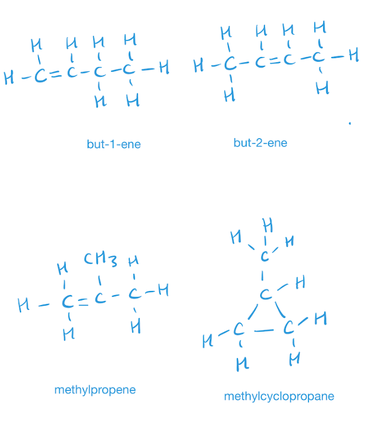

- *Remember **S**aturated compounds have **Si**ngle bonds only*
b)

i) The term *cracking* means:

- Action of heat or catalyst or thermal decomposition (on an alkane);* ***[1 mark]** *Ignore steam. Ignore pressure.*
- Long-chained molecules or alkanes form smaller molecules (not smaller fraction) 
**OR** 
Forms smaller alkenes (or alkanes); **[1 mark]**

ii) The molecular formula of the original alkane is:

- C10H22; **[1 mark]**

**[Total: 3 marks]**

- *Cracking is carried out to break the long chain, less useful alkanes into shorter, more in demand alkanes, and also produces alkenes*
- *You must learn the conditions for this process*
- *Symbol equations for the cracking process must be balanced just like any other equation*
- *The question tells you:*

  - *One mole of an alkane, when cracked, produced one mole of hexane, C**6**H**14**, and two moles of ethene.*
  - *Ethene has the formula C**2**H**4**, so with two moles being made, that totals four carbon atoms, and eight hydrogen atoms*
  - *The four carbon atoms from two moles of ethene added to the six carbon atoms from hexane is ten carbons *
  - *The alkane you began with must therefore be C**10**H**22** which follows the general formula C**n**H**2n+2*
c)

i) The structural formula of the product formed by the addition polymerisation of but-2-ene is:

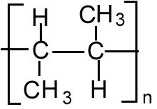

- Correct structure of one repeat unit; **[1 mark]**
- Continuation bonds; **[1 mark]**
- Use of brackets and subscript ‘n’; **[1 mark]**

ii) The name and structural formula of the addition product formed from ethene and bromine is:

- Dibromoethane 
**OR** 
1,2-dibromoethane; **[1 mark]**
- CH3CHBr2  
**OR** 
CH2BrCH2Br; **[1 mark]**

**[Total: 5 marks]**

- *You must be able to draw polymers from a given monomer such as this*
- *To draw the polymer:*

  - *Replace the double bond with a single bond*
  - *Draw brackets around the repeat unit *
  - *Draw bonds extending from the two central carbon atoms through the brackets (to show that monomers would be joined either side) *
  - *Place an n at the bottom right hand corner outside the bracket (this would indicate a number of repeat units)*
- *When determining the product of addition reactions between alkenes and either water, hydrogen or a halogen it is helpful to draw out the displayed formula of the reactants to see the structure of the product and then name it *
- *Bromine has the formula Br**2**, so adds across the carbon carbon double bond*
- *Don't forget to include the fact there are two bromine atoms in the name of the compound- **di**bromoethane *

### Q17
a)

i) The chemistry of making butanol from petroleum can be described as:

- Cracking / heat with catalyst; **[1 mark]**
- To make butene; **[1 mark]**
- Butene reacts with steam / water / is hydrated (to form butanol); **[1 mark]** *Accept heat and catalyst for cracking but if a temperature or a catalyst is specified then is must be: 450 to 800 °C zeolites / aluminosilicates / silica / aluminium oxide/alumina / china / broken pot / porcelain / chromium oxide*

ii) *Fermentation *means:

- Glucose / sugar changed to; **[1 mark]**
- Alcohol / ethanol; **[1 mark]** *Accept an unbalanced equation*
- (Catalysed by) enzymes / yeast; **[1 mark]**

**[Total: 6 marks]**

- *As the definition of fermentation has been asked for in general terms, you do not need to give the specific conditions required, other than  the reactants and that enzymes are required *
b) The name and structural formula of the carboxylic acid formed when butanol is heated with acidified potassium manganate(VII) are:

- Butanoic acid; **[1 mark]**
- CH3CH2CH2COOH / CH3(CH2)2COOH / CH3-CH2-CH2-COOH; **[1 mark]**

**[Total: 2 marks]**

- *The number of carbon atoms does not change when the alcohol is oxidised, so the resulting carboxylic acid will still have the same stem of but- in its name*
- *The functional group of a carboxylic acid is -COOH*
- *Don't forget to include the carbon in the -COOH when writing the structural formula, it is easy to forget this one and end up with too many carbon atoms!*
c)

i) The type of compound that liquid **X **is:

- Ester;** [1 mark]**

ii) The molecular formula of liquid **X **is:

- C6H12O2; **[1 mark]** *Ignore CH**3**COOC**4**H**9*

iii) The structural formula, showing all of the bonds, of** X** is:

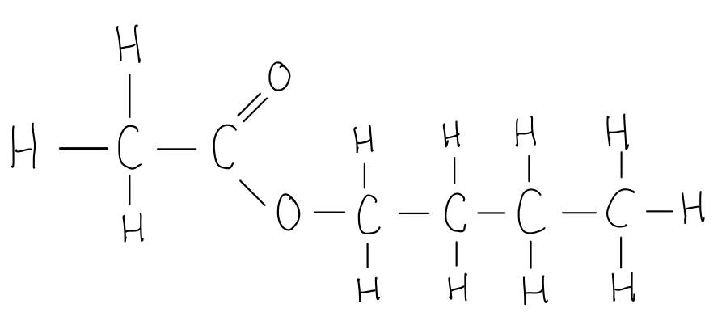

- Correct ester linkage; **[1 mark]**
- Rest of the structure correct; **[1 mark]** *Ignore CH**3**COOC**4**H**9*

**[Total: 4 marks]**

- *Whilst usually in structural formula most of the actual covalent bonds are omitted, in this question, they have specifically asked you to show all of the bonds, so CH**3**COOC**4**H**9** would not gain the marks in this instance*

  - *This type of formula is usually referred to as the displayed formula*

### Q18
a) The molecular formula of an alkene with a relative molecular mass of 126 is:

- C9H18; **[1 mark]**
- $\frac{126}{14}$ = 9 **OR **14x = 126 **AND **x = 9 **OR **(12 x 9) + 18 = 126; **[1 mark]**

**[Total: 2 marks]**

- *Being given the general formula for an alkene, C**n**H**2n**, allows you work out the molecular formula in an almost empirical formula style approach*

  - *C**n**H**2n** has the empirical formula CH**2** *
  - *CH**2** has a mass of 14 and you can use this mass to work out how many fragments with a mass of 14 there are in a total mass of 126*
b)

i) The diagram showing the arrangement of the valency electrons in one molecule of this covalent compound is:

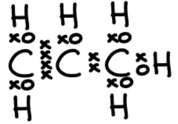

- All hydrogen atoms have one bonding pair (xo); **[1 mark]**
- Carbon carbon double bond / C=C has 2 bonding pairs (xxxx);** [1 mark]**
- Carbon carbon single bond / C-C has 1 bonding pair (xx); **[1 mark]**

ii) The structure of the polymer formed from propane is:

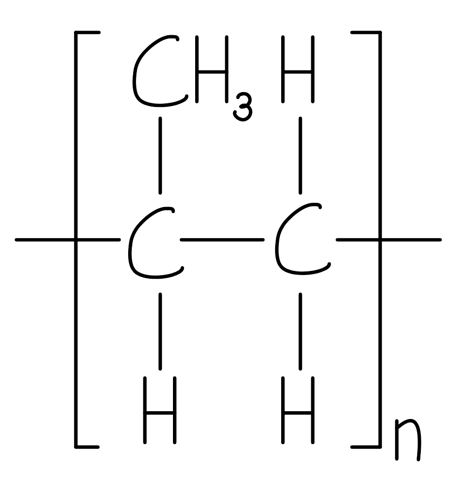

- Correct repeat unit; **[1 mark]**
- Continuation bonds; **[1 mark]**

iii) To show that the hydrogenation of propene is exothermic:

Alternative 1:

- Bonds broken: (C=C) + (H-H) = 610 + 436 = 1046 (kJ / mol); **[1 mark]**
- Bonds formed: (C-C) + (2 x C-H) = 346 + (2 x 415) = –1176 (kJ / mol); **[1 mark]**
- Energy change = 1046 - 1176 = –130 (kJ / mol) 
**OR **
More energy is released than absorbed; **[1 mark]**

Alternative 2:

- Bonds broken:** **(C=C) + (C-C) + (6 x C-H) + (H-H) = 610 + 346 + (6 x 415) +436 = 3882 (kJ / mol); **[1 mark]**
- Bonds formed: (2 x C-C) + (8 x C-H) = (2 x 346) + (8 x 415) = 4012 (kJ / mol);** [1 mark]**
- Energy change = 3882 - 4012 = –130 (kJ / mol) 
**OR **
More energy is released than absorbed;** [1 mark]**

**[Total: 8 marks]**

- *When you are given a displayed formula and asked to draw the dot-and-cross diagram showing the valence electrons, you can replace each bond with a pair of electrons*
- *To draw (addition) polymer structures:*

  1. *Draw the alkene with the C=C in the middle and 2 bonds above and 2 bonds below*
  2. *Add the relevant atoms / groups onto all of the single bonds*
  3. *Replace the central C=C with a –C–C– to show the single bond and continuation bonds*
  4. *Add brackets around the entire structure and an **n** after the brackets*

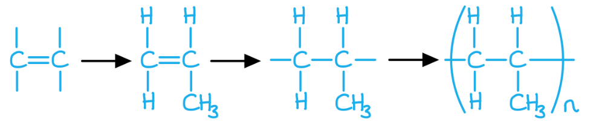

- * The bond energy calculation to prove that the reaction is exothermic can be done in 2 ways:*

  1. *Alternative 1: Identifying only the bonds that are broken and formed*
  2. *Alternative 2: Calculating **all** of the bonds that are broken and formed*
  
    - *Careful: **Make sure that you account for all of the relevant bonds, it is quite common to miss the C-C bond*
c)

i) The product formed when but-1-ene reacts with water is

- Butanol 
**OR **
Butan-1-ol 
**OR **
Butan-2-ol; **[1 mark]**

ii) The completed equation is:

- CH3–CH2–CH=CH2 + Br2 → **CH****3****-CH****2****-CH(Br)-CH****2****Br**; **[2 marks]** 
*C**4**H**8**Br**2** is accepted for 1 mark *
*Any other dibromobutane scores 0 marks*

iii) The formula of the compound which reacts with but-1-ene to form 1-iodobutane is:

- HI; **[1 mark] **

**[Total: 4 marks]**

- *Water splits into H and OH which add on either side of the C=C resulting in the formation of butan-1-ol and butan-2-ol*
- *The bromine molecule splits into 2 bromine atoms which add on either side of the C=C resulting in the formation of 1,2-dibromobutane*
- *The bromines cannot add anywhere else *
- *Part (iii) is the reverse process of parts (i) and (ii), where you have to work out which chemical has been added*

  - *You can easily do this by drawing out the 1-iodobutane and then crossing out all the atoms that are also in but-1-ene*
  - *This will leave you with a H and an I, therefore the chemical used is HI*

### Q19
a)

i) A hydrocarbon is:

- A compound which contains carbon and hydrogen <u>only</u>; **[1 mark]**

ii) The difference between these two series of hydrocarbon is:

- Alkanes contain only C-C single bonds 
**OR** 
They are saturated (hydrocarbons) 
**OR** 
They have the general formula CnH2n+2 **[1 mark]**
- Alkenes contain at least one C=C double bond
**OR** 
They are unsaturated (hydrocarbons) 
**OR** 
They have the general formula CnH2n; **[1 mark]**

**[Total: 3 marks]**

- *Make sure you include the word **only** in your definition of a hydrocarbon or you may not achieve the mark *
- *Alkanes are **S**aturated so only have **S**ingle bonds*
b) The completed equation for cracking is:

C20H42  → 2C4H8 + 2C2H4 + C8H18

- C8H18**; ****[1 mark]**

**[Total: 1 marks]**

- *Equations for catalytic cracking balanced the same way as other equations*
- *Identify how many carbon and hydrogens are on the left hand side*
- *Work out how many you already have on the right hand side, and take these away from the original number *
- *Cracking always produces alkenes and alkanes, the formula for the alkenes are already written so the third product must be an alkane*
- *To make sure you are correct- check that the formula have written adheres to the general formula of C**n**H**2n+2*
c)

i) The equation for the preparation of dibromoethane from ethene is:

- Any unambiguous structure of BrCH2CH2Br; **[1 mark]** *NOT just C**2**H**4**Br**2*

ii) The structural formula for the monomer of this poly(alkene) is:

- CH3-CH=CH-CH3; **[2 marks] ***Accept 1 mark for incorrect form of butene*

iii) Butanol is made from butene, CH3 –CH2 –CH=CH2 by:

- Butene reacts with water/steam (to form butanol) **ONLY**; **[1 mark]**
- CH3-CH2-CH=CH2 + H2O → CH3-CH2-CH2-CH2OH; **[1 mark]** *Correct balanced equation scores 2 marks Allow CH**3**-CHOH-CH**2**-CH**3*

iv) An alkene can be converted into an alkane by:

- C6H12 + H2 → C6H14; **[2 marks]** *Accept alkenes react with hydrogen for 1 mark * *Accept any correct equation for 2 marks *

**[Total: 7 marks]**

- *For part i) make sure that you add both bromine atoms across the double bond *
- *For part ii) to deduce the structural formula for the monomer, add the double bond in between the C-C atoms*
- *Make sure you the learn the three addition reactions alkenes undergo*

  - *The react with water to form alcohols*
  - *They react with hydrogen to form alkanes*
  - *The react with halogens to form haloalkanes *
d) To determine the formula of the hydrocarbon and write a balanced equation:

- Volume of oxygen used = 150 cm3; **[1 mark]**
- Volume of carbon dioxide formed: 100 cm3; **[1 mark]**
- Correct equation of the combustion of an pentene; **[2 marks]** e.g. 2C5H10 + 15O2 → 10CO2 + 10H2O 
*Accept multiples *
*Accept 1 mark for correct equation for a different alkene*

**[Total: 4 marks]**

- *The general equation for complete combustion is:*

  - *hydrocarbon + oxygen → carbon dioxide + oxygen*
- *After addition of sodium hydroxide, you are told that 25 cm**3** of unreacted oxygen remains, meaning that oxygen must be in excess and the hydrocarbon is the limiting reactant*
- *To calculate the volume of oxygen that reacted:*

  - *Initial volume = 175 cm**3*
  - *The total amount of gas produced after cooling is 25 cm**3 **which would include oxygen and carbon dioxide*
  - *Carbon dioxide was removed by the sodium hydroxide leaving 25 cm**3 **of unreacted oxygen *
  - *Therefore the volume of oxygen that reacted = 175 - 25 = 150 cm**3*
- *To calculate the volume of carbon dioxide that was produced:*

  - *The total volume of gases produced was 125 cm**3** but 25 cm**3** was oxygen*
  - *Therefore, the volume of carbon dioxide produced = 125 - 25 = 100 cm**3*
- *Once you know these volumes, you can use the fact that equal amounts of gases occupy the same volume of space*
- *So, the volume of gases produced tells you the molar ratio that reacts:*

  - *The ratio of hydrocarbon:oxygen:carbon dioxide is 20:150:100 *
  - *Or simplified: 2:15:10*
- *We can substitute this to give an unbalanced equation, using CxHy to represent the hydrocarbon:*

  - *2C**x**H**y** + 15O**2** → H**2**O + 10CO**2*
- *Now you need to work out the formula of the hydrocarbon and the number of moles of H**2**O present:*

  - *2C**5**H**y** + 15O**2** → H**2**O + 10CO**2*

  - *2C**5**H**y** + 15O**2** → 10H**2**O + 10CO**2*

  - *2C**5**H**10** + 15O**2** → 10H**2**O + 10CO**2*

  - *There are 10 C atoms on the RHS, so there must be 10 C atoms in the hydrocarbon:*
  - *There are 30 O atoms on the LHS and 20 already on the RHS, so 10 more are needed on the RHS:*
  - *There are now 20 H atoms on the RHS, so there must be 10 within the hydrocarbon:*
- *The formula of the hydrocarbon obeys the general equation C**n**H**2n** therefore it is the alkene, pentene*

### Q20
a)

i) Using the molecular formula, you can determine whether a compound is a carbohydrate because:

- It contains only carbon, hydrogen and oxygen; **[1 mark]**
- With a hydrogen (atom) to oxygen (atom) ratio of 2 : 1; **[1 mark]** 
*C:H:O as 1:2:1 or C**n**(H**2**O)**n** scores 2 marks*

ii) This type of reaction is:

- Condensation; **[1 mark]**
- Polymerisation; **[1 mark]**

**[Total: 4 marks]**

- *From your earlier studies, you should be aware that carbohydrates contain only carbon, hydrogen and oxygen*

  - *The specific detail of a 1 : 2 : 1 ratio may be new information*
- *Glucose is the monomer used to form starch*

  - *Since there are no C=C bonds, it cannot be addition polymerisation and must therefore be condensation polymerisation*
b)

i) The term *respiration* is where:

- Cells / micro-organisms / plants / animals / metabolic reactions;** [1 mark]**
- Obtain energy from food / glucose / nutrients;** [1 mark]**

ii) The complete equation is:

C6H12O6 → 2C2H5OH + 2CO2

- Correct products; **[1 mark]**
- Correct balancing; **[1 mark]**

iii) Air must be kept out of the flask:

- To prevent aerobic respiration / to ensure anaerobic respiration 
**OR **
To prevent ethanoic acid / lactic acid / carboxylic acid being formed 
**OR **
To prevent oxidation of ethanol;** [1 mark]**

**[Total: 5 marks]**

- *This question shows how content from Biology and Chemistry can overlap*
- *Alcohol production by fermentation is a chemical reaction*
- *The use of yeast / enzymes is the Biology overlap*

  - *The yeast / enzyme requires anaerobic conditions /no oxygen to produce ethanol*
c) The structural formula of methyl butanoate showing all the bonds is:

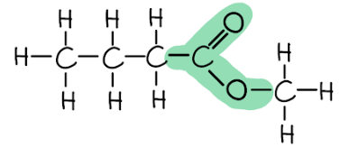

- Overall structure correct; **[1 mark]**
- Correct ester linkage (as highlighted); **[1 mark]**

**[Total: 2 marks]**

- *Naming and drawing esters is one of the more challenging aspects of molecules*
- *The -COO- ester linkage is one that you should be aware of *
- *The alkyl portion (first name) comes after the -COO-*

  - *In this case it is methyl, so you get -COO-CH**3*
- *The acid portion (surname) comes before the -COO- **AND** the C of the -COO- counts as part of this*

  - *Butanoate is 4 carbons*
  - *One carbon is in the ester linkage*
  - *This leaves 3 carbons to account for in an alkyl chain which gives CH3-CH2-CH**2**-COO-CH**3*
d) The structural formula of a typical protein, including three monomer units is:

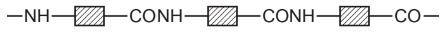

- At least one correct amide linkage –CONH–; **[1 mark]**
- Continuation bonds shown at both ends of chain; **[1 mark]**
- Diagram showing three (different) amino acid residues; **[1 mark]**

**[Total: 3 marks]**

- *Proteins are basically polymers of amino acids*
- *If you look at the ends of an amino acid, you should notice the NH**2** and COOH groups*
- *These can undergo condensation polymerisation to form the protein*

  - *The small molecule that will also be produced is water*
- *Careful:** The question specifically asks for three monomer units, so you cannot achieve full marks without showing this*

### Q21
a)

i)** Three **characteristics of a homologous series are:

Any **three **of the following:

- Same general formula; **[1 mark]**
- Consecutive members differ by CH2; **[1 mark]**
- Similar / same chemical properties; **[1 mark]**
- Same functional group; **[1 mark]**
- Physical properties vary in a predictable way / give trends such as mp increases with n; **[1 mark]**

ii) The name of the third member of this series is:

- Propanol / propan-1-ol / propan-2-ol; **[1 mark]**

iii) The molecular formula of the alcohol whose *M*r = 158 is:

- If molecular formula is given as C10H22O / C10H21OH award **[2 marks]**
- If not, look for evidence of some correct working for one mark 158 – 17 = 141 
**OR** 
12n + 2n + 1 = 141 
**OR** 
n = 10; **[1 mark]**

**[Total: 6 marks]**

- *You need to know what a homologous series is and how this affects the properties of the chemicals within  a homologous series*
- *To work out the molecular formula of the alcohol whose **M**r** is 158:*

  - *It must have an -OH group, whose **M**r** is 16 + 1 = 17*
  - *The carbon chain must have an **M**r** of 158 - 17 = 141*
  - *The carbon chain will have one CH**3** group and some CH**2** groups*
  - *M**r** of CH**3** = 12 + (3 x 1) = 15*
  - *141 - 15 = 126*
  - *Therefore the **M**r** of the CH**2** groups must = 126*
  - *M**r** of one CH**2** group = 12 + (2 x 1) = 14*
  - *126/14 = 9 so there are 9 CH**2** groups*
  - *Therefore the formula is C**10**H**21**OH*
b) The two alcohols are isomers because:

- They have the same molecular formula (C4H10O); **[1 mark]**
- (But) different structures / structural formula / arrangement of atoms; **[1 mark]** 
*Allow same number of each type of atom but not same number of atoms*

**[Total: 2 marks]**

- *You need to know the definition of isomers*
c)

i) The name and the structural formula of the organic product when butan-1-ol is passed over the catalyst silicon(IV) oxide is:

- Butene or but-1-ene; **[1 mark]** *Allow but-2-ene*
- CH3CH2CH=CH2 
**OR **
CH3-CH2-CH=CH2; **[1 mark]**

ii) The name of the ester formed from butanol and ethanoic acid is:

- Butyl ethanoate; **[1 mark]** 
*Allow butanyl*

iii) The name and the structural formula of the organic product when butan-1-ol is oxidised by acidified potassium manganate(VII) is:

- Butanoic acid; **[1 mark]** 
*Allow butyric acid*
- CH3CH2CH2COOH / CH3CH2CH2CO2H / CH3-CH2-CH2-COOH; **[1 mark]**

**[Total: 5 marks]**

- *Structural formula show enough information to make the structure clear but single bonds are usually omitted and just double or triple bonds are shown*
- *The name of the ester depends on the carboxylic acid and alcohol that were used to produce it*
- *The 1st part of the name indicates the length of the carbon chain in the alcohol, and it ends with the letters ‘- yl’*
- *The 2nd part of the name indicates the length of the carbon chain in the carboxylic acid, and it ends with the letters ‘- oate’*

  - *So the ester formed from** but**anol and **ethan**oic acid is called **but**yl **ethan**oate*
- *The alternative names, butanyl and butyric acid, are alternative names for butyl ethanoate and butanoic acid respectively but you are not expected to know these*

### Q22
a)

i) The concentration of methanol at equilibrium does not change because:

- The rate at which methanol is formed by the forward reaction; **[1 mark]**
- Equals the rate it is reacting in the backward / reverse reaction; **[1 mark]** 
*Allow [1 mark] for rate of forward reaction equals rate of back reaction *

ii) The temperature and pressure which would give a high yield of methanol are:

- Low / lower / decreased temperature; **[1 mark]**
- High / higher / increased pressure; **[1 mark]** 
*Explanations not needed but if they are given they must be correct* 
*IGNORE values of temperature and pressure*

iii) The conditions used in practice compared with those given in in part (ii) would be:

- A high pressure can be used  **OR** A lower pressure is used due to expense / safety; **[1 mark]**
- A low temperature cannot be used as rate would be too slow / the rate would not be economic; **[1 mark]**

**[Total: 6 marks]**

- *Whilst you have not studied the industrial conditions for this reaction, you can apply the same principles that you learnt from the Haber process and Contact process*
- *Industrial conditions for pressure are often a compromise between yield and safety or expense*
- *Temperature conditions for a reaction whose forward reaction is exothermic, are a compromise between yield and rate of reaction*
b)

i) The structural formula of an octene molecule is:

- H2C=CH(CH2)5CH3 / H2C=CHCH2CH2CH2CH2CH2CH3; **[1 mark]** 
*Allow CH**2**=CH around C=C* 
*Allow correct structural formula of isomers*

ii) A test, with results, that would distinguish between octane and octene is:

- Test: add bromine (water)/bromine in an organic solvent; **[1 mark]**
- Result with octane: (solution) remains brown/orange/yellow/red; **[1 mark]**
- Result with octene: (solution) goes colourless/decolourises; **[1 mark]** 
*Do NOT accept clear/discolours* 
*Colour of reagent must be shown somewhere for [3 marks] otherwise max [2 marks]* 
*Accept equivalent test using KMnO**4 **in acid or alkali*

**[Total: 4 marks]**

- *There are a number of straight chain isomers of octene as the double bond can be placed between any two carbon atoms, these would all be acceptable*

  - *E.g. CH**3**CH**2**CH=CH(CH**2**)**3**CH**3*
- *It is worth checking that you have 8 carbon atoms and 16 H atoms as per the formula for octene, C**8**H**16** as it obeys the general formula for an alkene, C**n**H**2n*
- *Whilst it is a suitable method to use KMnO**4** to distinguish alkanes and alkenes, you are not expected to know this test*

### Q23
a)

i) The phrase *photochemical reaction *means*:*

- A reaction whose rate is influenced by light / reaction which occurs in presence of light; **[1 mark]**

ii) The structural formula of the other isomer is:

- CH3CHClCH3;** [1 mark]**

iii) These two different compounds are isomers because:

- (Both have) same molecular formula; **[1 mark]**
- Different structural formula or structure; **[1 mark]**

**[Total: 4 marks]**

- *Structural formulae give enough information is shown to make the structure clear, but most of the actual covalent bonds are omitted*
- *The other isomer would have the chlorine atom on the middle carbon:*

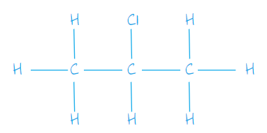

- *Ensure you know the difference between structural and displayed formulae*
- *The diagram above shows the displayed formula which shows the spatial arrangement of all the atoms and bonds in a molecule*
- *You would not get the mark if you drew this as the structural formula is CH**3**CHClCH**3*
b) To determine whether this reaction is exothermic or endothermic:

- Bonds breaking = (8 × 412) + (2 × 348) + 242 = 4234;** [1 mark]**
- Bonds forming = (7 × 412) + (2 × 348) + 338 + 431 = 4349; **[1 mark]**
- 4234 – 4349 = –115 **AND **exothermic;** [1 mark]**

**[Total: 3 marks]**

- *It is very easy make errors in these types of calculations by not accounting for all of the bonds in the reactants and prodcuts*
- *It is a good idea to draw the displayed formula, if not provided, then as you include the bond in your calculation, cross the bond out*
- *In this case, the bonds being broken in the reactants are:*

  - *8 x C-H, 2 x C-C, 1 x Cl-Cl*
- *These are used to work out the energy taken in by the reaction in breaking these bonds*
- *The bonds being formed are:*

  - *7 x C-H, 2 x C-C, 1 x C-Cl and 1 x H-Cl*
- *These are used to work out the energy given out in the reaction when new bonds are formed*
- *The following equation** **is then used to calculate the overall enthalpy change *

  - *enthalpy change (Δ**H**)  = energy taken in - energy given out is then used to calculate the overall enthalpy change*
  - *If this value is positive, the reaction is endothermic*
  - *If it is negative as it is in this question, it is exothermic*
c)

i) The equation for the reaction is:

CH3CH2CH2Cl + NaOH → CH3CH2CH2OH + NaCl

- NaCl as product; **[1 mark]**
- Rest of equation; **[1 mark]**

ii) The name and structure of the hydrocarbon is:

- Name: propene; **[1 mark]**
- Structure: CH2=CHCH3;** [1 mark]**

iii) The name of the acid is:

- Propanoic acid; **[1 mark]**

**[Total: 5 marks]**

- *In part (i), you are given the formulae of the reactants and one product so you are expected to work out that the remaining product is NaCl*
- *The reaction in part (ii) is the opposite of the hydration of ethene as ethanol is losing water to form propene*
- *The reverse of this is the addition of water to propene to form propanol*
- *Alcohols are oxidised to the carboxylic acid with the same number of carbon atoms so propanol with be oxidised to propanoic acid*
d)

i) The *M*r of methanoic acid is:

- 46;** [1 mark]**

ii) The* M*r of propanol is:

- 60; **[1 mark]**

iii) The limiting reagent and reason why is:

- Moles of CH3CH2CH2OH (= $\frac{\mathrm{mass}}{\mathrm{molar} \mathrm{mass}}=\frac{6.0}{60}$) = 0.1 moles; **[1 mark]**
- Moles of HCOOH (= $\frac{4.0}{46}$) = 0.087 (0.09) and limiting reagent is methanoic acid;** [1 mark]**

iv) The maximum yield in grams of propyl methanoate is:

- (= mass x molar mass =) 88 x (mol of limiting reagent in 4(d)(iii)); **[1 mark]** *Expected answer: 88 × 0.087 = 7.65 g*

**[Total: 5 marks]**

- *M**r** of methanoic acid: (1 X C) + (2 x H) + (2 x O) = (1 x 12) + (2 x 1) + (2 x 16) = 46*
- *M**r** of propanol: (3 X C) + (8 x H) + (1 x O) = (3 x 12) + (8 x 1) + (1 x 16) = 60*
- *M**r** of propyl methanoate: (4 X C) + (8 x H) + (2 x O) = (4 x 12) + (8 x 1) + (2 x 16) = 88*
- *The balanced symbol equation shows equal number of moles of methanoic acid and propanol will react*
- *There are more moles present of propanol, therefore this is in excess and the limiting reagent is methanoic acid*

### Q24
a)

i) The general formula of the alcohols is:

- CnH2n+1OH; **[1 mark]**

ii) The formula of the alcohol is:

- 116 - 17 = 99, 12n + (2n + 1) = 99, n = 7; **[1 mark]** *For any evidence of valid working out award 1 mark*
- C7H15OH; **[1 mark]**

iii) A diagram showing the arrangement of the outer (valency) electrons in one molecule of methanol is:

- 8 bonded electrons around C; **[1 mark]**
- 2 bonded electrons on each hydrogen; **[1 mark]**
- 4 bonded electrons and 4 non-bonded electrons on oxygen; **[1 mark]**

**[Total: 6 marks]**

- *The **M**r** due to OH = 16 + 1 = 17*
- *So the **M**r** due to C**n**H**2n+1** = 116 - 17 = 99*
- *The mass due to carbon is 12 x n = 12n*
- *The mass due to hydrogen is 1 x (2n + 1) = 2n + 1*
- *So, the mass due to carbon and hydrogen is 99:*

  - *12n + (2n+1) = 99*
  - *Simplifying gives 14n + 1 = 99*
  - *Rearranging: 14n = 98*
  - *n = 98/14 = 7*
- *Giving the formula C**7**H**15**OH*
- *When drawing the dot and cross diagram, check that all the electron shells are complete*

  - *Carbon and oxygen should have 8 electrons in their shell*
  - *Hydrogen should have 2 electrons*
b)

i) A high pressure used in reaction 2 because:

- It increases yield / moves equilibrium to RHS / favours forward reaction; **[1 mark]**
- High pressure favours side with smaller number of (gas) molecules / moles; **[1 mark]**

ii) A catalyst at 250 °C is preferred to using a higher temperature of 350°C and no catalyst because:

Any **three **from:

- Higher temperature / catalyst causes faster reaction; **[1 mark]**
- Comment about compromise conditions to give best rate and yield; **[1 mark]**
- At 250 oC (lower temp) there is a higher yield / forward reaction favoured; **[1 mark]**
- At 350 oC (higher temp) lower yield / back reaction favoured; **[1 mark]**

**[Total: 5 marks]**

- *Although you have not specifically learnt about the industrial conditions for the manufacture of methanol, the reasons why the conditions are chosen follow Le Chatalier's Principle, just like in the Haber process and the Contact process that you have learnt about*
- *Temperature conditions for a reaction that is exothermic in the forward direction will always be a compromise between the rate of the reaction and yield*
c)

i) The name and structural formula of the carboxylic acid produced is:

- Methanoic acid; **[1 mark]**
- 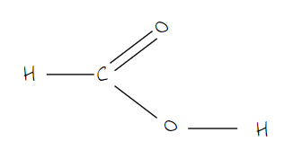 ; **[1 mark]** 
*Accept -OH*

ii) The name of the ester formed by the reaction of methanol with the carboxylic acid named in (i) is:

- Methyl methanoate; **[1 mark]**

**[Total: 3 marks]**

- *Whilst usually in structural formula most of the actual covalent bonds are omitted, in this question, they have specifically asked you to show all of the bonds, so HCOOH would not gain the mark in this instance*

  - *This type of formula is usually referred to as the displayed formula*
- *Don't forget the bond between the OH, although this is not penalised if you do!*
- *When naming esters, the first part of the name indicates the length of the carbon chain in the alcohol, and it ends with the letters ‘- yl’*
- *The second part of the name indicates the length of the carbon chain in the carboxylic acid, and it ends with the letters ‘- oate’*

  - *In this case, the ester formed from** meth**anol and **methan**oic acid is called **meth**yl **methan**oate*

### Q25
a)

i) A solid fossil fuel is:

- Coal / coke 
**OR **
Peat; **[1 mark]** 
*Wood and charcoal are not accepted*

ii) A gaseous fossil fuel is:  Any **one** of the following:

- Natural gas / methane;** [1 mark] **
- Propane; **[1 mark] **
- Butane; **[1 mark] **
- Petroleum gases; **[1 mark] **
- Calor gas; **[1 mark]**
- Refinery gas; **[1 mark]**

**[Total: 2 marks]**

- *You should know examples of solid, liquid and gaseous fossil fuels from your studies prior to GCSE*
b)

i) **Two **liquid fuels obtained from petroleum are:

Any **two** of the following:

- Petrol or gasoline;** [1 mark]**
- Paraffin or kerosene; **[1 mark]**
- Diesel;** [1 mark]**
- Aviation fuel or jet fuel; **[1 mark]**
- Fuel oil; **[1 mark]**
- Heavy fuel oil; **[1 mark]**
- Heating oil; **[1 mark]**

ii) **Two **other useful products obtained from petroleum that are not used as fuels are:

Any **two** of the following:

- Waxes; **[1 mark] **
- Grease; **[1 mark]**
- Lubricants; **[1 mark] **
- Polishes; **[1 mark] **
- Bitumen  / tar / asphalt; **[1 mark]**
- Naphtha; **[1 mark]**

iii) Another mixture of liquids that is separated on an industrial scale by fractional distillation is:

Any **one **of the following:

- (Liquid) air; **[1 mark]**
- Ethanol and water; **[1 mark]**
- Alkenes (made by cracking); **[1 mark] **
- Noble Gases; **[1 mark]**

**[Total: 5 marks]**

- *You should know the different fractions and, ideally, some uses as well*

### Q26
a)

i) The equation for the cracking of the alkane, decane is:

Example: C10H22 → C8H18 + C2H4

- Correct equation; **[2 marks]** 
*Accept 1 mark for giving correct formula of alkane and alkene* 
*Accept alkene and hydrogen*

ii)  Chloropropane can be made from propane by:

- Chlorine; **[1 mark]**
- Light;  
**OR** 
200°C  
**OR** 
Heat 
**OR** 
high temperature MAX 1000°C; **[1 mark]** 
*Ignore comment ‘catalyst’*

**[Total: 4 marks]**

- *Cracking results in the breakdown of a long chain alkane into a short chain alkane and alkene *
- *Any combination of alkane and alkene could be given here provided that the number of carbon atoms on the left hand side of the equation balances with those on the right hand side, and that your formula for the alkane and alkene are correct*
- *Some examples you could write are:*

  - *C**10**H**22** → C**8**H**18** + C**2**H**4 *
  - *C**10**H**22** → C**7**H**16** + C**3**H**6 *
  - *C**10**H**22** → C**6**H**14** + C**4**H**8 *
- *Haloalkanes are formed by a substitution reaction when an alkane reacts with a halogen*
- *You should know the conditions for this reaction*
b)

i) They  are isomers because:

- (They have the) same molecular formula; **[1 mark]**
- Different structures or structural formulae; **[1 mark]**

ii) The name and structural formula of another hydrocarbon that is isomeric with the above is

- But-2-ene; **[1 mark]**
- Corresponding structural formula; **[1 mark]** 
*NOT 2-butene*

**[Total: 4 marks]**

- *The molecular formula is the actual number of atoms of each element in a compound *
- *The molecular formula of the structures shown is C**4**H**8** but as you can see their atoms are arranged differently so they are known as structural isomers *
- *But-1-ene and 2-methylpropene are shown in part a) and so the position of the double bond can be moved to deduce the third isomer, but-2-ene*
c) The name of the product when but-1-ene reacts with steam, hydrogen and bromine are:

- Butanol; **[1 mark]**
- Butane; **[1 mark]**
- Dibromobutane; **[1 mark]**

**[Total: 3 marks]**

- *The reaction of but-1-ene with steam, hydrogen and bromine are all addition reactions*
- *The reaction between alkenes and steam produces an alcohol*
- *The reaction between alkenes and hydrogen produce an alkane*
- *The reaction between alke nes and bromine produces a haloalkane*
- *It is helpful to draw the displayed formula of your reactants and products to work out the name of the product formed*
- *Remember, bromine is Br**2**, so both bromine atoms need to be considered hence **di**bromobutane*
d)

i) The name and structural formula of the monomer from the structure of the polymer are:

- Propene; **[1 mark]**
- CH3—CH=CH2; **[1 mark]**

ii)  The structure of the polymer formed from the following monomer is:

- Correct repeat unit; **[1 mark]**
- Continuation of bonds; **[1 mark]**

iii) The pollution problems caused by the disposal of polymers in landfill sites and by burning are:

Landfill:

Any **two** from:

- They do not decay 
**OR** 
Non-biodegradable; **[1 mark]**
- Shortage of sites or amount of waste per year; **[1 mark]**
- Visual pollution; **[1 mark]**
- Forms methane; **[1 mark]**

Combustion

- Forms poisonous / toxic gases;  
**OR** 
Named gas CO, HCl HCN; **[1 mark]** 
*NOT carbon dioxide, harmful, sulphur dioxide*

**[Total: 7 marks]**

- *Remember: **When a polymer is named from a monomer, poly- is added to the beginning of the name of the monomer*

  - *This process is just reversed when naming a monomer, remove the poly and you get propene *
- *You should be aware of how to draw the first four alkenes but if you have forgotten*

  - *Draw the repeat unit without the brackets and n*
  - *Change the single bond to a double bond *
  - *Remove the bond from each end of the repeat unit*

### Q27
a)

i) The word equation for the fermentation of glucose is:

- Glucose → carbon dioxide + ethanol; **[1 mark] **

ii) It is necessary to add yeast because:

- It is a catalyst / speeds up the reaction / is a slow reaction without yeast 
**OR **
It provides enzymes; **[1 mark]**

The amount of yeast in the mixture increases because:

- Yeast cells grow / multiply / reproduce / undergo budding / breed;** [1 mark] **

iii) A higher temperature not used in this process because:

- Heat / high temperature would kill yeast (cells) 
**OR **
Heat / high temperature denatures enzymes;** [1 mark]** *Enzymes being killed or yeast being denatured are not accepted answers*
- Which would reduce the rate of reaction / slow the reaction / stop the reaction 
**OR **
Which means that there is no catalyst / (yeast or enzyme) no longer catalyses 
**OR **
No more product is formed; **[1 mark]**

**[Total: 5 marks]**

- *This question is showing the clear overlap between Biology and Chemistry in the process of fermentation, applying the language of enzymes and denaturing to the catalytic activity *
b)

i) Oxygen must be absent because:

- It would produce carbon dioxide / carboxylic acids / organic acids 
**OR **
To prevent aerobic respiration 
**OR **
To make sure that the products are not oxidised 
**OR **
Anaerobic bacteria can’t live with oxygen; **[1 mark]**

ii) **Two **other advantages of converting the waste into methane are:

Any **two **of the following:

- Fossil fuels have a reduced need; **[1 mark]**
- Conserve fossil fuels;** [1 mark]**
- No need to import;** [1 mark] **
- Fossil fuels will last longer; **[1 mark] **
- Cracking hydrocarbons to make methane would not be required; **[1 mark]**
- Methane is renewable / carbon neutral; **[1 mark]**
- Reduce pollution of water or sea; **[1 mark]**
- Prevents visual pollution; **[1 mark]**
- Less waste disposal or accumulation (accept: any methods of waste disposal) / so that waste is recycled; **[1 mark]**

**[Total: 3 marks]**

- *You need to know the advantages of reducing the use of fossil fuels*

### Q28
a)

i) You could show that propenoic acid is an unsaturated compound by:

- **Test**: add bromine water / bromine / aqueous bromine; **[1 mark]**
- **Result**: it will turn colourless / decolourise; **[1 mark]**
Do not award the mark for 'clear'

ii) You could show that a compound is an acid by:

- **Test**: add metal / carbonate / insoluble base / strong alkali / use a pH meter; **[1 mark]**
- **Result**: needs to match with reagent to be awarded the mark:  With metal - hydrogen given off / metal dissolves / effervescence / gas given off / burning splint pops; **[1 mark]** With carbonate - carbon dioxide given off / effervescence / gas given off / limewater turns milky; **[1 mark]** With an insoluble base - solution formed / dissolves; **[1 mark]** With an alkali - use of indicator to show neutralisation / temperature increase; **[1 mark]** Using a pH meter - gives pH less than 7; **[1 mark]**

**[Total: 4 marks]**

- *When bromine water is added to propenoic acid, the bromine atoms add across the double bond, removing the brown-coloured bromine and therefore decolourising the solution*

  - *Make sure you state colourless and not clear, they are different!*
- *Carboxylic acids will undergo reactions that are characteristic of acids*
b) The name and structural formula, showing all bonds, is:

- Name: ethyl propenoate; **[1 mark]**
- Structural formula: 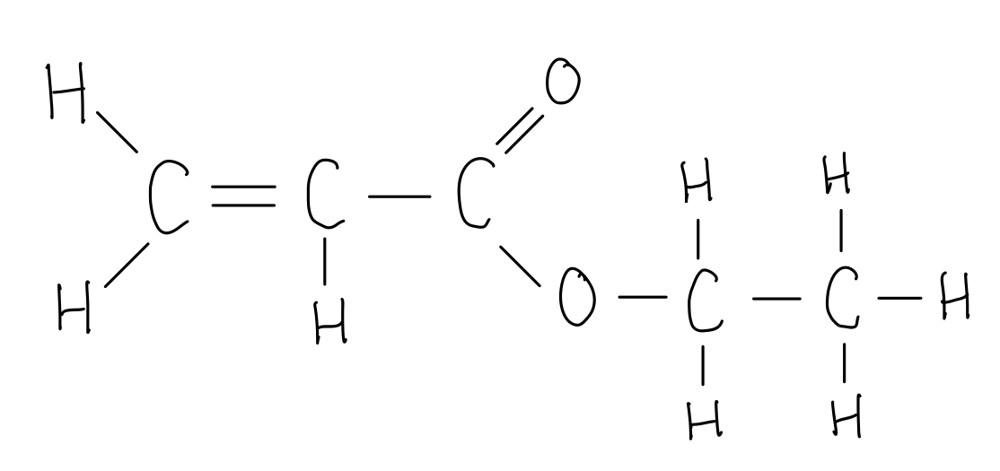
- Correct ester linkage; **[1 mark]**
- Rest of structure showing all bonds; **[1 mark]**

**[Total: 3 marks]**

- *Whilst usually in structural formula most of the actual covalent bonds are omitted, in this question, they have specifically asked you to show all of the bonds, so CH**2**CHCOOCH**2**CH**3** would not gain the mark in this instance*

  - *This type of formula is usually referred to as the displayed formula*
- *You have not studied unsaturated carboxylic acids and how they form esters, but the same principles apply as if it were a saturated carboxylic acid*
- *Remove the OH from the carboxylic acid group and the H from the OH of the alcohol group and join them together either side of the remaining O atom in the alcohol group*
- *Don't forget the C=C double bond and check the number of hydrogens too*
c)

i) The phrase *molecular formula* means:

- The number of atoms of each element; **[1 mark]**
- In one molecule; **[1 mark]**

ii) The number of moles of –COOH groups that are in one mole of this compound is:

- 2; **[1 mark]**

iii) The formula of another functional group in this compound is:

- C=C; **[1 mark]**

iv) A structural formula of this compound is:

- HOOCCH2CH=CHCH2COOH 
**OR** 
HOOCCH=CH(CH2)2COOH 
**OR** 
HOOC(CH2)2CH=CHCOOH 
**OR** 
HOOC(CH3)C=C(CH3)COOH; **[1 mark]**

**[Total: 5 marks]**

- *As 1 mole of the carboxylic acid reacts with 2 moles of sodium hydroxide, then there must be 2 -COOH groups within the acid, each one donates an H**+** to react with the OH- ion from sodium hydroxide*

  - *Therefore, one mole of this carboxylic acid must contain 2 moles of -COOH*
- *This means that the 4 oxygen atoms present in the acid are from the 2 -COOH groups*
- *The fact that it is unsaturated tells you that it must contain a double bond, which is the other functional group*
- *When deducing the structural formula for the carboxylic acid, you are best to draw the displayed formula first to ensure that you assign the correct number of hydrogens to each carbon atom, making sure each carbon atom has 4 bonds*
- *An example is as follows, but there are other isomers as the double bond can be placed in different positions and the carbon chain can be branched:*

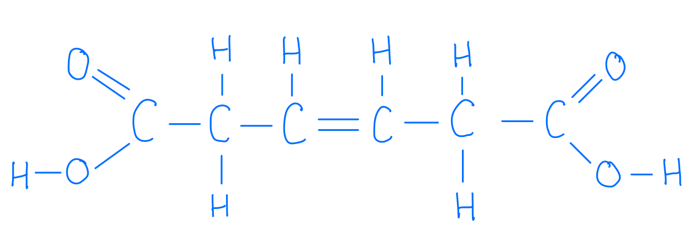

### Q29
a) The general trend in the density of the alkenes is:

- As the number of carbons (in a molecule) increases, the density increases 
**OR **
As the alkenes get bigger / longer, the density increases; **[1 mark]**

**[Total: 1 mark]**

- *To answer this question, you need to use the number of carbon atoms in a molecule column and the density column*

  - *The number of carbon atoms increases as you move down the column*
  - *The density increases as you move down the column*
- *The word 'AS' can help you describe trends in tables and graphs because it makes you compare *

  - *As the number of carbons (in a molecule) increases, the density increases*
b) The boiling point of butene is:

- Between –46 °C and 29 °C (inclusive); **[1 mark]**

**[Total: 1 mark]**

- *The boiling points in the table increase as you move down that column*
- *This means that the boiling point for butene should be:*

  - *Above the boiling point of propene, –47 °C*
  - *Below the boiling point of pentene, 30 °C*

### Q30
a)

i) The reaction conditions for cracking are:

- Heat; **[1 mark]**
- Catalyst; **[1 mark]**

ii) An equation for the cracking of decane, C10H22, to give but-1-ene is:

- An equation that gives alkane + alkene 
**OR** 
Alkene + alkane + hydrogen; **[1 mark]**
- C4H8 as one product;** [1 mark] **
*A correct and balanced equation for the cracking of decane, C**10**H**22** but not but-1-ene would score ***[1*** ***mark]**

iii) The reagent that reacts with but-1-ene to form butan-1-ol is:

- Water 
**OR** Steam; **[1 mark]**

**[Total: 5 marks]**

- *But-1-ene is an alkene, therefore will obey the general formula C**n**H**2n*
- *The 'but' prefix means 4 carbon atoms, therefore the formula of but-1-ene is C**4**H**8*
- *An example of an equation that would be awarded 2 marks for part (ii) is:*

  - *C**10**H**22** → C**4**H**8 **+ C**6**H**14*
- *Make sure that the number of carbon atoms and hydrogen atoms are balanced*
- *Alcohols can be produced via the hydration of alkenes*
- *A mixture of the alkene and steam is passed over a hot catalyst of phosphoric acid at a temperature of approximately 300 °C*
- *The pressure used is 60 atmospheres (6000 kPa)*
b)

i) The balanced equation for the complete combustion of butan-1-ol is:

C4H9OH + **6**O2 → **4**CO2 + **5**H2O

- Balancing CO2 **AND** H2O; **[1 mark]**
- Balancing O2; **[1 mark]**

ii) A word equation for the preparation of the ester butyl methanoate is:

butanol + methanoic acid → butyl methanoate + water

- Correct reactants; **[1 mark]**
- Correct products; **[1 mark]**

**[Total: 4 marks]**

- *When balancing equations of combustion of hydrocarbons, start by balancing the carbon atoms, followed by the hydrogen atoms and finally oxygen atoms*
- *If you end up with a fraction for oxygen atoms, multiply everything by 2*

- *The first part of the name of an ester indicates the length of the carbon chain in the alcohol, and it ends with the letters ‘- yl’*

  - *Butyl indicates that it is formed from butanol*
- *The second part of the name indicates the length of the carbon chain in the carboxylic acid, and it ends with the letters ‘- oate’*

  - *Methanoate indicates it is formed from methanoic acid *
c)

i) The structural formula of propanol and of propanoic acid with all the bonds shown are:

Propanol:

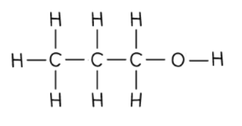

Propanoic acid:

- Correct structural formula of propanol; **[1 mark]**
- Correct structural formula of propanoic acid; **[1 mark]** *Accept either propanol and –OH in alcohol and acid* *Penalise once for CH**3** type diagrams (i.e. structural formula without showing all bonds)* 
*Do NOT accept either C**3**H**8**O or C**3**H**6**O**2*

ii) It is important to develop these fuels, such as biobutanol, as alternatives to petroleum to:

- Conserve petroleum 
**OR** 
Reduce greenhouse effect; **[1 mark]**

**[Total: 3 marks]**

- *Whilst usually in structural formula most of the actual covalent bonds are omitted, in this question, they have specifically asked you to show all of the bonds, so CH**3**CH**2**COOH or CH**3**CH**2**CH**2**OH  would not gain the mark in this instance*

  - *This type of formula is usually referred to as the displayed formula*
- *You should show the bond in the -OH group too, although they do not penalise here for not doing so*
d) You could show that butanol made from petroleum and biobutanol are the same chemical because:

- They have same boiling point; **[1 mark]**

**[Total: 1 mark]**

- *Melting points and boiling points can be found experimentally and compared to data tables in order to identify a substance*
- *They are also used to assess how pure a sample is as pure substances have a fixed melting / boiling point where as impure substances will melt / boil over a range of temperatures*

### Q31
a)

i) The term fuel means:

- A substance / material / compound / element / mixture (that is burnt) to <u>produce / release energy or heat</u>;** [1 mark]**

ii) **Two **other fossil fuels are:

Any **two** of the following:

- Coal;** [1 mark]**
- Coke;** [1 mark]**
- Peat;** [1 mark]**
- Petroleum/ crude oil;** [1 mark]**
- Refinery gas / LPG;** [1 mark]**
- Gasoline / petrol;** [1 mark]**
- Naptha;** [1 mark]**
- Kerosene / paraffin;** [1 mark]**
- Diesel (oil) / gas oil;** [1 mark]**
- Fuel oil;** [1 mark]**
- Propane;** [1 mark]**
- Butane;** [1 mark]**

iii) A **solid **fuel which is not a fossil fuel is:

Any **one **of the following:

- Wood;** [1 mark]**
- Charcoal;** [1 mark]**
- Animal dung;** [1 mark]**
- Biomass;** [1 mark]**
- Uranium / U;** [1 mark]**
- Plutonium / Pu;** [1 mark]**

**[Total: 4 marks]**

- *Remember: **The point of any fuel is to release energy*
b)

i) The products that would be formed if the decomposition occurred in the presence of oxygen are:

Any **two **of the following:

- Water / steam / water vapour / H2O; **[1 mark]**
- Carbon dioxide / CO2; **[1 mark]**
- Carbon monoxide / CO; **[1 mark]**

ii) **Two **main disadvantages in the widespread use of fossil fuels are:

Any **two **of the following:

- Limited or finite resource / non-renewable / will run out; **[1 mark]**
- Greenhouse effect / gas(es) / climate change / global warming; **[1 mark]**
- Acid rain; **[1 mark]**
- Production of poisonous / toxic gases; **[1 mark]**

**[Total: 4 marks]**

- *With oxygen present, the carbon and hydrogen from the organic matter would have been able to react to form carbon dioxide / carbon monoxide and water*
- *The 2 main disadvantages of the widespread use of fossil fuels are almost considered common knowledge*

  - *Global warming / climate change*
  - *Acid rain*

### Q32
a) **Three **characteristics of a homologous series are:

Any **three** from:

- Same general formula; **[1 mark]**
- Consecutive members differ by CH2; **[1 mark]**
- Same chemical properties; **[1 mark]**
- Same functional group; **[1 mark]**
- Physical properties vary in a predictable way / give trend – mp increases with *M**r* etc; **[1 mark]**
- They have common methods of preparation; **[1 mark]**

**[Total: 3 marks]**

- *A common question is to ask for 3 different features of homologous series, so make sure you have a good range of properties that you can recall*
b)

i) They are isomers as:

- They have the same molecular formula;** [1 mark]** *not general formula*
- different structures / structural formulae; **[1 mark]**

ii) The structural formula of another alcohol which is also an isomer of these alcohols is:

- CH3-CH2-CH(OH)-CH3 / (CH3)3C-OH; **[1 mark]**

*Do not allow ether-type structures* 
*Allow butan-2-ol and 2-methylpropan-2-ol are acceptable*

**[Total: 3 marks]**

- *A definition of a structural isomer is expected recall, and the definition helps you to identify isomers correctly*
c)

i) Another reagent which can oxidise butan-1-ol is:

- Air / oxygen / (acidified) potassium chromate(VI) / (acidified) potassium manganate(VII); **[1 mark]** *Must have oxidation states for the mark*

ii) The type of compound and formula is that is liquid X is:

- Carboxylic acid / alkanoic acid; **[1 mark]**
- CH3-CH2-CH2-COOH / C3H7COOH / C4H8O2; **[1 mark]** *Accept C**4**H**7**OOH*

**[Total: 3 marks]**

- *Oxidation can happen slowly in the air, which is why wine goes off if it is left open for a while. The vinegary smell and taste are because the ethanol has changed into ethanoic acid. This happens for all alcohols at a slow rate*
- *The oxidising agents commonly used in labs are acidified dichromate(VI) or manganate(VII) ions as these provide faster oxidation reactions!*
- *Oxidised primary alcohols turn into carboxylic acids*
d)

i) A method of measuring the rate of this reaction is:

- Measure volume of carbon dioxide; **[1 mark]**
- Measure time; **[1 mark]** *Accept day / hour / minute for time mark*

ii) The rate increase initially as:

- Increase in temperature / more yeast present / yeast multiplies; **[1 mark]**

iii) Two reasons why the rate eventually decreases are:

- Glucose used up;** [1 mark]**
- Concentration of ethanol high enough to kill / poison yeast / denature enzymes; **[1 mark]** *Accept sugar not reagent / reactants* *Do not accept kills enzymes*

iv) Fermentation carried out in the absence of air as:

- To prevent aerobic respiration / ethanol would be oxidised / ethanoic acid / acid formed / lactic acid formed / carbon dioxide and water formed; **[1 mark]**

**[Total: 6 marks]**

- *This rates graph is biological, and so there are other factors at play other than just concentration decreasing throughout the experiment*
- *Enzymes can become inactive by being denatured by increased temperature or poisoned, which reduces the rate*

### Q33
a)

i) Their empirical formula is:

- CH2/H2C; **[1 mark]**

ii)  The empirical formula the same for all alkenes because:

- Same ratio of C:H (atoms) / all cancel to CH2 / because general formula is CnH2n / same ratio of atoms or elements (in the compound) / C:H ratio is 1:2; **[1 mark]**

**[Total: 2 marks]**

- *Remember: **The empirical formula is the simplest ratio of atoms of each element in a compound*
- *There are always double the number of hydrogen atoms compared to carbon atoms according to the general formula C**n**H**2n* 
b)

i) The two carboxylic acids are:

- Propanoic / propionic (acid); **[1 mark]**
- Ethanoic / acetic (acid); **[1 mark]**

ii)  The formula of an alkene which forms only one carboxylic acid is:

- Formula of ethene / but-2-ene / any symmetrical alkene; **[1 mark]**

**[Total: 3 marks]**

- *To name the carboxylic acids, count the number of carbon atoms in the longest chain *
- *Don't forget to include the one that is part of the -COOH group*
- *Then name them in line with IUPAC rules, three carbons= prop, and two carbons= eth *
- *Carboxylic acids end with -anoic acid *
- *A symmetrical alkene is one where there are equal numbers of each atom on either side of the double bond such as ethene *
c)

i) The product formed is:

- CH3CH(Br)CH2Br; **[1 mark]**

ii) The product formed is:

- CH3CH(OH)CH3 / CH3CH2CH2OH / C3H7OH; **[1 mark]**

**[Total: 2 marks]**

- *When alkenes react with halogens, they form haloalkanes *
- *Both halogen atoms must add across the double bond, breaking it and forming a saturated compound *
- *For the purpose of this question, it does not matter which carbon atoms you place your bromines on *
- *When an alkene reacts with water / steam, an alcohol is formed *
- *The H and OH from the water add across the double bond *
- *For GCSE is does not matter which carbon atom you position the -OH group on*
d) The structural formula of poly(propene) is:

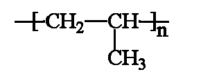

- Correct unit; **[1 mark]** *Accept: more than one repeat unit*
- Continuation bonds at both ends; **[1 mark]**

**[Total: 2 marks]**

- *You should know the structure of propene as C**3**H**6*
- *To draw the structure of the polymer from the monomer: *

  - *Remove the double bond *
  - *Add brackets around the repeat unit*
  - *Place an n at the bottom right hand corner, outside of the brackets *
e)

i) The formula of the alkene and an equation for the complete combustion of this alkene are:

- Moles of O2 (= 2.4/32 =) 0.075 mol 
**AND** 
moles of CO2 (= 2.2/44 =) 0.05 mol; **[1 mark]**
- Molar ratio: 1:7.5:5 
**OR** 
2:15:10; **[1 mark]**
- Formula of the alkene is C5H10

ii) Equation for complete combustion of the alkene:

- Accept any correct equation for the complete combustion of C5H10; **[1 mark]** 
*E.g 2C**5**H**10 **+ 15O**2** → 10CO**2 **+ 10H**2**O *
*Accept multiples including fractions *
*Allow: ecf for correct equation from any correct alkene including*

**[Total: 4 marks]**

- *Complete combustion occurs when a fuel reacts with oxygen to form carbon dioxide and water *
- *The word equation would be:*

  - *Alkene + oxygen →    carbon dioxide + water *
- *You are given the number of moles of the alkene = **0.01 mol*
- *You are given the mass of oxygen and carbon dioxide so can use these to find the moles of the oxygen and carbon dioxide (as shown in the mark scheme) *

  - *Oxygen 2.4    32 = **0.075 mol*
  - *Carbon dioxide = 2.2    44=** 0.05 mol*
- *You therefore have:  0.01   :   0.075    :   0.05 *
- *To calculate the ratio divide each of these by the smallest number which is 0.01*

  - *This gives you the ratio of 1     :      7.5     :     5 or if you double it 2     :     15     :     10*
- *From this you know that you have five moles of carbon dioxide so you therefore have an alkene with five carbons*
- *The general formula for alkenes is C**n**H**2n** so if you have 5 carbons you have 10 hydrogen atoms *
- *Put this information into the equation  *

  - *C**5**H**10**      +     7.5O**2 **    →     5CO**2**    +     H**2**O*
- *Balance the rest of the equation*

  - *C**5**H**10**      +     7.5O**2 **    →     5CO**2**    +     **5**H**2**O*
- *This answer is accepted or you could double the 7.5 to achieve a whole number 15, but remember to double the other substances too*

### Q34
a) The completed equation is:

- C13H28 → C3H6 + C10H22;** [1 mark] **

**Final answer:** **[Total: 1 mark] **

- *Catalytic cracking involves the breaking of a long chain alkane to form a shorter chain alkane and alkene*
- *C**13**H**28 **breaks into the alkene C**3**H**6** (propene)*
- *This means the other product is an alkane*
- *To work out the number of carbons: 13 - 3 = 10*
- *To work out the number of hydrogens: 28 - 6 = 22*
- *Therefore the alkane is C**10**H**22*
b) The structure of ethene is:

- 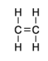 ; **[1 mark] **

**Final answer:** **[Total: 2 marks] **

- *The formula of ethene is C**2**H**4** *
- *Ethene is an alkene so contains one double bond between the two carbon atoms*

### Q35
a)

i) The volumes are:

- Volume of oxygen left = 35 cm3;** [1 mark]**
- Volume of carbon dioxide formed = 40 cm3; **[1 mark]**

ii) Incomplete combustion of any alkane, particularly in an enclosed space, is dangerous because:

- It forms carbon monoxide;** [1 mark]**
- Which is poisonous / toxic / lethal 
**OR **
Which prevents blood carrying oxygen / effect(s) on haemoglobin; **[1 mark]** 
*Harmful is not an accepted answer*

**[Total: 4 marks]**

- *There are two ways of calculating the volume of oxygen and carbon dioxide, one is more complicated than the other*
- *Method 1:*

  - *This uses the concept that equal volumes of gases will occupy the same volume, regardless of what type of gaseous species it is*
  - *So, 10 cm**3** of butane contains the same number of moles as 10 cm**3 **of carbon dioxide or 10 cm**3** of oxygen*
  - *Using the balanced symbol equation, you can see that 1 mole of butane will react with 6.5 moles of oxygen, therefore 10cm**3** of butane will react with 10 x 6.5 = 65 cm**3** of oxygen*
  - *Initially, there was 100 cm**3** of oxygen, therefore the volume of oxygen remaining = 100 - 65 = 35 cm**3*
  - *Also, 1 mole of butane will form 4 moles of carbon dioxide, therefore 10 cm**3** of butane forms 10 x 4 = 40 cm**3** of carbon dioxide*
- *Method 2:*

  - *This involves calculating the number of moles of butane*
  - *In both cases, you have to determine the number of moles of butane and then apply that to determine the volumes of oxygen remaining and carbon dioxide formed*
  - *Moles of butane =  = 0.000417 mol*
  - *Oxygen remaining*
  
    - *There are 6.5 times more moles of oxygen used in the reaction = 0.0027803 moles*
    - *This corresponds to 0.0027803 x 24 000 = 65 cm**3** of oxygen that are consumed in the reaction*
    - *Therefore, there are 100 - 65 = 35 cm**3** of oxygen remaining*
  - *Carbon dioxide formed*
  
    - *There are 4 times more moles of carbon dioxide formed in the reaction = 0.00167 moles*
    - *This corresponds to 0.00167 x 24 000 = 40 cm**3** of carbon dioxide are formed in the reaction*
- *Incomplete combustion of hydrocarbons releases carbon dioxide (and carbon particulates) *

  - *Carbon monoxide is harmful to the human body but, nowadays, the word harmful is insufficient for any marks, so you have to be more specific by saying that it is poisonous / toxic / lethal or describe the effects that it has on haemoglobin and the blood's ability to transport oxygen*
b)

i) The organic product is:

- (1-)Chlorobutane / butyl chloride; **[1 mark]**

ii) The essential reaction condition is:

- Light / UV **OR **200°C **OR **Lead tetraethyl; **[1 mark]**

iii) A different equation for a substitution reaction between butane and chlorine is:

- CH3−CH2−CH2−CH3 + Cl2 → CH3−CH2−CHCl−CH3 + HCl 
**OR **
CH3−CH2−CH2−CH3 + Cl2 → CH3−CH2−CHCl−CH2−Cl + H2; **[1 mark]**

**[Total: 3 marks]**

- *The organic product contains 4 carbons with all single bonds and, therefore, its name is butane based*

  - *It also contains one chlorine on carbon 1, so it is chlorobutane or 1-chlorobutane*
- *The reaction conditions for the substitution of an alkane is a fact that you simply have to learn*

  - *The most common answer given for the reaction conditions is ultraviolet / UV light *
- *The simplest alternative equation for a different substitution would be the chlorine substituting on to carbon 2 instead of carbon 1 *

  - *A more complicated answer would see the double substitution of chlorines*
c)

i) The structural formula of the polymer poly(propene) is

- Correct monomer structure containing a single carbon-carbon bond; **[1 mark]**
- Continuation bonds; **[1 mark]** 
*The mark for the continuation bonds should only be awarded if the structure is correct*

ii) The structural formula and name of the alcohol formed when but-1-ene reacts with steam is:

- Name: butanol / butan-1-ol / butan-2-ol; **[1 mark]**
- Structural formula: CH3-CH2-CH2-CH2OH 
**OR **
CH3-CH(OH)-CH2-CH3; **[1 mark]** 
*If butan-1-ol or butan-2-ol are given, then the structural formula ****must**** match*

iii) The structural formula of the product formed when propene reacts with hydrogen chloride is:

- CH3-CH(Cl)-CH3 
**OR **
CH3-CH2-CH2-Cl; **[1 mark]**

**[Total: 5 marks]**

- *This question covers the majority of the reactions of alkenes:*

  - *Part (i) is addition polymerisation*
  
    - *The most common mistakes on questions drawing the structural formula of polymers are:*
    
      - *Incorrect monomer structure*
      - *Leaving the carbon=carbon double bond / C=C in the structure*
      - *Forgetting the continuation bonds*
  - *Part (ii) is steam hydration*
  
    - *The water (steam) essentially splits into a hydrogen group and a hydroxide group which add to either side of the double bond, which becomes a single bond in the process *
  - *Part (iii) is chlorination / halogenation*
  
    - *The hydrogen chloride essentially splits into a hydrogen group and a chlorine group which add to either side of the double bond, which becomes a single bond in the process *

### Q36
a)

i) The term *isomer* refers to chemicals that have:

- The same molecular formula / same number of carbon and hydrogen atoms; **[1 mark]**
- But a different structural formula / structure / arrangement of atoms; **[1 mark]**

ii) A structural formula of another isomer of but-1-ene is:

- Structural formula of methyl cyclopropane, e.g. (CH2)2CHCH3 **OR** 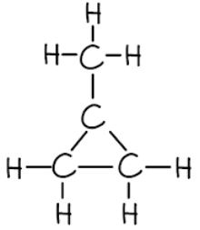 ; **[1 mark]  **
- Structural formula of but-2-ene, e.g. CH3CHCHCH3 **OR**  ; **[1 mark]  **
- Structural formula of methylpropene, e.g. CH2CH(CH3)CH2 **OR**  ; **[1 mark]**

iii) A test which would distinguish between but-1-ene and cyclobutane is:

Alternative 1:

- Reagent: bromine / bromine water / aqueous bromine; **[1 mark]**
- Result with but-1-ene: from brown to colourless / decolourises;** [1 mark]** *The word clear is not accepted*
- Result with cyclobutane: stays brown;** [1 mark]**

Alternative 2:

- Reagent: alkaline potassium manganate(VII); **[1 mark]**
- Result with but-1-ene: from purple / pink to green / brown;** [1 mark]**
- Result with cyclobutane: stays purple / pink;** [1 mark]**

Alternative 1:

- Reagent: acidic potassium manganate(VII); **[1 mark]**
- Result with but-1-ene: from purple/pink to colourless;** [1 mark]** *The word clear is not accepted*
- Result with cyclobutane: stays purple / pink;** [1 mark]**

**[Total: 6 marks]**

- *You need to be able to define, identify and draw isomers*
- *The most common reagent given for testing between alkanes and alkenes is bromine, which changes from an orange-brown colour to colourless*
b) Alkenes, such as but-1-ene, can be made from alkanes by:

- Heating / using high temperature; **[1 mark]** *If a temperature is given, then it must be above 500 **o**C*
- Using / in the presence of a catalyst / any metal oxide / zeolite / aluminosilicate / silica / silicon dioxide;** [1 mark]** *Nickel and platinum are ****not ****accepted answers*

**[Total: 2 marks]**

- *Alkanes are relatively unreactive chemicals*
- *Longer chain alkanes are often "cracked" into smaller and more useful alkanes with alkenes as a by-product*
- *Therefore, you need to be able to state the conditions required for cracking*
c) The product formed when but-1-ene reacts with:

- Bromine = 1,2-dibromobutane / dibromobutane; **[1 mark]**
- Hydrogen = butane; **[1 mark]**
- Steam = butanol / butan-1-ol / butan-2-ol;** [1 mark]**

**[Total: 3 marks]**

- *In all of these reactions, the other chemical will essentially be split and added on either side of the C=C*

  - *Bromine will add 2 bromine atoms on either side of the C=C giving 1,2-dibromobutane*
  - *Hydrogen will give a hydrocarbon with four carbons and all single bonds, which is butane*
  - *Steam will add a hydrogen and an OH on either side of the C=C giving ethanol*

### Q37
a)

i) The structural formula of ethanoic acid, showing all bonds is:

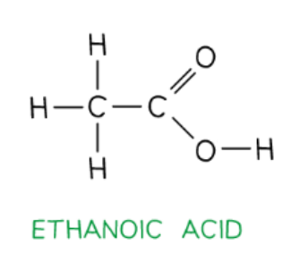

- Correct structure showing the bonds; **[1 mark]** 
*Allow -OH but not -COOH*

ii) The structural formula of ethanol, showing all bonds is:

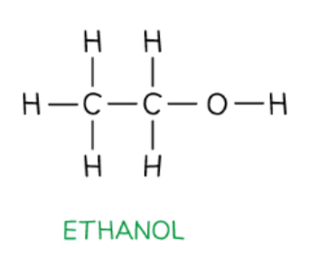

- Correct structure showing the bonds; **[1 mark]** 
*Allow -OH *

**[Total: 2 marks]**

- *The stem 'eth' tells you that both compounds have 2 carbon atoms*
- *The ending 'oic acid' means that it contains the functional group -COOH*
- *The ending 'ol' means that it contains the -OH group*
- *Whilst usually in structural formula most of the actual covalent bonds are omitted, in this question, they have specifically asked you to show all of the bonds, so CH**3**COOH or CH**3**CH**2**OH  would not gain the mark in this instance*

  - *This type of formula is usually referred to as the displayed formula*
b)

i) The name of this ester is:

- Ethyl ethanoate; **[1 mark]**

ii) The structure of the polyester which can be formed from the monomers shown in the questions is:

–OCC6H4COOCH2CH2O–

- Correct ester linkage; **[1 mark]**
- Correct repeat units; **[1 mark]**
- Continuation bonds; **[1 mark]** 
*Accept boxes if it is clear what the box represents*

iii) The pollution problems caused by non-biodegradable polymers are:

Any **two** from:

- They take a long time to decay; **[1 mark]**
- (They take up space in) landfill sites; **[1 mark]**
- Visual pollution / litter; **[1 mark]**
- Danger to animals; **[1 mark]**
- Produce poisonous gases when burnt;  **[1 mark]** 
*Accept: any correct suggestion*

**[Total: 6 marks]**

- *To draw the structural formula of the polyester, remove the OH from either end of the carboxylic acid and the H from either end of the alcohol:*

  - *—OC—C**6**H**4**—CO— and —O—CH**2**—CH**2**—O—*
- *Now join them together by an ester linkage —COO—:*

  - *—OC—C**6**H**4**—COO—CH**2**—CH**2**—O—*
- *Usually in structural formula, most of the covalent bonds are omitted but it is important that you keep the bonds at either end, to show that this is a repeating unit:*

  - *—OCC**6**H**4**COOCH**2**CH**2**O—*
c) The differences between nylon and protein are:

- Nylon / synthetic only has two monomers; **[1 mark]**
- Protein has many different monomers; **[1 mark] **

**OR **

- Protein has 1 C=O and 1 N–H; **[1 mark]**
- Nylon has 2 C=O / 2 N–H; **[1 mark] **

**OR **

- Nylon / synthetic – one monomer is a dicarboxylic acid and the other is a diamine; **[1 mark]**
- Protein all monomers are amino acids; **[1 mark]**

**[Total: 2 marks]**

- *There are many different amino acids that are the monomers which form proteins*
- *Amino acids have an amine, -NH**2**, group at one end and a carboxylic acid group, -COOH, at the other*
- *The repeating units of the two structures are different:*

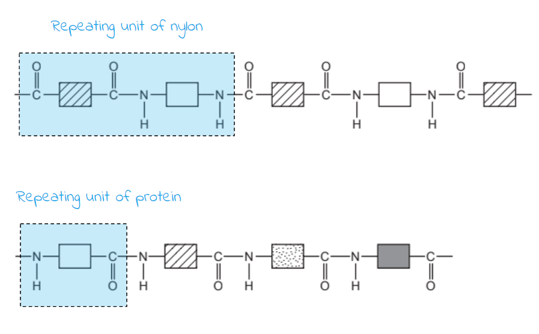

### Q38
a) **Two **industrial processes which must take place to produce alkenes from petroleum are:

- Fractional distillation; **[1 mark]**
- Cracking; **[1 mark]**

**[Total: 2 marks]**

- *Fractional distillation separates crude oil into groups of alkanes with similar boiling points*
- *The long chain alkanes then undergo cracking to produce shorter alkanes and alkenes*
b)

i) The type of polymerisation takes place when ethene forms a polymer is:

- Addition; **[1 mark]**

ii) The empirical formula of the polymer formed from ethene is:

- (C2H4)n; **[1 mark]**

iii) Two repeat units of the polymer made from propene are:

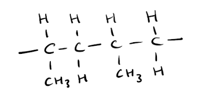

- Chain of 4 carbon atoms with single bonds and continuation bonds; **[1 mark]**
- Correctly positioned CH3 side chains; **[1 mark]**

**[Total: 4 marks]**

- *Empirical formula is the simplest ratio of atoms of each element in a compound*
- *The empirical formula for all alkenes is C**n**H**2n** so for the polymer, brackets and an n are added, just like you would when drawing the repeating unit of a polymer*
- *Addition monomers are formed by the joining of many monomers *
- *Only monomers with C=C bonds can form addition polymers*
- *To draw the repeat unit, the double bond is broken, and the monomers join up*
- *You need to make sure you have bonds extending from the end carbon atoms to indicate they would be joined to other monomers*
c) The alcohols formed are:

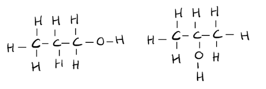

- Correct structure of propan-1-ol; **[1 mark]**
- Correct structure of propan-2-ol; **[1 mark]**

**[Total: 2 marks]**

- *Structural isomers have the same molecular formula but their atoms are arranged differently*
- *To work out the name of the alcohol formed from the alkene- just look at the prefix of the name*

  - *Eth**ene forms e**th**anol*
  - *Prop**ene forms **prop**anol *
d)

i) The catalyst needed to form an ester from ethanoic acid and methanol is:

- (Concentration) sulfuric acid; **[1 mark]**

ii) The ester formed when ethanoic acid reacts with methanol is:

- Methyl ethanoate; **[1 mark]**

iii) The structure of the ester formed when ethanoic acid reacts with methanol is:

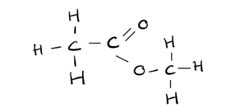

- Correct structure for methyl ethanoate; **[1 mark]**

iv)  The name of a polyester is:

- Terylene; **[1 mark]**

**[Total: 4 marks]**

- *Esters are formed from alcohols and carboyxlic acids *
- *The first part of an ester name comes from the alcohol, and the second from the carboxylic acid*
- *So **eth**anoic acid and **meth**anol forms **meth**yl **eth**anoate*
- *When drawing an ester- the methyl part is drawn after the COO group, and the carboxylic acid before it*

### Q39
a)

i) The carboxylic acid and the alcohol from which the ester could be made are:

- Butanoic acid; **[1 mark]**
- Methanol; **[1 mark]**

ii) The limiting reagent and the maximum yield of ethyl ethanoate can be found by:

- Number of moles of ethanoic acid = mass/molar mass = 6.0/60 = 0.1 moles; **[1 mark]**
- Number of moles of ethanol = mass/molar mass = 5.5/46 = 0.12 moles; **[1 mark]**
- The limiting reagent is ethanoic acid; **[1 mark]**
- Number of moles of ethyl ethanoate formed = 0.1 moles; **[1 mark]**
- Maximum yield of ethyl ethanoate = moles x molar mass = 0.1 x 88 = 8.8 g; **[1 mark]**

**[Total: 7 marks]**

- *An ester is made from one part that originates from the carboxylic acid and the other from the alcohol from which it is made:*

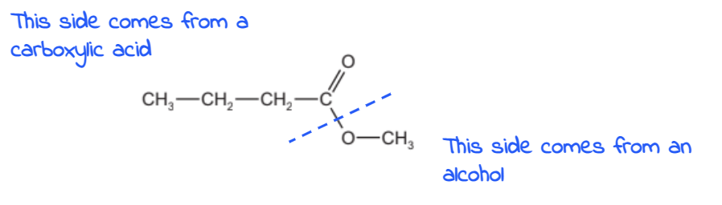

- *The carboxylic acid this ester was made from has 4 carbon atoms, therefore it is butanoic acid*
- *The alcohol has one carbon, therefore it is methanol*
- *The balanced symbol equation shows that 1 mole of ethanoic acid reacts with 1 mole of ethanol to form 1 mole of ethyl ethanoate and 1 mole of water*
- *So 0.1 moles of theanoic acid will react with 0.1 moles of ethanol*
- *There are 0.12 moles of ethanol, so ethanol is in excess, meaning that ethanoic acid is the limiting reactant*
- *The limiting reactant determines the amount of product formed*
- *0.1 moles of ethanoic acid will produce 0.1 moles of ethyl ethanoate, which can be used to find its mass*
b) The structural formula of this polyester is:

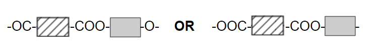

- Correct ester linkage; **[1 mark]**
- Two ester linkages; **[1 mark]** *This mark is only awarded if the correct linakge is shown*
- Continuation bonds at both ends; **[1 mark] ***Allow displayed formula*

**[Total: 3 marks]**

- *To draw the structure - remove OH from either end of the carboxylic acid and a H from either end of the alcohol, leaving the bonds in place:*

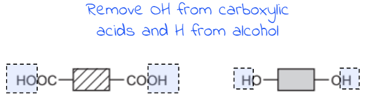

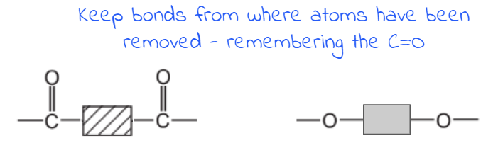

- *Then join the 2 together, remembering to leave the bonds either end to show that this is just part of a chain that continues many times*
- *The ester linkages are shown below, note how one link is split in two at either end of the polyester*

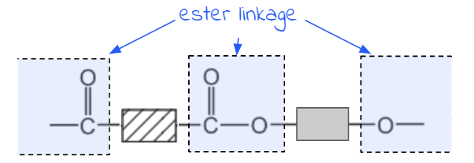

- *NOTE**: You could show this ester linkage together by moving the O on the right-hand side over to the left-hand side*
c) A test to distinguish between the saturated ester and the unsaturated ester is:

- Test: add bromine water / bromine; **[1 mark]**
- Result with unsaturated ester: turns colourless; **[1 mark]**
- Result with saturated ester: remains brown/orange/reddish brown/yellow; **[1 mark]**

ii) The ester that is unsaturated, with a reason, is:

- Ester 1; **[1 mark]**
- (Because) the (alkyl) group / if it was saturated it would be CnH2n+1 which is NOT C17H33 **OR **C17H35 is CnH2n+1 **OR** Less hydrogen; **[1 mark]**

**[Total: 5 marks]**

- *Remember**: **S**aturated compounds have **S**ingle bonds; **U**nsaturated compounds have do**U**ble bonds*
- *When bromine is added to an alkene, the bromine atoms add across the C=C double bond hence the solution no longer contains the orange-coloured bromine and the solution turns colourless*
- *If the group attached to the -COO- was saturated, then it would have the same general formula as an alkane but with one less hydrogen as it is attached to an O atom instead i.e. C**n**H**2n+1*
- *If it is unsaturated, it will have fewer hydrogens than this*

### Q40
a)

i) The form of energy is given out by the reaction is:

- Heat / thermal (energy); **[1 mark]**

ii) The reaction is:

- Exothermic; **[1 mark]**

iii) The equation for the complete combustion of ethanol is:

C2H5OH + **3**O2 → **2CO****2**** **+** 3H****2****O**

- For CO2 + H2O; **[1 mark]**
- For correct balancing; **[1 mark]**

iv) Using the points to determine the heat of combustion of butan-1-ol:

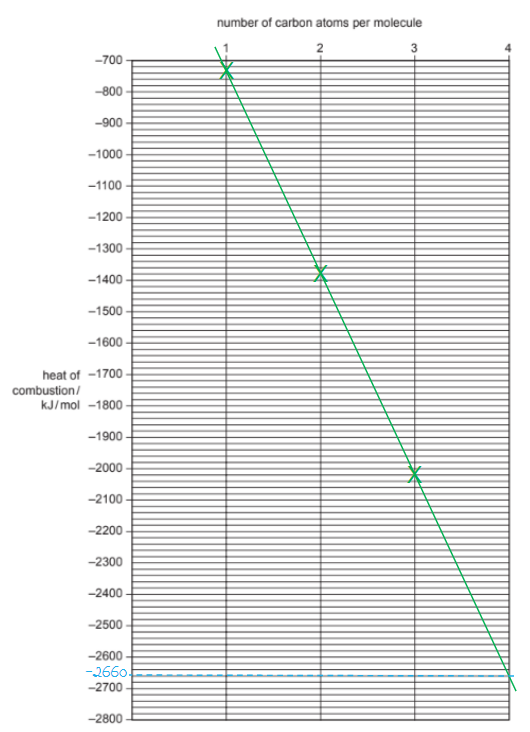

- Plotting points correctly; **[1 mark]**
- Straight line; **[1 mark]**
- Heat of combustion of butan-1-ol: between –2640 and –2700 kJ / mol; **[1 mark]** 
*NOTE minus sign needed*

v) **Two **other characteristics of homologous series are:

Any **two **from:

- Same general (molecular) formula; **[1 mark]**
- Same functional group; **[1 mark]**
- Consecutive members differ by CH2; **[1 mark]**
- Similar chemical properties / react in the same way; **[1 mark]** *NOT a comment about physical properties*

**[Total: 4 marks]**

- *When balancing the combustion of alcohols, balance the carbon atoms first, followed by the hydrogen atoms and finally the oxygen atoms*
- *Don't forget the oxygen atom in the alcohol*
- *Remember: **Use a ruler when drawing a straight line of best fit*
b) The name and structural formula of an isomer of propan-1-ol are:

- Name: propan-2-ol; **[1 mark]** 
"2" is needed
- CH3CH(OH)CH3; **[1 mark]** 
*Accept full structural formula – all bonds shown correctly* 
*Do NOT accept C**3**H**7**OH or CH**3**CH(HO)CH**3* 
*NOTE: the name and the formula must correspond for both marks*

**[Total: 2 marks]**

- *Structural isomers are compounds that have the same molecular formula but different structural formulae*
- *The alcohol group, -OH, can be attached to either the 1st carbon in the carbon chain or the 2nd carbon, the name shows which carbon atom it is attached to*
- *Careful**: Propan-3-ol is not an isomer as it is exactly the same as propan-1-ol, with the -OH just drawn with the carbon at the other end - in reality these are identical structures*
c)

i) Hydrogen is obtained from alkanes by:

Any **two** from:

- <u>Crackin</u>g; **[1 mark]**
- Heat (alkane) 
**OR **
(Alkane) and catalyst; **[1 mark]** 
*NOTE thermal cracking or catalytic cracking scores [2 marks]*
- Alkane → alkene + hydrogen; **[1 mark]**

ii) A method of making carbon monoxide from methane is:

- Combustion / burning; **[1 mark]**
- Incomplete / insufficient oxygen / air; **[1 mark]**

iii) The pressure that would give the maximum yield of methanol is:

- High pressure; **[1 mark]**
- (Because) fewer moles / molecules of gas on the right **OR**  
Volume of reactants greater than that of products 
**OR **
The forward reaction volume decreases; **[1 mark]** 
*NOTE accept correct arguments about either reactants or products*

**[Total: 6 marks]**

- *According to Le Chatalier's Principle when the pressure is increased, the equilibrium will shift to oppose the change by moving to the side with fewer amount of molecules*
- *In this case, this is the forward reaction, so more methanol is produced at higher pressures*
d)

i) The name of the organic product formed from the reaction between methanol and ethanoic acid is:

- Methyl ethanoate; **[1 mark]**

ii) The name of the organic product formed from the oxidation of propan-1-ol by potassium dichromate(VI) is:

- Propanoic acid; **[1 mark]** 
*Allow propanal*

iii) The name of the organic product formed from the removal of H2O from ethanol (dehydration) is:

- Ethene; **[1 mark]**

**[Total: 3 marks]**

- *Carboxylic acids will react with alcohols in the presence of an acid catalyst*
- *The first part of the name of the ester formed indicates the length of the carbon chain in the alcohol, and it ends with the letters ‘- yl’*
- *The second part of the name indicates the length of the carbon chain in the carboxylic acid, and it ends with the letters ‘- oate’*

  - *So the ester formed from** meth**anol and **ethan**oic acid is called **meth**yl **ethan**oate*
- *The dehydration of ethanol to form ethene is the reverse of the reaction used to form ethanol from ethene*

  - *This is a method of the production of ethanol that you need to learn*

### Q41
a)

i) The formula of hexene and its predicted boiling point are:

- C6H12; **[1 mark]**
- Between 60 to 65°C; **[1 mark]**

ii) the formula of the alkene which has a relative molecular mass of 168 is:

- C12H24; **[1 mark]**
- Some indication of method; **[1 mark]**

**[Total: 4 marks]**

- *You should know the general formula for alkenes as C**n**H**2n** however for this question, you can clearly use the formulas already given in the table to deduce the formula for hexene*

  - *To deduce the number of hydrogen atoms, the number of carbon atoms is doubled *
- *As the size of the molecule increases, so does the boiling point, use the table to identify by how much approximately it increases by to workout a figure*
b)  A test that will distinguish between the two isomers, but-2-ene and cyclobutane is:

- Add bromine water **OR** potassium manganate(VII); **[1 mark]**
- Butene it goes from brown/orange/yellow to colourless; **[1 mark]** *NOT clear*
- Cyclobutane it remains brown/orange/yellow  **OR** No colour change; **[1 mark]** 
*Accept does not react*

**[Total: 3 marks]**

- *But-2-ene is unsaturated (contains a double bond) whereas cyclohexane is saturated (contains single bonds only)*
- *Bromine water is a brown- orange colour*
- *When bromine reacts with but-2-ene it adds across the double bond forming a haloalkane which is colourless, and not orange*
- *You must make sure you learn this test to distinguish between alkanes and alkenes *
c)

i) The class of organic compound is formed when an alkene reacts with water is:

- Alcohol; **[1 mark]**

ii) The structure of the polymer formed from but-2-ene is:

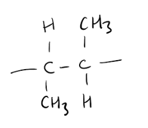

- Correct repeat unit; **[1 mark]**
- Extension of bonds; **[1 mark]**

**[Total: 3 marks]**

- *Remember**: You must know the three addition reacts alkenes undergo *

  - *Alkenes react with water to form alcohols *
  - *Alkenes react with hydrogen to form alkanes *
  - *Alkenes react with halogens to form  haloalkanes *
- *To deduce the polymer that but-2-ene forms:*

  - *Draw but-2-ene*
  - *Change the double bond into a single bond *
  - *Straighten out the groups attached to the carbons that were part of the double bond*
  - *Add extending bonds from each carbon to indicate that there are other monomers joined*
