# Exam Questions — Organic Families
**11. Organic Chemistry** · Cambridge (CIE) IGCSE chemistry (0620 & 0971)
> Source: [https://www.savemyexams.com/igcse/chemistry/cie/23/topic-questions/](https://www.savemyexams.com/igcse/chemistry/cie/23/topic-questions/) · 69 questions across 3 sets

## Alternative To Practical Questions (5 questions)

### Q1 — medium — 7 marks

**Q1** [2 marks]

Ethanol was reacted with hot acidified potassium manganate(VII) solution using the apparatus below. Ethanoic acid was formed.

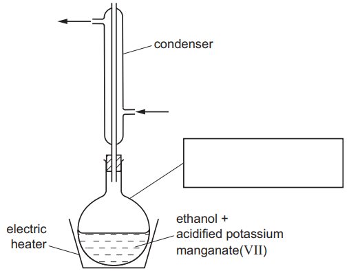

i) Complete the box to identify the piece of apparatus labelled.

[1]

ii) Label the arrows.

[1]

*Source: 2015 6 Q1*

**Q1** [3 marks]

**Extract:**

Ethanol was reacted with hot acidified potassium manganate(VII) solution using the apparatus below. Ethanoic acid was formed.

i) Suggest and explain why an electric heater is used to heat this reaction and not a Bunsen burner.

[2]

ii) Suggest why a condenser is necessary.

[1]

*Source: 2015 6 Q1*

**Q1** [2 marks]

Complete the table to show the difference in smell between ethanol and ethanoic acid.

|   | smell |
|---|---|
| ethanol |   |
| ethanoic acid |   |

*Source: 2015 6 Q1*

### Q2 — medium — 6 marks

**Q2** [2 marks]

The diagram shows how ethene can be made by cracking liquid alkanes.

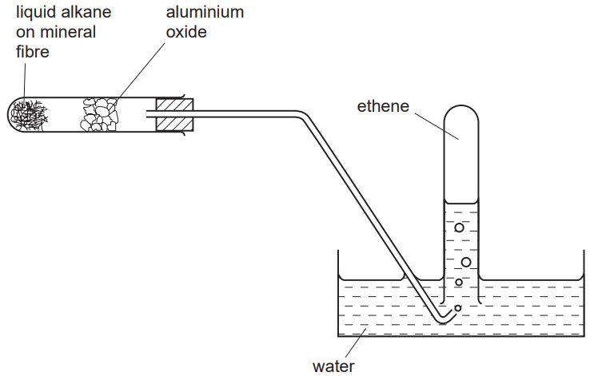

Indicate with arrows on the diagram where heat is applied.

*Source: 2005 6 Q6A*

**Q2** [2 marks]

Give a chemical test to show the presence of ethene.

test ....................................................................................................

result ....................................................................................................

*Source: 2005 6 Q6B*

**Q2** [2 marks]

**Extract:**

The diagram shows how ethene can be made by cracking liquid alkanes. Indicate with arrows on the diagram where heat is applied.

Why must the delivery tube be removed from the water before the heat is turned off?

*Source: 2005 6 Q6C*

### Q3 — medium — 6 marks

**Q3** [1 mark]

A liquid alkane was passed over heated aluminium oxide to make ethene.

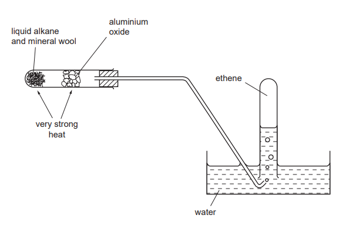

What is the purpose of the mineral wool?

*Source: 2004 6 Q3*

**Q3** [1 mark]

**Extract:**

A liquid alkane was passed over heated aluminium oxide to make ethene.

What is this type of chemical reaction called?

*Source: 2004 6 Q3*

**Q3** [2 marks]

Give a test for ethene.

test .....................................................................................

result ..................................................................................

*Source: 2004 6 Q3*

**Q3** [2 marks]

**Extract:**

A liquid alkane was passed over heated aluminium oxide to make ethene.

What precaution should be taken in the experiment when the heat is removed? Explain.

*Source: 2004 6 Q3*

### Q4 — medium — 9 marks

**Q4** [1 mark]

A student found a recipe for making elderberry wine by fermentation.

- 1kg elderberries
- 0.5kg sugar
- 10g yeast granules
- 3dm3 water

The student decided to make some elderberry wine using the apparatus below.

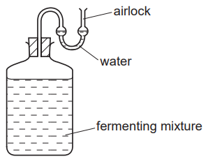

The student carried out the following method.

Step 1 The elderberries were crushed.

Step 2 The crushed elderberries and sugar were added to the water and the mixture was boiled for ten minutes. The crushed elderberries were then separated from the mixture.

Step 3 Yeast was added to the liquid when it had cooled to room temperature.

Suggest the purpose of the airlock in the apparatus.

*Source: 2013 61 Q2*

**Q4** [1 mark]

**Extract:**

A student found a recipe for making elderberry wine by fermentation. The student carried out the following method. Step 1 The elderberries were crushed. Step 2 The crushed elderberries and sugar were added to the water and the mixture was boiled for ten minutes. The crushed elderberries were then separated from the mixture. Step 3 Yeast was added to the liquid when it had cooled to room temperature.

What apparatus could be used in Step 1?

*Source: 2003 61 Q2*

**Q4** [2 marks]

**Extract:**

A student found a recipe for making elderberry wine by fermentation. The student carried out the following method. Step 1 The elderberries were crushed. Step 2 The crushed elderberries and sugar were added to the water and the mixture was boiled for ten minutes. The crushed elderberries were then separated from the mixture. Step 3 Yeast was added to the liquid when it had cooled to room temperature.

Draw a labelled diagram of the apparatus used to separate the crushed elderberries from the mixture in Step 2.

*Source: 2003 61 Q2*

**Q4** [1 mark]

**Extract:**

A student found a recipe for making elderberry wine by fermentation.
- 1kg elderberries
- 0.5kg sugar
- 10g yeast granules
- 3dm^3 water
The student carried out the following method.
Step 1 The elderberries were crushed.
Step 2 The crushed elderberries and sugar were added to the water and the mixture was boiled for ten minutes. The crushed elderberries were then separated from the mixture.
Step 3 Yeast was added to the liquid when it had cooled to room temperature.

Why was the yeast in Step 3 not added until the liquid was at room temperature?

*Source: 2003 61 Q2*

**Q4** [3 marks]

**Extract:**

A student found a recipe for making elderberry wine by fermentation.
- 1kg elderberries
- 0.5kg sugar
- 10g yeast granules
- 3dm^3 water
The student decided to make some elderberry wine using the apparatus below.
The student carried out the following method.
Step 1 The elderberries were crushed.
Step 2 The crushed elderberries and sugar were added to the water and the mixture was boiled for ten minutes. The crushed elderberries were then separated from the mixture.
Step 3 Yeast was added to the liquid when it had cooled to room temperature.

i) State **one **observation during the fermentation.

[1]

ii) Suggest how the rate of the fermentation reaction could be measured.

[2]

*Source: 2003 61 Q2*

**Q4** [1 mark]

**Extract:**

A student found a recipe for making elderberry wine by fermentation.

- 1kg elderberries
- 0.5kg sugar
- 10g yeast granules
- 3dm^3 water

Name the method that could be used to separate ethanol from the fermented mixture.

*Source: 2003 61 Q2*

### Q5 — medium — 4 marks

**Q5** [2 marks]

Ethene gas was formed by the cracking of a liquid alkane. The diagram shows the apparatus used.

Identify **two **mistakes in the diagram.

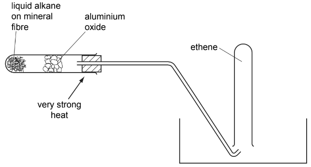

1 ....................................................................................................

2 ....................................................................................................

*Source: 2008 O6 Q3A*

**Q5** [2 marks]

Describe a test to show the presence of ethene.

test ....................................................................................................

result ....................................................................................................

*Source: 2008 O6 Q3B*

## Multiple Choice Questions (41 questions)

### Q1 — hard — 1 marks

**Q1** [1 mark]

The displayed formula of an ester is shown.

Which carboxylic acid and which alcohol react to form this ester?

|   | carboxylic acid | alcohol |
|---|---|---|
| **A** | butanoic acid | methanol |
| **B** | butanoic acid | butan-1-ol |
| **C** | methanoic acid | methanol |
| **D** | methanoic acid | butan-1-ol |

### Q2 — hard — 1 marks

**Q2** [1 mark]

Propane reacts with chlorine in a substitution reaction.

Which row shows the correct formulae of the products and the condition required for this reaction?

|   | formulae of products | condition |
|---|---|---|
| **A** | C3H7Cl and H2 | ultraviolet light |
| **B** | C3H7Cl and HCl | ultraviolet light |
| **C** | C3H7Cl and HCl | high temperature and a catalyst |
| **D** | C3H7Cl and H2 | high temperature and a catalyst |

### Q3 — medium — 1 marks

**Q3** [1 mark]

Ethanol can be manufactured by fermentation or by the catalytic addition of steam to ethene

Three statements comparing these two processes are shown.

1. The hydration of ethene uses non-renewable raw materials, whereas fermentation uses renewable raw materials.
2. Hydration is carried out as a batch process, making it less efficient than fermentation.
3. Hydration requires high temperatures and pressures, whereas fermentation requires a low and controlled temperature.

Which statements are correct?

### Q4 — medium — 1 marks

**Q4** [1 mark]

X, Y and Z are organic compounds.

Some properties of these compounds are listed.

- Y and Z decolourise bromine water, while X does not.
- X and Z has the same number of carbons. Y has one carbon atom more in the chain.
- X is manufactured by the hydration of Z with steam.

Which row identifies correctly X, Y and Z?

|   | X | Y | Z |
|---|---|---|---|
| **A** | ethanol | propene | ethene |
| **B** | ethanol | butene | ethene |
| **C** | ethene | propene | ethanol |
| **D** | ethene | butene | ethanol |

### Q5 — easy — 1 marks

**Q5** [1 mark]

Petroleum is separated into fractions by fractional distillation.

Which statement about the properties of the fractions is correct?

### Q6 — easy — 1 marks

**Q6** [1 mark]

Ethanol is used as a solvent and fuel, it is produced by the ….1….. of ….2…. .

Which words would correctly complete the gaps 1 and 2?

|   | **1** | **2** |
|---|---|---|
| **A** | combustion | ethane |
| **B** | combustion | glucose |
| **C** | fermentation | glucose |
| **D** | fermentation | ethane |

### Q7 — easy — 1 marks

**Q7** [1 mark]

Butene and octene belong to the same homologous series.

What would be the same for butene and octene?

### Q8 — easy — 1 marks

**Q8** [1 mark]

Which of the following statements about ethanol is **not** correct?

### Q9 — easy — 1 marks

**Q9** [1 mark]

The diagram shows an industrial process involved in the production of a substance that is used as an aircraft fuel.

|   | **process** | **substance Q** |
|---|---|---|
| **A** | fractional distillation | petrol |
| **B** | thermal decomposition | paraffin |
| **C** | fractional distillation | paraffin |
| **D** | thermal decomposition | petrol |

### Q10 — easy — 1 marks

**Q10** [1 mark]

Which of the equations show the incomplete combustion of methane?

### Q11 — hard — 1 marks

**Q11** [1 mark]

The products of some reactions are shown below.

Which row correctly identifies the products of a reaction between a carboxylic acid and an alcohol?

### Q12 — hard — 1 marks

**Q12** [1 mark]

Which of these statements about carboxylic acids is **not** correct?

### Q13 — hard — 1 marks

**Q13** [1 mark]

Which of these is an advantage of producing ethanol by fermentation of sugar compared to the catalytic addition of steam to ethene?

### Q14 — hard — 1 marks

**Q14** [1 mark]

The apparatus below was used to test gas Y

The bromine solution quickly went colourless.

What is the correct structure of gas Y?

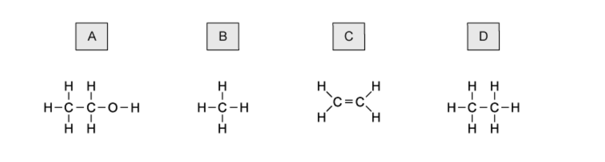

### Q15 — hard — 1 marks

**Q15** [1 mark]

The diagram shows a sequence of reactions.

Which row correctly names the processes **P**, **Q** and **R**?

|   | **P** | **Q** | **R** |
|---|---|---|---|
| **A** | distillation | fermentation | respiration |
| **B** | distillation | hydration | combustion |
| **C** | cracking | fermentation | respiration |
| **D** | cracking | hydration | combustion |

### Q16 — hard — 1 marks

**Q16** [1 mark]

The following reaction takes place in the presence of light.

CH4 + Cl2 + light → CH3Cl + HCl

What is the name for this reaction?

### Q17 — hard — 1 marks

**Q17** [1 mark]

Hydrocarbons separated by fractional distillation of petroleum can be cracked to make useful shorter chain products.

Which substance is not a product of the cracking of propane, *M**r** *44?

### Q18 — hard — 1 marks

**Q18** [1 mark]

The diagram shows the structure of a compound, **X**.

Which row correctly describes the properties of **X**?

|   | **colourless** | **characteristic smell** | **dissolves in water** |
|---|---|---|---|
| **A** | ✓ | ✗ | ✓ |
| **B** | ✓ | ✓ | ✗ |
| **C** | ✓ | ✓ | ✓ |
| **D** | ✗ | ✗ | ✓ |

### Q19 — medium — 1 marks

**Q19** [1 mark]

The diagram below shows the apparatus used to separate petroleum (crude oil) into four fractions.

Which fraction contains the smallest hydrocarbon molecules?

| **fraction** | **boiling point range / °C** |
|---|---|
| **A** | up to 70 |
| **B** | 71 to 120 |
| **C** | 121 to 170 |
| **D** | over 171 |

### Q20 — medium — 1 marks

**Q20** [1 mark]

Ethanol can be produced from substance Y.

substance Y + steam $\overset{\mathrm{catalyst}}{\rightarrow}$ ethanol

What is substance Y?

### Q21 — medium — 1 marks

**Q21** [1 mark]

The table below shows 4 different sources of petroleum (crude oil) and their composition.

| **Fraction** | **Arabian Heavy /%** | **Arabian Light /%** | **Iranian Heavy /%** | **North Sea**  **/%** |
|---|---|---|---|---|
| **gasoline** | 18 | 21 | 21 | 23 |
| **kerosene** | 11.5 | 13 | 13 | 15 |
| **diesel** | 18 | 20 | 20 | 24 |
| **fuel oil** | 52.5 | 46 | 46 | 38 |

Which composition of petroleum would be the best for the motor vehicle industry?

### Q22 — medium — 1 marks

**Q22** [1 mark]

A student carried out a cracking reaction on hydrocarbon,** P**, and obtained two products; **Q** and **R**.

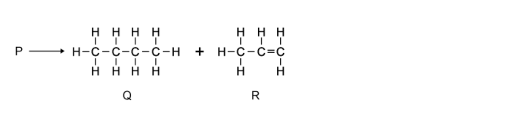

The student then made the following notes:

| **1** | **Q** is unsaturated. |
|---|---|
| **2** | **R** will decolourise bromine water. |
| **3** | A molecule of** P** has 7 carbon atoms. |

Which of the statements are correct?

### Q23 — medium — 1 marks

**Q23** [1 mark]

Which of the following properties of different compounds in petroleum enable it to be separated into fractions?

| ** ** | **1** | Chain length |
|---|---|---|
| ** ** | **2** | Chemical reactivity |
| ** ** | **3** | Solubility in water |
| ** ** | **4** | Boiling point |

## Theory Questions (47 questions)

### Q1 — hard — 15 marks

**Q1** [2 marks]

Ethanol and propan-1-ol are members of the alcohol homologous series.

i) State the general formula of the alcohol homologous series.

[1]

ii) Name the unbranched alcohol that contains exactly four carbon atoms per molecule.

[1]

**Q1** [2 marks]

Draw the displayed formula of a structural isomer of propan-1-ol. Show **all** of the atoms and all of the bonds.

**Q1** [2 marks]

Ethanol can be manufactured by the catalytic addition of steam to ethene, also known as hydration. State two conditions required for this reaction.

**Q1** [2 marks]

**Extract:**

Ethanol can be manufactured by the catalytic addition of steam to ethene, also known as hydration. State two conditions required for this reaction.
temperature of 300 °C / high temperature; pressure of 6000 kPa / 60 atm / high pressure; (phosphoric) acid catalyst

Ethanol can also be manufactured by fermentation. State **two** advantages of manufacturing ethanol by fermentation rather than by the hydration of ethene.

**Q1** [2 marks]

Ethanol reacts with compound **X** to form the ester ethyl propanoate and compound **Y**. Identify compound **X** and compound **Y**.

compound X:

compound Y:

**Q1** [3 marks]

An unknown alcohol, **A**, has the following composition by mass: C = 37.5%;  H = 12.5%;  O = 50.0%

Determine the empirical formula of compound **A**. Show all your working.

empirical formula = .......................

**Q1** [2 marks]

An unknown ester, **Z**, has the empirical formula CH2O. Its relative molecular mass, *M*r, is 60. Determine the molecular formula of ester **Z**.

molecular formula = ........................

### Q2 — easy — 11 marks

**Q2** [2 marks]

Methanoic acid, ethanoic acid, propanoic acid, and butanoic acid are members of the same homologous series.

State **two** general characteristics of a homologous series.

**Q2** [3 marks]

The displayed formula of hexanoic acid is shown in Fig 7.1

**Fig 7.1**

i) Complete Table 7.1 to calculate the relative molecular mass (*M*r) of hexanoic acid.

**Table 7.1**

| type of atom | number of atoms | relative atomic mass |   |
|---|---|---|---|
| carbon | 6 | 12 | 6 x 12 = 72 |
| hydrogen |   | 1 |   |
| oxygen |   | 16 |   |

relative molecular mass = ...........

[2]

ii) Determine the empirical formula of hexanoic acid.

[1]

**Q2** [1 mark]

Dilute ethanoic acid reacts with powdered calcium carbonate. A gas is produced.

Circle the pH value that represents the pH of dilute ethanoic acid.

**pH 4         pH 7         pH 9         pH 13**

**Q2** [3 marks]

**Extract:**

Dilute ethanoic acid reacts with powdered calcium carbonate. A gas is produced.

A student investigates the reaction between dilute ethanoic acid and calcium carbonate. State the effect on the **time taken** for the reaction to finish when the following changes are made. All other conditions stay the same.

(i) The temperature of the dilute acid is decreased.

[1]

(ii) Large lumps of calcium carbonate are used instead of powder.

[1]

(iii) 10 cm3 of water is added to the dilute acid.

[1]

**Q2** [2 marks]

Dicarboxylic acids can be used to make polymers.

i) Define the term **monomer**.

[1]

ii) State **one** pollution problem caused by non-biodegradable plastics.

[1]

### Q3 — easy — 15 marks

**Q3** [4 marks]

#### Separate: Chemistry and Extended Only

A compound **X** contains 82.76% of carbon by mass and 17.24% of hydrogen by mass.

i) Calculate the empirical formula of compound **X**.

[2]

ii) Compound **X** has a relative molecular mass of 58.

Deduce the molecular formula of compound **X**.

[2]

*Source: 2015 Ja32 Q4*

**Q3** [2 marks]

#### Separate: Chemistry Only

Alkenes are unsaturated hydrocarbons.

i) State the general formula of alkenes.

[1]

ii) State the empirical formula of alkenes.

[1]

*Source: 2015 Ja32 Q4*

**Q3** [2 marks]

What is meant by the term *unsaturated hydrocarbon*?

*unsaturated*

*hydrocarbon *

*Source: 2015 Ja32 Q4*

**Q3** [3 marks]

Describe a test that would distinguish between saturated and unsaturated hydrocarbons.

Reagent:

Observation (saturated hydrocarbon):

Observation (unsaturated hydrocarbon):

*Source: 2015 Ja32 Q4*

**Q3** [4 marks]

#### Extended Only

Addition polymers can be made from alkenes. The diagram shows part of an addition polymer.

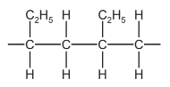

i) Draw a circle on the diagram to show one repeat unit in this polymer.

[1]

ii) Give the structure and the name of the monomer used to make this polymer.

[2]

iii) Give the structure of an isomer of the alkene in (e)(ii).

[1]

*Source: 2015 Ja32 Q4*

### Q4 — hard — 7 marks

**Q4** [4 marks]

Esters, fats and polyesters all contain the ester linkage.

The structural formula of an ester is given below.

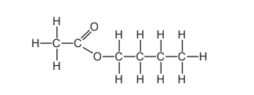

Name two chemicals that could be used to make this ester and draw their structural formulae. Show all bonds.

names ................................ and ..............................

[2]

structural formulae

[2]

*Source: 2007 Ju31 Q7*

**Q4** [3 marks]

**Extract:**

Esters, fats and polyesters all contain the ester linkage.

i) Draw the structural formula of a polyester such as Terylene.

[2]

ii) Suggest a use for this polymer.

[1]

*Source: 2007 Ju31 Q7*

### Q5 — medium — 13 marks

**Q5** [3 marks]

The fractional distillation of crude oil usually produces large quantities of the heavier fractions.

The market demand is for the lighter fractions and for the more reactive alkenes. The heavier fractions are cracked to form smaller alkanes and alkenes as in the following example.

| C8H18 | → | C4H10 | + | C4H8 |
|---|---|---|---|---|
| octane |   | butane |   | butene |

i) Write a different equation for the cracking of octane.

C8H18  → ...................... + .....................

[1]

ii) The cracking of octane can produce isomers with the molecular formula C4H8. Draw the structural formulae of two of these isomers.

[2]

*Source: 2006 Ju31 Q7*

**Q5** [4 marks]

**Extract:**

The fractional distillation of crude oil usually produces large quantities of the heavier fractions.

The market demand is for the lighter fractions and for the more reactive alkenes. The heavier fractions are cracked to form smaller alkanes and alkenes as in the following example.

| C8H18 | → | C4H10 | + | C4H8 |
|---|---|---|---|---|
| octane |   | butane |   | butene |

i) Give the essential condition for the reaction between chlorine and butane.

[1]

ii) What type of reaction is this?

[1]

iii) This reaction produces a mixture of products. Give the names of **two** products that contain four carbon atoms per molecule.

[2]

*Source: 2006 Ju31 Q7*

**Q5** [2 marks]

Alkenes are more reactive than alkanes and are used to make a range of organic chemicals. Propene, CH3–CH=CH2, is made by cracking. Give the structural formula of the addition product when propene reacts with the following.

i) water

[1]

ii) bromine

[1]

*Source: 2006 Ju31 Q7*

**Q5** [4 marks]

Propene reacts with hydrogen iodide to form 2-iodopropane.

CH3−CH=CH2 + HI →  CH3−CHI−CH3

1.4 g of propene produced 4.0 g of 2-iodopropane. Calculate the percentage yield.

moles of CH3–CH=CH2 reacted = .........................................

maximum moles of CH3–CHI–CH3 that could be formed = .........................................

mass of one mole of CH3–CHI–CH3 = 170 g

maximum mass of 2- iodopropane that could be formed = .........................................

percentage yield ......................................... %

*Source: 2006 Ju31 Q7*

### Q6 — medium — 13 marks

**Q6** [2 marks]

Alcohols can be made by fermentation or from petroleum.

Ethanol can be made by the fermentation of glucose.

C6H12O6 (aq) $\overset{\mathrm{yeast}}{\rightarrow}$2C2H5OH (aq) + 2CO2 (g)       exothermic reaction

Yeast are living single-cell fungi which ferment glucose by anaerobic respiration. This reaction is catalysed by enzymes from the yeast.

i) What are enzymes?

[1]

ii) Suggest a method of measuring the rate of this reaction.

[1]

*Source: 2015 Ju32 Q7*

**Q6** [4 marks]

**Extract:**

Ethanol can be made by the fermentation of glucose.

C~6~H~12~O~6~ (aq) --yeast--> 2C~2~H~5~OH (aq) + 2CO~2~ (g)       exothermic reaction

Yeast are living single-cell fungi which ferment glucose by anaerobic respiration. This reaction is catalysed by enzymes from the yeast.

The following observations were noted.

- When a small amount of yeast was added to the aqueous glucose the reaction started and the solution went slightly cloudy.
- The reaction rate increased and the solution became cloudier and warmer.
- After a while, the reaction rate decreased and eventually stopped, leaving a 14% solution of ethanol in water.

i) Why did the reaction rate increase?

[1]

ii) Suggest an explanation for the increase in cloudiness of the solution.

[1]

iii) Give **two **reasons why the fermentation stopped.

[2]

*Source: 2015 Ju32 Q7*

**Q6** [2 marks]

One use of ethanol is in alcoholic drinks.

Give two other uses of ethanol.

*Source: 2015 Ju32 Q7*

**Q6** [5 marks]

Alcohols can be made from petroleum by the following sequence of reactions.

alkanes from petroleum → alkene → alcohol

Describe the manufacture of ethanol from hexane, C6H14. Include in your description an equation and type of reaction for each step.

*Source: 2015 Ju32 Q7*

### Q7 — easy — 11 marks

**Q7** [2 marks]

The alkanes are a family of saturated hydrocarbons. Their reactions include combustion, cracking and substitution.

i) What is meant by the term *hydrocarbon*?

[1]

ii) What is meant by the term *saturated*?

[1]

*Source: 2014 Ju33 Q6A*

**Q7** [3 marks]

i) What is the general formula for the homologous series of alkanes?

[1]

ii) Calculate the mass of one mole of an alkane with 14 carbon atoms.

[2]

*Source: 2014 Ju33 Q6B*

**Q7** [4 marks]

Cracking is used to obtain short-chain alkanes, alkenes and hydrogen from long-chain alkanes.

i) Give a use for each of the three products listed above.

short-chain alkanes ..................................................

alkenes ..................................................

hydrogen ..................................................

[3]

ii) Write an equation for the cracking of decane, C10H22, which produces two different alkenes and hydrogen as the only products.

[1]

*Source: 2014 Ju33 Q6D*

**Q7** [2 marks]

#### Separate: Chemistry and Extended Only

Chlorine reacts with propane in a substitution reaction to form 1-chloropropane.

CH3–CH2–CH3 + Cl2 → CH3–CH2–CH2–Cl + HCl

i) What is the essential condition for the above reaction?

[1]

ii) There is more than one possible substitution reaction between chlorine and propane.

Suggest the structural formula of a different product.

[1]

*Source: 2014 Ju33 Q6E*

### Q8 — medium — 13 marks

**Q8** [3 marks]

The fractional distillation of crude oil usually produces large quantities of the heavier fractions. The market demand is for the lighter fractions and for the more reactive alkenes. The heavier fractions are cracked to form smaller alkanes and alkenes as in the following example.

C8H18      →      C4H10        +      C4H8

octane              butane           butene

i) Write a different equation for the cracking of octane.

C8H18 → .............................. + ..............................

[1]

ii) The cracking of octane can produce isomers with the molecular formula C4H8.

Draw the structural formulae of** two **of these isomers.

[2]

*Source: 2006 Ju31 Q7*

**Q8** [4 marks]

i) Give the essential condition for the reaction between chlorine and butane.

[1]

ii) What type of reaction is this?

[1]

iii) This reaction produces a mixture of products. Give the names of **two **products that contain four carbon atoms per molecule.

................................... and ......................................

[2]

*Source: 2006 Ju31 Q7*

**Q8** [2 marks]

Alkenes are more reactive than alkanes and are used to make a range of organic chemicals. Propene, CH3–CH=CH2, is made by cracking. Give the structural formula of the addition product when propene reacts with the following.

i) water

[1]

ii) bromine

[1]

*Source: 2006 Ju31 Q7*

**Q8** [4 marks]

Propene reacts with hydrogen iodide to form 2-iodopropane.

CH3−CH=CH2 + HI → CH3−CHI−CH3

1.4 g of propene produced 4.05 g of 2-iodopropane.

Calculate the percentage yield.

moles of CH3–CH=CH2 reacted = ..................................................

maximum moles of CH3–CHI–CH3 that could be formed = ..................................................

mass of one mole of CH3–CHI–CH3 = 170 g

maximum mass of 2- iodopropane that could be formed = ..................................................

percentage yield .................................................. %

*Source: 2006 Ju31 Q7*

### Q9 — medium — 14 marks

**Q9** [7 marks]

Two homologous series of hydrocarbons are the alkanes and the alkenes.

One general characteristic of a homologous series is that the physical properties vary in a predictable way.

i) State** three** other general characteristics of a homologous series.

[3]

ii) How can the molecular formula of a hydrocarbon show whether it is an alkane or an alkene?

[2]

iii) How do alkanes and alkenes differ in their molecular structures?

[2]

*Source: 2015 O33 Q4*

**Q9** [5 marks]

Cracking is the thermal decomposition of alkanes into smaller hydrocarbons and possibly hydrogen.

i) State **two** conditions required for the cracking of an alkane.

[2]

ii) One type of cracking produces an alkane and an alkene. Complete an equation for the cracking of heptane into an alkane and an alkene.

C7H16 → ................ + ................

[1]

iii) Complete an equation for the cracking of heptane into hydrogen and two other products.

C7H16  →................ + ................ + H2

[1]

iv) Suggest **one** reason why cracking is important.

[1]

*Source: 2015 O33 Q4*

**Q9** [2 marks]

Hydrocarbons burn in excess oxygen to form carbon dioxide and water. 20 cm3 of a gaseous hydrocarbon burned in an excess of oxygen, 200 cm3. After cooling, the volume of the residual gas at r.t.p. was 150 cm3, 50 cm3 of which was oxygen.

i) Determine the volume of the oxygen used.

[1]

ii) Determine the volume of the carbon dioxide formed.

[1]

### Q10 — hard — 18 marks

**Q10** [5 marks]

Propanoic acid is a carboxylic acid. Its formula is CH3–CH2–COOH.

i) Propanoic acid is the third member of the homologous series of carboxylic acids.

Give the name and structural formula of the fourth member of this series.

Name ..............................................................

Formula ..............................................................

[2]

ii) Members of a homologous series have very similar chemical properties.

State **three **other characteristics of a homologous series.

[3]

*Source: 2015 Oc23 Q3*

**Q10** [3 marks]

**Extract:**

Propanoic acid is a carboxylic acid. Its formula is CH~3~–CH~2~–COOH.

Carboxylic acids can be made by the oxidation of alcohols.

i) Draw the structural formula of the alcohol which can be oxidised to propanoic acid. Show all atoms and bonds.

[1]

ii) Name a reagent, other than oxygen, which can oxidise alcohols to carboxylic acids.

[2]

*Source: 2015 Oc32 Q3*

**Q10** [3 marks]

**Extract:**

Propanoic acid is a carboxylic acid. Its formula is CH~3~–CH~2~–COOH.

Complete the following equations for some of the reactions of propanoic acid.

The salts of this acid are called propanoates.

i) Zinc + propanoic acid → ........................... ........................... + hydrogen

[1]

ii) Calcium oxide + propanoic acid →........................... + ...........................

[1]

iii) LiOH + CH3CH2COOH → ............................... + ...........................

[1]

*Source: 2015 Oc32 Q3*

**Q10** [7 marks]

**Extract:**

experiment | acid | concentration in mol/dm^3 | temperature /°C | time /minutes
A | propanoic | 1.0 | 20 | 5
B | propanoic | 1.0 | 30 | 3
C | propanoic | 0.5 | 20 | 8
D | hydrochloric | 1.0 | 20 | 1

A piece of magnesium was added to 100 cm3 of an aqueous acid. The time taken for the metal to react completely was measured.

This experiment was repeated using different aqueous acids. The same volume of acid was used in each experiment and the pieces of magnesium used were identical.

In one experiment the reaction was carried out at a different temperatur

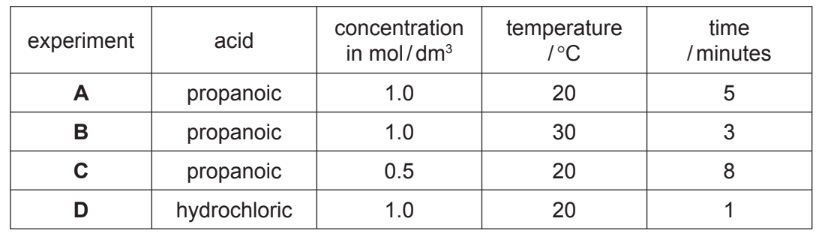

Explain the following in terms of collision rate between reacting particles.

i) Why is the rate in experiment C slower than the rate in experiment A?

[2]

ii) Why is the rate in experiment B faster than the rate in experiment A?

[2]

iii) Why is the rate in experiment D faster than the rate in experiment A?

[3]

*Source: 2015 Oc32 Q3*

### Q11 — medium — 13 marks

**Q11** [3 marks]

The alcohols form a homologous series. Two characteristics of a homologous series are that the physical properties of the members vary in a predictable way and they have similar chemical properties.

Complete the table.

| name | formula | mass of one mole / g | boiling point / oC |
|---|---|---|---|
| methanol | CH3 –OH | 32 | 64 |
| ethanol | CH3 –CH2 –OH | 46 | 78 |
| propan-1-ol | CH3 –CH2 –CH2 –OH | 60 | 98 |
| butan-1-ol | CH3 –CH2 –CH2 –CH2 –OH | 74 | 118 |
| pentan-1-ol |   |   | 138 |
| hexan-1-ol | CH3 –CH2 –CH2 –CH2 –CH2 –CH2 –OH | 102 |   |

*Source: 2011 O32 Q5*

**Q11** [2 marks]

**Extract:**

The alcohols form a homologous series. Two characteristics of a homologous series are that the physical properties of the members vary in a predictable way and they have similar chemical properties.

Give **two **other characteristics of a homologous series.

*Source: 2011 O32 Q5*

**Q11** [3 marks]

**Extract:**

| name | formula | mass of one mole / g | boiling point / ^o^C |
| methanol | CH~3~ –OH | 32 | 64 |

Draw a diagram showing the arrangement of the valency electrons in one molecule of the covalent compound methanol.

Use x to represent an electron from a carbon atom. 
Use ● to represent an electron from an oxygen atom. 
Use o to represent an electron from a hydrogen atom.

*Source: 2011 O32 Q5*

**Q11** [3 marks]

Alcohols can be oxidised to carboxylic acids by heating with acidic potassium manganate(VII).

i) Draw the structural formula of the carboxylic acid formed by the oxidation of propan-1-ol. Show all the bonds.

[1]

ii) Describe how ethanol could be oxidised to ethanoic acid by fermentation.

[2]

*Source: 2011 O32 Q5*

**Q11** [2 marks]

Propan-1-ol and ethanoic acid react together to form an ester. Give its name and structural formula.

*Source: 2011 O32 Q5*

### Q12 — hard — 13 marks

**Q12** [5 marks]

Carboxylic acids contain the group

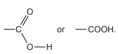

Ethanoic acid is a typical carboxylic acid. It forms ethanoates.

i) Complete the following equations.

Mg + ......CH3COOH → ............................... + ...............................

[2]

sodium hydroxide + ethanoic acid → ........................  ........................ + ........................

[1]

ii) Ethanoic acid reacts with ethanol to form an ester. Give the name of the ester and draw its structural formula. Show all of the bonds.

[2]

*Source: 2010 O33 Q5*

**Q12** [8 marks]

Maleic acid is an unsaturated acid. 5.8 g of this acid contained 2.4 g of carbon, 0.2 g of hydrogen and 3.2 g of oxygen.

i) How do you know that the acid contained only carbon, hydrogen and oxygen?

[1]

ii) Calculate the empirical formula of maleic acid.

Number of moles of carbon atoms = ................................

Number of moles of hydrogen atoms = ................................

Number of moles of oxygen atoms = ................................

The empirical formula is .................................................

[3]

iii) The mass of one mole of maleic acid is 116 g. What is its molecular formula?

[2]

iv) Maleic acid is dibasic. One mole of acid produces two moles of H+. Deduce its structural formula.

[2]

*Source: 2010 O33 Q5*

### Q13 — hard — 15 marks

**Q13** [3 marks]

The alkenes are unsaturated hydrocarbons. They form a homologous series, the members of which have the same chemical properties.

They undergo addition reactions and are easily oxidised.

The following hydrocarbons are isomers.

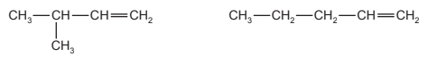

i) Explain why these two hydrocarbons are isomers.

[2]

ii) Give the structural formula of another hydrocarbon which is isomeric with the above.

[1]

*Source: 2013 O31 Q5*

**Q13** [6 marks]

Give the structural formula and name of each of the products of the following addition reactions.

i) ethene and bromine structural formula of product

name of product ...................................................................................................

[2]

ii) propene and hydrogen structural formula of product

name of product ...................................................................................................

[2]

iii) but-1-ene and water structural formula of product

name of product ...................................................................................................

[2]

*Source: 2013 O31 Q5*

**Q13** [4 marks]

**Extract:**

Propene, CH3 –CH=CH2, would produce ethanoic acid, CH3 –COOH, and methanoic acid, H–COOH.
If you have ethanoic acid and propanoic acid, the total of carbon atoms is five, as ethanoic acid has two, and propanoic acid three.
The alkene must therefore have five carbon atoms which is pentene.
If only ethanoic acid present, there must be two molecules of this, totalling four carbon atoms and so butene is formed.

Alkenes can be oxidised to carboxylic acids.

i) For example, propene, CH3 –CH=CH2, would produce ethanoic acid, CH3 –COOH, and methanoic acid, H–COOH.

Deduce the formulae of the alkenes which would form the following carboxylic acids when oxidised.

ethanoic acid and propanoic acid

only ethanoic acid

[2]

ii) Describe the colour change you would observe when an alkene is oxidised with acidified potassium manganate(VII).

[2]

*Source: 2013 O31 Q5*

**Q13** [2 marks]

Alkenes polymerise to form addition polymers.

Draw the structural formula of poly(cyanoethene), include at least two monomer units.

The structural formula of the monomer, cyanoethene, is given below.

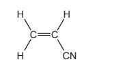

*Source: 2013 O31 Q5*

### Q14 — medium — 10 marks

**Q14** [2 marks]

The ester linkage showing all the bonds is drawn as

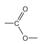

or more simply it can be written as –COO–.

i) Give the structural formula of the ester ethyl ethanoate.

[1]

ii) Deduce the name of the ester formed from methanoic acid and butanol.

[1]

*Source: 2013 Ju32 Q7*

**Q14** [3 marks]

**Extract:**

The ester linkage showing all the bonds is drawn as [ester-linkage image] or more simply it can be written as –COO–.

Draw the structural formula of the polyester formed from the following monomers.

HOOCC6H4COOH and HOCH2CH2OH

You are advised to use the simpler form of the ester linkage.

*Source: 2013 Ju32 Q7*

**Q14** [5 marks]

Esters can be used as solvents in chromatography. The following shows a chromatogram of plant acids.

An ester was used as the solvent and the chromatogram was sprayed with bromothymol blue.

i) Suggest why it was necessary to spray the chromatogram.

[2]

ii) Explain what is meant by the *R*f value of a sample.

[1]

iii) Calculate the *R*f values of the two samples and use the data in the table to identify the plant acids.

| **Plant acid** | ***R*****f**** value** |
|---|---|
| tartaric acid | 0.22 |
| citric acid | 0.30 |
| oxalic acid | 0.36 |
| malic acid | 0.46 |
| succinic acid | 0.60 |

[2]

*Source: 2013 Ju32 Q7*

### Q15 — hard — 15 marks

**Q15** [5 marks]

Many organic compounds which contain a halogen have chloro, bromo or iodo in their name.

The following diagram shows the structure of 1-chloropropane.

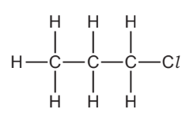

i) Draw the structure of an isomer of this compound.

[1]

ii) Describe how 1-chloropropane could be made from propane.

[2]

iii) Suggest an explanation why the method you have described in (ii) does not produce a pure sample of 1-chloropropane.

[2]

*Source: 2012 Oc32 Q3*

**Q15** [3 marks]

Organic halides react with water to form an alcohol and a halide ion.

CH3–CH2–I + H2O → CH3–CH2–OH + I–

i) Describe how you could show that the reaction mixture contained an iodide ion.

[2]

ii) Name the alcohol formed when 1-chloropropane reacts with water.

[1]

*Source: 2012 Oc32 Q3*

**Q15** [7 marks]

**Extract:**

A mixture of 10 cm^3^ of aqueous silver nitrate and 10 cm^3^ of ethanol is warmed to 60 °C. Drops of the organic halide are added and the time taken for a precipitate to form is measured. Silver ions react with the halide ions to form a precipitate of the silver halide. Ag^+^ (aq) + X^-^ (aq) → AgX (s)

Typical results for four experiments, **A**, **B**, **C** and **D**, are given in the table.

| experiment | organic halide | number of drops | time/min |
| A | bromobutane | 4 | 6 |
| B | bromobutane | 8 | 3 |
| C | chlorobutane | 4 | 80 |
| D | iodobutane | 4 | 0.1 |

The speed (rate) of reaction between an organic halide and water can be measured by the following method.

A mixture of 10 cm3 of aqueous silver nitrate and 10 cm3 of ethanol is warmed to 60 °C.

Drops of the organic halide are added and the time taken for a precipitate to form is measured.

Silver ions react with the halide ions to form a precipitate of the silver halide.

Ag+ (aq) + X- (aq) → AgX (s)

Typical results for four experiments, **A**, **B**, **C** and **D**, are given in the table.

| experiment | organic halide | number of drops | time/min |
|---|---|---|---|
| A | bromobutane | 4 | 6 |
| B | bromobutane | 8 | 3 |
| C | chlorobutane | 4 | 80 |
| D | iodobutane | 4 | 0.1 |

i) Explain why it takes longer to produce a precipitate in experiment **A** than in** B**.

[2]

ii) How does the order of reactivity of the organic halides compare with the order of reactivity of the halogens?

[2]

iii) Explain why the time taken to produce a precipitate would increase if the experiments were repeated at 50 °C.

[3]

*Source: 2012 Oc32 Q3*

### Q16 — medium — 14 marks

**Q16** [6 marks]

A hydrocarbon has the following structural formula.

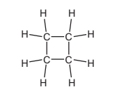

i) State the molecular formula and the empirical formula of this hydrocarbon.

molecular formula ..........................................................................................................

empirical formula ..........................................................................................................

[2]

ii) Draw the structural formula of an isomer of the above hydrocarbon.

[1]

iii) Explain why these two hydrocarbons are isomers.

[2]

iv) Are these two hydrocarbons members of the same homologous series? Give a reason for your choice.

[1]

*Source: 2014 O32 Q3*

**Q16** [3 marks]

Alkenes can be made from alkanes by cracking.

i) Explain the term *cracking*.

[2]

ii) One mole of an alkane, when cracked, produced one mole of hexane, C6H14, and two moles of ethene.

What is the molecular formula of the original alkane?

[1]

*Source: 2014 O32 Q3*

**Q16** [5 marks]

Alkenes are used in polymerisation reactions and addition reactions.

i) Draw the structural formula of the product formed by the addition polymerisation of but-2-ene. Its formula is given below.

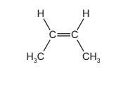

[3]

ii) Give the name and structural formula of the addition product formed from ethene and bromine.

name ..........................................................................................................

structural formula

[2]

*Source: 2014 o32 Q3*

### Q17 — medium — 12 marks

**Q17** [6 marks]

The structural formula of a butanol is given below.

CH3—CH2—CH2—CH2—OH

Butanol can be made from petroleum and also by fermentation.

i) Describe the chemistry of making butanol from petroleum by the following route.

**petroleum → butene → butanol**

[3]

ii) Explain, in general terms, what is meant by *fermentation*.

[3]

*Source: 2011 Ju31 Q6*

**Q17** [2 marks]

**Extract:**

The structural formula of a butanol is given below.

CH~3~—CH~2~—CH~2~—CH~2~—OH

Butanol can be oxidised to a carboxylic acid by heating with acidified potassium manganate(VII). Give the name and structural formula of the carboxylic acid.

*Source: 2015 Ju31 Q6*

**Q17** [4 marks]

Butanol reacts with ethanoic acid to form a liquid, **X**, which has the sweet smell of bananas. Its empirical formula is C3H6O and its *M*r is 116.

i) What type of compound is liquid **X**?

[1]

ii) Give the molecular formula of liquid **X**.

[1]

iii) Draw the structural formula of** X**. Show all the individual bonds.

[2]

*Source: 2011 Ju32 Q6*

### Q18 — medium — 14 marks

**Q18** [2 marks]

The alkenes are a series of unsaturated hydrocarbons. They have the general molecular formula CnH2n.

Deduce the molecular formula of an alkene which has a relative molecular mass of 126.

Show your working.

*Source: 2011 O33 Q7*

**Q18** [8 marks]

The structural formula of propene is drawn below.

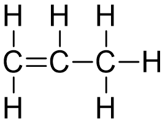

i) Draw a diagram showing the arrangement of the valency electrons in one molecule of this covalent compound.

Use x to represent an electron from an atom of carbon.

Use o to represent an electron from an atom of hydrogen.

[3]

ii) Draw the structure of the polymer formed from propene

[2]

iii) Bond energy is the amount of energy, in kJ, which must be supplied to break one mole of the bond.

| **bond** | **bond energies in kJ / mol** |
|---|---|
| H-H | +436 |
| C=C | +610 |
| C-C | +346 |
| C-H | +415 |

Use the data in the table to show that the following reaction is exothermic.

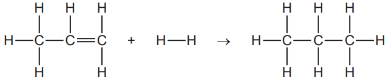

[3]

*Source: 2011 O33 Q7*

**Q18** [4 marks]

This question is concerned with some of the addition reactions of but-1-ene.

i) Name the product formed when but-1-ene reacts with water.

[1]

ii) Complete the equation.

CH3–CH2–CH=CH2 + Br2 → .....................................................................

[2]

iii) Deduce the formula of the compound which reacts with but-1-ene to form 1-iodobutane.

[1]

*Source: 2011 O33 Q7*

### Q19 — medium — 15 marks

**Q19** [3 marks]

Alkanes and alkenes are both series of hydrocarbons.

i) Explain the term *hydrocarbon*.

[1]

ii) What is the difference between these two series of hydrocarbons?

[2]

*Source: 2013 Ju33 Q7*

**Q19** [1 mark]

Alkenes and simpler alkanes are made from long-chain alkanes by cracking.

Complete the following equation for the cracking of the alkane C20H42.

C20H42  → 2C4H8 + 2C2H4 + ...............

*Source: 2013 Ju33 Q7*

**Q19** [7 marks]

Alkenes such as butene and ethene are more reactive than alkanes.

Alkenes are used in the petrochemical industry to make a range of products, which includes polymers and alcohols.

i) Dibromoethane is used as a pesticide. Complete the equation for its preparation from ethene.

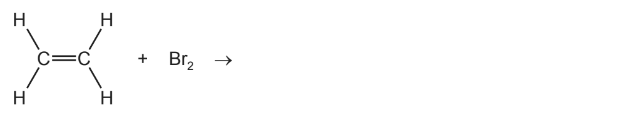

[1]

ii) The structural formula of a poly(alkene) is given below.

Deduce the structural formula of its monomer.

[2]

iii)  How is butanol made from butene, CH3 –CH2 –CH=CH2? Include an equation in your answer.

[2]

iv) Cracking changes alkanes into alkenes. How could an alkene be converted into an alkane?

Include an equation in your answer.

[2]

*Source: 2013 Ju33 Q7*

**Q19** [4 marks]

20 cm3 of a hydrocarbon was burnt in 175 cm3 of oxygen. After cooling, the volume of the remaining gases was

125 cm3. The addition of aqueous sodium hydroxide removed carbon dioxide leaving 25 cm3 of unreacted oxygen.

Volume of oxygen used = .......... cm3

[1]

Volume of carbon dioxide formed = .......... cm3

[1]

Deduce the formula of the hydrocarbon and the balanced equation for the reaction.

[2]

*Source: 2013 Ju33 Q7*

### Q20 — hard — 14 marks

**Q20** [4 marks]

Plants can make complex molecules from simple starting materials, such as water, carbon dioxide and nitrates. Substances produced by plants include sugars, more complex carbohydrates, esters, proteins, vegetable oils and fats.

i) Describe how you could decide from its molecular formula whether a compound is a carbohydrate.

[2]

ii) Plants can change the sugar, glucose, into starch which is a more complex carbohydrate. What type of reaction is this?

[2]

*Source: 2013 O32 Q7*

**Q20** [5 marks]

The fermentation of glucose can be carried out in the apparatus shown below. After a few days the reaction stops. A 12% aqueous solution of ethanol has been produced.

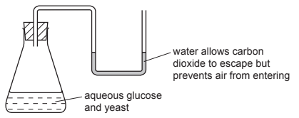

i) The enzyme, zymase, catalyses the anaerobic respiration of the yeast.

Explain the term *respiration*.

[2]

ii) Complete the equation.

| C6H12O6 → | ......................... + | ................................... |
|---|---|---|
| glucose |   | carbon dioxide |

[2]

iii) Why must air be kept out of the flask?

[1]

*Source: 2013 O32 Q7*

**Q20** [2 marks]

The ester methyl butanoate is found in apples. It can be made from butanoic acid and methanol. Their structural formulae are given below.

| 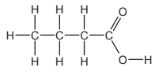 | 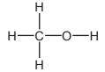 |
|---|---|
| butanoic acid | methanol |

Use the information given above to deduce the structural formula of methyl butanoate showing all the bonds.

*Source: 2013 O32 Q7*

**Q20** [3 marks]

Proteins are natural macromolecules. Draw the structural formula of a typical protein. Include three monomer units. You may represent amino acids by formulae of the type drawn below.

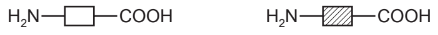

*Source: 2013 O32 Q7*

### Q21 — medium — 13 marks

**Q21** [6 marks]

The alcohols form a homologous series.

i) Give **three **characteristics which all members of a homologous series share.

[3]

ii) Give the name of the third member of this series.

[1]

iii) Deduce the molecular formula of the alcohol whose *M*r = 158. Show your working.

[2]

*Source: 2015 Ju31 Q4*

**Q21** [2 marks]

Explain why the following two alcohols are isomers.

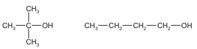

*Source: 2015 Ju31 Q4*

**Q21** [5 marks]

This question is based on typical reactions of butan-1-ol.

i) When butan-1-ol, CH3–CH2–CH2–CH2–OH, is passed over the catalyst silicon(IV) oxide, water is lost. Deduce the name and the structural formula of the organic product in this reaction.

[2]

ii) Suggest the name of the ester formed from butanol and ethanoic acid.

[1]

iii) Butan-1-ol is oxidised by acidified potassium manganate(VII).

Deduce the name and the structural formula of the organic product in this reaction.

[2]

*Source: 2015 Ju31 Q4*

### Q22 — hard — 10 marks

**Q22** [6 marks]

Methanol can be made from a mixture of carbon monoxide and hydrogen.

CO (g) + 2H2 (g) $\rightleftharpoons$ CH3OH (g)

The forward reaction is exothermic.

i) Explain why the concentration of methanol at equilibrium does not change.

[2]

ii) Suggest conditions, in terms of temperature and pressure, which would give a high yield of methanol.

[2]

iii) How would the conditions used in practice compare with those given in (ii)? Give an explanation of any differences.

[2]

*Source: 2011 Ju32 Q6*

**Q22** [4 marks]

Petroleum-based diesel is a mixture of hydrocarbons, such as octane and octene.

i) ‘Oct’ means eight carbon atoms per molecule. Draw a structural formula of an octene molecule.

[1]

ii) Describe a test which would distinguish between octane and octene. Test: Result with octane: Result with octene:

[3]

*Source: 2011 Ju32 Q6*

### Q23 — medium — 17 marks

**Q23** [4 marks]

Propane reacts with chlorine to form a mixture of chloropropanes. This is a photochemical reaction.

i) What is meant by the phrase *photochemical reaction*?

[1]

ii) The products of this reaction include two isomers, one of which has the following structural formula.

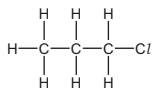

Draw the structural formula of the other isomer.

[1]

iii) Explain why these two different compounds are isomers.

[2]

*Source: 2015 O32 Q4*

**Q23** [3 marks]

Bond breaking is an endothermic change and bond forming is an exothermic change.  Bond energy is the amount of energy in kJ / mol needed to break one mole of the specified bond.

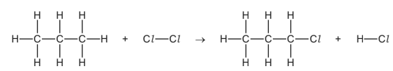

Use the following bond energies to determine whether this reaction is exothermic or endothermic. You must show your reasoning.

| **Bond** | **Bond energies in kJ / mol** |
|---|---|
| C-Cl | 338 |
| C-H | 412 |
| Cl-Cl | 242 |
| H-Cl | 431 |
| C-C | 348 |

*Source: 2015 O32 Q4*

**Q23** [5 marks]

**Extract:**

Propane reacts with chlorine to form a mixture of chloropropanes. This is a photochemical reaction.

i) Chloropropane can be hydrolysed to propanol, CH3CH2CH2OH, by sodium hydroxide. Write the equation for this reaction.

[2]

ii) Propanol can be dehydrated. It loses a water molecule to form a hydrocarbon.

Give the name and structural formula of this hydrocarbon.

[2]

iii) Propanol is oxidised to a carboxylic acid by acidified potassium manganate(VII).

Deduce the name of this acid.

[1]

*Source: 2015 O32 Q4*

**Q23** [5 marks]

Propanol reacts with methanoic acid to form the ester propyl methanoate.

CH3CH2CH2OH + HCOOH → HCOOCH2CH2CH3 + H2O

4.0 g of methanoic acid was reacted with 6.0 g of propanol.

i) Calculate the *M*r of methanoic acid.

[1]

ii) Calculate the* M*r of propanol.

[1]

iii) Determine which one is the limiting reagent. Show your reasoning.

[2]

iv) Calculate the maximum yield in grams of propyl methanoate, *M*r = 88.

[1]

*Source: 2015 O32 Q4*

### Q24 — medium — 14 marks

**Q24** [6 marks]

The alcohols form a homologous series. The first member of this series is methanol, CH3OH.

i) Give the general formula of the alcohols.

[1]

ii) The mass of one mole of an alcohol is 116 g. What is its formula? Show your reasoning.

[2]

ii) Draw a diagram showing the arrangement of the outer (valency) electrons in one molecule of methanol.

Use x to represent an electron from a carbon atom. 
Use o to represent an electron from a hydrogen atom. 
Use ● to represent an electron from an oxygen atom.

[3]

*Source: 2012 O32 Q7*

**Q24** [5 marks]

Methanol is manufactured using the following method.

CH4 (g) + H2O (g) → CO (g) + 3H2 (g)   reaction 1 CO (g) + 2H2 (g) $\rightleftharpoons$ CH3OH (g)    reaction 2

The conditions for reaction 2 are:

| pressure | 100 atmospheres |
|---|---|
| catalyst | a mixture of copper, zinc oxide and aluminium oxide |
| temperature | 250°C |

The forward reaction is exothermic.

i) Why is high pressure used in reaction 2?

[2]

ii) Explain why using a catalyst at 250 °C is preferred to using a higher temperature of 350°C and no catalyst.

[3]

*Source: 2012 O32 Q7*

**Q24** [3 marks]

Methanol is oxidised by atmospheric oxygen. This reaction is catalysed by platinum.

i) The products of this reaction include a carboxylic acid. Give its name and structural formula.

[2]

ii) Deduce the name of the ester formed by the reaction of methanol with the carboxylic acid named in (i).

[1]

*Source: 2012 O32 Q7*

### Q25 — easy — 7 marks

**Q25** [2 marks]

A major source of energy is the combustion of fossil fuels.

i) Name a solid fossil fuel.

[1]

ii) Name a gaseous fossil fuel.

[1]

*Source: 2007 Ju31 Q1*

**Q25** [5 marks]

Petroleum is separated into more useful fractions by fractional distillation.

i) Name **two **liquid fuels obtained from petroleum.

........................................ and ........................................

[2]

ii) Name **two **other useful products obtained from petroleum that are not used as fuels.

........................................ and ........................................

[2]

iii) Give another mixture of liquids that is separated on an industrial scale by fractional distillation.

[1]

*Source: 2007 Ju31 Q1*

### Q26 — hard — 18 marks

**Q26** [4 marks]

Alkenes are unsaturated hydrocarbons. They undergo addition reactions.

Two of the methods of making alkenes are cracking and the thermal decomposition of chloroalkanes.

i) Complete an equation for the cracking of the alkane, decane.

| C10H22 | → | ..................... | + | ...................... |
|---|---|---|---|---|
| decane |   |   |   |   |

[2]

ii) Propene can be made by the thermal decomposition of chloropropane.

Describe how chloropropane can be made from propane.

reagents:  propane and ..............................

conditions ...................................................

[2]

*Source: 2003 Ju31 Q3*

**Q26** [4 marks]

**Extract:**

CH3-CH2-CH=CH2 and CH3-C(CH3)=CH2 (the two structural formulae shown in the image)

The following alkenes are isomers.

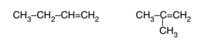

i) Explain why they are isomers.

[2]

ii) Give the name and structural formula of another hydrocarbon that is isomeric with the above.

name ......................................................

structural formula

[2]

*Source: 2003 Ju31 Q3*

**Q26** [3 marks]

Give the name of the product when but-1-ene reacts with each of the following.

steam ......................................................... 
hydrogen .................................................... 
bromine ......................................................

*Source: 2003 Ju31 Q3*

**Q26** [7 marks]

Alkenes can polymerise.

i) Deduce the name and structural formula of the monomer from the structure of the polymer.

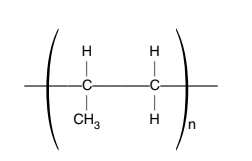

name of monomer .......................................................     structural formula

[2]

ii) Draw the structure of the polymer formed from the following monomer.

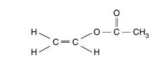

[2]

iii) Describe the pollution problems caused by the disposal of polymers in landfill sites and by burning.

landfill sites ..........................................................................................................

[2]

burning ..........................................................................................................

[1]

*Source: 2003 Ju31 Q3*

### Q27 — easy — 8 marks

**Q27** [5 marks]

Islay is an island off the west coast of Scotland. The main industry on the island is making ethanol from barley.

Barley contains the complex carbohydrate, starch. Enzymes catalyse the hydrolysis of starch to a solution of glucose.

Yeast cells are added to the aqueous glucose. Fermentation produces a solution containing up to 10% of ethanol.

i) Complete the word equation for the fermentation of glucose.

glucose → .......................... + ..........................

[1]

ii) Explain why is it necessary to add yeast and suggest why the amount of yeast in the mixture increases.

[2]

iii) Fermentation is carried out at 35°C. For many reactions a higher temperature would give a faster reaction. Why is a higher temperature not used in this process?

[2]

*Source: 2012 Ju32 Q5*

**Q27** [3 marks]

The organic waste, the residue of the barley and yeast, is disposed of through a pipeline into the sea. In the future this waste will be converted into biogas by the anaerobic respiration of bacteria. Biogas, which is mainly methane, will supply most of the island’s energy.

i) Anaerobic means in the absence of oxygen. Suggest an explanation why oxygen must be absent.

[1]

ii) The obvious advantage of converting the waste into methane is economic.

Suggest **two **other advantages.

[2]

*Source: 2012 Ju32 Q5*

### Q28 — medium — 12 marks

**Q28** [4 marks]

Propenoic acid is an unsaturated carboxylic acid. The structural formula of propenoic acid is given below.

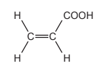

i) Describe how you could show that propenoic acid is an unsaturated compound.

Test:

Result:

[2]

ii) Without using an indicator, describe how you could show that a compound is an acid.

Test:

Result:

[2]

*Source: 2012 O33 Q5*

**Q28** [3 marks]

**Extract:**

Propenoic acid is an unsaturated carboxylic acid. The structural formula of propenoic acid is given below. 

Propenoic acid reacts with ethanol to form an ester. Deduce the name of this ester. Draw its structural formula.

Name of ester:

Structural formula showing all bonds:

*Source: 2012 O33 Q5*

**Q28** [5 marks]

An organic compound has a molecular formula C6H8O4. It is an unsaturated carboxylic acid. One mole of the compound reacts with two moles of sodium hydroxide.

i) Explain the phrase *molecular formula*.

[2]

ii) One mole of this carboxylic acid reacts with two moles of sodium hydroxide. How many moles of –COOH groups are there in one mole of this compound?

[1]

iii) What is the formula of another functional group in this compound?

[1]

iv) Deduce a structural formula of this compound.

[1]

*Source: 2012 O33 Q5*

### Q29 — easy — 2 marks

**Q29** [1 mark]

The properties of five alkenes at room temperature are shown in the table.

| alkene | number of carbon atoms in a molecule | state at room temperature | density in g / cm3 | boiling point / °C |
|---|---|---|---|---|
| ethene | 2 | gas | 0.0012 | –104 |
| propene | 3 | gas | 0.0018 | –47 |
| butene | 4 | gas | 0.0024 |   |
| pentene | 5 | liquid | 0.64 | 30 |
| hexene | 6 | liquid | 0.67 | 63 |

Answer these questions using only the information in the table.

Describe the general trend in the density of the alkenes.

**Q29** [1 mark]

**Extract:**

The properties of five alkenes at room temperature are shown in the table.

| alkene | number of carbon atoms in a molecule | state at room temperature | density in g / cm^3^ | boiling point / °C |
| ethene | 2 | gas | 0.0012 | –104 |
| propene | 3 | gas | 0.0018 | –47 |
| butene | 4 | gas | 0.0024 | |
| pentene | 5 | liquid | 0.64 | 30 |
| hexene | 6 | liquid | 0.67 | 63 |

Predict the boiling point of butene.

### Q30 — hard — 13 marks

**Q30** [5 marks]

Butan-1-ol is used as a solvent for paints and varnishes, to make esters and as a fuel. Butan-1-ol can be manufactured from but-1-ene, which is made from petroleum.

Biobutanol is a fuel of the future. It can be made by the fermentation of almost any form of biomass - grain, straw, leaves etc.

But-1-ene can be obtained from alkanes such as decane, C10H22, by cracking.

i) Give the reaction conditions.

[2]

ii) Complete an equation for the cracking of decane, C10H22, to give but-1-ene.

C10H22 →

[2]

iii) Name the reagent that reacts with but-1-ene to form butan-1-ol.

[1]

*Source: 2009 O31 Q7*

**Q30** [4 marks]

i) Balance the equation for the complete combustion of butan-1-ol.

...... C4H9OH + ...... O2 → ...... CO2 + ...... H2O

[2]

ii) Write a word equation for the preparation of the ester butyl methanoate.

[2]

*Source: 2009 O31 Q7*

**Q30** [3 marks]

The fermentation of biomass by bacteria produces a mixture of products which include biobutanol, propanol, hydrogen and propanoic acid.

i) Draw the structural formula of propanol and of propanoic acid. Show all the bonds.

[2]

ii) Why is it important to develop these fuels, such as biobutanol, as alternatives to petroleum?

[1]

*Source: 2009 O31 Q7*

**Q30** [1 mark]

**Extract:**

Butan-1-ol is used as a solvent for paints and varnishes, to make esters and as a fuel. Butan-1-ol can be manufactured from but-1-ene, which is made from petroleum. Biobutanol is a fuel of the future. It can be made by the fermentation of almost any form of biomass - grain, straw, leaves etc.

How could you show that butanol made from petroleum and biobutanol are the same chemical?

*Source: 2009 O31 Q7*

### Q31 — easy — 8 marks

**Q31** [4 marks]

Natural gas, which is mainly methane, is a fossil fuel.

i) What is meant by the term *fuel*?

[1]

ii) Name **two **other fossil fuels.

[2]

iii) Name a **solid **fuel which is not a fossil fuel.

[1]

*Source: 2014 Ju32 Q2*

**Q31** [4 marks]

Fossil fuels are formed by the anaerobic decomposition of organic matter. Anaerobic means in the absence of oxygen.

i) The organic matter contains hydrogen and carbon. Suggest the products that would be formed if the decomposition occurred in the presence of oxygen.

[2]

ii) What are the **two **main disadvantages in the widespread use of fossil fuels?

[2]

*Source: 2014 Ju32 Q2*

### Q32 — medium — 15 marks

**Q32** [3 marks]

The alcohols form an homologous series.

Give **three **characteristics of a homologous series.

*Source: 2010 Oc23 Q6*

**Q32** [3 marks]

The following two alcohols are members of the series and they are isomers.

CH3—CH2—CH2—CH2—OH and (CH3)2CH—CH2OH

i) Explain why they are isomers.

[2]

ii) Give the structural formula of another alcohol which is also an isomer of these alcohols.

[1]

*Source: 2010 Oc23 Q6*

**Q32** [3 marks]

Copper(II) oxide can oxidise butan-1-ol to liquid X whose pH is 4.

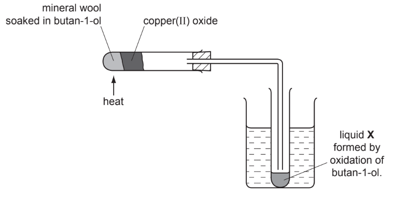

i) Name another reagent which can oxidise butan-1-ol.

[1]

ii) What type of compound is liquid X and what is its formula?

[2]

*Source: 2010 Oc23 Q6*

**Q32** [6 marks]

The alcohol ethanol can be made by fermentation. Yeast is added to aqueous glucose.

C6H12O6 (aq) → 2C2H5OH (aq) + 2CO2 (g)

Carbon dioxide is given off and the mixture becomes warm as the reaction is exothermic. The graph shows how the rate of reaction varies over several days.

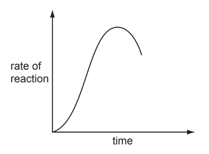

i) Suggest a method of measuring the rate of this reaction.

[2]

ii) Why does the rate increase initially?

[1]

iii) Suggest two reasons why the rate eventually decreases.

[2]

iv) Why is fermentation carried out in the absence of air?

[1]

*Source: 2010 Oc23 Q6*

### Q33 — hard — 13 marks

**Q33** [2 marks]

The alkenes are unsaturated hydrocarbons. They form a homologous series, the members of which have similar chemical properties

- easily oxidised
- addition reactions
- polymerisation
- combustion.

All the alkenes have the same empirical formula.

i) State their empirical formula.

[1]

ii) Why is the empirical formula the same for all alkenes?

[1]

*Source: 2012 Ju32 Q7*

**Q33** [3 marks]

Alkenes can be oxidised to carboxylic acids by boiling with aqueous potassium manganate(VII).

i) Pent-2-ene, CH3–CH2–CH=CH–CH3, oxidises to CH3–CH2–COOH and CH3COOH.

Name these two acids.

CH3–CH2–COOH .......................................................................................................

CH3COOH ..........................................................................................................

[2]

ii) Most alkenes oxidise to two carboxylic acids. Deduce the formula of an alkene which forms only one carboxylic acid.

[1]

*Source: 2012 Ju32 Q7*

**Q33** [2 marks]

Complete the following equations for the addition reactions of propene.

CH3–CH=CH2 + Br2 → ....................................

CH3–CH=CH2 + H2O → ....................................

*Source: 2012 Ju32 Q7*

**Q33** [2 marks]

**Extract:**

Complete the following equations for the addition reactions of propene. CH~3~–CH=CH~2~ + Br~2~ → ....

Draw the structural formula of poly(propene).

*Source: 2012 Ju32 Q7*

**Q33** [4 marks]

**Extract:**

0.01 moles of an alkene needed 2.4 g of oxygen for complete combustion. 2.2 g of carbon dioxide were formed.

0.01 moles of an alkene needed 2.4 g of oxygen for complete combustion. 2.2 g of carbon dioxide were formed.

Determine the following mole ratio.

moles of alkene : moles of O2 : moles of CO2

From this ratio determine the formula of the alkene.

[3]

Write an equation for the complete combustion of this alkene.

[1]

*Source: 2012 Ju32 Q7*

### Q34 — easy — 2 marks

**Q34** [1 mark]

Large hydrocarbons can be cracked to form smaller hydrocarbons. Complete the chemical equation for cracking tridecane, C13H28, to form an alkene and one other hydrocarbon.

C13H28 → C3H6 + ..............

*Source: 2020 Ju0620/31 Q7E*

**Q34** [1 mark]

#### Separate: Chemistry and Extended Only

Ethene is an alkene.

Draw the structure of ethene showing all of the atoms and all of the bonds.

*Source: 2020 Ju0620/31 Q7F*

### Q35 — hard — 12 marks

**Q35** [4 marks]

The alkanes are generally unreactive. Their reactions include combustion, substitution and cracking.

The complete combustion of an alkane gives carbon dioxide and water.

i) 10 cm3 of butane is mixed with 100 cm3 of oxygen, which is an excess. The mixture is ignited. What is the volume of unreacted oxygen left and what is the volume of carbon dioxide formed?

C4H10 (g) + 6.5O2 (g) → 4CO2 (g) + 5H2O (l)

Volume of oxygen left = .................................................. cm3

Volume of carbon dioxide formed = ................................. cm3

[2]

ii) Why is the incomplete combustion of any alkane dangerous, particularly in an enclosed space?

[2]

*Source: 2008 O31 Q7*

**Q35** [3 marks]

The equation for a substitution reaction of butane is given below.

CH3−CH2−CH2−CH3 + Cl2 → CH3−CH2−CH2−CH2−Cl + HCl

i) Name the organic product.

[1]

ii) This reaction does not need increased temperature or pressure.

What is the essential reaction condition?

[1]

iii) Write a different equation for a substitution reaction between butane and chlorine.

[1]

*Source: 2008 O31 Q7*

**Q35** [5 marks]

Alkenes are more reactive and industrially more useful than alkanes.

They are made by cracking alkanes.

| C7H16 → | CH3−CH=CH2 + | CH3−CH2−CH=CH2 + H2 |
|---|---|---|
| heptane | propene | but−1−ene |

i) Draw the structural formula of the polymer poly(propene).

[2]

ii) Give the structural formula and name of the alcohol formed when but-1-ene reacts with steam.

name ..................................................

[1]

structural formula

[1]

iii) Deduce the structural formula of the product formed when propene reacts with hydrogen chloride.

[1]

*Source: 2008 O31 Q7*

### Q36 — medium — 11 marks

**Q36** [6 marks]

But-1-ene is a typical alkene. It has the structural formula shown below.

CH3–CH2–CH=CH2

The structural formula of cyclobutane is given below.

These two hydrocarbons are isomers.

i) Define the term *isomer*.

[2]

ii) Draw the structural formula of another isomer of but-1-ene.

[1]

iii) Describe a test which would distinguish between but-1-ene and cyclobutane.

reagent ..................................................

result with but-1-ene ..................................................

result with cyclobutane ..................................................

[3]

*Source: 2010 Ju32 Q4*

**Q36** [2 marks]

Describe how alkenes, such as but-1-ene, can be made from alkanes.

*Source: 2010 Ju32 Q4*

**Q36** [3 marks]

**Extract:**

But-1-ene is a typical alkene. It has the structural formula shown below.
CH~3~–CH~2~–CH=CH~2~

Name the product formed when but-1-ene reacts with:

bromine, ..........................................................................................................

[1]

hydrogen, ..........................................................................................................

[1]

steam. ..........................................................................................................

[1]

*Source: 2010 Ju32 Q4*

### Q37 — hard — 10 marks

**Q37** [2 marks]

Structural formulae are an essential part of Organic Chemistry.

Draw the structural formula of each of the following. Show all the bonds in the structure.

i) ethanoic acid

[1]

ii) ethanol

[1]

*Source: 2011 O31 Q6*

**Q37** [6 marks]

Ethanoic acid and ethanol react to form an ester.

i) What is the name of this ester?

[1]

ii) The same linkage is found in polyesters. Draw the structure of the polyester which can be formed from the monomers shown below.

HOOC—C6H4—COOH and HO—CH2—CH2—OH

[3]

iii) Describe the pollution problems caused by non-biodegradable polymers.

[2]

*Source: 2011 O31 Q6*

**Q37** [2 marks]

Two macromolecules have the same amide linkage. Nylon, a synthetic polymer, has the following structure.

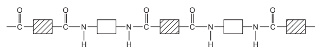

Protein, a natural macromolecule, has the following structure.

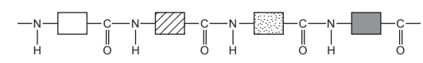

How are they different?

*Source: 2011 O31 Q6*

### Q38 — hard — 13 marks

**Q38** [2 marks]

Petroleum is a source of many important chemicals.

Name **two **industrial processes which must take place to produce alkenes from petroleum.

*Source: 2016 Ju41 Q6*

**Q38** [4 marks]

Ethene, CH2=CH2, and propene, CH2=CHCH3, can both be converted into polymers.

i) What type of polymerisation takes place when ethene forms a polymer?

[1]

ii) What is the empirical formula of the polymer formed from ethene?

[1]

iii) Propene has the structural formula CH2=CHCH3.

Draw two repeat units of the polymer made from propene.

[2]

*Source: 2016 Ju41 Q6*

**Q38** [2 marks]

**Extract:**

Ethene will react with steam to form ethanol. Propene will react with steam to form two isomers, both of which are alcohols. Structural isomers have the same molecular formula but their atoms are arranged differently. To work out the name of the alcohol formed from the alkene- just look at the prefix of the name. Ethene forms ethanol. Propene forms propanol.

Ethene will react with steam to form ethanol.

Propene will react with steam to form two isomers, both of which are alcohols.

Suggest the structures of these alcohols.

*Source: 2015 Ju41 Q6*

**Q38** [5 marks]

Esters are organic chemicals noted for their characteristic smells. Ethanoic acid and methanol will react to form an ester.

i) Name the catalyst needed to form an ester from ethanoic acid and methanol.

[1]

ii) Name the ester formed when ethanoic acid reacts with methanol.

[1]

iii) Draw the structure of the ester formed when ethanoic acid reacts with methanol. Show all bonds.

[2]

iv) Give the name of a polyester.

[1]

*Source: 2015 Ju41 Q6*

### Q39 — easy — 15 marks

**Q39** [7 marks]

#### Separate: Chemistry and Extended Only

Esters, polyesters and fats all contain the ester linkage.

Esters can be made from alcohols and carboxylic acids. For example, the ester ethyl ethanoate can be made by the following reaction.

CH3COOH + CH3CH2OH → CH3COOCH2CH3 + H2O

i) Name the carboxylic acid and the alcohol from which the following ester could be made.

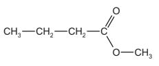

[2]

ii) 6.0 g of ethanoic acid, *M*r = 60, was reacted with 5.5 g of ethanol, *M*r = 46.  Determine which is the limiting reagent and the maximum yield of ethyl ethanoate, *M*r = 88.

Number of moles of ethanoic acid =

[1]

Number of moles of ethanol =

[1]

The limiting reagent is

[1]

Number of moles of ethyl ethanoate formed =

[1]

Maximum yield of ethyl ethanoate =

[1]

*Source: 2014 O31 Q6*

**Q39** [3 marks]

#### Separate: Chemistry and Extended Only

The following two monomers can form a polyester.

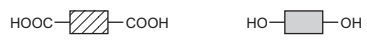

Draw the structural formula of this polyester. Include two ester linkages.

*Source: 2014 O31 Q6*

**Q39** [5 marks]

**Extract:**

The formulae of two examples of natural esters are given below.

[image: ester 1: CH2—CO2—C17H33, CH—CO2—C17H33, CH2—CO2—C17H33; ester 2: CH2—CO2—C17H35, CH—CO2—C17H35, CH2—CO2—C17H35]

One ester is saturated, the other is unsaturated. Describe a test to distinguish between them. Test: Result with unsaturated ester: Result with saturated ester:

Deduce which one of the above esters is unsaturated. Give a reason for your choice.

A test to distinguish between the saturated ester and the unsaturated ester is:
- Test: add bromine water / bromine;
- Result with unsaturated ester: turns colourless;
- Result with saturated ester: remains brown/orange/reddish brown/yellow;

The ester that is unsaturated, with a reason, is:
- Ester 1;
- (Because) the (alkyl) group / if it was saturated it would be CnH2n+1 which is NOT C17H33 OR C17H35 is CnH2n+1 OR Less hydrogen;

Fats and vegetable oils are esters. The formulae of two examples of natural esters are given below.

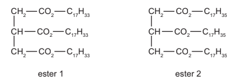

i) One ester is saturated, the other is unsaturated. Describe a test to distinguish between them. Test: Result with unsaturated ester: Result with saturated ester:

[3]

ii) Deduce which one of the above esters is unsaturated. Give a reason for your choice.

[2]

*Source: 2014 O31 Q6*

### Q40 — medium — 20 marks

**Q40** [9 marks]

The alcohols form a homologous series. The first four members are methanol, ethanol, propan-1-ol and butan-1-ol.

One characteristic of a homologous series is that the physical properties vary in a predictable way. The table below gives the heats of combustion of the first three alcohols.

| **Alcohol** | **Formula** | **Heat of combustion in kJ / mol** |
|---|---|---|
| methanol | CH3OH | -730 |
| ethanol | CH3-CH2-OH | -1370 |
| propan-1-ol | CH3-CH2-CH2-OH | -2020 |
| butan-1-ol | CH3-CH2-CH2-CH2-OH |   |

i) The minus sign indicates that there is less chemical energy in the products than in the reactants. What form of energy is given out by the reaction?

[1]

ii) Is the reaction exothermic or endothermic?

[1]

iii) Complete the equation for the complete combustion of ethanol.

[2]

iv) Determine the heat of combustion of butan-1-ol by plotting the heats of combustion of the first three alcohols against the number of carbon atoms per molecule.

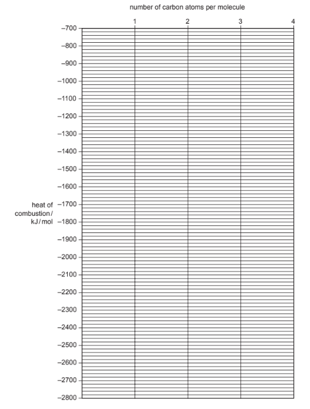

[3]

v) Describe **two **other characteristics of homologous series.

[2]

**Q40** [2 marks]

**Extract:**

The alcohols form a homologous series. The first four members are methanol, ethanol, propan-1-ol and butan-1-ol. propan-1-ol has formula CH~3~-CH~2~-CH~2~-OH

Give the name and structural formula of an isomer of propan-1-ol.

*Source: 2007 O31 Q6*

**Q40** [6 marks]

Methanol is made from carbon monoxide.

CO (g) + 2H2(g)$\rightleftharpoons$ CH3OH (g) the forward reaction is exothermic

i) Describe how hydrogen is obtained from alkanes.

[2]

ii) Suggest a method of making carbon monoxide from methane.

[2]

iii) Which condition, high or low pressure, would give the maximum yield of methanol? Give a reason for your choice.

[2]

*Source: 2007 O31 Q6*

**Q40** [3 marks]

For each of the following predict the name of the organic product.

i) reaction between methanol and ethanoic acid

[1]

ii) oxidation of propan-1-ol by potassium dichromate(VI)

[1]

iii) removal of H2O from ethanol (dehydration)

[1]

*Source: 2007 O31 Q2*

### Q41 — medium — 10 marks

**Q41** [4 marks]

The alkenes are a homologous series of unsaturated hydrocarbons.

The table below gives the names, formulae and boiling points of the first members of the series.

| **Name** | **Formula** | **Boiling point  / ****o****C** |
|---|---|---|
| ethene | C2H4 | -103.7 |
| propene | C3H6 | -47.6 |
| butene | C4H8 | -6.3 |
| pentene | C5H10 | 30 |
| hexene |   |   |

i) Complete the table by giving the formula of hexene and by predicting its boiling point.

[2]

ii) Deduce the formula of the alkene which has a relative molecular mass of 168. Show your working.

[2]

*Source: 2004 O31 Q8*

**Q41** [3 marks]

Describe a test that will distinguish between the two isomers, but-2-ene and cyclobutane.

test ..........................................................................................................

result with but-2-ene  ..........................................................................................................

result with cyclobutane  ..........................................................................................................

*Source: 2004 O31 Q8*

**Q41** [3 marks]

Alkenes undergo addition reactions.

i) What class of organic compound is formed when an alkene reacts with water?

[1]

ii) Draw the structure of the polymer formed from but-2-ene.

[2]

*Source: 2004 O31 Q8*

