# Mark Schemes — Polymers
**11. Organic Chemistry** · Cambridge (CIE) IGCSE chemistry (0620 & 0971)

## Multiple Choice Questions (26 questions)

### Q1
**Final answer:** **The correct answer is D**

- In condensation polymerisation, monomers link together and eliminate a small molecule, typically water
- This is seen in the formation of complex carbohydrates, proteins, nylon, and PET

**A** is incorrect as while chloroethene is the monomer of PVC, PVC is not mainly used for plastic bags (it is used for water pipes and electrical insulation). Plastic bags are made from **poly(ethene)**

**B **is incorrect as nylon is a **polyamide**, meaning it contains **amide** linkages, not ester linkages. PET/Terylene is the polymer that contains ester linkages

**C **is incorrect as although it is true that proteins are formed by joining amino acids with amide linkages, they are **condensation** polymers, not addition polymers

### Q2
**Final answer:** **The correct answer is C**

- **Polyethene** is a lightweight, flexible, and waterproof polymer
- It is an addition polymer whose monomer is ethene
- These properties make it suitable for making **plastic bags**

**A **is incorrect because artificial leather is made from polyurethane (PU) which is stronger and heavier than polyethene

**B** is incorect as wire insulatio is made from PVC (polychloroethene) which is stronger and heavier than polyethene

**D **is incorrect because ropes are commonly made from nylon or polypropene, which are stronger than polyethene

### Q3
**Final answer:** **The correct answer is ****B**** because:**

- **Addition polymerisation of alkenes produces very long molecules made up of a C-C backbone**
- **The carbon-carbon double bond in ethene can be made to open up, thus allowing many ethene molecules to join together. This makes a large molecule or polymer called poly(ethene) (or polythene).**
- **The reaction is carried out under high pressure with the use of a catalyst, which triggers the opening of the double bond.**

> *A **is incorrect as saturated hydrocarbons can not undergo polymerisation.*

> *C** and **D **are incorrect as cracking involves breaking long chain alkanes into smaller and more useful molecules, which is the opposite of polymerisation.*

### Q4
**The correct answer is ****B**** because:**

- **The carbon carbon double bonds open up and form long chain molecules called  polymers.**
- **The resulting polymer produced from ethene monomers is called poly(ethene) or polythene.**

> *A** and **C** are incorrect as these are alkanes and have no double bonds.*

> *D** is incorrect as when ethene undergoes polymerisation it becomes poly(eth**e**ne), not poly(eth**a**ne).*

### Q5
**Final answer:** **The correct answer is ****B**** because:**

- **Addition polymerisation involves the addition of many monomers to make a long chained polymer**
- **Poly(ethene) is formed when many ethene monomers join together due to the carbon-carbon double bond in ethene breaking**

> *A** is incorrect as cracking is the process where longer chain alkanes form shorter chain alkanes and alkenes*

> *C** is incorrect as fermentation is the process by which ethanol is produced from glucose in the presence of yeast, in the absence of oxygen at 25-35 **o**C*

> *D** is incorrect as catalytic addition of steam to ethene at 300°C and 6000kPa /60 atm in the presence of an acid catalyst produces ethanol*

### Q6
**Final answer:** **The correct answer is ****D**** because:**

- **The heat energy produced from the incineration of plastics can be used to generate electricity**

> *A** is incorrect as waste plastic in oceans causes harm to marine life*

> *B** is incorrect as taking up space in landfill sites causes the sites to fill up quickly so new sites are needed and less space is available for food production*

> *C** is incorrect as carbon monoxide is a toxic gas that reduces the level of oxygen transported by blood*

### Q7
**Final answer:** **The correct answer is ****A**** because:**

- **Being chemically unreactive makes it difficult to break it down at the end of its useful life**
- **This means it has to be disposed of by incineration or put into landfill causing environmental issues**

> *B**, **C** and **D** are incorrect as these properties make poly(ethene) useful as a plastic bag but do not impact how it is disposed of*

### Q8
**Final answer:** **The correct answer is ****C**** because:**

- **There is a carboxylic acid group (-COOH) and an amine group(-NH****2****) at either end.**
- **The link between these two functional groups is the amide link and each one is formed as a water molecule is lost, hence the name condensation polymerisation.**
- **There is a water molecule removed in the process shown in the question, therefore it is produced by condensation polymerisation.**

> *A** and **B **are incorrect as water is formed when the amine and carboxylic groups join together meaning this process is a condensation reaction. In addition polymerisation there are no waste products.*

> *D **is incorrect as Kevlar is held together by amide (peptide) links, whereas monomers of a polyester would consist of hydroxyl (-OH) and carboxylic acid (-COOH) groups and the polymer would be held together by ester links.*

### Q9
**The correct answer is ****A**** because:**

| **Final answer:** **Step** | **Final answer:** **Working out** |
|---|---|
| **1. Count the number of ****carbon ****atoms  present in each monomer.** | **A = 4, B = 2, C = 3 & D = 4** |
| **2. Break the double ****bond in each monomer.** | **This is to visualise the polymer it will form.** |
| **3. Look for the corresponding polymer** | **The one that matches is A** |

### Q10
**Final answer:** **The correct answer is ****B**** because:**

- **The structure shown is a polyamide which is a polymer where the individual monomer units are held together by amide (peptide) links (-CONH-).**
- **Polyamides are formed by condensation polymerisation of two monomers.**
- **One of the monomers has an amine (-NH****2****) group at each end and the other has a carboxylic acid group (-COOH) at both ends.**
- **The link between these two functional groups is the amide link and each one is formed as a water molecule is lost hence the name condensation polymerisation.**

> *A **is incorrect as water is formed when the amine and carboxylic groups join together meaning this process is a condensation reaction. In addition polymerisation there are no waste products.*

> *C** and **D **is incorrect as the amine and carboxylic groups are typical of monomers of a polyamide, whereas monomers of a polyester would consist of an alcohol (-OH) and a carboxylic acid (-COOH) group.*

### Q11
**Final answer:** **The correct answer is ****B**** because:**

- **Molecules 1 and 3 have the same groups attached to one carbon on the C=C double bond.**
- **They are the same molecule but the order of the functional groups has been changed slightly.**

> *A, C** and **D **are incorrect as molecules 2 and 4 do have the same groups attached but each group is bonded to a different carbon of the C=C double bond. This means that when they polymerize, they will have different positions on the chain to that of the molecule in the question.*

### Q12
**Final answer:** **The correct answer is ****D**** because:**

- **Addition polymerisation of alkenes produces very long polymer molecules which contain only single C-C bonds.**
- **Methyl propene has two methyl groups present, one above and one below the double bond.**
- **Methyl propene has alternate H atoms and methyl groups, so the polymer should  continue this pattern.**

| **Final answer:** **Step** | **Final answer:** **Diagram** |
|---|---|
| **1.**  ** Draw three of the monomers side by side showing clearly the double bonds and groups attached to the carbon atoms.** | 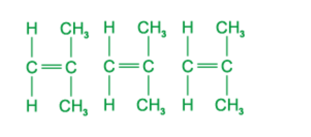 |
| **2.**  **Change the carbon-carbon double bonds to single bonds and add a single bond to each end of the monomers** |  |
| **3.**  **Join these bonds together, forming the polymer.** |  |

> *A **is incorrect as it has carbon-carbon double bonds.*

> *B **is incorrect as the methyl groups are on one side only.*

> *C **is incorrect as the groups on the chain are not alternating.*

### Q13
**Final answer:** **The correct answer is ****C**** because:**

- **Protein and nylon share the same linkages**
- **These are amide linkages which can also be called peptide bonds**
- **The linkages are what hold the monomers together to form polymers**

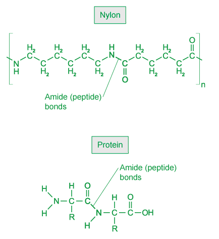

> *A**, **B** and **D** are incorrect as PET and complex carbohydrates (such as starch) do not contain amide (peptide) bonds*

### Q14
**Final answer:** **The correct answer is ****D**** because:**

- **The structure shown is a polyester which is a polymer where the individual monomer units are held together by ester links (-COO-).**
- **Polyesters are formed by condensation polymerisation of two monomers.**
- **One of the monomers has an alcohol (-OH) group and the other has a carboxylic acid group (-COOH).**

### Q15
**Final answer:** **The correct answer is ****B**** because:**

- **Protein and nylon share the same linkages**
- **These are amide linkages which can also be called peptide bonds**
- **The linkages are what hold the monomers together to form polymers**

> *A, C **and** D **are incorrect as PET and complex carbohydrates (such as starch) do not contain amide (peptide) bonds.*

### Q16
**Final answer:** **The correct answer is ****B**** because:**

- **The compound is a saturated hydrocarbon as it contains single bonds only.**
- **The polymer is poly(ethene) or polythene.**
- **Polythene is used extensively as it is durable and flexible and has many applications including plastic bags and bottles.**
- **It is also a good electrical insulator and is used as coating in electrical wiring.**

> *A **is incorrect as the monomer is ethene not ethane.*

> *C** and **D **are incorrect as the polymer is saturated whereas the monomer is unsaturated.*

> *As an easy way to remember, think of saturation in the sense that when something is saturated then nothing else will fit. A saturated solution for example is one in which no more solute can dissolve. A saturated hydrocarbon is one in which no more atoms can be added. As atoms tend to add across C=C double bonds, then if no double bond is present the compound must be saturated. An unsaturated compound must contain a C=C double bond.*

### Q17
**Final answer:** **The correct answer is ****C**** because:**

- **Polymerisation of ethene is carried out at high temperatures with catalysts, the only product is polythene.**
- **Therefore, CO****2**** is not produced in this process.**

> *A, B** and **D **are incorrect as these processes all produce CO**2**.*

### Q18
**Final answer:** **The correct answer is ****D**** because:**

- **Polyesters and polyamides are formed by condensation polymerisation of two  monomers.**
- **One of the monomers has an alcohol (-OH) group at each end and the other has a carboxylic acid group (-COOH) at either end.**

> *A** and **B **are incorrect as water is formed when the polyesters and polyamides are formed meaning this process is a condensation reaction. In addition polymerisation there are no waste products.*

> *C **is incorrect as if the monomers were unsaturated hydrocarbons then this would form polymers such as poly(ethene) and poly(propene).*

### Q19
**Final answer:** **The correct answer is ****D**** because:**

- **Addition polymerisation occurs in molecules that contain a C=C double bond.**
- **The bond breaks and molecules join together to form a much larger molecule.**
- **There is no other product formed.**

> *A **is incorrect as poly(ethene) is an example of an addition polymer and is not biodegradable.*

> *B** and **C **are incorrect as Terylene is an example of a condensation polymer which cannot be hydrolysed to make amino acids, and is also not a natural polymer.*

### Q20
**Final answer:** **The correct answer is ****C**** because:**

| **Final answer:** **Step** | **Final answer:** **Working out** |
|---|---|
| **Final answer:** **1. Identify the ****monomers ****in the displayed diagram.** | 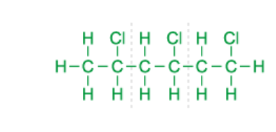 |
| **Final answer:** **2. Break the ****bond ****between these monomers.** |  |
| **Final answer:** **3. Add in the ****double ****bond between the carbon atoms.** |  |
| **Final answer:** **4. Write down the ****formula ****for what's left and identity this in the list of options given.** | **C****2****H****3****Cl, chloroethene**   |

> *A** and **B** are incorrect as the monomer must be an alkene.*

> *D** is incorrect as the monomer from which PVC is made has only one chlorine atom, not two.*

### Q21
**Final answer:** **The correct answer is ****D**** because:**

- **The monomer that is used to form a polymer is shown in the brackets of the name of the polymer, therefore it is ethene**
- **Ethene is an unsaturated compound as it contains a carbon-carbon double bond**

> *A** and **C **are incorrect as ethane is an alkane and is not the correct name of the monomer*

> *B** is incorrect as ethene is not a saturated compound as it contains a carbon-carbon double bond*

## Theory Questions (31 questions)

### Q1
a)

i) The term *solvent* means:

- (A chemical) in which something dissolves / that dissolves a solid;** [1 mark]**

ii) The formula of ethyl ethanoate is:

- CH3COOC2H5; **[1 mark]** *The full displayed / structural formula is accepted  C**4**H**8**O**2** is ****not ***

iii) How ethanol and ethanoic acid can be made:

Ethanol from ethene option 1:

- Steam / water 
**OR **
Hydration; **[1 mark]**
- Heat 
**OR **
Catalyst;** [1 mark]**

Ethanol from ethene option 2:

- Bubble into sulfuric acid;** [1 mark]**
- Add water; **[1 mark]**

Ethanoic acid from ethanol:

- Oxidation;** [1 mark]**
- By air / dichromate / manganate(VII); **[1 mark]**

iv) The **two **chemicals from which butyl ethanoate can be made are:

- Ethanoic acid 
**AND **
Butanol; **[1 mark]**

**[Total: 7 marks]**

- *Ethyl ethanoate is a common ester in exams because, like this question, it can go back to the origins of the chemicals required to make it*

  - *Ethene → ethanol → ethanoic acid*
  - *Ethanol + ethanoic acid → ethyl ethanoate*
b)

i) The type of polymer shown is:

- Polyester **OR **Condensation polymer; **[1 mark]**

ii) The structures of the two monomers that make the given polymer are:

- ; **[1 mark]**
-  ;** [1 mark] ***If the COOH and OH groups are on the wrong rectangle, then a maximum of 1 mark can be awarded*

**[Total: 3 marks]**

- *The molecule given has the -COO- ester linkage*
- *Since the molecule given has continuation bonds, it is a polyester that is formed as a condensation polymer*
- *The C=O groups are part of the parent carboxylic acid*

  - *To make the appropriate monomer for this, you simply redraw the grey rectangle with the two C=O attached and then add an OH group to each C=O*
- *The -O- groups are part of the parent alcohol *

  - *To make the appropriate monomer for this, you simply redraw the white rectangle with the O attached and then add a H atom to each O*

### Q2
a)

i) **Two **problems caused by the disposal of synthetic polymers in landfill sites are:

Any **two **of the following:

- Shortage of sites / landfill sites fill up;** [1 mark]**
- Visual pollution / litter; **[1 mark]**
- Danger to wildlife; **[1 mark]**

ii) **One **problem caused by burning synthetic polymers is:

- It produces toxic gases / CO / HCl / HF/ carbon dioxide / greenhouse gases; **[1 mark]**

**[Total: 3 marks]**

- *These are common problems associated with landfill sites and combustion / burning of waste polymers that you need to know*
b) **Two **uses of synthetic polymers are:

Any **two **of the following:

- Bags
- Clothing or specified clothing
- Packaging
- Bowls / cups / plates
- Flooring / carpets
- Pipes
- Insulation
- Non-stick coatings
- Ropes
- **Two **of the above required for the mark; **[1 mark]**

**[Total: 1 mark]**

- *You should be able to suggest two possible uses for synthetic polymers or plastics*
- *You must give two uses to achieve the mark*
c)

i) The structural formula of the monomer of polymer **A** is:

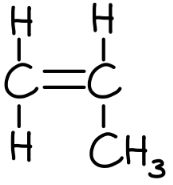

- Carbon=carbon double bond shown; **[1 mark]**
- Rest of the monomer structure correct; **[1 mark]**

ii) The functional group circled in polymer **B** is:

- An <u>ester</u>; **[1 mark]**

iii) The **two **types of organic compound which have reacted to form polymer **B** are:

- (Carboxylic) acid; **[1 mark]**
- Alcohol; **[1 mark]**

**[Total: 5 marks]**

- *For the monomer in part (i);*

  - *Identify the repeat unit containing two carbons*
  - *Draw this repeat unit*
  - *Remove the continuation bonds*
  - *Replace the carbon-carbon single bond with a carbon=carbon double bond*
- *The circled functional group is an ester linkage, which comes from the reaction of a carboxylic acid with an alcohol*
d) The difference between addition and condensation polymers, including classification of **A** and **B**, is:

- Addition polymerisation only forms the product/ one product; **[1 mark]**
- Condensation polymerisation forms the polymer and a simple molecule / water / hydrogen chloride; **[1 mark]**
- Polymer **A** is an addition polymer 
**AND **
Polymer **B** is a condensation polymer; **[1 mark]**

**[Total: 3 marks]**

- *You need to know this simple difference between addition and condensation polymers and be able to apply it*
- *As a general rule, if there are no oxygen or nitrogen atoms involved in the main polymer chain then you can assume that it is an addition polymer*

### Q3
a) The difference between addition and condensation polymers is:

- Addition polymerisation forms only the polymer / only one product 
**OR **
The monomer has C=C 
**OR **
The monomer and polymer have the same empirical formula **OR **
There is no loss of chemicals / material in addition polymerisation; **[1 mark]** *Only one monomer is not accepted*
- Condensation polymerisation forms the polymer and water / a small molecule / hydrogen chloride; **[1 mark]**

**[Total: 2 marks]**

- *You have to know the difference between addition and condensation polymers*
b) The structure of poly(dichloroethene) is:

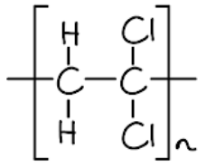

- Correct repeat unit; **[1 mark]**
- Continuation bonds; **[1 mark]**

**[Total: 2 marks]**

- *To draw the polymer from the monomer:*

  - *Draw the monomer*
  - *Replace the carbon=carbon double bond with a carbon-carbon single bond*
  - *Add continuation bonds on either side of the molecule, brackets and **n** *

### Q4
The type of condensation polymer that is formed from compound A is:

- Polyester; **[1 mark]**

**[Total: 1 mark]**

- *Compound A has a carboxylic acid functional group at one end and an alcohol at the other*
- *The carboxylic acid of one molecule can react with the alcohol of another molecule, forming an ester linkage with the loss of 1 water molecule in a condensation reaction*
- *The resulting condensation polymer is a polyester*
- *Careful**: The double bond can also open up and join with a neighbouring monomer to form an addition polymer, but the question specifically states to name the type of condensation polymer*

### Q5
a) Aluminium takes so long to corrode because:

- It forms a protective coating / layer 
**AND **
Of (aluminium) oxide; **[1 mark]**

**[Total: 1 mark]**

- *Any reactive metal that is not reacting or reacting very slowly usually has an oxide layer coating / protecting the surface*
b) The structural formula of a complex carbohydrate, such as cotton, including at least two glucose units is:

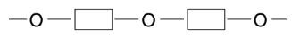

- Correct repeat unit; **[1 mark]**
- Continuation bonds shown; **[1 mark]**

**[Total: 2 marks]**

- *The glucose monomer has OH groups at the end*
- *If you draw two of the monomers side by side, you can remove a water molecule from between the two monomers *
c)

i) The scientific term used to describe polymers which do not break down in landfill sites is:

- Non-biodegradable; **[1 mark]**

ii) The structural formula of the monomer, phenylethene, is:

- CH2=CH(C6H5); **[1 mark]** *Full and partial displayed formulae are accepted*

**[Total: 2 marks]**

- *Biodegradable and non-biodegradable are terms that you have to know*
- *To convert the polymer structure back to the monomer structure:*

  - *Draw the polymer*
  - *Remove the square brackets, **n ** and continuation bonds*
  - *Change the central carbon-carbon single bond into a carbon-carbon double bond *

### Q6
a) The names and structural formulae of the **two **chemicals that could be used to make this ester / butyl ethanoate are:

- Butanol / butan-1-ol; **[1 mark]** *If a number is included in the alcohol name, then it must be 1*
- 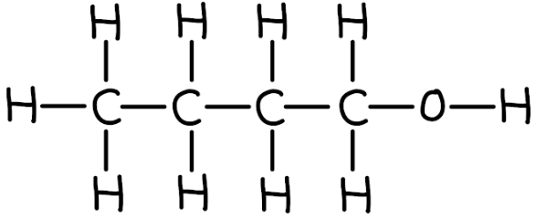 ; **[1 mark]**
- Ethanoic acid; **[1 mark]**
- 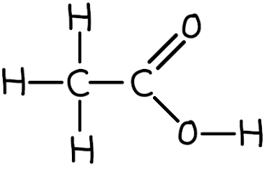 ; **[1 mark]**

**[Total: 4 marks]**

- *Esters are made from a carboxylic acid and an alcohol*

  - *The carboxylic acid will be the carbon chain with the C=O directly attached, which is drawn on the left by convention *
- *Since the ester has a two carbon chain including the C=O bond, the carboxylic acid is ethanoic acid*
- *The section of the ester that comes from the alcohol is a straight chain with four carbons, therefore the alcohol is butanol / butan-1-ol*
b)

i) The structural formula of a polyester is:

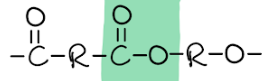

- Correct ester linkage (as highlighted);** [1 mark]** *Accept -COO-*
- Continuation bonds 
**AND **
A dicarboxylic acid type structure and a diol type structure on either side of the ester linkage; **[1 mark]**

ii) A possible use for this polymer is:

Any **one **of the following:

- Ropes;** [1 mark]**
- Clothing; **[1 mark]**
- Bottles; **[1 mark]**
- Packaging; **[1 mark]**
- Bags; **[1 mark]** *Other sensible suggestions are accepted*

**[Total: 3 marks]**

- *Polyesters are formed from the polymerisation of esters*
- *The acid end of one ester monomer condenses with the alcohol end of the next ester monomer*

  - *This is why the answer is looking for the ester linkage and the acid end on one side and the alcohol end on the other side *
- *You need to know some uses of polyesters for the 1 and 2 mark questions about uses of materials that examiners like to add*
c)

i) The blank space in the table is:

- 8; **[1 mark]**

ii) The product of the equation is:

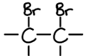

- One bromine atom per carbon atom; **[1 mark]**
- Rest of the structure correct, i.e. single bonds and each carbon having 4 bonds; **[1 mark]**

iii) The product that is the least likely to cause heart disease is:

- Corn oil; **[1 mark]**

**[Total: 4 marks]**

- *For part (i), there is a clear ratio of 7 g per 100 g of unsaturated fat to one drop of bromine water, i.e. 7 : 1*

  - *Therefore, 56 g equates to 8 drops*
- *For part (ii), the carbon=carbon double bond will split open to form a carbon-carbon single bond while each carbon atom gains a bromine atom*

  - *The bromine atoms add either side of the carbon=carbon double bond*
- *For part (iii), the information in the question states that saturated fat is linked to heart disease which means that you are looking for the cooking product with the least saturated fat *
d) To calculate the number of double bonds in one molecule of the fat:

- 884g of fat reacts with **762 **g of iodine; **[1 mark]**
- One mole of fat reacts with $\frac{762}{254}$ 
**OR **
**3 **moles of iodine molecules;** [1 mark]**
- Number of double bonds in one molecule of fat is **3**; **[1 mark]**

**[Total: 3 marks]**

- *The context and layout of this question are different compared to the usual presentation of moles calculations, which makes some people struggle with this question despite it guiding you through the calculation step by step*

  - *You are told that 100 g of fat reacts with 86.2 g of iodine*
  - *You can scale this up (x 8.84) to deduce that 884 g of fat will react with 762 g of iodine*
  - * You can now use the mass of iodine (254) to determine the number of moles of iodine*
  - *Since you are told that one mole of iodine reacts with one mole of C=C, this means that the number of moles of iodine equals the number of moles of double bonds*

### Q7
a)

i) The structural formula of the monomer is:

- CH3CH=CH2 / CH2CH=CH3; **[1 mark]**

ii) The structural formula of the polymer is:

-CH(CH3)-CH2- 
**OR** 
-CH2-CH(CH3)-

- Correct repeating unit; **[1 mark]**
- Shows continuation bonds on both ends; **[1 mark]**

iii) The one that will react with aqueous bromine and why is:

- The monomer / propene; **[1 mark]**
- (Because) it has a double bond / is an alkene; **[1 mark]**

**[Total: 5 marks]**

- *The name of the monomer from which a polymer is made is often given inside the brackets of the polymer *
- *In this case, the monomer is therefore propene*
- *Bromine water is used to distinguish alkanes from alkenes, as alkenes will react with bromine due to the presence of the double bond, causing the brown/orange colour of bromine water to disappear*
- *Remember:** Even though the polymer has the ending -ene in its name, it is saturated so contains no double bonds*
b)

i) The mixture was filtered to:

- Remove fibres / solid; **[1 mark]** NOT precipitate, NOT impurities, NOT to obtain a filtrate

ii) The change of silver atoms to silver ions is oxidation because:

- Silver atoms have lost electrons 
**OR **
Oxidation number increased; **[1 mark]**

iii) The name of the white precipitate is:

- Silver chloride; **[1 mark]**

**[Total: 3 marks]**

- *Silver atoms lose electrons to form silver(I) ions:*

  - *Ag → Ag**+** + e**-*
- *Remember**: **OIL RIG** - **O**xidation **I**s** L**oss, **R**eduction **I**s **G**ain of electrons*
- *When sodium chloride solution is added to the mixture containing silver(I) ions, the silver(I) ions react with the chloride ions forming silver chloride, which is insoluble so will form a precipitate:*

  - *Ag**+** (aq) + Cl**-** (aq) → AgCl (s)*
c)

i) Propanoic acid behaves as an acid and ammonia as a base because:

- (Propanoic) acid loses a proton / hydrogen ion; **[1 mark]**
- Ammonia / base accepts a proton / hydrogen ion; **[1 mark]**

ii) A weak acid means:

- It is only partially ionised 
**OR **
It is a poor proton / hydrogen ion donor; **[1 mark]** *Do NOT allow does not form many hydrogen ions in water or low concentration of hydrogen ions* *Do NOT allow answers referring to pH*

**[Total: 3 marks]**

- *Acids are proton donors and bases are propton acceptors*
- *The equation shows that propanoic acid loses a hydrogen ion from the -COOH group to form a negative ion whilst ammonia gains this hydrogen ion to form the positive NH**4**+*
- *Be careful with your explanation about weak acids *
- *Saying they have a low concentration of hydrogen ions is not acceptable because you can have a diluted strong acid which would also have a low concentration of hydrogen ions due to the dilution*
- *Concentration does not mean the same as strength:*

  - *Concentration relates to the number of particles in a given volume e.g. 1 mol/dm**3** will always contain one mole of a substance made up to 1 dm**3** (1000 cm**3**) of solution*
  - *Strength of an acid relates to the ability of that acid to release H**+** into solution (the degree of ionisation). The stronger the acid, the more H**+** it will release.*

### Q8
a) The type of polymerisation that occurs when alkenes form polymers is:

- Addition; **[1 mark]**

**[Total: 1 mark]**

- *The C=C double bond in the alkene opens up and the monomers add together*
b)The structure of the alkene from which this polymer can be made is:

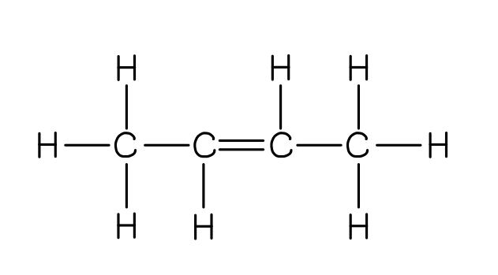

- Correct structure showing all bonds;** [1 mark]**

**[Total: 1 mark]**

- *To determine the monomer, identify the repeat unit in the polymer*

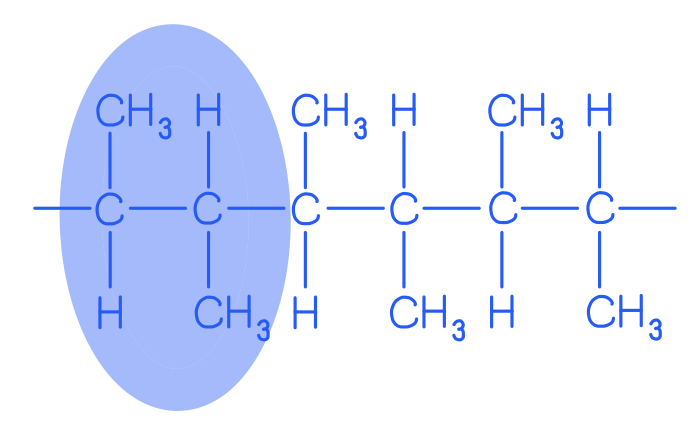

- *Remove the continuation bonds and add a C=C double bond *

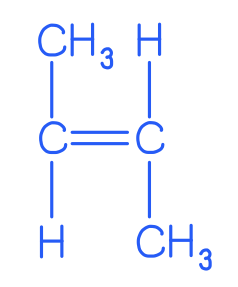

- *Draw in any bonds not already drawn in*

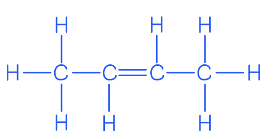

- *The hydrogen atoms attached to the carbon atoms of the C=C double bond can both be on the same side of the C=C, or on opposite sides as shown here*
c) The diagram to show the structure of one monomer is:

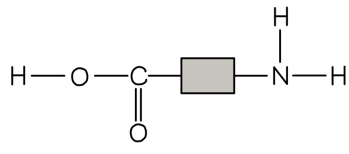

- –NH2 group drawn with all bonds shown on one end; **[1 mark]**
- Carboxylic acid group (COOH) drawn with all bonds shown on the other end; **[1 mark]**

**[Total: 2 marks]**

- *To draw the monomer, identify the repeat unit*

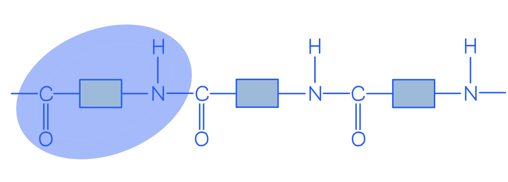

- *Add an H onto the N atom and an OH onto the C atom of the C=O bond, remembering to show all of the bonds*

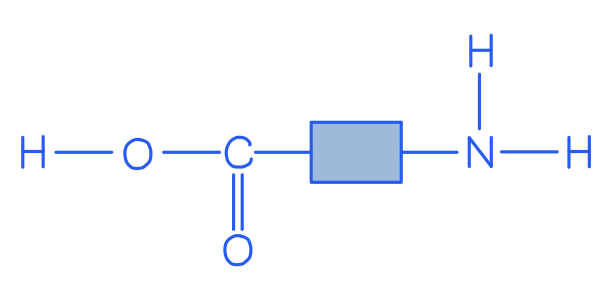

- *Careful**: Students often forget to draw the bond between the O and H atom in the OH group*

### Q9
a) The structure that represents part of a poly(ethene) molecule is:

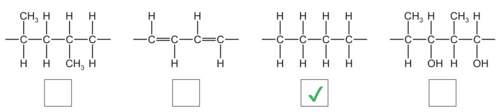

- Third box from left ticked;** [1 mark]**

**[Total: 1 mark]**

- *When poly(ethene) is formed, the C=C double bond in ethene opens up, so poly(ethene) does not contain any double bonds, ruling out the second box from the left*
- *Each carbon atom is attached to 2 hydrogen atoms, ruling out the boxes on the left and on the right*
b) The number of different types of atom that are shown in this structure is:

- 4; **[1 mark]**

**[Total: 1 mark]**

- *This question does not actually require you to know anything about the structure of nylon, all you need to do is look at the structure and see how many different elements are present*
- *There are 4: carbon, hydrogen, oxygen and nitrogen*

### Q10
a)

i) The term *hydrocarbon* means:

- A compound containing carbon and hydrogen only; **[1 mark]**

ii) The general formula of the following straight-chain compounds are:

- Alkanes: CnH2n+2; **[1 mark]**
- Alkenes: CnH2n; **[1 mark]**

**[Total: 3 marks]**

- *You will not get the hydrocarbon definition mark without including the word only*
- *Tip: **It can help to quickly sketch an alkane and alkene to help you determine the general formula*
b)

i) The empirical formula of compound X is:

- Moles of carbon $=\frac{54.54}{12}=$ 4.5(45) 
**AND **
Moles of hydrogen $=\frac{9.09}{1}=$ 9.09 
**AND **
Moles of oxygen $=\frac{36.37}{16}=$2.27;** [1 mark]**
- Empirical formula = C2H4O; **[1 mark]**

ii) The molecular formula of compound X is:

- *M*r of C2H4O = 44; **[1 mark]**
- $\frac{88}{44}$ = 2, therefore the molecular formula is C4H8O2;** [1 mark]**

**[Total: 4 marks]**

- *You can lay empirical formula calculations out in one templated style (EVADRA) that works for all empirical formula calculations:*
- *Instruction* |   | > * * | > * * | > * * |
|---|---|---|---|
| > *Elements - write them* | > *C* | > *H* | > *O* |
| > *Values - taken from the question as % or g* | > *54.54* | > *9.09* | > *36.37* |
| > *Atomic mass* | > *12* | > *1* | > *16* |
| > *Divide - the calculation is already laid out correctly * | > $\frac{54.54}{12}$* = 4.545* | > $\frac{9.09}{1}$* = 9.09* | > $\frac{36.37}{16}$* = 2.27* |
| > *Ratio - divide by the smallest answer* | > $\frac{4.545}{2.27}$* = 2.00* | > $\frac{9.09}{2.27}$* = 4.00* | > $\frac{2.27}{2.27}$* = 1* |
| > *Answer - write the final empirical formula* | > *C**2** * | > *H**4** * | > *O* |
- *To calculate the molecular formula using an empirical formula and a relative molecular mass:*

  - *Find the mass of the empirical formula*
  
    - *C**2**H**4**O = (2 x 12) + (4 x 1) + 16 = 44*
  - *Divide the relative molecular mass by the mass of the empirical formula*
  
    - $\frac{88}{44}$* = 2*
  - *Apply the answer to the empirical formula*
  
    - *C**2**H**4**O x 2 = C**4**H**8**O**2** *
c) The names and structural formulae of the two esters with the molecular formula C3H6O2 are:

| Name of ester | methyl ethanoate; **[1 mark]** | ethyl methanoate; **[1 mark]** |
|---|---|---|
| Structural formula | CH3COOCH3; **[1 mark]** | HCOOCH2CH3; **[1 mark]** |

*   Displayed formulae are accepted*

**[Total: 4 marks]**

- To deduce ester structures using a molecular formula:

  - Draw the ester linkage, -COO-
  - Remove this from the molecular formula
  
    - C3H6O2 - COO = C2H6
  - Add a hydrogen before the ester linkage, -COO-
  
    - HCOO-
    - This leaves you with an ethyl group / C2H5
    - Place this group after the ester linkage
    - Therefore, you have HCOOCH2CH3 
  - Add a CH3 group before the ester linkage, -COO-
  
    - CH3COO-
    - This leaves you with a methyl group / CH3
    - Place this group after the ester linkage
    - Therefore, you have CH3COOCH3
d) The ester produced from the reaction of propanoic acid and methanol is:

- Methyl propanoate; **[1 mark]**

**[Total: 1 mark]**

- *Naming esters is very challenging but it can help to think of the their names in terms of a first name and surname*
- *The first name always comes from the alcohol*

  - *Methanol → methyl*
- *The surname always comes from the acid*

  - *Propanoic acid → propanoate*
e)

i) The type of polymerisation that is used for the production of polyesters:

- Condensation; **[1 mark]**

ii) The simple molecule that is removed when a polyester forms is:

- Water / H2O; **[1 mark]**

iii) The structures of the monomers used to produce the polyester are:

- 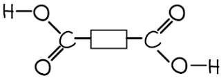 ; **[1 mark] ***The diacyl chloride (the OH groups replaced with chlorine) is also accepted*
- 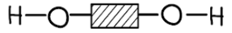 ; **[1 mark]**

**[Total: 4 marks]**

- *Esters are made from carboxylic acids and alcohols*
- *Polyesters are made from dicarboxylic acids and diols*
- *From the polyester structure given, the white rectangle with the carbons attached must be the dicarboxylic acid and the grey rectangle must be the diol*

### Q11
a) The name and structure of each product is:

i) Ethene + steam:

- Name of product = ethanol;** [1 mark]**
- Structure of product = 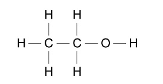 ; **[1 mark]**

ii) Ethene + hydrogen:

- Name of product = ethane; **[1 mark]**
- Structure of product = 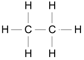 ; **[1 mark]**

**[Total: 4 marks]**

- *Alkenes undergo addition reactions*

  - *Ethene + steam → ethanol*
  - *Ethene + hydrogen → ethane *
  - *Essentially, the chemical that you are reacting the ethene with splits in half and adds either side of the carbon=carbon double bond*
b)

i) The term polymerise means:

- (Where) many simple molecules / monomers; **[1 mark]**
- To form one large one molecule / macromolecule / chain; **[1 mark]**

ii) The difference between addition polymerisation and condensation polymerisation is:

- Addition polymerisation makes only one product / the polymer; **[1 mark]**
- Condensation polymerisation makes the polymer and water / the polymer and another small molecule;** [1 mark] **

iii) The structure of poly(dichloroethene) is:

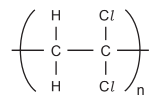

- Correct repeat unit;** [1 mark]**
- Continuation bonds, brackets and *n*; **[1 mark]**

**[Total: 6 marks]**

- *Polymerisation is the process where lots (poly-) of links / monomers join together to form a long chain*
- *Addition polymerisation involves breaking open the C=C bond of monomers, joining the monomers together and forms only the polymer *
- *Condensation polymerisation sees the monomers join together but as they join, there is a small molecule (often water) removed as a second product*
- *To draw the polymer from the monomer*

  1. *Draw a copy of the monomer*
  2. *Replace the carbon=carbon double bond with a carbon-carbon single bond*
  3. *Add brackets around the molecule *
  4. *Add one continuation bond from each carbon to outside the bracket*
  5. *Add **n** after the brackets (bottom right)*

### Q12
a)

i) The empirical formula of compound **X** is:

- Moles of carbon $=\frac{82.76}{12}=$ 6.897 
**AND **
Moles of hydrogen $=\frac{17.24}{1}=$ 17.24;** [1 mark]**
- Empirical formula = C2H5; **[1 mark]**

ii) The molecular formula of compound X is:

- *M*r of C2H5 = 29; **[1 mark]**
- $\frac{58}{29}$ = 2, therefore the molecular formula is C4H10;** [1 mark]**

**[Total: 4 marks]**

- *You can lay empirical formula calculations out in one templated style (EVADRA) that works for all empirical formula calculations:*
- *Instruction* |   | > * * | > * * |
|---|---|---|
| > *Elements - write them* | > *C* | > *H* |
| > *Values - taken from the question as % or g* | > *82.76* | > *17.24* |
| > *Atomic mass* | > *12* | > *1* |
| > *Divide - the calculation is already laid out correctly * | > $\frac{82.76}{12}$* = 6.897* | > $\frac{17.24}{1}$* = 17.24* |
| > *Ratio - divide by the smallest answer* | > $\frac{6.897}{6.897}$* = 1* | > $\frac{17.24}{6.897}$* = 2.50* |
| > *Answer - write the final empirical formula **Remember: **An empirical formula had to have whole numbers* | > *C**2** * | > *H**5** * |
- *To calculate the molecular formula using an empirical formula and a relative molecular mass:*

  - *Find the mass of the empirical formula*
  
    - *C**2**H**5** = (2 x 12) + (5 x 1) = 29*
  - *Divide the relative molecular mass by the mass of the empirical formula*
  
    - $\frac{58}{29}$* = 2*
  - *Apply the answer to the empirical formula*
  
    - *C**2**H**5** x 2 = C**4**H**10** *
b)

i) The general formula of alkenes is:

- CnH2n; **[1 mark]**

ii) The empirical formula of alkenes is:

- CH2; **[1 mark]**

**[Total: 2 marks]**

- *You should know the general formula of the alkanes (C**n**H**2n+2**) and alkenes (C**n**H**2n**)*
- *The empirical formula is the simplest ratio of atoms*

  - *This means that you can put the number 1 into the general formula, i.e. C**1**H**2x1** or CH**2** *
c) The term *unsaturated hydrocarbon* means:

- Unsaturated: contains double bond/ triple bond / multiple bond(s) / not all bonds are single; **[1 mark]**
- Hydrocarbon: (contains) carbon and hydrogen only; **[1 mark]**

**[Total: 2 marks]**

- *You need to learn the definitions of saturated, unsaturated and hydrocarbon*
d) A test that would distinguish between saturated and unsaturated hydrocarbons is:

- Reagent: bromine / bromine water / Br2 (aq); **[1 mark]**
- Observation with a saturated hydrocarbon: no change 
**OR **
Stays brown / orange / yellow / red-brown 
**OR **
Only changes in UV;** [1 mark]**
- Observation with an unsaturated hydrocarbon: (changes from brown / orange / yellow / red-brown) to colourless 
**OR **
Decolourises; **[1 mark] **

**[Total: 3 marks]**

- *This is one of the most common chemical tests - testing for a carbon=carbon double bond*
- *The reagent is bromine water which changes from an orange / brown colour to colourless in the presence of a carbon=carbon double bond*
e)

i) One repeat unit in this polymer is:

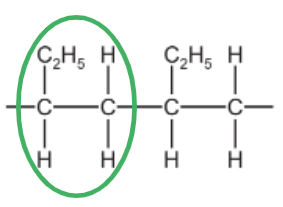

- Circle/ brackets around any 2 consecutive carbon atoms in the main chain and all attached atoms; **[1 mark] ***Repeat unit must contain 2 carbons from the central / main carbon chain*

ii) The structure and the name of the monomer used to make this polymer are:

- Structure: CH3CH2CH=CH2 / C2H5CH=CH2 / CH2=CHCH2CH3 / CH2=CHC2H5; **[1 mark]** *The double bond must be shown*
- Name: butene / but-1-ene; **[1 mark]**

iii) The structure of an isomer of the alkene in (e)(ii) is:

- (CH3)2C=CH2 (structural formula of methylpropene) 
**OR **
CH3CH=CHCH3 (structural formula of but-2-ene) 
**OR **
(CH2)2CHCH3 (structural formula of methyl cyclopropane **OR **
(CH2)4 (structural formula of cyclobutane;** [1 mark] ***Displayed formulae are accepted*

**[Total: 4 marks]**

- *Remember: **The repeat unit for an addition polymer must contain 2 carbons from the main polymer chain*
- *For this polymer, the monomer will therefore be a chain of four carbons with the carbon=carbon double bond between carbons 1 and 2*

  - *This is the structure of but-1-ene*
- *The most common isomer given as an answer will be but-2-ene, where the carbon=carbon double bond is shifted along one place in the carbon chain*

### Q13
a)

i) The term *hydrocarbon* is:

- A compound which contains carbon and hydrogen <u>only</u>; **[1 mark]**

ii) The difference between alkanes and alkenes:

- Alkanes contain only C-C single bonds 
**OR **
Alkanes are saturated (hydrocarbons) 
**OR **
Alkanes have the general formula CnH2n+2; **[1 mark]**
- Alkenes contain at least one C=C double bond 
**OR **
Alkenes are unsaturated (hydrocarbons) 
**OR **
Alkenes have the general formula CnH2n; **[1 mark]**

**[Total: 3 marks]**

- *When you define the term hydrocarbon, you must include the word **only*
- *Alkanes contain single bonds between the carbon atoms and alkenes contain at least one double bond between the carbon atoms*
b) The completed equation for the cracking of the alkane C20H42 is:

C20H42 → 2C4H8 + 2C2H4 + C8H18

- C8H18; **[1 mark]**

**[Total: 1 mark]**

- *The products already given are alkenes, so you should expect the missing product to be an alkane*
- *Looking at the carbons:*

  - *20 at the start*
  - *12 in the products already given*
  - *20 - 12 = 8 missing carbons, therefore C**8** *
- *Looking at the hydrogens:*

  - *42 at the start*
  - *24 in the products already given*
  - *42 - 24 = 18 missing hydrogens, therefore H**18*
- *Combining the missing carbons and hydrogens brings you to the final answer of C**8**H**18** *
c)

i) The product of the equation is:

- BrCH2CH2Br; **[1 mark]** *Displayed formulae are accepted C**2**H**4**Br**2** is ****not ****accepted *

ii) The structural formula of the monomer is:

- CH3-CH=CH-CH3; **[2 marks]** *But-1-ene scores 1 mark*

iii) Butanol is made from butene, CH3–CH2–CH=CH2 by:

CH3-CH2-CH=CH2 + H2O → CH3-CH2-CH2-CH2OH

- Correct reactants; **[1 mark]**
- Correct products; **[1 mark]** *Butene reacts with water / steam scores 1 mark*

iv) An alkene can be converted into an alkane by:

Example equation: C6H12 + H2 → C6H14

- Correct reactants including an alkene;** [1 mark]**
- Correct alkane product; **[1 mark]** *Alkenes react with hydrogen scores 1 mark*

**[Total: 7 marks]**

- *For alkenes, you need to be able to:*

  - *Draw and name the addition polymers that they can form*
  - *State the reaction conditions for various addition reactions*
  - *Write balanced equations for the addition polymerisation and other addition reactions*
d)

i) The volume of oxygen used is

- 150 cm3; **[1 mark]**

ii) The volume of carbon dioxide formed is:

- 100 cm3;** [1 mark]**

iii) The formula of the hydrocarbon and the balanced equation for the reaction are:

Any equation of the combustion of an alkene, e.g. 2C5H10 + 15O2 → 10CO2 + 10H2O

- Correct formulae; **[1 mark]**
- Correct balancing; **[1 mark]**

**[Total: 4 marks]**

- *The initial volume of oxygen was 175 cm**3** and the final volume was 25 cm**3** *

  - *Therefore, 175 - 25 = 150 cm**3** of oxygen was used in the reaction*
- *The total volume of gas at the end of the reaction is 125 cm**3** *

  - *25 cm**3** of this is oxygen*
  - *So, 125 - 25 = 100 cm**3** of carbon dioxide are produced*
- *You can use this information in the following general equation:*

| > *C**x**H**y** + * | > *O**2** →* | > *CO**2** + * | > *H**2**O* |
|---|---|---|---|
| > *20 cm**3** * | > *150 cm**3** * | > *100 cm**3** * |   |

- *Using the volumes, we can see that there is a 20 : 100 ratio of hydrocarbon to carbon dioxide which simplifies to 1 : 5*

  - *There is also a 20 : 150 ratio of hydrocarbon to carbon dioxide which simplifies of 1 : 7.5 *
  
    - *We can update the general equation using this ratio C**5**H**y** + 7.5O**2** → 5CO**2** + H**2**O*
  - *The carbon dioxide accounts for 10 of the reactant oxygen atoms, which means that the water must account for the remaining 5*
  
    - *We can update the general equation using this ratio C**5**H**y** + 7.5O**2** → 5CO**2** + 5H**2**O*
  - *The water product is responsible for a total of 10 hydrogen atoms*
  
    - *We can update the general equation using this ratio C**5**H**10** + 7.5O**2** → 5CO**2** + 5H**2**O*

### Q14
a)

i) The equation for the cracking of the alkane, decane, is:

C10H22 → CH4 + C9H18  **   **
**OR **   
C10H22 → C2H6 + C8H16  **   **
**OR **   
C10H22 → C3H8 + C7H14  **   **
**OR **   
C10H22 → C4H10 + C6H12  **   **
**OR **   
C10H22 → C5H12 + C5H10  **   **
**OR **   
C10H22 → C6H14 + C4H8  **   **
**OR **   
C10H22 → C7H16 + C3H6  **   **
**OR **   
C10H22 → C8H18 + C2H4

- Correct equation (from the list above); **[2 marks]**
- Correct alkane formula; **[1 mark]**
- Correct alkene formula;** [1 mark]** *The marks for the correct alkane and alkene formulae must be correctly paired for both marks*

ii) Chloropropane can be made from propane by:

- Reagents: propane and <u>chlorine</u>; **[1 mark]**
- Conditions: light / sunlight / UV 
**OR **
200 °C 
**OR **
Heat / high temperature (max 1000 °C) 
**OR **
Lead tetraethyl; **[1 mark]**

**[Total: 4 marks]**

- *Remember: **The number of carbons and hydrogens must balance in equations showing cracking **AND** they are the only time that you should change the "small" numbers in a chemicals formula*
- *The most common reaction to form chloropropane will be the free radical substitution reaction using chlorine and UV light*
b)

i) They are isomers because:

- They have the same molecular formula; **[1 mark]**
- But, a different structure / structural formula / arrangement of atoms; **[1 mark]**

ii) The name and structural formula of another hydrocarbon that is isomeric with the alkene isomers are:

Alternative 1:

- Name: but-2-ene; **[1 mark]**
- Structural formula:  ; **[1 mark]**

Alternative 2:

- Name: cyclobutane; **[1 mark]**
- Structural formula: 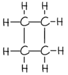 ; **[1 mark]**

**[Total: 4 marks]**

- *The definition of a structural isomer is one that you have to learn and be able to apply*
- *The most common isomer will be but-2-ene because this simply moves the carbon=carbon double bond along one in the chain*
c) The names of the products when but-1-ene reacts with each of the following, are:

- Steam: butanol;** [1 mark]**
- Hydrogen: butane;** [1 mark]**
- Bromine: dibromobutane;** [1** **mark]*** Numbers can be ignored in all three answers, if they are used*

**[Total: 3 marks]**

- *Addition of steam (water) will add a hydrogen atom and an OH group on either side of the double bond forming a 4 carbon chain with all single bonds and an alcohol group = butanol*
- *Addition of hydrogen will add a hydrogen atom on either side of the double bond forming a 4 carbon chain with all single bonds = butane*
- *Addition of bromine will add a bromine atom on either side of the double bond forming a 4 carbon chain with all single bonds and two bromine atoms = dibromobutane*
d)

i) The name and structural formula of the monomer are:

- Name of monomer: propene; **[1 mark]**
- Structural formula: CH3–CH=CH2; **[1 mark] ***Displayed formulae are accepted*

ii) The structure of the polymer formed from the monomer is:

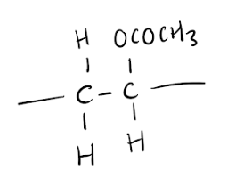

- Correct repeat unit; **[1 mark]**
- Continuation bonds; **[1 mark]**

iii) The pollution problems caused by the disposal of polymers in landfill sites and by burning are:

Landfill sites: Any **two** of the following:

- Polymers do not decay / are non-biodegradable; **[1 mark]**
- There is a shortage of sites; **[1 mark]**
- There is too much / a large amount of waste produced per year; **[1 mark]**
- Visual pollution; **[1 mark]**
- Disposal of the polymers forms methane; **[1 mark]**

Burning:

- Forms poisonous / toxic gases / named gas, e.g. CO / HCl / HCN; **[1 mark]**

**[Total: 7 marks]**

- *In addition polymers, the difference between monomers and polymers is basically the carbon-carbon bond inside the main structure*

  - *Monomers have a carbon=carbon double bond / C=C*
  - *Polymers have carbon-carbon single bonds / C-C*
- *You are expected to know the disadvantages of polymer / plastic disposal*

  - *Questions about burning polymers often focus on chlorine-containing polymers such as PVC*

### Q15
a)

i) Another property of PVC that makes it suitable for electric cables is:

- Does not degrade / non-biodegradable 
**OR **
Flexible / bendable 
**OR **
Easily moulded 
**OR**
Low density / light / lightweight 
**OR **
Waterproof / insoluble in water  
**OR** 
Does not corrode / durable;** [1 mark]**

ii) **Two **poisonous gases which could be formed by the combustion of PVC are:

Any **two **of the following:

- Chlorine; **[1 mark]**
- Hydrogen chloride; **[1 mark]**
- Carbon monoxide; **[1 mark]**

**[Total: 3 marks]**

- *The first part of this question uses your general knowledge of material properties from before GCSE*
- *Since PVC has chlorine in it, you can assume that it could form chlorine or hydrogen chloride when it burned*
- *PVC also contains carbon so another poisonous gas that could be formed by incomplete combustion is carbon monoxide*
b)

i) The structural formula of the monomer from the given polymer is:

- CH3–CH=CH2; **[1 mark]** *Full and partial displayed formulae are accepted*

ii) The structural formula of the polymer, poly(phenylethene), is:

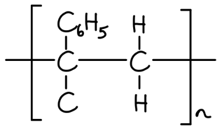

- Correct repeat unit; **[1 mark]**
- Continuation bonds; **[1 mark]**

**[Total: 3 marks]**

- *This question is a great example of how you need to be able to identify monomers from polymers as well as draw polymers from monomers*
- *The key difference is the central carbon-carbon bond:*

  - *Monomers contain a carbon=carbon double bond*
  - *Polymers contain a carbon-carbon single bond*
c) The polymerisation of glucose differs from that of an alkene such as phenylethene because:?

- Glucose forms two products / the polymer and water 
**OR** 
Glucose undergoes condensation (polymerisation) 
**OR **
Glucose polymerisation removes a small molecule; **[1 mark]**
- Phenylethene forms only one product / the polymer 
**OR **
Phenylethene undergoes addition (polymerisation); **[1 mark]**

**[Total: 2 marks]**

- *This is a very specific example of the common question about the difference between addition and condensation polymers*

### Q16
a)

i) **Two **advantages of a plastic bucket compared to a steel bucket are:

- Lighter / light / lightweight / lower density; **[1 mark]**
- Does not corrode / rust / is not oxidised; **[1 mark]**

ii) **Two **uses of man-made fibres, such as nylon and Terylene, are:

Any **two **of the following:

- Rope; **[1 mark]**
- Clothing; **[1 mark]**
- Netting; **[1 mark]**
- String / thread; **[1 mark]**
- Carpets; **[1 mark]**
- Fishing line / fishing nets; **[1 mark]**
- Parachutes; **[1 mark]**
- Tyres; **[1 mark]**
- Tents; **[1 mark]**
- Bottles; **[1 mark]**
- Umbrellas; **[1 mark]**
- Curtains; **[1 mark]**
- Toothbrushes; **[1 mark]**
- Cassettes / video tapes; **[1 mark]**

iii) The pollution / issues caused by synthetic polymers includes:

Any **three** of the following:

- They are non-biodegradable / do not rot / do not decompose / persist for years / accumulate; **[1 mark]**
- Landfill sites limited / getting filled up; **[1 mark]**
- Visual pollution; **[1 mark]**
- Danger to fish / animals; **[1 mark]**
- Release of toxic gases / harmful gases / pollutant gases / acidic gases / CO / HCl / HF / HCN; **[1 mark]**

**[Total: 7 marks]**

- *Whilst most polymers questions focus on the processes of polymerisation, you need to know the uses and disposal of polymers as they often form the supplementary questions around the process*
- *Terylene is a trade name for the polymer PET and is not used in this specification but you may see it in past exam questions and resources*
b)

i) The name and structural formula of the monomer are:

- Name: propene / propylene; **[1 mark]**
- Structural formula: CH3-CH=CH2; **[1 mark]**

ii) The structural formula of the addition polymer formed by the polymerisation of phenylethene is:

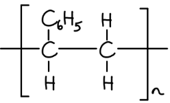

- Correct repeat unit; **[1 mark]**
- Continuation bonds; **[1 mark]**

**[Total: 4 marks]**

- *This question shows two of the expected skills linked to addition polymers*

  - *The ability to draw monomers from polymers*
  - *The ability to draw polymer structures from the monomer units*
  
    - *The main difference in addition polymers is the monomer has a C=C and the polymer has a C-C*
c)

i) The linkage in the polymer is:

- Amide / peptide / polypeptide; **[1 mark]**

ii) The natural macromolecules which have the same linkage are:

- Proteins / polypeptides; **[1 mark]**

iii) The formulae of the **two **monomers which reacted to form the nylon and water are:

- Monomer: H2N(CH2)6NH2; **[1 mark]**
- Monomer: HOOC(CH2)8COOH; **[1 mark]**

**[Total: 4 marks]**

- *For condensation polymerisation, you need to be aware of the ester / -COO- linkage and the amide / -CONH- linkage*
- *For the nylon monomers, look for the C=O and N-H groups as they signify the join of the monomers*

  - *Split the chain into:*
  - *The C=O based monomer - this monomer can be completed by making it into the dicarboxylic acid*
  - *The N-H based monomer - this monomer can be completed by making it into the diamine* 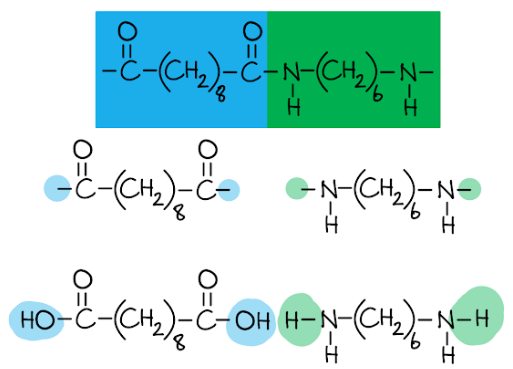

### Q17
a) The difference between these two types of polymerisation is:

- Addition polymerisation forms only one product;** [1 mark]**
- Condensation polymerisation forms the polymer and water / a small molecule; **[1 mark]**

**[Total: 2 marks]**

- *You need to know the difference between addition and condensation polymerisation*

  - *Addition polymerisation forms only one product because the carbon=carbon double bond breaks open and attaches to another monomer*
  - *Condensation polymerisation occurs when certain functional groups are used to form a polymer, which results in a small molecule (often water) being released as a second product*
b) **Two **pollution problems that are caused by non-biodegradable plastics are:

Any **two** of the following:

- Kill animals / ingestion can be fatal to animals; **[1 mark]**
- Animals can be caught in plastics e.g. fishing line; **[1 mark]**
- Combustion releases toxins / poisonous gases; **[1 mark]**
- Land-fill uses natural resources; **[1 mark]** *Other appropriate examples are allowed*

**[Total: 2 marks]**

- *You should be able to answer this question using your knowledge of the environmental issues surrounding plastic and its disposal*
c) The structural formula of the PVA monomer is:

- CH2=CHOCOCH3  
**OR** 
CH2CHOCOCH3; **[1 mark]**

**[Total: 1 mark]**

- *To identify the monomer from an **addition** polymer structure:*

  - *Identify a single repeat unit, which must contain a minimum of 2 carbons in the chain*
  - *Remove the bonds from the sides of the monomer*
  - *Replace the carbon-carbon single bond with a carbon=carbon double bond*
d) The structural formula of the polymer formed from HOOC(CH2)4COOH and H2N(CH2)6NH2 is:

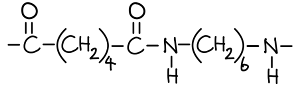

- Correct amide (-CONH-) linkage correct; **[1 mark]**
- Correct repeat units (OC(CH2)4CO and NH(CH2)6NH);** [1 mark]**
- Continuation bonds shown; **[1 mark]**

**[Total: 3 marks]**

- *To draw a condensation polymer:*

  - *Draw the monomers next to one another*
  - *Look for the small molecule that is going to be produced as well, typically this is water* 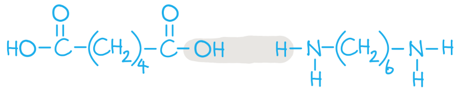
  - *Remove the atoms required for the small molecule and replace them with a single bond connecting the monomers*

### Q18
a) One advantage **and **one disadvantage for burning and recycling polymers are:

Any **one **of the following disadvantages for **burning: **

- produces toxic gases / harmful to health; **[1 mark]**
- increases greenhouse gases / global warming; **[1 mark]**

Any **one **of the following advantages for **burning: **

- reduces visual pollution / litter; **[1 mark]**
- reduces risks to wildlife; **[1 mark]**
- shortage of landfill sites / reduces space needed in landfill sites / saves space; **[1 mark]**
- non-biodegradable / long time to rot / decompose / accumulates waste; **[1 mark]**
- burning source of energy / used to generate electricity; **[1 mark]**

Any **one **of the following advantages for **recycling: **

- conserves petroleum / natural resources; **[1 mark]**
- reduces need for landfill; **[1 mark]**

Any **one **of the following disadvantages for **recycling: **

- difficult to recycle / expensive / takes much energy; **[1 mark]**
- problems over sorting; **[1 mark]**
- quality of plastic is reduced each time it is recycled; **[1 mark]**

**[Total: 4 marks]**

- *Exam technique should guide you in this question to one advantage for burning, one disadvantage for burning, one advantage for recycling and one advantage for recycling to achieve all 4 marks*
b)

i) The names of the two types of polymerisation reaction and the differences between them are:

- Addition (polymerisation); **[1 mark]**
- Addition (polymerisation) forms only one product / the polymer; **[1 mark]**
- Condensation (polymerisation); **[1 mark]**
- Condensation (polymerisation) forms the polymer and a simple molecule / small molecule / water / hydrogen chloride / second product; **[1 mark] **

ii) The structural formula of a polymer which is formed from two different monomers is:

Alternative 1:

-OC-(CH2)4-CONH-(CH2)4-NH- *   Alternative structures can be put in place of the (CH**2**) groups*

- Correct amide CONH linkage; **[1 mark]**
- Two different monomers;** [1 mark]**

Alternative 2:

-OC-(CH2)4-COO-(CH2)2-CO- *   Alternative structures can be put in place of the (CH**2**) groups but they ****must ****be different*

- Correct ester COO linkage; **[1 mark]**
- Two different monomers;** [1 mark]**

**[Total: 6 marks]**

- *This is an older question which explains the high number of marks for knowing the difference between addition and condensation polymers*
- *It also explains why part (ii) is very vague - more recent papers are usually much more specific by asking for the structures of either amides or esters*

### Q19
a) **Two **industrial processes which must take place to produce alkenes from petroleum are:

- Fractional distillation; **[1 mark]**
- Cracking;** [1 mark]**

**[Total: 2 marks]**

- *Fractional distillation is used to separate the mixture of crude oil into different fractions based on the length of the hydrocarbon chain (which relates to their properties)*
- *Fractions containing longer chain hydrocarbons can then be cracked into smaller chain alkanes and alkenes*
b)

i) The type of polymerisation that takes place when ethene forms a polymer is:

- Addition; **[1 mark]**

ii) The empirical formula of the polymer formed from ethene is:

- CH2; **[1 mark]**

iii) The structure showing **two **repeat units of the polymer made from propene is:

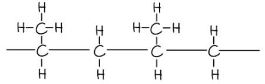

- Chain of 4 carbon atoms with single bonds and continuation bonds; **[1 mark]**
- Correctly positioned CH3 side chains; **[1 mark]**

**[Total: 4 marks]**

- *Alkenes typically undergo addition polymerisation*
- *When you draw the polymer of ethene out, you should see that every carbon has 2 hydrogens attached*

  - *Therefore, the empirical formula of polyethene is CH**2** *
- *To draw any addition polymer:*

  - *Draw the monomer with the carbon=carbon double bond in the centre and the attached atoms / groups above and below the carbons*
  
    - *Take your time doing this so you don't make a mistake*
  - *Replace the carbon=carbon double bond with a carbon-carbon single bond*
  - *Add continuation bonds*
  - *If you are simply drawing the polymer then you can add brackets and **n** *
  - *If you are asked to show repeat units (like this question) draw a second version and connect them together with continuation bonds at the sides*
  
    - *An addition polymer structure containing two repeat units should have 4 carbons in the main polymer chain, three repeat units = 6 carbons, etc*
c) The structures of the two isomers formed when propene reacts with steam are:

- 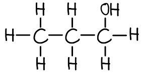 ; **[1 mark]**
- 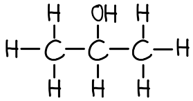 ; **[1 mark]**

**[Total: 2 marks]**

- *The carbon=carbon double bond in propene is between carbons 1 and 2 in the chain*
- *When steam reacts with this double bond, a hydrogen atom can attach to one side while an OH group attaches to the other side*

  - *This means that the OH group can attach to carbon 1 or carbon 2 which causes the two isomers propan-1-ol and propan-2-ol*
d)

i) The catalyst needed to form an ester from ethanoic acid and methanol is:

- (Concentrated) sulfuric acid; **[1 mark] **

ii) The ester formed when ethanoic acid reacts with methanol is:

- Methyl ethanoate;** [1 mark]**

iii) The structure of the ester formed when ethanoic acid reacts with methanol is:

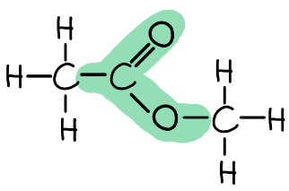

- Correct ester link; **[1 mark]**
- Rest of the molecule correct; **[1 mark]**

iv) The name of a polyester is:

- PET / polyethylene terephthalate / Terylene; **[1 mark]**

**[Total: 5 marks]**

- *You need to know how esters are formed from an acid and an alcohol in the presence of a concentrated sulfuric acid catalyst*
- *Careful: **Naming and drawing esters correctly are two of the more challenging areas related to esters*

  - *The alcohol gives the first name and the acid gives the surname of the ester*
  - *Esters are typically drawn a certain way which has the acid in the first half (up to and including the C=O) and the alcohol in the second half of the molecule (after the -COO- ester linkage)*

### Q20
a) Two** **advantages that PLA has compared with a polymer made from petroleum are:

Any **two** from:

- Biodegradable 
**OR **
breaks down naturally; **[1 mark]**
- Made from a renewable source 
**OR **
does not use up petroleum; **[1 mark]**
- Reduce visual pollution 
**OR** 
reduces need for landfill sites 
**OR **
less danger to wildlife; **[1 mark]** *Ignore mention of toxic gases*

**[Total: 2 marks]**
b)

i) The type of compound that contains the group that is circled is:

- Ester; **[1 mark]** *Accept polyester or fat or lipid or vegetable oil or *<u>*carboxylic acid*</u>

ii) The completed sentence is:

Lactic acid molecules can form this group because they contain both an **acid **group and an **alcohol** group.

- Acid / carboxylic acid; **[1 mark]**
- Alcohol / hydroxyl; **[1 mark]** *Do not accept the formulae or hydroxide*

iii) The formation of PLA is:

- Condensation (polymerisation); **[1 mark]**
- Because water is formed in reaction 
**OR **
Monomer does not have C=C bond; **[1 mark]** *2nd mark is dependent on 1st mark being awarded*

**[Total: 5 marks]**

- *Polyester is formed from two different monomers which join together, releasing water*
- *The monomers are a diol (a molecule containing two -OH groups) and a dicarboxylic acid (a molecule containing two -COOH groups)*
- *Esters have the functional group -COO-*
c)

i) The products in the word equation ate:

- Acrylic acid 
**AND **
water; **[1 mark]**

ii) A test that would distinguish between lactic acid and acrylic acid is:

- Test: add bromine (water) or bromine in an organic solvent; **[1 mark]**
- Result for lactic acid: remains brown/orange/yellow; **[1 mark]**
- Result for acrylic acid: goes colourless NOT clear; **[1 mark]** *If mark 1 is a near miss e.g. bromide, allow marks 2 and 3* *Colour of reagent must be shown somewhere for [3 marks] otherwise max [2 marks]*

iii) A test, other than using an indicator, which would show that both chemicals contain an acid group is:

- Reagent; **[1 mark]**
- Observable result; **[1 mark]** Examples:
- Suitable named metal (**NOT **sodium, lead, any metal below magnesium etc.) *If un-named metal [0] result can score [1]*
- Hydrogen evolved or bubbles / effervescence / fizzing
- Insoluble metal oxide
- Colour change or dissolves
- Any carbonate or bicarbonate
- Gas / carbon dioxide / bubbles / effervescence / fizzing
- Sodium hydroxide or alkali
- Temperature increase or accept indicator to show neutralisation *Unspecified base scores [1 mark] only* *NOT alcohol*

**[Total: 6 marks]**

- *You are not expected to know the reaction when lactic acid is heated but you are given that acrylic acid is formed and you can see the difference between the two molecules is 2 hydrogen atoms and  1 oxygen atom, i.e. water*
- *As acrylic acid contains a double bond, bromine will attach across this when added, removing bromine from solution therefore causing the solution to turn colourless*
- *As lactic acid is saturated, it will not react with bromine, therefore there is no colour change when bromine is added*

### Q21
a) The name given to this type of chemical reaction is:

- Polymerisation / addition; **[1 mark]**

**[Total: 1 mark]**

- *You do not need to be specific about the type of polymerisation that occurs to gain the mark*
b) The correct word that describes the ethene molecules in this reaction is:

- Monomers; **[1 mark]**

**[Total: 1 mark]**

- *Monomers join together to form polymers*
- *Ethene are the monomers that join together to form the polymer, poly(ethene)*
c) The term *non-biodegradable* means:

- Cannot be decomposed by organisms / cannot be broken down by bacteria / cannot be broken down by fungi; **[1 mark]**

**[Total: 1 mark]**

- *You also need to be able to discuss the environmental impact of non-biodegradable plastics*
d) One pollution problem caused by non-biodegradable plastics is:

- Gets stuck in gullets of birds / gets stuck in gullets of animals / blocks drains;** [1 mark]**

**[Total: 1 mark]**

- *You could be asked for a couple of problems, so it is useful to learn at least two*

### Q22
a)

i) The two amino acids on the chromatogram are:

- A is glutamic acid; **[1 mark]**
- B is alanine; **[1 mark]**

ii) The chromatogram must be exposed to a locating agent before *R*f values can be measured because:

- Acids are colourless 
**OR **
To make the spots visible 
**OR **
To show the positions of the samples 
**OR **
To show the distance travelled;** [1 mark]**

iii) Another way of identifying amino acids on a chromatogram is:

- Comparing with known (amino) acids 
**OR **
Using reference samples / standards;** [1 mark]**

iv) The structural formula of nylon is:

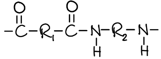

- Correct amide linkage, i.e. -CONH-; **[1 mark]**
- Different monomers;** [1 mark]**
- Continuation bonds; **[1 mark]**

**[Total: 7 marks]**

- *The chromatography calculation (part (i)) requires you to:*

  - *Measure the distance travelled by spot A and divide that by the distance travelled by the solvent front*
  - *Measure the distance travelled by spot B and divide that by the distance travelled by the solvent front*
  - *Then compare your answers with the values given to determine the identities of A and B*
  
    - *You can do this by eye (although this is less accurate)*
    - *Spot A has not travelled up to halfway / 0.5 and therefore is glutamic acid with an **R**f** value of 0.4*
    - *Spot B ha travelled past halfway / 0.5 but not as high as 0.9 and therefore is alanine with an **R**f** value of 0.7*
- *Parts (ii) and (iii) are checking your background knowledge of chromatography using location agents and comparing to references samples*
- *Part (iv) is asking for the structure of a nylon*

  - *Nylon is a polyamide*
  - *This is why the mark scheme focuses on the amide linkage, having different monomers and the standard continuation bonds*
b)

i) The completed equation is:

C6H12O6 → 2C2H5OH + 2CO2

- Correct formulae of products; **[1 mark]**
- Correct balancing;** [1 mark]**

ii) The reaction stops after a few days because:

- The glucose has been used up 
**OR **
The yeast has ‘killed’ by ethanol; **[1 mark]**

iii) It is essential that there is no oxygen in the flask because:

- It can oxidise the alcohol to (ethanoic) acid / carbon dioxide and water 
**OR **
It causes aerobic respiration 
**OR **
You cannot have anaerobic respiration in the presence of oxygen; **[1 mark]**

iv) The technique that is used to concentrate the aqueous ethanol is:

- Fractional distillation; **[1 mark]**

**[Total: 5 marks]**

- *You need to know about the process of fermentation *

### Q23
a)

i) The completed cracking chemical equation is:

- C10H22 → C3H6 + **C****7****H****16**;** [1 mark]**

ii) Unsaturated means:

- Contains a double bond / triple bond / multiple bond 
**OR **
Not all bonds are single bonds; **[1 mark]**

iii) A test to show that propene is an unsaturated compound is:

- Test = aqueous bromine / bromine (water) / Br2; **[1 mark]**
- Result = (orange / yellow / brown) to colourless 
**OR **
Decolourises / colour disappears; **[1 mark]**

**[Total: 4 marks]**

- *Since you are told that there is only one other product, you can use simple maths to determine the formula of the missing chemical in the equation:*

  - *Carbons: 10 - 3 = 7*
  - *Hydrogens: 22 - 6 = 16*
  - *Therefore, the formula of the missing chemical is C**7**H**16*
- *S**aturated means **S**ingle bonds, **U**nsaturated means do**U**ble bonds*
- *The standard tests for alkenes uses bromine water, which changes from orange / brown to colourless*

  - *Careful: **You must say colourless as clear will not get the mark*
b)

i) The type of polymerisation that occurs is:

- Addition (polymerisation);** [1 mark]**

ii) The maximum mass of polypropene that could be produced from 1 kg of propene is:

- 1 (kg); **[1 mark]**

iii) The empirical formulae are:

- Propene = CH2; **[1 mark]**
- Polypropene = CH2; **[1 mark]**

**[Total: 4 marks]**

- *When you see only one product along with brackets, you should automatically think addition polymerisation *
- *There is only one product in addition polymerisation*

  - *This means that the mass of reactant will equal the mass of product*
- *Propene is C**3**H**6** which will have the empirical formula (simplest ratio) of CH**2** *
- *Polypropene is made from propene with no waste, therefore it's empirical formula will also be CH**2** *

### Q24
a)

i) The structural formula of the monomer is:

- CH2=CCl2; **[1 mark]**

ii) Oxygen can diffuse faster through the polymer bag than carbon dioxide can because:

- It has a lower *M*r 
**OR** 
It has a lower density 
**OR** 
Its molecules move faster; **[2 marks]** *Award [1 mark] for it is lighter * *If the only comment is it has smaller molecules award [0 marks]* *If the answer implies or states ideas referring to sieves, then award [0 marks]*

**[Total: 3 marks]**

- *The key difference between polymers and monomers is the central carbon-carbon bond:*

  - *Monomers contain a carbon=carbon double bond*
  - *Polymers contain a carbon-carbon single bond*
- *When you draw a monomer from the polymer, you need to:*

  - *Remove the brackets and 'n'*
  - *Remove the continuation bonds from either side of the polymer*
  - *Add a double bond between the 2 carbon atoms which had the continuation bonds on*
- *At the same temperature, different substances do not diffuse at the same rate*
- *This is due to the difference in their relative molecular masses*
- *Take care with terminology - if you use the term 'lighter' you will only be awarded 1 mark for part (ii)*
b)

i) The structure of this polyester is:

-OC-C6H4-COO-CH2CH2-O-

- Correct ester linkage -COO-; **[1 mark]**
- Polymer chain showing different monomers and continuation; **[1 mark] ***Allow displayed formula*

ii) The term thermal stability means:

- Does not decompose easily when heated; **[1 mark]** *Accept similar statements*

**[Total: 3 marks]**

- *Polyester is a condensation polymer so when it is formed from the two monomers, a small molecule is removed*
- *Draw the 2 monomers next to each other and look for a small molecule that can be removed - this is usually water*

  - *HOOC-C**6**H**4**-CO**OH  H**O-CH**2**CH**2**-OH*
- *Join the two monomers where the water has been removed with a single bond*

  - *HOOC-C**6**H**4**-COO-CH**2**CH**2**-OH*
- *Identify another water molecule from each end:*

  - *HO**OC-C**6**H**4**-COO-CH**2**CH**2**-O**H*
- *Remove this, leaving a continuation bond on wither end to show that they are bonded to another unit*

  - *-**OC-C**6**H**4**-COO-CH**2**CH**2**-O**-*
- *A suitable displayed formula would be:*

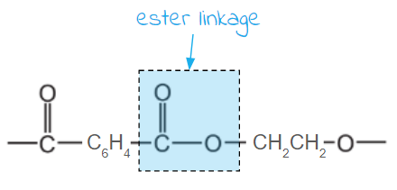
c)

i) Two environmental problems caused by the disposal of plastic (polymer) waste are:

Any **two** from:

- They do not decompose / are non-biodegradable; **[1 mark]**
- Shortage of landfill sites / of space; **[1 mark]**
- Visual pollution; **[1 mark]**
- Poisonous / toxic / harmful gases released when burnt; **[1 mark]** *Do NOT accept carbon monoxide, sulfur dioxide. If gas named has to be a correct one e.g. HCl, HCN*
- Dangerous to animals; **[1 mark]**

ii) Another advantage of recycling plastics made from petroleum is:

- To conserve petroleum 
**OR** 
Save energy; **[1 mark]** *Do NOT accept cheaper*

**[Total: 3 marks]**

- *You should be able to answer this question using your knowledge of the environmental issues surrounding plastic and its disposal*

### Q25
a) An example of structural isomerism is:

- The molecular formula must be able to give isomers; **[1 mark]**
- Isomer 1 structure; **[1 mark]**
- Isomer 1 structure; **[1 mark]**

  - **Example 1 - Alkene**
  
    - Molecular formula: C4H8
    - Structural formula 1: CH3–CH=CH–CH3 (but-1-ene)
    - Structural formula 2: CH2=CH–CH2–CH3 (but-2-ene)
  - **Example 2 - Alkane**
  
    - Molecular formula: C4H10
    - Structural formula 1: CH3–CH2–CH2–CH3 (butane)
    - Structural formula 2: CH3–CH(CH3)–CH3 (methylpropane)
  - **Example 2 - Alcohol**
  
    - Molecular formula: C3H7OH
    - Structural formula 1: CH3–CH2–CH2OH (propan-1-ol)
    - Structural formula 2: CH3–CH(OH)–CH3 (propan-2-ol)

**[Total: 3 marks]**

- *This question is unusual in how open / vague it is*

  - *You can essentially put down any pair of structural isomers that you can think of*
- *You might find it easier to draw two possible isomers of each other and then add the molecular formula afterwards*
b)

i) The name and structural formula of the product when ethene reacts with steam are:

- Name: Ethanol;** [1 mark]**
- Structural formula: CH3CH2OH; **[1 mark]** *Displayed formulae are accepted *

ii) The name and structural formula of the product when ethene reacts with hydrogen are:

- Name: Ethane; **[1 mark]**
- Structural formula: CH3CH3; **[1 mark]** *Displayed formulae are accepted *

**[Total: 4 marks]**

- *You should be aware that when an alkene reacts:*

  - *With steam (water), a hydrogen atom and an OH group add on either side of the carbon=cabron double bond to form a saturated alcohol*
  - *With hydrogen, a hydrogen atom adds on either side of the carbon=carbon double bond to form the alkane*
c)

i) The term *polymerise *means:

- Many simple molecules / monomers; **[1 mark]**
- Forming one large one / macromolecule / chain; **[1 mark]**

ii) The difference between addition polymerisation and condensation polymerisation is:

- Addition polymerisation forms only one product / the polymer;** [1 mark]**
- Condensation polymerisation forms the polymer and a small molecule / water hydrogen chloride; **[1 mark]**

iii) The structure of poly(dichloroethene) is:

- Correct repeat unit;** [1 mark]**
- Continuation bonds; **[1 mark]**

**[Total: 6 marks]**

- *The term polymerise as a definition is not asked as much now because the focus is more on the types of polymers that can form*
- *You need to know the difference between addition and condensation polymers*
- *To draw the structure of an addition polymer from its monomer:*

  - *Draw the same monomer*
  - *Replace the carbon=carbon double bond with a carbon-carbon single bond*
  - *Add continuation bonds on either side, brackets and an **n*

### Q26
a) The other type of organic compound used in the formation of polyesters is:

- A diol; **[1 mark]**

**[Total: 1 mark]**

- *Each -COOH group on the dicarboxylic acid reacts with a -OH group on the diol and an ester linkage is formed, -COO-, along with the loss of a water molecule*
b) The type of polymerisation used in the manufacture of polyesters is:

- Condensation;** [1 mark]**

**[Total: 1 mark]**

- *Condensation polymerisation involves 2 monomers joining together with the removal of a small molecule, usually water*
- *Careful**: Don't get mixed up with addition polymerisation which occurs when one type of monomer containing a C=C bond joins together*

### Q27
a)

i) The term *polymerise* means:

- Many (simple) molecules forming one (large) molecule 
**OR **
Monomer molecules forming one polymer molecule; **[1 mark]**

ii) The difference between addition and condensation polymers is:

- Addition polymerisation forms only the product; **[1 mark]** *Accept  nX → Xn*
- Condensation polymerisation forms the polymer and simpler molecules / a small molecule / water / hydrogen chloride; **[1 mark]** *Accept nX → Xn + nHCl / H**2**O*

**[Total: 3 marks]**

- *There are several ways of describing the difference between addition and condensation polymers, so find the one that works for you and learn it*
b)

i) The equation for cracking dodecane is:

- C12H26 → **C****8****H****18**** **+ 2C2H4; **[1 mark]**

ii) A reason why making dichloromethane using ethene is preferred is:

- Ethane and chlorine give a range of products 
**OR **
Ethene is more readily available than ethane 
**OR **
Half of the chlorine is wasted as hydrogen chloride 
**OR **
Ethene is more reactive than ethane;** [1 mark]**

iii) An industrial method of making chlorine is:

- Electrolysis; **[1 mark]**
- Of aqueous sodium chloride;** [1 mark]**

iv) The structural formula of poly(chloroethene), including three monomer units, is:

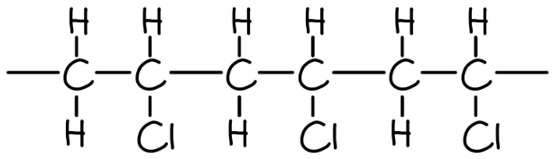

- Three correct repeat units; **[1 mark]**
- Continuation bonds; **[1 mark]**

**[Total: 6 marks]**

- *This question tests a lot of your knowledge from various topics but asks the questions in a different way *

  - *For part (i), the number of carbons and hydrogens must be balanced on each side of an equation for cracking*
  - *Part (ii) is an alternative version of reacting alkanes with halogens*
  - *Part (iii) is a disguised electrolysis question *
  - *Part (iv) is a polymer drawing question but it specifies three monomers so you cannot achieve full marks without this*

### Q28
a)

i) The structural formula of the monomer is:

**OR **CH3–CH=CH–CH3; **[1 mark]**

ii) The structural formula showing one repeat unit of the nylon polymer is:

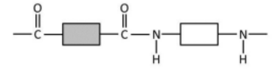

- One correct amide linkage between two rectangles;** [1 mark]**
- Correct sequencing of a second amide link and monomers; **[1 mark]**
- Two correct amide links and rest of structure correct (including additional monomers if seen) and correct continuation bonds; **[1 mark]**

iii) The natural macromolecule which contains the same linkage as nylon is:

- Protein / polypeptide / named protein; **[1 mark]**

iv) The difference between addition polymerisation and condensation polymerisation is:

- Addition polymerisation only forms the polymer / one product ;** [1 mark]**
- Condensation polymerisation forms the polymer and a small molecule / water / HCl; **[1 mark]**

**[Total: 7 marks]**

- *This question is a very good illustration of the need for you to know about addition and condensation polymers*
b)

i) The term *non-biodegradable* means:

- Does not break down / rot / decompose; **[1 mark]**
- By microbes / fungi / bacteria / by living organisms; **[1 mark]**

ii) **Three **problems caused by the disposal of non-biodegradable polymers are:

Any **three** of the following:

- Visual pollution;** [1 mark]**
- (Shortage of) landfill sites;** [1 mark]**
- Danger to wildlife / animals (including at sea); **[1 mark]**
- Toxic / greenhouse gases produced when burnt;** [1 mark]**

**[Total: 5 marks]**

- *Whilst you are expected to know about plastics and their disposal, this question is unusual in requiring 3 points about the disposal of non-biodegradable polymers*

### Q29
a) The type of polymerisation that occurs is:

- Addition; **[1 mark]**

**[Total: 1 mark]**

- *This is addition polymerisation as the monomer has a C=C double bond which can open up, joining the monomers together*
- *The other type of polymerisation, condensation polymerisation, requires two different functional groups to be able to join to form a polymer, either on two different monomers, or on one monomer*
b) The name of the polymer formed is:

- Poly(but-1-ene); **[1 mark]**

**[Total: 1 mark]**

- *To name the monomer:*

  - *The monomer has four carbon atoms, so its name will be based around but-*
  - *It is an alkene, so will end in -ene*
  - *The C=C double bond is between the first and second carbon*
  - *Putting these together gives the name but-1-ene*
- *To name the polymer, add 'poly' as a prefix and then put the name of the monomer in brackets:*

  - *Poly(but-1-ene)*
c) The completed chemical equation to show this polymerisation is:

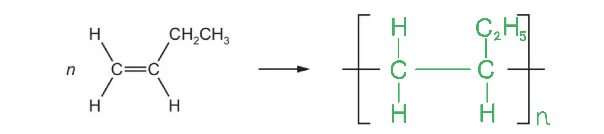

- 2 C atoms (only) with a single bond between them linked to the continuation bonds shown; **[1 mark]**
- Correct repeat unit showing one C2H5 / CH2CH3 side chain attached to one of the C atoms in the first marking point; **[1 mark]**
- Correct use of ‘n’; **[1 mark]**

**[Total: 3 marks]**

- *To show the repeat unit, draw the monomer but replace the C=C double bond with a C-C single bond and add continuation / extension bonds from each of these carbon atoms *
- *To complete the repeat unit, add square brackets and an n on the right hand side*

  - *In this case, the square brackets and continuation bonds are provided but don't forget the n!*
  - *n represents a very large number*
d) The empirical formula of the polymer formed is:

- CH2; **[1 mark]**

**[Total: 1 mark]**

- *The repeat unit contains 4 carbon atoms and 8 hydrogen atoms*
- *This means for every 1 carbon atom, there are 2 hydrogen atoms giving it the empirical formula CH**2*
