# Exam Questions — Polymers
**11. Organic Chemistry** · Cambridge (CIE) IGCSE chemistry (0620 & 0971)
> Source: [https://www.savemyexams.com/igcse/chemistry/cie/23/topic-questions/](https://www.savemyexams.com/igcse/chemistry/cie/23/topic-questions/) · 50 questions across 2 sets

## Multiple Choice Questions (26 questions)

### Q1 — hard — 1 marks

**Q1** [1 mark]

Which statement about polymers is correct?

### Q2 — easy — 1 marks

**Q2** [1 mark]

Polyethene is a synthetic polymer made in a factory.

What is one use of polyethene?

### Q3 — easy — 1 marks

**Q3** [1 mark]

The diagram shows the structure of an important product.

This product is formed by …... **1** .….. of an .….. **2** …… .

Which words complete gaps 1 and 2?

|   | **1** | **2** |
|---|---|---|
| **A** | addition polymerisation | alkane |
| **B** | addition polymerisation | alkene |
| **C** | cracking | alkane |
| **D** | cracking | alkene |

### Q4 — easy — 1 marks

**Q4** [1 mark]

A macromolecule is a very large molecule.

Macromolecules can be made by joining smaller molecules together. This is called  polymerisation.

Which row in the table describes the formation of a polymer?

|   | **monomer** | **polymer** |
|---|---|---|
| **A** | ethane | poly(ethane) |
| **B** | ethene | poly(ethene) |
| **C** | ethane | poly(ethene) |
| **D** | ethene | poly(ethane) |

### Q5 — easy — 1 marks

**Q5** [1 mark]

Which process produces poly(ethene) from ethene?

### Q6 — easy — 1 marks

**Q6** [1 mark]

Which of the following does **not** cause a problem from the disposal of non-biodegradable plastics?

### Q7 — easy — 1 marks

**Q7** [1 mark]

Poly(ethene) is commonly used to make plastic bags.

Which property of poly(ethene) makes it difficult to dispose of?

### Q8 — hard — 1 marks

**Q8** [1 mark]

The equation shows the formation of a polymer called Kevlar.

Which row describes Kevlar?

|   | **how the monomer is formed** | **type of polymer** |
|---|---|---|
| **A** | addition polymerisation | polyamide |
| **B** | addition polymerisation | polyester |
| **C** | condensation polymerisation | polyamide |
| **D** | condensation polymerisation | polyester |

### Q9 — hard — 1 marks

**Q9** [1 mark]

In which row are the monomer and polymer chain correctly matched?

|   | **monomer** | **part of polymer chain** |
|---|---|---|
| **A** | CH3CH=CHCH3 | –CH(CH3)–CH(CH3)–CH(CH3)–CH(CH3)– |
| **B** | CH2=CHCl | –CHC–CHCl–CHCl–CHCl – |
| **C** | CH3CH=CH2 | –CH3–CH–CH2–CH3–CH–CH2– |
| **D** | CH2=CHCH2CH3 | –CH2–CH2–CH2–CH(CH2CH3)– |

### Q10 — hard — 1 marks

**Q10** [1 mark]

The structure of a synthetic polymer is shown.

The structure shows the synthetic polymer is a ......**1**...... . It is formed by ......**2**...... polymerisation.

Which words complete gaps 1 and 2?

|   | **1** | **2** |
|---|---|---|
| **A** | polyamide | addition |
| **B** | polyamide | condensation |
| **C** | polyester | addition |
| **D** | polyester | condensation |

### Q11 — hard — 1 marks

**Q11** [1 mark]

A polymer has the formula shown.

From which monomers can it be formed?

### Q12 — hard — 1 marks

**Q12** [1 mark]

A polymer can be made from methylpropene.

Which diagram shows the structure of the polymer?

### Q13 — hard — 1 marks

**Q13** [1 mark]

Which row shows a natural polymer with the same linkages as a synthetic polymer?

|   | **natural polymer** | **synthetic polymer** |
|---|---|---|
| **A** | complex carbohydrate | nylon |
| **B** | complex carbohydrate | PET |
| **C** | protein | nylon |
| **D** | protein | PET |

### Q14 — hard — 1 marks

**Q14** [1 mark]

The structure of polylactic acid (PLA) is given below.

What is the name given to the polymer link that is circled?

### Q15 — hard — 1 marks

**Q15** [1 mark]

Which two polymers have the same linkages bonding the monomers together?

### Q16 — hard — 1 marks

**Q16** [1 mark]

Ethene forms an addition polymer as shown.

Which terms describe this polymer?

### Q17 — medium — 1 marks

**Q17** [1 mark]

Which process does not produce carbon dioxide?

### Q18 — medium — 1 marks

**Q18** [1 mark]

Polyesters and polyamides are types of synthetic polymer.

Which statements are correct?

| **1** | They are made by addition polymerisation. |
|---|---|
| **2** | They are made by condensation polymerisation. |
| **3** | The monomers from which they are made are unsaturated hydrocarbons. |
| **4** | The monomers from which they are made contain reactive functional groups at their ends. |

### Q19 — medium — 1 marks

**Q19** [1 mark]

Which statement about polymers is correct?

### Q20 — medium — 1 marks

**Q20** [1 mark]

The diagram shows three repeat units in the structure of an addition polymer.

Which alkene monomer is used to make this polymer?

### Q21 — medium — 1 marks

**Q21** [1 mark]

Poly(ethene) is an addition polymer.

Which term describes the monomer from which it is formed?

## Theory Questions (31 questions)

### Q1 — hard — 10 marks

**Q1** [7 marks]

Esters occur naturally in plants and animals. They are manufactured from petroleum. Ethyl ethanoate and butyl ethanoate are industrially important as solvents.

i)        Explain the term *solvent*.

[1]

ii) Give the formula of ethyl ethanoate.

[1]

iii) Ethyl ethanoate can be made from ethanol and ethanoic acid. Describe how these chemicals can be made.

ethanol from ethene ..................................................

[2]

ethanoic acid from ethanol ..................................................

[2]

iv) Name **two **chemicals from which butyl ethanoate can be made.

[1]

*Source: 2003 O31 Q4*

**Q1** [3 marks]

A polymer has the structure shown below.

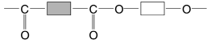

(i) What type of polymer is this?

[1]

(ii) Complete the following to give the structures of the two monomers from which the above polymer could be made.

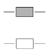

[2]

*Source: 2003 O31 Q4C*

### Q2 — medium — 12 marks

**Q2** [3 marks]

#### Separate: Chemistry Only

Synthetic polymers are disposed of in landfill sites and by burning.

i) Describe **two **problems caused by the disposal of synthetic polymers in landfill sites.

[2]

ii) Describe **one **problem caused by burning synthetic polymers.

[1]

*Source: 20156 O31 Q4*

**Q2** [1 mark]

#### Extended Only

State **two **uses of synthetic polymers.

*Source: 2015 O31 Q4*

**Q2** [5 marks]

**Extract:**

The structural formulae of two synthetic polymers are given below.

polymer A: —CH₂—CH—CH₂—CH— (with CH₃ side groups on the two CH units)
polymer B: (repeating units with C=O, O, and C atoms, with a circled C=O—O group)

i) Draw the structural formula of the monomer of polymer A.
ii) Identify the functional group circled in polymer B.
iii) Deduce the two types of organic compound which have reacted to form polymer B.

Mark scheme guidance: For the monomer in part (i): Identify the repeat unit containing two carbons, draw this repeat unit, remove the continuation bonds, replace the carbon-carbon single bond with a carbon=carbon double bond. The circled functional group is an ester linkage, which comes from the reaction of a carboxylic acid with an alcohol.

#### Extended Only

The structural formulae of two synthetic polymers are given below.

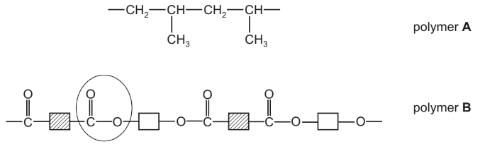

i) Draw the structural formula of the monomer of polymer **A**.

[2]

ii) Identify the functional group circled in polymer **B**.

[1]

iii) Deduce the **two **types of organic compound which have reacted to form polymer **B**.

[2]

*Source: 2015 O31 Q4*

**Q2** [3 marks]

**Extract:**

The structural formulae of two synthetic polymers are given below. (polymer A and polymer B)
i) The structural formula of the monomer of polymer A shows a carbon=carbon double bond.
ii) The functional group circled in polymer B is an ester.
iii) The two types of organic compound which have reacted to form polymer B are (carboxylic) acid and alcohol.

#### Extended Only

Explain the difference between addition and condensation polymers. Classify **A** and **B** as either addition or condensation polymers.

*Source: 2015 O31 Q4*

### Q3 — medium — 4 marks

**Q3** [2 marks]

#### Extended Only

There are two types of polymerisation - addition and condensation.

Explain the difference between them.

*Source: 2011 Ju31 Q8*

**Q3** [2 marks]

#### Extended Only

Poly(dichloroethene) is used to package food. Draw its structure. The structural formula of dichloroethene is shown below.

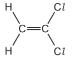

*Source: 2011 Ju31 Q8*

### Q4 — easy — 1 marks

**Q4** [1 mark]

#### Extended Only

There are three functional groups in compound A.

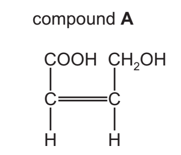

Compound A can be used as a single monomer to produce two different polymers.

What type of condensation polymer is formed from compound A?

*Source: 2019 Ju42 Q6D*

### Q5 — medium — 5 marks

**Q5** [1 mark]

Domestic rubbish is disposed of in landfi ll sites. Rubbish could include the following items.

| **item of rubbish** | **approximate time for** **item to break down** |
|---|---|
| newspaper | one month |
| cotton rag | six months |
| woollen glove | one year |
| aluminium container | up to 500 years |
| styrofoam cup | 1000 years |

Explain why aluminium, a reactive metal, takes so long to corrode.

*Source: 2013 O33 Q5*

**Q5** [2 marks]

#### Extended Only

Both paper and cotton are complex carbohydrates. They can be hydrolysed to simple sugars such as glucose.

The formula of glucose can be represented as:

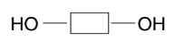

Draw the structural formula of a complex carbohydrate, such as cotton.

Include at least two glucose units.

*Source: 2013 O33 Q5*

**Q5** [2 marks]

#### Separate: Chemistry and Extended Only

i) What is the scientific term used to describe polymers which do not break down in landfill sites?

[1]

ii) Styrofoam is poly(phenylethene). It is an addition polymer. Its structural formula is given below. Deduce the structural formula of the monomer, phenylethene.

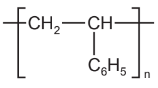

[1]

*Source: 2013 O33 Q5D*

### Q6 — hard — 14 marks

**Q6** [4 marks]

Esters, fats and polyesters all contain the ester linkage.

The structural formula of an ester is given below.

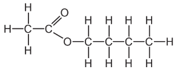

Name **two **chemicals that could be used to make this ester and draw their structural formulae. Show all bonds.

names .................................................. and ..................................................

[2]

structural formulae .................................................. and ..................................................

[2]

*Source: 2007 Ju31 Q7*

**Q6** [3 marks]

**Extract:**

Esters, fats and polyesters all contain the ester linkage.

i) Draw the structural formula of a polyester such as Terylene.

[2]

ii) Suggest a use for this polymer.

[1]

*Source: 2007 Ju31 Q7*

**Q6** [4 marks]

Cooking products, fats and vegetable oils, are mixtures of saturated and unsaturated esters

The degree of unsaturation can be estimated by the following experiment. 4 drops of the oil are dissolved in 5 cm3 of ethanol. Dilute bromine water is added a drop at a time until the brown colour no longer disappears. Enough bromine has been added to the sample to react with all the double bonds.

| cooking product | mass of saturated fat in 100g of product / g | mass of unsaturated fat in 100g of product / g | number of drops of bromine water |
|---|---|---|---|
| margarine | 35 | 35 | 5 |
| butter | 45 | 28 | 4 |
| corn oil | 10 | 84 | 12 |
| soya oil | 15 | 70 | 10 |
| lard | 38 | 56 | .................... |

i) Complete the one blank space in the table.

[1]

ii) Complete the equation for bromine reacting with a double bond.

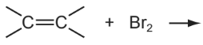

[2]

iii) Using saturated fats in the diet is thought to be a major cause of heart disease.

Which of the products is the least likely to cause heart disease?

[1]

*Source: 2007 Ju31 Q7*

**Q6** [3 marks]

A better way of measuring the degree of unsaturation is to find the iodine number of the unsaturated compound. This is the mass of iodine that reacts with all the double bonds in 100 g of the fat.

Use the following information to calculate the number of double bonds in one molecule of the fat.

*Mass of one mole of the fat is 884 g.*

*One mole of I**2** reacts with one mole C=C.*

*The iodine number of the fat is 86.2 g.*

Complete the following calculation.

100 g of fat reacts with 86.2 g of iodine.

884 g of fat reacts with .............................. g of iodine.

One mole of fat reacts with .............................. moles of iodine molecules.

Number of double bonds in one molecule of fat is ..............................

*Source: 2007 Ju31 Q7*

### Q7 — hard — 11 marks

**Q7** [5 marks]

A South Korean chemist has discovered a cure for smelly socks. Small particles of silver are attached to a polymer, poly(propene), and this is woven into the socks.

i) Give the structural formula of the monomer.

[1]

ii) Draw the structural formula of the polymer.

[2]

iii) Suggest which one, monomer or polymer, will react with aqueous bromine and why?

[2]

*Source: 2005 Ju31 Q*

**Q7** [3 marks]

**Extract:**

A South Korean chemist has discovered a cure for smelly socks. Small particles of silver are attached to a polymer, poly(propene), and this is woven into the socks.

To show that the polymer contains silver the following test was carried out.

The polymer fibres were chopped into small pieces and warmed with nitric acid. The silver atoms were oxidised to silver(I) ions. The mixture was filtered. Aqueous sodium chloride was added to the filtrate and a white precipitate formed.

i) Why was the mixture filtered?

[1]

ii) Explain why the change of silver atoms to silver ions is oxidation.

[1]

iii) Give the name of the white precipitate.

[1]

*Source: 2005 Ju31 Q3*

**Q7** [3 marks]

Propanoic acid is a weak acid.

i) The following equation represents its reaction with ammonia.

CH3CH2COOH + NH3 → CH3CH2COO–+ NH4+

Explain why propanoic acid behaves as an acid and ammonia as a base.

[2]

ii) Explain the expression *weak acid*.

[1]

*Source: 2005 Ju31 Q3*

### Q8 — medium — 4 marks

**Q8** [1 mark]

#### Extended Only

Alkenes can form polymers.

What type of polymerisation occurs when alkenes form polymers?

*Source: 2019 Ju43 Q6C*

**Q8** [1 mark]

#### Extended Only

Part of the structure of a polymer is shown.

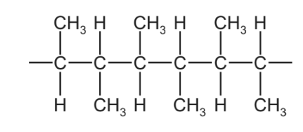

Draw the structure of the alkene from which this polymer can be made. Show all of the atoms and all of the bonds.

*Source: 2019 Ju43 Q6C*

**Q8** [2 marks]

#### Extended Only

Part of the structure of a polyamide is shown.

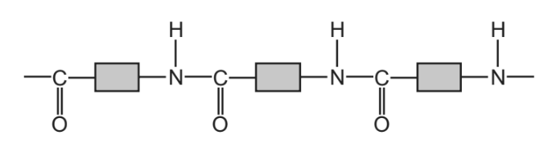

This polyamide is formed from identical monomers. Complete the diagram to show the structure of one monomer. Show all of the atoms and all of the bonds.

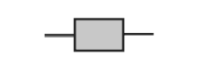

*Source: 2019 Ju43 Q6D*

### Q9 — easy — 2 marks

**Q9** [1 mark]

#### Extended Only

Poly(ethene) is made by the polymerisation of ethene. Which one of the structures represents part of a poly(ethene) molecule? Tick one box.

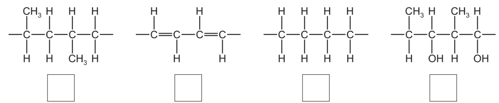

*Source: 2019 Ju32 Q5D*

**Q9** [1 mark]

Nylon is also a polymer.

Part of the structure of nylon is shown.

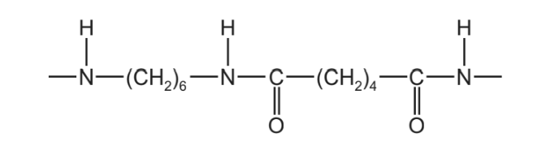

How many different types of atom are shown in this structure?

*Source: 2019 Ju32 Q5E*

### Q10 — hard — 16 marks

**Q10** [3 marks]

Alkanes and alkenes are examples of hydrocarbons.

i) What is meant by the term *hydrocarbon*?

[1]

ii) Give the general formula of straight-chain

alkanes, ..................................................

alkenes. ..................................................

[2]

*Source: 2016 Ja42 Q7*

**Q10** [4 marks]

A compound X contains carbon, hydrogen and oxygen only.

X contains 54.54% of carbon by mass, 9.09% of hydrogen by mass and 36.37% of oxygen by mass.

i) Calculate the empirical formula of compound X.

[2]

ii) Compound X has a relative molecular mass of 88.

Deduce the molecular formula of compound X.

[2]

*Source: 2016 Ja42 Q7*

**Q10** [4 marks]

An ester has the molecular formula C3H6O2.

Name and give the structural formulae of two esters with the molecular formula C3H6O2.

| name of ester |   |   |
|---|---|---|
| structural formula |   |   |

*Source: 2016 Ja42 Q7*

**Q10** [1 mark]

Name the ester produced from the reaction of propanoic acid and methanol.

*Source: 2016 Ja42 Q7*

**Q10** [4 marks]

A polyester is represented by the structure shown.

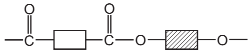

i) What type of polymerisation is used for the production of polyesters?

[1]

ii) Which simple molecule is removed when the polyester is formed?

[1]

iii) Complete the diagrams below to show the structures of the monomers used to produce the polyester. Show all atoms and bonds.

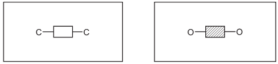

[2]

*Source: 2016 Ja42 Q7*

### Q11 — medium — 10 marks

**Q11** [4 marks]

#### Extended Only

Alkenes are unsaturated hydrocarbons. They show structural isomerism. Alkenes take part in addition reactions and form polymers.

Ethene reacts with each of the following. Give the name and structural formula of each product.

i) steam

name of product ..........................................................

structure of product

[2]

ii) hydrogen

name of product ...........................................................

structure of product

[2]

*Source: 2002 O31 Q5B*

**Q11** [6 marks]

#### Extended Only

Islay is an island off the west coast of Scotland. The main industry on the island is making ethanol from barley.

Barley contains the complex carbohydrate, starch. Enzymes catalyse the hydrolysis of starch to a solution of glucose.

Alkenes polymerise by addition.

i) Explain the term *polymerise*.

[2]

ii) What is the difference between addition polymerisation and condensation polymerisation?

[2]

iii) Poly(dichloroethene) is used extensively to package food. Draw its structure. The structural formula of dichloroethene is drawn below.

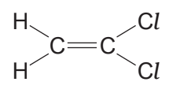

[2]

*Source: 2002 O31 Q5C*

### Q12 — medium — 15 marks

**Q12** [4 marks]

#### Separate: Chemistry and Extended Only

A compound **X** contains 82.76% of carbon by mass and 17.24% of hydrogen by mass.

i) Calculate the empirical formula of compound **X**.

[2]

ii) Compound **X **has a relative molecular mass of 58.

Deduce the molecular formula of compound **X**.

[2]

*Source: 2015 Ja32 Q4*

**Q12** [2 marks]

#### Separate: Chemistry Only

Alkenes are unsaturated hydrocarbons.

i) State the general formula of alkenes.

[1]

ii) State the empirical formula of alkenes.

[1]

*Source: 2015 Ja32 Q4*

**Q12** [2 marks]

What is meant by the term *unsaturated hydrocarbon*?

unsaturated ..................................................

hydrocarbon ..................................................

*Source: 2015 Ja32 Q4*

**Q12** [3 marks]

Describe a test that would distinguish between saturated and unsaturated hydrocarbons.

reagent ..................................................

observation (saturated hydrocarbon) ..................................................

observation (unsaturated hydrocarbon) ..................................................

*Source: 2015 Ja32 Q4*

**Q12** [4 marks]

#### Extended Only

Addition polymers can be made from alkenes. The diagram shows part of an addition polymer.

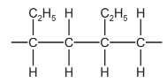

i) Draw a circle on the diagram to show one repeat unit in this polymer.

[1]

ii) Give the structure and the name of the monomer used to make this polymer.

structure ..................................................

name ..................................................

[2]

iii) Give the structure of an isomer of the alkene in (e)(ii).

[1]

*Source: 2015 Ja32 Q4*

### Q13 — hard — 15 marks

**Q13** [3 marks]

Alkanes and alkenes are both series of hydrocarbons.

i) Explain the term *hydrocarbon*.

[1]

ii) What is the difference between these two series of hydrocarbons?

[2]

*Source: 2013 Ju33 Q7*

**Q13** [1 mark]

Alkenes and simpler alkanes are made from long-chain alkanes by cracking.

Complete the following equation for the cracking of the alkane C20H42.

C20H42 → 2C4H8 + 2C2H4 + ...............

*Source: 2013 Ju33 Q7*

**Q13** [7 marks]

Alkenes such as butene and ethene are more reactive than alkanes.

Alkenes are used in the petrochemical industry to make a range of products, which includes polymers and alcohols.

i) Dibromoethane is used as a pesticide. Complete the equation for its preparation from ethene.

| 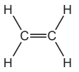 | + Br2 → |   |   |
|---|---|---|---|

[1]

ii) The structural formula of a poly(alkene) is given below.

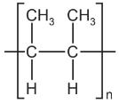

Deduce the structural formula of its monomer.

[2]

iii) How is butanol made from butene, CH3–CH2–CH=CH2? Include an equation in your answer.

[2]

iv) Cracking changes alkanes into alkenes. How could an alkene be converted into an alkane? Include an equation in your answer.

[2]

*Source: 2013 Ju33 Q7*

**Q13** [4 marks]

20c m3 of a hydrocarbon was burnt in 175 cm3 of oxygen. After cooling, the volume of the remaining gases was 125 cm3. The addition of aqueous sodium hydroxide removed carbon dioxide leaving 25 cm3 of unreacted oxygen.

i) volume of oxygen used = .......... cm3

[1]

ii) volume of carbon dioxide formed = .......... cm3

[1]

iii) Deduce the formula of the hydrocarbon and the balanced equation for the reaction.

[2]

*Source: 2013 Ju33 Q7*

### Q14 — medium — 18 marks

**Q14** [4 marks]

#### Separate: Chemistry and Extended Only

Alkenes are unsaturated hydrocarbons. They undergo addition reactions.

Two of the methods of making alkenes are cracking and the thermal decomposition of chloroalkanes.

i) Complete an equation for the cracking of the alkane, decane.

| C10H22 → | ............................. + ...................................... |
|---|---|
| decane |   |

ii) Propene can be made by the thermal decomposition of chloropropane.

Describe how chloropropane can be made from propane.

reagents   propane and ..............................

conditions   ...................................................

[4]

*Source: 2003 Ju31 Q3*

**Q14** [4 marks]

#### Separate: Chemistry and Extended Only

The following alkenes are isomers.

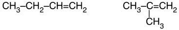

i) Explain why they are isomers.

[2]

ii) Give the name and structural formula of another hydrocarbon that is isomeric with the above.

name ......................................................

structural formula ......................................................

[2]

*Source: 2003 Ju31 Q3*

**Q14** [3 marks]

#### Extended Only

Give the name of the product when but-1-ene reacts with each of the following.

steam .........................................................

hydrogen ....................................................

bromine ......................................................

*Source: 2003 Ju31 Q3*

**Q14** [7 marks]

#### Separate: Chemistry and Extended Only

Alkenes can polymerise.

i) Deduce the name and structural formula of the monomer from the structure of the polymer.

name of monomer .......................................................

structural formula .......................................................

[2]

ii) Draw the structure of the polymer formed from the following monomer.

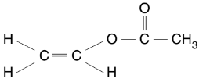

[2]

iii) Describe the pollution problems caused by the disposal of polymers in landfill sites and by burning.

landfill sites ..................................................

[2]

burning ..................................................

[1]

*Source: 2003 Ju31 Q3*

### Q15 — medium — 8 marks

**Q15** [3 marks]

#### Separate: Chemistry Only

Many monomer molecules react together to form one molecule of a polymer. This reaction is called polymerisation.

The structural formula of the polymer, poly(chloroethene), is given below. This polymer is also known as PVC.

i) A major use of PVC is insulation of electric cables. PVC is a poor conductor of electricity.

Suggest another property which makes it suitable for this use.

[1]

ii) One way of disposing of waste PVC is by burning it. This method has the disadvantage that poisonous gases are formed.

Suggest **two **poisonous gases which could be formed by the combustion of PVC.

[2]

*Source: 2013 Ju32 Q5*

**Q15** [3 marks]

#### Extended Only

i) Deduce the structural formula of the monomer from that of the polymer.

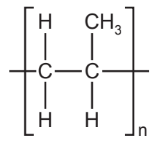

structural formula of monomer ..................................................

[1]

ii) Deduce the structural formula of the polymer, poly(phenylethene), from the formula of its monomer, phenylethene.

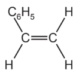

structural formula of polymer ..................................................

[2]

*Source: 2013 Ju32 Q5*

**Q15** [2 marks]

**Extract:**

ii) Deduce the structural formula of the polymer, poly(phenylethene), from the formula of its monomer, phenylethene.

- The structural formula of the polymer, poly(phenylethene), is: 
- Correct repeat unit; [1 mark]
- Continuation bonds; [1 mark]

- The key difference is the central carbon-carbon bond:
- Monomers contain a carbon=carbon double bond
- Polymers contain a carbon-carbon single bond

#### Extended Only

The carbohydrate, glucose, polymerises to form the more complex carbohydrate starch.

If glucose is represented by

then the structural formula of starch is as drawn below.

How does the polymerisation of glucose differ from that of an alkene such as phenylethene?

*Source: 2013 Ju32 Q5*

### Q16 — hard — 15 marks

**Q16** [7 marks]

Synthetic polymers are widely used in the modern world.

Their use has brought considerable advantages to modern life as well as some disadvantages.

i) Suggest **two **advantages of a plastic bucket compared to a steel bucket.

[2]

ii) Name **two **uses of man-made fibres, such as nylon and Terylene.

[2]

iii) Describe the pollution caused by synthetic polymers.

[3]

*Source: 2010 O33 Q7*

**Q16** [4 marks]

One type of polymer is formed by addition polymerisation.

i) The structural formula of an addition polymer is given below.

Give the name and structural formula of the monomer.

name of monomer ..................................................

[1]

structural formula of monomer

[1]

ii) Draw the structural formula of the addition polymer formed by the polymerisation of phenylethene. The structural formula of phenylethene is given below.

[2]

*Source: 2010 O33 Q7*

**Q16** [4 marks]

Nylon is made by condensation polymerisation. It has the structural formula shown below.

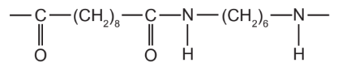

i) Name the linkage in this polymer.

[1]

ii) Name the natural macromolecules which have the same linkage.

[1]

iii) Deduce the formulae of the **two **monomers which reacted to form the nylon and water.

monomer ...................................................................................................................

monomer ...................................................................................................................

[2]

*Source: 2010 O33 Q7*

### Q17 — hard — 8 marks

**Q17** [2 marks]

There are two types of polymerisation, addition and condensation.

Explain the difference between these two types of polymerisation.

*Source: 2016 Sp4 Q9*

**Q17** [2 marks]

Some plastics, formed by polymerisation, are non-biodegradable.

Describe **two **pollution problems that are caused by non-biodegradable plastics.

*Source: 2016 Sp4 Q9*

**Q17** [1 mark]

The polymer known as PVA is used in paints and adhesives. Its structural formula is shown below

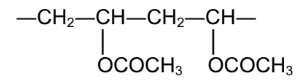

Deduce the structural formula of its monomer.

*Source: 2016 Sp4 Q9*

**Q17** [3 marks]

**Extract:**

HOOC(CH~2~)~4~COOH and H~2~N(CH~2~)~6~NH~2~

A condensation polymer can be made from the following monomers.

HOOC(CH2)4COOH and H2N(CH2)6NH2

Draw the structural formula of this polymer.

*Source: 2016 Sp4 Q9*

### Q18 — medium — 10 marks

**Q18** [4 marks]

#### Separate: Chemistry Only

Plastics are polymers. They are formed from their monomers by polymerisation.

Two methods for the disposal of waste plastics are

- burning
- recycling.

Describe one advantage **and **one disadvantage of each method.

burning ..............................................................................................................................

recycling ...........................................................................................................................

*Source: 2012 Ju31 Q7*

**Q18** [6 marks]

#### Extended Only

i) There are two types of polymerisation reaction. Give their names and explain the differences between them.

[4]

ii) Give the structural formula of a polymer which is formed from two different monomers.

[2]

*Source: 2012 Ju31 Q7*

### Q19 — hard — 13 marks

**Q19** [2 marks]

Petroleum is a source of many important chemicals.

Name **two **industrial processes which must take place to produce alkenes from petroleum.

*Source: 2016 Ju41 Q6*

**Q19** [4 marks]

Ethene, CH2=CH2, and propene, CH2=CHCH3, can both be converted into polymers.

i) What type of polymerisation takes place when ethene forms a polymer?

[1]

ii) What is the empirical formula of the polymer formed from ethene?

[1]

iii) Propene has the structural formula CH2=CHCH3.

Draw **two **repeat units of the polymer made from propene.

[2]

*Source: 2016 Ju41 Q6*

**Q19** [2 marks]

Ethene will react with steam to form ethanol.

Propene will react with steam to form two isomers, both of which are alcohols.

Suggest the structures of these alcohols.

*Source: 2016 Ju41 Q6*

**Q19** [5 marks]

Esters are organic chemicals noted for their characteristic smells. Ethanoic acid and methanol will react to form an ester.

i) Name the catalyst needed to form an ester from ethanoic acid and methanol.

[1]

ii) Name the ester formed when ethanoic acid reacts with methanol.

[1]

iii) Draw the structure of the ester formed when ethanoic acid reacts with methanol. Show all bonds.

[2]

iv) Give the name of a polyester.

[1]

*Source: 2016 Ju41 Q6*

### Q20 — medium — 13 marks

**Q20** [2 marks]

#### Separate: Chemistry Only

Lactic acid can be made from corn starch.

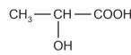

lactic acid

It polymerises to form the polymer, polylactic acid (PLA ) which is biodegradable.

Suggest **two **advantages that PLA has compared with a polymer made from petroleum.

*Source: 2009 Ju31 Q8*

**Q20** [5 marks]

**Extract:**

Lactic acid can be made from corn starch. It polymerises to form the polymer, polylactic acid (PLA) which is biodegradable.

#### Extended Only

The structure of PLA is given below.

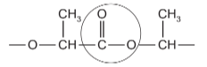

i) What type of compound contains the group that is circled?

[1]

ii) Complete the following sentence. Lactic acid molecules can form this group because they contain both an ............................. group and an ............................. group.

[2]

iii) Is the formation of PLA, an addition or condensation polymerisation? Give a reason for your choice.

[2]

*Source: 2009 Ju31 Q8*

**Q20** [6 marks]

When lactic acid is heated, acrylic acid is formed.

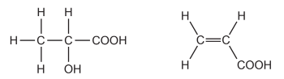

i) Complete the word equation for the action of heat on lactic acid. lactic acid → ..................................... + .....................................

[1]

ii) Describe a test that would distinguish between lactic acid and acrylic acid. test ...............................................................................................................  result for lactic acid ...............................................................................................................  result for acrylic acid ...............................................................................................................

[3]

iii) Describe a test, other than using an indicator, which would show that both chemicals contain an acid group. test ...............................................................................................................  result ...............................................................................................................

[2]

*Source: 2009 Ju31 Q8*

### Q21 — easy — 4 marks

**Q21** [1 mark]

#### Extended Only

Coal gas is made by heating coal in the absence of air. The list shows the main gases present in coal gas.

**carbon dioxide** 
**carbon monoxide** 
**ethene** 
**hydrogen** 
**methane** 
**nitrogen**

Ethene molecules react with each other to form poly(ethene).

What is the name given to this type of chemical reaction?

*Source: 2019 Ju31 Q5B*

**Q21** [1 mark]

**Extract:**

Ethene molecules react with each other to form poly(ethene).

#### Extended Only

Which one of the following words describes the ethene molecules in this reaction? Draw a circle around the correct answer.

**elements                 mixtures                 monomers             polymers**

*Source: 2019 Ju31 Q5B*

**Q21** [1 mark]

#### Separate: Chemistry Only

Poly(ethene) is a non-biodegradable plastic. What is meant by the term *non-biodegradable*?

*Source: 2019 Ju31 Q5B*

**Q21** [1 mark]

**Extract:**

The term *non-biodegradable* means: Cannot be decomposed by organisms / cannot be broken down by bacteria / cannot be broken down by fungi.

#### Separate: Chemistry Only

Describe one pollution problem caused by non-biodegradable plastics.

*Source: 2019 Ju31 Q5B*

### Q22 — medium — 12 marks

**Q22** [7 marks]

#### Extended Only

Enzymes are biological catalysts. They are used both in research laboratories and in industry.

Enzymes called proteases can hydrolyse proteins to amino acids. The amino acids can be separated and identified by chromatography. The diagram below shows a typical chromatogram.

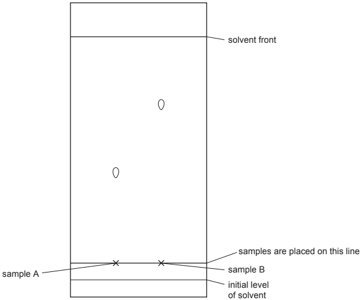

i) The *R*f value of a sample = $\frac{\mathrm{distance} \mathrm{travelled} \mathrm{by} \mathrm{sample}}{\mathrm{distance} \mathrm{travelled} \mathrm{by} \mathrm{solvent} \mathrm{front}}$

Some *R*f values for amino acids are:

- glutamic acid = 0.4
- glycine = 0.5
- alanine = 0.7
- leucine = 0.9

Identify the two amino acids on the chromatogram.

A is ..............................    B is ..............................

[2]

ii) Explain why the chromatogram must be exposed to a locating agent before *R*f values can be measured.

[1]

iii) Measuring *R*f values is one way of identifying amino acids on a chromatogram.

Suggest another.

[1]

iv) The synthetic polymer, nylon, has the same linkage as proteins. Draw the structural formula of nylon.

[3]

*Source: 2005 Ju31 Q5*

**Q22** [5 marks]

Fermentation can be carried out in the apparatus drawn below. After a few days the reaction stops. It has produced a 12% aqueous solution of ethanol.

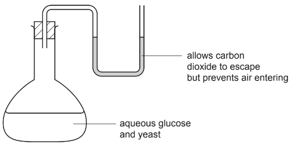

i) Complete the equation.

| C6H12O6 → | ........................   + | .............................. |
|---|---|---|
| glucose | ethanol | carbon dioxide |

[2]

ii) Suggest a reason why the reaction stops after a few days.

[1]

iii) Why is it essential that there is no oxygen in the flask?

[1]

iv) What technique is used to concentrate the aqueous ethanol?

[1]

*Source: 2005 Ju31 Q5C*

### Q23 — easy — 8 marks

**Q23** [4 marks]

Cracking is used to convert long chain alkanes into shorter chain alkanes and alkenes. Alkenes are unsaturated compounds.

Decane, C10H22, can be cracked to give propene and one other product.

i) Complete the chemical equation.

C10H22 → C3H6 + ...............

[1]

ii) What is meant by the term *unsaturated*?

[1]

iii) Describe a test to show that propene is an unsaturated compound.

test ......................................................................................................................................

result ...................................................................................................................................

[2]

*Source: 2016 Ju42 Q5*

**Q23** [4 marks]

#### Separate: Chemistry and Extended Only

Propene can be polymerised. The only product is polypropene. The equation for the polymerisation is:

i) Name the type of polymerisation that occurs.

<u>[</u>1]

ii) Deduce the maximum mass of polypropene that could be produced from 1 kg of propene.

............... kg [1]

iii) Give the empirical formula of:

propene .............................................................................

polypropene .............................................................................

[2]

*Source: 2016 Ju42 Q5*

### Q24 — hard — 9 marks

**Q24** [3 marks]

Polymers are extensively used in food packaging. Poly(dichloroethene) is used because gases can only diffuse through it very slowly. Polyesters have a high thermal stability and food can be cooked in a polyester bag.

The structure of poly(dichloroethene) is given below.

i) Draw the structural formula of the monomer.

[1]

ii) Explain why oxygen can diffuse faster through the polymer bag than carbon dioxide can.

[2]

*Source: 2004 O31 Q6*

**Q24** [3 marks]

i) A polyester can be formed from the monomers HO-CH2CH2-OH and HOOC-C6H4-COOH. Draw the structure of this polyester.

[2]

ii) Suggest what is meant by the term *thermal stability*.

[1]

*Source: 2004 O31 Q6*

**Q24** [3 marks]

i) Describe **two **environmental problems caused by the disposal of plastic (polymer) waste.

[2]

ii) The best way of disposing of plastic waste is recycling to form new plastics. What is another advantage of recycling plastics made from petroleum?

[1]

*Source: 2004 O31 Q6*

### Q25 — medium — 13 marks

**Q25** [3 marks]

#### Separate: Chemistry and Extended Only

Alkenes are unsaturated hydrocarbons. They show structural isomerism. Alkenes take part in addition reactions and form polymers.

Structural isomers have the same molecular formula but different structural formulae.

Give an example of structural isomerism.

molecular formula ........................................

two structural formulae ........................................ and ........................................

*Source: 2002 O31 Q5*

**Q25** [4 marks]

#### Extended Only

Ethene reacts with each of the following. Give the name and structural formula of each product.

i) steam

name of product ..........................................................

structure of product ..........................................................

[2]

ii) hydrogen

name of product ...........................................................

structure of product ..........................................................

[2]

*Source: 2002 O31 Q5*

**Q25** [6 marks]

#### Extended Only

Alkenes polymerise by addition.

i) Explain the term *polymerise*.

[2]

ii) What is the difference between addition polymerisation and condensation polymerisation?

[2]

iii) Poly(dichloroethene) is used extensively to package food. Draw its structure. The structural formula of dichloroethene is drawn below.

[2]

*Source: 2002 O31 Q5*

### Q26 — easy — 2 marks

**Q26** [1 mark]

#### Extended Only

Carboxylic acids can be converted into esters.

Polyesters are polymers made from dicarboxylic acids.

Name the other type of organic compound used in the formation of polyesters.

*Source: Specimen 04 Q7*

**Q26** [1 mark]

#### Extended Only

Name the type of polymerisation used in the manufacture of polyesters.

*Source: Speciment 04 Q7*

### Q27 — hard — 9 marks

**Q27** [3 marks]

Monomers polymerise to form polymers or macromolecules.

i) Explain the term *polymerise*.

[1]

ii) There are two types of polymerisation - addition and condensation. What is the difference between them?

[2]

*Source: 2010 O31 Q5*

**Q27** [6 marks]

An important monomer is chloroethene which has the structural formula shown below.

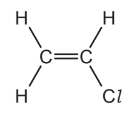

It is made by the following method.

C2H4 + Cl2 → C2H4Cl2 dichloromethane

This is heated to make chloroethene.

C2H4Cl2 → C2H3Cl + HCl

i) Ethene is made by cracking alkanes. Complete the equation for cracking dodecane.

C12H26 → .................... + 2C2H4

[1]

Another method of making dichloroethane is from ethane.

C2H6 + 2Cl2 → C2H4Cl2 + 2HCl

ii) Suggest a reason why the method using ethene is preferred.

[1]

iii) Describe an industrial method of making chlorine.

[2]

iv) Draw the structural formula of poly(chloroethene).

Include three monomer units.

[2]

*Source: 2010 O31 Q5*

### Q28 — medium — 12 marks

**Q28** [7 marks]

#### Extended Only

Polymers are made by the polymerisation of simple molecules called monomers.

i) The structural formula of a polymer is given below.

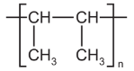

This polymer is made by addition polymerisation. Draw the structural formula of its monomer.

[1]

ii) The two monomers shown below form a nylon which is a condensation polymer.

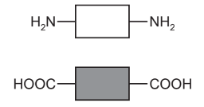

Draw its structural formula showing one repeat unit of the polymer.

[3]

iii) Name the natural macromolecule which contains the same linkage as nylon.

[1]

iv) Explain the difference between addition polymerisation and condensation polymerisation.

[2]

*Source: 2014 Ju31 Q8A*

**Q28** [5 marks]

#### Separate: Chemistry Only

Many polymers are non-biodegradable.

i) Explain the term *non-biodegradable*.

[2]

ii) State **three **problems caused by the disposal of non-biodegradable polymers.

[3]

*Source: 2014 Ju31 Q8*

### Q29 — easy — 6 marks

**Q29** [1 mark]

#### Extended Only

The structures of five alkenes, A, B, C, D and E, are shown.

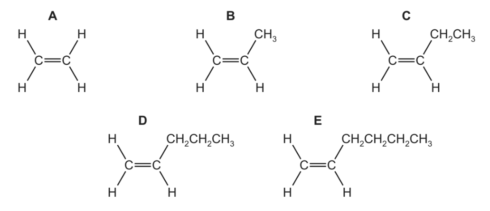

Alkene **C** can be converted into a polymer.

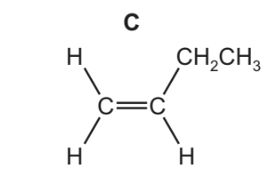

What type of polymerisation occurs?

*Source: 2019 Ju41 Q5G*

**Q29** [1 mark]

**Extract:**

The structures of five alkenes, A, B, C, D and E, are shown. Alkene C can be converted into a polymer.

#### Extended Only

Suggest the name of the polymer formed.

*Source: 2019 Ju41 Q5G*

**Q29** [3 marks]

**Extract:**

Alkene C can be converted into a polymer. What type of polymerisation occurs?

#### Extended Only

Complete the chemical equation to show this polymerisation.

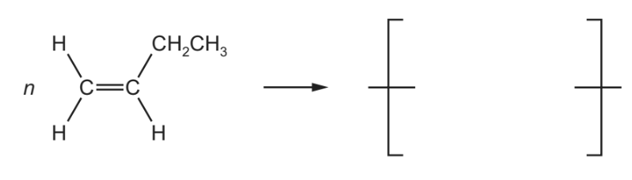

*Source: 2019 Ju41 Q5G*

**Q29** [1 mark]

**Extract:**

The structures of five alkenes, A, B, C, D and E, are shown. Alkene C can be converted into a polymer.
The name of the polymer formed is: Poly(but-1-ene). The monomer has four carbon atoms, so its name will be based around but-. It is an alkene, so will end in -ene. The C=C double bond is between the first and second carbon.

#### Separate: Chemistry and Extended Only

State the empirical formula of the polymer formed.

*Source: 2019 Ju41 Q5G*

