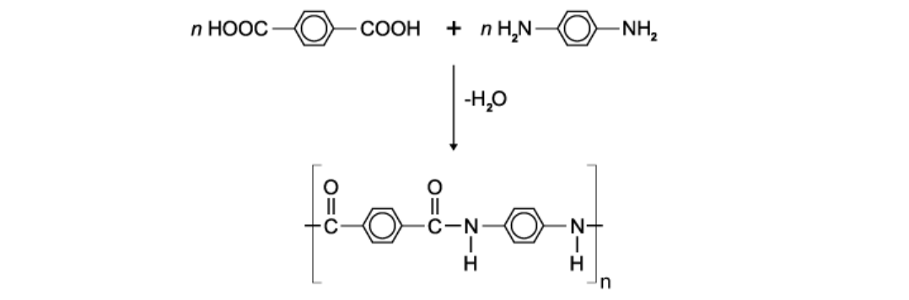
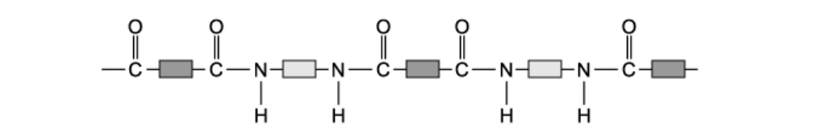
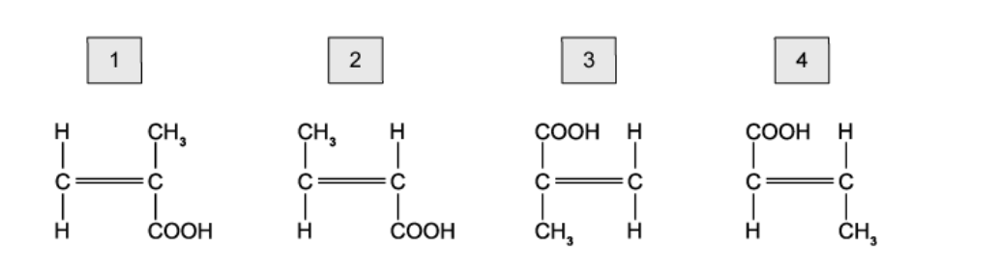
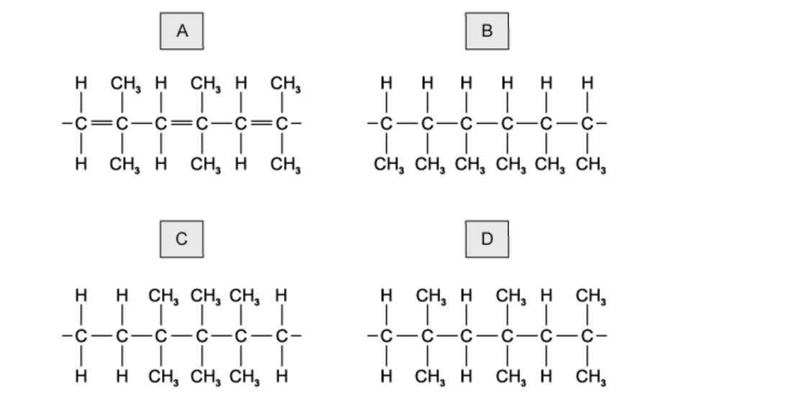
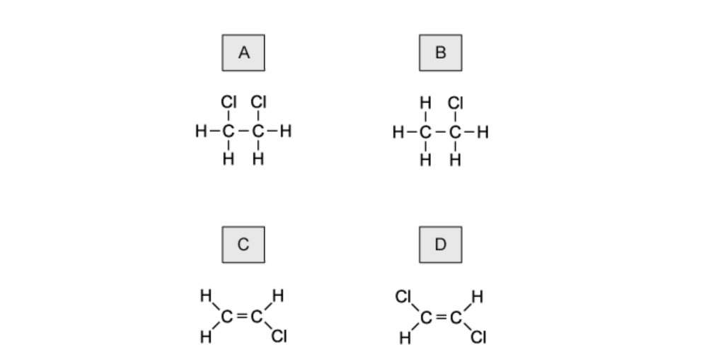

# Exam Questions — Polymers
**11. Organic Chemistry** · Cambridge (CIE) IGCSE chemistry (0620 & 0971)
> Source: [https://www.savemyexams.com/igcse/chemistry/cie/23/topic-questions/](https://www.savemyexams.com/igcse/chemistry/cie/23/topic-questions/) · 21 questions across 1 sets

## Multiple Choice Questions (26 questions)

### Q1 — hard — 1 marks

**Q1** [1 mark]

Which statement about polymers is correct?

### Q2 — easy — 1 marks

**Q2** [1 mark]

Polyethene is a synthetic polymer made in a factory.

What is one use of polyethene?

### Q3 — easy — 1 marks

**Q3** [1 mark]

The diagram shows the structure of an important product.

This product is formed by …... **1** .….. of an .….. **2** …… .

Which words complete gaps 1 and 2?

|   | **1** | **2** |
|---|---|---|
| **A** | addition polymerisation | alkane |
| **B** | addition polymerisation | alkene |
| **C** | cracking | alkane |
| **D** | cracking | alkene |

### Q4 — easy — 1 marks

**Q4** [1 mark]

A macromolecule is a very large molecule.

Macromolecules can be made by joining smaller molecules together. This is called  polymerisation.

Which row in the table describes the formation of a polymer?

|   | **monomer** | **polymer** |
|---|---|---|
| **A** | ethane | poly(ethane) |
| **B** | ethene | poly(ethene) |
| **C** | ethane | poly(ethene) |
| **D** | ethene | poly(ethane) |

### Q5 — easy — 1 marks

**Q5** [1 mark]

Which process produces poly(ethene) from ethene?

### Q6 — easy — 1 marks

**Q6** [1 mark]

Which of the following does **not** cause a problem from the disposal of non-biodegradable plastics?

### Q7 — easy — 1 marks

**Q7** [1 mark]

Poly(ethene) is commonly used to make plastic bags.

Which property of poly(ethene) makes it difficult to dispose of?

### Q8 — hard — 1 marks

**Q8** [1 mark]

The equation shows the formation of a polymer called Kevlar.

Which row describes Kevlar?

|   | **how the monomer is formed** | **type of polymer** |
|---|---|---|
| **A** | addition polymerisation | polyamide |
| **B** | addition polymerisation | polyester |
| **C** | condensation polymerisation | polyamide |
| **D** | condensation polymerisation | polyester |

### Q9 — hard — 1 marks

**Q9** [1 mark]

In which row are the monomer and polymer chain correctly matched?

|   | **monomer** | **part of polymer chain** |
|---|---|---|
| **A** | CH3CH=CHCH3 | –CH(CH3)–CH(CH3)–CH(CH3)–CH(CH3)– |
| **B** | CH2=CHCl | –CHC–CHCl–CHCl–CHCl – |
| **C** | CH3CH=CH2 | –CH3–CH–CH2–CH3–CH–CH2– |
| **D** | CH2=CHCH2CH3 | –CH2–CH2–CH2–CH(CH2CH3)– |

### Q10 — hard — 1 marks

**Q10** [1 mark]

The structure of a synthetic polymer is shown.

The structure shows the synthetic polymer is a ......**1**...... . It is formed by ......**2**...... polymerisation.

Which words complete gaps 1 and 2?

|   | **1** | **2** |
|---|---|---|
| **A** | polyamide | addition |
| **B** | polyamide | condensation |
| **C** | polyester | addition |
| **D** | polyester | condensation |

### Q11 — hard — 1 marks

**Q11** [1 mark]

A polymer has the formula shown.

From which monomers can it be formed?

### Q12 — hard — 1 marks

**Q12** [1 mark]

A polymer can be made from methylpropene.

Which diagram shows the structure of the polymer?

### Q13 — hard — 1 marks

**Q13** [1 mark]

Which row shows a natural polymer with the same linkages as a synthetic polymer?

|   | **natural polymer** | **synthetic polymer** |
|---|---|---|
| **A** | complex carbohydrate | nylon |
| **B** | complex carbohydrate | PET |
| **C** | protein | nylon |
| **D** | protein | PET |

### Q14 — hard — 1 marks

**Q14** [1 mark]

The structure of polylactic acid (PLA) is given below.

What is the name given to the polymer link that is circled?

### Q15 — hard — 1 marks

**Q15** [1 mark]

Which two polymers have the same linkages bonding the monomers together?

### Q16 — hard — 1 marks

**Q16** [1 mark]

Ethene forms an addition polymer as shown.

Which terms describe this polymer?

### Q17 — medium — 1 marks

**Q17** [1 mark]

Which process does not produce carbon dioxide?

### Q18 — medium — 1 marks

**Q18** [1 mark]

Polyesters and polyamides are types of synthetic polymer.

Which statements are correct?

| **1** | They are made by addition polymerisation. |
|---|---|
| **2** | They are made by condensation polymerisation. |
| **3** | The monomers from which they are made are unsaturated hydrocarbons. |
| **4** | The monomers from which they are made contain reactive functional groups at their ends. |

### Q19 — medium — 1 marks

**Q19** [1 mark]

Which statement about polymers is correct?

### Q20 — medium — 1 marks

**Q20** [1 mark]

The diagram shows three repeat units in the structure of an addition polymer.

Which alkene monomer is used to make this polymer?

### Q21 — medium — 1 marks

**Q21** [1 mark]

Poly(ethene) is an addition polymer.

Which term describes the monomer from which it is formed?
