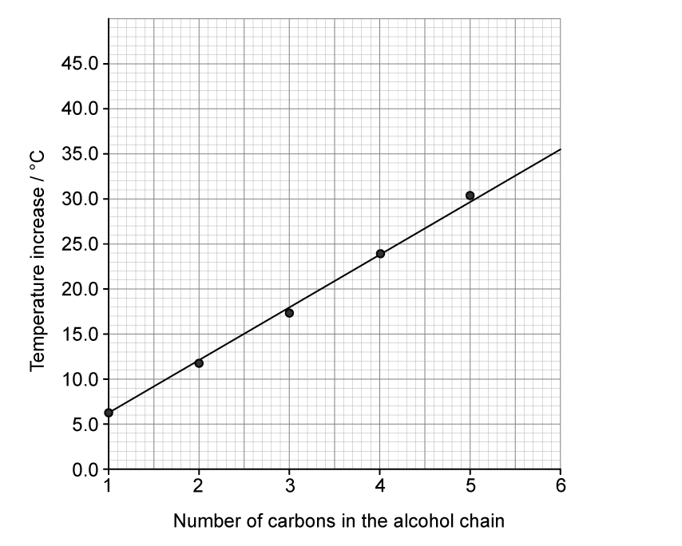
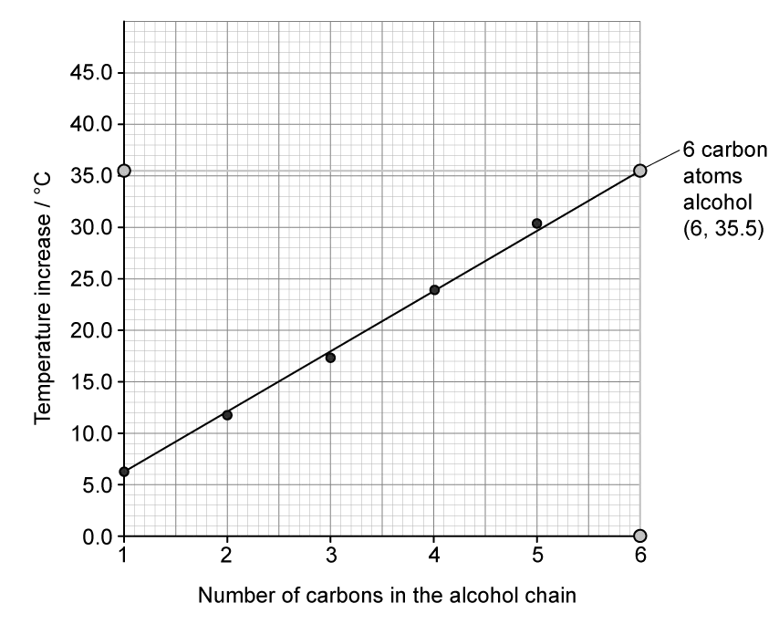
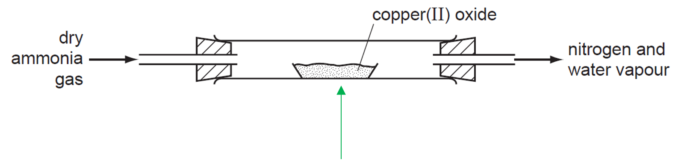
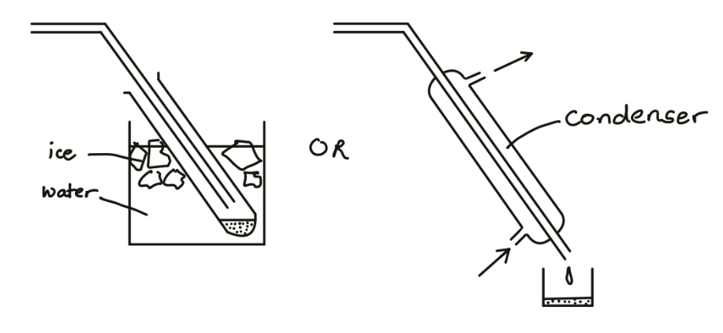
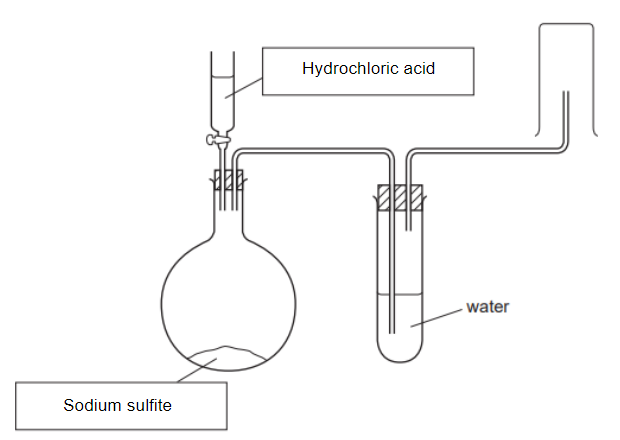
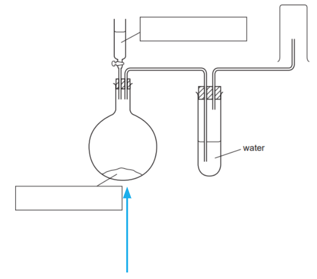
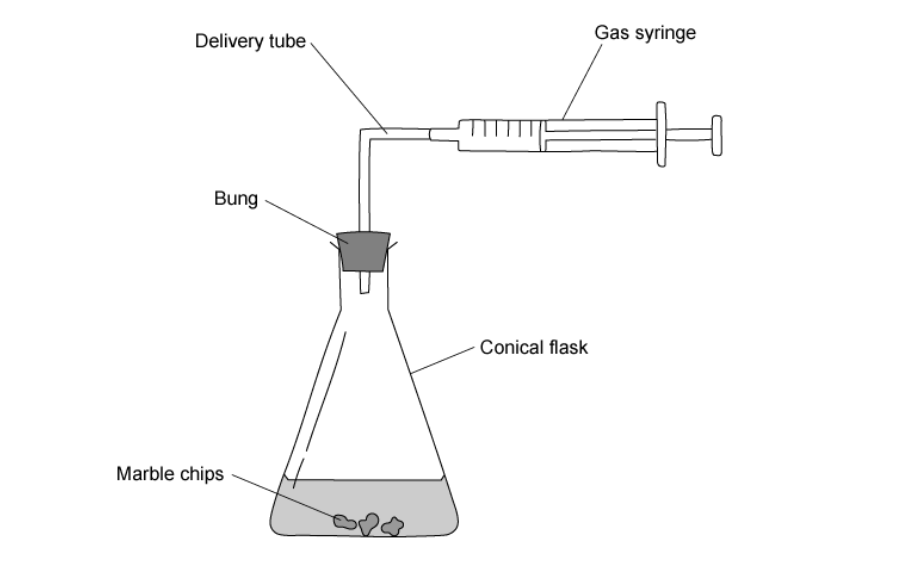
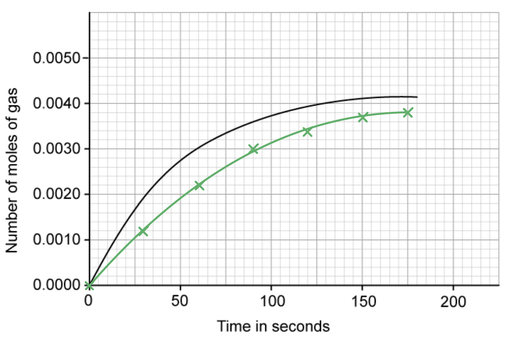
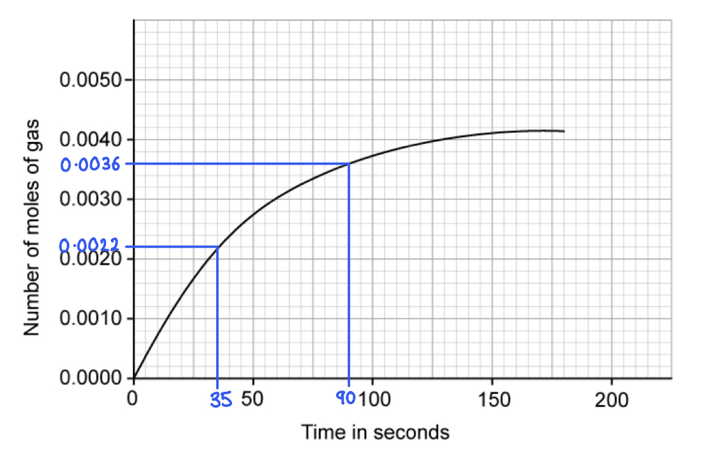

# Mark Schemes — Experimental Techniques
**12. Experimental Techniques & Chemical Analysis** · Cambridge (CIE) IGCSE chemistry (0620 & 0971)

## Alternative To Practical Questions (19 questions)

### Q1
> **[mark-scheme]**
> - Effervescence / fizzing / bubbles **[1 mark]**

> **[exam-tip]**
> Watch out! Do not write “a gas is produced” since this is not a visible observation.
> 
> If carbonate ions are present and acid is added, you should write “effervescence” or “bubbles are seen” because that is what you actually observe when carbon dioxide forms.
> 
> Always describe what you can see, not the name of the gas.
> **[mark-scheme]**
> i)
> 
> - Lilac **[1 mark]**
> 
> ii)
> 
> - Dip a clean (nichrome/platinum) wire into the solid/solution 
> **OR** 
> use a fresh wooden splint soaked in the solution **[1 mark]**
> - Place the wire/splint into a (roaring/blue) Bunsen burner flame **[1 mark]**

> **[exam-tip]**
> You can find the flame tests for cations and its expected results at the back your Paper 6.
> **[mark-scheme]**
> - Calcium/Ca2+**[1 mark]**
> - Iodide/I-  **[1 mark]**
> 
> 2 marks can be awarded if the student writes the name of the compound:** calcium iodide**
> 
> **Allow **Ca+2 
> 
> **Allow**  I-1  **OR ** I1-
> 
> **Reject** Iodine or I2 (it is not an ion)

> **[exam-tip]**
> Read carefully! Answer each test step by step and match the observation to the ion.
> 
> An **orange-red (brick-red) flame** points to **calcium**. The very slight white precipitate with aqueous ammonia in excess supports a metal ion like calcium too.
> 
> A **yellow precipitate** with acidified silver nitrate identifies **iodide ions**.
> 
> You can find all these tests and its expected results at the back your Paper 6.
> 
> Be careful with ionic notation, you must follow proper conventions.
> 
> Write charges as Ca2+ and I-. Avoid forms like Ca+2, I1− or I−1, as these are not standard IUPAC style and may not always be accepted.
> 
> Clear, correct charge notation avoids losing marks on technical accuracy.

### Q2
| experiment | alcohol | number of Carbon Atoms | initial temperature / °C | final temperature / °C | temperature increase / °C |
|---|---|---|---|---|---|
| 1 | Methanol | 1 | 21.0 | 27.0 | 6.0 |
| 2 | Ethanol | 2 | **Final answer:** **21.0** | **Final answer:** **33.0** | **Final answer:** **12.0** |
| 3 | Propanol | 3 | **Final answer:** **21.0** | **Final answer:** **38.5** | **Final answer:** **17.5** |
| 4 | Butanol | 4 | **Final answer:** **21.0** | **Final answer:** **45.0** | **Final answer:** **24.0** |
| 5 | Pentanol | 5 | **Final answer:** **21.0** | **Final answer:** **51.5** | **Final answer:** **30.5** |

**[4 marks]**

> **[mark-scheme]**
> 1 mark awarded for all initial temperatures recorded correctly from the thermometer diagrams
> 
> 1 mark awarded for all final temperatures recorded correctly from the thermometer diagrams
> 
> 1 mark for all temperature increases calculated correctly using the formula (final temperature - initial temperature)
> 
> 1 mark for all readings to consistent precision of **one decimal place**

> **[exam-tip]**
> Watch out! You can lose an easy mark by not using the correct precision.
> 
> If the thermometer readings are given to **one decimal place**, all your answers must also be to **one decimal place**, even if the value is a whole number (e.g. write 21.0, not 21).
> 
> Always match the precision shown in the question to secure the mark. This is usually shown in the first row of the table.

**[5 marks]**

> **[mark-scheme]**
> 1 mark is awarded for using a **linear y-axis scale** that covers at least half of the grid
> 
> 2 marks are awarded for plotting **all 5 points correctly** (each within ± half a small square). You will lose this mark if:
> 
> - Any point is more than half a small square away from its correct position
> - x and y values are reversed
> - A point is missing
> - A point is plotted against the wrong scale value
> 
> 1 mark is awarded for drawing a correct **line of best fit** (a smooth straight line that attempts to cross most of the points following the increasing pattern)
> 
> 1 mark is awarded for extending the line to x = 6 so that extrapolation can be done
> 
> Each part is marked separately, so even if one section is incorrect, you can still gain marks for the others

> **[exam-tip]**
> Do not simply join the dots!! The **line of best fit** that balances the points, roughly equal numbers of points above and below the line.
> 
> If one point does not follow the trend, do not force the line through it.
> 
> Examiners look for a smooth trend line, not a dot-to-dot sketch.

**[1 mark]**

As shown in the graph,

- The expected temperature change for 6 carbon atoms would be **35.5 °C** **[1 mark]**

> **[mark-scheme]**
> 1 mark is awarded for** clear evidence** that the graph was used to obtain the value. Therefore, extrapolation shown on graph (vertical line from x = 6 to line, then horizontal to y-axis)
> 
> 1 mark is awarded for the correct value read from y-axis (± half a small square)
- Using the formula:

$Q=mc\DeltaT$

- Replacing the values given by the statement, and the answer in (**c)**

$\mathrm{Q} = 100 \mathrm{g} \times 4.2 \frac{J}{g C pre^{ring} operator} \times 35.5 C pre^{ring} \text{operator}$   **[1 mark]**

- The thermal energy absorbed by water when burning hexanol is:

$\mathrm{Q} = 100 \cancel{ \mathrm{g} \times 4.2 \frac{J}{ \cancel{g} \cancel{C} pre^{ring} operator} } \times 35.5 \cancel{C pre^{ring} operator}$

Q = **14910 J ****[2 marks] **

> **[mark-scheme]**
> 1 mark is awarded for correct substitution into the formula: 100 × 4.2 × (answer from part c)
> 
> - You must clearly use the value calculated earlier
> 
> 1 mark is awarded for the correct calculation
> 
> - Even if your answer from part (c) was wrong, you can still gain this mark using your value correctly
> 
> 1 mark is awarded for the correct unit: Joules (J)
> 
> - If converted correctly, **kJ** is also accepted (14.9 kJ)
> - Missing or incorrect units lose this mark
> 
> Each step earns a separate mark, so clear substitution and correct units can still secure marks even if one number earlier was incorrect
- As the number of carbon atoms increases, the temperature change/energy released increases 
**OR **
As the number of carbon atoms decreases, the temperature change/energy released decreases** ****[1 mark]**

> **[exam-tip]**
> Keep it simple! The easiest way is to use the **two variables exactly as written on the axes**. Do not overcomplicate it or add extra chemistry, you  just need to describe the trend shown on the graph.
> **[mark-scheme]**
> - The amount of heat/temperature change depends on the amount of alcohol/fuel used  **[1 mark]**
> **[mark-scheme]**
> - The results will be** **more accurate **[1 mark]**
> - A pipette has a **smaller percentage error** / is more **precise** 
> **OR**
> A pipette measures a fixed / exact volume
> **OR**
> A pipette has smaller / finer scale divisions **[1 mark]**

> **[exam-tip]**
> Back up 'more accurate' with a precise reason such as smaller percentage error or greater precision, not a vague comment.
> **[mark-scheme]**
> Any **two** from:
> 
> - Heat loss to the surroundings (air/beaker/stand)
> - Incomplete combustion of the alcohol (soot/carbon monoxide formed)
> - Evaporation of the alcohol from the wick before/after the experiment
> - Non-standard conditions (e.g. the water was not stirred)
> 
> **[2 marks]**

### Q3
a) The piece of apparatus should be used to measure the aqueous potassium hydroxide is:

- Pipette / burette;** [1 mark] **

**[Total: 1 mark] **

- *Pipettes and burettes are used in titrations to accurately measure volumes of solutions *
b)

i) A suitable indicator would be:

- Phenolphthalein 
**OR** 
Methyl orange; **[1 mark] **

ii) The colour change would be:

Phenolphthalein:

- Pink; **[1 mark] **
- To colourless; **[1 mark]**

Methyl orange:

- Yellow; **[1 mark] **
- Orange; **[1 mark] **

**Any suitable named indicator; [1 mark] **

**Correct colour change; [2 marks] **

*Do not allow litmus or universal indicator *

**[Total: 3 marks]**

- *The indicator will begin with the colour that it exhibits in alkali as sodium hydroxide is in the flask *
- *You can not state litmus or universal indicator as these are not suitable for a titration*

  - *The colour changes are too gradual*
  - *You need the indicator to change from just one colour to another *
c) The more concentrated solution is the:

- Acid; **[1 mark] **
- (Because) less required to neutralise the potassium hydroxide;** [1 mark] **

**[Total: 2 marks] **

- *The volume of acid required to neutralise 25 cm**3** the potassium hydroxide solution is 19 cm**3*
- *Neutralisation occurs when the concentration of hydrogen ions is the same as the hydroxide ions*
- *Therefore the acid solution must be more concentrated*
d) The pure crystals of potassium chloride could be obtained by:

Any **three** of the following:

- Repeat experiment; **[1 mark]**
- Without indicator;** [1 mark]**
- Evaporate solution;** [1 mark] **
- To crystalisation point; **[1 mark] **

**If without indicator omitted, max of 2 marks. **

**[Total: 3 marks] **

- *If you make a note of how much acid was required, the experiment can be repeated without any indictor *
- *You know how much acid is required for neutralisation to occur*
- *Therefore you can be confident that you only have potassium chloride and water in the final solution*
- *Potassium hydroxide + hydrochloric acid → potassium chloride + water *

### Q4
a) The pieces of equipment are:

- A = mortar; **[1 mark]**
- B = stirrer / stirring rod; **[1 mark] **
*A thermometer is not accepted*
- C = tripod; **[1 mark]**
- D = Bunsen burner;** [1 mark]**

**[Total: 4 marks]**

- *The main issues with naming the equipment in this question are A and B*

  - *For A, the mortar (bowl) and pestle (stick) are commonly jumbled*
  - *For B, several students will put a thermometer even though a thermometer is used to measure temperature, not stir *
b) Separation method **C** is:

- Filtration / filtering; **[1 mark]**

**[Total: 1 mark]**

- *Diagrams in exam questions won't always show the filter paper and filter funnel as clear and separate parts but this should not stop you from correctly identifying this technique / method*
c) The apparatus that would be most suitable to obtain crystals from an aqueous solution of copper(II) sulphate is:

- **D**; **[1 mark]**

**[Total: 1 mark]**

- *To obtain crystals from an aqueous solution of copper(II) sulphate, you need to boil / evaporate off the water *

### Q5
a) The completed results table is:

| burette readings / cm3 | Experiment 1 | Experiment 2 |
|---|---|---|
| final reading | **10.6** | **36.1** |
| initial reading | 0.0 | **14.9** |
| difference | **10.6** | **21.2** |

- Correct final reading for experiments 1 (10.6);** [1 mark]**
- Correct final reading for experiments 2 (14.9); **[1 mark]**
- Correct initial reading for experiments 2 (36.1);** [1 mark]**
- Correct difference for experiments 1 (10.6) 
**AND **
Correct difference for experiment 2 (21.2); **[1 mark]**

**[Total: 4 marks]**

- *You can either give the burette readings to 1 decimal place or to 2 decimal places but you must be consistent*
- *As the burette has an analogue graduated scale, the uncertainty is assumed to be ± half the smallest graduation*
- *The smallest graduation is 0.1 cm**3** so the uncertainty is ±0.05 cm**3*
- *This means that if you give readings to 2 decimal places, the final figure must be either 0 or 5*
- *At this level, giving burette readings to the nearest 0.1 cm**3** is acceptable*
b) The type of chemical reaction that occurs when hydrochloric acid reacts with calcium hydroxide is:

- Neutralisation; **[1 mark]**

**[Total: 1 mark]**
c)

i) The experiment which used the greater volume of hydrochloric acid was:

- Experiment 2; **[1 mark]**

ii) Comparing the volumes of acid used in Experiments 1 and 2:

- Experiment 2 used more / had a greater volume; **[1 mark]**
- Double the volume / x2; **[1 mark]**

iii) A possible explanation for the difference in volumes is:

- **M** is more concentrated than **N**;** [1 mark]**
- Twice as concentrated / x2; **[1 mark]**

**[Total: 5 marks]**

- *The number of moles of calcium hydroxide is the same in each experiment as the same volume was used *
- *The number of moles of hydrogen ions needed to reach the end point will also be the same*
- *This means the concentration of **M** must be stronger as it contains the required number of moles of hydrogen ions  in a smaller volume *
d) The volume of hydrochloric acid **M** that would be needed to react completely if Experiment 1 was repeated with 50 cm3 of calcium hydroxide solution would be:

- 21.2; **[1 mark]**
- cm3; **[1 mark]**
- (Because,) there is twice as much calcium hydroxide; **[1 mark]**

**[Total: 3 marks]**

- *From part (a), you should have found that 10.6 cm**3** solution **M** completely reacts completely with 25.0 cm**3** of calcium hydroxide solution*
- *Therefore, twice the amount of solution **M** will be required to react completely with 50.0 cm3 of calcium hydroxide solution*
e) **One **change you could make to the **apparatus **used in the experiments to obtain more accurate results is:

- Use a pipette / burette instead of a measuring cylinder; **[1 mark]**

**[Total: 1 mark]**

- *A change to make the method more accurate is a commonly asked question, so ensure you know a way *
- *This knowledge can be tested by asking you why a pipette is used instead of a measuring cylinder*

### Q6
a)   Indicate with an arrow where the heat is applied:

- The arrow must be under copper oxide;** [1 mark]**

**[Total 1: mark]**
b) The colour of the copper(II) oxide would change from:

- <u>Black</u> to<u> brown/red</u>;** [2 marks]**

**[Total: 2 marks]**

- *Copper(II) oxide is one of only three black powders you are likely to come across. The other two are carbon and manganese(IV) oxide*
- *The copper(II) oxide is reduced to copper, giving the brown red colour*
c) A labelled diagram to show how liquid water could be obtained from the water vapour produced:

- Diagram of tube entering test-tube or similar in beaker of cold water/ice/Liebig condenser; **[1 mark]**
- Labelled water/ice/condenser; **[1 mark]**

**[Total: 2 marks]**
d)  The effect of nitrogen on a lighted splint:

- Extinguished/goes out; **[1 mark]**

**[Total: 1 mark]**

> *Nitrogen does not support burning, so you cannot say no reaction or no effect to score the mark*

### Q7
a) The completed table is:

|   | Experiment 1 | Experiment 2 |
|---|---|---|
| final reading | 39.2; **[1 mark]** | 28.7; **[1 mark]** |
| initial reading | 0.0 | 8.1 |
| difference | 39.2; **[1 mark]** | 20.6; **[1 mark]** |

Starch is used because:

- It is an indicator (for this reaction); **[1 mark] ***Accept answers suggesting this*

**[Total: 5 marks]**

- *Take your time with the readings to get them correct*
- *The information for experiment 1 tells you that iodine is being formed / released*

  - *It also says about the contents of the flask changing from yellow to colourless, which is going to be a hard colour change to spot*
  - *You should know from your Biology that starch is an indicator for iodine (and vice versa) giving a blue-black colour when starch and iodine are present together*
b)

i) The experiment where the greatest volume of sodium thiosulfate solution was used is:

- Experiment 1; **[1 mark]**

ii) Comparing the volumes of sodium thiosulfate solution used in Experiments 1 and 2:

- The volume in experiment 1 is greater 
**OR **
There is more in experiment 1; **[1 mark]**

iii) An explanation for the difference in the volumes could be:

- Solution **A** is more concentrated / stronger (than **B**); **[1 mark]**
- Twice as concentrated / strong (than **B**); **[1 mark]**

**[Total: 4 marks]**

- *The question is guiding you to ideas about concentration when it talks about using a **different solution of potassium iodate*
- *From your calculations in part (a), you should be able to deduce that experiment 1 uses a greater volume of sodium thiosulfate solution*
- *Therefore, this suggests that solution **A** used in experiment 1 is more concentrated*
c) The volume of sodium thiosulfate solution which would be needed to react completely with 10cm3 of solution **B** is:

- 10.3; **[1 mark]**
- cm3 / ml; **[1 mark]**

**[Total: 2 marks]**

- *From part (a), you should have calculated that 20 cm**3** solution **B** completely reacts completely with 20.6 cm**3** of sodium thiosulfate solution*
- *Therefore, half the amount of solution **B** will require half the amount of sodium thiosulfate solution*
d) **One **change that could be made to the experimental **method **to obtain more accurate results, without changing the apparatus, is:

- Change: Repeat titrations; **[1 mark]**
- Explanation: The average reading is more accurate; **[1 mark]**

**[Total: 2 marks]**

- *It is very common practice to perform titrations until you get concordant (within 0.1 cm**3**) results which are more accurate*

### Q8
a) The completed table is:

| Burette readings / cm3 | Experiment 1 | Experiment 2 |
|---|---|---|
| Final reading | 16.8 / 16.80 | 25.5 / 25.50 |
| Initial reading | 0.0 | 17.1 / 17.10 |
| Difference | 16.8 / 16.80 | 8.4 / 8.40 |

- Final reading for experiment 1; **[1 mark]**
- Initial reading for experiment 2; **[1 mark]**
- Final reading for experiment 1; **[1 mark]**
- Differences completed; **[1 mark] **
*Allow all readings correct to 1 or 2 decimal places but must be consistent*

**[Total: 4 marks]**

- *Be sure to read the burette scale the correct way around *
- *You can either give the burette readings to 1 decimal place or to 2 decimal places but you must be consistent*
- *As the burette has an analogue graduated scale, the uncertainty is assumed to be ± half the smallest graduation*
- *The smallest graduation is 0.1 cm**3** so the uncertainty is ±0.05 cm**3*
- *This means that if you give readings to 2 decimal places, the final figure must be either 0 or 5*
- *At this level, giving burette readings to the nearest 0.1 cm**3 **is acceptable*
- *Note that in the mark scheme you must be consistent and have your readings to the same number of decimal places*
b)

i) The greatest volume of aqueous sodium thiosulfate was used in:

- Experiment 1; **[1 mark]**

ii) To compare the volumes of sodium thiosulfate used in Experiments 1 and 2:

- Twice the volume (was used in experiment 1); **[1 mark]**

**[Total: 2 marks]**

- *You just need to use the information in the table *

### Q9
a) The correctly filled boxes are:

- Boxes completed correctly to show position of hydrochloric acid; **[1 mark]**
- And sodium sulfite; **[1 mark]**

**[Total: 2 marks]**

- *You are given the reactants in the question, you just need to work out which is the solid in the round-bottomed flask and which is the solution in the burette*
- *The question tells you that hydrochloric acid is added to the sodium sulfite, which would suggest that it is in the burette as it can be added to the flask*
- *Sodium sulfite is an ionic compound which are typically solids and dilute hydrochloric acid is a solution, so there are clues in the question for you to be able to gain these marks*
b) Where heat is applied can be shown by:

- An arrow underneath flask; **[1 mark]**

**[Total: 1 mark]**

- *It is the mixture which is warmed, which is held in the flask:*

c) The two mistakes in the diagram are:

- (The gas is) passed through water; **[1 mark]**
- (The gas is) collected by upward delivery; **[1 mark]**

**[Total: 2 marks]**

- *Sulfur dioxide is the gas produced during the reaction and you are told that it is denser than air and soluble*
- *When sulfur dioxide is passed through water, it will dissolve*
- *Sulfur dioxide can't be collected by upward delivery as it is denser than air so will not rise as it escapes the tube but fall*

### Q10
a) Substance **C** is:

- Sodium hydroxide; **[1 mark]**

**[Total: 1 mark]**

- *Sodium hydroxide is a solution and ammonium sulfate is a solid (as it is an ionic compound which are usually solids)*
- *The burette will hold the solution which is substance **C*
b) Substance **D** is :

- Ammonium sulfate; **[1 mark]**

**[Total: 1 mark]**
c) The missing piece of equipment is:

- A Bunsen burner; **[1 mark]**

**[Total: 1 mark]**

- *The information given in the question tells you that the mixture needs to be heated, so a Bunsen burner is required*
d) Concentrated sulfuric acid should not be used to dry ammonia because:

- Reference to reaction; **[1 mark]**

**[Total: 1 mark]**

- *Ammonia is a base gas so will react with concentrated sulfuric acid forming fumes of ammonium sulfate, (NH**4**)**2**SO**4*
e) The two other mistakes in the apparatus shown in the diagram, and an explanation of why they are mistakes are:

- **Mistake**: Gas jar is the wrong way up;** [1 mark]**
- **Explanation**: Gas is less dense than air;** [1 mark]**
- **Mistake**: Tubes in flask should be evened;** [1 mark]**
- **Explanation**: Liquid would be transferred to gas jar;** [1 mark]** *Also credit any of these mistakes and explanations if they are give in part (c)*

**[Total: 4 marks]**

- *As ammonia is less dense than air, it will rise when it passes out of the delivery tube, so collecting above the tube would be more appropriate*
- *As one of the tubes in the conical flask is in the sulfuric acid, as gas collects in the flask, some of the liquid would be pushed up the tube *

### Q11
a) The completed table is:

|   | burette readings |
|---|---|
| final volume / cm3 | 24.4 / 24.40 |
| initial volume / cm3 | 0.0 / 0.00 |
| difference / cm3 | 24.4 / 24.40 |

- Final volume: 24.4; **[1 mark]**
- All other readings correct and all to 1 decimal place; **[1 mark]** **OR**
- Final volume: 24.40; **[1 mark]**
- All other readings correct and all to 2 decimal places with the last digit either 0 or 5; **[1 mark]**

**[Total: 2 marks]**

- *You can either give the burette readings to 1 decimal place or to 2 decimal places but you must be consistent*
- *As the burette has an analogue graduated scale, the uncertainty is assumed to be ± half the smallest graduation*
- *The smallest graduation is 0.1 cm**3** so the uncertainty is ±0.05 cm**3*
- *This means that if you give readings to 2 decimal places, the final figure must be either 0 or 5*
- *At this level, giving burette readings to the nearest 0.1 cm**3** is acceptable*
b) The completed table is:

|   | burette readings |
|---|---|
| final volume / cm3 | 6.1 / 6.10 |
| initial volume / cm3 | 0.0 / 0.00 |
| difference / cm3 | 6.1 / 6.10 |

- Final volume: 6.1; **[1 mark]**
- All other readings correct and all to 1 decimal place; **[1 mark]** **OR**
- Final volume: 6.10; **[1 mark]**
- All other readings correct and all to 2 decimal places with the last digit either 0 or 5; **[1 mark]**

**[Total: 2 marks]**

- *You can either give the burette readings to 1 decimal place or to 2 decimal places but you must be consistent*
- *As the burette has an analogue graduated scale, the uncertainty is assumed to be ± half the smallest graduation*
- *The smallest graduation is 0.1 cm**3** so the uncertainty is ±0.05 cm**3*
- *This means that if you give readings to 2 decimal places, the final figure must be either 0 or 5*
- *At this level, giving burette readings to the nearest 0.1 cm**3** is acceptable*
c)

i) The type of chemical reaction that takes place when hydrochloric acid reacts with alkaline solutions is:

- Neutralisation; **[1 mark]** *Allow: acid-base*

ii) Methyl orange is added to the flask to:

- Act as an indicator / to show end point; **[1 mark]**

**[Total: 2 marks]**
d) The burette was rinsed, first with distilled water and then with solution **B**, before starting Experiment 2 to:

- With water to remove the solution **A** / hydrochloric acid; **[1 mark]**
- With acid **B** to remove traces of water; **[1 mark]**

**[Total: 2 marks]**

- *Failing to rinse the burette in this way will cause errors in the subsequent readings*
e)

i) The volume was greater in:

- Experiment 1; **[1 mark]** 
*Allow ecf from readings*

ii) Comparing the volumes:

- Any correct comparison; **[1 mark]** 
*Allow ecf from readings*

iii) An explanation for the differences in volumes used is:

- Solution B is more concentrated / stronger or converse; **[1 mark]**
- Less volume was needed; **[1 mark]**

**[Total: 4 marks]**

- *Comparisons accepted could be:*

  - *4 times more acid was needed in Experiment 1 than in Experiment 2*
  - *4 times less acid was needed in Experiment 2 than in Experiment 1*
- *Your response does need to give a comparison so you need to refer to both experiments and not just comment on one*
- *Just saying that Experiment 1 used a greater volume of acid or the converse is not sufficient as this is the same as the previous answer*
f) If Experiment 2 was repeated using 10 cm3 of solution** C**, the volume of dilute hydrochloric acid that would be used is:

- Half the value from table result for experiment 2;** [1 mark]** *Expected answer is 3.0 - 3.1*
- cm3;** [1 mark]**

**[Total: 2 marks]**

- *Half the volume of solution **C** is being used, so it would take half the volume of solution **B** to neutralise it compared with Experiment 2*
- *Don't forget to give units!*
g) One advantage and one disadvantage of using a measuring cylinder for solution **C **are:

- Advantage: easy to use / quick / convenient; **[1 mark]**
- Disadvantage: not accurate owtte; **[1 mark]**

**[Total: 2 marks]**

- *For approximate volumes where high accuracy is not an important factor, measuring cylinders are used*
- *Volumetric pipettes are the most accurate way of measuring a fixed volume of liquid*
h) Another method that could be used to compare the concentrations of the two solutions of dilute hydrochloric acid, **A** and **B **is:

- Use the same volume of each solution; **[1 mark]** *e.g. 10 cm**3** of each acid*
- Add suitable reactant; **[1 mark]** *e.g. add strip of magnesium / named carbonate*
- Expected observation; **[1 mark]** *e.g. effervescence*
- Comparison; **[1 mark]** *e.g. more rapid bubbles means stronger acid*

**[Total: 4 marks]**

- *You could suggest a variety of different experiments here - think of the typical reactions of acids that you have learnt and apply those *
- *The question says that you need to give a method to compare the concentrations, so your response needs to explain how the results / observations from the experiment would allow you to draw a comparison*

### Q12
a) The completed table is:

|   | experiment 1 | experiment 2 |
|---|---|---|
| final burette reading / cm3 | 13.2 | 39.2 |
| initial burette reading / cm3 | 0.0 | 12.8 |
| difference / cm3 | 13.2 | 26.4 |

- Final readings completed correctly: 13.2, 39.2; **[1 mark]**
- Initial readings completed correctly: 0.0, 12.8; **[1 mark]**
- Differences completed correctly: 13.2, 26.4; **[1 mark]**
- All readings and differences to 1 decimal place; **[1 mark]**

**[Total: 4 marks]**

- *The information to complete the table is all given in the question*
- *Experiment 1*

  - *You are told that a burette was filled up to the 0.0 cm**3** mark- this is your initial volume *
  - *The final reading can be read from the diagram of the burette, each division represents a volume of 0.1 cm**3 **so the final volume is 13. 2 cm**3*
  - *The volumes are also read from the bottom of the meniscus*
  - *The difference between these: 13.2 - 0.0 = 13. 2 cm**3*
- *Experiment 2*

  - *You can read both initial and final volumes from the burette diagrams *
  - *The difference between these is: 39.2 - 12. 8 = 26.4 cm**3*
- *You can either give the burette readings to 1 decimal place or to 2 decimal places but you must be consistent*
- *As the burette has an analogue graduated scale, the uncertainty is assumed to be ± half the smallest graduation*
- *The smallest graduation is 0.1 cm**3** so the uncertainty is ±0.05 cm**3*
- *This means that if you give readings to 2 decimal places, the final figure must be either 0 or 5*
- *At this level, giving burette readings to the nearest 0.1 cm**3** is acceptable*
b) The colour change observed in the flask in experiment 2 was:

- <u>Yellow</u> to orange / pink / red; **[1 mark]**

**[Total: 1 mark]**

- *The indicator used in experiment 2 is methyl orange*
- *The indicator was added to 25 cm**3** of aqueous sodium carbonate, so the colour is initially yellow*
- *Once the end point is reached methyl orange turns orange in neutral solutions or if the solution is slightly acidic, red *
- *Be careful- a different indicator, thymolphthalein was used in experiment 1 but the question asks for experiment 2*
- *Thymolphthalein would have changed from blue to colourless*
c) The completed table is:

|   | experiment 3 |
|---|---|
| final burette reading / cm3 | 16.5 |
| initial burette reading / cm3 | 9.9 |
| difference / cm3 | 6.6 |

- Initial 
**AND** 
final readings completed correctly; **[1 mark]**
- Difference completed correctly; **[1 mark]**

**[Total: 2 marks]**

- *Remember to read the values from the bottom of the meniscus and ensure they are to one decimal place*
- *The difference is calcualted by 16.5 - 9.9 = 6.6 cm**3*
d) **One** observation, other than colour change, that is made when hydrochloric acid is added to sodium carbonate is:

- Bubbles / fizzing / effervescence; **[1 mark]**

**[Total: 1 mark]**

- *When hydrochloric acid is added to sodium carbonate carbon dioxide gas is formed which would produce bubbles / fizzing *
- *This is shown in the balanced symbol equation in part a)*
e) The completed sentence is:

Experiment **2** needed the largest volume of hydrochloric acid to change the colour of the indicator.

- 2; **[1 mark]**

**[Total: 1 mark]**

- *The differences between the initial and final volumes you have calculated for each experiment show the volume of acid that was required to neutralise 25 cm**3** of aqueous sodium carbonate*
- *At this point the indicator changed colour *
- *The results were: *

  - *Experiment 1 = 13.2 cm**3*
  - *Experiment 2 = 26.4 cm**3*
  - *Experiment 3 = 6.6 cm**3*
- *Therefore experiment 2 required the largest volume*
f) A more accurate method of measuring the volume of the aqueous sodium carbonate is:

- Use a pipette / burette; **[1 mark]**

**[Total: 1 mark]**

- *A pipette would be the more common instrument used to measure the aqueous sodium carbonate*
- *They can measure fixed volumes of liquids and reduce the error of misreading the meniscus*
g) The effect on the results, if any, if the solutions of sodium carbonate were warmed before adding the hydrochloric acid is:

- No change; ** [1 mark]**
- (Because) there is no change in the concentration;** [1 mark]**

**[Total: 2 marks]**

- *If the concentration of the aqueous sodium carbonate had been increased, then the volume of hydrochloric acid required to neutralise it would also have increased *
- *The rate of reaction would have increased if the sodium carbonate had been warmed but the volume taken to reach neutralisation would remain the same*
h)

i) The ratio of volumes of dilute hydrochloric acid used in experiments 1 and 3 are:

- 2:1; **[1 mark]**

ii) The concentration of solution** A** differs from that of solution **B** because:

- Acid **B** is double the concentration of acid **A** ora / acid **B** is more concentrated ora; **[1 mark]**

**[Total: 2 marks]**

- *Careful- this question is referring to experiments **1 **and experiment **3**, **not **experiment** 2*
- *This is important as you need to look at the correct volumes of acid added*
- *The volume of acid added in experiment 1 was 13.2 cm**3*
- *The volume of acid added in experiment 3 was 6.6 cm**3*
- *Double the amount of acid **A** compared to **B** was added so the ratio is 2:1*
- *The concentration of the aqueous sodium carbonate did not change between experiments, so double the amount of acid **A** being required for neutralisation indicates that this has a lower concentration than **B*
i) A different method using standard laboratory chemicals, which could be used to determine which of the solutions of dilute hydrochloric acid, **A** or **B**, is more concentrated are:

- Method;** [1 mark]**
- Reagents; ** [1 mark]**
- Result; ** [1 mark]**

**[Total: 3 marks]**

- *A couple of examples might include:*

  - *React the acid with a metal such as magnesium and observe the amount of fizzing*
  - *The more concentrated acid will produce more effervescence / fizzing **OR*
  - *Determine the pH of each acid using universal indicator*
  - *The strongest acid will have a lower pH*

### Q13
a) The completed table is:

|   | burette readings |
|---|---|
| final volume / cm3 | 38.0 / 38.00 |
| initial volume / cm3 | 0.0 / 0.00 |
| difference / cm3 | 38.0 / 38.00 |

- Final volume: 38.0; **[1 mark]**
- All other readings correct and all to 1 decimal place; **[1 mark]**

**OR**

- Final volume: 38.00; **[1 mark]**
- All other readings correct and all to 2 decimal places; **[1 mark]**

**[Total: 2 marks]**

- *You can either give the burette readings to 1 decimal place or to 2 decimal places but you must be consistent*
- *As the burette has an analogue graduated scale, the uncertainty is assumed to be ± half the smallest graduation'*
- *The smallest graduation is 0.1 cm**3** so the uncertainty is ±0.05 cm**3*
- *This means that if you give readings to 2 decimal places, the final figure must be either 0 or 5*
- *At this level, giving burette readings to the nearest 0.1 cm**3** is acceptable*
a) The completed table is:

|   | burette readings |
|---|---|
| final volume / cm3 | 29.0 / 29.00 |
| initial volume / cm3 | 10.0 / 10.00 |
| difference / cm3 | 19.0 / 19.00 |

- Initial volume = 10.0 
**AND** 
final volume: 29.0; **[1 mark]**
- Difference = 19.0 
**AND **
all to 1 decimal place; **[1 mark] **

**OR**

- Initial volume = 10.00 
**AND **
final volume: 29.00; **[1 mark]**
- Difference = 19.00 
**AND **
all to 2 decimal place; **[1 mark]**

**[Total: 2 marks]**

- *You can either give the burette readings to 1 decimal place or to 2 decimal places but you must be consistent*
- *As the burette has an analogue graduated scale, the uncertainty is assumed to be ± half the smallest graduation'*
- *The smallest graduation is 0.1 cm**3** so the uncertainty is ±0.05 cm**3*
- *This means that if you give readings to 2 decimal places, the final figure must be either 0 or 5*
- *At this level, giving burette readings to the nearest 0.1 cm**3** is acceptable*
c) The type of chemical reaction that occurred when acid **K** reacted with sodium hydroxide is:

- Neutralisation / exothermic; **[1 mark]**

**[Total: 1 mark]**

- *Sodium hydroxide is a base so this reaction is acid + base which you should know is a neutralisation reaction*
- *The majority of neutralisation reactions are exothermic*
d) If Experiment 1 were repeated using 50 cm3 of acid **K**, the volume of sodium hydroxide that would be required to change the colour of the indicator is:

- 2 × volume for Experiment 1 from table / 76 cm3; **[1 mark]**

**[Total: 1 mark]**

- *50 cm**3** of acid **K** is twice the volume of acid **K** that is used in Experiment 1, therefore twice the volume of sodium hydroxide would be required to neutralise the acid *
e)

i) The effects of adding 0.3 g of powdered calcium carbonate to acid **K** were:

- It reacts with the acid / neutralised; **[1 mark]**
- Less sodium hydroxide was needed; **[1 mark]**

ii) The difference between the volume of sodium hydroxide needed to completely react with 50 cm3 of acid **K** and the volume of sodium hydroxide used in Experiment 2 is:

- Volume in (d) – volume added in Experiment 2; **[1 mark]** 
*e.g. 76 – 19*
- Correct value; **[1 mark]** 
*e.g. 57 cm**3*

iii) The mass of calcium carbonate that would be needed to be added to 50 cm3 of acid **K** to require 0.0 cm3 of sodium hydroxide is:

- Answer to (ii) / 3 divided into 19 × 0.1 + 0.3 = 0.4 g;** [1 mark]**

**[Total: 5 marks]**

- *Part (ii) is challenging - from the previous questions you know that:*
- *50 cm**3** of acid **K** required 76 cm**3** of NaOH to be neutralised **OR** 50 cm**3** of acid **K** required 0.3 g CaCO**3** and 19 cm**3 **of NaOH to be neutralised (from Experiment 2)*
- *This means that 0.3 g of CaCO**3** neutralised 57 cm**3** NaOH in Experiment 2*
- *To find out how much extra CaCO**3** is needed so that 0.0 cm**3** NaOH is used, we need to find out how much CaCO**3** is needed to neutralise the remaining 19 cm**3** in Experiment 2*
- *57 cm**3** is 3 x greater than 19 (57/19 = 3) and we know 0.3 g CaCO**3** was needed to neutralise 57 cm**3** NaOH*
- *Therefore, an extra third of CaCO**3** is needed: 0.3/3 = 0.1 g*
- *So, in total, 0.1 + 0.3 = 0.4 g of CaCO**3** is required*
f) The effect on the results if the solutions of acid **K** were warmed before adding the sodium hydroxide is:

- No effect; **[1 mark]**
- Reason – reaction not affected by temperature; **[1 mark]**

**[Total: 2 marks]**
g)

i)  The advantage of using a pipette is:

- More accurate; **[1 mark]**
- Than a measuring cylinder; **[1 mark]**

ii) The advantage of using a polystyrene cup instead of a flask is:

- No effect / advantage; **[1 mark]**
- Not measuring temperature changes; **[1 mark]**

**[Total: 4 marks]**

- *The reason why a pipette is used to measure volume instead of a measuring cylinder is a commonly asked question, so ensure you know why*
- *This knowledge can be tested by asking you how you could make a method more accurate*

### Q14
a) The completed table is:

|   | experiment 1 |
|---|---|
| final reading / cm3 | 32.0 / 32.00 |
| initial reading / cm3 | 0.0 / 0.00 |
| difference / cm3 | 32.0 / 32.00 |

- Final volume: 32.0; **[1 mark]**
- All other readings correct and all to 1 decimal place; **[1 mark]**

**OR**

- Final volume: 32.00; **[1 mark]**
- All other readings correct and all to 2 decimal places with the last digit either 0 or 5; **[1 mark]**

**[Total: 2 marks]**

- *You can either give the burette readings to 1 decimal place or to 2 decimal places but you must be consistent*
- *As the burette has an analogue graduated scale, the uncertainty is assumed to be ± half the smallest graduation*
- *The smallest graduation is 0.1 cm**3** so the uncertainty is ±0.05 cm**3*
- *This means that if you give readings to 2 decimal places, the final figure must be either 0 or 5*
- *At this level, giving burette readings to the nearest 0.1 cm**3** is acceptable*
b) The completed table is:

|   | experiment 2 |
|---|---|
| final reading / cm3 | 35.0 / 35.00 |
| initial reading / cm3 | 19.0 / 19.00 |
| difference / cm3 | 16.0 / 16.00 |

- Initial volume = 19.0 
**AND** 
final volume = 35.0; **[1 mark]**
- Difference = 16.0 
**AND **
all to 1 decimal place; **[1 mark] **

**OR**

- Initial volume = 19.00 
**AND** 
final volume = 35.00; **[1 mark]**
- Difference = 16.00 
**AND **
all to 2 decimal places; **[1 mark]**

**[Total: 2 marks]**

- *You can either give the burette readings to 1 decimal place or to 2 decimal places but you must be consistent*
- *As the burette has an analogue graduated scale, the uncertainty is assumed to be ± half the smallest graduation*
- *The smallest graduation is 0.1 cm**3** so the uncertainty is ±0.05 cm**3*
- *This means that if you give readings to 2 decimal places, the final figure must be either 0 or 5*
- *At this level, giving burette readings to the nearest 0.1 cm**3** is acceptable*
c) The gas given off in Experiment 3 was:

- Oxygen; **[1 mark]**

**[Total: 1 mark]**

- *This is one of the gases that you need to know how to test for it and what a positive test is*
d)

i) The colour change that was observed when potassium manganate(VII) solution was added to the flask was:

- From colourless to pink; **[1 mark]** 
*Not clear* *Allow the reverse*

ii) An indicator was not added to the flask because:

- Potassium manganate is coloured / owtte; **[1 mark]** 
*Accept is not an acid / alkali reaction*

**[Total: 2 marks]**

- *Whilst you have not specifically learnt about titrations other than acid-base titrations, this is an application of identifying redox reactions*
- *You should know that potassium manganate(VII) is an oxidising agent which is often used to test for the presence of reducing agents*

  - *When acidified potassium manganate(VII) is added to a reducing agent its colour changes from purple to colourless*
  - *When it is added to hydrogen peroxide, a reducing agent, it will turn colourless until the hydrogen peroxide has been used up*
  - *Then, as more potassium manganate(VII) is added to the solution, it will not change colour and the solution appears pink (the purple colour of the potassium manganate(VII) is diluted giving it a more pink colour)*
e)

i) The greatest volume of potassium manganate(VII) solution used was in:

- Experiment 1; **[1 mark]** 
*Allow ecf*

ii) Comparing the volumes of potassium manganate(VII) used in Experiments 1 and 2:

- Volume used in Experiment 1 is 2× volume of experiment 2; **[1 mark]**

iii) A possible explanation for the difference in volumes is:

- Solution **B** more concentrated / stronger (or converse); **[1 mark]**
- It is 2× as concentrated; **[1 mark]**

**[Total: 4 marks]**

- *The number of moles of hydrogen peroxide is the same in each experiment as the same volume was used *
- *The number of moles potassium manganate(VII) needed to reach the end point will also be the same*
- *This means the concentration of **B** must be stronger as it contains the required number of moles in a smaller volume *
f) If Experiment 2 was repeated using 12.5 cm3 of the hydrogen peroxide solution, the volume of potassium manganate(VII) solution that would be needed to react completely is:

- Half the volume of hydrogen peroxide is used; **[1 mark]**
- Half value from table result for experiment 2 / 8; **[1 mark]**
- cm3; **[1 mark]**

**[Total: 3 marks]**

- *25 cm**3** of hydrogen peroxide is used in experiment 2, so if it is repeated with 12.5 cm**3** of hydrogen peroxide, there is half the volume*
- *This will require half the volume of potassium manganate(VII) to react with it than was required in experiment 2*
- *Experiment 2 required 16 cm**3**, therefore if it was repeated with 12.5 cm**3**, it would need half this, i.e. 8 cm**3** of potassium manganate(VII)*
g) One advantage and one disadvantage of using a measuring cylinder for the hydrogen peroxide solution are:

- Advantage: easy to use / quick / convenient / fairly accurate; **[1 mark]**
- Disadvantage: not accurate / owtte; **[1 mark]**

**[Total: 2 marks]**

- *It is important to know what type of apparatus is best for measuring volumes in different situations*

### Q15
a) The correct labels in the boxes are:

- Top box = sulfuric acid; **[1 mark]**
- Bottom box = sodium chloride; **[1 mark]**

**[Total: 2 marks]**

- *The question tells you that the chemicals being reacted together are sodium chloride and sulfuric acid*

  - *Sodium chloride is a solid, and therefore the bottom box*
  - *Sulfuric acid is a liquid, and therefore the top box*
b) **Two **mistakes in the diagram are:

- Mistake 1: The gas is passed through water; **[1 mark]**
- Reason 1: The gas is soluble in water;** [1 mark]**
- Mistake 2: The gas is collected by upward delivery; **[1 mark]**
- Reason 2: The gas is denser than air;** [1 mark] **

**[Total: 4 marks]**

- *Use the diagram and information to spot the errors*
- *From the diagram, the likely errors are:*

  - *The way that the acid is added*
  - *The delivery tube going into water - you would normally expect this to be limewater *
  - *The final delivery tube going upwards to a vial / container*
- *Combining this with the information about hydrogen chloride at the start of the question:*

  - *Strong-smelling - irrelevant*
  - *Denser than air - will travel downards / sink*
  - *Soluble in water*
c) **One **precaution that should be taken when carrying out this experiment is:

- Use safety goggles / glasses 
**OR **
Use safety gloves 
**OR **
Perform the reaction in a fume cupboard / well ventilated room; **[1 mark]**

**[Total: 1 mark]**

- *Hydrogen chloride is an acidic gas which means that the reaction should be completed in a fume cupboard*
- *On more recent exam papers, it would be unlikely that safety glasses / goggles / gloves would get the mark*

### Q16
A suitable investigation to show which oven cleaner contains the highest concentration of sodium hydroxide would be:

Any **six** from:

- Measured volume of oven cleaner; **[1 mark]**
- Add indicator / named indicator; **[1 mark]**
- Add named acid; **[1 mark]**
- From a burette / pipette; **[1 mark]**
- Until colour change / end point; **[1 mark]**
- Measure / record volume of acid; **[1 mark]**
- Repeat with other cleaner; **[1 mark]**
- Compare the results; **[1 mark]**

**[Total: 6 marks]**

- *Describing how to perform a titration is a common question and is worth spending some time on learning the key steps*
- *Note**: Here you don't need to specify which indicator you should use but an appropriate indicator would be methyl orange*

  - *Universal indicator should not be used in titrations as it does not have a sharp enough colour change at the end point*
- *A suitable acid would be a strong acid, such as hydrochloric acid or sulfuric acid*

## Multiple Choice Questions (20 questions)

### Q1
**Final answer:** **The correct answer is A**

To answer this question correctly, you must apply your practical knowledge of the standard experimental sequence for an acid-base titration

- **Step 1 (Action Q):** First, a volumetric pipette is used to accurately measure a fixed volume of the standard alkali and transfer it into the conical flask
- **Step 2 (Action R):** Next, a few drops of a suitable indicator are added to the alkali in the flask so the end-point can be visualised
- **Step 3 (Action S):** Before opening the burette tap, the initial volume of the acid in the burette must be read and recorded
- **Step 4 (Action T):** The acid is carefully run from the burette into the flask while swirling, stopping exactly when the indicator permanently changes colour
- **Step 5 (Action P):** Finally, the final volume of the acid in the burette is recorded so the total titre can be calculated

The correct sequence is therefore **Q → R → S → T → P**

**B **&** C **are incorrect because the indicator was added after opening the burette tap. The indicator must be added  before opening the tap because otherwise there is no colour change, and the end point will not be seen

**D **is incorrect because it suggests adding the acid to reach the end-point before noting the initial burette reading . If the starting volume is not recorded before the acid is released, it is impossible to calculate how much acid was actually used!

### Q2
**Final answer:** **The correct answer is A**

- The student is plotting loss in mass against time
- Loss in mass is measured using a balance, as carbon dioxide gas escapes during the reaction

  - Therefore, the mass of the container will decrease with time
- Time is measured using a stop-watch
- The investigation studies the effect of temperature, so a thermometer is required to measure and control temperature
- These three measurements are exactly what is needed to plot the graph, so the three apparatus are: **thermometer, balance and stop-watch**

**B **is incorrect because a gas syringe measures volume of gas produced, not loss in mass

**C **is incorrect because missing a thermometer, so temperature is not measured. The experiment is performed to analyze the effect of temperature in the rate

**D** is incorrect because an inverted measuring cylinder also measures volume of gas produced, not mass

### Q3
**Final answer:** **The correct answer is ****A**** because:**

- The residue is the substance that remains behind after filtration has happened
- It would be left behind in the filter paper

**B** is incorrect as the filtrate is the solution that has passed through the filter paper, in this case, the copper sulfate solution

**C **is incorrect as a solvent is a substance that dissolves the solute

**D** is incorrect as a solution is a mixture of a solute and solvent

### Q4
**Final answer:** **The correct answer is ****D**** because:**

- A pipette is the most accurate piece of equipment given that can be used to measure fixed volumes of a liquid

**A** is incorrect as a burette measures variable volumes

**B** is incorrect as a measuring cylinder is less accurate than a pipette

**C** is incorrect as a beaker is less accurate than a pipette

### Q5
**Final answer:** **The correct answer is**** A**** because:**

- 1 is a **burette **for carrying out **titrations**.
- 2 is a **graduated measuring cylinder **for measuring different volumes of liquids.
- 3 is a pipette for measuring **fixed **and very **accurate **volumes of liquids.

**B**,** C **and** D **are incorrect as these names do not** **match with the apparatus.

### Q6
**Final answer:** **The correct answer is ****A ****because:**

- A solute will dissolve in another substance called the solvent
- So ammonium chloride is the solute as it dissolves in water, and therefore water is the solvent
- The mixture of ammonium chloride with water is a solution

**B **is incorrect as ammonium chloride is not the solvent and the water on its own is the solvent

**C** is incorrect as ammonium chloride on its own is not the solution

**D** is incorrect as the water on its own is the solvent

### Q7
**Final answer:** **The correct answer is**** C**** because:**

- The graduation is different for each instrument.
- On the burette the value increases as you **move** **down** and each division is 0.1 cm3, therefore the correct reading is 17.8 cm3.
- On the measuring cylinder the value increases as you **move** **up** and each division is 2 cm3, therefore the correct reading is 34 cm3.

### Q8
**Final answer:** **The correct answer is**** D**** because:**

- 25 cm3 of hydrochloric acid has been measured into a conical flask
- The methyl orange indicator will therefore be added to the acid
- Methyl orange is red in acids
- At the end point, it will turn orange
- One drop over the end point and the solution will become more alkaline and the methyl orange indicator would turn yellow

**A, B**, and **C** ** **are incorrect as the colour change is incorrect

### Q9
**Final answer:** **The correct answer is ****A**** because:**

- When an excess of copper(II) oxide is added to sulfuric acid, the mixture contains copper(II) sulfate dissolved in water and the excess copper(II) oxide which is insoluble

copper(II) oxide + sulfuric acid → copper(II) sulfate + water

- Copper(II) sulfate is the solute as it is dissolved in a liquid
- Water is the solvent, as it is the liquid that the solute is dissolved in
- As the mixture passes through the filter, the liquid that passes through is copper(II) sulfate solution; this is the filtrate
- Copper(II) oxide will be caught by the filter paper; this is the residue

### Q10
**Final answer:** **The correct answer is ****C**** because:**

- Step 1 does **not **use the most appropriate apparatus

  - 25.0 cm3 of dilute hydrochloric acid could be more accurately measured by using a volumetric pipette
- In step 2, a burette is the most appropriate use of apparatus for measuring variable volumes accurately
- Step 3 does **not **use the most appropriate apparatus

  - A pipette accurately measures a fixed volume, a measuring cylinder is more appropriate to measure an approximate volume
- Steps 1 and 3 are therefore the two steps that do not use the most appropriate apparatus

### Q11
**Final answer:** **The correct answer is ****B**** becasue:**

- Suggestion 1 would improve the titration as a pipette would measure the volume of sodium hydroxide more accurately
- Suggestion 2 would not improve the titration as universal indicator is not appropriate in titrations because it does not give a sharp colour change at the end point of the titration
- Suggestion 3 would improve the accuracy of the titration by removing any anomalous readings
- Suggestion 4 is unnecessary as both the initial and final readings from the burette are taken, and the volume added is calculated from these values. It therefore does not matter if the initial value is 0.00 cm3 or not

### Q12
**Final answer:** **The correct answer is ****D**** because:**

- In a titration you need to ensure the total volume of solution added from the burette is recorded in your titre value
- When you perform a titration you should always run the solution through the burette with the tap open, to allow the space below the tap to fill with solution

**A **is incorrect as this answer does not elaborate on why the results will be inaccurate

**B** is incorrect as the burette's 50 cm3 scale does include this volume

**C** is incorrect as concordant results are within 0.1 cm3 of each other and allow you to calculate the mean volume of acid added. If the space below the tap in the burette is not filled the volume of acid / base may vary however the results you record may still be concordant. They would be incorrect though as the volume you record will be larger than the actual amount needed.

### Q13
**Final answer:** **The correct answer is ****C**** because:**

- The correct steps for an acid-base titration are:

1   Add a fixed volume of sodium hydroxide to a conical flask using a pipette

2   Add indicator

3   Record the initial volume of hydrochloric acid acid in the burette

4   Add hydrochloric acid from the burette into the conical flask until the indicator changes colour

5   Record the final volume of  hydrochloric acid in the burette

### Q14
**Final answer:** **The correct answer is ****D ****because:**

- The mass of marble chips needs to be controlled so she would need a balance
- To keep the temperature at 35 oC a thermometer would be needed
- To measure the volume of hydrochloric acid a measuring cylinder is needed
- Since this is a rate of reaction investigation, time has to be recorded using a stopwatch or timer

### Q15
**Final answer:** **The correct answer is ****C**** because:**

- **Y** is a burette which is the most accurate way of measuring a variable volume of liquid between 0 cm3 and 50 cm3
- Burettes are typically used in titrations as a method to determine exactly how much alkali is needed to neutralise a quantity of acid, and vice versa

**A **is incorrect as **W** is a measuring cylinder which is used for measuring approximate volumes of liquid. A 100 cm3 measuring cylinder is not the appropriate apparatus to measure 0.5 cm3, a measuring cylinder capable of holding a smaller volume would be more suitable 

**B **is incorrect as **X **is a volumetric pipette which is the most accurate way of measuring a fixed volume of water. This pipette is for measuring 25 cm3 so cannot be used to measure 20 cm3

**D **is incorrect as **Z** is a gas syringe which is used to measure the volume of gas. This gas syringe can measure up to 50 cm3 so is not able to measure 85 cm3 of gas

### Q16
**Final answer:** **The correct answer is**** B**** because: **

- The four pieces of equipment in option B are the correct setup to perform this measurement as shown below.

**A** is incorrect as the cotton wool would allow the gas to **escape**.

**C **is incorrect as a beaker cannot be sealed by a bung.

**D **is incorrect as this equipment could not be used to measure gas volume.

### Q17
**Final answer:** **The correct answer is ****C**** because:**

- A fixed volume of liquid in a measuring cylinder can quickly be poured out into another reaction container

**A **is incorrect as a burette can measure 25 cm3 very accurately, but it cannot be emptied quickly

**B **is incorrect as a conical flask is not suitable for measuring volumes as the markings, if present, are very rough. Conical flasks often do not have a pouring lip so are harder to pour out quickly

**D **is incorrect as like a burette, a volumetric can measure 25 cm3 very accurately, but it cannot be emptied quickly

## Theory Questions (16 questions)

### Q1
$\mathrm{reservoir} \mathrm{water}\rightarrowsedimentation\rightarrow\mathrm{filtration}\rightarrow\mathrm{fine} \mathrm{filtration}\rightarrowchlorination\rightarrow\mathrm{drinking} \mathrm{water}$

**[2 marks]**

> **[mark-scheme]**
> 1 mark for writing **sedimentation** in the first empty box (after filtration and before fine filtration)
> 
> 1 mark for writing **chlorination** after fine filtration in the second empty box (after filtration)

> **[exam-tip]**
> Watch out! “Distillation” or “boiling” are not part of a large-scale water treatment process. Distillation is far too expensive and energy-intensive for a city water supply.
> 
> Chlorination is **always the final step** to kill microbes after solids have been removed.
> **[mark-scheme]**
> The two gases are:
> 
> - Nitrogen/N2 **[1 mark]**
> - Oxygen/O2 **[1 mark]**
least reactive  $------------\rightarrow$ most reactive

| **Final answer:** **Y** | **Final answer:** **Z** | **Final answer:** **W** | **Final answer:** **X** |
|---|---|---|---|

**[2 marks]**

> **[mark-scheme]**
> 2 marks for all the metals placed in the correct order
> 
> If 2 marks are not scored:
> 
> - 1 mark awarded for all reversed **OR** 1 mark for one consecutive pair reversed
> **[mark-scheme]**
> Any **pair** from (1 mark per point):
> 
> - **Indicator: **universal indicator
> - **Observation: **purple/blue (for base)
> 
> **OR**
> 
> - **Indicator: **litmus
> - **Observation: **blue (for base)
> 
> **OR**
> 
> - **Indicator: **thymolphthalein
> - **Observation: **blue (for base)
> 
> **OR**
> 
> - **Indicator: **methyl orange
> - **Observation: **yellow (for base)
> 
> **[2 marks]**
> 
> 1 mark awarded for the correct name of an acid-base indicator
> 
> 1 mark awarded for the correct observation **specific to the indicator chosen**
> **[mark-scheme]**
> - Copper/Cu **[1 mark]**
> **[mark-scheme]**
> The two pigments in the sample are:
> 
> - A **AND** C **[1 mark]**

> **[exam-tip]**
> Substances are the same if they travel the same distance from the baseline (**they line up horizontally**).
> 
> If two spots are at the same height, both in the standard and in the sample, they are the same substance.

### Q2
a) The product that made the solution go cloudy is:

- Sulfur / S; **[1 mark]**

**[Total: 1 mark]**

- *Use the state symbols to answer this question*

  - *Precipitates are solids so are identified in an equation by the (s) symbol*
b) **Two **control variables are:

Any **two** from:

- The concentration of sodium thiosulfate solution; **[1 mark]**
- The concentration of hydrochloric acid; **[1 mark]**
- The type of acid used; **[1 mark]**
- The volume of acid; **[1 mark]**
- The volume of sodium thiosulfate; **[1 mark]**
- The total volume of the solution; **[1 mark]**
- The size / darkness / thickness of the cross; **[1 mark]**

**[Total: 2 marks]**

- *Notice 'amount' is not allowed for two separate marks *
- *This is a common error made for control variables:*

  - *If you are controlling the amount of a solid, you need to state 'mass'*
  - *If you are controlling the amount of liquid, you need to state 'volume'*
- *If you do not specify volume / mass then you can score 1 mark for the amount of HCl / thiosulfate or 1 mark for the volume of solution*
c) Defining the terms:

- Solution: The mixture formed when a solute / solid is dissolved in the solvent; **[1 mark]**
- Solute: The substance which dissolves in a liquid (to form a solution); **[1 mark]**
- Solvent: The liquid in which a solute dissolves; **[1 mark]**

**[Total: 3 marks]**

- *It is important to learn these key terms and be able to apply them to a given context *
d) Identifying the solute and solvent:

- Solute: NaCl / Sodium chloride;** [1 mark]**
- Solvent: Water; ** [1 mark]**

**[Total: 2 marks]**

- *Four products are formed during the reaction: *

  - *Sodium chloride has the symbol aq which means dissolved in solution so is the solute*
  - *Sodium has the state symbol s, which indicates it is a solid*
  - *Sulfur dioxide is a gas which will be given off *
  - *Water is the liquid, and therefore solvent in which the sodium chloride has dissolved *

### Q3
a) The correct readings from the thermometer are:

- All 11 temperatures recorded correctly; **[5 marks]** 
*-1 for each incorrect reading*

**[Total: 5 marks]**

- *Each interval on the thermometer represents 1 °C so when the reading is level with an interval, the temperature will be a whole number*
- *When the reading is between 2 intervals, it will end in .5*
b) The type of chemical reaction that occurs when sodium thiosulphate dissolves in water is:

- Endothermic;** [1 mark]**

**[Total: 1 mark]**

- *As more mass is added, the final temperature decreases*
- *In endothermic reactions, thermal energy is taken in from the surroundings so the temperature of the surroundings decreases*
c) The temperature changes would differ in the experiments if 40 cm3 of water were used:

- The temperature changes would be smaller;** [1 mark]**
- (Because there is) more water; **[1 mark]**

**[Total: 2 marks]**

- *The energy taken in to dissolve a given mass of solid, whether it is dissolved in 20 cm**3** or 40 cm**3**, remains the same*
- *As the energy is taken from the water, the temperature decrease will be greater if 20 cm**3** is used as the energy is being taken from a smaller volume than if 40 cm**3** of water is used*
d) One** **change that could be made to the apparatus used in the experiments to obtain more accurate results is:

- Use a burette / pipette instead of measuring cylinder 
**OR** 
Use insulation / a lid; **[1 mark]**

**[Total: 1 mark]**

- *Measuring cylinders are appropriate for measuring approximate volumes and readings from them will have a larger uncertainty than using a pipette or burette*
- *Using a lid or insulating the reaction vessel will reduce heat losses, so that the temperature change will be closer to the true value, making it more accurate*

### Q4
a) To complete the titration:

- A suitable indicator (phenolphthalein / methyl orange / thymolphthalein) is added to the sodium hydroxide in the conical flask; **[1 mark]**
- The acid is added from the burette to the conical flask; **[1 mark]**
- The acid is added with swirling / dropwise towards the endpoint 
**OR** 
The acid is added with swirling / dropwise until the indicator just changes colour; **[1 mark]**
- The indicator changes colour at the endpoint 
**OR **
The indicator changes from pink to colourless (for phenolphthalein) 
**OR **
The indicator changes from yellow to red (for methyl orange) 
**OR** 
The indicator changes from blue to colourless ( for thymolphthalein); **[1 mark]**

**[Total: 4 marks]**

- *You should be able to describe how to carry out a titration *
- *You cannot score the mark for giving Universal indicator or litmus as an indicator*

  - *This is because they do not have a sharp colour change when the endpoint is reached *
- *Your colour change must also be the right way around*

  - *The question tells you that sodium hydroxide, an alkali, has been added to the conical flask *
  - *The indicator is therefore added to the alkali*
b) A pipette would be used to measure the sodium hydroxide solution but a burette would be used to measure the sulfuric acid solution because:

- A pipette measures one fixed / specific / exact / accurate volume; **[1 mark]**
- A burette (accurately) measures variable volumes; **[1 mark]**

**[Total: 2 marks]**

- *Careful:** Questions about specific pieces of equipment and their uses often cause problems in exams*

### Q5
a) The piece of apparatus that would be used to measure the mass of sodium chloride is:

- Balance; **[1 mark]**

**[Total: 1 mark]**

- *You would score the mark if you said digital balance*

  - *You may score the mark if you said scales but this is not guaranteed in an actual exam*
- *Digital balances usually give readings to 2 decimal places but others are available that read to more decimal places *
b) The control variables are:

- The volume of water; **[1 mark]**

**[Total: 1 mark]**

- *As stated in the question, a control variable is what is kept the same to ensure your investigation is fair *

  - *Think sensibly, you cannot change the volume of water each time as this will affect the mass of sodium chloride that will dissolve*
  - *You only want to see the effect of temperature on the mass that dissolves*
  - *The temperature should therefore be the only thing changed in this investigation*
  
    - *Temperature is the independent variable (what you change)*
- *The dependent variable is the mass of sodium chloride which dissolves in the water (what you are measuring)*
c) The completed sentences are:

The salt is the **solute **because it dissolves in water. The water is the **solvent** because it has the salt dissolved in it.

The mixture of salt and water is known as a **solution****.**

When no more salt can dissolve in water at a specific temperature, the solution has become **saturated.**

- Solute; **[1 mark]**
- Solvent; **[1 mark]**
- Solution; **[1 mark]**
- Saturated; **[1 mark]**

**[Total: 4 marks]**

- *These are key terms you must learn and be able to apply to different contexts: *

  - *Solute = the substance that dissolves*
  - *Solvent = the substance that has the solute dissolved in it*
  - *Solution = solute + solvent*
  
    - *There may be more than one solute in the solution*
d) A piece of apparatus that would give the student a more precise reading is:

- Digital thermometer / digital probe; **[1 mark]**

**[Total: 1 mark]**

- *Digital thermometers are more precise than non digital, able to give readings to 0.1 **o**C*

### Q6
a) Copper carbonate should be added in excess:

- So that the acid is fully neutralised / so that all of the acid has reacted;** [1 mark]**

**[Total: 1 mark]**

- *If acid is left unreacted, it could be dangerous when the solution is later heated to obtain the crystals*
b) The residue is:

- Copper carbonate; **[1 mark]**

**[Total: 1 mark]**

- *The residue is the substance that is left behind once filtration has taken place*
- *Copper carbonate is insoluble in water*
- *Therefore, the copper carbonate would remain in the filter paper*
c) The filtrate is:

- Copper(II) sulfate; **[1 mark]**

**[Total: 1 mark]**

- *The filtrate is the liquid or solution that has passed through a filter *
- *The copper carbonate and sulfuric acid reacted to form a copper(II) sulfate solution*
- *There was excess insoluble copper carbonate remaining *
- *When the mixture was filtered, the copper(II) sulfate solution will pass through the filter paper into a conical flask*

  - *The copper carbonate remained in the filter paper as residue *
  - *Since the copper(II) sulfate passes through the filter, it is the filtrate*
d) Describe how you would obtain dry copper(II) sulfate crystals from the solution:

- Heat the solution gently until crystals form 
**OR** 
Evaporate some of the water;** [1 mark]**
- Leave to cool / dry / crystallise; **[1 mark]**

**[Total: 2 marks]**

- *The solution is initially heated until only some of the water evaporates, and left to cool*
- *Heating the solution too strongly can result in:*

  - *The formation of anhydrous copper(II) sulfate *
  - *The copper(II) sulfate decomposing to release sulfur dioxide*
  - *The crystals "spitting" out of the evaporating basin, which is hazardous*

### Q7
a) Substance **C** is:

- Sodium hydroxide; **[1 mark]**

**[Total: 1 mark]**

- *Sodium hydroxide is a solution and ammonium sulfate is a solid (as it is an ionic compound which are usually solids)*
- *The burette will hold the solution which is substance **C*
b) Substance **D** is :

- Ammonium sulfate; **[1 mark]**

**[Total: 1 mark]**
c) The missing piece of equipment is:

- A Bunsen burner; **[1 mark]**

**[Total: 1 mark]**

- *The information given in the question tells you that the mixture needs to be heated, so a Bunsen burner is required*
d) Concentrated sulfuric acid should not be used to dry ammonia because:

- Reference to reaction; **[1 mark]**

**[Total: 1 mark]**

- *Ammonia is a base gas so will react with concentrated sulfuric acid forming fumes of ammonium sulfate, (NH**4**)**2**SO**4*
e) The two other mistakes in the apparatus shown in the diagram, and an explanation of why they are mistakes are:

- **Mistake**: Gas jar is the wrong way up;** [1 mark]**
- **Explanation**: Gas is less dense than air;** [1 mark]**
- **Mistake**: Tubes in flask should be evened;** [1 mark]**
- **Explanation**: Liquid would be transferred to gas jar;** [1 mark]** *Also credit any of these mistakes and explanations if they are give in part (c)*

**[Total: 4 marks]**

- *As ammonia is less dense than air, it will rise when it passes out of the delivery tube, so collecting above the tube would be more appropriate*
- *As one of the tubes in the conical flask is in the sulfuric acid, as gas collects in the flask, some of the liquid would be pushed up the tube *

### Q8
a) The steps in the correct order are:

| first step |   |   |   | last step |
|---|---|---|---|---|
| **C** | **D** | **A** | **B** | **E** |

- Four steps in the correct order; **[2 marks]**
- Two / three steps in the correct order; **[1 mark]**

**[Total: 2 marks]**

- *You could be asked to write a method for a titration from scratch so make sure you are familiar with this experiment*
b) The colour change observed is:

- Pink to colourless; **[1 mark]**

**[Total: 1 mark]**

- *The question in part (a) tells you that 25 cm**3** of NaOH was added to the conical flask*
- *The indicator was then added so has been added to an alkali*
- *Phenolphthalein is pink in alkalis and will turn colourless when the endpoint is reached *

  - *You need to know the colour changes associated with certain indicators such as phenolphthalein*
c) Universal indicator cannot be used to show the end point in a titration because:

- It doesn't have a sharp colour change  
**OR** 
It gives a gradual colour change; **[1 mark]**

**[Total: 1 mark]**

- *There needs to be a sharp colour change so that you can see exactly when neutralisation has happened*
- *You can then determine the volume of acid / alkali  that was required for neutralisation*
d) One advantage of using a pipette is:

- It is more accurate;** [1 mark]**

**[Total: 1 mark]**

- *When taking measurements we want them to be as close to their true value as possible*
- *Their true value refers to what the reading would be if there were no errors when taking it*
- *A pipette will give you a volume closer to its true value than a measuring cylinder will*

### Q9
a) The piece of apparatus that would be used to measure the time taken for a precipitate to form when barium chloride is added to sodium sulfate is:

- Stopwatch; **[1 mark]**

**[Total: 1 mark]**

- *From the equipment listed, you should be able to identify that a stopwatch is the only piece that can measure time*
b) The piece of apparatus used to determine whether the reaction between magnesium and hydrochloric acid is exothermic is:

- Thermometer; **[1 mark]**

**[Total: 1 mark]**

- *An exothermic reaction is one which gives out energy to the surroundings resulting in a temperature increase*

  - *The temperature of the acid would be measured*
  - *The magnesium is added*
  - *The temperature is measured again*
- *Therefore, the appropriate piece of equipment is a thermometer*
c) The apparatus that would be used to measure the volume of carbon dioxide produced when marble chips are added to hydrochloric acid is:

- Gas syringe; **[1 mark]**

**[Total: 1 mark]**

- *Gas syringes measure the volume of a gas produced during the reaction *
- *For this reaction, the preferred method would be to add the acid and marble chips to a conical flask, and have the gas syringe attached using a bung and delivery tube *
d) The piece of apparatus used to add hydrochloric acid to 25 cm3 of sodium hydroxide solution during a titration is:

- Burette;** [1 mark]**

**[Total: 1 mark]**

- *When carrying out a titration two pieces of apparatus to measure volume are used:*

  - *Pipette - used to measure a fixed volume of acid / alkali into the conical flask*
  - *Burette - used to measure a variable volume of liquid to the acid / alkali in the conical flask until the endpoint is reached*

### Q10
a) The completed table is:

|   | burette readings |
|---|---|
| final volume / cm3 | 38.0 / 38.00 |
| initial volume / cm3 | 0.0 / 0.00 |
| difference / cm3 | 38.0 / 38.00 |

- Final volume: 38.0; **[1 mark]**
- All other readings correct and all to 1 decimal place; **[1 mark]**

**OR**

- Final volume: 38.00; **[1 mark]**
- All other readings correct and all to 2 decimal places; **[1 mark]**

**[Total: 2 marks]**

- *You can either give the burette readings to 1 decimal place or to 2 decimal places but you must be consistent*
- *As the burette has an analogue graduated scale, the uncertainty is assumed to be ± half the smallest graduation'*
- *The smallest graduation is 0.1 cm**3** so the uncertainty is ±0.05 cm**3*
- *This means that if you give readings to 2 decimal places, the final figure must be either 0 or 5*
- *At this level, giving burette readings to the nearest 0.1 cm**3** is acceptable*
b) The completed table is:

|   | burette readings |
|---|---|
| final volume / cm3 | 29.0 / 29.00 |
| initial volume / cm3 | 10.0 / 10.00 |
| difference / cm3 | 19.0 / 19.00 |

- Initial volume = 10.0 
**AND** 
final volume: 29.0; **[1 mark]**
- Difference = 19.0 
**AND **
all to 1 decimal place; **[1 mark]**

**OR**

- Initial volume = 10.00 
**AND **
final volume: 29.00; **[1 mark]**
- Difference = 19.00 
**AND **
all to 2 decimal place; **[1 mark]**

**[Total: 2 marks]**

- *You can either give the burette readings to 1 decimal place or to 2 decimal places but you must be consistent*
- *As the burette has an analogue graduated scale, the uncertainty is assumed to be ± half the smallest graduation'*
- *The smallest graduation is 0.1 cm**3** so the uncertainty is ±0.05 cm**3*
- *This means that if you give readings to 2 decimal places, the final figure must be either 0 or 5*
- *At this level, giving burette readings to the nearest 0.1 cm**3** is acceptable*
c) The type of chemical reaction that occurred when acid **K** reacted with sodium hydroxide is:

- Neutralisation / exothermic; **[1 mark]**

**[Total: 1 mark]**

- *Sodium hydroxide is a base so this reaction is acid + base which you should know is a neutralisation reaction*
- *The majority of neutralisation reactions are exothermic*
d) If Experiment 1 were repeated using 50 cm3 of acid **K**, the volume of sodium hydroxide that would be required to change the colour of the indicator is:

- 2 × volume for Experiment 1 from table / 76 cm3; **[1 mark]**

**[Total: 1 mark]**

- *50 cm**3** of acid **K** is twice the volume of acid **K** that is used in Experiment 1, therefore twice the volume of sodium hydroxide would be required to neutralise the acid *
e)

i) The effects of adding 0.3 g of powdered calcium carbonate to acid **K** were:

- It reacts with the acid / neutralised; **[1 mark]**
- Less sodium hydroxide was needed; **[1 mark]**

ii) The difference between the volume of sodium hydroxide needed to completely react with 50 cm3 of acid **K** and the volume of sodium hydroxide used in Experiment 2 is:

- Volume in (d) – volume added in Experiment 2; **[1 mark]** e.g. 76 – 19
- Correct value; **[1 mark]** e.g. 57 cm3

iii) The mass of calcium carbonate that would be needed to be added to 50 cm3 of acid **K** to require 0.0 cm3 of sodium hydroxide is:

- Answer to (ii) / 3 divided into 19 × 0.1 + 0.3 = 0.4 g;** [1 mark]**

**[Total: 5 marks]**

- *Part (ii) is challenging - from the previous questions you know that:*
- *50 cm**3** of acid **K** required 76 cm**3** of NaOH to be neutralised **OR** 50 cm**3** of acid **K** required 0.3 g CaCO**3** and 19 cm**3 **of NaOH to be neutralised (from Experiment 2)*
- *This means that 0.3 g of CaCO**3** neutralised 57 cm**3** NaOH in Experiment 2*
- *To find out how much extra CaCO**3** is needed so that 0.0 cm**3** NaOH is used, we need to find out how much CaCO**3** is needed to neutralise the remaining 19 cm**3** in Experiment 2*
- *57 cm**3** is 3 x greater than 19 (57/19 = 3) and we know 0.3 g CaCO**3** was needed to neutralise 57 cm**3** NaOH*
- *Therefore, an extra third of CaCO**3** is needed: 0.3/3 = 0.1 g*
- *So, in total, 0.1 + 0.3 = 0.4 g of CaCO**3** is required*
f) The effect on the results if the solutions of acid **K** were warmed before adding the sodium hydroxide is:

- No effect; **[1 mark]**
- Reason – reaction not affected by temperature; **[1 mark]**

**[Total: 2 marks]**
g)

i)  The advantage of using a pipette is:

- More accurate; **[1 mark]**
- Than a measuring cylinder; **[1 mark]**

ii) The advantage of using a polystyrene cup instead of a flask is:

- No effect / advantage; **[1 mark]**
- Not measuring temperature changes; **[1 mark]**

**[Total: 4 marks]**

- *The reason why a pipette is used to measure volume instead of a measuring cylinder is a commonly asked question, so ensure you know why*
- *This knowledge can be tested by asking you how you could make a method more accurate*

### Q11
a) The correctly plotted points and line of best fit are:

- All seven points correctly plotted; **[2 marks]** *allow a tolerance of half a small square* *allow ****1 ****mark for five or six points plotted correctly *
- Line of best fit; **[1 mark]**

**[Total: 3 marks]**

- *Don't forget to plot the point at 0.0000*
- *You will lose 1 mark if this is not plotted *
b) To determine the mean rate of reaction for small calcium carbonate lumps between 35 seconds and 90 seconds:

- 0.0036  
**AND** 
0.0022; **[1 mark]**
- $\frac{0.0036-0.0022}{90-35}$ ; **[1 mark] ***allow correct use of incorrectly determined values*
- 0.000025** **
**OR**** **
2.5 x 10-5 ; **[1 mark]**
- mol/s; **[1 mark]**

**[Total: 4 marks]**

- *To determine the moles of gas produced between 35 and 90 seconds: *

- *Find the difference between the two times, 90-35= 55 seconds*
- *Find the difference between the moles of gas at these times, 0.0036- 0.0022= 0.0014*
- *To calculate the rate of reaction the equation is used:*

$\frac{\mathrm{moles} \mathrm{of} \mathrm{gas} \mathrm{formed}}{\mathrm{time} \mathrm{taken}}$

- *So 0.0014 / 55= 0.000025*
- *To determine the units, look at the units used for moles and time from the y and x axis *
c) The conclusion that can be made is:

- Large calcium carbonate lumps react more slowly than small calcium carbonate lumps; **[1 mark]**

(Because)

Any **one** from:

- (For large lumps) a smaller number of moles of gas is collected in the same time; **[1 mark]**
- More time is needed to collect the same number of moles of gas; **[1 mark]**
- The line of best fit for large lumps is less steep; **[1 mark]** 
*allow converse statement for small lumps* 
*allow the line of best fit for large lumps takes more time to become horizontal*

**[Total: 2 marks]**
d) The correctly balanced symbol equation is:

CaCO3 + 2HCl  → CaCl2 + H2O + CO2

- Correct formulae;** [1 mark]**
- Correctly balanced;** [1 mark]**

**[Total: 2 marks]**

- *You are given the formula for calcium carbonate and hydrochloric acid in part (a)*
- *One product is given to you in the question and you need to use your knowledge of making salts to determine the two other products.*

  - *Metal carbonate    +   acid   →   salt   +   water   +   carbon dioxide*
- *You are expected to know this general equation and the formula for water and carbon dioxide *
- *Once the equation is written the only atoms that are unbalanced are hydrogen and chlorine*

  - *There are two of each on the right hand side, so a 2 can be placed in front of HCl*
e) One advantage and two disadvantages of using a gas syringe are:

Advantages

Any** one **of the following

- Easi<u>er</u> to set up; **[1 mark] **
- Gas kept dry; **[1 mark] **

Disadvantages

Any** two **of the following

- Pistons can stick on gas syringe; **[1 mark]**
- Limited volume can be collected in gas syringe; **[1 mark] **
- More delicate and expensive; **[1 mark]**

**[Total: 3 marks] **

- *You should be able to give advantages and disadvantages for use of different lab apparatus*
- *Make sure you use words that compare the two apparatus*

  - *Easi**er** not easy*

### Q12
a) The completed table is:

|   | burette readings |
|---|---|
| final volume / cm3 | 24.4 / 24.40 |
| initial volume / cm3 | 0.0 / 0.00 |
| difference / cm3 | 24.4 / 24.40 |

- Final volume: 24.4; **[1 mark]**
- All other readings correct 
**AND **
all to 1 decimal place; **[1 mark]**

**OR**

- Final volume: 24.40; **[1 mark]**
- All other readings correct 
**AND **
all to 2 decimal places with the last digit either 0 or 5; **[1 mark]**

**[Total: 2 marks]**

- *You can either give the burette readings to 1 decimal place or to 2 decimal places but you must be consistent*
- *As the burette has an analogue graduated scale, the uncertainty is assumed to be ± half the smallest graduation*
- *The smallest graduation is 0.1 cm**3** so the uncertainty is ±0.05 cm**3*
- *This means that if you give readings to 2 decimal places, the final figure must be either 0 or 5*
- *At this level, giving burette readings to the nearest 0.1 cm**3** is acceptable*
b) The completed table is:

|   | burette readings |
|---|---|
| final volume / cm3 | 6.1 / 6.10 |
| initial volume / cm3 | 0.0 / 0.00 |
| difference / cm3 | 6.1 / 6.10 |

- Final volume: 6.1; **[1 mark]**
- All other readings correct 
**AND **
all to 1 decimal place; **[1 mark]**

**OR**

- Final volume: 6.10; **[1 mark]**
- All other readings correct 
**AND **
all to 2 decimal places with the last digit either 0 or 5; **[1 mark]**

**[Total: 2 marks]**

- *You can either give the burette readings to 1 decimal place or to 2 decimal places but you must be consistent*
- *As the burette has an analogue graduated scale, the uncertainty is assumed to be ± half the smallest graduation*
- *The smallest graduation is 0.1 cm**3** so the uncertainty is ±0.05 cm**3*
- *This means that if you give readings to 2 decimal places, the final figure must be either 0 or 5*
- *At this level, giving burette readings to the nearest 0.1 cm**3** is acceptable*
c)

i) The type of chemical reaction that takes place when hydrochloric acid reacts with alkaline solutions is:

- Neutralisation; **[1 mark]**

ii) Methyl orange is added to the flask to:

- Act as an indicator 
**OR** 
To show the endpoint; **[1 mark]**

**[Total: 2 marks]**

- *The general equation for this type of neutralisation is:*

  - *acid  +   alkali    →   salt   +   water*
d) The burette was rinsed, first with distilled water and then with solution **B**, before starting Experiment 2 to:

- With water to remove the solution **A** / hydrochloric acid; **[1 mark]**
- With acid **B** to remove traces of water; **[1 mark]**

**[Total: 2 marks]**

- *Failing to rinse the burette in this way will cause errors in the subsequent readings*
e)

i) The volume was greater in:

- Experiment 1; **[1 mark]**

ii) Comparing the volumes:

- Any correct comparison; **[1 mark]**

iii) An explanation for the differences in volumes used is:

- Solution B is more concentrated / stronger or converse; **[1 mark]**
- Less volume was needed; **[1 mark]**

**[Total: 4 marks]**

- *Comparisons accepted could be:*

  - *4 times more acid was needed in Experiment 1 than in Experiment 2*
  - *4 times less acid was needed in Experiment 2 than in Experiment 1*
- *Your response does need to give a comparison so you need to refer to both experiments and not just comment on one*
- *Just saying that Experiment 1 used a greater volume of acid or the converse is not sufficient as this is the same as the previous answer*
- *If you have misread the volumes from previous questions, you will be awarded the marks here for correctly comparing them*
f) If Experiment 2 was repeated using 10 cm3 of solution** C**, the volume of dilute hydrochloric acid that would be used is:

- Half the value from the table result for experiment 2;** [1 mark]**
- cm3;** [1 mark]**

**[Total: 2 marks]**

- *Half the volume of solution **C** is being used, so it would take half the volume of solution **B** to neutralise it compared with Experiment 2*
- *Don't forget to give units!*
g) One advantage and one disadvantage of using a measuring cylinder for solution **C **are:

- Advantage: easy to use / quick / convenient; **[1 mark]**
- Disadvantage: not accurate (or words to that effect); **[1 mark]**

**[Total: 2 marks]**

- *For approximate volumes where high accuracy is not an important factor, measuring cylinders are used*
- *Volumetric pipettes are the most accurate way of measuring a fixed volume of liquid*
h) Another method that could be used to compare the concentrations of the two solutions of dilute hydrochloric acid, **A** and **B **is:

- Use the same volume of each solution; **[1 mark]**
- Add suitable reactant; **[1 mark]**
- Expected observation; **[1 mark]**
- Comparison; **[1 mark]**

**[Total: 4 marks]**

- *You could suggest a variety of different experiments here - think of the typical reactions of acids that you have learnt and apply those *
- *The question says that you need to give a method to compare the concentrations, so your response needs to explain how the results / observations from the experiment would allow you to draw a comparison*
- *A four-mark response would be:*

  - *Add 10 cm**3** of each acid*
  - *Add a 2 cm strip of magnesium ribbon *
  - *Observe the effervescene*
  - *More rapid bubbles mean a stronger acid *

### Q13
A suitable investigation to show which oven cleaner contains the highest concentration of sodium hydroxide would be:

Any **six** from:

- Measured volume of oven cleaner; **[1 mark]**
- Add indicator / named indicator; **[1 mark]**
- Add named acid; **[1 mark]**
- From a burette / pipette; **[1 mark]**
- Until colour change / end point; **[1 mark]**
- Measure / record volume of acid; **[1 mark]**
- Repeat with other cleaner; **[1 mark]**
- Compare the results; **[1 mark]**

**[Total: 6 marks]**

- *Describing how to perform a titration is a common question and is worth spending some time on learning the key steps*
- *Note**: Here you don't need to specify which indicator you should use but an appropriate indicator would be methyl orange*

  - *Universal indicator should not be used in titrations as it does not have a sharp enough colour change at the end point*
- *A suitable acid would be a strong acid, such as hydrochloric acid or sulfuric acid*

### Q14
a) The equation to show the products formed in this reaction is:

Potassium hydroxide + hydrochloric acid → potassium **chloride** + **water**

- (Potassium) chloride; **[1 mark]**
- Water; **[1 mark]**

**[Total: 2 marks]**

- *The general equation for this reaction is:*

  - *acid + alkali →  salt + water*
- *To name a salt:*

  - *The first part of the name is the metal *
  - *The second part of the name depends on the acid used*
  
    - *Hydrochloric acid forms chloride*
    - *Sulfuric acid forms sulfates*
    - *Nitric acid forms nitrates *
b)The piece of equipment the student will use to measure out the 25.0 cm3 of potassium hydroxide solution is:

- A pipette; **[1 mark]**

**[Total: 1 mark]**

- *A pipette is used to measure out a fixed volume of liquid*
- *A burette is used to measure out a variable volume of liquid*
- *Although a measuring cylinder can be used to measure the volume of a liquid, a pipette is more accurate and is used in titrations*
c) How the student can tell when the potassium hydroxide solution is just neutralised:

- When there is a colour change; **[1 mark]**

**[Total: 1 mark]**

- *A sharp change in colour indicates the end point of the titration *
- *When the titration is repeated, the acid should be added slowly as you near the end point so that you can see the colour change with one drop *
- *The colour change depends on which indicator has been used, you could be asked for the colour change of a specific indicator so make sure you learn them *
d)

i) The complete table of burette readings:

| **Titration number** | **1** | **2** | **3** |
|---|---|---|---|
| final reading in cm3 | **17.8** | 37.5 | 32.1 |
| initial reading in cm3 | **0.0** | 20.4 | 15.0 |
| titre (volume of acid added) in cm3 | **17.8** | 17.1 | 17.1 |

- Correct initial and final readings; **[1 mark]**
- Correct titre; **[1 mark]**

**[Total: 2 marks]**

- *The burette readings should be recorded to one decimal place, consistent with the other readings*
- *This includes the zero reading; you would lose the mark if you recorded it as 0*

### Q15
a) The piece of apparatus that should be used to measure the aqueous potassium hydroxide is:

- Pipette / burette;** [1 mark] **

**[Total: 1 mark] **

- *Pipettes and burettes are used in titrations to accurately measure volumes of solutions *
b)

i) A suitable indicator would be:

- Phenolphthalein 
**OR** 
Methyl orange 
**OR** 
Thymolphthalein; **[1 mark] **

ii) The colour change would be:

Phenolphthalein:

- Pink;** [1 mark] **
- To colourless; **[1 mark]**

Methyl orange:

- Yellow;** [1 mark] **
- To orange; **[1 mark] **

Thymophthalein

- Blue;** [1 mark] **
- To colourless; **[1 mark] **

**[Total: 3 marks]**

- *The indicator will begin with the colour that it exhibits in alkali as sodium hydroxide is in the flask *
- *You can not state litmus or universal indicator as these are not suitable for a titration*

  - *The colour changes are too gradual*
  - *You need the indicator to change from just one colour to another *
- *The colour change you give must be correct for the example you have given *
c) The more concentrated solution is the:

- Acid; **[1 mark] **
- (Because) less required to neutralise the sodium hydroxide;** [1 mark] **

**[Total: 2 marks] **

- *The volume of acid required to neutralise 25 cm**3** sodium hydroxide solution is 19 cm**3*
- *Neutralisation occurs when the concentration of hydrogen ions is the same as the hydroxide ions*
- *Therefore the acid solution must be more concentrated*
d) The pure crystals of potassium chloride could be obtained by:

Any **three** of the following:

- Repeat the experiment; **[1 mark]**
- Without an indicator;** [1 mark]**
- Evaporate the solution;** [1 mark] **
- To crystallisation point / until crystals start to form; **[1 mark] **

**[Total: 3 marks] **

- *If you make a note of how much acid was required, the experiment can be repeated without any indicator *
- *You know how much acid is required for neutralisation to occur*
- *Therefore you can be confident that you only have potassium chloride and water in the final solution*
- *Potassium hydroxide + hydrochloric acid → potassium chloride + water *
- *If you do not state that the experiment should be repeated without indicator, you will only score a maximum of 2 marks*

### Q16
a) **One** improvement to step 2 that the students could have done to make sure all the salt is dissolved is:

- Heat / stir the contents of the beaker;** [1 mark]**** **

ii) The name** ****given to the solution when no more salt can dissolve is:**

- **Saturated; ****[1 mark]**

**[Total: 2 marks]**

- *You can help solids dissolve more easily by:*

  - *Heating the solvent*
  - *Stirring the solid in the solvent*
  - *Using more solvent, although this will affect the overall concentration of the solution*
b)  The residue and filtrate in Step 4 are:

- Residue: sand; **[1 mark] **
- Filtrate: saltwater; **[1 mark] **

**[Total: 2 marks]**

- *The filtrate is the liquid or the solution that passes through a filter*

  - *The saltwater will pass through the filter paper into a conical flask *
- *The filtrate is the insoluble solid that is left behind in the filter paper*

  - *The sand will remain in the filter paper*
c) **One** safety precaution the students should take in step 5 is:

Any **one** of the following:

- Wear safety spectacles / glasses / goggles; **[1 mark] **
- Use an apron; **[1 mark] **
- Have hair tied back; **[1 mark] **

**[Total: 1 mark]**

- *Don't underestimate the power of a simple answer, e.g. wear safety glasses*
- *It can be helpful to also put a safety precaution that is specific to practical, if appropriate*
d) This technique works by:

- Evaporation / boiling occurs at point 1; **[1 mark]**
- Condensation occurs at point 2; **[1 mark]**

**[Total: 2 marks]**

- *Distillation is the process of boiling / evaporating followed by condensing*
e) The residue in the experiment being carried out in part (d) is:

- Salt; **[1 mark]**

**[Total: 1 mark]**

- *The residue is the substance that remains after the separation technique has been carried out*
- *The separation technique could be evaporation, distillation or filtration *
