# Exam Questions — Experimental Techniques
**12. Experimental Techniques & Chemical Analysis** · Cambridge (CIE) IGCSE chemistry (0620 & 0971)
> Source: [https://www.savemyexams.com/igcse/chemistry/cie/23/topic-questions/](https://www.savemyexams.com/igcse/chemistry/cie/23/topic-questions/) · 49 questions across 3 sets

## Alternative To Practical Questions (19 questions)

### Q1 — medium — 6 marks

**Q1** [1 mark]

A student tests two substances, **solution C** and **solid D**.

**Tests on solution C**

Solution **C** is aqueous potassium carbonate.

The student divides **solution C** into two approximately equal portions in two test-tubes. Record the expected observation.

To the first portion of solution **C**, about 10 cm3 of dilute hydrochloric acid is added.

**Observation:**

**Q1** [3 marks]

**Extract:**

A student tests two substances, solution C and solid D. Tests on solution C: Solution C is aqueous potassium carbonate. The student divides solution C into two approximately equal portions in two test-tubes.

The student does a flame test on the second portion of solution **C**.

i) State the expected colour of the flame.

[1]

ii) Describe how to do a flame test.

[2]

**Q1** [2 marks]

**Tests on solid D**

Table 3.1 shows the tests and the student's observations for solid **D**.

**Table 3.1**

| tests | observations |
|---|---|
| **test 1**  Do a flame test on solid **D.** | orange-red colour |
| **test 2**  The remaining solid **D** is dissolved in distilled water to form solution **D**. Solution **D** is divided into two portions.  To the first portion of solution **D**, aqueous ammonia is added dropwise and then in excess. | very slight white precipitate |
| **test 3**  To the second portion of solution **D**, add about 1 cm3 of dilute nitric acid followed by a few drops of aqueous silver nitrate. | yellow precipitate |

Identify the **two** ions present in the solid

### Q2 — medium — 20 marks

**Q2** [4 marks]

A student investigates the energy of reaction when different alcohols are burned. The alcohols belong to a homologous series.

The student uses the apparatus shown in Fig. 2.1

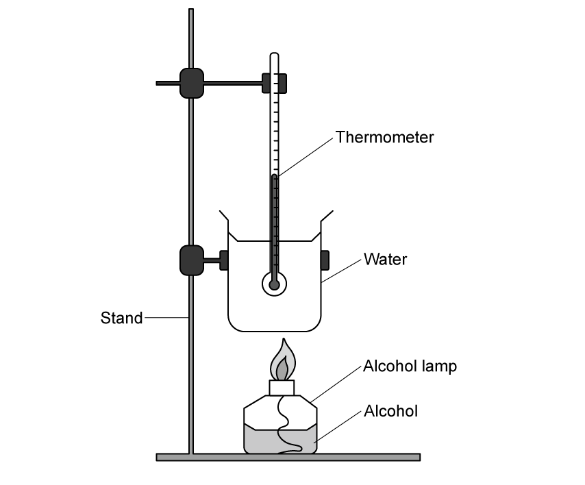

**Fig 2.1**

The student does five experiments.

**Experiment 1**

- Using a measuring cylinder, 10 cm3 of methanol, CH3OH, is placed into the spirit burner.
- 100 cm3 of water is poured into a 250 cm3 beaker.
- The initial temperature of the water is recorded.
- The wick is lit and the alcohol is allowed to burn until it is all used up.
- The final temperature of the water is recorded.

**Experiment 2**

- Experiment 1 is repeated using ethanol, C2H5OH.

**Experiments 3, 4 and 5**

- Experiment 1 is repeated using propanol (C3H7OH), butanol (C4H9OH) and pentanol (C5H11OH).

Use the thermometer diagrams to complete Table 2.1.

| experiment | alcohol | number of Carbon Atoms | initial temperature / °C | final temperature / °C | temperature increase / °C |
|---|---|---|---|---|---|
| 1 | Methanol | 1 | 21.0 | 27.0 | 6.0 |
| 2 | Ethanol | 2 |   |   |   |
| 3 | Propanol | 3 |   |   |   |
| 4 | Butanol | 4 |   |   |   |
| 5 | Pentanol | 5 |   |   |   |

**Experiment 1 **

**Experiment  2**

**Experiment  3**

**Experiment  4**

**Experiment  5**

**Q2** [5 marks]

**Extract:**

| experiment | alcohol | number of Carbon Atoms | initial temperature / °C | final temperature / °C | temperature increase / °C |
| 1 | Methanol | 1 | 21.0 | 27.0 | 6.0 |
| 2 | Ethanol | 2 | 21.0 | 33.0 | 12.0 |
| 3 | Propanol | 3 | 21.0 | 38.5 | 17.5 |
| 4 | Butanol | 4 | 21.0 | 45.0 | 24.0 |
| 5 | Pentanol | 5 | 21.0 | 51.5 | 30.5 |

The student wants to study the relationship between the number of carbon atoms in the alcohol molecule and the energy released.

Plot the results from Experiments 1 to 5 on the grid in Fig 2.2. The x-axis is provided. Add a suitable scale for the y-axis. **Draw a line of best fit that extends through all the grid.**

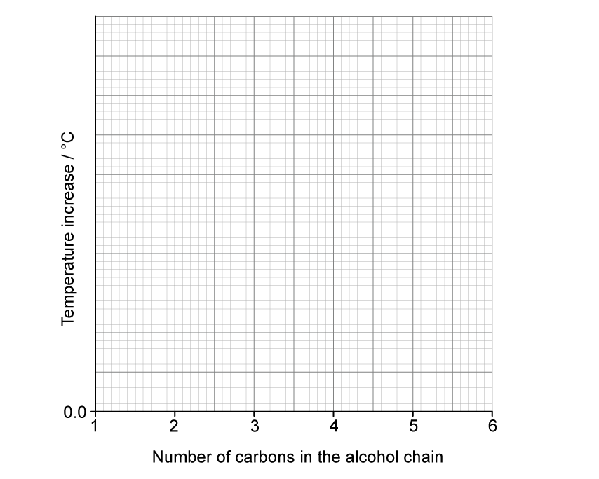

**Fig 2.2**

**Q2** [2 marks]

**Extract:**

The student investigates the energy of reaction when different alcohols are burned. Temperature increase data:
Methanol (1 carbon): 6.0 °C
Ethanol (2 carbons): 12.0 °C
Propanol (3 carbons): 17.5 °C
Butanol (4 carbons): 24.0 °C
Pentanol (5 carbons): 30.5 °C

Plot the results from Experiments 1 to 5 on the grid in Fig 2.2. The x-axis is number of carbons in the alcohol chain (1 to 6), y-axis is temperature increase / °C. Draw a line of best fit that extends through all the grid.

Use your graph to deduce the temperature increase expected if **hexanol** (6 carbon atoms) is used. Show clearly on the graph how you worked out your answer.

............. °C

**Q2** [3 marks]

**Extract:**

Use your graph to deduce the temperature increase expected if hexanol (6 carbon atoms) is used.
The expected temperature change for 6 carbon atoms would be 35.5 °C

Calculate the thermal energy, *Q*, absorbed by the water during the combustion of **hexanol**. Use your predicted temperature increase for hexanol from the graph in **Fig 2.2**.

$Q=mc\DeltaT$

where:

- c = 4.2 J / g °C
- m = 100 g (mass of water used)
- ΔT is the temperature increase.

Include the unit for Q in your answer.

**Q2** [1 mark]

**Extract:**

A student investigates the energy of reaction when different alcohols are burned. The alcohols belong to a homologous series. Experiments 1-5 use methanol (1 carbon), ethanol (2), propanol (3), butanol (4), pentanol (5). Results table:
| experiment | alcohol | number of Carbon Atoms | temperature increase / °C |
| 1 | Methanol | 1 | 6.0 |
| 2 | Ethanol | 2 | 12.0 |
| 3 | Propanol | 3 | 17.5 |
| 4 | Butanol | 4 | 24.0 |
| 5 | Pentanol | 5 | 30.5 |

Describe the relationship between the number of carbon atoms in the alcohol molecule and the temperature change of the water.

**Q2** [1 mark]

**Extract:**

A student investigates the energy of reaction when different alcohols are burned. The alcohols belong to a homologous series. The student does five experiments. Experiment 1: Using a measuring cylinder, 10 cm^3 of methanol, CH3OH, is placed into the spirit burner. 100 cm^3 of water is poured into a 250 cm^3 beaker. The initial temperature of the water is recorded. The wick is lit and the alcohol is allowed to burn until it is all used up. The final temperature of the water is recorded. Experiment 1 is repeated using ethanol, propanol, butanol and pentanol.

Explain why the volume of alcohol used must be kept constant in all five experiments.

**Q2** [2 marks]

**Extract:**

A student investigates the energy of reaction when different alcohols are burned. Experiment 1: Using a measuring cylinder, 10 cm^3 of methanol, CH3OH, is placed into the spirit burner. 100 cm^3 of water is poured into a 250 cm^3 beaker. The initial temperature of the water is recorded. The wick is lit and the alcohol is allowed to burn until it is all used up. The final temperature of the water is recorded.

The student repeats the experiment but uses a **pipette** rather than a measuring cylinder to measure the volume of alcohol. Suggest how this change affects the accuracy of the results. Explain your answer.

**Q2** [2 marks]

**Extract:**

A student investigates the energy of reaction when different alcohols are burned. The alcohols belong to a homologous series. The student uses the apparatus shown in Fig. 2.1 (Clamp stand holding a thermometer vertically. The thermometer bulb is immersed in water inside a beaker. An alcohol lamp containing alcohol is placed beneath the beaker to heat the water.) Using a measuring cylinder, 10 cm^3 of methanol, CH3OH, is placed into the spirit burner. 100 cm^3 of water is poured into a 250 cm^3 beaker. The initial temperature of the water is recorded. The wick is lit and the alcohol is allowed to burn until it is all used up. The final temperature of the water is recorded.

The student’s calculated value for the energy released was much lower than the theoretical value found in a data book.

Suggest **two** reasons for this difference, other than student error in reading the thermometer.

### Q3 — medium — 9 marks

**Q3** [1 mark]

The following paragraph was taken from a student’s notebook.

*To make potassium chloride*

25.0 cm3 of aqueous potassium hydroxide were placed in a flask and a few drops of indicator were added. Dilute hydrochloric acid was added to the flask until the indicator changed colour. The volume of acid used was 19.0 cm3.

What piece of apparatus should be used to measure the aqueous potassium hydroxide?

*Source: 2002 6 Q6*

**Q3** [3 marks]

**Extract:**

To make potassium chloride. 25.0 cm^3 of aqueous potassium hydroxide were placed in a flask and a few drops of indicator were added. Dilute hydrochloric acid was added to the flask until the indicator changed colour. The volume of acid used was 19.0 cm^3.

i) Name a suitable indicator that could be used.

[1]

ii) The indicator would change from ........................... to ................................

[2]

*Source: 2002 6 Q6*

**Q3** [2 marks]

**Extract:**

25.0 cm^3^ of aqueous potassium hydroxide were placed in a flask and a few drops of indicator were added. Dilute hydrochloric acid was added to the flask until the indicator changed colour. The volume of acid used was 19.0 cm^3^.

Which solution was more concentrated? Explain your answer.

*Source: 2002 6 Q6*

**Q3** [3 marks]

**Extract:**

To make potassium chloride

25.0 cm^3^ of aqueous potassium hydroxide were placed in a flask and a few drops of indicator were added. Dilute hydrochloric acid was added to the flask until the indicator changed colour. The volume of acid used was 19.0 cm^3^.

How could pure crystals of potassium chloride be obtained from this experiment?

*Source: 2002 6 Q6*

### Q4 — medium — 6 marks

**Q4** [4 marks]

Look at the diagrams of common laboratory apparatus.

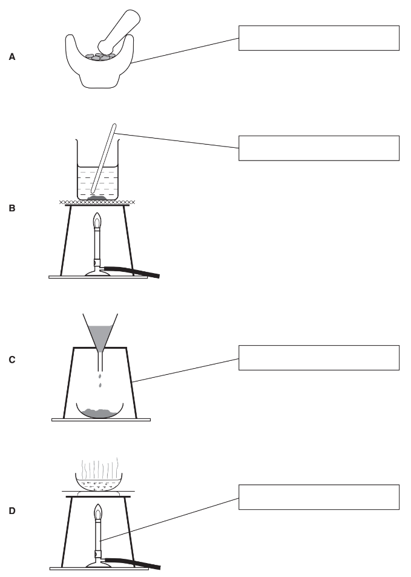

Complete the empty boxes to identify the pieces of apparatus labelled.

*Source: 2003 6 Q1*

**Q4** [1 mark]

**Extract:**

Look at the diagrams of common laboratory apparatus. Complete the empty boxes to identify the pieces of apparatus labelled.

What name is given to the separation method in **C**?

*Source: 2003 6 Q1*

**Q4** [1 mark]

**Extract:**

Look at the diagrams of common laboratory apparatus. Complete the empty boxes to identify the pieces of apparatus labelled.
A = mortar; B = stirrer / stirring rod; C = tripod; D = Bunsen burner

Which apparatus would be most suitable to obtain crystals from an aqueous solution of copper(II) sulphate?

*Source: 2003 6 Q1*

### Q5 — medium — 14 marks

**Q5** [4 marks]

A student investigated an aqueous solution of calcium hydroxide and water.

Two experiments were carried out.

<u>Experiment 1</u>

By using a measuring cylinder 25 cm3 of the aqueous solution of calcium hydroxide was placed in a flask. Phenolphthalein indicator was added to the flask. A burette was filled to the 0.0cm3 mark with solution **M** of hydrochloric acid.

Solution** M** was added slowly to the flask until the colour just disappeared.

Use the burette diagram to record the volume in the table and complete the column.

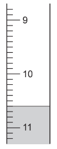

<u>Experiment 2 </u>

Experiment 1 was repeated using a different solution, **N**, of hydrochloric acid.

Use the burette diagrams to record the volumes in the table and complete the table.

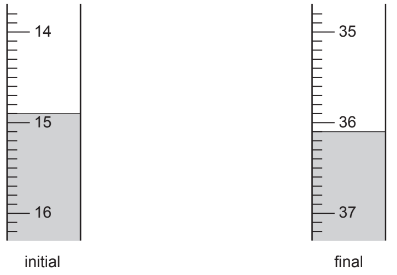

<u>Table of results</u>

| burette readings / cm3 | Experiment 1 | Experiment 2 |
|---|---|---|
| final reading |   |   |
| initial reading | 0.0 |   |
| difference |   |   |

*Source: 2005 6 Q4*

**Q5** [1 mark]

What type of chemical reaction occurs when hydrochloric acid reacts with calcium hydroxide?

*Source: 2005 6 Q4*

**Q5** [5 marks]

**Extract:**

A student investigated an aqueous solution of calcium hydroxide and water. Two experiments were carried out. Experiment 1: By using a measuring cylinder 25 cm^3 of the aqueous solution of calcium hydroxide was placed in a flask. Phenolphthalein indicator was added to the flask. A burette was filled to the 0.0cm^3 mark with solution M of hydrochloric acid. Solution M was added slowly to the flask until the colour just disappeared. Experiment 2: Experiment 1 was repeated using a different solution, N, of hydrochloric acid.

The completed results table is:
| burette readings / cm^3 | Experiment 1 | Experiment 2 |
| final reading | 10.6 | 36.1 |
| initial reading | 0.0 | 14.9 |
| difference | 10.6 | 21.2 |

i) In which experiment was the greater volume of hydrochloric acid used?

[1]

ii) Compare the volumes of acid used in Experiments 1 and 2.

[2]

iii) Suggest an explanation for the difference in volumes.

[2]

*Source: 2005 6 Q4*

**Q5** [3 marks]

**Extract:**

Experiment 1: By using a measuring cylinder 25 cm^3^ of the aqueous solution of calcium hydroxide was placed in a flask. Phenolphthalein indicator was added to the flask. A burette was filled to the 0.0cm^3^ mark with solution M of hydrochloric acid. Solution M was added slowly to the flask until the colour just disappeared.

Completed results: Experiment 1 final reading 10.6, initial reading 0.0, difference 10.6 cm^3^.

Predict the volume of hydrochloric acid **M** that would be needed to react completely if Experiment 1 was repeated with 50cm3 of calcium hydroxide solution?

volume of solution ..................................................

explanation ....................................................................................................

*Source: 2005 6 Q4*

**Q5** [1 mark]

**Extract:**

A student investigated an aqueous solution of calcium hydroxide and water. Two experiments were carried out. Experiment 1: By using a measuring cylinder 25 cm^3 of the aqueous solution of calcium hydroxide was placed in a flask. Phenolphthalein indicator was added to the flask. A burette was filled to the 0.0cm^3 mark with solution M of hydrochloric acid. Solution M was added slowly to the flask until the colour just disappeared.

Suggest **one **change you could make to the **apparatus **used in the experiments to obtain more accurate results.

*Source: 2005 6 Q4*

### Q6 — medium — 6 marks

**Q6** [1 mark]

A student reacted dry ammonia gas with hot copper(II) oxide.

The apparatus used is shown below.

The equation for the reaction is

2NH3 + 3CuO → 3Cu + N2 + 3H2O

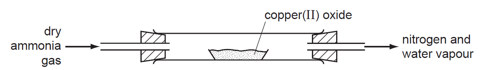

Indicate with an arrow where the heat is applied.

*Source: 2012 61 Q1*

**Q6** [2 marks]

**Extract:**

A student reacted dry ammonia gas with hot copper(II) oxide.

The equation for the reaction is

2NH~3 ~+ 3CuO → 3Cu + N~2~ + 3H~2~O

The colour of the copper(II) oxide would change from ............................... to ...............................

*Source: 2012 61 Q1*

**Q6** [2 marks]

**Extract:**

A student reacted dry ammonia gas with hot copper(II) oxide. The equation for the reaction is 2NH3 + 3CuO → 3Cu + N2 + 3H2O

Draw a labelled diagram to show how liquid water could be obtained from the water vapour produced.

**Q6** [1 mark]

**Extract:**

A student reacted dry ammonia gas with hot copper(II) oxide. The equation for the reaction is 2NH~3 ~+ 3CuO → 3Cu + N~2~ + 3H~2~O

Suggest the effect of nitrogen on a lighted splint.

### Q7 — medium — 13 marks

**Q7** [5 marks]

A student investigated the reaction between sodium thiosulfate and potassium iodate.

Two experiments were carried out.

***Experiment 1***

A burette was filled up to the 0.0 cm3 mark with sodium thiosulfate solution. By using a measuring cylinder, 20 cm3 of solution **A **of potassium iodate was placed into a conical flask. Dilute sulfuric acid and potassium iodide were also added to the flask. The flask was shaken to mix the contents and produce a red solution of iodine.

The sodium thiosulfate solution was added to the flask. When the contents of the flask were yellow, 1 cm3 of starch solution was added to the flask. Addition of sodium thiosulfate to the flask was continued until the solution turned colourless.

Use the burette diagram to record the final volume in the table and complete the column in the table of results.

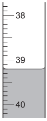

***   Experiment 2***

Experiment 1 was repeated using a different solution of potassium iodate, solution **B**.

Use the burette diagrams to record the volumes and complete the table.

| 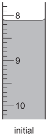 | 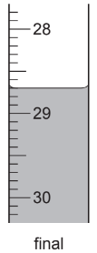 |
|---|---|

*   Table of results*

Burette readings / cm3

|   | Experiment 1 | Experiment 2 |
|---|---|---|
| final reading |   |   |
| initial reading | 0.0 | 8.1 |
| difference |   |   |

Suggest why the starch was used.

*Source: 2007 6 Q4*

**Q7** [4 marks]

**Extract:**

A student investigated the reaction between sodium thiosulfate and potassium iodate. Two experiments were carried out. Experiment 1: A burette was filled up to the 0.0 cm3 mark with sodium thiosulfate solution. 20 cm3 of solution A of potassium iodate was placed into a conical flask... Experiment 2 was Experiment 1 repeated using a different solution of potassium iodate, solution B.

Table of results (Burette readings / cm3):
Experiment 1: final reading 39.2, initial reading 0.0, difference 39.2
Experiment 2: final reading 28.7, initial reading 8.1, difference 20.6

i) In which experiment was the greatest volume of sodium thiosulfate solution used?

[1]

ii) Compare the volumes of sodium thiosulfate solution used in Experiments 1 and 2.

[1]

iii) Suggest an explanation for the difference in the volumes.

[2]

*Source: 2007 6 Q4*

**Q7** [2 marks]

**Extract:**

Experiment 1 was repeated using a different solution of potassium iodate, solution B. By using a measuring cylinder, 20 cm^3 of solution of potassium iodate was placed into a conical flask. From the table of results, Experiment 2: initial reading 8.1, final reading 28.7, difference 20.6 cm^3 of sodium thiosulfate solution.

Predict the volume of sodium thiosulfate solution which would be needed to react completely with 10cm3 of solution **B**.

*Source: 2007 6 Q4*

**Q7** [2 marks]

**Extract:**

A student investigated the reaction between sodium thiosulfate and potassium iodate. Two experiments were carried out. Experiment 1: A burette was filled up to the 0.0 cm^3 mark with sodium thiosulfate solution. By using a measuring cylinder, 20 cm^3 of solution A of potassium iodate was placed into a conical flask. Dilute sulfuric acid and potassium iodide were also added to the flask. The flask was shaken to mix the contents and produce a red solution of iodine. The sodium thiosulfate solution was added to the flask. When the contents of the flask were yellow, 1 cm^3 of starch solution was added to the flask. Addition of sodium thiosulfate to the flask was continued until the solution turned colourless. Experiment 2: Experiment 1 was repeated using a different solution of potassium iodate, solution B.

Explain **one **change that could be made to the experimental **method **to obtain more accurate results, without changing the apparatus.

change ....................................................................................................

explanation ....................................................................................................

*Source: 2007 6 Q4*

### Q8 — medium — 6 marks

**Q8** [4 marks]

A student investigated the redox reaction between potassium iodate(V) and iodide ions.

Two experiments were carried out.

*Experiment 1 *

A burette was filled up to the 0.0 cm3 mark with the solution **A** of sodium thiosulphate. By using a measuring cylinder, a 10 cm3 sample of the solution **B** of potassium iodate(V) was added into a conical flask. A 10 cm3 sample of dilute sulfuric acid was added to the flask followed by 20 cm3 of aqueous potassium iodide.

Solution **A** was added slowly to the flask until there was a pale yellow colour in the contents of the flask. Starch solution was then added into the flask and the colour changed to blue black. Solution **A **was added to the flask until the colour just disappeared.

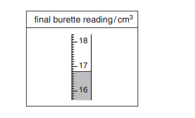

*Experiment 2*

Experiment 1 was repeated using solution **C **of potassium iodate(V) instead of solution **B.**

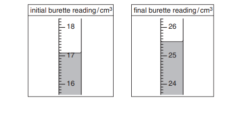

Use the burette diagrams for experiment 1 and 2 to record the volumes in the table and complete the table.

| Burette readings / cm3 | Experiment 1 | Experiment 2 |
|---|---|---|
| Final reading |   |   |
| Initial reading | 0.0 |   |
| Difference |   |   |

*Source: 2003 6 Q*

**Q8** [2 marks]

**Extract:**

A student investigated the redox reaction between potassium iodate(V) and iodide ions. Two experiments were carried out. Experiment 1: A burette was filled up to the 0.0 cm^3 mark with the solution A of sodium thiosulphate... Solution A was added slowly to the flask until there was a pale yellow colour... Experiment 2: Experiment 1 was repeated using solution C of potassium iodate(V) instead of solution B.

The completed table is:
| Burette readings / cm^3 | Experiment 1 | Experiment 2 |
| Final reading | 16.8 | 25.5 |
| Initial reading | 0.0 | 17.1 |
| Difference | 16.8 | 8.4 |

The reaction of the mixture of potassium iodate(V), sulfuric acid and potassium iodide in the flask produces iodine. Sodium thiosulfate then reacts with the iodine.

i) In which Experiment was the greatest volume of aqueous sodium thiosulfate used?

[1]

ii) Compare the volumes of sodium thiosulfate used in Experiments 1 and 2.

[1]

*Source: 2003 6 Q3*

### Q9 — medium — 5 marks

**Q9** [2 marks]

Sulfur dioxide gas is denser than air and soluble in water. A sample of sulfur dioxide can be prepared by adding dilute hydrochloric acid to sodium sulfite and warming the mixture. Study the diagram of the apparatus used.

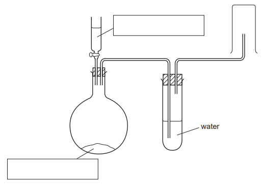

Fill in the boxes to show the chemicals used.

*Source: 2008 6 Q3*

**Q9** [1 mark]

**Extract:**

Sulfur dioxide gas is denser than air and soluble in water. A sample of sulfur dioxide can be prepared by adding dilute hydrochloric acid to sodium sulfite and warming the mixture. Study the diagram of the apparatus used. Fill in the boxes to show the chemicals used.

Show by using an arrow, on the diagram, where heat is applied.

*Source: 2008 6 Q3*

**Q9** [2 marks]

**Extract:**

Sulfur dioxide gas is denser than air and soluble in water. A sample of sulfur dioxide can be prepared by adding dilute hydrochloric acid to sodium sulfite and warming the mixture. Study the diagram of the apparatus used.  Fill in the boxes to show the chemicals used.

Identify **two **mistakes in the diagram.

*Source: 2008 6 Q3*

### Q10 — medium — 8 marks

**Q10** [1 mark]

Ammonia is produced when aqueous sodium hydroxide is warmed with ammonium sulfate. Ammonia is less dense than air and very soluble in water. The apparatus below was used to prepare a sample of dry ammonia gas.

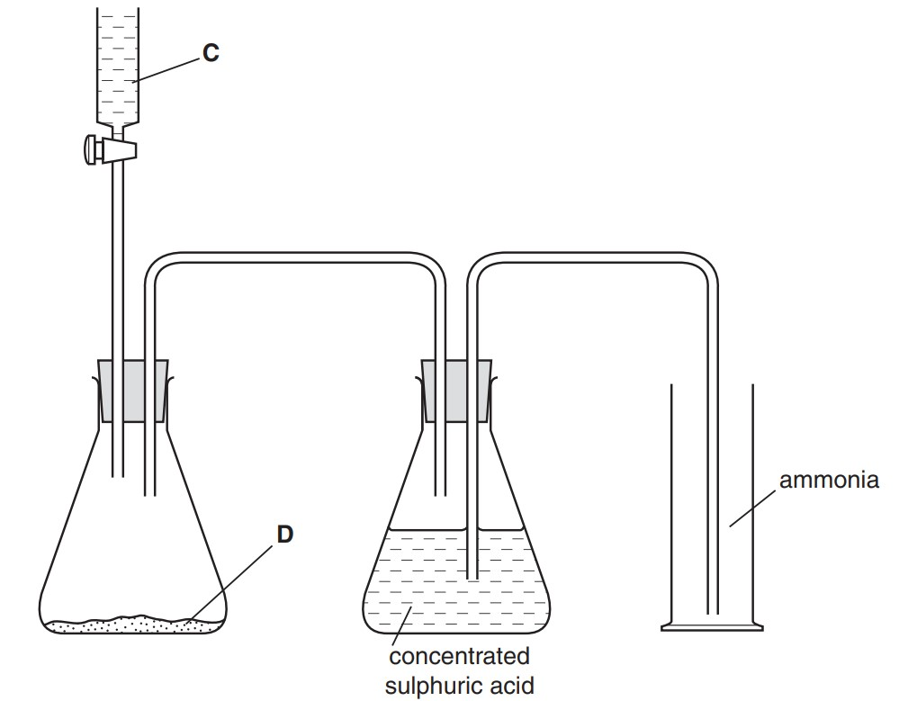

Name substance **C**.

*Source: 2003 6 Q5*

**Q10** [1 mark]

**Extract:**

Ammonia is produced when aqueous sodium hydroxide is warmed with ammonium sulfate. Ammonia is less dense than air and very soluble in water. The apparatus below was used to prepare a sample of dry ammonia gas. [Chemistry setup with two Erlenmeyer flasks connected by tubing, one with concentrated sulphuric acid, the other with ammonia and labelled variables C and D.]

Name substance **D**.

*Source: 2003 6 Q5*

**Q10** [1 mark]

**Extract:**

Ammonia is produced when aqueous sodium hydroxide is warmed with ammonium sulfate. Ammonia is less dense than air and very soluble in water. The apparatus below was used to prepare a sample of dry ammonia gas. [Chemistry setup with two Erlenmeyer flasks connected by tubing, one with concentrated sulphuric acid, the other with ammonia and labelled variables C and D.]

What necessary piece of equipment is missing in the diagram?

*Source: 2003 6 Q5*

**Q10** [1 mark]

**Extract:**

Ammonia is produced when aqueous sodium hydroxide is warmed with ammonium sulfate. Ammonia is less dense than air and very soluble in water. The apparatus below was used to prepare a sample of dry ammonia gas. Chemistry setup with two Erlenmeyer flasks connected by tubing, one with concentrated sulphuric acid, the other with ammonia and labelled variables C and D.

Suggest why concentrated sulfuric acid should **not **be used to dry ammonia.

*Source: 2003 6 Q5*

**Q10** [4 marks]

**Extract:**

Ammonia is produced when aqueous sodium hydroxide is warmed with ammonium sulfate. Ammonia is less dense than air and very soluble in water. The apparatus below was used to prepare a sample of dry ammonia gas.

![Chemistry setup with two Erlenmeyer flasks connected by tubing, one with concentrated sulphuric acid, the other with ammonia and labelled variables C and D.]

There are two other mistakes in the apparatus shown in the diagram. Identify and explain these mistakes.

mistake 1 ..........................................................................................................
explanation ..........................................................................................................

mistake 2 ..........................................................................................................
explanation ..........................................................................................................

*Source: 2003 6 Q5*

### Q11 — medium — 20 marks

**Q11** [2 marks]

A student investigated the reaction between two different solutions of dilute hydrochloric acid, **A** and **B**, and solution **C** which is alkaline.

Two experiments were carried out

*Experiment 1 *

A burette was filled with solution **A** of dilute hydrochloric acid to the 0.0 cm3 mark. Using a measuring cylinder, 20 cm3 of solution **C** was poured into a conical flask. A few drops of methyl orange were added to the flask.

Solution **A** was added to the flask, with shaking, until the mixture just changed colour. Use the burette diagram to record the burette reading in the table and complete the table.

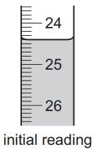

|   | burette readings |
|---|---|
| final volume / cm3 |   |
| initial volume / cm3 |   |
| difference / cm3 |   |

*Source: 2014 O61 Q4*

**Q11** [2 marks]

**Extract:**

A student investigated the reaction between two different solutions of dilute hydrochloric acid, A and B, and solution C which is alkaline. Two experiments were carried out. Experiment 1: A burette was filled with solution A of dilute hydrochloric acid to the 0.0 cm^3 mark. Using a measuring cylinder, 20 cm^3 of solution C was poured into a conical flask. A few drops of methyl orange were added to the flask. Solution A was added to the flask, with shaking, until the mixture just changed colour.

*Experiment 2 *

The burette was emptied and rinsed, first with distilled water, and then with a little of solution **B**. The burette was filled with solution **B** of dilute hydrochloric acid to the 0.0 cm3 mark.

Experiment 1 was repeated using solution **B**.

Use the burette diagram to record the burette reading in the table and complete the table.

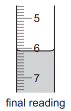

|   | burette readings |
|---|---|
| final volume / cm3 |   |
| initial volume / cm3 |   |
| difference / cm3 |   |

*Source: 2014 O61 Q4*

**Q11** [2 marks]

**Extract:**

A student investigated the reaction between two different solutions of dilute hydrochloric acid, A and B, and solution C which is alkaline.

Experiment 1

A burette was filled with solution A of dilute hydrochloric acid to the 0.0 cm^3 mark. Using a measuring cylinder, 20 cm^3 of solution C was poured into a conical flask. A few drops of methyl orange were added to the flask.

Solution A was added to the flask, with shaking, until the mixture just changed colour.

i) What type of chemical reaction takes place when hydrochloric acid reacts with alkaline solutions?

[1]

ii) Why is methyl orange added to the flask?

[1]

*Source: 2014 O61 Q4*

**Q11** [2 marks]

**Extract:**

A student investigated the reaction between two different solutions of dilute hydrochloric acid, **A** and **B**, and solution **C** which is alkaline.

Experiment 1: A burette was filled with solution **A** of dilute hydrochloric acid to the 0.0 cm^3^ mark. Using a measuring cylinder, 20 cm^3^ of solution **C** was poured into a conical flask. A few drops of methyl orange were added to the flask. Solution **A** was added to the flask, with shaking, until the mixture just changed colour.

Experiment 2: The burette was emptied and rinsed, first with distilled water, and then with a little of solution **B**. The burette was filled with solution **B** of dilute hydrochloric acid to the 0.0 cm^3^ mark. Experiment 1 was repeated using solution **B**.

Why was the burette rinsed, first with distilled water and then with solution **B**, before starting Experiment 2?

*Source: 2014 O61 Q4*

**Q11** [4 marks]

**Extract:**

A student investigated the reaction between two different solutions of dilute hydrochloric acid, A and B, and solution C which is alkaline. Two experiments were carried out. Experiment 1: A burette was filled with solution A of dilute hydrochloric acid to the 0.0 cm^3 mark. Using a measuring cylinder, 20 cm^3 of solution C was poured into a conical flask. A few drops of methyl orange were added to the flask. Solution A was added to the flask, with shaking, until the mixture just changed colour. The difference (volume used) was 24.4 cm^3.
Experiment 2: The burette was filled with solution B of dilute hydrochloric acid to the 0.0 cm^3 mark. Experiment 1 was repeated using solution B. The difference (volume used) was 6.1 cm^3.

i) In which experiment was the greater volume of dilute hydrochloric acid used?

[1]

ii) Compare the volumes of dilute hydrochloric acid used in Experiments 1 and 2.

[1]

iii) Suggest, in terms of the concentration of solutions **A** and **B**, an explanation for the difference in volumes used.

[2]

*Source: 2014 O61 Q4*

**Q11** [2 marks]

**Extract:**

Experiment 1: Using a measuring cylinder, 20 cm^3 of solution C was poured into a conical flask. A few drops of methyl orange were added to the flask. Solution A was added to the flask, with shaking, until the mixture just changed colour.

Experiment 2: The burette was filled with solution B of dilute hydrochloric acid to the 0.0 cm^3 mark. Experiment 1 was repeated using solution B. The burette result (difference) was 6.1 / 6.10 cm^3.

If Experiment 2 was repeated using 10 cm3 of solution** C**, what volume of dilute hydrochloric acid would be used? Explain your answer.

*Source: 2014 O61 Q4*

**Q11** [2 marks]

**Extract:**

A student investigated the reaction between two different solutions of dilute hydrochloric acid, A and B, and solution C which is alkaline.

Experiment 1

A burette was filled with solution A of dilute hydrochloric acid to the 0.0 cm^3 mark. Using a measuring cylinder, 20 cm^3 of solution C was poured into a conical flask. A few drops of methyl orange were added to the flask.

Give **one **advantage and **one **disadvantage of using a measuring cylinder for solution **C**.

*Source: 2014 O61 Q4*

**Q11** [4 marks]

**Extract:**

A student investigated the reaction between two different solutions of dilute hydrochloric acid, **A** and **B**, and solution **C** which is alkaline.

Describe a method other than titration, using a different reactant, that could be used to compare the concentrations of the two solutions of dilute hydrochloric acid, **A** and **B**.

*Source: 2014 O61 Q4*

### Q12 — medium — 17 marks

**Q12** [4 marks]

A student investigated the reaction between aqueous sodium carbonate and two different solutions of dilute hydrochloric acid, **A** and **B**.

The reaction is:

Na2CO3 (aq) + 2HCl (aq) → 2NaCl (aq) + H2O (l) + CO2 (g)

Three experiments were carried out.

*Experiment 1 *

Using a measuring cylinder, 25 cm3 of aqueous sodium carbonate were poured into a conical flask.

Thymolphthalein indicator was added to the conical flask. A burette was filled up to the 0.0 cm3 mark with solution **A**. Dilute hydrochloric acid **A** was added to the flask, until the solution just changed colour. Use the burette diagram to record the reading in the table.

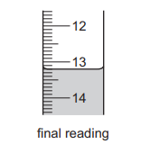

*Experiment 2*

Experiment 1 was repeated using methyl orange indicator instead of thymolphthalein.

Methyl orange is red-orange in acidic solutions and yellow in alkaline solutions. Use the burette diagrams to record the readings in the table and complete the table.

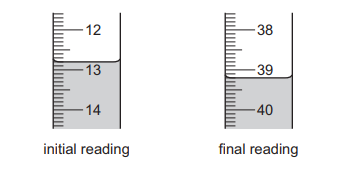

|   | experiment 1 | experiment 2 |
|---|---|---|
| final burette reading / cm3 |   |   |
| initial burette reading / cm3 |   |   |
| difference / cm3 |   |   |

**Q12** [1 mark]

**Extract:**

A student investigated the reaction between aqueous sodium carbonate and two different solutions of dilute hydrochloric acid, A and B.

Experiment 2: Experiment 1 was repeated using methyl orange indicator instead of thymolphthalein. Methyl orange is red-orange in acidic solutions and yellow in alkaline solutions. Using a measuring cylinder, 25 cm^3 of aqueous sodium carbonate were poured into a conical flask, and the indicator was added.

What colour change was observed in the flask in experiment 2?

from .......................................... to ........................................

**Q12** [2 marks]

**Extract:**

A student investigated the reaction between aqueous sodium carbonate and two different solutions of dilute hydrochloric acid, A and B.

The reaction is: Na2CO3 (aq) + 2HCl (aq) → 2NaCl (aq) + H2O (l) + CO2 (g)

Experiment 1: Using a measuring cylinder, 25 cm3 of aqueous sodium carbonate were poured into a conical flask. Thymolphthalein indicator was added to the conical flask. A burette was filled up to the 0.0 cm3 mark with solution A. Dilute hydrochloric acid A was added to the flask, until the solution just changed colour.

*Experiment 3*

Experiment 1 was repeated using solution **B **of acid instead of solution **A**. Use the burette diagrams to record the readings in the table and complete the table.

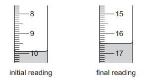

|   | experiment 3 |
|---|---|
| final burette reading / cm3 |   |
| initial burette reading / cm3 |   |
| difference / cm3 |   |

**Q12** [1 mark]

**Extract:**

A student investigated the reaction between aqueous sodium carbonate and two different solutions of dilute hydrochloric acid, A and B. The reaction is: Na~2~CO~3~ (aq) + 2HCl (aq) → 2NaCl (aq) + H~2~O (l) + CO~2~ (g)

Suggest **one** observation, other than colour change, that is made when hydrochloric acid is added to sodium carbonate.

**Q12** [1 mark]

**Extract:**

A student investigated the reaction between aqueous sodium carbonate and two different solutions of dilute hydrochloric acid, A and B. Three experiments were carried out. Experiment 1: 25 cm^3 of aqueous sodium carbonate, thymolphthalein indicator, titrated with acid A - difference = 13.2 cm^3. Experiment 2: repeated with methyl orange indicator - difference = 26.4 cm^3. Experiment 3: repeated using solution B of acid instead of solution A - difference = 6.6 cm^3.

Complete the sentence below. Experiment .......... needed the largest volume of hydrochloric acid to change the colour of the indicator.

**Q12** [1 mark]

**Extract:**

Using a measuring cylinder, 25 cm^3 of aqueous sodium carbonate were poured into a conical flask.

What would be a more accurate method of measuring the volume of the aqueous sodium carbonate?

**Q12** [2 marks]

**Extract:**

A student investigated the reaction between aqueous sodium carbonate and two different solutions of dilute hydrochloric acid, A and B.

The reaction is:

Na2CO3 (aq) + 2HCl (aq) → 2NaCl (aq) + H2O (l) + CO2 (g)

Using a measuring cylinder, 25 cm3 of aqueous sodium carbonate were poured into a conical flask. Indicator was added to the conical flask. A burette was filled up to the 0.0 cm3 mark with the acid solution. Dilute hydrochloric acid was added to the flask, until the solution just changed colour.

What would be the effect on the results, if any, if the solutions of sodium carbonate were warmed before adding the hydrochloric acid? Give a reason for your answer.

effect on results ............................................................................................... reason ...............................................................................................

**Q12** [2 marks]

**Extract:**

A student investigated the reaction between aqueous sodium carbonate and two different solutions of dilute hydrochloric acid, A and B. Experiment 1 used 25 cm^3 of aqueous sodium carbonate with solution A; the volume of acid A added (difference) was 13.2 cm^3.
Experiment 3 was Experiment 1 repeated using solution B instead of solution A; the volume of acid B added (difference) was 6.6 cm^3.

i) Determine the ratio of volumes of dilute hydrochloric acid used in experiments 1 and 3.

[1]

ii) Use your answer to (h)(i) to deduce how the concentration of solution **A** differs from that of solution **B**.

[1]

**Q12** [3 marks]

**Extract:**

A student investigated the reaction between aqueous sodium carbonate and two different solutions of dilute hydrochloric acid, A and B.

Suggest a different method, using standard laboratory chemicals, to determine which of the solutions of dilute hydrochloric acid, **A** or **B**, is more concentrated.

### Q13 — medium — 18 marks

**Q13** [2 marks]

A student investigated the reaction between aqueous sodium hydroxide and acid **K**.

Two experiments were carried out.

*Experiment 1*

Using a measuring cylinder, 25 cm3 of acid **K** was poured into a conical flask. Phenolphthalein indicator was added to the flask. A burette was filled with aqueous sodium hydroxide to the 0.0 cm3 mark. Aqueous sodium hydroxide was added from the burette to the flask and the mixture shaken until the solution showed a permanent colour change.

The final volume was measured. Use the burette diagram to record the final volume in the table and complete the table.

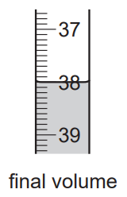

|   | burette readings |
|---|---|
| final volume / cm3 |   |
| initial volume / cm3 |   |
| difference / cm3 |   |

*Source: 2013 O61 Q3*

**Q13** [2 marks]

**Extract:**

A student investigated the reaction between aqueous sodium hydroxide and acid K. Two experiments were carried out. Experiment 1: Using a measuring cylinder, 25 cm^3 of acid K was poured into a conical flask. Phenolphthalein indicator was added to the flask. A burette was filled with aqueous sodium hydroxide to the 0.0 cm^3 mark. Aqueous sodium hydroxide was added from the burette to the flask and the mixture shaken until the solution showed a permanent colour change.

*Experiment 2*

The solution was poured away and the conical flask rinsed.

Using a measuring cylinder, 50 cm3 of acid **K** was poured into the conical flask. 0.3 g of powdered calcium carbonate was added to the flask and the flask shaken until no further reaction was observed.

Phenolphthalein was added to the mixture in the flask.

A burette was filled with the same aqueous sodium hydroxide and the initial volume measured. Aqueous sodium hydroxide was added from the burette to the flask and the mixture shaken until the solution showed a permanent colour change.

Use the burette diagrams to record the initial and final volumes in the table and complete the table.

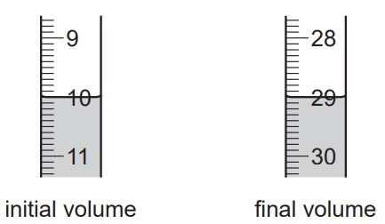

|   | burette readings |
|---|---|
| final volume / cm3 |   |
| initial volume / cm3 |   |
| difference / cm3 |   |

*Source: 2013 O61 Q3*

**Q13** [1 mark]

**Extract:**

A student investigated the reaction between aqueous sodium hydroxide and acid **K**.

What type of chemical reaction occurred when acid **K** reacted with sodium hydroxide?

*Source: 2013 O61 Q3*

**Q13** [2 marks]

**Extract:**

Experiment 1: Using a measuring cylinder, 25 cm^3 of acid K was poured into a conical flask. Phenolphthalein indicator was added to the flask. A burette was filled with aqueous sodium hydroxide to the 0.0 cm^3 mark. Aqueous sodium hydroxide was added from the burette to the flask and the mixture shaken until the solution showed a permanent colour change. The final volume (difference) was 38.0 cm^3.

If Experiment 1 were repeated using 50 cm3 of acid **K**, what volume of sodium hydroxide would be required to change the colour of the indicator?

*Source: 2013 O61 Q3*

**Q13** [5 marks]

**Extract:**

Experiment 2: Using a measuring cylinder, 50 cm^3 of acid K was poured into the conical flask. 0.3 g of powdered calcium carbonate was added to the flask and the flask shaken until no further reaction was observed. Phenolphthalein was added to the mixture in the flask. A burette was filled with the same aqueous sodium hydroxide and the initial volume measured. Aqueous sodium hydroxide was added from the burette to the flask until the solution showed a permanent colour change. The burette readings: final volume 29.0 cm^3, initial volume 10.0 cm^3, difference 19.0 cm^3.

If Experiment 1 were repeated using 50 cm^3 of acid K, the volume of sodium hydroxide that would be required to change the colour of the indicator is 2 × volume for Experiment 1 from table / 76 cm^3.

i) What were the effects of adding 0.3 g of powdered calcium carbonate to acid **K**?

[2]

ii) Use your answer in (d) to work out the difference between the volume of sodium hydroxide needed to completely react with 50 cm3 of acid **K** and the volume of sodium hydroxide used in Experiment 2.

[2]

iii) Estimate the mass of calcium carbonate that would be needed to be added to 50 cm3 of acid **K** to require 0.0 cm3 of sodium hydroxide.

[1]

*Source: 2013 O61 Q3*

**Q13** [2 marks]

**Extract:**

A student investigated the reaction between aqueous sodium hydroxide and acid **K**. 

*Experiment 1*

Using a measuring cylinder, 25 cm^3^ of acid **K** was poured into a conical flask. Phenolphthalein indicator was added to the flask. A burette was filled with aqueous sodium hydroxide to the 0.0 cm^3^ mark. Aqueous sodium hydroxide was added from the burette to the flask and the mixture shaken until the solution showed a permanent colour change.

What would be the effect on the results if the solutions of acid **K** were warmed before adding the sodium hydroxide? Give a reason for your answer.

*Source: 2013 O61 Q3*

**Q13** [4 marks]

**Extract:**

Using a measuring cylinder, 25 cm^3^ of acid **K** was poured into a conical flask. Phenolphthalein indicator was added to the flask. A burette was filled with aqueous sodium hydroxide to the 0.0 cm^3^ mark. Aqueous sodium hydroxide was added from the burette to the flask and the mixture shaken until the solution showed a permanent colour change.

Suggest the advantage, if any, of

i) using a pipette to measure the volume of acid **K**.

[2]

ii) using a polystyrene cup instead of a flask.

[2]

*Source: 2013 O61 Q3*

### Q14 — medium — 16 marks

**Q14** [2 marks]

A student investigated the reaction between two different solutions of deep purple potassium manganate(VII), **A** and **B**, and an acidic solution of hydrogen peroxide.

Three experiments were carried out.

*Experiment 1*

A burette was filled with the solution** A** of potassium manganate(VII) up to the 0.0 cm3 mark. Using a measuring cylinder, 25 cm3 of colourless hydrogen peroxide solution was poured into the conical flask.

The potassium manganate(VII) solution **A** was added slowly to the flask, and shaken to mix thoroughly. Addition of potassium manganate(VII) solution was continued until there was a permanent pink colour in the contents of the flask.

Use the burette diagram to record the volume in the table of results and complete the column.

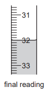

|   | experiment 1 |
|---|---|
| final reading / cm3 |   |
| initial reading / cm3 |   |
| difference cm3 |   |

*Source: 2011 61 Q4*

**Q14** [2 marks]

**Extract:**

A student investigated the reaction between two different solutions of deep purple potassium manganate(VII), A and B, and an acidic solution of hydrogen peroxide. Three experiments were carried out. Experiment 1: A burette was filled with the solution A of potassium manganate(VII) up to the 0.0 cm^3 mark. Using a measuring cylinder, 25 cm^3 of colourless hydrogen peroxide solution was poured into the conical flask. The potassium manganate(VII) solution A was added slowly to the flask, and shaken to mix thoroughly. Addition of potassium manganate(VII) solution was continued until there was a permanent pink colour in the contents of the flask.

*Experiment 2 *

Experiment 1 was repeated using the solution **B** of potassium manganate(VII) instead of solution **A**.

Use the burette diagrams to record the volumes in the table of results and complete the table.

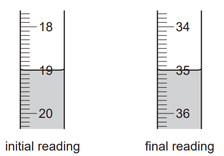

|   | experiment 2 |
|---|---|
| final reading / cm3 |   |
| initial reading / cm3 |   |
| difference / cm3 |   |

*Source: 2011 61 Q4*

**Q14** [1 mark]

*Experiment 3* To a little of the hydrogen peroxide solution in a test-tube, manganese(IV) oxide was added. Rapid effervescence was observed and a glowing splint relit.

Identify the gas given off in Experiment 3.

*Source: 2011 61 Q4*

**Q14** [2 marks]

**Extract:**

A student investigated the reaction between two different solutions of deep purple potassium manganate(VII), A and B, and an acidic solution of hydrogen peroxide.

A burette was filled with the solution A of potassium manganate(VII) up to the 0.0 cm^3 mark. Using a measuring cylinder, 25 cm^3 of colourless hydrogen peroxide solution was poured into the conical flask.

The potassium manganate(VII) solution A was added slowly to the flask, and shaken to mix thoroughly. Addition of potassium manganate(VII) solution was continued until there was a permanent pink colour in the contents of the flask.

i) What colour change was observed when potassium manganate(VII) solution was added to the flask?

from ..................................................... to .....................................................

[1]

ii) Why was an indicator **not **added to the flask?

[1]

*Source: 2011 61 Q4*

**Q14** [4 marks]

**Extract:**

A student investigated the reaction between two different solutions of deep purple potassium manganate(VII), A and B, and an acidic solution of hydrogen peroxide. Experiment 1: A burette was filled with solution A of potassium manganate(VII) up to the 0.0 cm³ mark. 25 cm³ of colourless hydrogen peroxide solution was poured into the conical flask. Potassium manganate(VII) solution A was added until there was a permanent pink colour. Experiment 1 result: final reading 32.0, initial reading 0.0, difference 32.0 cm³.
Experiment 2 was Experiment 1 repeated using solution B instead of solution A. Experiment 2 result: final reading 35.0, initial reading 19.0, difference 16.0 cm³.

i) In which experiment was the greatest volume of potassium manganate(VII) solution used?

[1]

ii) Compare the volumes of potassium manganate(VII) used in Experiments 1 and 2.

[1]

iii) Suggest an explanation for the difference in volumes.

[2]

*Source: 2011 61 Q4*

**Q14** [3 marks]

**Extract:**

Experiment 1: Using a measuring cylinder, 25 cm^3 of colourless hydrogen peroxide solution was poured into the conical flask.
Experiment 2: Experiment 1 was repeated using the solution B of potassium manganate(VII) instead of solution A. difference / cm^3 = 16.0

If Experiment 2 was repeated using 12.5 cm3 of the hydrogen peroxide solution, what volume of potassium manganate(VII) solution would be needed to react completely? Explain your answer.

*Source: 2011 61 Q4*

**Q14** [2 marks]

**Extract:**

A burette was filled with the solution A of potassium manganate(VII) up to the 0.0 cm^3^ mark. Using a measuring cylinder, 25 cm^3^ of colourless hydrogen peroxide solution was poured into the conical flask.

Give **one **advantage and **one **disadvantage of using a measuring cylinder for the hydrogen peroxide solution.

*Source: 2011 61 Q4*

### Q15 — medium — 7 marks

**Q15** [2 marks]

Hydrogen chloride gas is strong-smelling, denser than air and soluble in water. A sample of hydrogen chloride gas can be prepared by adding concentrated sulfuric acid to sodium chloride. Study the diagram of the apparatus used.

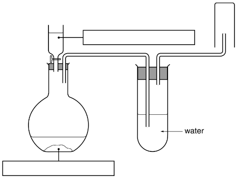

Fill in the boxes to show the chemicals used.

*Source: 2002 6 Q2*

**Q15** [4 marks]

**Extract:**

Hydrogen chloride gas is strong-smelling, denser than air and soluble in water. A sample of hydrogen chloride gas can be prepared by adding concentrated sulfuric acid to sodium chloride. Study the diagram of the apparatus used.

Identify and explain **two **mistakes in the diagram.

Mistake 1 ....................................................................................................

[2]

Mistake 2 ....................................................................................................

[2]

*Source: 2002 6 Q2*

**Q15** [1 mark]

**Extract:**

Hydrogen chloride gas is strong-smelling, denser than air and soluble in water. A sample of hydrogen chloride gas can be prepared by adding concentrated sulfuric acid to sodium chloride.

State **one **precaution that should be taken when carrying out this experiment.

*Source: 2002 6 Q2*

### Q16 — medium — 6 marks

**Q16** [6 marks]

The diagram shows two bottles of liquid oven cleaner.

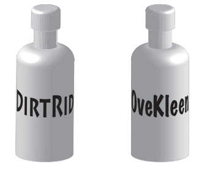

The oven cleaners contain sodium hydroxide solution. Plan an investigation to show which oven cleaner contains the highest concentration of sodium hydroxide.

*Source: 2006 Ju6 Q6*

## Multiple Choice Questions (20 questions)

### Q1 — easy — 1 marks

**Q1** [1 mark]

A student carries out a titration to determine the concentration of a dilute acid using a standard alkali.

Five actions in this acid-base titration are shown in the table.

| step | action |
|---|---|
| P | record the final burette reading after the end-point is reached |
| Q | transfer a measured volume of alkali into a conical flask using a volumetric pipette |
| R | add a few drops of a suitable indicator to the flask |
| S | note the initial burette reading before starting the titration |
| T | carefully run the acid from the burette into the flask while swirling until a permanent colour change occurs |

### Q2 — easy — 1 marks

**Q2** [1 mark]

A student investigates the effect of temperature on the rate of reaction between large lumps of calcium carbonate and dilute acid. The student plots a graph of the loss in mass of the reaction mixture against time for different temperatures.

Which combination of apparatus are essential to record the measurements used to plot the graph?

### Q3 — easy — 1 marks

**Q3** [1 mark]

A student prepared crystals of copper sulfate from copper carbonate and sulfuric acid.

The student separated the excess copper carbonate from the solution using filtration.

What word describes the excess copper carbonate?

### Q4 — easy — 1 marks

**Q4** [1 mark]

A student carries out a titration to determine the volume of hydrochloric acid needed to neutralise 25 cm3 of sodium hydroxide.

She measured 25 cm3 sodium hydroxide into a conical flask.

Which piece of equipment should she use to do this?

### Q5 — easy — 1 marks

**Q5** [1 mark]

Measuring volumes of liquids is a fundamental aspect of experimental chemistry. The diagram shows three different pieces of apparatus used for this task.

Which row is correct?

|   | **1** | **2** | **3** |
|---|---|---|---|
| **A** | burette | measuring cylinder | pipette |
| **B** | burette | pipette | measuring cylinder |
| **C** | pipette | measuring cylinder | burette |
| **D** | measuring cylinder | burette | pipette |

### Q6 — easy — 1 marks

**Q6** [1 mark]

A student dissolved ammonium chloride in water when investigating energy changes in reactions.

Which terms best describes each substance?

|   | **ammonium chloride** | **water** |
|---|---|---|
| **A** | solute | solvent |
| **B** | solvent | solution |
| **C** | solution | solvent |
| **D** | solute | solution |

### Q7 — easy — 1 marks

**Q7** [1 mark]

The diagram shows a burette and a measuring cylinder, both of which contain a liquid.

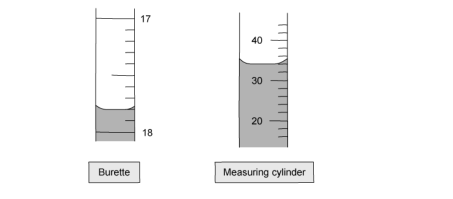

Which row shows the correct reading for both?

|   | **Burette** | **Measuring cylinder** |
|---|---|---|
| **A** | 18.4 | 34 |
| **B** | 18.4 | 56 |
| **C** | 17.8 | 34 |
| **D** | 17.8 | 56 |

### Q8 — hard — 1 marks

**Q8** [1 mark]

A student titrated sodium carbonate solution against 25 cm3 of hydrochloric acid.

They used methyl orange as an indicator.

What is the colour changed observed at the end point?

### Q9 — hard — 1 marks

**Q9** [1 mark]

A student prepared a solution of copper(II) sulfate by mixing dilute sulfuric acid with an excess of copper(II) oxide.

They filtered the mixture using the apparatus below.

Which terms best describes each substance?

|   | **Solvent** | **Solute** | **Filtrate** | **Residue** |
|---|---|---|---|---|
| **A** | water | copper(II) sulfate | copper(II) sulfate solution | copper(II) oxide |
| **B** | dilute hydrochloric acid | copper(II) oxide | water | copper(II) oxide |
| **C** | water | copper(II) sulfate solution | copper(II) oxide | copper(II) sulfate |
| **D** | copper(II) sulfate solution | water | dilute hydrochloric acid | water |

### Q10 — hard — 1 marks

**Q10** [1 mark]

A student prepared crystals of potassium(II) chloride by the following method.

| **1** | 25.0 cm3 of dilute hydrochloric acid was accurately measured into a conical flask using a measuring cylinder |
|---|---|
| **2** | Aqueous potassium hydroxide was added from a burette until the solution was neutral |
| **3** | The solution was evaporated and the crystals washed with approximately 20 cm3 of water measured using a pipette |

Which steps do **not **use the most appropriate piece of apparatus for the measurement taken?

### Q11 — hard — 1 marks

**Q11** [1 mark]

A student performed a titration to find the volume of hydrochloric acid required to neutralise 25.0 cm3 of sodium hydroxide using the following method.

- Add a fixed volume of sodium hydroxide to a conical flask using a measuring cylinder
- Add methyl orange indicator
- Record the initial volume of hydrochloric acid in the burette
- Add hydrochloric acid from the burette into the conical flask until the indicator changes colour
- Record the final volume of hydrochloric acid in the burette

Another student suggested the following changes.

| **1** | Use a pipette to measure the sodium hydroxide |
|---|---|
| **2** | Use universal indicator as the indicator |
| **3** | Repeat the experiment until the results are concordant |
| **4** | Ensure that the initial volume of hydrochloric acid reads 0.00 cm3 on the burette |

Which suggestions would improve the experiment?

### Q12 — hard — 1 marks

**Q12** [1 mark]

Why is it important to fill the space below the tap in a burette with acid or alkali before beginning a titration?

### Q13 — medium — 1 marks

**Q13** [1 mark]

The steps below are for an acid-base titration.

| 1 | Record the final volume of hydrochloric acid in the burette |
|---|---|
| 2 | Add hydrochloric acid from the burette into the conical flask until the indicator changes colour |
| 3 | Record the initial volume of hydrochloric acid in the burette |
| 4 | Add a fixed volume of sodium hydroxide to a conical flask using a pipette |
| 5 | Add indicator |

What is the correct order of these steps?

### Q14 — medium — 1 marks

**Q14** [1 mark]

A student decided to investigate the rate of reaction between marble chips and dilute hydrochloric acid at 35 oC.

She had access to the following apparatus:

**W **a balance

**X **a thermometer

**Y** a measuring cylinder

**Z** a stopwatch

Which pieces of apparatus did she use?

### Q15 — medium — 1 marks

**Q15** [1 mark]

**W**, **X**, **Y** and **Z** are pieces of laboratory apparatus.

Which row describes the most appropriate use of the apparatus for the measurement taken?

|   | **Apparatus** | **Measurement taken** |
|---|---|---|
| **A** | **W** | 0.5 cm3 of acid to add to marble chips in a rate of reaction investigation |
| **B** | **X** | 20 cm3 of sodium hydroxide for use in a titration |
| **C** | **Y** | 26.70 cm3 of hydrochloric acid added to sodium hydroxide in a titration |
| **D** | **Z** | 85 cm3 of gas given off in a rate of reaction investigation |

### Q16 — medium — 1 marks

**Q16** [1 mark]

A student wants to investigate the rate of reaction between marble chips and hydrochloric acid by measuring the volume of carbon dioxide produced with different concentrations of acid.

The equation for the reaction is as follows:

2 HCl + MgCO3 → MgCl2 + CO2 + H2O

Which of the following lists of equipment can she use to measure the volume of the gas produced?

### Q17 — medium — 1 marks

**Q17** [1 mark]

A student is following the written procedure for an experiment. The instruction states:

'Quickly add 25 cm3 of sodium hydroxide'

Which piece of apparatus would be most suitable to use?

## Theory Questions (16 questions)

### Q1 — easy — 10 marks

**Q1** [2 marks]

Water from a reservoir is treated to make it suitable for drinking.

Fig. 8.1 shows the steps in the water treatment process. Complete Fig. 8.1 by naming the missing stages

$\mathrm{reservoirwater}\rightarrow......................\rightarrow\mathrm{filtration}\rightarrow\mathrm{finefiltration}\rightarrow..........................\rightarrow\mathrm{drinkingwater}$

**Fig. 8.1**

**Q1** [2 marks]

Ozone can also be used in water treatment. Ozone is a gas that makes up less than 1% of the air.

State the name of the two gases that are the **main components** of clean, dry air.

**Q1** [2 marks]

A student uses a sample of the water reservoir to react with four metals, **W**, **X**, **Y**, and **Z**. The results are shown in Table 8.1

| metal | reaction with cold water |
|---|---|
| W | reacts slowly |
| X | reacts violently |
| Y | no reaction |
| Z | reacts very slowly |

Put the four metals in order of their reactivity.

Put the least reactive metal first

least reactive $- - - - - - - - - - \rightarrow$ most reactive

|   |   |   |   |
|---|---|---|---|

**Q1** [2 marks]

**Extract:**

A student uses a sample of the water reservoir to react with four metals, W, X, Y, and Z. The results are shown in Table 8.1

metal | reaction with cold water
W | reacts slowly
X | reacts violently
Y | no reaction
Z | reacts very slowly

Metal **X** forms a basic oxide. When this oxide is placed in water, a soluble hydroxide is produced.

Suggest a suitable indicator to check the pH of the solution formed and the expected observation.

**Indicator:**

**Observation:**

**Q1** [1 mark]

**Extract:**

A student uses a sample of the water reservoir to react with four metals, W, X, Y, and Z. The results are shown in Table 8.1

metal | reaction with cold water
W | reacts slowly
X | reacts violently
Y | no reaction
Z | reacts very slowly

A flame test is performed on an ionic compound of metal Y. A blue-green flame is observed.

Name metal Y.

**Q1** [1 mark]

A student monitors the health of the reservoir. They notice a green bloom of algae and use paper chromatography to identify the natural pigments present in a sample of the algae.

Fig. 8.2 shows  four known standard pigments, **A**, **B**, **C**, and **D**, and the chromatogram of the algae sample.

**Fig. 8.2**

Identify which of the standard pigments, A, B, C, or D, are present in the algae sample.

### Q2 — medium — 8 marks

**Q2** [1 mark]

A student investigated the effect of temperature on the rate of reaction between sodium thiosulfate solution and dilute hydrochloric acid:

Na2S2O3 (aq) + 2HCl (aq)  → 2NaCl (aq) + S (s) + SO2 (g) + H2O (l)

The reaction between these two substances produces a precipitate which makes the mixture turn cloudy.

A student timed how long it took until the cross could no longer be seen through the precipitate, shown in **Figure 1.**

They then calculated the rate of reaction and repeated the experiment at different temperatures.

**Figure 1 **

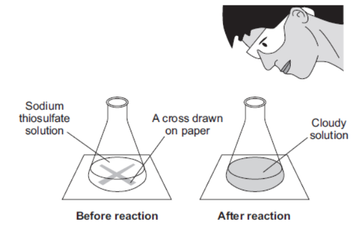

Name the product that made the mixture go cloudy.

**Q2** [2 marks]

**Extract:**

A student investigated the effect of temperature on the rate of reaction between sodium thiosulfate solution and dilute hydrochloric acid:

Na2S2O3 (aq) + 2HCl (aq) → 2NaCl (aq) + S (s) + SO2 (g) + H2O (l)

The reaction between these two substances produces a precipitate which makes the mixture turn cloudy.

A student timed how long it took until the cross could no longer be seen through the precipitate, shown in Figure 1.

They then calculated the rate of reaction and repeated the experiment at different temperatures.

Suggest **two** control variables for the investigation that would ensure valid results are obtained.

**Q2** [3 marks]

Define the terms:

i) Solution

[1]

ii) Solvent

[1]

iii) Solute

[1]

**Q2** [2 marks]

**Extract:**

A student investigated the effect of temperature on the rate of reaction between sodium thiosulfate solution and dilute hydrochloric acid:

Na~2~S~2~O~3~ (aq) + 2HCl (aq)  → 2NaCl (aq) + S (s) + SO~2~ (g) + H~2~O (l)

From the products formed in part a) identify:

i) The solute

[1]

ii) The solvent

[1]

### Q3 — hard — 9 marks

**Q3** [5 marks]

A student investigated what happened when sodium thiosulphate dissolved in water. *   *

*Experiment 1 *

By using a measuring cylinder, 20 cm3 of distilled water was poured into a polystyrene cup.

Use the thermometer diagram to record the temperature of the water in the table.

1 g of powdered sodium thiosulphate was added to the cup and the mixture stirred with a thermometer. Use the thermometer diagram to record the temperature of the solution. *   *

*Experiment 2 *

*Experiment 1* was repeated using 2 g of powdered sodium thiosulphate. Record the temperature in the table. *   *

*Experiments 3, 4 and 5 *

*Experiment* *1* was repeated using 3 g, 4 g and 5 g of powdered sodium thiosulphate respectively. Record the temperatures in the table.

*Source: 2004 O6 Q4*

**Q3** [1 mark]

**Extract:**

A student investigated what happened when sodium thiosulphate dissolved in water. Experiment 1: By using a measuring cylinder, 20 cm^3 of distilled water was poured into a polystyrene cup. Record the temperature of the water. 1 g of powdered sodium thiosulphate was added to the cup and the mixture stirred with a thermometer. Record the temperature of the solution. Experiment 2: Experiment 1 was repeated using 2 g of powdered sodium thiosulphate. Experiments 3, 4 and 5: Experiment 1 was repeated using 3 g, 4 g and 5 g of powdered sodium thiosulphate respectively.

What type of chemical reaction occurs when sodium thiosulphate dissolves in water?

*Source: 2004 O6 Q4*

**Q3** [2 marks]

**Extract:**

A student investigated what happened when sodium thiosulphate dissolved in water. Experiment 1: By using a measuring cylinder, 20 cm^3 of distilled water was poured into a polystyrene cup. Use the thermometer diagram to record the temperature of the water in the table. 1 g of powdered sodium thiosulphate was added to the cup and the mixture stirred with a thermometer. Use the thermometer diagram to record the temperature of the solution. Experiment 2: Experiment 1 was repeated using 2 g of powdered sodium thiosulphate. Experiments 3, 4 and 5: Experiment 1 was repeated using 3 g, 4 g and 5 g of powdered sodium thiosulphate respectively.

Explain how the temperature changes would differ in the experiments if 40 cm3 of water were used.

*Source: 2006 O6 Q4*

**Q3** [1 mark]

**Extract:**

A student investigated what happened when sodium thiosulphate dissolved in water. Experiment 1: By using a measuring cylinder, 20 cm^3 of distilled water was poured into a polystyrene cup. Use the thermometer diagram to record the temperature of the water in the table. 1 g of powdered sodium thiosulphate was added to the cup and the mixture stirred with a thermometer.

Suggest **one **change you could make to the apparatus used in the experiments to obtain more **accurate **results.

*Source: 2004 O6 Q4*

### Q4 — medium — 6 marks

**Q4** [4 marks]

A chemist used a volumetric pipette to add 25.0 cm3 of a solution of sodium hydroxide of unknown concentration to a conical flask.

The chemist then carried out a titration to find out the volume of 0.150 mol / dm3 sulfuric acid needed to neutralise the sodium hydroxide.

Describe how the chemist would complete the titration.

You should state a suitable indicator and give the colour change that would be observed.

**Q4** [2 marks]

**Extract:**

A chemist used a volumetric pipette to add 25.0 cm^3 of a solution of sodium hydroxide of unknown concentration to a conical flask.

The chemist then carried out a titration to find out the volume of 0.150 mol / dm^3 sulfuric acid needed to neutralise the sodium hydroxide.

Explain why a pipette would be used to measure the sodium hydroxide solution but a burette would be used to measure the sulfuric acid solution.

### Q5 — easy — 7 marks

**Q5** [1 mark]

A student investigated the effect of temperature on the mass of sodium chloride that dissolves in 100 cm3 of water.

Name the piece of apparatus that would be used to measure the mass of sodium chloride.

**Q5** [1 mark]

**Extract:**

A student investigated the effect of temperature on the mass of sodium chloride that dissolves in 100 cm^3 ^of water.

A control variable is one which must be kept constant each time the investigation is repeated.  Give **one **control variable in this investigation.

| The temperature of the water |   |
|---|---|
| The volume of water |   |
| The mass of sodium chloride |   |
| The beaker used |   |

**Q5** [4 marks]

Complete these sentences using the word from the list.

| **solution** | **saturated** | **solute** | **solvent** |
|---|---|---|---|

| **residue** | **filtrate** | **liquid** |
|---|---|---|

The salt is the .................................. because it dissolves in water. The water is the .................................. because it has the salt dissolved in it.

The mixture of salt and water is known as a ...................................

When no more salt can dissolve in water at a specific temperature, the solution has become..................................

**Q5** [1 mark]

**Extract:**

A student investigated the effect of temperature on the mass of sodium chloride that dissolves in 100 cm^3 of water.

#### Separate: Chemistry Only

The student used a thermometer to measure the temperature during their investigation.

Name a different piece of apparatus that would give the student a more precise reading.

### Q6 — easy — 5 marks

**Q6** [1 mark]

A student made copper sulfate crystals.

The first two steps of their method are shown below.

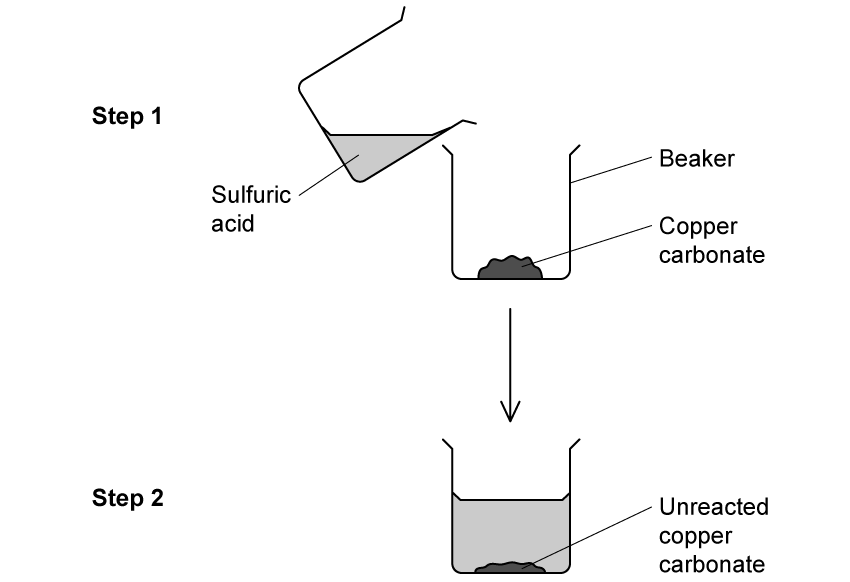

Why should copper carbonate be added in excess to sulfuric acid?

**Q6** [1 mark]

**Extract:**

A student made copper sulfate crystals. The first two steps of their method are shown below. Why should copper carbonate be added in excess to sulfuric acid?

The contents of the beaker in step 2 are separated using filtration.

Identify the residue.  Draw a circle around the correct answer.

| **water** | **copper carbonate** | **copper(II) sulfate** | **sulfuric acid** |
|---|---|---|---|

**Q6** [1 mark]

**Extract:**

A student made copper sulfate crystals. The first two steps of their method are shown below. Why should copper carbonate be added in excess to sulfuric acid?

The contents of the beaker in step 2 are separated using filtration. Identify the residue. Draw a circle around the correct answer.

Identify the filtrate.  Draw a circle around the correct answer.

| **water** | **copper carbonate** | **copper(II) sulfate** | **sulfuric acid** |
|---|---|---|---|

**Q6** [2 marks]

**Extract:**

A student made copper sulfate crystals. The first two steps of their method are shown below.

The filtrate is: Copper(II) sulfate; The copper carbonate and sulfuric acid reacted to form a copper(II) sulfate solution. When the mixture was filtered, the copper(II) sulfate solution will pass through the filter paper into a conical flask.

Describe how you would obtain dry copper(II) sulfate crystals from the solution.

### Q7 — hard — 8 marks

**Q7** [1 mark]

Ammonia is produced when aqueous sodium hydroxide is warmed with ammonium sulfate. Ammonia is less dense than air and very soluble in water. The apparatus below was used to prepare a sample of dry ammonia gas.

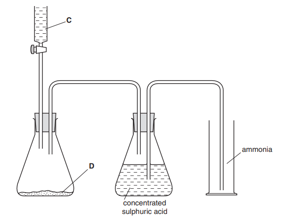

Name substance **C**.

*Source: 2003 6 Q5*

**Q7** [1 mark]

**Extract:**

Ammonia is produced when aqueous sodium hydroxide is warmed with ammonium sulfate. Ammonia is less dense than air and very soluble in water. The apparatus below was used to prepare a sample of dry ammonia gas.

Name substance **D**.

*Source: 2003 6 Q5*

**Q7** [1 mark]

**Extract:**

Ammonia is produced when aqueous sodium hydroxide is warmed with ammonium sulfate. Ammonia is less dense than air and very soluble in water. The apparatus below was used to prepare a sample of dry ammonia gas. 

What necessary piece of equipment is missing in the diagram?

*Source: 2003 6 Q5*

**Q7** [1 mark]

**Extract:**

Ammonia is produced when aqueous sodium hydroxide is warmed with ammonium sulfate. Ammonia is less dense than air and very soluble in water. The apparatus below was used to prepare a sample of dry ammonia gas.

Suggest why concentrated sulfuric acid should **not **be used to dry ammonia.

*Source: 2003 6 Q5*

**Q7** [4 marks]

**Extract:**

Ammonia is produced when aqueous sodium hydroxide is warmed with ammonium sulfate. Ammonia is less dense than air and very soluble in water. The apparatus below was used to prepare a sample of dry ammonia gas. 

There are two other mistakes in the apparatus shown in the diagram. Identify and explain these mistakes.

mistake 1 ..........................................................................................................
explanation ..........................................................................................................

mistake 2 ..........................................................................................................
explanation ..........................................................................................................

*Source: 2003 6 Q5*

### Q8 — easy — 5 marks

**Q8** [2 marks]

A student carried out a titration using sodium hydroxide and hydrochloric acid.

Their method is written below.

| **A** | Add a few drops of phenolphthalein |
|---|---|
| **B** | Add the HCl slowly until the endpoint is reached |
| **C** | Add HCl into the burette and record initial volume |
| **D** | Pipette 25 cm3 of NaOH  into a conical flask |
| **E** | Record the volume of acid added |

Put the statements **A**, **B**, **C**, **D**, **E **in the correct order.

The first step has been done for you.

| first step |   |   |   | last step |
|---|---|---|---|---|
| **C** |   |   |   |   |

**Q8** [1 mark]

**Extract:**

A student carried out a titration using sodium hydroxide and hydrochloric acid. Their method includes: Add a few drops of phenolphthalein; Add the HCl slowly until the endpoint is reached; Add HCl into the burette and record initial volume; Pipette 25 cm^3 of NaOH into a conical flask; Record the volume of acid added.

What colour change will be observed when the end point is reached? Tick **one** box.

| Red to yellow |   |
|---|---|
| Pink to colourless |   |
| Colourless to pink |   |
| Yellow to red |   |

**Q8** [1 mark]

Why can universal indicator not be used to show the end point in a titration?

**Q8** [1 mark]

**Extract:**

A student carried out a titration using sodium hydroxide and hydrochloric acid. Their method is written below. D | Pipette 25 cm^3 of NaOH into a conical flask

#### Separate: Chemistry Only

A measuring cylinder could have been used to measure 25 cm3 of sodium hydroxide.  Give** one** advantage of using a pipette

### Q9 — easy — 4 marks

**Q9** [1 mark]

The names of some pieces of equipment are shown.

**stopwatch   balance    thermometer   gas syringe   burette   pipette**

For each question, name the piece of apparatus that would be used in each case.

Each piece of equipment can be used once, more than once or not at all.

Name the piece of apparatus that would be used to measure the time taken for a white precipitate to form when barium chloride is added to sodium sulfate.

**Q9** [1 mark]

**Extract:**

The names of some pieces of equipment are shown.

stopwatch   balance    thermometer   gas syringe   burette   pipette

For each question, name the piece of apparatus that would be used in each case.

Each piece of equipment can be used once, more than once or not at all.

Name the piece of apparatus that would be used to determine whether the reaction between magnesium and hydrochloric acid is exothermic.

**Q9** [1 mark]

**Extract:**

The names of some pieces of equipment are shown.

stopwatch   balance    thermometer   gas syringe   burette   pipette

For each question, name the piece of apparatus that would be used in each case.

Each piece of equipment can be used once, more than once or not at all.

Name the piece of apparatus that would be used to measure the volume of carbon dioxide produced when marble chips are added to hydrochloric acid.

**Q9** [1 mark]

**Extract:**

The names of some pieces of equipment are shown. stopwatch balance thermometer gas syringe burette pipette For each question, name the piece of apparatus that would be used in each case. Each piece of equipment can be used once, more than once or not at all.

Name the piece of apparatus used to add hydrochloric acid to 25 cm3 of sodium hydroxide solution during a titration.

### Q10 — hard — 17 marks

**Q10** [2 marks]

A student investigated the reaction between aqueous sodium hydroxide and acid **K**. Two experiments were carried out.

*Experiment 1*

Using a measuring cylinder, 25 cm3 of acid **K** was poured into a conical flask. Phenolphthalein indicator was added to the flask. A burette was filled with aqueous sodium hydroxide to the 0.0 cm3 mark. Aqueous sodium hydroxide was added from the burette to the flask and the mixture shaken until the solution showed a permanent colour change. The final volume was measured. Use the burette diagram to record the final volume in the table and complete the table.

|   | burette readings |
|---|---|
| final volume / cm3 |   |
| initial volume / cm3 |   |
| difference / cm3 |   |

*Source: 2013 O61 Q3*

**Q10** [2 marks]

**Extract:**

A student investigated the reaction between aqueous sodium hydroxide and acid K. Two experiments were carried out. Experiment 1: Using a measuring cylinder, 25 cm^3 of acid K was poured into a conical flask. Phenolphthalein indicator was added to the flask. A burette was filled with aqueous sodium hydroxide to the 0.0 cm^3 mark.

*Experiment 2*

The solution was poured away and the conical flask rinsed.

Using a measuring cylinder, 50 cm3 of acid **K** was poured into the conical flask. 0.3 g of powdered calcium carbonate was added to the flask and the flask shaken until no further reaction was observed.

Phenolphthalein was added to the mixture in the flask.

A burette was filled with the same aqueous sodium hydroxide and the initial volume measured. Aqueous sodium hydroxide was added from the burette to the flask and the mixture shaken until the solution showed a permanent colour change.

Use the burette diagrams to record the initial and final volumes in the table and complete the table.

|   | burette readings |
|---|---|
| final volume / cm3 |   |
| initial volume / cm3 |   |
| difference / cm3 |   |

*Source: 2013 O61 Q3*

**Q10** [1 mark]

**Extract:**

A student investigated the reaction between aqueous sodium hydroxide and acid **K**.

What type of chemical reaction occurred when acid **K** reacted with sodium hydroxide?

*Source: 2013 O61 Q3*

**Q10** [1 mark]

**Extract:**

A student investigated the reaction between aqueous sodium hydroxide and acid K. Two experiments were carried out. Experiment 1: Using a measuring cylinder, 25 cm^3 of acid K was poured into a conical flask. Phenolphthalein indicator was added to the flask. A burette was filled with aqueous sodium hydroxide to the 0.0 cm^3 mark. Aqueous sodium hydroxide was added from the burette to the flask and the mixture shaken until the solution showed a permanent colour change. The final volume was measured.
The completed table for Experiment 1: final volume / cm^3 = 38.0; initial volume / cm^3 = 0.0; difference / cm^3 = 38.0

If Experiment 1 were repeated using 50 cm3 of acid **K**, what volume of sodium hydroxide would be required to change the colour of the indicator?

*Source: 2013 O61 Q3*

**Q10** [5 marks]

**Extract:**

Experiment 2: Using a measuring cylinder, 50 cm^3 of acid K was poured into the conical flask. 0.3 g of powdered calcium carbonate was added to the flask and the flask shaken until no further reaction was observed. Phenolphthalein was added and aqueous sodium hydroxide was added from the burette until a permanent colour change. Burette readings: final volume 29.0 cm^3, initial volume 10.0 cm^3, difference 19.0 cm^3.

If Experiment 1 were repeated using 50 cm^3 of acid K, the volume of sodium hydroxide required would be 2 × volume for Experiment 1 = 76 cm^3.

i) What were the effects of adding 0.3 g of powdered calcium carbonate to acid **K**?

[2]

ii) Use your answer in (d) to work out the difference between the volume of sodium hydroxide needed to completely react with 50 cm3 of acid **K** and the volume of sodium hydroxide used in Experiment 2.

[2]

iii) Estimate the mass of calcium carbonate that would be needed to be added to 50 cm3 of acid **K** to require 0.0 cm3 of sodium hydroxide.

[1]

*Source: 2013 O61 Q3*

**Q10** [2 marks]

**Extract:**

A student investigated the reaction between aqueous sodium hydroxide and acid K. Two experiments were carried out. Experiment 1: Using a measuring cylinder, 25 cm^3 of acid K was poured into a conical flask. Phenolphthalein indicator was added to the flask. A burette was filled with aqueous sodium hydroxide to the 0.0 cm^3 mark. Aqueous sodium hydroxide was added from the burette to the flask and the mixture shaken until the solution showed a permanent colour change. The final volume was measured.

What would be the effect on the results if the solutions of acid **K** were warmed before adding the sodium hydroxide? 
Give a reason for your answer.

*Source: 2013 O61 Q3*

**Q10** [4 marks]

**Extract:**

A student investigated the reaction between aqueous sodium hydroxide and acid **K**. Two experiments were carried out. 

*Experiment 1*

Using a measuring cylinder, 25 cm^3^ of acid **K** was poured into a conical flask. Phenolphthalein indicator was added to the flask. A burette was filled with aqueous sodium hydroxide to the 0.0 cm^3^ mark. Aqueous sodium hydroxide was added from the burette to the flask and the mixture shaken until the solution showed a permanent colour change.

#### Separate: Chemistry Only

Suggest the advantage, if any, of

i) using a pipette to measure the volume of acid **K**.

[2]

ii) using a polystyrene cup instead of a flask.

[2]

*Source: 2013 O61 Q3*

### Q11 — hard — 14 marks

**Q11** [3 marks]

A student investigated the effect of the size of calcium carbonate lumps, CaCO3, on the rate of reaction with hydrochloric acid, HCl, using the following method:

1. Put 50 cm3 of hydrochloric acid into a conical flask
2. Add 12 g of large calcium carbonate lumps into the flask
3. Attach the gas syringe
4. Measure the volume of gas produced every 30 seconds for 180 seconds
5. Repeat steps 1 - 4 using 12 g of small calcium carbonate lumps.
6. The number of moles of gas for each volume was calculated.

The results for large calcium carbonate lumps are shown below.

**Table 1**

| **Time in seconds** | **Number of moles of gas ** |
|---|---|
| 0 | 0.000 |
| 30 | 0.0012 |
| 60 | 0.0022 |
| 90 | 0.0030 |
| 120 | 0.0034 |
| 150 | 0.0037 |
| 180 | 0.0038 |

The student had already plotted the data for small calcium carbonate lumps.

Plot the data for the large calcium carbonate lumps and draw a line of best fit.

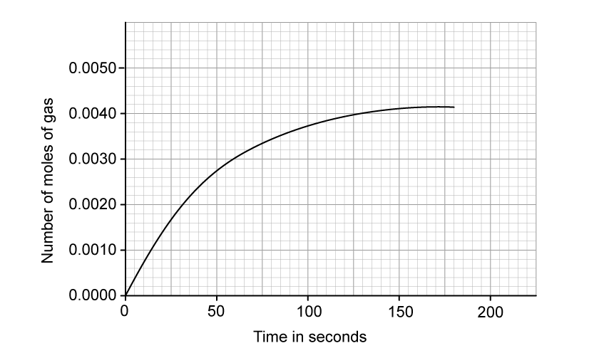

**Q11** [4 marks]

**Extract:**

A student investigated the effect of the size of calcium carbonate lumps, CaCO3, on the rate of reaction with hydrochloric acid, HCl, using the following method: 1. Put 50 cm3 of hydrochloric acid into a conical flask 2. Add 12 g of large calcium carbonate lumps into the flask 3. Attach the gas syringe 4. Measure the volume of gas produced every 30 seconds for 180 seconds 5. Repeat steps 1 - 4 using 12 g of small calcium carbonate lumps. 6. The number of moles of gas for each volume was calculated. The student had already plotted the data for small calcium carbonate lumps. [Graph: Number of moles of gas against Time in seconds - for small calcium carbonate lumps, at 35 seconds the moles of gas is 0.0022 and at 90 seconds the moles of gas is 0.0036]

Determine the mean rate of reaction for **small** calcium carbonate lumps between 35 seconds and 90 seconds.

Give the unit.

Use the graph in part (a)

**Q11** [2 marks]

**Extract:**

A student investigated the effect of the size of calcium carbonate lumps, CaCO3, on the rate of reaction with hydrochloric acid, HCl, using the following method:
1. Put 50 cm3 of hydrochloric acid into a conical flask
2. Add 12 g of large calcium carbonate lumps into the flask
3. Attach the gas syringe
4. Measure the volume of gas produced every 30 seconds for 180 seconds
5. Repeat steps 1 - 4 using 12 g of small calcium carbonate lumps.
6. The number of moles of gas for each volume was calculated.

The results for large calcium carbonate lumps are shown below.
Table 1
Time in seconds | Number of moles of gas
0 | 0.000
30 | 0.0012
60 | 0.0022
90 | 0.0030
120 | 0.0034
150 | 0.0037
180 | 0.0038

The student had already plotted the data for small calcium carbonate lumps.

#### Extended Only

What conclusion can be made about the rate of reaction of small calcium carbonate lumps compared to large calcium carbonate lumps?

Give **one** reason for your answer.

**Q11** [2 marks]

**Extract:**

A student investigated the effect of the size of calcium carbonate lumps, CaCO~3~, on the rate of reaction with hydrochloric acid, HCl

Complete and balance the equation for the reaction between calcium carbonate and hydrochloric acid.

_______   +   _______      →     CaCl2   +   _______    +    _______

**Q11** [3 marks]

#### Separate: Chemistry Only

State **one** advantage and **two** disadvantages of using a gas syringe as opposed to a upturned measuring cylinder when collecting gas.

### Q12 — medium — 20 marks

**Q12** [2 marks]

A student investigated the reaction between two different solutions of dilute hydrochloric acid, **A** and **B**, and solution **C** which is alkaline. Two experiments were carried out

*Experiment 1 *A burette was filled with solution **A** of dilute hydrochloric acid to the 0.0 cm3 mark. Using a measuring cylinder, 20 cm3 of solution **C** was poured into a conical flask. A few drops of methyl orange were added to the flask.

Solution **A** was added to the flask, with shaking, until the mixture just changed colour. Use the burette diagram to record the burette reading in the table and complete the table.

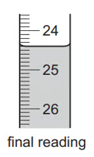

|   | burette readings |
|---|---|
| final volume / cm3 |   |
| initial volume / cm3 |   |
| difference / cm3 |   |

*Source: 2014 O61 Q4*

**Q12** [2 marks]

**Extract:**

A student investigated the reaction between two different solutions of dilute hydrochloric acid, A and B, and solution C which is alkaline. Two experiments were carried out

Experiment 1 A burette was filled with solution A of dilute hydrochloric acid to the 0.0 cm^3 mark. Using a measuring cylinder, 20 cm^3 of solution C was poured into a conical flask. A few drops of methyl orange were added to the flask. Solution A was added to the flask, with shaking, until the mixture just changed colour.

*Experiment 2 *The burette was emptied and rinsed, first with distilled water, and then with a little of solution **B**. The burette was filled with solution **B** of dilute hydrochloric acid to the 0.0 cm3 mark.

Experiment 1 was repeated using solution **B**.

Use the burette diagram to record the burette reading in the table and complete the table.

|   | burette readings |
|---|---|
| final volume / cm3 |   |
| initial volume / cm3 |   |
| difference / cm3 |   |

*Source: 2014 O61 Q4*

**Q12** [2 marks]

**Extract:**

A student investigated the reaction between two different solutions of dilute hydrochloric acid, A and B, and solution C which is alkaline. Two experiments were carried out. Experiment 1: A burette was filled with solution A of dilute hydrochloric acid to the 0.0 cm^3 mark. Using a measuring cylinder, 20 cm^3 of solution C was poured into a conical flask. A few drops of methyl orange were added to the flask. Solution A was added to the flask, with shaking, until the mixture just changed colour.

i) What type of chemical reaction takes place when hydrochloric acid reacts with alkaline solutions?

[1]

ii) Why is methyl orange added to the flask?

[1]

*Source: 2014 O61 Q4*

**Q12** [2 marks]

**Extract:**

A student investigated the reaction between two different solutions of dilute hydrochloric acid, **A** and **B**, and solution **C** which is alkaline. Two experiments were carried out. Experiment 1: A burette was filled with solution **A** of dilute hydrochloric acid to the 0.0 cm^3 mark.
Experiment 2: The burette was emptied and rinsed, first with distilled water, and then with a little of solution **B**. The burette was filled with solution **B** of dilute hydrochloric acid to the 0.0 cm^3 mark. Experiment 1 was repeated using solution **B**.

Why was the burette rinsed, first with distilled water and then with solution **B**, before starting Experiment 2?

*Source: 2014 O61 Q4*

**Q12** [4 marks]

**Extract:**

A student investigated the reaction between two different solutions of dilute hydrochloric acid, A and B, and solution C which is alkaline. Two experiments were carried out. Experiment 1: A burette was filled with solution A of dilute hydrochloric acid to the 0.0 cm^3 mark. Using a measuring cylinder, 20 cm^3 of solution C was poured into a conical flask. A few drops of methyl orange were added to the flask. Solution A was added to the flask, with shaking, until the mixture just changed colour. Experiment 1 result (difference): 24.4 cm^3.
Experiment 2: The burette was filled with solution B of dilute hydrochloric acid. Experiment 1 was repeated using solution B. Experiment 2 result (difference): 6.1 cm^3.

#### Separate: Chemistry and Extended Only

i) In which experiment was the greater volume of dilute hydrochloric acid used?

[1]

ii) Compare the volumes of dilute hydrochloric acid used in Experiments 1 and 2.

[1]

iii) Suggest, in terms of the concentration of solutions **A** and **B**, an explanation for the difference in volumes used.

[2]

*Source: 2014 O61 Q4*

**Q12** [2 marks]

**Extract:**

Experiment 1: Using a measuring cylinder, 20 cm^3 of solution C was poured into a conical flask. A few drops of methyl orange were added to the flask. Solution A was added to the flask, with shaking, until the mixture just changed colour.

Experiment 2: The burette was filled with solution B of dilute hydrochloric acid to the 0.0 cm^3 mark. Experiment 1 was repeated using solution B. The completed table for Experiment 2 is: final volume 6.1 cm^3, initial volume 0.0 cm^3, difference 6.1 cm^3.

#### Separate: Chemistry and Extended Only

If Experiment 2 was repeated using 10 cm3 of solution** C**, what volume of dilute hydrochloric acid would be used? Explain your answer.

*Source: 2014 O61 Q4*

**Q12** [2 marks]

**Extract:**

A student investigated the reaction between two different solutions of dilute hydrochloric acid, A and B, and solution C which is alkaline. Experiment 1: A burette was filled with solution A of dilute hydrochloric acid to the 0.0 cm^3 mark. Using a measuring cylinder, 20 cm^3 of solution C was poured into a conical flask. A few drops of methyl orange were added to the flask.

#### Separate: Chemistry Only

Give **one **advantage and **one **disadvantage of using a measuring cylinder for solution **C**.

*Source: 2014 O61 Q4*

**Q12** [4 marks]

**Extract:**

A student investigated the reaction between two different solutions of dilute hydrochloric acid, **A** and **B**, and solution **C** which is alkaline.

Describe a method other than titration, using a different reactant, that could be used to compare the concentrations of the two solutions of dilute hydrochloric acid, **A** and **B**.

*Source: 2014 O61 Q4*

### Q13 — hard — 6 marks

**Q13** [6 marks]

The diagram shows two bottles of liquid oven cleaner.

The oven cleaners contain sodium hydroxide solution. Plan an investigation to show which oven cleaner contains the highest concentration of sodium hydroxide.

*Source: 2006 Ju6 Q6*

### Q14 — easy — 6 marks

**Q14** [2 marks]

A student does three titrations with dilute hydrochloric acid and potassium hydroxide solution.

Complete the equation to show the products formed during this reaction.

potassium hydroxide + hydrochloric acid  →   potassium ______ +  _______

**Q14** [1 mark]

**Extract:**

A student does three titrations with dilute hydrochloric acid and potassium hydroxide solution.

Some of the apparatus the student uses is shown below.

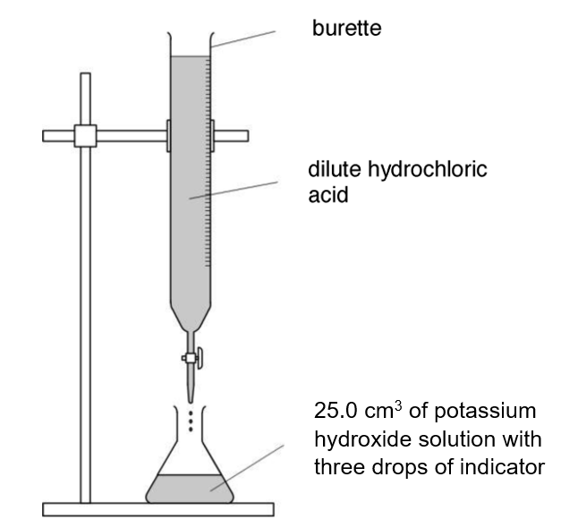

Name the piece of equipment the student will use to measure out the 25.0 cm3 of potassium hydroxide solution.

*Source: 2016 Spec 2F Q17A*

**Q14** [1 mark]

In her first titration the student measures the initial volume of hydrochloric acid in the burette.

She slowly adds the acid until the potassium hydroxide is just neutralised. She then measures the volume of the hydrochloric acid again. Describe how she can tell when the potassium hydroxide solution is just neutralised.

*Source: 2016 Spec 2F Q17B*

**Q14** [2 marks]

Look at the diagrams. They show parts of the burette during the first titration.

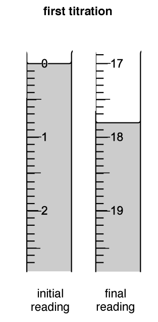

Here is the student’s results table.

| **Titration number** | **1** | **2** | **3** |
|---|---|---|---|
| final reading in cm3 |   | 37.5 | 32.1 |
| initial reading in cm3 |   | 20.4 | 15.0 |
| titre (volume of acid added) in cm3 |   | 17.1 | 17.1 |

**Complete** the table by recording the burette readings from the diagrams.

*Source: 2016 Spec 2F Q17C*

### Q15 — medium — 9 marks

**Q15** [1 mark]

The following paragraph was taken from a student’s notebook.

*To make potassium chloride*

25.0 cm3 of aqueous potassium hydroxide were placed in a flask and a few drops of indicator were added. Dilute hydrochloric acid was added to the flask until the indicator changed colour. The volume of acid used was 19.0 cm3.

What piece of apparatus should be used to measure the aqueous potassium hydroxide?

*Source: 2002 6 Q6*

**Q15** [3 marks]

**Extract:**

The following paragraph was taken from a student's notebook. To make potassium chloride: 25.0 cm^3 of aqueous potassium hydroxide were placed in a flask and a few drops of indicator were added. Dilute hydrochloric acid was added to the flask until the indicator changed colour. The volume of acid used was 19.0 cm^3.

i) Name a suitable indicator that could be used.

[1]

ii) The indicator would change from ........................... to ................................

[2]

*Source: 2002 6 Q6*

**Q15** [2 marks]

**Extract:**

25.0 cm^3^ of aqueous potassium hydroxide were placed in a flask and a few drops of indicator were added. Dilute hydrochloric acid was added to the flask until the indicator changed colour. The volume of acid used was 19.0 cm^3^.

Which solution was more concentrated? Explain your answer.

*Source: 2002 6 Q6*

**Q15** [3 marks]

**Extract:**

To make potassium chloride: 25.0 cm^3 of aqueous potassium hydroxide were placed in a flask and a few drops of indicator were added. Dilute hydrochloric acid was added to the flask until the indicator changed colour. The volume of acid used was 19.0 cm^3.

How could pure crystals of potassium chloride be obtained from this experiment?

*Source: 2002 6 Q6*

### Q16 — medium — 8 marks

**Q16** [2 marks]

Rock salt is a mixture of sand and salt. Salt dissolves in water while sand does not.

A group of students separated rock salt.

They used the following method.

1. Add the rock salt to a beaker.
2. Add 250 cm3 of water.
3. Leave without disturbing to allow the sand to settle to the bottom.
4. After a while, filter the salt water into an evaporating dish.
5. Heat the evaporating dish with a Bunsen burner until salt crystals begin to form.

i) Suggest **one** improvement to step 2 that the students could have done to make sure all the salt is dissolved.

[1]

ii) What name is given to the solution when no more salt can dissolve at this specific temperature?

[1]

**Q16** [2 marks]

**Extract:**

Rock salt is a mixture of sand and salt. Salt dissolves in water while sand does not. A group of students separated rock salt. They used the following method.
1. Add the rock salt to a beaker.
2. Add 250 cm^3 of water.
3. Leave without disturbing to allow the sand to settle to the bottom.
4. After a while, filter the salt water into an evaporating dish.
5. Heat the evaporating dish with a Bunsen burner until salt crystals begin to form.

Identify the residue and filtrate in **step 4**.

**Q16** [1 mark]

**Extract:**

Rock salt is a mixture of sand and salt. Salt dissolves in water while sand does not. A group of students separated rock salt. They used the following method.
1. Add the rock salt to a beaker.
2. Add 250 cm^3 of water.
3. Leave without disturbing to allow the sand to settle to the bottom.
4. After a while, filter the salt water into an evaporating dish.
5. Heat the evaporating dish with a Bunsen burner until salt crystals begin to form.

Suggest **one** safety precaution the students should take in step 5.

**Q16** [2 marks]

Another student separated water from salty water using the apparatus in the diagram below.

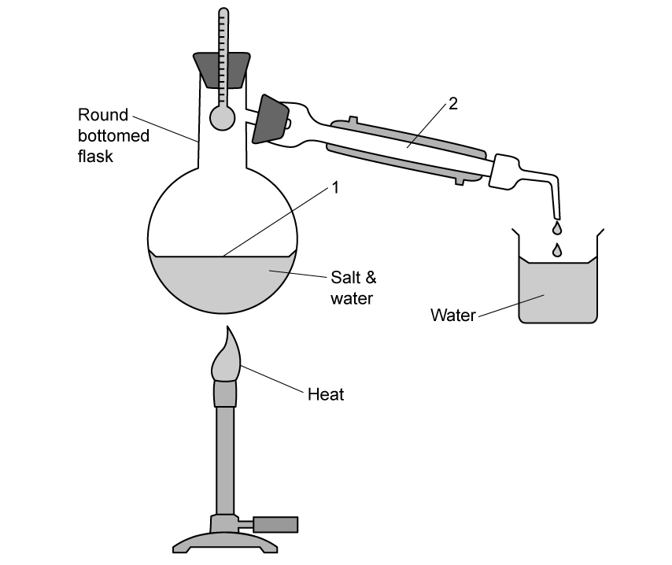

By referring to points 1 and 2 in the diagram, describe how this technique works.

**Q16** [1 mark]

**Extract:**

Another student separated water from salty water using the apparatus in the diagram below. By referring to points 1 and 2 in the diagram, describe how this technique works.

Identify the residue in the experiment being carried out in part (d).
