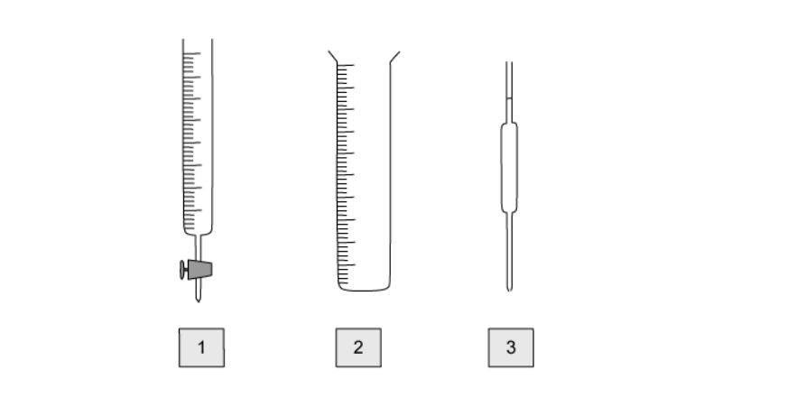

# Exam Questions — Experimental Techniques
**12. Experimental Techniques & Chemical Analysis** · Cambridge (CIE) IGCSE chemistry (0620 & 0971)
> Source: [https://www.savemyexams.com/igcse/chemistry/cie/23/topic-questions/](https://www.savemyexams.com/igcse/chemistry/cie/23/topic-questions/) · 17 questions across 1 sets

## Multiple Choice Questions (20 questions)

### Q1 — easy — 1 marks

**Q1** [1 mark]

A student carries out a titration to determine the concentration of a dilute acid using a standard alkali.

Five actions in this acid-base titration are shown in the table.

| step | action |
|---|---|
| P | record the final burette reading after the end-point is reached |
| Q | transfer a measured volume of alkali into a conical flask using a volumetric pipette |
| R | add a few drops of a suitable indicator to the flask |
| S | note the initial burette reading before starting the titration |
| T | carefully run the acid from the burette into the flask while swirling until a permanent colour change occurs |

### Q2 — easy — 1 marks

**Q2** [1 mark]

A student investigates the effect of temperature on the rate of reaction between large lumps of calcium carbonate and dilute acid. The student plots a graph of the loss in mass of the reaction mixture against time for different temperatures.

Which combination of apparatus are essential to record the measurements used to plot the graph?

### Q3 — easy — 1 marks

**Q3** [1 mark]

A student prepared crystals of copper sulfate from copper carbonate and sulfuric acid.

The student separated the excess copper carbonate from the solution using filtration.

What word describes the excess copper carbonate?

### Q4 — easy — 1 marks

**Q4** [1 mark]

A student carries out a titration to determine the volume of hydrochloric acid needed to neutralise 25 cm3 of sodium hydroxide.

She measured 25 cm3 sodium hydroxide into a conical flask.

Which piece of equipment should she use to do this?

### Q5 — easy — 1 marks

**Q5** [1 mark]

Measuring volumes of liquids is a fundamental aspect of experimental chemistry. The diagram shows three different pieces of apparatus used for this task.

Which row is correct?

|   | **1** | **2** | **3** |
|---|---|---|---|
| **A** | burette | measuring cylinder | pipette |
| **B** | burette | pipette | measuring cylinder |
| **C** | pipette | measuring cylinder | burette |
| **D** | measuring cylinder | burette | pipette |

### Q6 — easy — 1 marks

**Q6** [1 mark]

A student dissolved ammonium chloride in water when investigating energy changes in reactions.

Which terms best describes each substance?

|   | **ammonium chloride** | **water** |
|---|---|---|
| **A** | solute | solvent |
| **B** | solvent | solution |
| **C** | solution | solvent |
| **D** | solute | solution |

### Q7 — easy — 1 marks

**Q7** [1 mark]

The diagram shows a burette and a measuring cylinder, both of which contain a liquid.

Which row shows the correct reading for both?

|   | **Burette** | **Measuring cylinder** |
|---|---|---|
| **A** | 18.4 | 34 |
| **B** | 18.4 | 56 |
| **C** | 17.8 | 34 |
| **D** | 17.8 | 56 |

### Q8 — hard — 1 marks

**Q8** [1 mark]

A student titrated sodium carbonate solution against 25 cm3 of hydrochloric acid.

They used methyl orange as an indicator.

What is the colour changed observed at the end point?

### Q9 — hard — 1 marks

**Q9** [1 mark]

A student prepared a solution of copper(II) sulfate by mixing dilute sulfuric acid with an excess of copper(II) oxide.

They filtered the mixture using the apparatus below.

Which terms best describes each substance?

|   | **Solvent** | **Solute** | **Filtrate** | **Residue** |
|---|---|---|---|---|
| **A** | water | copper(II) sulfate | copper(II) sulfate solution | copper(II) oxide |
| **B** | dilute hydrochloric acid | copper(II) oxide | water | copper(II) oxide |
| **C** | water | copper(II) sulfate solution | copper(II) oxide | copper(II) sulfate |
| **D** | copper(II) sulfate solution | water | dilute hydrochloric acid | water |

### Q10 — hard — 1 marks

**Q10** [1 mark]

A student prepared crystals of potassium(II) chloride by the following method.

| **1** | 25.0 cm3 of dilute hydrochloric acid was accurately measured into a conical flask using a measuring cylinder |
|---|---|
| **2** | Aqueous potassium hydroxide was added from a burette until the solution was neutral |
| **3** | The solution was evaporated and the crystals washed with approximately 20 cm3 of water measured using a pipette |

Which steps do **not **use the most appropriate piece of apparatus for the measurement taken?

### Q11 — hard — 1 marks

**Q11** [1 mark]

A student performed a titration to find the volume of hydrochloric acid required to neutralise 25.0 cm3 of sodium hydroxide using the following method.

- Add a fixed volume of sodium hydroxide to a conical flask using a measuring cylinder
- Add methyl orange indicator
- Record the initial volume of hydrochloric acid in the burette
- Add hydrochloric acid from the burette into the conical flask until the indicator changes colour
- Record the final volume of hydrochloric acid in the burette

Another student suggested the following changes.

| **1** | Use a pipette to measure the sodium hydroxide |
|---|---|
| **2** | Use universal indicator as the indicator |
| **3** | Repeat the experiment until the results are concordant |
| **4** | Ensure that the initial volume of hydrochloric acid reads 0.00 cm3 on the burette |

Which suggestions would improve the experiment?

### Q12 — hard — 1 marks

**Q12** [1 mark]

Why is it important to fill the space below the tap in a burette with acid or alkali before beginning a titration?

### Q13 — medium — 1 marks

**Q13** [1 mark]

The steps below are for an acid-base titration.

| 1 | Record the final volume of hydrochloric acid in the burette |
|---|---|
| 2 | Add hydrochloric acid from the burette into the conical flask until the indicator changes colour |
| 3 | Record the initial volume of hydrochloric acid in the burette |
| 4 | Add a fixed volume of sodium hydroxide to a conical flask using a pipette |
| 5 | Add indicator |

What is the correct order of these steps?

### Q14 — medium — 1 marks

**Q14** [1 mark]

A student decided to investigate the rate of reaction between marble chips and dilute hydrochloric acid at 35 oC.

She had access to the following apparatus:

**W **a balance

**X **a thermometer

**Y** a measuring cylinder

**Z** a stopwatch

Which pieces of apparatus did she use?

### Q15 — medium — 1 marks

**Q15** [1 mark]

**W**, **X**, **Y** and **Z** are pieces of laboratory apparatus.

Which row describes the most appropriate use of the apparatus for the measurement taken?

|   | **Apparatus** | **Measurement taken** |
|---|---|---|
| **A** | **W** | 0.5 cm3 of acid to add to marble chips in a rate of reaction investigation |
| **B** | **X** | 20 cm3 of sodium hydroxide for use in a titration |
| **C** | **Y** | 26.70 cm3 of hydrochloric acid added to sodium hydroxide in a titration |
| **D** | **Z** | 85 cm3 of gas given off in a rate of reaction investigation |

### Q16 — medium — 1 marks

**Q16** [1 mark]

A student wants to investigate the rate of reaction between marble chips and hydrochloric acid by measuring the volume of carbon dioxide produced with different concentrations of acid.

The equation for the reaction is as follows:

2 HCl + MgCO3 → MgCl2 + CO2 + H2O

Which of the following lists of equipment can she use to measure the volume of the gas produced?

### Q17 — medium — 1 marks

**Q17** [1 mark]

A student is following the written procedure for an experiment. The instruction states:

'Quickly add 25 cm3 of sodium hydroxide'

Which piece of apparatus would be most suitable to use?
