# Mark Schemes — Separation & Purification
**12. Experimental Techniques & Chemical Analysis** · Cambridge (CIE) IGCSE chemistry (0620 & 0971)

## Alternative To Practical Questions (32 questions)

### Q1
a) **Table 1 **is:

| Experiment | total volume of water cm3 | temperature at which crystals first appeared / °C |
|---|---|---|
| 1 | 10 | **68** |
| 2 | **11** | **63** |
| 3 | **12** | **59** |
| 4 | **13** | **55** |
| 5 | **14** | **51** |

- Total volume of water boxes correctly competed; **[1 mark] **
- Temperature boxes completed; **[4 marks] **
*Deduct 1 mark for each incorrect reading*

**[Total: 5 marks] **

- *Take care with reading the temperature from the thermometer*
- *Make sure that you have the correct reading in the correct box!*
b) The graph should be:

- appropriate scale for y-axis; **[1 mark] **
- points plotted correctly; **[4 marks] ** 
*–1 for each incorrect*
- Best fit straight line graph; **[1 mark] **

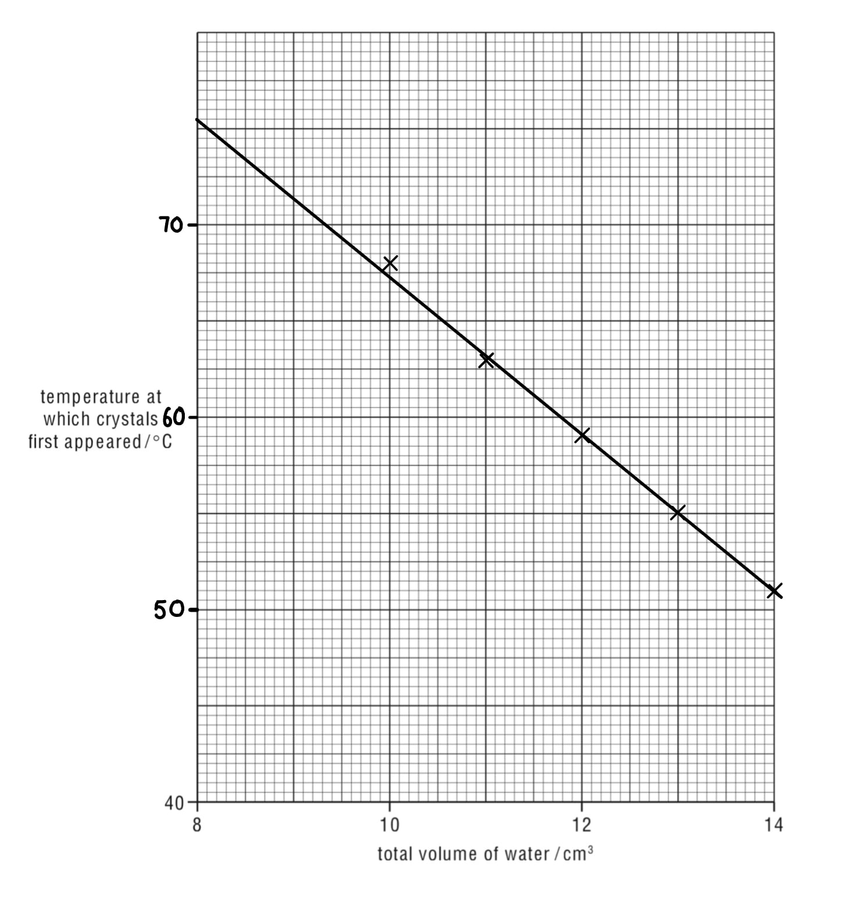

**[Total: 6 marks] **

- *It will massively help the examiner if you use** x** for plotting points as if you use • they will be covered up by the line of best fit*
- *This will mean the examiner can not see your points so you may lose a mark*
- *Your scale should be appropriate meaning that the plotted points take up at least two-thirds of the graph area*
c) The student would know that salt **A** was completely dissolved because:

- Clear liquid formed / no solid visible;** [1 mark] **

**[Total: 1 mark] **

- *A salt dissolving will form a solution which will not contain any solid particles*
d) The temperature that salt **A** would first appear is;

- Value from graph for 9 cm3 of water, around 72 °C;** [1 mark] **
- Extrapolation of straight line shown; **[1 mark] **

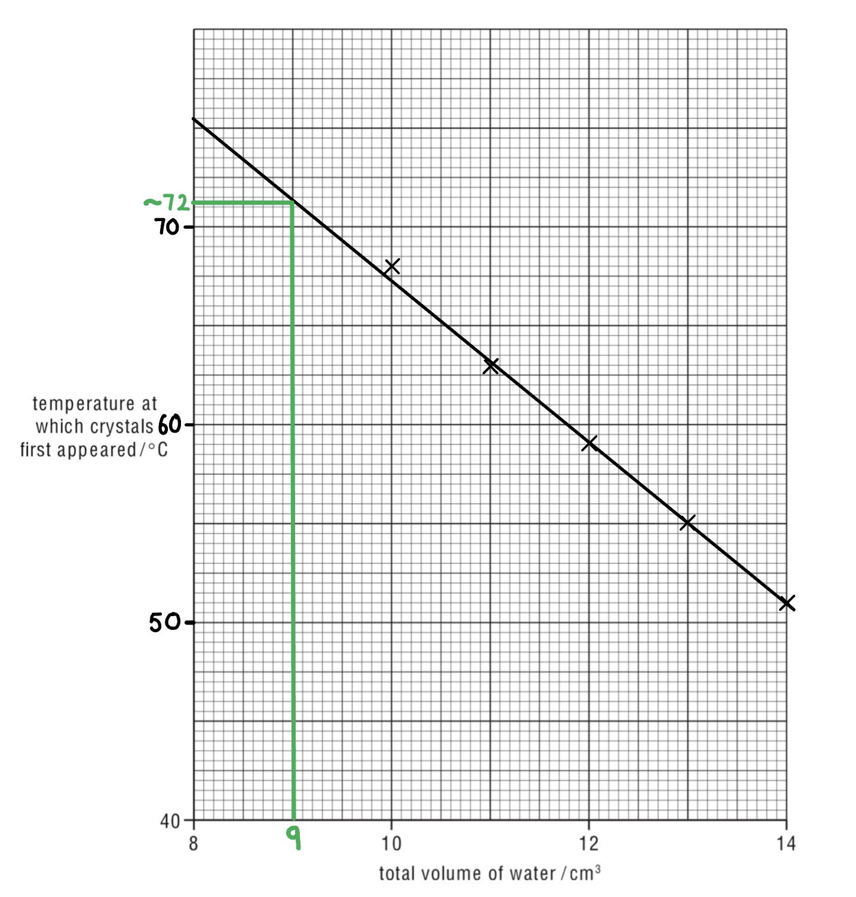

**[Total: 2 marks] **

- *Start by drawing a vertical line from the x-axis reading up to the point at which it meets the line of best fit *
- *Then draw a horizontal line from this point to the y-axis*
- *This will give you the required reading*
- *If you are given a y-axis reading in the question, reverse this process *
e) The results would be differ if 6 g of salt **A **were used instead of 12 g of salt **A:**

- Temperatures at which crystals appear lower;** [1 mark]**
- Solution more dilute in same volume of water / less saturated;** [1 mark] **

**[Total: 2 marks] **

- *If there is less salt dissolved in the **same** volume of water the salt will recrystallise at the lower temperature *
- *The solute in a saturated solution will begin to crystalise very quickly once it begins to cool *
f) The line for salt B should be:

- Sketch graph below line; **[1 mark] **
- Labelled;** [1 mark] **

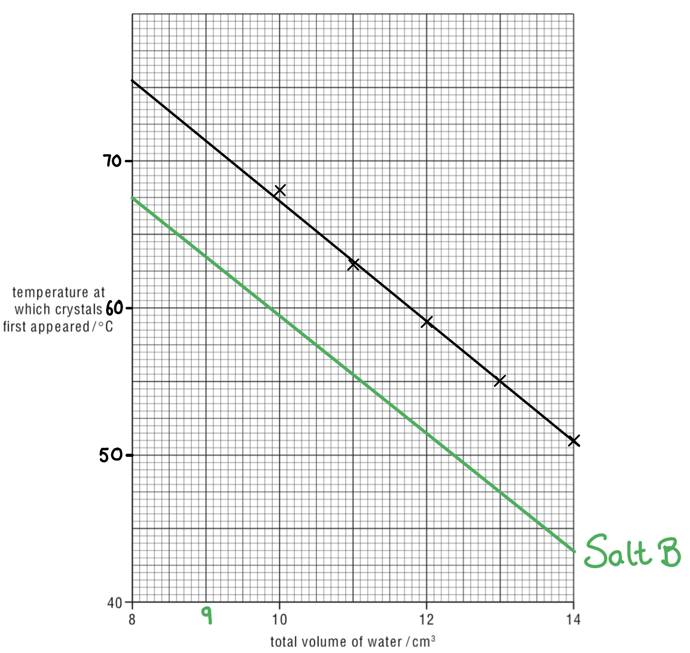

**[Total: 2 marks] **

- *If the salt** B** is more soluble than salt **A**, you would expect crystallisation to occur at a lower temperature *
g) The improvement and explanation are:

**   One** improvement from the following:

- Don’t use a beaker of cold water to cool solution; **[1 mark] **
- Do not remove thermometer from the solution;** [1 mark] **
- Use second person / IT method to note formation of crystals; **[1 mark] **
- Repeat; **[1 mark] **

With **one **linked explanation:

- Different rate of heat losses; **[1 mark] **
- Loss of solid on thermometer;** [1 mark] **
- Observing formation of first crystals may vary; **[1 mark] **
- Average / mean more accurate / increases reliability; **[1 mark] ** *Not just accurate*

**[Total: 2 marks] **

- *It is common to be asked for an improvement to a given investigation, *
- *Data logging or use of IT is a good option for investigations where you are relying on eyesight and perception as different people will see the change at different points*

### Q2
a) The apparatus that should be used to crush the beans in Stage 1 are:

- Pestle; **[1 mark]**
- Mortar; **[1 mark]**

**[Total: 2 marks]**

- *A mortar and pestle are common laboratory apparatus used to crush solids into smaller pieces or powder*
- *The smaller the pieces of solid are, the easier it is to make a solution with as they will dissolvemore easily*
- *The mortar is the bowl and the pestle is used for crushing*
b) The dissolving process in Stage 2 could be speeded up by:

- Stir / mix / shake; **[1 mark]** *Allow: heat / boil*

**[Total: 1 mark]**
c) A diagram showing the equipment for Stage 3:

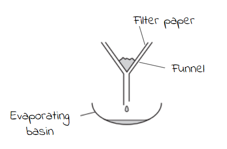

- Diagram showing funnel; **[1 mark]**
- Indication of filter paper; **[1 mark]** *Note: labels not necessary*

**[Total: 2 marks]**

- *As the crushed beans are solid, they should be removed by filtration*
- *The soluble substances will pass through the filter paper as they are dissolved in the water*
- *The evaporating basin is not needed for this question*
d) Stage 5 should be carried out by:

Any **two **from:

- Heat / evaporation; **[1 mark]**
- To crystallising point; **[1 mark]** Allow a description
- In a fume cupboard; **[1 mark]**

**[Total: 2 marks]**

- *When crystallising, it is important not to strongly heat the solution to dryness as the crystals may further decompose*
- *Instead, the solution can be heated until some crystals begin to form, then the solution left in a warm place, such as near a radiator, until the water has fully evaporated*
e) The method that could be used to check the purity of the crystals in Stage 6 is:

- Melting point / description of; **[1 mark]**
 *Allow: chromatography* *Do NOT allow: boiling point*

**[Total: 1 mark]**

- *A pure substance will give a sharp melting point whereas an impure substance will melt over a range of temperatures*

### Q3
An experiment to find out which of limestone and marble contain most insoluble impurities:

Any **seven** from:

- Equal weight / mass of limestone and marble;** [1 mark]**
- Crush; **[1 mark]**
- Add excess; **[1 mark]**
- (of) hydrochloric acid; **[1 mark]**
- Stir; **[1 mark]**
- Filter mixture; **[1 mark]**
- Dry; **[1 mark]**
- Reweigh; **[1 mark]**
- Conclusion; **[1 mark]**

**[Total: 7 marks]**

- *Excess hydrochloric acid is added to ensure all of the calcium carbonate in each sample reacts to form calcium chloride*
- *Calcium chloride is water soluble so will remain in solution*
- *The mixture is filtered and the calcium chloride solution will go through the filter paper (the filtrate) and the insoluble impurities and remaining calcium carbonate will remain in the filter paper (the residue) *
- *The residue can be weighed for each sample, the limestone and marble, and compared to one another to determine which one has the most insoluble impurities *

### Q4
An experiment to show which one of these inks is the same as the ink from the banknote is:

- Chromatography; **[1 mark] **
- Apply ink / spots to paper; **[1 mark] **
- Use a solvent / water; **[1 mark] **
- The dots rise up the paper; **[1 mark] **
- Check the heights / positions of the spots; **[1 mark] **
- Compare the four inks with the ink from the banknote; **[1 mark] **

**[Total: 6 marks]**

- *You should be able to write a method for chromatography- in this case, you would complete it for the four ink samples and for the ink from the banknote *
- *Remember: The components of the ink will rise up the paper, and the distance they travel is determined by the solubility of the substance *
- *More soluble substances travel further up the paper*
- *Any dots that are in line with one another will have the same **R**f** **value and are therefore the same substance*

### Q5
a)

i) The process is called:

- Chromatography; **[1 mark]**

ii) The glass cover is required:

- To prevent loss / evaporation of solvent; **[1 mark]**

**[Total: 2 marks]**

- *This is a commonly examinable practical, make sure you can spell the name and identify all of the components of the set-up. The lid is one that is often missed out but it is vital to produce valid results*
b) The paper should be removed:

- When the solvent is near the top of the paper / before the solvent reaches the top of the paper; **[1 mark]**

**[Total: 1 mark]**

- *The solvent front needs to be measurable to calculate **R**f** values, so it is very important to remove the paper before the solvent reaches the top*
c)

i) The number of different coloured compounds present in the fruit drink is:

- 4; **[1 mark]**

ii) The presence of artificial colours in the fruit drink:

- Yes, one artificial dye is present;** [1 mark]**
- At the same height / matches; **[1 mark]**

**[Total: 3 marks]**

- *The number of different spots vertically above the place where the original sample was placed at the baseline gives the number of different coloured compounds*
- *Comparisons can be made between samples run next to each other by looking at spots that show up at the same distance up the chromatogram, which shows that these substances have the same affinities for the mobile and stationary phases*
- *The artificial colour on the left-hand side of the chromatogram produces a spot that travelled the same distance as the spot at the top of the chromatography paper produced by the fruit drink*

### Q6
To investigate the percentage of copper(II) oxide in the mixture:

The method must use a minimum of **six** of the following:

- Weigh the mixture;** [1 mark]**
- Add an excess; **[1 mark]**
- Of sulfuric acid; **[1 mark]**
- Heat / stir; **[1 mark]**
- Filter the carbon / residue; **[1 mark] ***Ignore details about the evaporation of the copper(II) sulfate solution*
- Wash the carbon / residue; **[1 mark]**
- Dry the carbon / residue 
**OR **
Place in a warm oven / somewhere warm; **[1 mark]**
- Reweigh the carbon / residue;** [1 mark] **
- Calculate the percentage (of copper(II) oxide in the mixture);** [1 mark]** *If the method will not work, then 0 marks are scored* ***Note:**** must have at least one weighing for 6 marks*

**[Total: 6 marks]**

- *Since the copper(II) oxide will react with the sulfuric acid and form copper(II) sulfate solution, there is no need to do anything other than filter out the carbon *
- *You can collect and dry the carbon *
- *The mass of the carbon will allow you to determine the percentage of copper(II) oxide*

  - *You can work out the mass of copper(II) oxide and complete the percentage calculation*
  - *Or, you can work out the percentage of carbon in the sample and subtract this value from 100 to get the percentage of copper(II) oxide*

### Q7
a) The labelled diagram is:

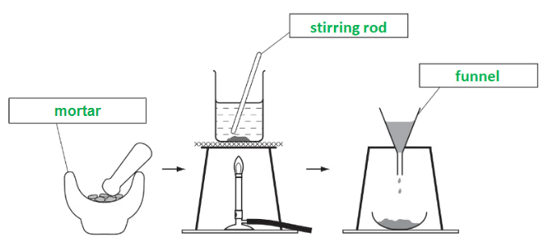

- Mortar; **[1 mark]**
- (Stirring / glass) rod / stirrer; **[1 mark]** 
*Metal rod or thermometer are not accepted*
- Funnel;** [1 mark]** 
*Filter or filter paper are not accepted*

**[Total: 3 marks]**

- *These are pieces of equipment that you should know*
b)

i) The solvent used is:

- Water / H2O; **[1 mark]**

ii) The origin is:

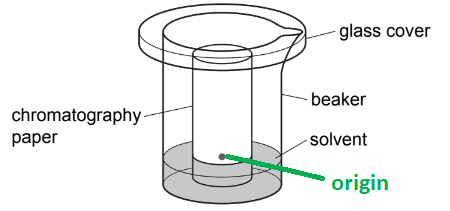

- Origin correctly labelled on diagram i.e. at the dot; **[1 mark] ***Accept a labelled line drawn at the level of the dot*

**[Total: 2 marks]**

- *The question tells you that the dyes are water-soluble, so that would be the best solvent*
- *Careful: **The way that the diagram is drawn in three dimensions can make it easy to incorrectly label the line (where it changes from grey to white) as the origin but this is the solvent level*
c) The chromatogram would look like:

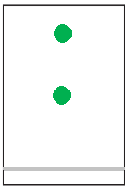

- Two spots / dots at different levels in a vertical line;** [1 mark]** *Allow three spots if one is the origin*

**[Total: 1 mark]**

- *Remember:** If a sample has two colours present then it will have two spots / dots*
- *They must be in a vertical line to show that they come from the same sample*

### Q8
a) The correct labels are:

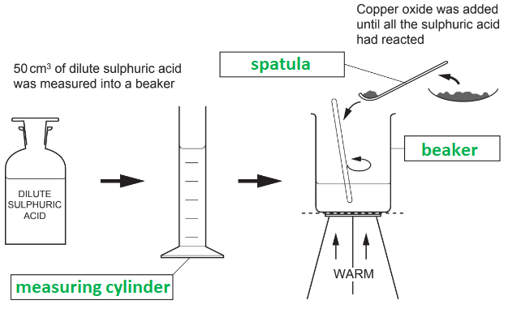

- Measuring cylinder; **[1 mark]**
- Spatula; **[1 mark]**
- Beaker;** [1 mark]**

**[Total: 3 marks]**

- *Make sure you know the names of laboratory equipment*
b) The colour of the solution formed is:

- Blue; **[1 mark]**

**[Total: 1 mark]**

- *The solution formed will be copper(II) sulfate*
- *You should know the colour of copper(II) sulfate is blue*
c) Crystals could be quickly obtained from the solution by:

- Heating / evaporating the solution;** [1 mark]**
- Until crystallisation / saturation point 
**OR **
Until crystals start to form (on a glass rod) 
**OR **
Until half the solution has evaporated; **[1 mark]**

**[Total: 2 marks]**

- *When crystallising, you should make it clear that the solution is only heated until crystals start to form (the crystallisation / saturation point)*
- *Heating the solution until all the water is removed produces small, poor quality crystals and can lead to decompostion of the crystals (depending on the chemical)*

### Q9
a) The pieces of equipment are:

- **A** = thermometer; **[1 mark]**
- **B** = beaker; **[1 mark]**
- **C** = tripod; **[1 mark]**

**[Total: 3 marks]**

- *You should be able to name these three pieces of laboratory equipment *
b) The purpose of **D** is:

- To cool / condense the vapour; **[1 mark]**

**[Total: 1 mark]**

- *D** is the condenser*
- *The clue is in the name, the condenser is used to condense the vapour that forms from the heating / boiling of the contents of the round-bottomed flask*
c) The purity of the ethanol collected can be checked by:

- Measuring the boiling point;** [1 mark]**

**[Total: 1 mark]**

- *The purity of a distillate can be checked by measuring its boiling point*

  - *A pure distillate will have a  narrow / sharp boiling point *
  - *An impure distillate will have a wider range of temperatures for the boiling point*

### Q10
a) You could show that a solution of benzoic acid is a weak acid by using:

- Test: universal indicator / pH paper; **[1 mark]** 
*Not litmus*
- Result: pH of 4–6 / yellow / orange; **[1 mark]** 
*Not red*

**[Total: 2 marks]**

- *Weak acids have a pH which are generally in the range of 4 to 6 so the colour of universal indicator must match this*
- *Red is not accepted as this would indicate a strong acid*
- *Litmus is not suitable as it only determines if a substance is acidic or alkaline, it does not show if it is a strong or a weak acid*
b) A suitable substance that would react with a solution of benzoic acid to form sodium benzoate is:

- Sodium hydroxide / carbonate / oxide; **[1 mark]**

**[Total: 1 mark]**

- *Whilst benzoic acid may not be familiar to you, you can apply your knowledge of how other salts are formed and named to deduce a suitable substance*
- *A salt is formed by the reaction between an acid and a base*
- *The last name of the salt comes from the acid used - here benzoic acid forms a benzoate salt*
- *The first name of the salt comes from the base used - so the base used to form sodium benzoate must be a base that contains sodium*
- *Sodium hydroxide, carbonate and oxide are all suitable bases*
c) A method that you could use to show the presence of E110 in a food colouring is:

- Chromatography; **[1 mark]**
- Use of solvent; **[1 mark]**
- Description of applying E110 to paper; **[1 mark]**
- Results / number of spots; **[1 mark]**

**[Total: 4 marks]**

- *You should be able to write a method for chromatography - it is a common practical to perform and to be asked about*
- *Make sure you include all steps, however small they seem!*
- *Remember**: The components of the food colouring will rise up the paper, the distance they travel determined by the solubility of the substance *
- *More soluble substances travel further up the paper*

### Q11
a) The correct labels for the pieces of equipment are:

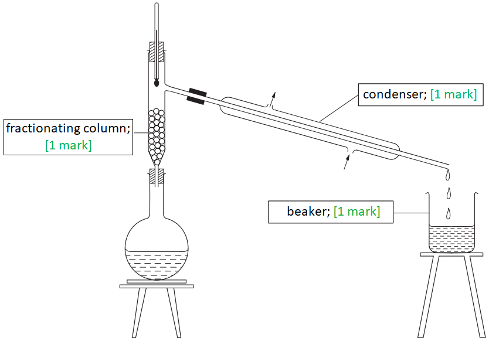

**[Total: 3 marks]**

- *The most challenging piece of equipment to label is the fractionating column*
b) Heat is applied:

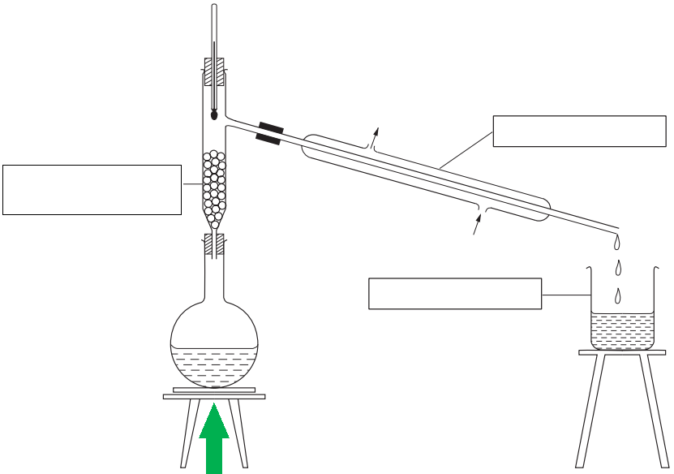

- Arrow under the round-bottomed flask; **[1 mark]**

**[Total: 1 mark]**

- *The arrow for heat must go underneath the round-bottomed flask as this contains the mixture to be separated*
c) This separation process is:

- Fractional; **[1 mark]**
- Distillation; **[1 mark]**

**[Total: 2 marks]**

- *The mixture in the round-bottomed flask will be heated and then condensed, which is distillation*
- *The fractionating column (glass column filled with beads) indicates that it is fractional distillation*

### Q12
a) The sweets should be crushed to:

- Provide a larger surface area*;  ***[1 mark]**
- (So) quicker to extract the colour / more colour is extracted; **[1 mark]** 
*Not easier / faster *

**[Total: 2 marks]**
b) The experiment be carried out in a well-ventilated laboratory because:

- Reference to ethanol; **[1 mark]**

**[Total: 1 mark]**** **

- *Ethanol is flammable *
c) One safety precaution that the student should have taken, other than carrying out the experiment in a well-ventilated laboratory and using eye protection is:

- Reference to flammability of ethanol; **[1 mark]**

**[Total: 1 mark]**** **

- *Any suitable measure for ensuring you are reducing the risk regarding the flammability of ethanol would be accepted, for example, keep away from sources of ignition*
d) The purpose of the watch glass is:

- To prevent loss of solvent; **[1 mark]** *Not splash / evaporation*

**[Total: 1 mark]**
e) Decant means to:

- <u>Pour</u> off liquid;** [1 mark]**

**[Total: 1 mark]**
f) To carry out instruction 6:

Any** five** from:

- Carry out chromatography;** [1 mark]**
- Apply orange concentrate; ** [1 mark]**
- To paper; ** [1 mark]**
- Use a solvent; ** [1 mark]**
- Result of experiment / analyse chromatogram; ** [1 mark]** 
*All five marks can be achieved from a suitable diagram*

**[Total: 5 marks]**

- *You should feel confident writing a method for chromatography *
- *Remember: the solvent used should be one in which the substance will dissolve fairly well*
- *The more soluble colours will travel to the top of the paper, with less soluble colours staying nearer the start line, allowing then number of different colours to be easily identified*

### Q13
a)  The base line (origin):

- Correct location; **[1 mark]**

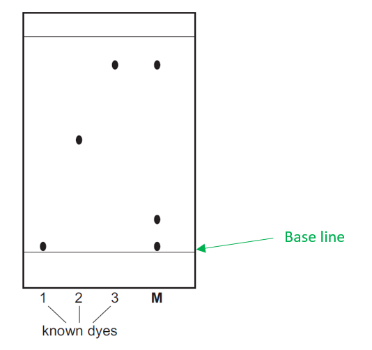

**[Total: 1 mark]**
b) A solvent that could be used in this separation:

- Any organic solvent/ ethanol/ alcohol/ acetone; **[1 mark]**

**[Total: 1 mark]**

- *You are told the dyes are insoluble in water, so an organic solvent must be used*
- *Common organic laboratory solvents, in addition to those above, include hexane, cyclohexane and ether*
c)  The number of dyes in the mixture, **M**:

- There are 3 dyes in mixture **M**; **[1 mark]**

**[Total: 1 mark]**

- *You can tell this because there are three dots visible in the chromatogram*
d)   The identity of the dyes in the mixture,** M**:

- Dyes 1 and 3 present in **M**;** [1 mark]**
- Dye 2 not present; **[1 mark]**
- An unknown dye present; **[ 1mark]**

**[Total: 3 marks]**

- *All you need to do is to match up the spots with the reference dyes*
- *You can also get credit for referencing the solubility properties of the dyes:*

  - *Dye 3 is the most soluble as it has travelled furthest up the paper*
  - *Dye 1 is the least soluble as it has barely moved off the base line*
e) Checking the reliability of the results:

- You could repeat the experiment; **OR** Use a different solvent; **OR** Measure the *R*f  values; **[1 mark]**

**[Total: 1 mark]**

- *Reliability is all about whether the results are consistent*
- *You can check this by repeating the experiment with exactly the same conditions*
- *Using a different solvent would give you different positions of the spots, but the relative position compared to the reference spots should be the same*
- *Measuring the **R**f**  **values would allow you to compare the exact positions of the spots in **M** compared to the reference spots and know if they are the same substances*

### Q14
a) The names of the apparatus are:

- Tripod; **[1 mark]**
- Stirring rod / stirrer / glass rod; **[1 mark]**

**[Total: 2 marks]**

- *You should be familiar with both of these pieces of equipment and be able to name the other equipment used when making soluble and insoluble salts*
b)

i) The order in which the apparatus should be used in this experiment is

- **B**, **C**, **A**; **[1 mark]**

ii)  The separation process in **C** is:

- Filtration;** [1 mark]**

**[Total: 2 marks]**

- *Read the question carefully- you want to obtain crystals of calcium chloride which is soluble from a mixture of solid calcium chloride and calcium carbonate, which is insoluble *
- *First, you would add them both to water to dissolve the calcium chloride, the calcium carbonate would remain undissolved*
- *You would filter the mixture (shown in **C**) to remove the undissolved calcium carbonate from the solution*
- *You would heat the remaining calcium chloride solution to obtain crystals*
- *These are basic separation techniques which you need to be familiar with*
c)

i) The substance added to mixture **B** is:

- Water; **[1 mark]**

ii) The general name given to the liquid in dish **C** is:

- Filtrate; **[1 mark]**

**[Total: 2 marks]**

- *Water is added to enable the calcium chloride to dissolve*
- *This way you can separate it from the insoluble calcium carbonate by filtering the undissolved solid*
- *The filtrate refers to the solution that was allowed to pass through the filter paper*
- *The solid particles that remain behind are known as the residue*
d) You would know when to stop heating the dish in **A** because:

- Solid forms / crystals appear on the edge / glass rod test; **[1 mark]**

**[Total: 1 mark]**

- *If the solution is heated to dryness, the crystals may decompose further*

### Q15
a) The purpose of step 1 is:

- To extract the colour; **[1 mark]**

**[Total: 1 mark]**

- *As the jam is heated, the consistency will change to become less viscous *
- *This allows it to be subsequently filtered and the coloured liquid used for chromatography*
b) The mixture was filtered:

- To remove solids / insoluble impurities;** [1 mark]**

**[Total: 1 mark]**

- *Filtration separates a solid from a liquid*
- *The solids will remain in the filter paper, the filtrate*
- *The solution will pass through the filter paper, the filtrate*
c) Step 3 was carried out by:

- Heating / Evaporation; **[1 mark]**

**[Total: 1 mark]**

- *The filtrate is the solution that has passed through the filter paper*
- *By heating it, a proportion of the water will evaporate leaving behind a more concentrated solution*
d) A diagram to show the possible paper chromatogram obtained in Step 4 is:

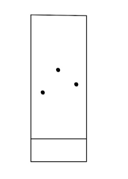

- Diagram showing spots; **[1 mark]**
- 3 at different levels; **[1 mark]**

**[Total: 2 marks]**

- *You should be aware of what a chromatogram looks like*
- *If three different colours are present, each one will move a different distance up the paper*
- *The dots being at the same level would indicate they are the same colour, so they need to be at different levels*

### Q16
a) A chemical test to show the presence of ammonia in Bite Relief solution is:

- Test: red litmus / other named indicator; **[1 mark]**
- Result: blue; **[1 mark]**

**[Total: 2 marks]**

- *The test for the presence of ammonia is one of several gases that you must know how to test for, they are easy marks to pick up if you now them!*
b) The practical method that could be used to separate the mixture of alcohol and water is:

- Fractional; **[1 mark]**
- Distillation; **[1 mark]** 
*Allow fractionation for 1 mark*

**[Total: 2 marks]**

- *Fractional distillation is suitable because the mixture contains two miscible liquids which have different boiling points*
c) A chemical test to show the presence of water is:

- Test: blue cobalt chloride paper; **[1 mark]**
- Result: turns pink; **[1 mark]**

**OR**

- Test: anhydrous/white copper sulfate; **[1 mark]**
- Result: turns blue; **[1 mark]**

**[Total: 2 marks]**

- *You could be asked about the use of either of these tests to show the presence of water, so ensure you learn them both, including the colour changes*
d) The effect of touching the alcohol with a lighted splint is:

- It catches fire owtte; **[1 mark]**

**[Total: 1 mark]**

- *Alcohols are flammable, producing water and carbon dioxide when they undergo combustion*

### Q17
a) The process used to separate the colours is:

- Chromatography; **[1 mark]**

**[Total: 1 mark]**

- *This is a practical that you will probably have done several times*
b) The solvent used is:

- Water / H2O; **[1 mark]**

**[Total: 1 mark]**

- *The question tells you that the dyes are water-soluble, therefore the solvent will be water*
c) The line at position **B** is the:

- Origin / baseline / datum; **[1 mark] **
*Ignore references to start line / initial / pencil*

**[Total: 1 mark]**

- *Most people refer to this line as the baseline*
d) The following conclusions can be drawn about the colours present in sweets **C** and **D**:

- Sweet **C** has 4 colours; **[1 mark]**
- Sweet **D** has 3 colours; **[1 mark]** 
*Allow ****C**** has one more colour / more colours than ****D**** for one mark*
- 2 colours are the same;** [1 mark]**

**[Total: 3 marks]**

- *To read the results for each sweet, you move directly / vertically upwards*

  - *There are 4 spots vertically above the sweet **C** label*
  - *There are 3 spots vertically above the sweet **D** label*
- *To compare results, you work horizontally*

  - *Sweets **C** and **D** have the very top spot in common*
  - *The bottom spot on sweet **D** is also present in sweet **C** *

### Q18
a) The term concentrated means:

- No / little water present; **[1 mark]**

**[Total: 1 mark]**
b) The pH of the lemon drink is:

- Any value less than 7; **[1 mark]**

**[Total: 1 mark]**

- *You are told on the label that the lemon drink contains citric acid *
- *You are given no indication of the strength of the acid so any value below 7 is accepted *
- *Remember: The fact that the drink is concentrated does not mean the pH would be very low, it refers to the amount of water present so could mean a concentrated weak acid which would still have a pH of close to 7*
- *The pH scale refers to the percentage of hydrogen ions present due to the ionisation of the acid molecules*
c) An experiment to show that two different yellow colourings are present in the drink is:

- Chromatography; **[1 mark]**
- Apply drink to paper; **[1 mark]**
- Use a solvent; **[1 mark]**
- Two yellow spots will be present; **[1 mark]** *Any reference of the paper being added to the drink obtains 2 marks max*

**[Total: 4 marks]**

- *When the substance separates, if there are two different yellow colours, then two dots will be present on the chromatography paper*
- *They would have different **R**f** values so travel different distances*

### Q19
a)  The type of chemical reaction resulted in the formation of the lead chloride:

- Precipitation / double decomposition; **[1 mark] **
*Allow ppt*

**[Total: 1 mark]**

- *Ppt is not a standard abbreviation for precipitate, but it would be recognised and accepted in an exam*
b)  The solubility of lead chloride in:

i) Cold water

- Low / insoluble / does not dissolve;** [1 mark]**

ii) Hot water

- High / soluble / dissolves;** [1 mark]**

**[Total: 1 mark]**

- *From the description in the student's notebook, you can tell that the lead chloride dissolved when the mixture was boiled and reappeared as white crystals on cooling*
c)   The method which should be used to separate the crystals from the mixture:

- Filtration; **[1 mark]**

**[Total: 1 mark]**

### Q20
An experiment to find the mass of salts in 1 dm3 of seawater would involve:

Any **six **from:

- Measured volume of seawater; **[1 mark]**
- Using measuring cylinder; **[1 mark]**
- Into evaporating dish/beaker; **[1 mark]**
- Pre-weighed; **[1 mark]**
- Evaporate/heat; **[1 mark]**
- To dryness/constant mass; **[1 mark]**
- Re-weigh; **[1 mark]**
- Indication of calculation method; **[1 mark]** If the method described would not work, award 0 marks

**[Total: 6 marks]**

- *Seawater is a solution, so the method needs to separate a solute from a solvent*
- *As the mass of the salts in 1 dm**3** is required, it is necessary to measure the mass of an evaporating basin when it is empty and once the dry salts are obtained - the difference in mass is the mass of the salt obtained*
- *Heating to a constant mass ensures all of the water has evaporated, otherwise, the recorded mass of the dry salts would be greater than it should be*

### Q21
a) The student would need the following to effectively carry out instruction 1:

Any **three** from:

- Pestle; **[1 mark]**
- Mortar; **[1 mark]**
- Solvent; **[1 mark]**
- Sand; **[1 mark]** 
*Ignore water and / or heat*

**[Total: 3 marks]**

- *A pestle and mortar are common pieces of laboratory equipment used to crush up substances into smaller pieces*
- *This enables the substances in solids to dissolve easily*
- *Sand can be used to help break down the solid further and it will not dissolve in the water*
b) An experiment to carry out instruction 2 is:

*NB marks can be obtained from a diagram*

Maximum of **four **marks from:

- Chromatography or chromatogram; **[1 mark]**
- Paper; **[1 mark]**
- Apply spot / extract to paper; **[1 mark]**
- Description or name of solvent used; **[1 mark]**
- And separation e.g. spots on paper; **[1 mark]** 
*If water used as solvent (max 3)* 
*If paper dipped into extract (max 3)* 
*If method would not work (max 2)*

**[Total: 4 marks]**

- *The process of setting up a chromatogram is a common practical to perform and to be asked about*
- *Make sure you include all steps, however small they seem!*
- *Careful**: the information provided tells you that the pigments in the leaves are not soluble in water, so water is not suitable in this case*
- *A solvent typically used to dissolve plant pigments is propan-2-one, also known as acetone, however, you are not expected to know this*
- *You would be awarded a mark to state a solvent other than water*

### Q22
a) The graph should be plotted:

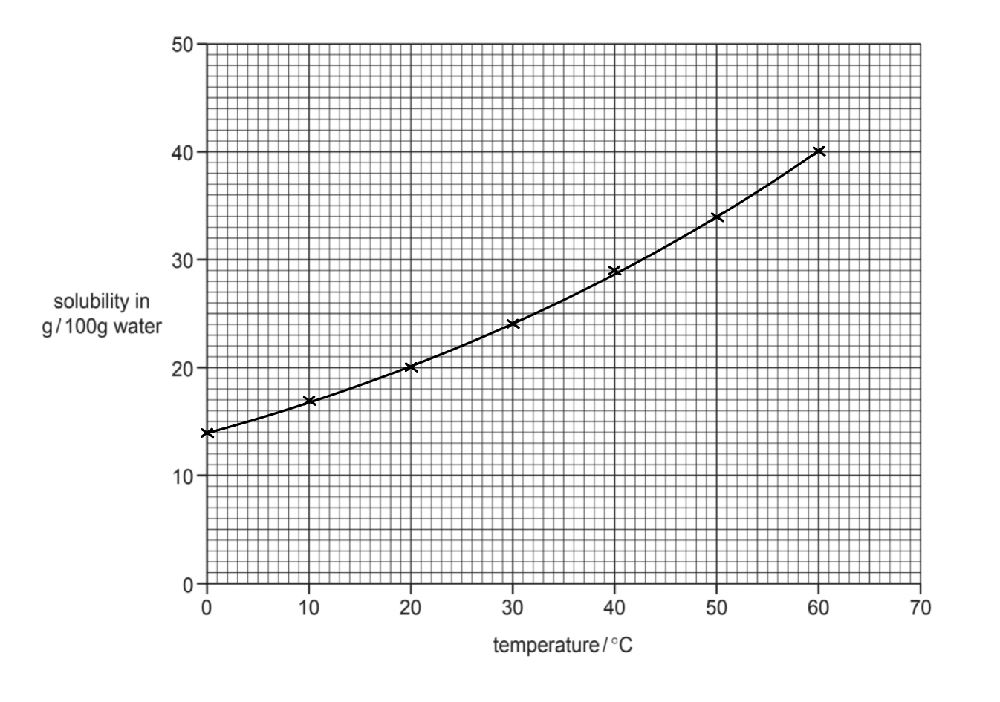

- Points plotted correctly;** [3 marks]   ** 
*–1 for each incorrect*
- Smooth curve, not a straight line; **[1 mark] **

**[Total: 4 marks] **

- *Take care when considering the line of best fit which should go as close to the points as possible - it does not have to be a straight line*
- *If your plots look like there is a slight curve to them, then use a smooth curve as a line of best fit*
- *Make sure your plots are x’s as otherwise the line of best fit will cover up •’s *
b) The solubility of potassium chlorate at 70 °C is:

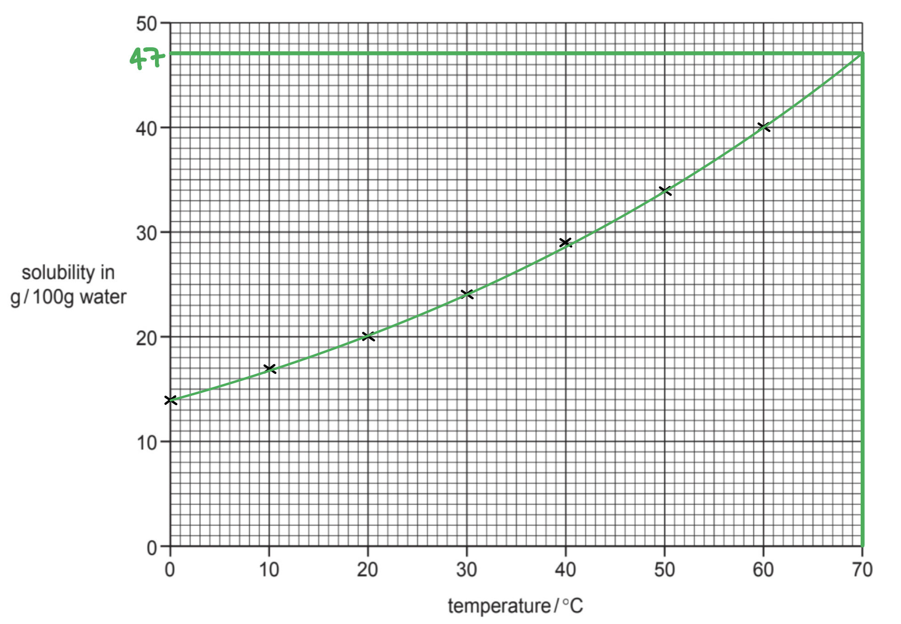

- 47±1 
**OR** 
reading from graph;** [1 mark]  **
- Curve extrapolated on grid; **[1 mark] **

**[Total: 2 marks]**

- *You need to extend the curve (extrapolate) to get an accurate reading for 70 °C*
c) The effect of cooling would be:

- Solid / crystals form; **[1 mark] **
- 20 g; **[1 mark] **
 *Not solubility decreases*

**[Total: 2 marks] **

- *As the temperature increases solubility of a salt tends to increase, therefore as a solution is cooled the solute in the solution will start to crystalise *
- *You can use your graph to answer this question*
- *The solubility of potassium chlorate at 20 °C is 20 g per 100 g of water*
- *Therefore we would see the solid crystals form*

### Q23
a) The origin line is drawn in pencil because:

- Pencil does not dissolve in the solvent 
**OR **
Pencil does not interfere with results; **[1 mark]** 
*Accept words to that effect*

**[Total: 1 mark]**

- *This is a common question about the baseline / origin in chromatography, so make sure that you know why*
b) The amino acids that could be the same are:

- 1 and 3; **[1 mark]**

**[Total: 1 mark]**

- *To find the amino acids that are the same, you need to work horizontally looking for spots at the same level*

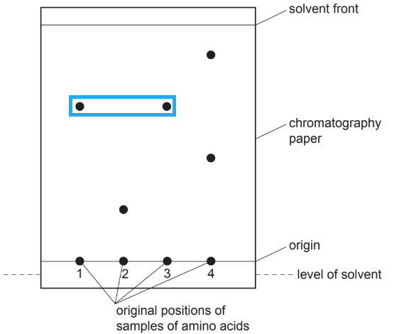
c) The sample that contains more than one amino acid is:

- Sample 4; **[1 mark]**
- (Because) it has two spots; **[1 mark]**

**[Total: 2 marks]**

- *To find the sample that contains more than one amino acid, you need to work vertically to identify which sample has more than one spot (not including the spot on the origin)*

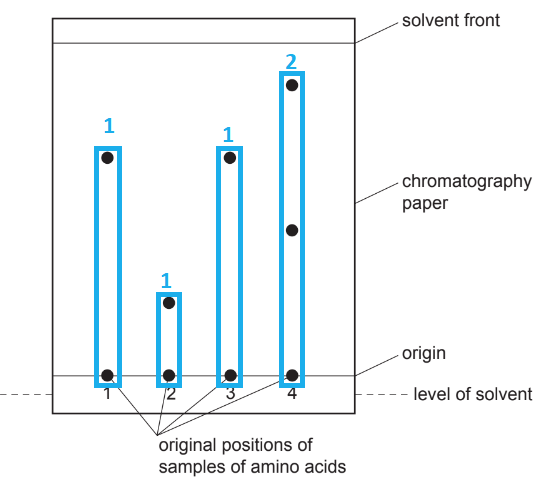
d) It is necessary to spray the chromatogram with ninhydrin to:

- Show the position of the acids / spots; **[1 mark]**

**[Total: 1 mark]**

- *Amino acids are not visible to the naked eye on a chromatogram*
- *Ninhydrin is a locating agent that is sprayed on the chromatogram to locate the spots*
- *You are not expected to know either of these points but as the question uses the 'suggest' command word, you should use your knowledge about locating agents and apply it to this situation*

### Q24
a)   The pieces of apparatus labelled:

- 2 correct labels; **[2 marks]**

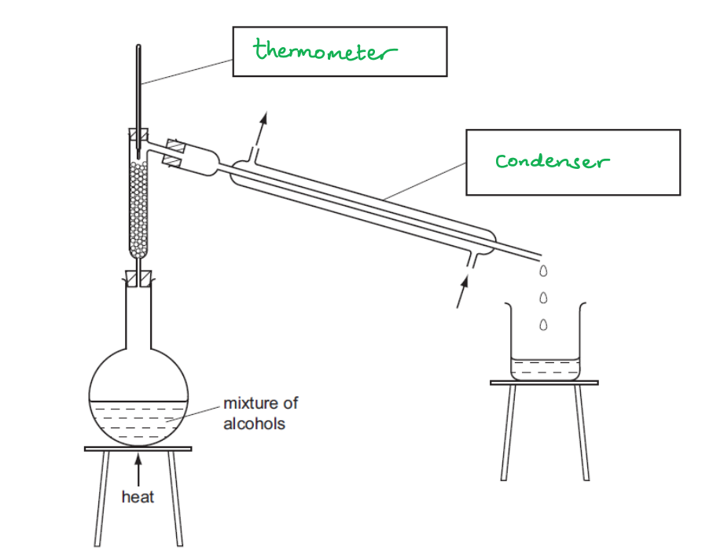

**[Total: 2 marks]**
b) Labels for the arrows:

- Correct labels; **[1 mark]**

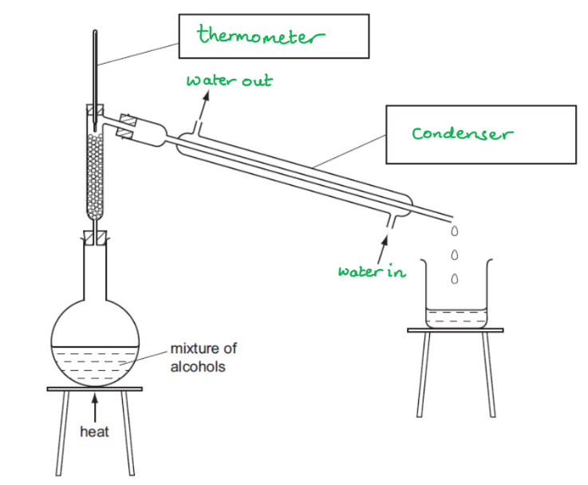

**[Total: 1 mark]**

- *Having the water enter the condenser at the bottom ensures that it is always filled with cold water*
c)  The name of this separation process:

- Fractional** [1 mark]**
- Distillation;** [1 mark]**

**[Total: 2 marks]**
d)

i) The liquid first to collected in the beaker:

- Ethanol; [**1 mark]**

ii) How the student would know when all of this liquid had collected:

- The temperature would rise (above 78 oC);** [1 mark]**

**[Total: 2 marks]**

- *Ethanol has the lower boiling point so will boil first *
e)  A possible hazard in this experiment:

- Alcohols are (in)flammable / catch fire / burn; **[1 mark]**
- There is a Bunsen burner / flame / heat;** [1 mark]**

**[Total: 2 marks]**

- *You should know that alcohols are flammable, which is why they can be used as fuels*

### Q25
a) The labels are:

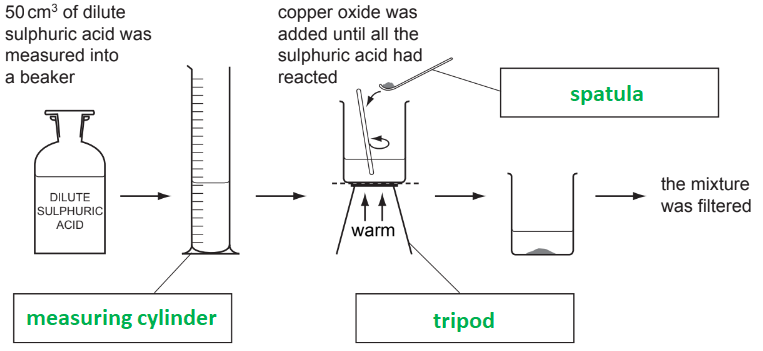

- Measuring cylinder; **[1 mark]**
- Spatula; **[1 mark]**
- Tripod; **[1 mark]**

**[Total: 3 marks]**

- *You should know the names of various pieces of laboratory equipment *
b) The term *excess *means:

- More than enough to react; **[1 mark]** 
*Accept words to that effect*

**[Total: 1 mark]**

- *This is not a common definition to ask for, but you should know what excess means*
c) The labelled diagram to show how the mixture is filtered:

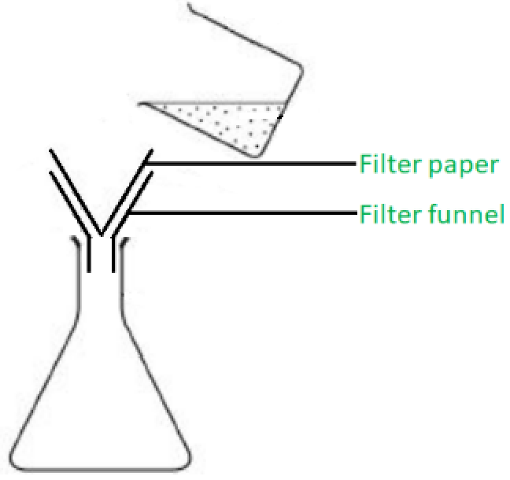

- Filter paper;** [1 mark]**
- (Filter) funnel;** [1 mark] **

**[Total: 2 marks]**

- *Don't forget to draw and label both the funnel and filter paper*

### Q26
To find out the percentage of calcium carbonate present in this toothpaste:

Any **seven **from:

- Weighed amount/ x g of toothpaste; **[1 mark]**
- Add water; **[1 mark]**
- Stir / heat; **[1 mark]**
- Filter (to obtain calcium carbonate); **[1 mark]**
- Wash; **[1 mark]**
- Dry; **[1 mark]**
- Weigh residue; **[1 mark]**
- Calculate the percentage of calcium carbonate; **[1 mark]**

**[Total: 7 marks]**

- *You calculate the percentage of calcium carbonate in the toothbrush using:   *

$\frac{\mathrm{mass} \mathrm{of} \mathrm{calcium} \mathrm{carbonate}}{\mathrm{total} \mathrm{mass} \mathrm{of} \mathrm{toothpaste}}\times100$

- *You therefore need to ensure you measure the mass of toothpaste before attempting to separate the calcium carbonate from the sodium fluoride *
- *The sodium fluoride will dissolve when water is added but the calcium carbonate will not as it is insoluble*
- *You can therefore filter the solution to obtain the calcium carbonate*
- *Next, you wash and dry it to remove any water that may contribute to the mass, and then weigh it *
- *Calculate the percentage of calcium carbonate using the equation above*

### Q27
a) The correct labels for the boxes are:

- Top box = fractionating column; **[1 mark]**
- Bottom box = tripod;** [1 mark]**

**[Total: 2 marks]**

- *You should definitely know the label for the tripod from your previous studies*
- *Any column / piece of equipment making the distance between the flask and the side-arm (to the condenser) longer is being added to help fractional distillation occur*
b) The labels on the arrows should be:

- (Cold) water labelled twice; **[1 mark]**

**[Total: 1 mark]**

- *This is an older question so it is more likely that you would have to label the bottom / lowest arrow as water in and the top / uppermost arrow as water out to imply that the condenser is filled with water*
c) **One **mistake in the apparatus is:

- Heat under the beaker (at the end);** [1 mark] **

**[Total: 1 mark]**

- *The liquid collecting in the beaker (distillate) has been cooled and there is no need to re-heat as part of the distillation process*
d) The liquid that would collect first is:

- Ethanol;** [1 mark]**
- (Because,) it has a lower / the lowest boiling point; **[1 mark]**

**[Total: 2 marks]**

- *The question tells you the boiling points of the liquids being separated*
- *This means that you should be able to deduce that ethanol has the lower boiling point and will, therefore, be the first liquid to collect *
e) It would be better to use an electrical heater instead of a Bunsen burner to heat the water and ethanol mixture because:

- Ethanol is flammable; **[1 mark]**

**[Total: 1 mark]**

- *Ethanol is part of the homologous series of alcohols*
- *You are expected to know that alcohols are flammable*
- *Therefore, heating them with a Bunsen burner or naked flame is hazardous*

### Q28
An investigation to show that the drink did not contain these two colours is:

Any **six** from:

- Chromatography; **[1 mark]**
- (Pencil) baseline / origin; **[1 mark]**
- Apply orange colour to paper; **[1 mark]**
- Apply samples of both E110 and E129; **[1 mark]**
- Solvent / named solvent; **[1 mark]**
- Check heights of spots of E colours against orange drink; **[1 mark]**
- Conclusion / allow comparison to known *R*f values; **[1 mark]**

**[Total: 6 marks]**

- *The process of setting up a chromatogram is a common practical to perform and to be asked about*
- *Make sure you include all steps, however small they seem!*

### Q29
a) The apparatus used in step 1 is:

- Pestle; **[1 mark]**
- Mortar; **[1 mark]**

**[Total: 2 marks]**

- *This question would more commonly be worth 1 mark as the mortar and pestle are used together so often that most people are not absolutely certain which is the mortar and which is the pestle*
b) The grass is ground with ethanol rather than water because:

- Chlorophyll is more soluble in ethanol 
**OR **
Chlorophyll is less soluble in water; **[1 mark]**

**[Total: 1 mark]**

- *The reason for using any other solvent will usually be linked to solubility*
c) The separation technique used in step 3 is:

- Filtration; **[1 mark]**

**[Total: 1 mark]**

- *The question tells you that the solution is separated from the rest of the mixture, which contains crushed grass and sand*
- *Therefore, you will be filtering solids out a liquid / solution*
d) Description of how step 4 is carried out:

The description should include the following:

- Paper;** [1 mark]**
- Chromatography; **[1 mark]**
- Adding pigments / sample (to the baseline on the filter / chromatography paper); **[1 mark]**
- Use of solvent; **[1 mark]**

**[Total: 4 marks]**

- *Your answer should basically describe how to perform paper chromatography on the solution obtained in step 3, e.g.*

  - *Step 4 is paper chromatography*
  
    - *A horizontal pencil baseline is drawn about 1 cm up from the bottom of the chromatography paper*
    - *The sample / solution / pigment is spotted onto the baseline*
    - *The chromatography paper is then suspended in a beaker*
    - *Solvent is added to the beaker so that it just touches the bottom of the chromatography paper (it must not touch the sample / pencil line)*
    - *The chromatogram is then left to run until the solvent is almost at the top*
    - *The solvent front is marked on the chromatography paper with a pencil *

### Q30
a) This method of separation is:

- Chromatography; **[1 mark]**

**[Total: 1 mark]**

- *Separating a mixture by differences in solubility involves chromatography *
b) The level of the solvent should be:

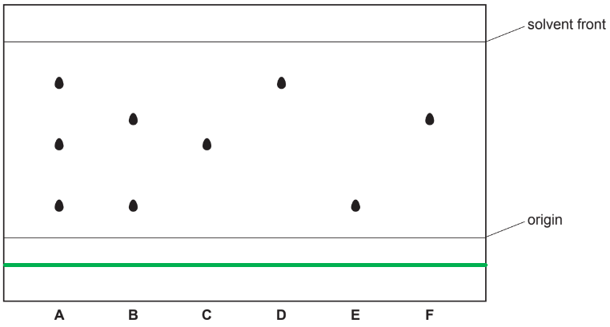

- Line drawn on the diagram below the origin;** [1 mark]**

**[Total: 1 mark]**

- *The solvent should always be filled to just below the origin / baseline so that it doesn't wash the spots of sample off the chromatography paper*
c) The origin / baseline should be drawn in pencil, not pen, because:

- Pencil does not interfere with results; **[1 mark]** 
*Accept words to this effect*

**[Total: 1 mark]**

- *This is one of the common questions about the baseline in chromatography*
- *The other question is about ensuring that the solvent level is below the pencil origin / baseline*
d) **One **difference and **one **similarity between the coloured mixtures, **A** and **B** are:

- Difference: **A** has more colours / **B** has less colours 
**OR **
**A** has 3 colours / **B** has 2 colours 
**OR **
**B** contains** F** but **A** doesn’t 
**OR **
**A** contains **C **/ **D** but **B** does not;** [1 mark]**
- Similarity: both contain the same colour / **E**; **[1 mark]**

**[Total: 2 marks]**

- *Remember: **To compare results in a chromatogram, you work horizontally *

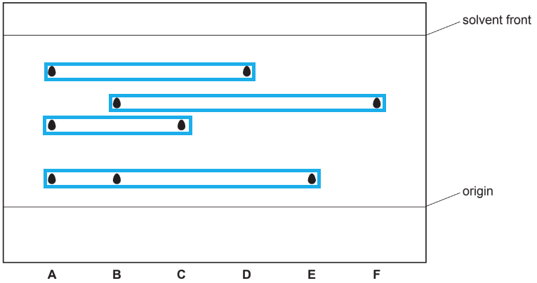
e) The substances present in mixture **A** are:

- **C** **AND D AND** **E**; **[1 mark]**

**[Total: 1 mark]**

- *Remember: **To identify the spots in a sample:*

  - *You work vertically to identify the number of spots*
  - *You work horizontally to compare those spots with known samples*

## Multiple Choice Questions (22 questions)

### Q1
**Final answer:** **The correct answer is A**

- To identify the pigment, you must calculate the *R*f value of the unknown spot using the formula:

$R_{f}=\frac{\mathrm{distance} \mathrm{travelled} \mathrm{by} \mathrm{substance}}{\mathrm{distance} \mathrm{travelled} \mathrm{by} \mathrm{solvent}}$

- Using the diagram:

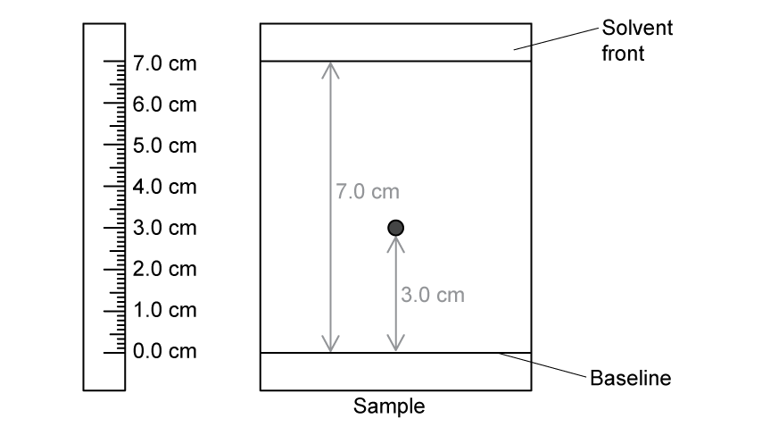

- Distance travelled by substance = 3.0 cm
- Distance travelled by solvent (solvent front) = 7.0 cm

$R_{f}=\frac{3.0}{7.0}=0.428..=0.43$

- Comparing this to the table, the unknown sample matches **pigment P **

> **[exam-tip]**
> Always measure the distance from the **baseline to the centre of the spot**, not the top or bottom. Using the centre of the spot ensures accurate **Rf values** and avoids losing marks for measurement errors.

### Q2
**Final answer:** **The correct answer is A**

- Silver nitrate reacts with sodium chloride to form silver chloride, which is insoluble and appears as a white precipitate
- Insoluble solids are trapped on the filter paper during filtration and form the residue
- The remaining liquid that passes through the filter paper is the filtrate
- Aqueous sodium nitrate is a soluble side product from the mixture
- The filtrate contains aqueous sodium nitrate, which stays dissolved in water
- Therefore, the **residue is silver chloride and filtrate is aqueous sodium nitrate**

**B **is incorrect because aqueous sodium nitrate is soluble and cannot be the residue, because it will go through the filter paper

**C **is incorrect because the filtrate is not pure water because sodium nitrate is dissolved in it. **The filtration process does not remove the soluble salt from the mixture**

**D **is incorrect because silver nitrate and sodium chloride are the reactants, not the separated products

### Q3
**Final answer:** **The correct answer is**** B**** because:**

- Compare the chromatogram for X by using a ruler and carefully identifying the spots which are the same distance from the baseline as X.
- Only foodstuff **B** matches so B is the one that contains X.
- **A**, **C** and** D** do not match and so do not contain the banned dye.

**A, C **and** D **are incorrect as the chromatogram from these foodstuffs do not match with that of X and so do not contain the banned preservative.

### Q4
**Final answer:** **The correct answer is**** A**** because:**

- In paper chromatography the sample spots should all go onto the **base line**.
- This is always made with a** pencil **as to use ink would contaminate the samples being analysed.

**B **is incorrect as the samples would dissolve in the solvent.

**C **and** D** are incorrect as the base line is used to measure the distances to calculate the *R*f value. If the spots are above or below this line then the calculations will be **inaccurate**.

### Q5
**Final answer:** **The correct answer is ****D**** because:**

- Filtration is the process of using a filter funnel and filter paper to separate an insoluble solid from a solution or liquid

  - The solid is unable to pass through the filter paper and becomes the residue
  - The solution / liquid that is collected in the flask is called the filtrate

**A**, **B** and **C** are incorrect as all three of these methods require heating

### Q6
**Final answer:** **The correct answer is ****C**** because:**

- Water is added to the rocksalt to dissolve the sodium chloride
- The mixture is then filtered to remove and separate the insoluble sand
- The filtrate contains sodium chloride dissolved in water
- The sodium chloride can be separated / removed from the water by crystallisation

**A** and **B** are incorrect as melting will not separate the sodium chloride, it will produce molten sodium chloride with sand mixed in

**D** is incorrect as dissolving gets the sodium chloride into solution but it still contains sand Subsequent crystallising then undoes this physical change

### Q7
**Final answer:** **The correct answer is ****B**** because:**

- Water enters at the bottom of the condenser in order to **fill** the entire condenser.
- It then flows out at the top once the condenser is **full** of water as shown in the diagram.

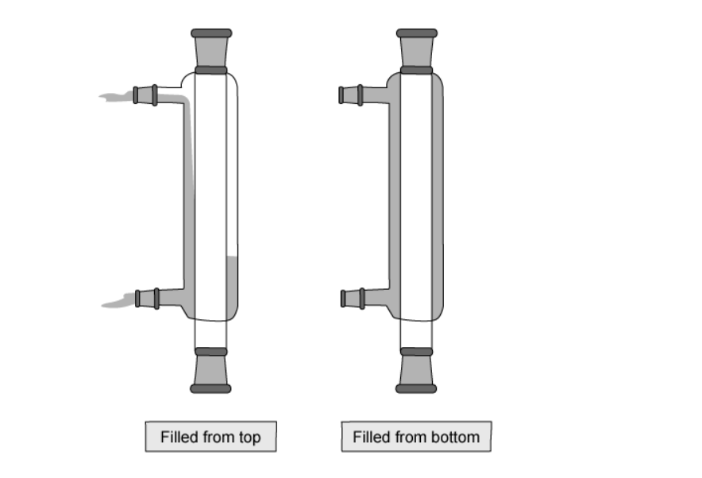

**A**,** C **and** D **are incorrect as if the water enters at the top of the condenser it will pour straight out and the condenser would not fill up.

### Q8
**Final answer:** **The correct answer is**** D**** because:**

- **The locating agent is sprayed onto the ****chromatogram ****once it has ****dried****.**
- **A chromatogram is the name given to the chromatography paper ****after**** the process has been carried out.**

> *A **and** C **are incorrect as the locating agent is added to the chromagram **after** the run has been completed and the paper is dry.*

> *B **is incorrect as the **R**f** value obtained is compared to **standard reference values **to identify the amino acid.*

### Q9
**Final answer:** **The correct answer is**** B**** because:**

- X and Y **both** produce a spot at 0.18 cm which corresponds to pure paracetamol.
- The **impurity** in sample X is visible at 0.27 cm and this is the value which must be used to calculate the retention factor for the chemical.
- Use the equation for the retention factor: *R*f =  $\frac{distancetravelledbyspot}{distancetravelledbysolventfront}$
- Rf = $\frac{0.27}{0.36}=0.75$

**A, C **and** D **are incorrect as these *R*f values are not correct.

### Q10
**Final answer:** **The correct answer is**** A**** because:**

- Measure the distance from the baseline to each sample spot.
- Measure the distance from the baseline to the solvent front.
- Use the equation for the retention factor: *R*f = $\frac{distancetravelledbyspot}{distancetravelledbysolventfront}$
- Determine which sample spot produces an answer of 0.7.

**B**,** C **and** D **are incorrect as these dyes do not produce an *R*f value of 0.7.

### Q11
**Final answer:** **The correct answer is ****C**** because:**

- Sugars are colourless substances
- Locating agents are sprayed onto the chromatogram once the experiment has been carried out and allow the positions of the sugars to be observed

**A**, **B **and **D** are incorrect as these are not the purpose of the locating agent

### Q12
**Final answer:** **The correct answer is**** D**** because:**

- Crystallisation is a separation technique used to separate a **soluble solid** from a  solution.
- It involves evaporating the solution to a much smaller volume and then leaving it to cool.
- As the solution cools, crystals of the solid form.

**A **is incorrect as neutralisation is the reaction between an **acid **and a **base** and is not a separation technique.

**B **is incorrect as chromatography is useful for separating a mixture of **dissolved** substances.

**C** is incorrect as distillation is used to separate a **pure liquid **from a **solution **or a **mixture **of liquids.

### Q13
**Final answer:** **The correct answer is**** A**** because:**

- Potassium chloride in water is an **impurity** which affects its physical properties.
- Pure water boils at 100 ºC and freezes at 0 ºC.
- In water, potassium chloride causes the boiling point to** increase **and the freezing point to **decrease**.
- This is why salt is used to prevent icing on roads as it lowers the freezing point, making it more difficult for ice to form at temperature close to 0 ºC.

**B **and** D **are incorrect as the freezing point of water **decreases **when potassium chloride is added to it.

**C **is incorrect as the boiling point of water **increases **when potassium chloride is added to it.

### Q14
**Final answer:** **The correct answer is**** A ****because: **

- The first fold requires that the filter paper adopts a** semi-circular shape**.
- This is then folded again to form a cone that fits inside the funnel.

**B**,** C **and** D **are incorrect as these diagrams do not correctly illustrate the final step to obtain the required shape.

### Q15
**Final answer:** **The correct answer is**** B**** because:**

- The apparatus shown is for **distillation**.
- Distillation is used to **separate **two or more liquids from each other if they have **different boiling **points.
- The boiling point of ethanol is 78ºC and water is 100oC, ethanol therefore boils **before **the water does.
- It is then **cooled **and **condensed **back into the liquid form.

**A** is incorrect as filtration is the technique required for this mixture.

**C **and **D **are incorrect as aqueous and organic liquids are immiscible and so can be separated using a **separating funnel**.

### Q16
**Final answer:** **The correct answer is ****D**** because**

- The substance is a **solid** at room temperature which is 20  °C.
- Its melting point must be above this temperature but must also be a **specific** number and **not a range** as the question states that the substance is pure.

**A** is incorrect as its melting point must be **above** room temperature so it has to be above 20 °C.

**B** and **C** are incorrect as pure substances boil at a **specific** temperature so their melting point would also be a specific temperature i.e. not a range of temperatures.

### Q17
**Final answer:** **The correct answer is**** D**** because:**

- Impure substances have melting points and boiling points that fall in a **range of  temperatures** while pure substances have **exact **and** sharp** melting and boiling  points.
- Solid P has an **exact** melting point and boiling point hence it is a pure substance.
- Paper chromatography of solid Q produces two spots, indicating it must contain more than one substance.

**A **and** B **are incorrect as solid Q contains **more than one** substance.

**C **is incorrect as solid P contains only** one** substance.

## Theory Questions (16 questions)

### Q1
a) The process that is used to separate a mixture of liquids with different boiling points is:

- (Simple / fractional) distillation; **[1 mark]**

**[Total: 1 mark]**

- *You should know that distillation separates mixtures of liquids with different boiling points*
- *If the difference in the boiling points is large, then you can use simple distillation*
- *If the difference in the boiling points is small, then you use fractional distillation*
b) Apparatus **A** is a:

- (Liebig) condenser; **[1 mark]**

**[Total: 1 mark]**

- *You need to know the apparatus for distillation, including the individual pieces required:*

  - *Round-bottomed / pear-shaped flask*
  - *Thermometer*
  - *Condenser*
  - *Beaker (or another container to receive the distillate / liquid that comes off)*
c) The diagram showing where water enters apparatus **A** is:

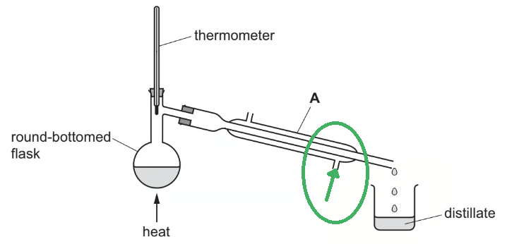

- Arrow at the lower inlet (as shown); **[1 mark]**

**[Total: 1 mark]**

- *Water always enters a condenser at the lowest point *
- *This means that the condenser is then filled with water and more efficient at condensing any vapours that pass through it*

### Q2
a)

i)  A hydrocarbon is a compound which:

- Contains carbon and hydrogen only;** [1 mark]**

ii) Explaining what is meant by the term fractional distillation:

- A mixture of liquids that is separated by (different) boiling points;** [1 mark]**

**[Total: 2 marks]**

- *You must state 'only' in your hydrocarbon definition otherwise you will lose the mark*
- *You need to include the idea that the separation takes place according to the difference in boiling points in your answer*
b)   A use for each fraction is:

Bitumen

- Making roads / roofs / water-proofing, etc;** [1 mark]**

Lubricating fraction

- Waxes / vaseline / grease, etc. or machinery example, e.g. (oil a) bike / hinges / reducing friction*; ***[1 mark]**

Paraffin fraction

- Jet fuel / (home) heating or tractors or cooking or lighting; **[1 mark]**

Gasoline fraction

- Petrol or fuel for cars / vans / trucks; **[1 mark]**

**[Total: 4 marks]**

- *You also need to know examples of uses for the remaining fractions obtained from the fractional distillation of petroleum, i.e. for refinery gas, naphtha, diesel oil and fuel oil*

### Q3
a) Two things that the student would observe when the mixture is added to the dilute sulfuric acid are:

Any **two **from:

- Bubbles / effervescence / fizzing; **[1 mark]**
- (Some of the) solid / copper carbonate dissolves / disappears 
**OR **
Some (brown) solid seen (undissolved); **[1 mark]**
- (Colourless) solution / liquid turns blue;** [1 mark]**

**[Total: 2 marks]**

- *When an acid reacts with a carbonate, a salt, carbon dioxide and water are produced*
- *As carbon dioxide is a gas, bubbles of gas will be seen*
- *The resulting salt is aqueous copper sulfate which is blue in colour and should be a colour that you know*
- *When asked for observations, don't just state what substances are produced, i.e. stating carbon dioxide will not get the mark as you cannot deduce this from your observation - you **see **bubbles which is as a result of CO**2** being produced!*
- *When you have a solid reactant, you will observe that disappearing as it reacts*
b) The student can produce pure dry copper from the mixture of copper and copper(II) sulfate solution by:

- Filter / centrifuge / decant; **[1 mark]**
- Wash with (distilled) water; **[1 mark]**
- (Dry with) filter paper / tissues / warm windowsill / in sun / oven / fan / heat;** [1 mark]**

**[Total: 3 marks]**

- *Filtration is a suitable method of separation in this case as copper is a solid and copper(II) sulfate is in solution*
- *The copper will be trapped on the filter paper whilst aqueous copper(II) sulfate will pass through the filter*
- *The copper on the filter paper may have some residue of the copper(II) sulfate solution, therefore, washing it with distilled water is an important step to remove impurities*
c)

i) When sodium hydroxide solution was to the copper(II) sulfate solution to produce copper(II) hydroxide, the student would observe:

- A blue precipitate / ppt; **[1 mark]**

ii) The ionic equation for this reaction is:

- Cu2+ + 2OH– → Cu(OH)2; **[1 mark]**

**[Total: 2 marks]**

- *Metal cations in an aqueous solution can be identified by the colour of the precipitate they form on the addition of sodium hydroxide *
- *You need to know the colours of the precipitates formed for quite a few different metals and also what happens to the precipitate when you add excess sodium hydroxide, in some cases the precipitate dissolves which further helps to identify the metal ion*
- *To write the ionic equation, write the full equation:*

  - *CuSO**4** (aq) + 2NaOH (aq) → Na**2**SO**4** (aq) + Cu(OH)**2** (s)*
- *Identify the ionic substances and write down the ions separately:*

  - *Cu**2+ **(aq) + SO**4**2-**(aq) + 2Na**+** (aq) + 2OH**-** (aq) → 2Na**+** + SO**4**2-** (aq) + Cu(OH)**2** (s)*
- *Rewrite the equation eliminating the ions which appear on both sides of the equation (spectator ions ) which in this case are the Na**+** and SO**4**2- **ions*

  - *Cu**2+ **(aq) + 2OH**-** (aq) → Cu(OH)**2** (s)*
d)

i) An equation for the decomposition of copper(II) hydroxide, including state symbols, is:

Cu(OH)2 (s) → CuO (s) + H2O (g)

- Correct equation; **[1 mark]**
- Correct state symbols; **[1 mark]**

ii) A non-metallic element that can be used to convert copper(II) oxide into copper is:

- Carbon / hydrogen; **[1 mark]**

**[Total: 3 marks]**

- *Whilst the decomposition of metal hydroxides is not on the specification, this question gives you sufficient information to deduce the equation so you would be expected to be able to give the equation*
- *You are told that copper(II) hydroxide is heated, so this is the reactant*
- *You are also told that copper(II) hydroxide decomposes into copper(II) oxide and steam, so copper(II) oxide and steam (water) are the two products*
- *You know that copper hydroxide is a solid as it was the precipitate that was formed in part (c) that has been separated from the mixture, so its state symbol is (s)*
- *Copper oxide is a compound that you should be familiar with and is a black solid*
- *You are told that steam is produced which is water in gaseous form, therefore the product H**2**O must have the (g) state symbol*

### Q4
a) The chromatogram shows that this substance is not pure because:

- There is more than one spot 
**OR **
There is not one spot; **[1 mark]**

**[Total: 1 mark]**

- *Pure substances produce only one spot in chromatography, impure substances give more than one*
b) The correct *R*f value for the spot labelled **X** is:

- 0.8 (circled); **[1 mark]**

**[Total: 1 mark]**

- *The maximum an **R**f** value can be is 1.0*

  - *This means that the spot has travelled with the solvent to the top / solvent front*
  - *Therefore, 1.2 is not a correct possibility *
- *You can estimate where spots with the other values would appear on the chromatography paper*

  - *0.2 is almost a quarter (0.25)*
  
    - *This means that the spot would appear just below a quarter of the way up from the baseline to the solvent front*
    - *Spot **X** appears above this spot, so the **R**f** value of X cannot be 0.2 *
  - *0.4 is close to a half (0.5)*
  
    - *This means that the spot would appear just below halfway up from the baseline to the solvent front*
    - *Spot **X** appears above this spot, so the **R**f** value of **X** cannot be 0.4 *
  - *0.8 is just over three quarters (0.75)*
  
    - *This means that the spot would appear just over three-quarters of the way up from the baseline to the solvent front*
    - *Spot **X** appears at about this point, so the **R**f** value of **X** is 0.8 *
- *You can also calculate the **R**f** value by measuring the distance from the baseline to the solvent front and measuring the distance from the baseline to spot **X*

  - *Using the equation** R**f** =  *$\frac{\mathrm{distance} \mathrm{travelled} \mathrm{by} \mathrm{substance}}{\mathrm{distance} \mathrm{travelled} \mathrm{by} \mathrm{solvent}}$* will give a more precise value*
c) A colourless substance can be made visible on a chromatogram by:

- Using a locating agent; **[1 mark]**

**[Total: 1 mark]**

- *Locating agents are substances which react with the sample / spots*
- *They cause a coloured product to form which is visible*
- *You can sometimes use UV light to see the spots but this is something that you are not expected to know at this level*

### Q5
a)  Methane from a mixture of the gases, methane and ethane:

- F / diffusion 
**OR **
B / fractional distillation; **[1 mark]**

**[Total: 1 mark]**

- *The key to solving separation techniques problems is knowing the physical and chemical properties of the substances present*
- *Methane and ethane are both gaseous hydrocarbons, so a physical technique is appropriate*
- *Mixtures of gases are usually separated by fractional distillation of the liquified mixture*
- *However, they can also be separated by diffusion, where the boiling points are very close or it is impractical or expensive to use fractional distillation.*
b)  Water from aqueous magnesium sulfate:

- A / simple distillation;** [1 mark]**

**[Total: 1 mark]**

- *Be careful not to choose evaporation, which removes the water but does not recover it, only the solid*
c)   Iron filings from a mixture of iron filings and water:

- E / filtration;** [1 mark]**

**[Total: 1 mark]**

- *Iron filings are not soluble in water which means they can be filtered from the mixture*
d)   Zinc sulfate crystals from aqueous zinc sulfate:

- C / evaporation; **[1 mark]**

**[Total: 1 mark]**

- *Evaporation will remove the water from the aqueous zinc sulfate leaving you with the zinc sulfate crystals*
e)  Hexane from a mixture of the liquids, hexane and octane:

- B / fractional distillation; **[1 mark]**

**[Total: 1 mark]**

- *Hexane and octane are alkanes *
- *They are likely to have boiling points that are different but quite close together *
- *This means that you will need to use fractional distillation as the distance travelled by the vapours is longer which gives more time for the hexane to distil first*

### Q6
a) Evaluation of the different methods to separate the coloured substances in the sample of ink, **K**:

- Chromatography 
**AND **
Fractional distillation will / may work (to separate the coloured substances in **K**); **[1 mark]**
- Chromatography is the simplest / easiest / quickest method (to separate the coloured substances in **K**); **[1 mark]**
- Crystallisation 
**AND **
Filtration 
**AND **
Simple distillation will <u>not</u> work (to separate the coloured substances in **K**);** [1 mark]**

**[Total: 3 marks]**

- *Chromatography is a method used to separate substances that have different solubilities in a given solvent and is often used for ink, dyes and food colourings*
- *Crystallisation is used to form crystals and, therefore, is not appropriate*
- *Filtration is used to remove insoluble solids from solutions / mixtures and, therefore, is not appropriate*
- *Simple distillation separates soluble chemicals by their boiling points but is not appropriate for this situation as there will be four different chemicals to separate*

  - *The three different coloured substances plus the solvent that has been used to make the ink*
- *Fractional distillation, again, separates chemicals by their boiling points*

  - *It would potentially separate the coloured substances based on their boiling points, which will be different *
  - *However, this will not be the best method*
  
    - *There is no guarantee that the solvent will not be the first chemical to distil across, which would leave the three coloured substances behind to potentially degrade as heating continues*
    - *If the coloured substances distil across first, then they are likely to stain the equipment making it unusable for further experiments *
b)

i) The labelled arrows showing where the water should flow in and out are:

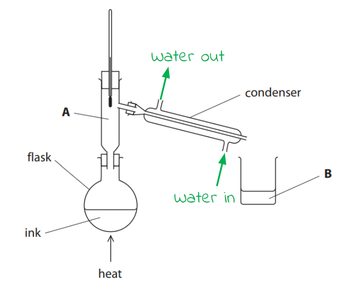

- One labelled arrow to show water going into the bottom of the condenser 
**AND **
One labelled arrow to show water going out of the condenser at the top;** [1 mark]**

ii) A condenser is used:

- To cool the (water) vapour / gas into a liquid; **[1 mark]**

iii) An alternative piece of apparatus that could be used to heat the flask is:

Any **one **from:

- Electric heater / heating mantle;** [1 mark]**
- Spirit burner; **[1 mark]**
- Hot plate;** [1 mark]**
- Blow torch; **[1 mark]**

**[Total: 3 marks]**

- *Careful**: Do not state a Bunsen burner for part (iii) as this is given in the question*
- *A water bath is not suitable as the temperature is not sufficient*
c) The arrangement of particles that would be expected at **A** and **B **are:

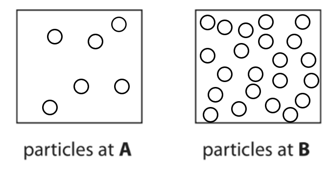

- Particles at **A**: White circles only, none touching; **[1 mark]**
- Particles at **B**: White circles only, randomly arranged, more circles than in A; **[1 mark]**

**[Total: 2 marks]**

- *Water will evaporate first, leaving the ink in the flask, so only water particles will be at **A** and **B*

  - *So the diagrams should both only contain white circles to represent water particles*
- *At **A**, the water has boiled to form a gas and at **B** it has condensed to form a liquid*

  - *The diagram for **A** should show the particles spread out in a random pattern*
  - *The diagram for **B** should show more particles that are much closer together but still in an irregular arrangement*

### Q7
a)  Butane from a mixture of propane and butane:

- Diffusion 
**OR **
Fractional distillation;** [1 mark]**

**[Total: 1 Mark]**

- *The key to solving separation techniques problems is knowing the physical and chemical properties of the substances present*
- *Propane and butane are both gaseous hydrocarbons, so a physical technique is appropriate*
- *Mixtures of gases are usually separated by fractional distillation of the liquified mixture*
- *However, they can also be separated by diffusion, where the boiling points are very close or it is impractical or expensive to use fractional distillation.*
b)  Oxygen from liquid air:

- Fractional distillation; **[1 mark]**

**[Total: 1 Mark]**

- *Liquid air is a mixture of liquids with different boiling points so fractional distillation is the most appropriate technique*
c)  Water from aqueous magnesium sulfate:

- Simple distillation; **[1 mark]**

**[Total: 1 mark]**

- *Be careful not to choose crystallisation, which removes the water but does not recover it, only the solid*
d)   Potassium chloride from aqueous potassium chloride:

- Crystallisation; **[1 mark]**

**[Total: 1 mark]**

- *Water evaporates from the solution, leaving behind the solute, potassium chloride*
e)   Silver chloride from a mixture of silver chloride and water:

- Filtration; **[1 mark]**

**[Total: 1 mark]**

- *Silver chloride is an insoluble solid- you should know that from the silver nitrate test for chloride ions.*

### Q8
a)

i) The two boxes that represent an element are:

- Boxes 1 **AND **2; **[1 mark]**
- Because they both have only one type of atom / molecule; **[1 mark] **

ii) The two boxes that represent a mixture are:

- Boxes 3 **AND **5;** [1 mark]**
- Because they both have two different molecules; **[1 mark] **

**[Total: 4 marks] **

- *In this question, the elemental symbols have been used to show the atoms and molecules*

  - *e.g. H-H, H-O-H*
- *It is also common for the question to give shaded circles to represent different atoms and molecules *
- *Remember**: An element only contains 1 type of atom, so therefore one type of elemental symbol, in this case:*

  - *H-H and He*
- *The mixtures will contain more than one type of atom to make up the molecule*
- *The molecules will not have chemical bonds between them*
b)

i) Separating water from sodium chloride solution would be done by:

- Simple distillation; **[1 mark] **

ii) Separating the blue dye from a mixture of blue and red dyes would be done by:

- Chromatography; **[1 mark] **

iii) Separating potassium nitrate from potassium nitrate solution would be done by:

- Crystallisation; **[1 mark] **

**[Total: 3 marks] **

- *All of the scenarios given are mixtures and different methods are required to isolate the given compound*
- *If water needs to be collected from a mixture of sodium chloride solution we need to use simple distillation*

  - *The water would be evaporated by heating and the water vapour can then be collected and condensed *
- *Chromatography is a simple method that can be used to separate different dyes or pigments *
- *If potassium nitrate (crystals) are to be isolated from potassium nitrate solution (note that all nitrate salts are soluble) then we can heat the solution*

  - *Water does not need to be collected so we can just let it evaporate or heat until crystals form *
c) The two mistakes made are:

| The dyes are all on the same piece of chromatography paper |   |
|---|---|
| The solvent used is water | ✔; **[1 mark]** |
| A lid is on the beaker |   |
| The water is not level with the dyes |   |
| The start line is drawn in ink | ✔; **[1 mark]** |

**[Total: 2 marks]**

- *The dyes are not soluble in water so water is not a suitable solvent*

  - *Propanone would have been a more suitable solvent as the dyes would dissolve in this and travel with the solvent front up the paper*
- *If the start line is drawn in ink, it may dissolve in the solvent and travel with the solvent front*

  - *The start line should be drawn in pencil which will not dissolve and not interfere with the resulting chromatogram*
d) The true and false statements are:

|   | **True** | **False** |
|---|---|---|
| Dye **A** is the most soluble |   | ✔ |
| Dye **C** is a mixture | ✔ |   |
| Dye **C** contains dye **B** |   | ✔ |
| Dye **C** contains dye **A** |   | ✔ |
| Dye **B** is a pure substance | ✔ |   |

- One / two statements correct; **[1 mark]**
- Three / four statements correct; **[2 marks]**
- Five correct statements; **[3 marks]**

**[Total: 3 marks]**

- *A pure substance will appear as one dot whereas a mixture will appear as more than one dot *
- *More soluble substances will have more attraction to the solvent and less attraction to the paper so will travel further up *
- *The less soluble substances will not travel as far *
- *To determine whether different dyes contain the same substances look to see if the dots are in line with one another*

  - *In this case dyes **A**, **B** and** C** share no similar substances*

### Q9
a)  To separate copper powder from a mixture containing copper and zinc powders:

- Add a dilute acid;** [1 mark]**
- Filter the mixture; **[1 mark]**
- Copper does not react or dissolve 
**OR **
The zinc reacts/ dissolves / forms a salt; **[1 mark]**

**[Total: 3 marks]**

- *From your knowledge of the reactivity series of metals you should know that copper is less reactive than zinc, which can be used to separate them*
- *Copper does not react at all with dilute acids, so would be left behind when you add acid to the mixture of metal powders*
b)  To separate nitrogen from a mixture of nitrogen and oxygen:

- Allow the mixture to diffuse (through a membrane); **[1 mark]**
- Nitrogen diffuses faster; **[1 mark]**
- Nitrogen has smaller *M**r*; **[1 mark]**

**OR**

- Liquify the mixture; **[1 mark]**
- Use fractional distillation to separate the mixture;** [1 mark]**
- The liquids have different boiling points; **[1 mark]**

**[Total: 3 marks]**

- *You could use a chemical method to separate the gases*

  - *For example burning a substance to make a non-gaseous product, such as burning iron wool to make iron oxide*
  - *The oxygen reacts and leaves behind the nitrogen gas*
- *If you are going to use this method make sure you name your example substance and the product*
c) To separate glycine from a mixture of glycine and alanine:

- Chromatography; **[1 mark]**

Any **one **from:

- Use a locating agent; **[1 mark]**
- The two amino acids move at different rates;** [1 mark]**
- Alanine travels faster; **[1 mark]**
- Alanine travels further / higher up the paper; **[1 mark]**

**[Total: 2 marks]**

- *Separation of amino acids is a practical use of paper chromatography*
- *Since amino acids are colourless you need a locating agent to show the amino acids*
- *A locating agent reacts with amino acids and forms coloured compounds*
d)  To separate magnesium hydroxide from a mixture of magnesium hydroxide and zinc hydroxide:

- Add sodium hydroxide solution; **[1 mark]**
- Filer the mixture; **[1 mark]**
- Zinc hydroxide will react / dissolve 
**OR **
Magnesium hydroxide does not react / dissolve;** [1 mark]**

**[Total: 3 marks]**

- *Zinc hydroxide is an amphoteric hydroxide, meaning it will react with acids and bases.*
- *Sodium hydroxide will dissolve amphoteric oxides and hydroxides*

### Q10
a)  An example of a substance used in everyday life which must be pure:

- Foodstuffs 
**OR **
Drugs;** [1 mark]**

**[Total: 1 mark]**
b)   The most suitable technique to separate the following is:

Water from sea-water:

- Simple distillation; **[1 mark]**

Helium from a mixture of helium and methane:

- Fractional distillation / diffusion; **[1 mark]**

Ethanol from a mixture of ethanol and propanol:

- Fractional distillation; **[1 mark]**

Iron filings from a mixture of iron filings and water:

- Filtration / evaporation; **[1 mark]**

A mixture of two amino acids, glycine and alanine:

- Chromatography; **[1 mark]**

ii)  To obtain a pure sample of copper(II) sulfate-5-water crystals from a mixture of copper(II) sulfate-5-water with copper(II) oxide:

ALTERNATIVE 1

- Dissolve the mixture (in water); **[1 mark]**
- Filter the mixture; **[1 mark]**
- Evaporate or heat (to crystallisation point); **[1 mark]**
- Crystallise or allow leave to cool; **[1 mark]**

ALTERNATIVE 2:  Adding to H2SO4

- Add excess acid to the mixture until no more dissolves; **[1 mark]**
- Filter the mixture; **[1 mark]**
- Evaporate or heat (to crystallisation point); **[1 mark]**
- Crystallise or allow leave to cool; **[1 mark]**

*The fourth mark is lost if heated to dryness.*

**[Total: 9 marks]**

> *ALTERNATIVE 1*

- *The copper sulfate dissolves leaving behind the copper(II) oxide*
- *This remains in the filter paper as a residue.*
- *You then need to obtain the hydrated copper(II) sulfate crystals, by evaporation, but leaving some water behind*
- *You can have crystallisation and filtration for the third and fourth mark*

> *ALTERNATIVE 2*

- *Adding excess sulfuric acid converts all the copper(II) oxide into copper(II) sulfate so filtration may not be needed*

### Q11
a)  To separate water from aqueous copper(II) sulphate:

- Simple distillation; **[1 mark]**

**[Total: 1 mark]**

- *Copper(II) sulfate is a soluble ionic salt so you need to evaporate and condense the solution to separate the water - this is simple distillation*
b)  To separate helium from a mixture of helium and argon:

- Fractional distillation 
**OR** 
Diffusion; **[1 mark]**

**[Total: 1 mark]**

- *The problem with this pair is that you think of fractional distillation for separating liquids but it can also be used to separate gases*
c)  To separate copper(II) sulphate from aqueous copper(II) sulphate:

- Crystallisation; **[1 mark]**

**[Total: 1 mark]**

- *This pair requires the water to be removed producing copper(II) sulfate crystals - therefore, this is crystallisation*
d)  To separate ethanol from aqueous ethanol:

- Fractional distillation; **[1 mark]**

**[Total: 1 mark]**

- *This mixture contains two liquids, water and ethanol, which can be separated based on their boiling points - this is fractional distillation*
e)  To separate barium sulfate from a mixture of water and barium sulfate:

- Filtration; **[1 mark]**

**[Total: 1 mark]**

- *Barium sulfate is insoluble in water - therefore, this can be separated by filtration*

### Q12
a) One improvement to step 2 to make sure all the salt is dissolved in the water is:

Any **one** from:

- Heat; **[1 mark]**
- Use hot water; **[1 mark]**
- Stir; **[1 mark]**

**[Total: 1 mark]**

- *The most common answer to this question is to use hot water*
- *Using more / a greater volume of water does not get the mark*
b) **One** improvement to step 4 to remove all the sand is:

- Filter (the salty water) 
**OR **
Use a centrifuge 
**OR **
Leave the mixture to settle for longer; **[1 mark]**

**[Total: 1 mark]**

- *In part (a), you were reminded that sand is insoluble in water*
- *Filtration is used to remove an insoluble solid from a liquid*
c) The processes occurring at **A** and **B** are:

- **A** = Evaporation / evaporating / boiling; **[1 mark]**
- **B** = Condensation / condensing; **[1 mark]**

**[Total: 2 marks]**

- *You need to know that the process of distillation involves the boiling / evaporation of a liquid from a mixture*
- *The liquid is then condensed*
d) The reading on the thermometer during this distillation is:

- 100 (oC); **[1 mark]**

**[Total: 1 mark]**

- *The liquid being distilled is water*
- *Therefore, the thermometer should be showing the boiling point of water, 100 **o**C*

### Q13
a) The crushed plant leaves could be separated from the solution of nerol in octane by:

- Filtration / filtering; **[1 mark]**

**[Total: 1 mark]**

- *The crushed plant leaves are an insoluble solid*
- *This means that they can be filtered out of the solution*
b) How distillation separates nerol from the octane:

Any **two** of the following:

- Octane boils off first when heated 
**OR **
Nerol boils off last when heated; **[1 mark]**
- (Because,) Octane has a lower boiling point 
**OR **
(Because,) nerol has a higher boiling point; **[1 mark]**
- Octane condenses / turns to liquid in the condenser first 
**OR **
Nerol condenses / turns to liquid in the condenser <u>after</u> octane; **[1 mark]**
- Nerol is left in the distillation flask 
**OR **
Only the octane evaporates; **[1 mark]**

**[Total: 2 marks]**

- *The process of distillation depends on the boiling points of the components in the mixture*
- *As the distillation equipment is heated, the nerol will boil first because it has a lower boiling point*
- *The nerol will, therefore, enter the condenser first and turn back into a liquid first*
c) The completed diagram is:

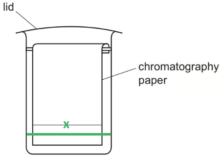

- X on the baseline; **[1 mark]**
- Line for the solvent level drawn between the baseline and the bottom of paper; **[1 mark]**

**[Total: 2 marks]**

- *This question tests two common marking points for paper chromatography*
- *Make sure that you draw the solvent level below the pencil baseline*

  - *This is because the solvent can wash the samples off the chromatography paper if it is above the baseline*
- *The solvent must be in contact with the chromatography paper *

  - *If it is not then the solvent cannot be absorbed up the paper, allowing chromatography to happen*

### Q14
a)

i) The structural formula of the ester ethyl ethanoate is:

- CH3COOCH2CH3 / CH3CO2CH2CH3 / CH3COOC2H5 / CH3CO2C2H5 / C2H5OOCCH3 / CH3CH2OOCCH3; **[1 mark]** *Do NOT allow –OCO– linkage * *Note: formulae can be displayed or semi-displayed* *Note: penalise sticks (i.e. any missing atoms)*

ii) The name of the ester formed from methanoic acid and butanol is:

- Butyl methanoate; **[1 mark]**

**[Total: 2 marks]**

- *The first part of the name indicates the length of the carbon chain in the alcohol, and it ends with the letters ‘- yl’*
- *The second part of the name indicates the length of the carbon chain in the carboxylic acid, and it ends with the letters ‘- oate’*

  - *So, the ester formed from** but**anol and **methan**oic acid is called **but**yl **methan**oate*
b) The structural formula of the polyester formed from the given monomers is:

-OOCC6H4COOCH2CH2- 
**OR **
-OCC6H4COOCH2CH2O-

- Two correct ester linkages, e.g. –OOC / –O2C and –COO / –CO2; **[1 mark] **
*Allow the one ester linkage to be split so shown at either end*
- Contents of the ‘boxes’ being C6H4 and C2H4 or CH2CH2; **[1 mark]**
- Continuation bonds at both ends;** [1 mark]**

**[Total: 3 marks]**

- *You need to remove 2 x H**2**O from the structural formula of the two monomers:*
- *Remove OH from either end  of the carboxylic acid and an H from with end of the alcohol, then join them together*
- *This gives -OCC**6**H**4**COOCH**2**CH**2**O- which has the displayed formula shown below where the left-hand box represents C**6**H**4** and the right-hand box represents C**2**H**4*

- *You can show the ester linkage together by moving the O from one end to the other:*

  - *-OOCC**6**H**4**COOCH**2**CH**2**- *
c)

i) It was necessary to spray the chromatogram to:

- To make colourless / invisible (spots); **[1 mark]**
- Visible / coloured / seen / position made clear / indicate; **[1 mark]**

ii) The *R*f value of a sample means:

- $R_{f} = \frac{distance \text{travelled} \text{by} sample}{distance \text{travelled} \text{by} \text{solvent} ( \text{front} )}$;** [1 mark]**

iii) The *R*f values of the two samples and their identities are:

- Sample 1: *R*f = 0.20 to 0.24 
**AND **
Tartaric (acid); **[1 mark]**
- Sample 2: *R*f = 0.44 to 0.48 
**AND **
Malic (acid); **[1 mark]**

**[Total: 5 marks]**

- *To calculate the **R**f** value, measure the distance from the baseline to the cross which represents the centre of the spots - this is the 'distance travelled by sample'*
- *Measure the distance from the baseline to the solvent front - this is the 'distance travelled by the solvent (front)'*
- *Then use these distances in the equation above to calculate the **R**f **value for each sample*
- *Compare these to the values in the table, the **R**f** value should be very similar to one of the acids *
- *Remember**: **R**f** values cannot be greater than 1, so if you calculated it to be more than 1 you have probably divided the distance travelled by the solvent by the distance travelled by the sample*

### Q15
a)

i) The number of carbon atoms is / each carbon atom bonded to:

- 3; **[1 mark]**

ii)  The number of carbon atoms in one molecule of this fullerene is:

- 70; **[1 mark]**

**[Total: 2 marks]**

- *Although this looks like a tricky question, you don't need to have studied fullerenes to answer it - interpretation of a diagrammatic formula is a likely question*
- *Looking at the structure, each intersection of a pentagon or hexagon carries three bonds, so each carbon atom is bonded to three others*
- *To get the number of carbon atoms in a fullerene, simply divide the relative molecular mass by 12:*

  - *Number of carbon atoms: 840 ÷ 12 = 70*
b)   How you could obtain crystals of fullerenes from soot:

- Add octane (or another liquid hydrocarbon) (to soot); **[1 mark]**
- Filter (to remove insoluble forms of carbon); **[1 mark]**
- Evaporate / heat / warm / leave in sun (to get crystals of fullerene); **[1 mark]**

**[Total: 3 marks]**

- *This is just a separation techniques question using a different solvent, so don't be put off by the fact that fullerenes and hydrocarbon solvents are used - the principles are still the same*
- *To get the second and third marks, you must have the addition of a solvent in the first step*
c)

i) The other form of solid carbon that is a good conductor of electricity is:

- Graphite; **[1 mark]**

ii)  Metals, such as potassium, are good conductors of electricity because:

- They have delocalised electrons / free electrons / a sea of electrons; **[1 mark]**
- The electrons can move / are mobile / can flow;** [1 mark]**

iii)  **Two **potassium compounds which could be formed when potassium is exposed to air are:

Any **two **from:

- Potassium oxide; **[1 mark]**
- Potassium hydroxide; **[1 mark]**
- Potassium carbonate; **[1 mark]**
- Potassium hydrogencarbonate (bicarbonate);** [1 mark]**

**[Total: 5 marks]**

- *To get the second mark in part ii) you have to mention that the electrons flow or move when conduction takes place*
- *In part iii) potassium reacts with oxygen or moisture in the air to produce the oxide and hydroxide respectively. These are the more likely products*

  - *However, strong alkalis like potassium hydroxide are also good at absorbing carbon dioxide in the air by reacting and forming the carbonate or hydrogencarbonate, so these are allowed answers*

### Q16
a)

i) A non-metal which could be used for the positive electrode is:

- Graphite / carbon; **[1 mark]**
- (Because,) it conducts electricity 
**OR **
(Because,) it is inert; **[1 mark]**

ii) The ionic equations for the products of the electrolysis of molten magnesium bromide are:

- At the positive electrode: 2Br – → Br2 + 2e–; **[1 mark]**
- At the negative electrode: Mg2+ + 2e– → Mg; **[1 mark]**

**[Total: 4 marks]**

- *The fact that the negative electrode is made of iron is a distraction *
- *You should automatically be saying graphite for a non-metal electrode*
- *Since the electrolysis is of a molten ionic compound, there are only the component ions present*

  - *Mg**2+*
  
    - *These will be attracted to the negative electrode and gain electrons to form magnesium*
  - *Br**–** *
  
    - *These will be attracted to the positive electrode and lose electrons while forming bromine *
b) The correct order of statements is:

A, E, C, F, D, B

- Correct order; **[2 marks]**
- 1 pair reversed in a near-correct sequence, e.g. A, E, **F, C**, D, B; **[1 mark]**

**[Total: 2 marks]**

- *You should be able to describe how to crystallise a product *
- *The most common error in a written crystallisation method is to warm the filtrate to remove all water*

  - *Doing this risks decomposition of the crystals, produces small low quality crystals and can make some of the product spit / jump out of the equipment *
c) **Two **other properties of cobalt which are different from those of magnesium are:

Any **two** from:

- Cobalt has a high density / magnesium has a low density; **[1 mark]**
- Cobalt forms coloured compounds / magnesium does not form coloured compounds; **[1 mark]**
- Cobalt forms ions with different charges / magnesium forms one (2+) ion 
**OR **
Cobalt has a variable oxidation number / magnesium has a fixed oxidation number; **[1 mark]**
- Cobalt forms complex ions / magnesium does not for complex ions; **[1 mark]**
- Cobalt is a catalyst / magnesium is not a catalyst; **[1 mark]**

**[Total: 2 marks]**

- *You should be able to talk about the difference in the properties of transition metals and other metals*
- *You should not comment about the relative reactivity of cobalt because you do not know how high it is on the reactivity series*
d)

i) Explanation of the results shown for solutions **Y** and **Z**:

- They show one spot 
**AND **
Because they are pure / contain only one type of transition metal ion; **[1 mark]**

ii) The sample that does not contain the same ions as either solution **Y** or solution **Z** is:

- **T**; **[1 mark]**

iii) The sample that contains the same ions as both solution **Y** and solution **Z** is:

- **R**; **[1 mark]**

iv) The sample that has the greatest number of transition element ions is:

- **R**; **[1 mark]**

**[Total: 4 marks]**

- *The question tells you that solutions **Y** and **Z** contain only one type of transition element ion*

  - *This means that they are pure and should only produce one spot on a chromatogram*
- *Tip: **Take your time working with chromatograms as it can be very easy to make a simple mistake *
- *For parts (ii) and (iii)*

  - *Draw a horizontal line across from the spots for **Y** and **Z*
  - *The sample that has no matching spots (**R**) is the sample that does not contain the same ions as either solution **Y** or solution **Z*
  - *The sample that has two matching spots (**T**) is the sample that contains the same ions as both solution **Y** and solution **Z*
- *The sample that has the greatest number of transition element ions is the one that has the most spots in its vertical line*
