# Exam Questions — Separation & Purification
**12. Experimental Techniques & Chemical Analysis** · Cambridge (CIE) IGCSE chemistry (0620 & 0971)
> Source: [https://www.savemyexams.com/igcse/chemistry/cie/23/topic-questions/](https://www.savemyexams.com/igcse/chemistry/cie/23/topic-questions/) · 63 questions across 3 sets

## Alternative To Practical Questions (32 questions)

### Q1 — medium — 20 marks

**Q1** [5 marks]

A student investigated the solubility of salt **A** in water at various temperatures. Five experiments were carried out. *Experiment 1* The student was provided with a boiling tube containing 12 g of salt **A**.

A burette was filled with distilled water and 10.0 cm3 of water was added to the boiling tube.

The mixture of salt **A** and water was heated until all of the solid had dissolved.

The boiling tube was removed from the heat and the solution was stirred with a thermometer and allowed to cool.

The temperature at which crystals first appeared was measured.

Use the thermometer diagram to record the temperature in the table of results.

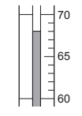

The boiling tube and contents were kept for the next four experiments.

*Experiment 2*

From the burette, 1.0 cm3 more of water was added into the boiling tube and contents from Experiment 1.

The experiment was repeated exactly as before to find the temperature at which crystals first appeared.

The boiling tube was dipped for short periods of time in a beaker of cold water to speed up the cooling.

Record, in the table of results, the total volume of water in the boiling tube.

Use the thermometer diagram to record the temperature at which crystals first appeared.

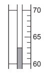

*Experiment 3 *

From the burette 1.0 cm3 more of water was added into the boiling tube and contents from Experiment 2.

The experiment was repeated exactly as before.

Record, in the table of results, the total volume of water used.

Use the thermometer diagram to record the temperature at which crystals first appeared.

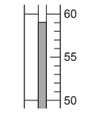

This procedure was continued for Experiments 4 and 5 with two more successive additions of 1.0 cm3 of water. Note all the results in the table.

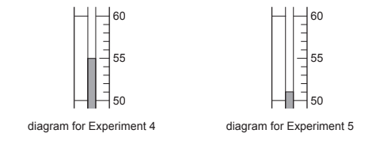

**Table 1  (Table of results)**

| Experiment | total volume of water cm3 | temperature at which crystals first appeared / °C |
|---|---|---|
| 1 | 10 |   |
| 2 |   |   |
| 3 |   |   |
| 4 |   |   |
| 5 |   |   |

*Source: 2010 O61 Q1*

**Q1** [6 marks]

**Extract:**

Table 1 (Table of results):
| Experiment | total volume of water cm^3 | temperature at which crystals first appeared / °C |
| 1 | 10 | 68 |
| 2 | 11 | 63 |
| 3 | 12 | 59 |
| 4 | 13 | 55 |
| 5 | 14 | 51 |

Plot the results on the grid below and draw a straight line graph.

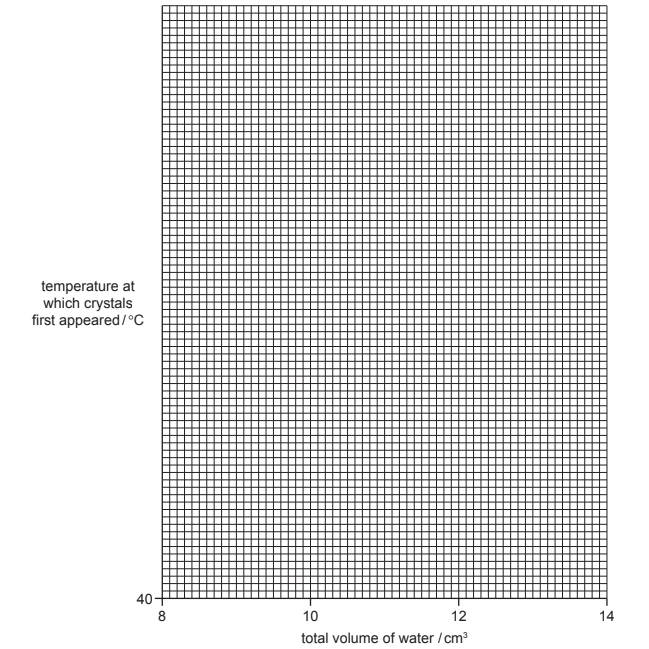

*Source: 2010 O61 Q1*

**Q1** [1 mark]

**Extract:**

A student investigated the solubility of salt A in water at various temperatures. The student was provided with a boiling tube containing 12 g of salt A. A burette was filled with distilled water and 10.0 cm^3 of water was added to the boiling tube. The mixture of salt A and water was heated until all of the solid had dissolved.

How did the student know when salt **A** was completely dissolved in the water?

*Source: 2010 O61 Q1*

**Q1** [2 marks]

**Extract:**

A student investigated the solubility of salt A in water at various temperatures. Five experiments were carried out. Table 1 (Table of results):
| Experiment | total volume of water cm³ | temperature at which crystals first appeared / °C |
| 1 | 10 | 68 |
| 2 | 11 | 63 |
| 3 | 12 | 59 |
| 4 | 13 | 55 |
| 5 | 14 | 51 |

From your graph, find the temperature at which crystals of salt **A** would first appear if the total volume of water in the solution was 9.0 cm3.

Show clearly on the grid how you worked out your answer.

*Source: 2010 O61 Q1*

**Q1** [2 marks]

**Extract:**

A student investigated the solubility of salt A in water at various temperatures. Five experiments were carried out. Experiment 1: The student was provided with a boiling tube containing 12 g of salt A. A burette was filled with distilled water and 10.0 cm^3 of water was added to the boiling tube. The mixture of salt A and water was heated until all of the solid had dissolved. The boiling tube was removed from the heat and the solution was stirred with a thermometer and allowed to cool. The temperature at which crystals first appeared was measured. In subsequent experiments 1.0 cm^3 more of water was added each time and the temperature at which crystals first appeared was measured.

Suggest, with a reason, how the results would be different if 6 g of salt** A** were used instead of 12 g of salt **A**.

*Source: 2010 O61 Q1*

**Q1** [2 marks]

**Extract:**

Plot the results on the grid below and draw a straight line graph.

A student investigated the solubility of salt A in water at various temperatures. The temperature at which crystals first appeared was measured against total volume of water. Results (Table 1): Experiment 1: 10 cm^3, 68°C; Experiment 2: 11 cm^3, 63°C; Experiment 3: 12 cm^3, 59°C; Experiment 4: 13 cm^3, 55°C; Experiment 5: 14 cm^3, 51°C.

Salt **B** is more soluble in water than salt **A**.

Sketch on the grid the graph you would expect for salt** B**. Label this graph.

*Source: 2010 O61 Q1*

**Q1** [2 marks]

**Extract:**

A student investigated the solubility of salt A in water at various temperatures. Five experiments were carried out. Experiment 1: The student was provided with a boiling tube containing 12 g of salt A. A burette was filled with distilled water and 10.0 cm^3 of water was added to the boiling tube. The mixture of salt A and water was heated until all of the solid had dissolved. The boiling tube was removed from the heat and the solution was stirred with a thermometer and allowed to cool. The temperature at which crystals first appeared was measured. Experiment 2: From the burette, 1.0 cm^3 more of water was added into the boiling tube and contents from Experiment 1. The experiment was repeated exactly as before to find the temperature at which crystals first appeared. The boiling tube was dipped for short periods of time in a beaker of cold water to speed up the cooling.

Explain **one** improvement you could make to the experimental procedure to obtain more accurate results in this investigation.

improvement ..........................................................................................................

explanation ..........................................................................................................

*Source: 2010 O61 Q1*

### Q2 — medium — 8 marks

**Q2** [2 marks]

Coffee beans contain caffeine and other compounds. Caffeine is soluble in water and in trichloromethane, an organic solvent. A student obtained crystals of caffeine by the following method.

| Stage 1 | Some coffee beans were crushed into small pieces. |
|---|---|
| Stage 2 | Hot water was added to the crushed beans to dissolve the soluble substances. |
| Stage 3 | The crushed beans were separated from the liquid solution. |
| Stage 4 | The liquid was allowed to cool and shaken with trichloromethane to extract the caffeine from the water. |
| Stage 5 | The caffeine was crystallised from the trichloromethane solution. |
| Stage 6 | The caffeine crystals were checked for purity. |

What apparatus should be used to crush the beans in Stage 1?

*Source: 2012 Ju61 Q3*

**Q2** [1 mark]

**Extract:**

Coffee beans contain caffeine and other compounds. Caffeine is soluble in water and in trichloromethane, an organic solvent. A student obtained crystals of caffeine by the following method. Stage 1: Some coffee beans were crushed into small pieces. Stage 2: Hot water was added to the crushed beans to dissolve the soluble substances. Stage 3: The crushed beans were separated from the liquid solution. Stage 4: The liquid was allowed to cool and shaken with trichloromethane to extract the caffeine from the water. Stage 5: The caffeine was crystallised from the trichloromethane solution. Stage 6: The caffeine crystals were checked for purity.

How could the dissolving process in Stage 2 be speeded up?

*Source: 2012 Ju61 Q3*

**Q2** [2 marks]

**Extract:**

Coffee beans contain caffeine and other compounds. Caffeine is soluble in water and in trichloromethane, an organic solvent. A student obtained crystals of caffeine by the following method. Stage 1: Some coffee beans were crushed into small pieces. Stage 2: Hot water was added to the crushed beans to dissolve the soluble substances. Stage 3: The crushed beans were separated from the liquid solution.

Draw a diagram of the apparatus used in Stage 3.

*Source: 2012 Ju61 Q3*

**Q2** [2 marks]

**Extract:**

Coffee beans contain caffeine and other compounds. Caffeine is soluble in water and in trichloromethane, an organic solvent. A student obtained crystals of caffeine by the following method.
| Stage 1 | Some coffee beans were crushed into small pieces. |
| Stage 2 | Hot water was added to the crushed beans to dissolve the soluble substances. |
| Stage 3 | The crushed beans were separated from the liquid solution. |
| Stage 4 | The liquid was allowed to cool and shaken with trichloromethane to extract the caffeine from the water. |
| Stage 5 | The caffeine was crystallised from the trichloromethane solution. |
| Stage 6 | The caffeine crystals were checked for purity. |

How should Stage 5 be carried out?

*Source: 2012 Ju61 Q3*

**Q2** [1 mark]

**Extract:**

Coffee beans contain caffeine and other compounds. Caffeine is soluble in water and in trichloromethane, an organic solvent. A student obtained crystals of caffeine by the following method.
Stage 5: The caffeine was crystallised from the trichloromethane solution.
Stage 6: The caffeine crystals were checked for purity.

What method could be used to check the purity of the crystals in Stage 6?

*Source: 2012 Ju61 Q3*

### Q3 — medium — 7 marks

**Q3** [7 marks]

Calcium carbonate is found in limestone and in marble. All carbonates react with hydrochloric acid to form chlorides. Calcium carbonate is insoluble in water but calcium chloride is water soluble. Most impurities in limestone and marble are insoluble.

Plan experiment to find out which of limestone and marble contain most insoluble impurities. You are provided with common laboratory apparatus.

*Source: 2012 6 Q6*

### Q4 — medium — 6 marks

**Q4** [6 marks]

A fake banknote can be investigated by dissolving the ink off the paper. You are provided with four different inks from four different criminals.

Describe an experiment to show which one of these inks is the same as the ink from the banknote. You can use a labelled diagram to help you answer the question.

*Source: 2004 6 Q7*

### Q5 — medium — 6 marks

**Q5** [2 marks]

A student investigated the colours present in a fruit drink. The fruit drink was tested to check that no artificial colours had been added. The apparatus below was used.

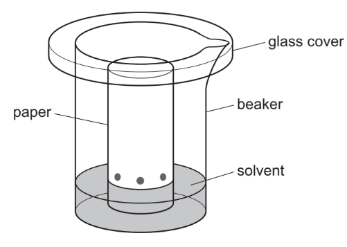

i) Name the method used.

[1]

ii) Why is there a glass cover on the beaker?

[1]

*Source: 2014 61 Q3*

**Q5** [1 mark]

**Extract:**

A student investigated the colours present in a fruit drink. The fruit drink was tested to check that no artificial colours had been added. The apparatus below was used. i) Name the method used. [Chromatography] ii) Why is there a glass cover on the beaker?

When should the paper be removed from the beaker?

*Source: 2014 61 Q3*

**Q5** [3 marks]

**Extract:**

A student investigated the colours present in a fruit drink. The fruit drink was tested to check that no artificial colours had been added.

The diagram shows the results of the experiment.

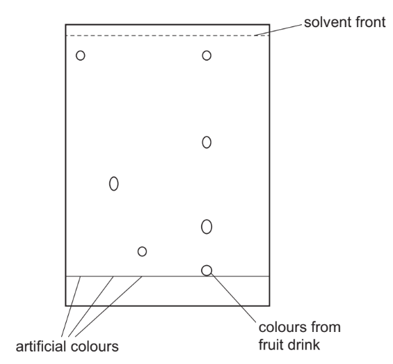

i) How many different coloured compounds were present in the fruit drink?

[1]

ii) Are there any of the artificial colours present in the fruit drink? Explain your answer.

[2]

*Source: 2014 61 Q3*

### Q6 — medium — 6 marks

**Q6** [6 marks]

Copper(II) oxide and carbon are both black solids. Copper(II) oxide reacts with dilute sulfuric acid to form aqueous copper(II) sulfate. Carbon does not react with dilute sulfuric acid.

You are given a mixture of copper(II) oxide and carbon and access to dilute sulfuric acid.

Plan an experiment to investigate the percentage of copper(II) oxide in the mixture.

*Source: 2013 61 Q6*

### Q7 — medium — 6 marks

**Q7** [3 marks]

The colours present in some blackcurrant sweets can be separated by chromatography.

The colours are water-soluble dyes.

The diagrams show how the colours can be extracted from the sweets.

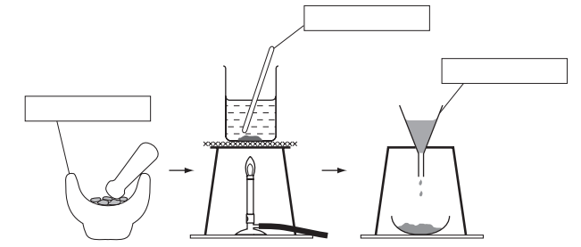

Complete the empty boxes to name the pieces of apparatus.

*Source: 2008 6 Q1*

**Q7** [2 marks]

**Extract:**

The colours present in some blackcurrant sweets can be separated by chromatography. The colours are water-soluble dyes.

The apparatus below was used to carry out the chromatography.

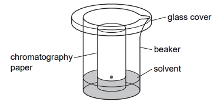

i) Name the solvent used.

[1]

ii) Label, with an arrow, the origin on the diagram.

[1]

*Source: 2008 6 Q1*

**Q7** [1 mark]

**Extract:**

The colours present in some blackcurrant sweets can be separated by chromatography. The colours are water-soluble dyes.

Sketch, in the box, the chromatogram you would expect if two different colours were present in the sweets.

*Source: 2008 6 Q1*

### Q8 — medium — 6 marks

**Q8** [3 marks]

A student reacted sulphuric acid with copper(II) oxide. The diagram shows the procedure followed.

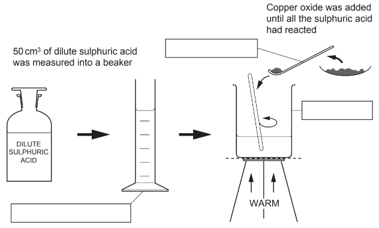

Complete the boxes to identify the pieces of apparatus labelled.

*Source: 2005 6 Q1*

**Q8** [1 mark]

**Extract:**

A student reacted sulphuric acid with copper(II) oxide. The diagram shows the procedure followed.

What is the colour of the solution formed?

*Source: 2005 6 Q1*

**Q8** [2 marks]

**Extract:**

A student reacted sulphuric acid with copper(II) oxide. The diagram shows the procedure followed.

Describe how crystals could be quickly obtained from the solution.

*Source: 2005 6 Q1*

### Q9 — medium — 5 marks

**Q9** [3 marks]

A mixture of ethanol and water can be separated by fractional distillation. The apparatus below can be used to carry out such a separation in the laboratory.

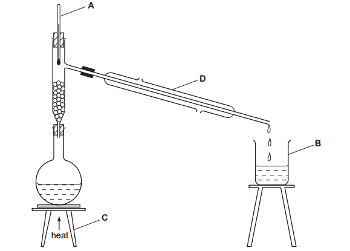

Name each piece of apparatus.

**A** ....................................................................................................

**B** ....................................................................................................

**C** ....................................................................................................

*Source: 2007 6 Q1*

**Q9** [1 mark]

**Extract:**

A mixture of ethanol and water can be separated by fractional distillation. The apparatus below can be used to carry out such a separation in the laboratory.  Name each piece of apparatus.

What is the purpose of **D**?

*Source: 2007 6 Q1*

**Q9** [1 mark]

**Extract:**

A mixture of ethanol and water can be separated by fractional distillation. The apparatus below can be used to carry out such a separation in the laboratory.

How could the purity of the ethanol collected be checked?

*Source: 2007 6 Q1*

### Q10 — medium — 7 marks

**Q10** [2 marks]

E numbers identify chemicals which are added to foods.

E210 is benzoic acid. How could you show that a solution of benzoic acid is a weak acid?

test ..........................................................................................................

result ..........................................................................................................

*Source: 2010 61 Q7*

**Q10** [1 mark]

**Extract:**

E numbers identify chemicals which are added to foods. E210 is benzoic acid.

E211 is sodium benzoate. Name a suitable substance that would react with a solution of benzoic acid to form sodium benzoate.

*Source: 2010 61 Q7*

**Q10** [4 marks]

E110 is Sunset yellow. Outline a method you could use to show the presence of E110 in a food colouring. A space has been left if you want to draw a diagram to help you answer the question.

*Source: 2010 61 Q7*

### Q11 — medium — 6 marks

**Q11** [3 marks]

The apparatus below was used to separate ethanol from water.

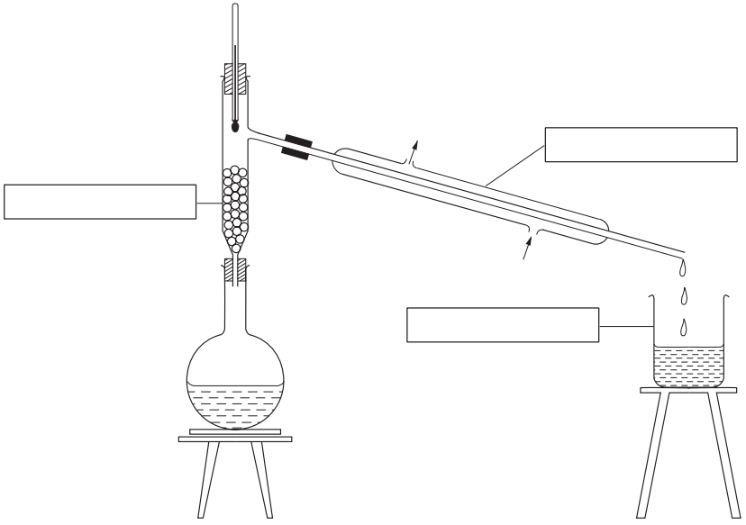

Complete the empty boxes to name the pieces of apparatus.

*Source: 2003 6 Q1*

**Q11** [1 mark]

**Extract:**

The apparatus below was used to separate ethanol from water. Complete the empty boxes to name the pieces of apparatus. (Fractional distillation apparatus including round-bottomed flask, fractionating column, thermometer, condenser, and beaker)

Indicate by an arrow where heat is applied.

*Source: 2003 6 Q1*

**Q11** [2 marks]

**Extract:**

The apparatus below was used to separate ethanol from water. Complete the empty boxes to name the pieces of apparatus.

Name this separation process.

*Source: 2003 6 Q1*

### Q12 — medium — 11 marks

**Q12** [2 marks]

A student extracted and investigated the orange colour in some sweets.

The student followed these instructions:

1. Collect sweets, a watch glass, a beaker, eye protection and 100 cm3 of ethanol.
2. Crush the sweets.
3. Place the crushed sweets in the beaker containing 100 cm3 of ethanol.
4. Boil the mixture with the watch glass covering the beaker.
5. Decant the liquid and concentrate it by evaporation until the colour is dark orange.
6. Investigate which colours are present in the orange solution.

Why should the sweets be crushed?

*Source: 2003 6 Q2*

**Q12** [1 mark]

**Extract:**

A student extracted and investigated the orange colour in some sweets. The student followed these instructions: 1. Collect sweets, a watch glass, a beaker, eye protection and 100 cm^3^ of ethanol. 2. Crush the sweets. 3. Place the crushed sweets in the beaker containing 100 cm^3^ of ethanol. 4. Boil the mixture with the watch glass covering the beaker. 5. Decant the liquid and concentrate it by evaporation until the colour is dark orange. 6. Investigate which colours are present in the orange solution.

Why should the experiment be carried out in a well-ventilated laboratory?

*Source: 2003 6 Q2*

**Q12** [1 mark]

**Extract:**

A student extracted and investigated the orange colour in some sweets. The student followed these instructions: 1. Collect sweets, a watch glass, a beaker, eye protection and 100 cm^3 of ethanol. 2. Crush the sweets. 3. Place the crushed sweets in the beaker containing 100 cm^3 of ethanol. 4. Boil the mixture with the watch glass covering the beaker. 5. Decant the liquid and concentrate it by evaporation until the colour is dark orange. 6. Investigate which colours are present in the orange solution.

State one safety precaution that the student should have taken, other than carrying out the experiment in a well-ventilated laboratory and using eye protection.

*Source: 2003 6 Q2*

**Q12** [1 mark]

**Extract:**

A student extracted and investigated the orange colour in some sweets. The student followed these instructions: 1. Collect sweets, a watch glass, a beaker, eye protection and 100 cm^3^ of ethanol. 2. Crush the sweets. 3. Place the crushed sweets in the beaker containing 100 cm^3^ of ethanol. 4. Boil the mixture with the watch glass covering the beaker. 5. Decant the liquid and concentrate it by evaporation until the colour is dark orange. 6. Investigate which colours are present in the orange solution.

State the purpose of the watch glass.

*Source: 2003 6 Q2*

**Q12** [1 mark]

**Extract:**

A student extracted and investigated the orange colour in some sweets. The student followed these instructions: 1. Collect sweets, a watch glass, a beaker, eye protection and 100 cm^3 of ethanol. 2. Crush the sweets. 3. Place the crushed sweets in the beaker containing 100 cm^3 of ethanol. 4. Boil the mixture with the watch glass covering the beaker. 5. Decant the liquid and concentrate it by evaporation until the colour is dark orange. 6. Investigate which colours are present in the orange solution.

Explain the term decant.

*Source: 2003 6 Q2*

**Q12** [5 marks]

**Extract:**

A student extracted and investigated the orange colour in some sweets. The student followed these instructions: 1. Collect sweets, a watch glass, a beaker, eye protection and 100 cm^3 of ethanol. 2. Crush the sweets. 3. Place the crushed sweets in the beaker containing 100 cm^3 of ethanol. 4. Boil the mixture with the watch glass covering the beaker. 5. Decant the liquid and concentrate it by evaporation until the colour is dark orange. 6. Investigate which colours are present in the orange solution.

Describe how the student could carry out instruction 6. You may draw a diagram in the space below to help you answer the question.

*Source: 2003 6 Q2*

### Q13 — medium — 7 marks

**Q13** [1 mark]

A mixture of coloured dyes, **M**, was separated by chromatography. The dyes were insoluble in water.

The chromatogram below shows the result of separating the mixture and the chromatography of three known dyes 1, 2 and 3.

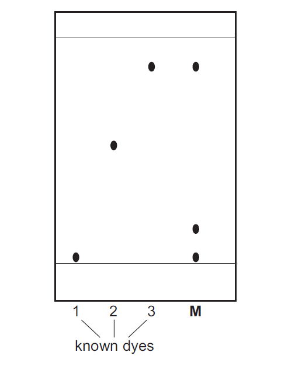

On the diagram, label the base line (origin).

*Source: 2015 61 Q3A*

**Q13** [1 mark]

**Extract:**

A mixture of coloured dyes, M, was separated by chromatography. The dyes were insoluble in water. The chromatogram shows the result of separating the mixture and the chromatography of three known dyes 1, 2 and 3.

Name a solvent that could be used in this separation.

*Source: 2015 61 Q3B*

**Q13** [1 mark]

**Extract:**

A mixture of coloured dyes, **M**, was separated by chromatography. The dyes were insoluble in water. The chromatogram below shows the result of separating the mixture and the chromatography of three known dyes 1, 2 and 3.

How many dyes were there in the mixture, **M**?

*Source: 2015 61 Q3C*

**Q13** [3 marks]

**Extract:**

A mixture of coloured dyes, **M**, was separated by chromatography. The dyes were insoluble in water. The chromatogram below shows the result of separating the mixture and the chromatography of three known dyes 1, 2 and 3.

What are your conclusions about the identity of the dyes in the mixture, **M**?

*Source: 2015 61 Q3D*

**Q13** [1 mark]

**Extract:**

A mixture of coloured dyes, M, was separated by chromatography. The dyes were insoluble in water. The chromatogram below shows the result of separating the mixture and the chromatography of three known dyes 1, 2 and 3.

How could the reliability of the results be checked?

*Source: 2015 61 Q3E*

### Q14 — medium — 7 marks

**Q14** [2 marks]

The diagrams show the apparatus used to obtain crystals of calcium chloride from a mixture of solid calcium chloride and solid calcium carbonate. Calcium chloride is soluble in water and calcium carbonate is insoluble in water.

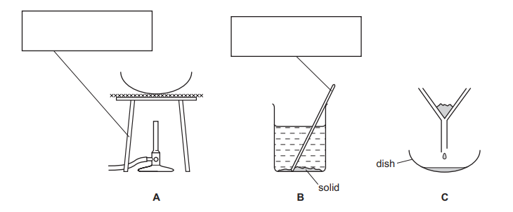

Complete the boxes to name the apparatus.

*Source: 2016 6 Q1*

**Q14** [2 marks]

**Extract:**

The diagrams show the apparatus used to obtain crystals of calcium chloride from a mixture of solid calcium chloride and solid calcium carbonate. Calcium chloride is soluble in water and calcium carbonate is insoluble in water.

i) Write down the order in which the apparatus should be used in this experiment.

[1]

ii) Name the separation process in **C**.

[1]

*Source: 2016 6 Q1*

**Q14** [2 marks]

**Extract:**

The diagrams show the apparatus used to obtain crystals of calcium chloride from a mixture of solid calcium chloride and solid calcium carbonate. Calcium chloride is soluble in water and calcium carbonate is insoluble in water.

i) What has been added to the mixture in **B**?

[1]

ii) What is the general name given to the liquid in the dish in** C**?

[1]

*Source: 2016 6 Q1*

**Q14** [1 mark]

**Extract:**

The diagrams show the apparatus used to obtain crystals of calcium chloride from a mixture of solid calcium chloride and solid calcium carbonate. Calcium chloride is soluble in water and calcium carbonate is insoluble in water. Complete the boxes to name the apparatus. [making-calcium-chloride-crystals]

The order in which the apparatus should be used in this experiment is B, C, A. You would heat the remaining calcium chloride solution to obtain crystals (in A).

How would you know when to stop heating the dish in **A**?

*Source: 2016 6 Q1*

### Q15 — medium — 5 marks

**Q15** [1 mark]

A sample of orange fruit jam was investigated to check the three colourings present.

Step 1: The jam was boiled with water.

Step 2: The mixture was filtered.

Step 3: The filtrate was concentrated.

Step 4: The concentrate was analysed by chromatography.

What was the purpose of Step 1?

*Source: 2006 6 Q2*

**Q15** [1 mark]

**Extract:**

A sample of orange fruit jam was investigated to check the three colourings present. Step 1: The jam was boiled with water. Step 2: The mixture was filtered. Step 3: The filtrate was concentrated. Step 4: The concentrate was analysed by chromatography.

Why was the mixture filtered?

*Source: 2006 6 Q2*

**Q15** [1 mark]

**Extract:**

A sample of orange fruit jam was investigated to check the three colourings present. Step 1: The jam was boiled with water. Step 2: The mixture was filtered. Step 3: The filtrate was concentrated. Step 4: The concentrate was analysed by chromatography.

How was Step 3 carried out?

*Source: 2006 6 Q2*

**Q15** [2 marks]

**Extract:**

A sample of orange fruit jam was investigated to check the three colourings present. Step 1: The jam was boiled with water. Step 2: The mixture was filtered. Step 3: The filtrate was concentrated. Step 4: The concentrate was analysed by chromatography.

Draw a diagram to show the possible paper chromatogram obtained in Step 4.

*Source: 2006 6 Q2*

### Q16 — medium — 7 marks

**Q16** [2 marks]

This label is from a container of ‘Bite Relief’ solution.

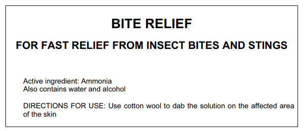

Give a chemical test to show the presence of ammonia in Bite Relief solution.

test ..........................................................................................................

result ..........................................................................................................

*Source: 2008 6 Q7*

**Q16** [2 marks]

What practical method could be used to separate the mixture of alcohol (bp 78 °C) and water (bp 100 °C)?

*Source: 2008 6 Q7*

**Q16** [2 marks]

Give a chemical test to show the presence of water.

test ...............................................................................................

result ...........................................................................................

*Source: 2008 6 Q7*

**Q16** [1 mark]

**Extract:**

What practical method could be used to separate the mixture of alcohol (bp 78 °C) and water (bp 100 °C)?

What would be the effect of touching the alcohol with a lighted splint?

*Source: 2009 6 Q7*

### Q17 — medium — 4 marks

**Q17** [1 mark]

The colours present in some fruit sweets can be separated using the apparatus below. The colours are water-soluble dyes.

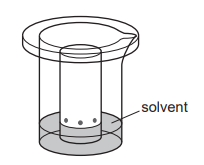

Name the process used to separate the colours.

*Source: 2011 61 Q3*

**Q17** [1 mark]

**Extract:**

The colours present in some fruit sweets can be separated using the apparatus below. The colours are water-soluble dyes.

Name the solvent used.

*Source: 2011 61 Q3*

**Q17** [1 mark]

The results obtained for the colours in two different sweets, **C** and **D**, are shown below.

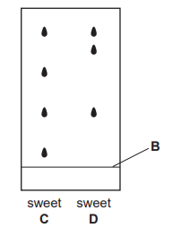

What is the name for the line at position **B**?

*Source: 2011 61 Q3*

**Q17** [1 mark]

**Extract:**

The results obtained for the colours in two different sweets, **C** and **D**, are shown below.

What conclusions can you draw about the colours present in sweets **C** and **D**?

*Source: 2011 61 Q3*

### Q18 — medium — 6 marks

**Q18** [1 mark]

The label below is from a bottle of concentrated lemon drink.

| **Concentrated lemon drink**  Ingredients: Water, sugar, citric acid, preservatives, potassium sorbate (artificial sweetener). Yellow colourings E102 and E104. |
|---|

What is meant by the term concentrated?

*Source: 2005 6 Q6*

**Q18** [1 mark]

**Extract:**

The label below is from a bottle of concentrated lemon drink. Concentrated lemon drink Ingredients: Water, sugar, citric acid, preservatives, potassium sorbate (artificial sweetener). Yellow colourings E102 and E104.

Predict the pH of the lemon drink.

*Source: 2005 6 Q6*

**Q18** [4 marks]

**Extract:**

The label below is from a bottle of concentrated lemon drink. Concentrated lemon drink Ingredients: Water, sugar, citric acid, preservatives, potassium sorbate (artificial sweetener). Yellow colourings E102 and E104.

Describe an experiment to show that two different yellow colourings are present in the drink.

*Source: 2005 6 Q6*

### Q19 — medium — 4 marks

**Q19** [1 mark]

The following paragraph was taken from a student’s notebook:

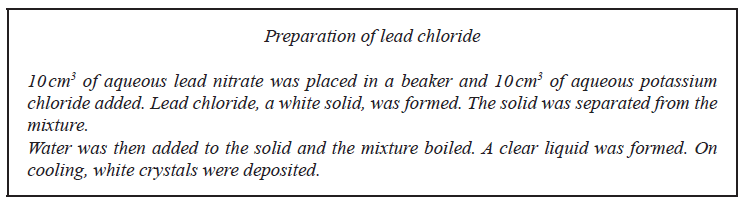

What type of chemical reaction resulted in the formation of the lead chloride?

*Source: 2014 61 Q2A*

**Q19** [2 marks]

**Extract:**

The following paragraph was taken from a student's notebook:

What is the solubility of lead chloride in:

i) Cold water?

[1]

ii) Hot water?

[1]

*Source: 2014 61 Q2B*

**Q19** [1 mark]

**Extract:**

From the description in the student's notebook, you can tell that the lead chloride dissolved when the mixture was boiled and reappeared as white crystals on cooling. The solubility of lead chloride in cold water is low/insoluble; in hot water it is high/soluble.

What method should be used to separate the crystals from the mixture?

*Source: 2014 61 Q2C*

### Q20 — medium — 6 marks

**Q20** [6 marks]

Seawater contains sodium chloride and other salts.

Plan an experiment to find the mass of salts in 1 dm3 of seawater.

You will be provided with a small bottle of seawater.

You should include details of the method and any apparatus used.

(1 dm3 = 1000 cm3)

*Source: 2011 O61 Q6*

### Q21 — medium — 7 marks

**Q21** [3 marks]

Leaves from trees contain a mixture of coloured pigments which are not soluble in water. A student was given these two instructions to investigate the pigments in the leaves.

1. Crush some leaves to extract the coloured pigments.
2. Use the liquid extract to find the number of coloured pigments in the leaves.

What would the student need in order to effectively carry out instruction 1?

*Source: 2009 6 Q7*

**Q21** [4 marks]

**Extract:**

Leaves from trees contain a mixture of coloured pigments which are not soluble in water. A student was given these two instructions to investigate the pigments in the leaves. 
1. Crush some leaves to extract the coloured pigments.
2. Use the liquid extract to find the number of coloured pigments in the leaves.

Describe an experiment to carry out instruction 2. A space has been left below if you want to draw a diagram to help answer the question.

*Source: 2009 6 Q7*

### Q22 — medium — 8 marks

**Q22** [4 marks]

An experiment was carried out to determine the solubility of potassium chlorate at different temperatures. The solubility is the mass of potassium chlorate that dissolves in 100 g of water. The results obtained are shown in the table below.

| **temperature/ °C** | 0 | 10 | 20 | 30 | 40 | 50 | 60 |
|---|---|---|---|---|---|---|---|
| **solubility in g/ 100g water** | 14 | 17 | 20 | 24 | 29 | 34 | 40 |

On the grid, draw a smooth line graph to show the solubility of potassium chlorate at different temperatures.

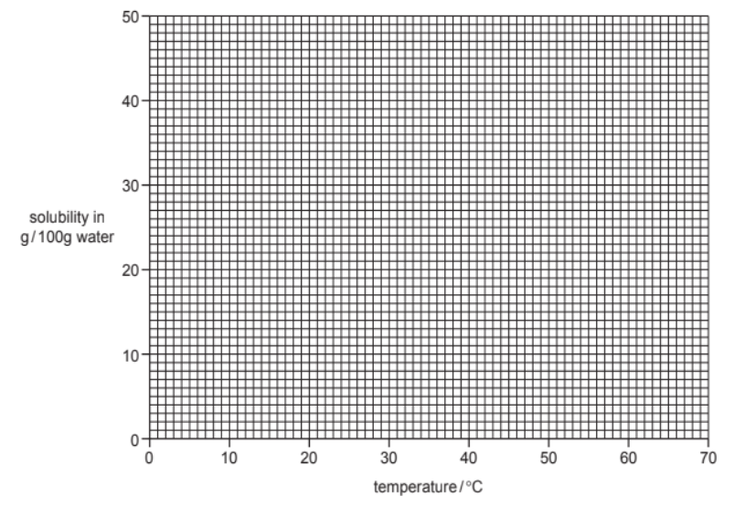

*Source: 2008 6 Q6*

**Q22** [2 marks]

**Extract:**

An experiment was carried out to determine the solubility of potassium chlorate at different temperatures. The solubility is the mass of potassium chlorate that dissolves in 100 g of water. The results obtained are shown in the table below.

| temperature/ °C | 0 | 10 | 20 | 30 | 40 | 50 | 60 |
| solubility in g/ 100g water | 14 | 17 | 20 | 24 | 29 | 34 | 40 |

On the grid, draw a smooth line graph to show the solubility of potassium chlorate at different temperatures.

Use your graph to determine the solubility of potassium chlorate at 70 °C. Show clearly on the graph how you obtained your answer.

*Source: 2008 6 Q6*

**Q22** [2 marks]

**Extract:**

An experiment was carried out to determine the solubility of potassium chlorate at different temperatures. The solubility is the mass of potassium chlorate that dissolves in 100 g of water. The results obtained are shown in the table below.

| temperature/ °C | 0 | 10 | 20 | 30 | 40 | 50 | 60 |
| solubility in g/ 100g water | 14 | 17 | 20 | 24 | 29 | 34 | 40 |

What would be the effect of cooling a saturated solution of potassium chlorate from 60 °C to 20 °C?

*Source: 2008 6 Q6*

### Q23 — medium — 5 marks

**Q23** [1 mark]

Chromatography can be used to identify amino acids from a sample of protein.

The diagram shows the chromatogram obtained when four samples of amino acids were analysed. The paper was sprayed with ninhydrin.

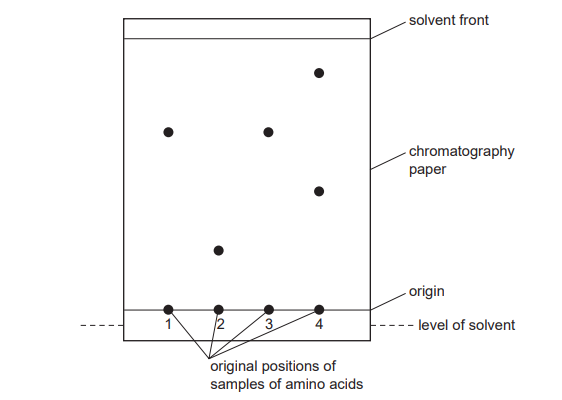

Why is the origin line drawn in pencil?

*Source: 2007 6 Q3*

**Q23** [1 mark]

**Extract:**

Chromatography can be used to identify amino acids from a sample of protein. The diagram shows the chromatogram obtained when four samples of amino acids were analysed. The paper was sprayed with ninhydrin.

Which amino acids could possibly be the same?

*Source: 2007 6 Q3*

**Q23** [2 marks]

**Extract:**

Chromatography can be used to identify amino acids from a sample of protein. The diagram shows the chromatogram obtained when four samples of amino acids were analysed. The paper was sprayed with ninhydrin.

Which amino acid sample contains more than one amino acid? Explain your answer.

sample ....................................................................................................

explanation ....................................................................................................

*Source: 2007 6 Q3*

**Q23** [1 mark]

**Extract:**

Chromatography can be used to identify amino acids from a sample of protein. The diagram shows the chromatogram obtained when four samples of amino acids were analysed. The paper was sprayed with ninhydrin.

Suggest why it is necessary to spray the chromatogram with ninhydrin.

*Source: 2007 6 Q3*

### Q24 — medium — 9 marks

**Q24** [2 marks]

A student separated a mixture of two alcohols, ethanol (boiling point 78 °C) and butanol (boiling point 118 °C).

The apparatus used is shown below.

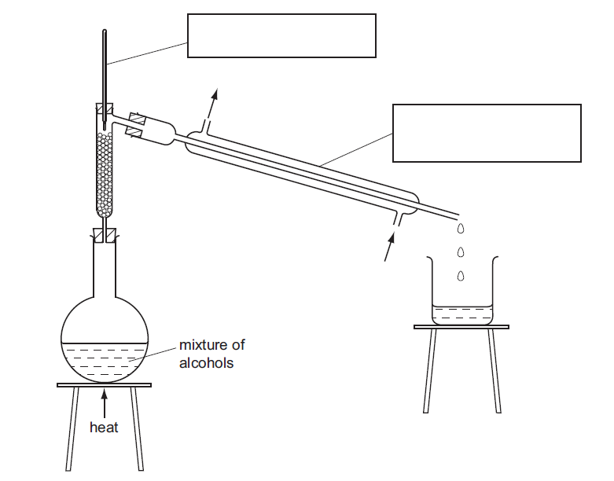

Complete the boxes to identify the pieces of apparatus labelled.

*Source: 2014 61 Q1A*

**Q24** [1 mark]

**Extract:**

A student separated a mixture of two alcohols, ethanol (boiling point 78 °C) and butanol (boiling point 118 °C). The apparatus used is shown below. Complete the boxes to identify the pieces of apparatus labelled.

Label the arrows.

*Source: 2014 61 Q1B*

**Q24** [2 marks]

**Extract:**

A student separated a mixture of two alcohols, ethanol (boiling point 78 °C) and butanol (boiling point 118 °C). The apparatus used is shown below.

State the name of this separation process.

*Source: 2014 61 Q1C*

**Q24** [2 marks]

**Extract:**

A student separated a mixture of two alcohols, ethanol (boiling point 78 °C) and butanol (boiling point 118 °C).

i) Which liquid is first to collect in the beaker?

[1]

ii) How would the student know when all of this liquid had collected?

[1]

*Source: 2014 61 Q1D*

**Q24** [2 marks]

**Extract:**

A student separated a mixture of two alcohols, ethanol (boiling point 78 °C) and butanol (boiling point 118 °C). The apparatus used is shown below.

Identify and explain a possible hazard in this experiment.

*Source: 2014 61 Q1E*

### Q25 — medium — 6 marks

**Q25** [3 marks]

A solution of copper sulphate was made by reacting excess copper oxide with dilute sulphuric acid. The diagram shows the method used.

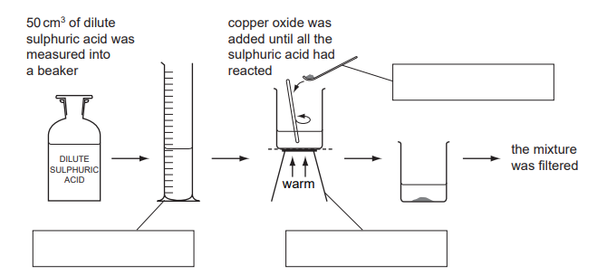

Complete the empty boxes to name the pieces of apparatus.

*Source: 2008 6 Q1*

**Q25** [1 mark]

**Extract:**

A solution of copper sulphate was made by reacting excess copper oxide with dilute sulphuric acid.

What does the term *excess *mean?

**Q25** [2 marks]

**Extract:**

A solution of copper sulphate was made by reacting excess copper oxide with dilute sulphuric acid.

Draw a labelled diagram to show how the mixture was filtered.

*Source: 2008 6 Q1*

### Q26 — medium — 7 marks

**Q26** [7 marks]

Toothbright toothpaste contains three compounds, sodium fluoride, calcium carbonate and water. Calcium carbonate is insoluble in water and sodium fluoride is soluble in water.

Plan an investigation to find out the percentage of calcium carbonate present in this toothpaste. You are provided with common laboratory apparatus.

*Source: 2015 6 Q1*

### Q27 — medium — 7 marks

**Q27** [2 marks]

The diagram shows the apparatus used to separate a mixture of water, boiling point 100 °C, and ethanol, boiling point 78 °C.

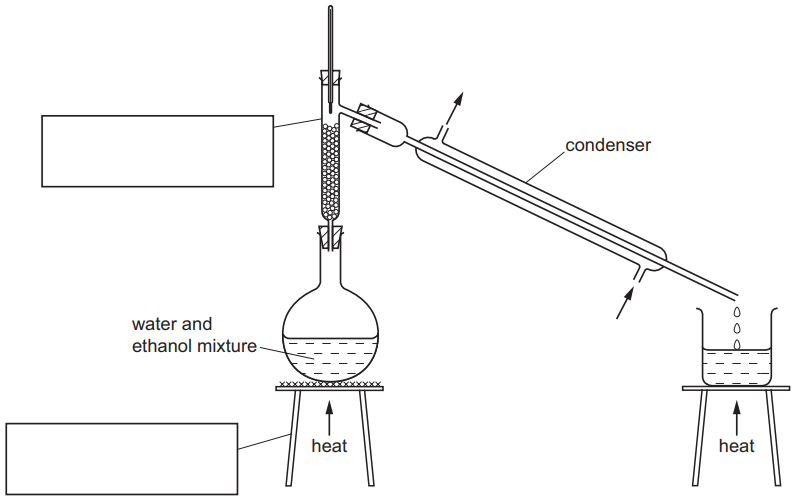

Complete the boxes to name the apparatus.

*Source: 2016 6 Q1A*

**Q27** [1 mark]

**Extract:**

The diagram shows the apparatus used to separate a mixture of water, boiling point 100 °C, and ethanol, boiling point 78 °C.

Complete the boxes to name the apparatus.

Label the arrows on the condenser.

*Source: 2016 6 Q1*

**Q27** [1 mark]

**Extract:**

The diagram shows the apparatus used to separate a mixture of water, boiling point 100 °C, and ethanol, boiling point 78 °C.

Identify **one **mistake in the apparatus.

*Source: 2016 6 Q1*

**Q27** [2 marks]

**Extract:**

The diagram shows the apparatus used to separate a mixture of water, boiling point 100 °C, and ethanol, boiling point 78 °C.

Which liquid would collect first? Explain your answer.

*Source: 2016 6 Q1*

**Q27** [1 mark]

**Extract:**

The diagram shows the apparatus used to separate a mixture of water, boiling point 100 °C, and ethanol, boiling point 78 °C.

Why would it be better to use an electrical heater instead of a Bunsen burner to heat the water and ethanol mixture?

*Source: 2016 6 Q1*

### Q28 — medium — 6 marks

**Q28** [6 marks]

The label on a bottle of orange drink stated ‘contains no artificial colours’. A scientist thought that the orange colour in the drink was a mixture of two artificial colours:

- Sunset Yellow E110
- Allura Red E129

Plan an investigation to show that the orange colour in the drink did not contain these two artificial colours. You are provided with samples of E110, E129 and the orange colouring from the drink. You are also provided with common laboratory apparatus. You may draw a diagram to help answer the question.

*Source: 2016 62 Q4*

### Q29 — medium — 8 marks

**Q29** [2 marks]

The green pigment chlorophyll can be obtained from grass.

Step 1: The grass is crushed with sand.

Step 2: The grass is ground with ethanol until the solution is saturated.

Step 3: The solution is separated from the rest of the mixture.

Step 4: The colours in the solution are separated.

What apparatus is used in Step 1?

*Source: 2005 6 Q3*

**Q29** [1 mark]

**Extract:**

The green pigment chlorophyll can be obtained from grass. Step 1: The grass is crushed with sand. Step 2: The grass is ground with ethanol until the solution is saturated. Step 3: The solution is separated from the rest of the mixture. Step 4: The colours in the solution are separated.

Suggest why the grass is ground with ethanol rather than water in Step 2.

*Source: 2005 6 Q3*

**Q29** [1 mark]

**Extract:**

The green pigment chlorophyll can be obtained from grass.

Step 1: The grass is crushed with sand.
Step 2: The grass is ground with ethanol until the solution is saturated.
Step 3: The solution is separated from the rest of the mixture.
Step 4: The colours in the solution are separated.

Name the separation method in Step 3.

**Q29** [4 marks]

**Extract:**

The green pigment chlorophyll can be obtained from grass. Step 1: The grass is crushed with sand. Step 2: The grass is ground with ethanol until the solution is saturated. Step 3: The solution is separated from the rest of the mixture. Step 4: The colours in the solution are separated.

Describe how Step 4 is carried out.

*Source: 2005 6 Q3*

### Q30 — medium — 6 marks

**Q30** [1 mark]

The diagram shows the results of an experiment to separate and identify the colours present in two coloured mixtures, **A** and **B**.

Substances **C**, **D**, **E** and **F** are single colours.

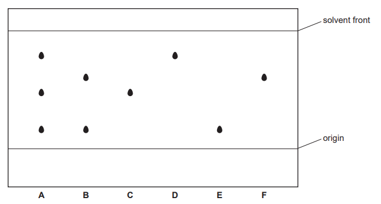

Name this method of separation.

*Source: 2011 61 Q3*

**Q30** [1 mark]

**Extract:**

The diagram shows the results of an experiment to separate and identify the colours present in two coloured mixtures, **A** and **B**. Substances **C**, **D**, **E** and **F** are single colours. 

Draw a line on the diagram to show the level of the solvent at the beginning of the experiment.

*Source: 2011 61 Q3*

**Q30** [1 mark]

**Extract:**

The diagram shows the results of an experiment to separate and identify the colours present in two coloured mixtures, A and B. Substances C, D, E and F are single colours. Name this method of separation. This method of separation is: Chromatography.

Why should a pencil be used instead of a pen to draw the origin line?

*Source: 2011 61 Q3*

**Q30** [2 marks]

**Extract:**

The diagram shows the results of an experiment to separate and identify the colours present in two coloured mixtures, A and B. Substances C, D, E and F are single colours. 

State **one **difference and **one **similarity between the coloured mixtures, **A** and **B**.

difference ....................................................................................................

similarity ....................................................................................................

*Source: 2011 61 Q3*

**Q30** [1 mark]

**Extract:**

The diagram shows the results of an experiment to separate and identify the colours present in two coloured mixtures, **A** and **B**. Substances **C**, **D**, **E** and **F** are single colours. 

Which substances are present in mixture **A**?

*Source: 2011 61 Q3*

## Multiple Choice Questions (22 questions)

### Q1 — medium — 1 marks

**Q1** [1 mark]

The *R*f values of three different pigments are shown in the table.

| pigment | *R*f value |
|---|---|
| P | 0.43 |
| Q | 0.57 |
| R | 0.75 |

A student carries out chromatography on an unknown sample. The resulting chromatogram is shown below

What is the identity of the unknown pigment?

### Q2 — easy — 1 marks

**Q2** [1 mark]

A student reacts aqueous silver nitrate with aqueous sodium chloride. A white precipitate of silver chloride is formed in a solution of sodium nitrate. The reaction mixture is filtered to separate the precipitate.

Which row identifies the **residue** and the **filtrate**?

|   | residue | filtrate |
|---|---|---|
| **A** | silver chloride | aqueous sodium nitrate |
| **B** | aqueous sodium nitrate | silver chloride |
| **C** | silver chloride | pure water |
| **D** | silver nitrate | aqueous sodium chloride |

### Q3 — easy — 1 marks

**Q3** [1 mark]

Paper chromatography was used to determine if a banned preservative, X, is present in four samples obtained from four different packaged foods labelled A, B, C and D.

The results of the analysis of the foodstuffs are shown in the diagram below.

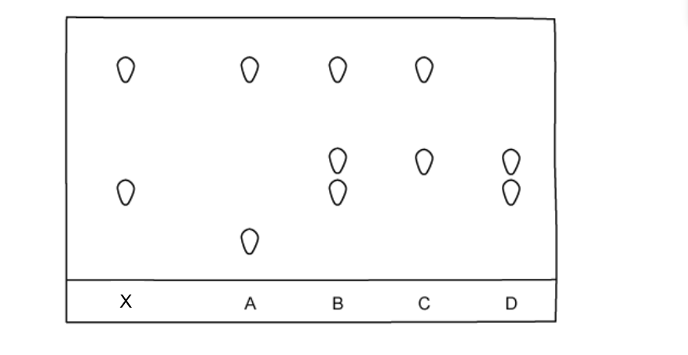

Which foodstuff contains X?

### Q4 — easy — 1 marks

**Q4** [1 mark]

A student carries out an investigation on different plant extracts using paper chromatography. The experimental set-up he uses is shown below.

Where should he place the samples of plant extract?

### Q5 — easy — 1 marks

**Q5** [1 mark]

A student performs a technique using the apparatus shown.

Which separation technique has the student performed?

### Q6 — easy — 1 marks

**Q6** [1 mark]

Rocksalt is the mineral form of sodium chloride. It is known to commonly contain sodium chloride and sand along with other trace impurities.

A combination of physical changes and separation techniques can be used to produce higher purity sodium chloride and sand.

What is the correct order of physical changes and separation techniques to separate sodium chloride and sand?

### Q7 — easy — 1 marks

**Q7** [1 mark]

The diagram below illustrates the experimental set-up to carry out distillation. What are the correct labels for points A and B on the condenser?

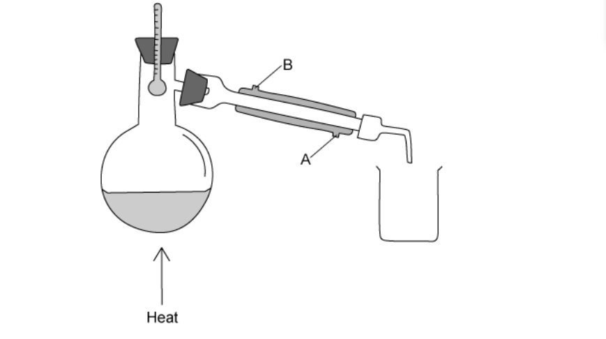

|   | **Point A** | **Point B** |
|---|---|---|
| **A** | water in | water in |
| **B** | water in | water out |
| **C** | water out | water in |
| **D** | water out | water out |

### Q8 — hard — 1 marks

**Q8** [1 mark]

A student has been given a sample of an amino acid to analyse by chromatography. As part of the investigation the student will have to use a locating agent to make the colourless amino acid spots visible. The *R*f value is then calculated to identify the amino acid.

Which row describes the correct steps?

|   | **How to add the locating agent** | **How to identify the amino acid** |
|---|---|---|
| **A** | Add to solvent | Calculate the *R*f |
| **B** | Spray on the chromatography paper before the experiment | Compare the *R*f value to that of known solvents |
| **C** | Spray on the surface of the solvent | Perform the experiment again and compare the *R*f values |
| **D** | Spray on the chromatogram | Compare the *R*f value to that of known amino acids |

### Q9 — hard — 1 marks

**Q9** [1 mark]

It is important that substances used in the synthesis of medicines are pure as impurities in these products can be detrimental to our health. Samples of pure and impure paracetamol were analysed using chromatography. The resulting chromatogram is shown below.

The impure sample of paracetamol was contaminated with one of the raw chemicals used during its synthesis.

What is the *R*f value of the chemical?

### Q10 — hard — 1 marks

**Q10** [1 mark]

Four different dyes labelled P, Q, R and S produced the chromatograms as shown below.

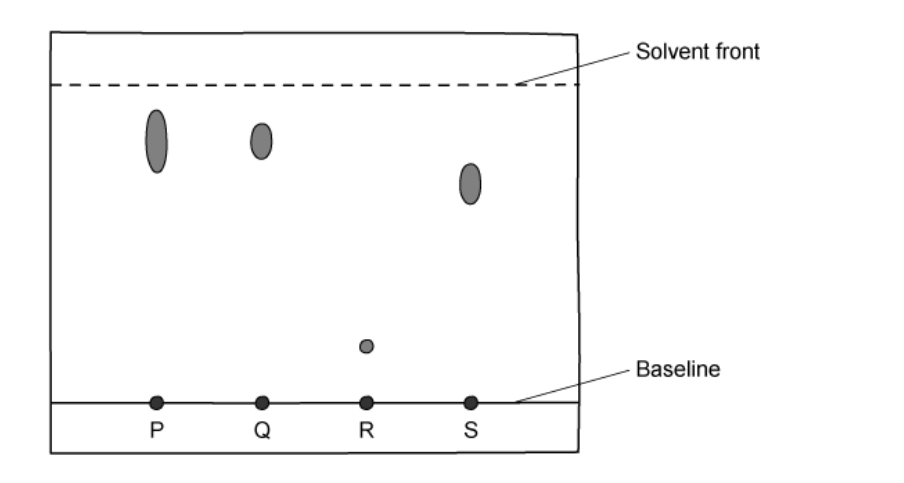

Which dye has an *R*f value of 0.7?

### Q11 — hard — 1 marks

**Q11** [1 mark]

A mixture of sugars can be separated out by paper chromatography.

The student sprays the dried chromatogram with a locating agent.

Why is this used?

### Q12 — hard — 1 marks

**Q12** [1 mark]

A yellow solid, W is soluble in water. Which method of separation can be used to obtain the solid W from an aqueous solution?

### Q13 — medium — 1 marks

**Q13** [1 mark]

Pure H2O boils at 100 oC and freezes at 0 oC.

What is the melting point and boiling point of water after the addition of potassium chloride?

|   | Boiling point / oC | Freezing point / oC |
|---|---|---|
| **A** | 103 | -3 |
| **B** | 103 | 3 |
| **C** | 97 | -3 |
| **D** | 97 | No change |

### Q14 — medium — 1 marks

**Q14** [1 mark]

A student has performed an experiment which produced a precipitate. She correctly chooses to separate the precipitate using the process of filtration. She prepares the filter paper to be placed into the funnel by folding it as shown below.

Which diagram correctly illustrates the filter paper at stage 3?

### Q15 — medium — 1 marks

**Q15** [1 mark]

The diagram below shows the apparatus a student used to separate a product from a reaction mixture.

What did the mixture contain?

### Q16 — medium — 1 marks

**Q16** [1 mark]

A substance was analysed and was found to have a boiling point of 450 °C.

At room temperature it is a soft grey solid.

Which temperature could be the melting point of a pure sample of the substance?

### Q17 — medium — 1 marks

**Q17** [1 mark]

Solid P melts at exactly 60oC and boils at exactly 310oC. Solid Q dissolves in ethanol and shows a green colour and a yellow colour when analysed using paper chromatography.

Which row is correct?

|   | **Contains only one substance** | **Contains more than one substance** |
|---|---|---|
| **A** | Q | P |
| **B** | Q | - |
| **C** | - | Q |
| **D** | P | Q |

## Theory Questions (16 questions)

### Q1 — easy — 3 marks

**Q1** [1 mark]

Alcohols can be partially oxidised to form aldehydes. Aldehydes are a homologous series of organic compounds.

Partial oxidation is achieved by reacting an alcohol with the oxidising agent in the apparatus as shown.

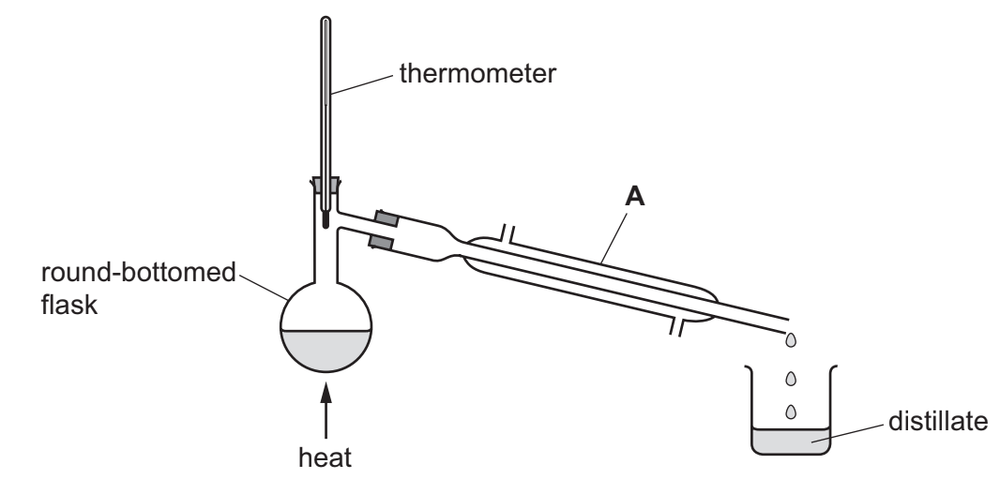

Give the name of this process that is used to separate a mixture of liquids with different boiling points.

**Q1** [1 mark]

**Extract:**

Alcohols can be partially oxidised to form aldehydes. Aldehydes are a homologous series of organic compounds. Partial oxidation is achieved by reacting an alcohol with the oxidising agent in the apparatus as shown.

Name apparatus **A**.

**Q1** [1 mark]

**Extract:**

Alcohols can be partially oxidised to form aldehydes. Aldehydes are a homologous series of organic compounds. Partial oxidation is achieved by reacting an alcohol with the oxidising agent in the apparatus as shown.
Apparatus A is a (Liebig) condenser.

On the diagram, use one arrow to show where water enters apparatus** A**.

### Q2 — medium — 6 marks

**Q2** [2 marks]

Petroleum contains hydrocarbons which are separated by fractional distillation.

i) Complete the following definition of a hydrocarbon:

A hydrocarbon is a compound which ............................................

[1]

ii) Explain what is meant by the term *fractional distillation*.

[1]

*Source: 2013 Ju31 Q1A*

**Q2** [4 marks]

Some of the fractions obtained from petroleum are given below. State a use for each fraction.

bitumen ....................................................................

lubricating fraction ..............................................

paraffin fraction ........................................................

gasoline fraction ......................................................

*Source: 2013 Ju31 Q1B*

### Q3 — hard — 10 marks

**Q3** [2 marks]

A student is told to produce the maximum amount of copper from a mixture of copper and copper(II) carbonate. The student adds the mixture to an excess of dilute sulfuric acid in a beaker and stirs the mixture with a glass rod. The copper(II) carbonate reacts with the sulfuric acid, forming a solution of copper(II) sulfate but the copper does not react with the sulfuric acid. The student then

- removes the unreacted copper from the mixture,
- converts the solution of copper(II) sulfate into copper by a series of reactions.

Describe **two **things that the student would observe when the mixture is added to the dilute sulfuric acid.

*Source: 2015 Ja32 Q6*

**Q3** [3 marks]

**Extract:**

A student is told to produce the maximum amount of copper from a mixture of copper and copper(II) carbonate. The student adds the mixture to an excess of dilute sulfuric acid in a beaker and stirs the mixture with a glass rod. The copper(II) carbonate reacts with the sulfuric acid, forming a solution of copper(II) sulfate but the copper does not react with the sulfuric acid. The student then removes the unreacted copper from the mixture, converts the solution of copper(II) sulfate into copper by a series of reactions.

Describe how the student can produce pure dry copper from the mixture of copper and copper(II) sulfate solution.

*Source: 2015 Ja32 Q6*

**Q3** [2 marks]

**Extract:**

A student is told to produce the maximum amount of copper from a mixture of copper and copper(II) carbonate. The student adds the mixture to an excess of dilute sulfuric acid in a beaker and stirs the mixture with a glass rod. The copper(II) carbonate reacts with the sulfuric acid, forming a solution of copper(II) sulfate but the copper does not react with the sulfuric acid.

The student then adds sodium hydroxide solution to the copper(II) sulfate solution to produce copper(II) hydroxide.

i) Describe what the student would observe.

[1]

ii) Write an ionic equation for this reaction.

[1]

*Source: 2015 Ja32 Q6*

**Q3** [3 marks]

**Extract:**

The student then adds sodium hydroxide solution to the copper(II) sulfate solution to produce copper(II) hydroxide. i) Describe what the student would observe. ... A blue precipitate / ppt

After separating the copper(II) hydroxide from the mixture, the copper(II) hydroxide is heated strongly. The copper(II) hydroxide decomposes into copper(II) oxide and steam.

i) Write an equation for the decomposition of copper(II) hydroxide. Include state symbols.

[2]

ii) Name a non-metallic element that can be used to convert copper(II) oxide into copper.

[1]

*Source: 2015 O32 Q6*

### Q4 — easy — 3 marks

**Q4** [1 mark]

Chromatography can be used to test the purity of substances.

The diagram shows the chromatogram of a coloured substance.

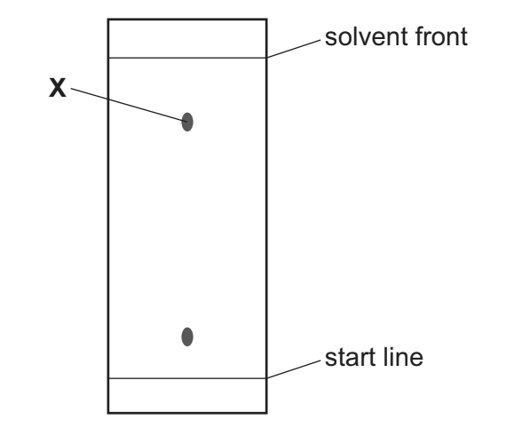

How does this chromatogram show that this substance is not pure?

*Source: 2020 Ju61 Q*

**Q4** [1 mark]

**Extract:**

Chromatography can be used to test the purity of substances. The diagram shows the chromatogram of a coloured substance. 

#### Extended Only

Draw a circle around the correct *R*f value for the spot labelled **X**.

0.2         0.4        0.8         1.2

*Source: 2020 Ju61 Q*

**Q4** [1 mark]

#### Separate: Chemistry and Extended Only

State how a colourless substance can be made visible on a chromatogram.

### Q5 — medium — 5 marks

**Q5** [1 mark]

The following techniques are used to separate mixtures.

| A   simple distillation | B   fractional distillation | C   evaporation |
|---|---|---|
| D   chromatography | E   filtration | F   diffusion |

From this list, choose the most suitable technique to separate the following.

methane from a mixture of the gases, methane and ethane.

*Source: 2011 Ju31 Q1A*

**Q5** [1 mark]

**Extract:**

The following techniques are used to separate mixtures.

| A   simple distillation | B   fractional distillation | C   evaporation |
| D   chromatography | E   filtration | F   diffusion |

From this list, choose the most suitable technique to separate the following.

Water from aqueous magnesium sulfate.

*Source: 2011 Ju31 Q1B*

**Q5** [1 mark]

**Extract:**

The following techniques are used to separate mixtures.

| A simple distillation | B fractional distillation | C evaporation |
| D chromatography | E filtration | F diffusion |

From this list, choose the most suitable technique to separate the following.

Iron filings from a mixture of iron filings and water.

*Source: 2011 Ju31 Q1D*

**Q5** [1 mark]

**Extract:**

The following techniques are used to separate mixtures.

| A simple distillation | B fractional distillation | C evaporation |
| D chromatography | E filtration | F diffusion |

From this list, choose the most suitable technique to separate the following.

Zinc sulfate crystals from aqueous zinc sulfate.

*Source: 2011 Ju31 Q1E*

**Q5** [1 mark]

**Extract:**

The following techniques are used to separate mixtures. | A simple distillation | B fractional distillation | C evaporation | | D chromatography | E filtration | F diffusion | From this list, choose the most suitable technique to separate the following.

Hexane from a mixture of the liquids, hexane and octane:

*Source: 2011 Ju31 Q1F*

### Q6 — hard — 8 marks

**Q6** [3 marks]

An ink is a mixture of coloured substances dissolved in water.

A sample of ink, **K**, is known to contain three different coloured substances.

Evaluate the use of the following methods to separate the coloured substances in the sample of ink, **K**.

- chromatography
- crystalisation
- filtration
- fractional distillation
- simple distillation

**Q6** [3 marks]

The apparatus shown can be used to separate water from ink.

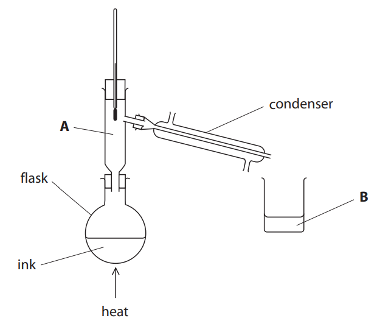

i) Cold water flows through the condenser.

Add labelled arrows to the diagram to show where the water should flow in and out of the apparatus

[1]

ii) Explain why a condenser is used.

[1]

iii) The flask was heated with a Bunsen burner.

Name an alternative piece of apparatus that could be used to heat the flask.

[1]

**Q6** [2 marks]

**Extract:**

The apparatus shown can be used to separate water from ink.

i) Cold water flows through the condenser.

ii) Explain why a condenser is used. - To cool the (water) vapour / gas into a liquid.

The arrangement of the particles in the ink inside the flask is shown.

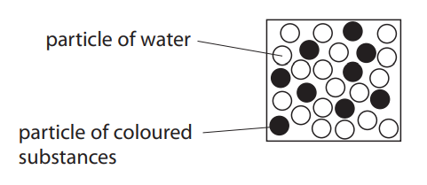

In the boxes below, draw the arrangement of particles that would be expected at **A** and **B** shown in part (b).

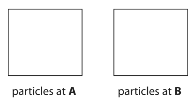

*Source: 2018 Ju1F Q6C*

### Q7 — medium — 5 marks

**Q7** [1 mark]

A list of techniques used to separate mixtures is given below.

**filtration **
**diffusion **
**fractional distillation **
**simple distillation **
**crystallisation **
**chromatography**

From this list, choose the most suitable technique to separate the following mixtures.

A technique may be used once, more than once or not at all.

Butane from a mixture of propane and butane.

*Source: 2012 O31 Q1A*

**Q7** [1 mark]

**Extract:**

A list of techniques used to separate mixtures is given below.

filtration
diffusion
fractional distillation
simple distillation
crystallisation
chromatography

From this list, choose the most suitable technique to separate the following mixtures. A technique may be used once, more than once or not at all.

Oxygen from liquid air.

*Source: 2012 O31 Q1B*

**Q7** [1 mark]

**Extract:**

A list of techniques used to separate mixtures is given below.

filtration
diffusion
fractional distillation
simple distillation
crystallisation
chromatography

From this list, choose the most suitable technique to separate the following mixtures. A technique may be used once, more than once or not at all.

Water from aqueous magnesium sulfate.

*Source: 2012 O31 Q1C*

**Q7** [1 mark]

**Extract:**

A list of techniques used to separate mixtures is given below. filtration, diffusion, fractional distillation, simple distillation, crystallisation, chromatography. From this list, choose the most suitable technique to separate the following mixtures. A technique may be used once, more than once or not at all.

Potassium chloride from aqueous potassium chloride.

*Source: 2012 O31 Q1D*

**Q7** [1 mark]

**Extract:**

A list of techniques used to separate mixtures is given below.

filtration

diffusion

fractional distillation

simple distillation

crystallisation

chromatography

From this list, choose the most suitable technique to separate the following mixtures. A technique may be used once, more than once or not at all.

Silver chloride from a mixture of silver chloride and water.

*Source: 2012 O31 Q1E*

### Q8 — easy — 12 marks

**Q8** [4 marks]

Substances can be classified as elements, compounds or mixtures.

Each of the boxes in the diagram represents either an element, a compound or a mixture.

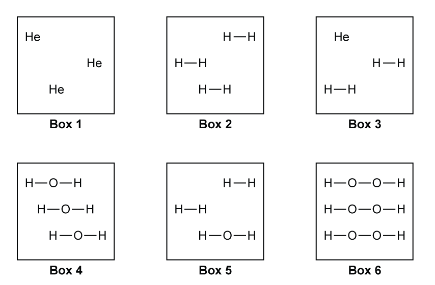

i) Explain which two boxes represent an element.

(2)

ii) Explain which two boxes represent a mixture.

(2)

*Source: 2017 Specimen1C Q2A*

**Q8** [3 marks]

The list gives the names of some methods used in the separation of mixtures:

- chromatography
- crystallisation
- distillation
- filtration

Use names from the list to choose a suitable method for each separation. Each name may be used once, more than once or not at all.

i) Separating water from sodium chloride solution.

(1)

iii) Separating the blue dye from a mixture of blue and red dyes.

(1)

iii) Separating potassium nitrate from potassium nitrate solution.

(1)

*Source: 2017 Specimen1C Q2B*

**Q8** [2 marks]

**Extract:**

The dyes are soluble in propanone but not soluble in water. The solvent used is water. The start line is drawn in ink.

The colours in three different dyes, **A**,** B **&** C**, were investigated using paper chromatography. The dyes are soluble in propanone but not soluble in water. The apparatus used is shown.

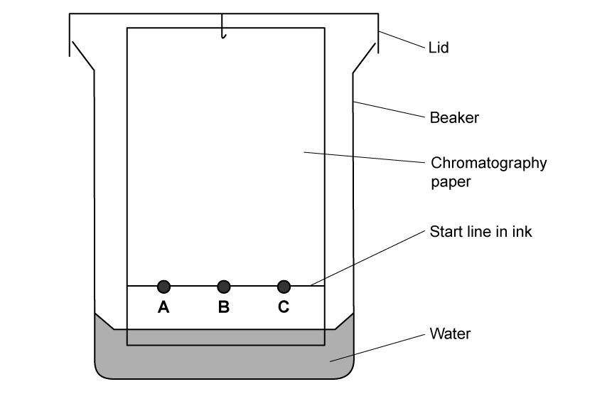

Place two ticks in boxes that identify how the equipment was incorrectly set up.

| The dyes are all on the same piece of chromatography paper |   |
|---|---|
| The solvent used is water |   |
| A lid is on the beaker |   |
| The water is not level with the dyes |   |
| The start line is drawn in ink |   |

**Q8** [3 marks]

**Extract:**

The colours in three different dyes, A, B & C, were investigated using paper chromatography. The dyes are soluble in propanone but not soluble in water.

The student corrected the mistakes and obtained the chromatogram shown in Figure 2.

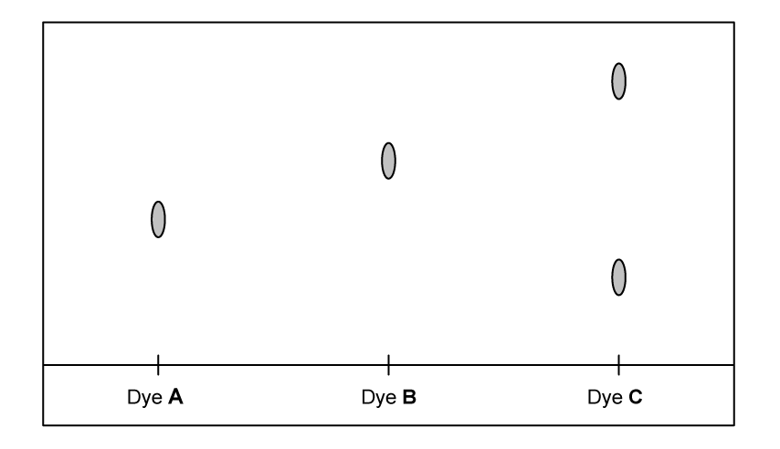

**Figure 2 **

Put ticks (✔ ) in the boxes to show which statements are true and which statements are false.

|   | **True** | **False** |
|---|---|---|
| Dye **A** is the most soluble |   |   |
| Dye **C** is a mixture |   |   |
| Dye **C** contains dye **B** |   |   |
| Dye **C** contains dye **A** |   |   |
| Dye **B** is a pure substance |   |   |

### Q9 — medium — 11 marks

**Q9** [3 marks]

Describe how to separate the following. In each example, give a description of the procedure used and explain why this method works.

Copper powder from a mixture containing copper and zinc powders.

procedure..............................................

explanation .........................................

*Source: 2015 O31 Q2A*

**Q9** [3 marks]

**Extract:**

Describe how to separate the following. In each example, give a description of the procedure used and explain why this method works.

Nitrogen from a mixture of nitrogen and oxygen.

procedure............................................

explanation........................................

*Source: 2015 O31 Q2B*

**Q9** [2 marks]

**Extract:**

Describe how to separate the following. In each example, give a description of the procedure used and explain why this method works.

Glycine from a mixture of the two amino acids glycine and alanine. Glycine has the lower *R*f value.

procedure.........................................

explanation.....................................

*Source: 2015 O31 Q2C*

**Q9** [3 marks]

**Extract:**

Describe how to separate the following. In each example, give a description of the procedure used and explain why this method works.

Magnesium hydroxide from a mixture of magnesium hydroxide and zinc hydroxide.

procedure..................................................

explanation..............................................

*Source: 2015 O31 Q2D*

### Q10 — medium — 10 marks

**Q10** [1 mark]

An important aspect of chemistry is purity and methods of purification.

Give an example of a substance used in everyday life which must be pure.

*Source: 2014 O32 Q1A*

**Q10** [9 marks]

A list of techniques used to separate mixtures is given below.

| \| chromatography \| crystallisation \| diffusion \| \|---\|---\|---\|  \| evaporation \| filtration \| fractional distillation \| simple distillation \| \|---\|---\|---\|---\| |
|---|

i) From the list, choose the most suitable technique to separate the following.

Water from sea-water ........................................................................

Helium from a mixture of helium and methane .................................

Ethanol from a mixture of ethanol and propanol ...............................

Iron filings from a mixture of iron filings and water ..........................

A mixture of two amino acids, glycine and alanine ...........................

[5]

ii) Describe how you would obtain a pure sample of copper(II) sulfate-5-water crystals from a mixture of copper(II) sulfate-5-water with copper(II) oxide using some of the techniques listed above.

[4]

### Q11 — easy — 5 marks

**Q11** [1 mark]

A list of techniques used to separate mixtures is given below.

- fractional distillation
- simple distillation
- crystallisation
- filtration
- diffusion

From the list choose the most suitable technique to separate the following:

water from aqueous copper(II) sulfate.............................

*Source: 2007 O31 Q1*

**Q11** [1 mark]

**Extract:**

A list of techniques used to separate mixtures is given below.

- fractional distillation
- simple distillation
- crystallisation
- filtration
- diffusion

From the list choose the most suitable technique to separate the following:

Helium from a mixture of helium and argon.......................

**Q11** [1 mark]

**Extract:**

A list of techniques used to separate mixtures is given below.
- fractional distillation
- simple distillation
- crystallisation
- filtration
- diffusion
From the list choose the most suitable technique to separate the following:

Copper(II) sulfate from aqueous copper(II) sulfate.

**Q11** [1 mark]

**Extract:**

A list of techniques used to separate mixtures is given below.

- fractional distillation
- simple distillation
- crystallisation
- filtration
- diffusion

From the list choose the most suitable technique to separate the following:

Ethanol from aqueous ethanol.

**Q11** [1 mark]

**Extract:**

A list of techniques used to separate mixtures is given below.

- fractional distillation
- simple distillation
- crystallisation
- filtration
- diffusion

From the list choose the most suitable technique to separate the following:

Barium sulfate from a mixture of water and barium sulfate.

### Q12 — easy — 5 marks

**Q12** [1 mark]

Rock salt is a mixture of sand and salt. Salt dissolves in water. Sand does not dissolve in water.

A student sepearted a sample of rock salt using this method:

1. Place the rock salt in a beaker.
2. Add 100 cm3 of cold water.
3. Allow the sand to settle to the bottom of the beaker.
4. Carefully pour the salty water into an evaporating dish.
5. Heat the contents of the evaporating dish with a Bunsen burner until salt crystals start to form.

Suggest one improvement to step 2 to make sure all the salt is dissolved in the water.

**Q12** [1 mark]

**Extract:**

Rock salt is a mixture of sand and salt. Salt dissolves in water. Sand does not dissolve in water.

A student sepearted a sample of rock salt using this method:

1. Place the rock salt in a beaker.
2. Add 100 cm^3^ of cold water.
3. Allow the sand to settle to the bottom of the beaker.
4. Carefully pour the salty water into an evaporating dish.
5. Heat the contents of the evaporating dish with a Bunsen burner until salt crystals start to form.

Step 3 produces the salty water which is used in step 4. This salty water contains very small grains of sand.

Suggest **one** improvement to step 4 to remove all the sand.

**Q12** [2 marks]

Another student distilled the water from the salty water using the apparatus shown.

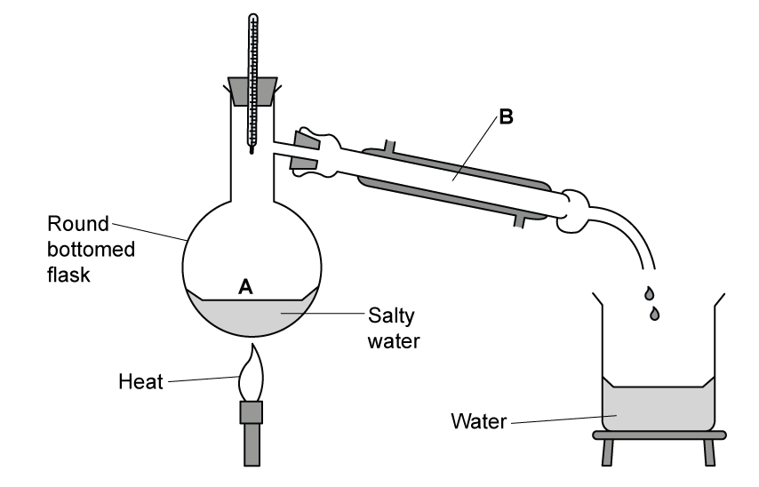

State the name of the processes occurring at **A** and **B**.

**Q12** [1 mark]

**Extract:**

Another student distilled the water from the salty water using the apparatus shown.

What is the reading on the thermometer during this distillation?

### Q13 — medium — 5 marks

**Q13** [1 mark]

Nerol can be extracted from some plants.

Crushed plant leaves containing nerol are mixed with an organic solvent called octane.

Nerol dissolves in octane.

Describe how you would separate the crushed plant leaves from the solution of nerol in octane.

**Q13** [2 marks]

The boiling point of nerol is 224 °C.

The boiling point of octane is 126 °C.

Explain how distillation separates nerol from the octane.

**Q13** [2 marks]

The mixture of coloured compounds in plant leaves can be separated by chromatography.

The apparatus is shown.

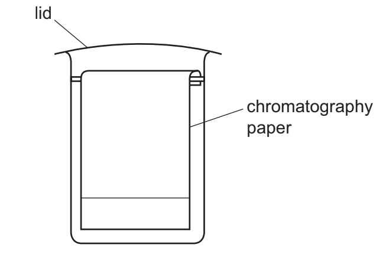

On the diagram:

- draw an ‘X’ to show where the mixture of coloured compounds is placed at the start of the experiment
- draw a line to show the level of the solvent at the start of the experiment.

### Q14 — hard — 10 marks

**Q14** [2 marks]

The ester linkage showing all the bonds is drawn as

or more simply it can be written as –COO–.

i) Give the structural formula of the ester ethyl ethanoate.

[1]

ii) Deduce the name of the ester formed from methanoic acid and butanol.

[1]

*Source: 2013 Ju32 Q7*

**Q14** [3 marks]

**Extract:**

The ester linkage showing all the bonds is drawn as [image] or more simply it can be written as –COO–.

Draw the structural formula of the polyester formed from the following monomers.

HOOCC6H4COOH and HOCH2CH2OH

You are advised to use the simpler form of the ester linkage.

*Source: 2013 Ju32 Q7*

**Q14** [5 marks]

**Extract:**

An ester was used as the solvent and the chromatogram was sprayed with bromothymol blue.

i) Suggest why it was necessary to spray the chromatogram.

ii) Explain what is meant by the Rf value of a sample.

iii) Calculate the Rf values of the two samples and use the data in the table to identify the plant acids.

| Plant acid      | Rf value |
|----------------|----------|
| tartaric acid  | 0.22     |
| citric acid    | 0.30     |
| oxalic acid    | 0.36     |
| malic acid     | 0.46     |
| succinic acid  | 0.60     |

The cross represents the centre of the spot. The baseline and solvent front are marked on the chromatogram.

Esters can be used as solvents in chromatography. The following shows a chromatogram of plant acids.

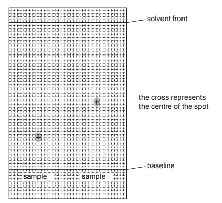

An ester was used as the solvent and the chromatogram was sprayed with bromothymol blue.

i) Suggest why it was necessary to spray the chromatogram.

[2]

ii) Explain what is meant by the *R*f value of a sample.

[1]

iii) Calculate the *R*f values of the two samples and use the data in the table to identify the plant acids.

| **Plant acid** | ***R*****f**** value** |
|---|---|
| tartaric acid | 0.22 |
| citric acid | 0.30 |
| oxalic acid | 0.36 |
| malic acid | 0.46 |
| succinic acid | 0.60 |

[2]

*Source: 2013 Ju32 Q7*

### Q15 — hard — 10 marks

**Q15** [2 marks]

In 1985 the fullerenes were discovered. They are solid forms of the element carbon. The structure of the C60 fullerene is given below.

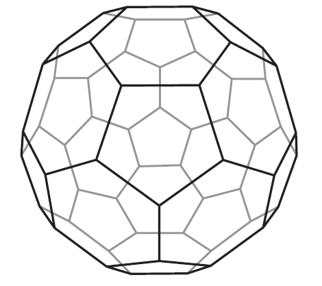

i) In the C60 fullerene, how many other carbon atoms is each carbon atom bonded to?

[1]

ii) Another fullerene has a relative molecular mass of 840.

How many carbon atoms are there in one molecule of this fullerene?

[1]

*Source: 2014 O33 Q3*

**Q15** [3 marks]

Fullerenes are soluble in liquid hydrocarbons such as octane. The other solid forms of carbon are insoluble.

Describe how you could obtain crystals of fullerenes from soot which is a mixture of fullerenes and other solid forms of carbon.

*Source: 2014 O33 Q3*

**Q15** [5 marks]

**Extract:**

In 1985 the fullerenes were discovered. They are solid forms of the element carbon.

A mixture of a fullerene and potassium is an excellent conductor of electricity.

i) Which other form of solid carbon is a good conductor of electricity?

[1]

ii) Explain why metals, such as potassium, are good conductors of electricity.

[2]

iii) The mixture of fullerene and potassium has to be stored out of contact with air. There are substances in unpolluted air which will react with potassium.

Name **two **potassium compounds which could be formed when potassium is exposed to air.

[2]

### Q16 — hard — 12 marks

**Q16** [4 marks]

#### Extended Only

Electrolysis is used to manufacture magnesium from molten magnesium bromide.

i) The negative electrode is made of iron.

Suggest a non-metal which could be used for the positive electrode.

Give a reason for your answer.

[2]

ii) Write the ionic equations for the products of the electrolysis of molten magnesium bromide at:

the positive electrode ..........................................................................................................

the negative electrode. .......................................................................................................

[2]

**Q16** [2 marks]

The following statements are about the procedure for making crystals of hydrated magnesium bromide from magnesium and dilute hydrobromic acid.

| **A** | Add an excess of magnesium to dilute hydrobromic acid. |
|---|---|
| **B** | Filter off the crystals and dry between filter papers. |
| **C** | Filter off the excess magnesium. |
| **D** | Leave the mixture at room temperature to form more crystals. |
| **E** | Leave the mixture until no more bubbles are seen. |
| **F** | Warm the filtrate to the point of crystallisation. |

Put the statements A, B, C, D, E and F in the correct order.

**Q16** [2 marks]

Magnesium is a metal in Group II of the Periodic Table.

Cobalt is a transition element with a higher melting point and a higher boiling point than magnesium.

Describe **two **other properties of cobalt which are different from those of magnesium.

**Q16** [4 marks]

Chromatography can be used to separate a mixture of ions from different transition element compounds.

Two solutions, **Y** and **Z**, each containing only one type of transition element ion were placed on a piece of chromatography paper.

Four samples, **R**, **S**, **T** and **U**, each containing transition element ions, were also placed on the same piece of chromatography paper.

The results of the chromatography are shown.

i) Explain the results shown for solutions **Y** and **Z**.

[1]

ii) Which sample, **R**, **S**, **T** or **U**, does not contain the same ions as either solution **Y** or solution **Z**?

[1]

iii) Which sample, **R**, **S**, **T** or **U**, contains the same ions as both solution **Y** and solution **Z**?

[1]

iv) Which sample, **R**, **S**, **T** or **U**, has the greatest number of transition element ions?

[1]
