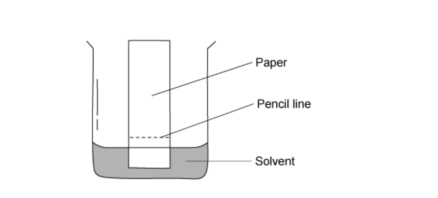
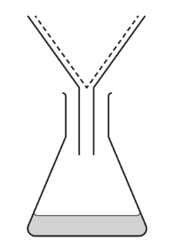
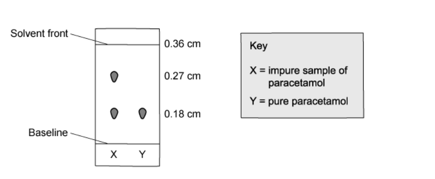
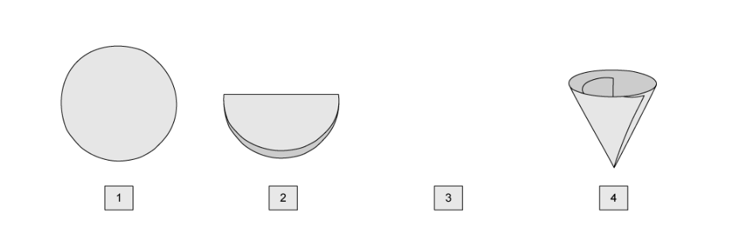
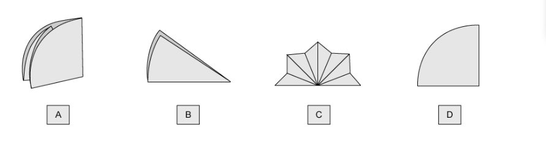
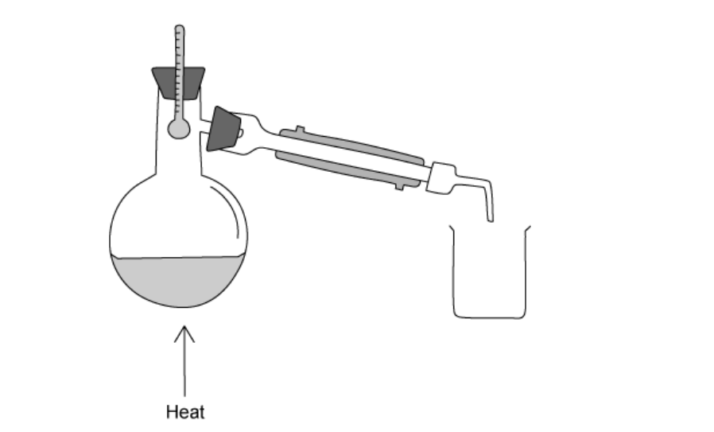

# Exam Questions — Separation & Purification
**12. Experimental Techniques & Chemical Analysis** · Cambridge (CIE) IGCSE chemistry (0620 & 0971)
> Source: [https://www.savemyexams.com/igcse/chemistry/cie/23/topic-questions/](https://www.savemyexams.com/igcse/chemistry/cie/23/topic-questions/) · 17 questions across 1 sets

## Multiple Choice Questions (22 questions)

### Q1 — medium — 1 marks

**Q1** [1 mark]

The *R*f values of three different pigments are shown in the table.

| pigment | *R*f value |
|---|---|
| P | 0.43 |
| Q | 0.57 |
| R | 0.75 |

A student carries out chromatography on an unknown sample. The resulting chromatogram is shown below

What is the identity of the unknown pigment?

### Q2 — easy — 1 marks

**Q2** [1 mark]

A student reacts aqueous silver nitrate with aqueous sodium chloride. A white precipitate of silver chloride is formed in a solution of sodium nitrate. The reaction mixture is filtered to separate the precipitate.

Which row identifies the **residue** and the **filtrate**?

|   | residue | filtrate |
|---|---|---|
| **A** | silver chloride | aqueous sodium nitrate |
| **B** | aqueous sodium nitrate | silver chloride |
| **C** | silver chloride | pure water |
| **D** | silver nitrate | aqueous sodium chloride |

### Q3 — easy — 1 marks

**Q3** [1 mark]

Paper chromatography was used to determine if a banned preservative, X, is present in four samples obtained from four different packaged foods labelled A, B, C and D.

The results of the analysis of the foodstuffs are shown in the diagram below.

Which foodstuff contains X?

### Q4 — easy — 1 marks

**Q4** [1 mark]

A student carries out an investigation on different plant extracts using paper chromatography. The experimental set-up he uses is shown below.

Where should he place the samples of plant extract?

### Q5 — easy — 1 marks

**Q5** [1 mark]

A student performs a technique using the apparatus shown.

Which separation technique has the student performed?

### Q6 — easy — 1 marks

**Q6** [1 mark]

Rocksalt is the mineral form of sodium chloride. It is known to commonly contain sodium chloride and sand along with other trace impurities.

A combination of physical changes and separation techniques can be used to produce higher purity sodium chloride and sand.

What is the correct order of physical changes and separation techniques to separate sodium chloride and sand?

### Q7 — easy — 1 marks

**Q7** [1 mark]

The diagram below illustrates the experimental set-up to carry out distillation. What are the correct labels for points A and B on the condenser?

|   | **Point A** | **Point B** |
|---|---|---|
| **A** | water in | water in |
| **B** | water in | water out |
| **C** | water out | water in |
| **D** | water out | water out |

### Q8 — hard — 1 marks

**Q8** [1 mark]

A student has been given a sample of an amino acid to analyse by chromatography. As part of the investigation the student will have to use a locating agent to make the colourless amino acid spots visible. The *R*f value is then calculated to identify the amino acid.

Which row describes the correct steps?

|   | **How to add the locating agent** | **How to identify the amino acid** |
|---|---|---|
| **A** | Add to solvent | Calculate the *R*f |
| **B** | Spray on the chromatography paper before the experiment | Compare the *R*f value to that of known solvents |
| **C** | Spray on the surface of the solvent | Perform the experiment again and compare the *R*f values |
| **D** | Spray on the chromatogram | Compare the *R*f value to that of known amino acids |

### Q9 — hard — 1 marks

**Q9** [1 mark]

It is important that substances used in the synthesis of medicines are pure as impurities in these products can be detrimental to our health. Samples of pure and impure paracetamol were analysed using chromatography. The resulting chromatogram is shown below.

The impure sample of paracetamol was contaminated with one of the raw chemicals used during its synthesis.

What is the *R*f value of the chemical?

### Q10 — hard — 1 marks

**Q10** [1 mark]

Four different dyes labelled P, Q, R and S produced the chromatograms as shown below.

Which dye has an *R*f value of 0.7?

### Q11 — hard — 1 marks

**Q11** [1 mark]

A mixture of sugars can be separated out by paper chromatography.

The student sprays the dried chromatogram with a locating agent.

Why is this used?

### Q12 — hard — 1 marks

**Q12** [1 mark]

A yellow solid, W is soluble in water. Which method of separation can be used to obtain the solid W from an aqueous solution?

### Q13 — medium — 1 marks

**Q13** [1 mark]

Pure H2O boils at 100 oC and freezes at 0 oC.

What is the melting point and boiling point of water after the addition of potassium chloride?

|   | Boiling point / oC | Freezing point / oC |
|---|---|---|
| **A** | 103 | -3 |
| **B** | 103 | 3 |
| **C** | 97 | -3 |
| **D** | 97 | No change |

### Q14 — medium — 1 marks

**Q14** [1 mark]

A student has performed an experiment which produced a precipitate. She correctly chooses to separate the precipitate using the process of filtration. She prepares the filter paper to be placed into the funnel by folding it as shown below.

Which diagram correctly illustrates the filter paper at stage 3?

### Q15 — medium — 1 marks

**Q15** [1 mark]

The diagram below shows the apparatus a student used to separate a product from a reaction mixture.

What did the mixture contain?

### Q16 — medium — 1 marks

**Q16** [1 mark]

A substance was analysed and was found to have a boiling point of 450 °C.

At room temperature it is a soft grey solid.

Which temperature could be the melting point of a pure sample of the substance?

### Q17 — medium — 1 marks

**Q17** [1 mark]

Solid P melts at exactly 60oC and boils at exactly 310oC. Solid Q dissolves in ethanol and shows a green colour and a yellow colour when analysed using paper chromatography.

Which row is correct?

|   | **Contains only one substance** | **Contains more than one substance** |
|---|---|---|
| **A** | Q | P |
| **B** | Q | - |
| **C** | - | Q |
| **D** | P | Q |
