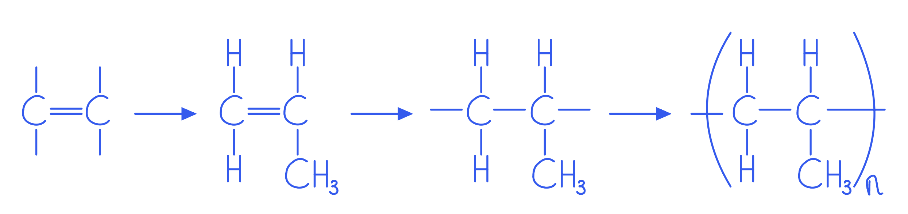

# Mark Schemes — Identification of Ions & Gases
**12. Experimental Techniques & Chemical Analysis** · Cambridge (CIE) IGCSE chemistry (0620 & 0971)

## Alternative To Practical Questions (38 questions)

### Q1
a)

i) The observation for **Test 1** is:

- Blue; **[1 mark]**

ii) The observation for **Test 2** is:

- Blue; **[1 mark]**
- Precipitate; **[1 mark]**

iii) The observation for **Test 3** is:

- Blue precipitate; **[1 mark]**

iv) The observation for **Test 4** is:

- Deep / royal blue; **[1 mark]**
- Solution **OR** Precipitate dissolves; **[1 mark]**

**[Total: 6 marks]**

- *Copper(II) sulfate is a blue solution; this is commonly used and you should know the colour*
- *A blue precipitate of copper(II) hydroxide is produced when sodium hydroxide is added*
- *A blue precipitate of copper(II) hydroxide is initially produced when ammonia is added, which redissolves in an excess of aqueous ammonia as a soluble complex ion containing copper(II) and ammonia is formed, with the resulting solution being a deep blue colour*
b) The identity of solution **Y** is:

- Sulfuric; **[1 mark]**
- Acid; **[1 mark]**

*Allow sulfate for only ***[1 mark]**

**[Total: 2 marks]**

- *Solution **Y** has a pH of 1, making it a strong acid*
- *The test with barium ions gives a white precipitate as a result, indicating that sulfate ions are present in solution Y, hence sulfuric acid is the identity of the acid*

### Q2
a) The observations are:

i) First portion:

- Fizz / bubbles / effervesce; **[1 mark]**
- Pop; **[1 mark]**

ii) Second portion:

- Fizz / bubbles / effervesce; **[1 mark]**
- Limewater turns milky / cloudy; **[1 mark]**

**[Total: 4 marks]**

- *When metals react with acids, a salt + hydrogen are formed*
- *When metals react with carbonates, a salt, water + carbon dioxide are formed*
- *You need to know the tests and positive results for a number of gases, including hydrogen and carbon dioxide*
b) Test 1 tells you that the type of acid in solution **A** is:

- Weak; **[1 mark]**

**[Total: 1 mark]**

- *Weak acids typically have a pH in the range 4 to 6*
c)

i) The gas given off in test 2 is:

- Hydrogen / H2; **[1 mark]**

ii) The gas given off in test 3 is:

- Carbon dioxide / CO2; **[1 mark]**

**[Total: 2 marks]**

- *When metals react with acids, a salt + hydrogen are formed*
- *When metals react with carbonates, a salt, water + carbon dioxide are formed*
d) The observations in test 4 are caused by:

- Copper; **[1 mark]**
- 2+; **[1 mark] **
*Cu**2+** scores 2 marks*

**[Total: 2 marks]**

- *Addition of aqueous ammonia is a common test to identify a variety of different cations*
- *As this test produces a dark blue solution with an excess of aqueous ammonia, copper ions must be present*
- *Copper ions are one of several cations that will form a precipitate with aqueous ammonia that you need to know, together with the colour of the precipitates formed and what happens to the precipitate on addition of excess aqueous ammonia*

### Q3
a)

i) The observations when drops of aqueous sodium hydroxide were added to the first portion, followed by excess aqueous sodium hydroxide, were:

- White; **[1 mark]**
- Precipitate; **[1 mark]**
- Dissolves; **[1 mark]**

ii)The observations when drops of aqueous ammonia were added to the second portion, followed by excess ammonia were:

- White; **[1 mark]**
- Precipitate; **[1 mark]**
- Insoluble; **[1 mark]**

**[Total: 6 marks]**

- *Sodium hydroxide and aqueous ammonia are used to test for the positive ions, the cations*
- *Aluminium ions have the same result initially in both solutions- a white precipitate*
- *This will dissolve in excess sodium hydroxide but not in excess ammonia *
b) The test tells you the gas is:

- Acidic **OR **Hydrated salt; **[1 mark]**

**[Total: 1 mark]**

- *The gas turned pH indicator red, which is a positive result for an acidic substance*
- *Condensation formed when the substance was heated, indicating water had evaporated and that substance X is, therefore, a hydrated salt *
- *The question asks for a feature of the gas, but as water vapour and an acidic gas are given off then either option is acceptable*
c) The tests done to the third and fourth portions tell you:

- Third portion- It is not a sulfate; **[1 mark]**
- Fourth portion- It is not a halide;** [1 mark]**

**[Total: 2 marks]**

- *Barium chloride was added to the third portion- had **X** contained the sulfate ion, a white precipitate of barium sulfate would have formed *
- *Nitric acid and lead nitrate solution were added to the fourth portion- the lead nitrate solution would have reacted with **X** to form a lead halide precipitate*
d) The gas given off in the fifth portion is:

- Ammonia;** [1 mark]**

**[Total: 1 mark]**

- *A pungent gas which turns indicator paper blue when sodium hydroxide is added and heated is a positive test for ammonia gas*
e) The conclusions that can be drawn about substance **X** are:

- It is a nitrate; **[1 mark]**
- It is hydrated; **[1 mark]**

**[Total: 2 marks]**

- *The test for nitrate ions is adding aqueous NaOH and a form of aluminium, and warming it gently *
- *The positive result for this test is ammonia gas being given off which we identified in d) as ammonia, which is produced from the nitrate ions being reduced*
- *We also know from b) that the salt is hydrated due to the formation of condensation when it was heated*
- *These types of questions contain a lot of information so it is important to go back and check each test carefully*

### Q4
a)

i) The expected observation in **Test 1** part (i) is:

- White; **[1 mark]**
- Precipitate; **[1 mark]**
- Dissolves; **[1 mark]**

ii) The expected observation in **Test 1** part (ii) is:

- White precipitate; **[1 mark]**
- Dissolves; **[1 mark]**

iii) The expected observation in **Test 2** part (i) is:

- No reaction/change; **[1 mark]**

iv) The expected observation in **Test 3** part (i) is:

- White; **[1 mark]**
- Precipitate; **[1 mark]**

**[Total: 8 marks]**

- *The mixture contains zinc ions, which is stated in the question. Zinc ions form a white precipitate of zinc hydroxide when sodium hydroxide is added, and this white precipitate re-dissolves in an excess of sodium hydroxide*
- *Ammonia solution also forms zinc hydroxide when added to a solution of zinc ions, so also forms a white precipitate that re-dissolves when an excess of ammonia is added*
- *Silver nitrate and nitric acid test for the presence of halide ions, which are not known to be present in this mixture and would not form a precipitate with sulfate ions, which are present*
- *Barium nitrate and nitric acid test for the presence of sulfate ions, which are present in this mixture as stated at the start of the question, and so a white precipitate would form *
b) The gas given off in **Test 5** is:

- Chlorine; **[1 mark]**

*Not: chloride*

**[Total: 1 mark]**

- *A pungent gas that bleaches damp litmus paper is ammonia*
c) The gas produced in **Test 6** is:

- Oxygen; **[1 mark]**

**[Total: 1 mark]**

- *A gas that relights a glowing splint is oxygen*
d) The conclusions that can be drawn about solid** N** are:

- Transition metal present;** [1 mark]**
- Catalyst; **[1 mark]**

**OR**

- Manganese;** [1 mark]**
- Oxide; **[1 mark]**

*Allow: copper oxide for one mark*

**[Total: 2 marks]**

- *Transition metals form coloured compounds, and **M** is a black solid as this is the residue present when the soluble and insoluble parts of the mixture are separated*
- *Transition metal compounds are good catalysts, and the decomposition of hydrogen peroxide described in the final test is a catalysed decomposition (as normally the rate of decomposition is very slow)*
- *Manganese oxide is a commonly used catalyst for this decomposition that is also a black solid*

### Q5
a)

i) The pH of solution** L** in **Test 2**:

- pH of solution **L** 11-14; **[1 mark]**

ii) The expected observation in **Test 4**:

- Blue precipitate; **[1 mark]**

*Both for one mark (soluble in excess = 0)*

iii) The expected observation in **Test 5**:

- White;** [1 mark]**
- Precipitate; **[1 mark]**
- Dissolves / clears / soluble in excess;** [1 mark]**

**[Total: 5 marks]**

- *L** is given as sodium hydroxide in the question and therefore has a high pH*
- *Sodium hydroxide will react with copper(II) ions to form a blue precipitate of copper(II) hydroxide*
- *Sodium hydroxide will react with aluminium ions to form a white precipitate of aluminium hydroxide, which redissolves in excess*
b) Solution **K** is:

- Weak; **[1 mark]**
- Alkali / base; **[1 mark]** 
*Accept ammonia for both marks*

**[Total: 2 marks]**

- *Solution **K** has a pH of 10, which makes it a weak alkali / base*
c) Solution **M** is:

- Hydrochloric acid; **[2 marks]**

**OR**

- Acid; **[1 mark]**
- Containing the chloride ion; **[1 mark]** 
*Chlorine atom is not accepted*

**[Total: 2 marks]**

- *Solution **M** has a pH of 2, which suggests that it is an acid*
- *The addition of silver nitrate solution formed a white precipitate, which suggests that the chloride ion is present*

  - *An acid that contains the chloride ion is hydrochloric acid*

### Q6
a) The appearance of copper(II) chloride is:

- Blue solid / crystals / powder
**OR**
Blue-green solid / crystals / powder
**OR**
Green solid / crystals / powder; **[1 mark]**

**[Total: 1 mark]**

- *When describing the appearance of a solid, always state the colour and the physical form*

  - *e.g. "green crystals" rather than just "green"*
- *Copper(II) chloride is typically seen as blue-green or green crystals in its hydrated form*

  - *The exact shade can vary, so green, blue-green, or blue are all accepted*
- *Do not write yellow or yellow-green*

  - *Anhydrous copper(II) chloride is yellow-brown*
  - *This colour mixed with the blue of hydrated copper(II) chloride can sometimes be seen as green*
  - *So, unless the question specifies "anhydrous," you should assume the hydrated form, which is green or blue-green*
b)

i) The observation when drops of aqueous ammonia are added, followed by excess ammonia are:

- (Pale) blue; **[1 mark]**
- Precipitate; **[1 mark]**
- Royal / deep blue; **[1 mark]**
- Dissolves / solution; **[1 mark]**

ii) The observation when excess aqueous sodium hydroxide was added is:

- (Pale) blue precipitate; **[1 mark]**

iii) The observation when dilute nitric acid was added followed by aqueous silver nitrate is:

- White precipitate; **[1 mark]**

iv) The observation when dilute nitric acid was added followed by aqueous barium nitrate is:

- No reaction / change / precipitate; **[1 mark]**

**[Total: 7 marks]**

- *Copper(II) ions form an initial precipitate that is blue, and in excess ammonia, the precipitate dissolves to form a deeper blue solution*
- *Aqueous sodium hydroxide forms a blue precipitate of copper(II) hydroxide with a solution containing copper(II) ions*
- *Dilute nitric acid and silver nitrate form a white precipitate in the presence of chloride ions. The nitric acid needs to be added first to make sure that any carbonate impurities react, as these would also form a white precipitate and mask the results*
- *Nitric acid followed by barium nitrate would not give any visible changes as this test is for the presence of sulfate ions, which would form a white precipitate of barium sulfate*
c)

- Ammonium; **[1 mark]**
- Iodide; **[1 mark]**

**[2 marks]**

- *When the solution was reacted with sodium hydroxide a gas was given off that had a pH of 10 and was pungent - this is ammonia gas, from the ammonium ion*
- *The gas released when the solid was heated is also ammonia, which turns damp red litmus paper blue*
- *Dilute nitric acid and silver nitrate give a yellow precipitate in the presence of iodide ions*

### Q7
i) The observations expected in **Test 3 **are:

- White;** [1 mark]**
- Precipitate;** [1 mark]**
- With excess dissolves / clears / colourless; **[1 mark]**

ii) The observations expected in **Test 4 **are:

- White precipitate; **[1 mark]**
- Insoluble / no change (in excess); **[1 mark]**

**[Total: 5 marks]**

- *Aluminium salts form a white precipitate of aluminium hydroxide when added to both sodium hydroxide and to ammonia*
- *This white precipitate will redissolve in excess sodium hydroxide, whilst it will not redissolve in excess ammonia*
b) **Test 2** tells you that solid **E** is:

- Contains water / hydrated; **[1 mark]**

**[Total: 1 mark]**

- *A colourless liquid forming at the top of a tube when a substance is heated is a liquid that has evaporated and then re-condensed on the cooler glass*
- *This is the water of crystallisation being driven out of the solid lattice*
c) The gas given off in **Test 6** is:

- Ammonia; **[1 mark]**

*Not ammonium*

**[Total: 1 mark]**

- *Ammonia is a pungent gas - this is not a test you necessarily want to do but one you will notice anyway!*
- *The official test for ammonia gas is that it turns damp litmus paper blue, which is the result in **Test 6*
- *Ammonium is the NH**4**+** ion, which is not a gas and does not give these test results*
d) Conclusions about the identity of solid** E** are:

Any **two** from:

- Nitrate; **[1 mark]**
- Hydrated salt; **[1 mark]**
- Not a sulfate; **[1 mark]**

**[Total: 2 marks]**

- *If the aluminium salt was a sulfate, then a white precipitate would have formed in **Test 5**, as when barium ions are present a white precipitate of barium sulfate is formed*
- *The condensation at the top of the tube in **Test 2** suggests that it is a hydrated salt*
- *Test 6** yields ammonia (NH**3**) which can be formed from the reduction of the nitrate ion, NO**3**-**, as this process involves loss of oxygen and gain of hydrogen by the nitrogen - this is not a standard test but it can be deduced from the information in the question and synoptic knowledge of the syllabus*

  - *Aluminium metal (powdered) is the reducing agent, but it has to be activated by sodium hydroxide as aluminium has an oxide layer that otherwise reduces its reactivity*

### Q8
a) A test by which you could identify sodium nitrate solution:

- Add aluminium / Devarda’s alloy 
**AND** 
sodium hydroxide (warm); **[1 mark]**
- Ammonia / alkaline gas formed that turns red litmus blue; **[1 mark]**

*For a ‘near miss’ in reagents allow a mark*

**[Total: 2 marks]**

- *Reduction with aluminium in the presence of sodium hydroxide is a test for the nitrate ion, NO**3**-*
- *Both the test and the result are in the list of anion tests required in this specification*
b) A test by which you could identify pure water is:

- Boiling point; **[1 mark]**
- 100 oC; **[1 mark]**

**[Total: 2 marks]**

- *This is expected standard knowledge*
- *Do not say taste it, as lots of liquids look like water and are not ok to drink*
c) A test by which you could identify hexene is:

- Bromine (water); **[1 mark]**
- Goes colourless; **[1 mark]**

*Not clear*

**[Total: 2 marks]**

- *Hexene is an alkene, as the name ends in 'ene'*
- *The easiest test for an alkene is to add bromine water*
- *The bromine water is an orange solution, and alkenes are colourless*
- *Bromine reacts with alkenes in an addition reaction, with the resulting compound being colourless*

### Q9
a) Solid **C** is:

- Sodium;** [1 mark]**
- Bromide; **[1 mark]**

**[Total: 2 marks]**

- *Sodium gives a yellow flame colour*
- *Bromide ions give a cream precipitate when it is mixed with dilute nitric acid followed by silver nitrate solution*
b) The appearance of solution **D **is:

- Green; **[1 mark]**

**[Total: 1 mark]**

- *Chromium(III) ions give a green colour when in solution*
c)

i) The observations from **Test 1** are:

- Green; **[1 mark]**
- Precipitate; **[1 mark]**
- With excess, green solution/ clear/ dissolves; **[1 mark]**

ii) The observations from **Test 2** are:

- Grey-green; **[1 mark]**
- Precipitate; **[1 mark]**

iii) The observations from **Test 3** are:

- White precipitate; **[1 mark]**

**[Total: 6 marks]**

- *Chromium(III) ions produce a green precipitate when sodium hydroxide is added, which redissolves when an excess is added*
- *Chromium(III) ions give a grey-green precipitate when excess ammonia is added*
- *Chloride ions give a white precipitate when nitric acid and silver nitrate are added*
d) A safety precaution is:

- Fume cupboard / protective clothing, e.g. gloves or goggles;** [1 mark]**

**[Total: 1 mark]**

- *Chromium ions should not be in contact with skin, so safety precautions are essential*

### Q10
a)

i) The observation in **Test 1** is:

- Colourless (liquid); **[1 mark]**

*Allow: (pale) yellow*

ii) The observation in **Test 3** is:

- No reaction / change;** [1 mark]**

ii) The observation in **Test 4** is:

- Yellow; **[1 mark]**
- Precipitate; **[1 mark]**

**[Total: 4 marks]**

- *Group 1 metal compounds form colourless solutions or white solids*
- *Nitric acid and barium nitrate test for the presence of sulfate ions, which are not present in **L** as it is potassium iodide*
- *Nitric acid and silver nitrate test for the presence of halide ions; iodide ions form a yellow precipitate*
b) The colour changes as:

- Iodine dissolves / owtte; **[1 mark]**

**[Total: 1 mark]**

- *The halogens are all simple molecular substances that can dissolve in water. Iodine forms a pale orange solution, as does bromine*
c) Liquid **M** is:

Any **two** from:

- Organic;** [1 mark]**
- Solvent; **[1 mark]**
- Liquids do not mix; **[1 mark]**

**[Total: 2 marks]**

- *The pink colour is typical of iodine in an organic solvent, so liquid **M** is the organic solvent as the original solution is just in water*

### Q11
a) The appearance of the filtrate can be described as:

- Colourless; **[1 mark]** 
*Ignore: clear, not: white*

**[Total: 1 mark]**

- *Aluminium chloride is water soluble so will dissolve in water but the insoluble solid **F** will remain as a solid*
- *When the mixture is filtered, aluminium chloride is in solution so will pass through the filter, leaving the solid **F** on the filter paper*
- *The solution that passes through filter paper is known as the filtrate*
- *Aluminium does not form coloured compounds or solutions (transition metals give rise to coloured compounds and solutions but not other metals) so it will appear as a colourless solution*
b) When aqueous sodium hydroxide is added drop wise, then in excess, the observations would be:

- A white; **[1 mark]**
- Precipitate; **[1 mark]**
- (Which is) soluble in excess / dissolves;  **[1 mark]**

**[Total: 3 marks]**

- *Sodium hydroxide reacts with aluminium chloride to form sodium chloride which remains in solution and aluminium hydroxide which is insoluble and forms a white precipitate*
- *When an excess of aqueous sodium hydroxide is added, the precipitate dissolves*
- *Aluminium ions are one of several cations that will form a precipitate with aqueous sodium hydroxide that you need to know, together with the colour of the precipitates formed and what happens to the precipitate on addition of excess aqueous sodium hydroxide*
c) When aqueous ammonia was added to the third portion, dropwise and then in excess, the resulting observations would be:

- A white precipitate; **[1 mark]**
- (Which is) insoluble in excess / does not dissolve;  **[1 mark]**

**[Total: 3 marks]**

- *Ammonia reacts with aluminium chloride to form ammonium chloride which is insoluble and forms a white precipitate*
- *When an excess of aqueous ammonia is added, the precipitate remains*
- *Aluminium ions are one of several cations that will form a precipitate with aqueous ammonia that you need to know, together with the colour of the precipitates formed and what happens to the precipitate on addition of excess aqueous ammonia*
d) When dilute nitric acid and aqueous silver nitrate were added, the observation would be:

- A white; **[1 mark]**
- Precipitate; **[1 mark]**

**[Total: 2 marks]**

- *Silver nitrate will react with aluminium chloride to form silver chloride and aluminium nitrate*
- *Silver chloride is insoluble and produces a white precipitate*
e) When dilute nitric acid and barium nitrate solution were added, the observation would be:

- No reaction / no change / no precipitate; **[1 mark]**

**[Total: 1 mark]**

- *Barium nitrate is used to test for the presence of sulfate ions, which would produce a white precipiate as insoluble barium sulfate would form*
- *There are no sulfate ions present in the solution, so reaction would be seen*
f) You can conclude that solid **F** is:

- A transition metal / copper; **[1 mark]**
- Carbonate; **[1 mark]**

**[Total: 2 marks]**

- *Test (i) shows that the gas produced from the reaction is carbon dioxide, so the residue must contain the carbonate ion as acid + metal carbonate → salt + water + carbon dioxide*
- *Transition metals form coloured compounds so the metal ion in solid **F **must be a transition metal*
- *You can deduce that it is copper if you can recall that copper carbonate is green, when it is heated it forms copper oxide, which is a black solid, and carbon dioxide*

### Q12
a)

i) The expected observation for **Test 3** is:

- No reaction / no change / no precipitate; **[1 mark]**

ii) The expected observation for **Test 4** is:

- White; **[1 mark]**
- Precipitate; **[1 mark]**

**[Total: 3 marks]**

- *Aqueous silver nitrate and nitric acid test for the presence of halide ions, which are not present in this solution, as the question states it is a sulfate*
- *The precipitate seen in **Test 4** is barium sulfate, as sulfate ions react with barium ions to form an insoluble white precipitate*
- *This type of question with these particular expected observations is a common one, you will potentially see it come up a number of times with slightly different initial observations in the table!*
b) **Test 1** tells you that solid **D** contains:

- Transition metal present; **[1 mark]**

*Allow: iron*

- Water / hydrated; **[1 mark]**

**[2 marks]**

- *The compounds formed are green so the metal present is a transition metal*
- *The condensation at the top of the tube when it is heated suggests that the initial compound is heated, and the water lost is the water of crystallisation*
c) Conclusions can you draw about the identity of solid **D **are:

- Hydrated; **[1 mark]**
- Iron; **[1 mark]**
- (II); **[1 mark]**

**[Total: 3 marks]**

- *The transition metal that produced green precipitates with sodium hydroxide is iron(II) ions, so the compound is hydrated iron(II) sulfate*
- *There is no mark for sulfate as this is given in the question*

### Q13
a)

i) The appearance of **E** is:

- White; **[1 mark]**
- crystals / solid; **[1 mark]**

ii) The observations are:

- White; **[1 mark]**
- Precipitate; **[1 mark]**

iii) The observations are:

- White; **[1 mark]**
- Precipitate; **[1 mark]**

iv) The observations are:

Any **two **from:

- Reference to smell; **[1 mark]**
- Alkaline / blue; **[1 mark]**
- pH 9 -12; **[1 mark]**

**[Total: 8 marks]**

- *Adding nitric acid and silver nitrate solution is the test for halide ions *

  - *Chloride ions= white precipitate*
  - *Bromide ion= cream precipitate*
  - *Iodide ion= yellow precipitate*
- *When lead nitrate is added to ammonium chloride, lead chloride and ammonium nitrate are formed*

  - *Lead chloride is insoluble forming a white precipitate *
- *You should know that when sodium hydroxide is added to ammonium ions ammonia will be given off *

  - *This is a colourless gas with a pungent smell and alkaline properties, so will turn indicator paper blue *
b) The gas given off is:

- Ammonia; **[1 mark]**

**[Total: 1 mark]**

- *When sodium hydroxide is added to ammonium ions, and the mixture warmed, ammonia is formed*
- *Ammonia is a colourless gas with alkaline properties, so will turn indicator paper blue*
c) The observations can be explained by:

- Alkaline gas / ammonia given off;** [1 mark]**
- Acid gas / hydrogen chloride given off;** [1 mark]**

**[Total: 2 marks]**

- *When ammonium chloride is heated, it will break down to form ammonia, and hydrogen chloride *
- *Hydrogen chloride has acidic properties so will turn blue litmus red*
- *Ammonia has alkaline properties so will turn red litmus blue*
- *You do not need to be able to name the substances for the marks, just be able to identify that an acidic and alkaline gas have been formed*

### Q14
a)

i) Observations with drops of aqueous sodium hydroxide with a solution of **C**, followed by an excess of aqueous sodium hydroxide are:

- A white; **[1 mark]**
- Precipitate (is formed); **[1 mark]**
- Which dissolves / clears (in excess sodium hydroxide); **[1 mark]**

ii) Observations when an excess of aqueous ammonia is added to solution **C **are:

- White precipitate; **[1 mark]**

iii) Observations when a few drops of dilute nitric acid and aqueous silver nitrate are added to solution **C** are:

- No reaction / no change / no precipitate / colourless solution; **[1 mark]**

iv) Observations when a few drops of dilute nitric acid and barium nitrate solution are added to solution **C** are:

- White precipitate; **[1 mark]**

**[Total: 7 marks]**

- *Aluminium ions will react with a few drops of aqueous sodium hydroxide and aqueous ammonia to form a white precipitate*

  - *In excess aqueous sodium hydroxide, the precipitate dissolves*
  - *In excess aqueous ammonia, the precipitate does not dissolve*
- *Silver nitrate is used to test for the presence of halide ions, Cl**-.** Br**-** or I**-** which are not present in solid **C*
- *Barium nitrate is used to test for the presence of sulfate ions which are present in solid **C*

  - *Barium sulfate is formed, which is insoluble and forms a white precipitate*
b) The formation of condensation in test (b) tells you that solid **C** is:

- Hydrated / (contains) water; **[1 mark]**

**[Total: 1 mark]**

- *When hydrated salts are heated, the water from their structure is removed, forming an anhydrous salt*
- *The water released will be in the form of water vapour due the heat; this will condense at the top of the test tube as it cools*
c) Test iii) tells you that **C** is:

- Not a halide / not a named halide; **[1 mark]**

**[Total: 1 mark]**

- *Silver nitrate will react with halide ions to form the corresponding silver halide which is insoluble so will form a precipitate*
- *The colour of the precipitate depends on the halide present*
- *As no precipitate is formed in test iii), no halide ions must be present*
d)

i) The gas given off in test (b) is:

- Ammonia  / NH3; **[1 mark]**

ii) The identity of the other cation in solid **C** is:

- Ammonium / NH4+; **[1 mark]**

**[Total: 2 marks]**

- *When ammonium ions are heated, ammonia gas is evolved which can be tested for as it will turn damp red litmus paper blue*

### Q15
a) The observations in the table are:

Observations for the second portion:

- White; **[1 mark]**
- Precipitate;** [1 mark]**
- Insoluble in excess;** [1 mark]**

Observations for the third portion:

- No / slight; **[1 mark]**
- Precipitate; **[1 mark]*** No reaction on its own scores a maximum of ***1 mark ***for the observations with the third portion*

***Maximum of *****4 marks***** from the available marking points***

**[Total: 4 marks]**

- *Calcium ions are one of several cations that will form a precipitate with aqueous sodium hydroxide and ammonia that you need to know, together with the colour of the precipitates formed and what happens to the precipitate on addition of excess aqueous sodium hydroxide / ammonia*
- *Careful**: Calcium ions only produce a small amount of precipitated with aqueous ammonia which will be faintly visible*
b) Tests (i) tell you that solutions **T** and **V** are:

- Weak; **[1 mark]**
- Acids;** [1 mark]**

**[Total: 2 marks]**

- *The pH of solutions **T** and **V** are 5 and 6 respectively*
- *These pHs both fall into the range of weak acids in the pH scale*
c) The additional conclusions that can you draw about solid **V** are:

- Copper is present; **[1 mark]**
- Ethanoic acid / an organic salt is present; **[1 mark]**

**[Total: 2 marks]**

- *The remaining tests with aqueous sodium hydroxide and ammonia to form blue precipitates / solutions show that copper ions must be present - these are results for copper ions that you need to know!*
- *The smell of vinegar indicates the presence of ethanoic acid, which is the main component of vinegar *

### Q16
a) The correct observations are:

i) Test 1:

- **Q** = blue / purple; **[1 mark]**
- pH 11 - 14;** [1 mark]**

ii) Test 3:

- **Q** = no reaction / no change; **[1 mark]**
- Bubbles / fizz;** [1 mark]**

iii) Test 4:

- Bubbles / fizz;** [1 mark]**
- Limewater; **[1 mark]**
- Turns cloudy; **[1 mark]**

**[Total: 7 marks]**

- *Solution **Q** is an aqueous solution of sodium hydroxide which is a strong alkali, therefore will have a high pH in the range of 11 to 14*
- *Alkalis, such as sodium hydroxide, will not react with a metal*
- *Acids react with metals to produce a salt and hydrogen gas, so fizzing would be observed*

  - *R** is an acid as its pH is 5 so will produce fizzing when reacted with magnesium*
- *Liquid **P** is also an acid as its pH is 1, so will react with a carbonate to form a salt, water and carbon dioxide*
b) The gas given off in test 2 is:

- Hydrogen; **[1 mark]**

**[Total: 1 mark]**

- *A popping sound when lit is the positive test for hydrogen gas*
c) The gas given off in test 4 is:

- Carbon dioxide; **[1 mark]**

**[Total: 1 mark]**

- *As **P** is acidic, it will react with sodium carbonate to form a salt, water and carbon dioxide which is a gas*
d) Liquid **P** is:

- Hydrochloric acid; **[1 mark]**

**[Total: 1 mark]**

- *In test 5 a white precipitate is produced upon addition of silver nitrate*
- *This is a positive test for the presence of chloride ions*
- *P is acidic, so the acid which contains chloride ions is hydrochloric acid*
e) Liquid **R** is:

- Weak; **[1 mark]**
- Acid; **[1 mark]**

**[Total: 1 mark]**

- *Liquid **R** has a pH of 5 which is within the pH range typical of weak acids of 4 to 6*

### Q17
a) The piece of equipment is a:

- (Filter) funnel; **[1 mark]**

**[Total: 1 mark]**

- *Although it is not being used for its normal purpose, you should still be able to identify the funnel*
b) A suction pump is used because:

- It moves products through the apparatus; **[1 mark]** 
Allow other phrases to that effect, e.g. let the gases go out

**[Total: 1 mark]**

- *A suction pump does exactly as the name suggests, it sucks*
- *In this case, it will draw air and other gases into the funnel and test tube*
c)

i) The purpose and identity of liquid **F** is:

- Identity = limewater; **[1 mark]**
- Purpose - to detect carbon dioxide; **[1 mark]**

ii) The end of the delivery tube is below the surface of liquid **F** so:

- Gas bubbles through the liquid / limewater;** [1 mark]**

**[Total: 3 marks]**

- *The question is asking about the combustion of an alcohol / ethanol*
- *The spirit burner containing the alcohol / ethanol is open to the air, so it is likely that you will be dealing with complete combustion*
- *Therefore, liquid **F** should be limewater to test for the gases released for carbon dioxide*
d) **One **expected observation in the horizontal part of the delivery tube would be:

Alternative 1:

- Condensation **OR **Droplets: **[1 mark]**
- Due to water; **[1 mark]**

Alternative 2:

- Black deposit **OR **Soot: **[1 mark]**
- Due to carbon; **[1 mark]**

**[Total: 2 marks]**

- *In the horizontal part of the delivery tube, you could expect to see any combustion products*

  - *You would not be able to see carbon monoxide and carbon dioxide*
  - *This leaves possible products of water and carbon / soot*

### Q18
a) A chemical test to distinguish between water and ethanol is:

- Cobalt chloride; **[1 mark] **
- Goes blue to pink in water, no change for ethanol; **[1 mark] **

**[Total: 2 marks]**

- *Make sure you give the result of your test for **both** substances *
- *Do not assume the examiner knows that you mean there is no change for a substance if you don't reference it*
- *This is a common test for water which you must learn*
b) A test to distinguish between sulfuric acid and sodium sulfate is:

- Add indicator / named indicator; **[1 mark]**
- Turns red for sulfuric acid, no change for sodium sulfate; **[1 mark]**

**[Total: 2 marks]**

- *Sodium sulfate is a salt, so there will be no change with indicator*
c) A test to distinguish between hydrochloric acid and nitric acid is:

- Add silver nitrate; **[1 mark]**
- White precipitate with hydrochloric acid, no change with nitric acid; **[1 mark]**

**[Total: 2 marks]**

- *When silver nitrate is added to hydrochloric acid, a white precipitate of silver chloride forms*
- *With nitric acid, silver nitrate would form, all nitrates are soluble so no precipitate would appear*

### Q19
a) The pieces of apparatus are:

- On the left: (conical) flask; **[1 mark]**
- On the right: (gas) syringe; **[1 mark]**

**[Total: 2 marks]**

- *These are standard pieces of equipment that you need to know!*
b) The tube of manganese oxide is suspended in the flask as:

- To stop loss of gas (owtte) 
**OR** 
stop mixing 
**OR** 
so that they don’t react; **[1 mark]**

**[Total: 1 mark]**

- *It is important that the manganese oxide is only mixed once the apparatus is all in place to allow the accurate recording of all of the gas produced*
- *If the manganese oxide was added before the bung was put on then any gas produced initially would escape and not be recorded by the gas syringe*
c) The test for oxygen is:

- Glowing splint;** [1 mark]**
- Relights; **[1 mark]**

lighted splint = 0 ignore ‘pops’

**[Total: 2 marks]**

- *This is a standard gas test, make sure you know it*

### Q20
a) The correct observations are:

i) Test 3:

- White; **[1 mark]**
- Precipitate;** [1 mark]**
- Dissolves / soluble; **[1 mark]**

ii) Test 4:

- White; **[1 mark]**
- Precipitate;** [1 mark]**
- Dissolves / soluble; **[1 mark]**

**[Total: 6 marks]**

- *The filtrate will contain compound **B** as it was water-soluble but compound **C** would have remained on the filter paper as it was insoluble, therefore it will contain zinc ions*
- *Zinc ions are one of several cations that will form a precipitate with aqueous sodium hydroxide and ammonia that you need to know, together with the colour of the precipitates formed and what happens to the precipitate on addition of excess aqueous sodium hydroxide and ammonia*
b) Test 1 indicates that:

- Water is present 
**OR** 
There is a hydrated salt involved; **[1 mark]**

**[Total: 1 mark]**

- *Cobalt chloride is a standard test for the presence of water, as is copper sulfate*
- *You need to know the colour changes involved*
- *There is also condensation around the top of the test-tube when it is heated, which often indicates a hydrated salt*
c) Compound **B **is:

- A sulfate; **[1 mark]**
- Not a chloride; **[1 mark]**

**[Total: 2 marks]**

- *Test 4 produced a white precipitate when barium nitrate was added to the solution*
- *This is a positive test for sulfate ions as insoluble barium sulfate is produced*
- *No chloride ions are present there is no visible reaction when silver nitrate is added*

  - *If chloride ions were present, this would have produced a white precipitate*
d) Test 6 indicates:

- Carbon dioxide (is present);** [1 mark]**
- From a carbonate; **[1 mark]**

**[Total: 1 mark]**

- *Carbonates readily react with acids, forming a salt, water and carbon dioxide*
- *The gas carbon dioxide produces rapid effervescence and it will turn limewater cloudy*

### Q21
a)

i) The observation when sodium hydroxide solution is added is:

- Blue precipitate; **[1 mark] **

ii) The observation when ammonia solution is added is:

- Blue; **[1 mark]**
- Precipitate; **[1 mark]**

iii) The observation with excess ammonia is:

- Dissolves / clears; **[1 mark]**
- Deep / royal blue; **[1 mark]**

iv) The observation with barium chloride is:

- White; **[1 mark]**
- Precipitate; **[1 mark]**

**[Total: 7 marks]**

- *Copper(II) oxide is given in the question, and copper(II) ions for a blue precipitate of copper(II) hydroxide when added to sodium hydroxide*
- *Copper(II) hydroxide is also formed when aqueous ammonia is added initially, and this blue precipitate will redissolve to form a deep blue solution when excess ammonia is added as a soluble complex ion forms (which contains copper(II) and ammonia)*
- *The copper oxide was mixed with sulfuric acid before the final three tests, so the solution being tested contains sulfate ions, which is why the white precipitate of barium sulfate forms when barium ions are added*
b)

i) Comparing the reactivity of solid **S** and solid **V** with hydrogen peroxide:

- **V** is more reactive or converse; **[1 mark]**

ii) The gas given off in **Test 2 **is:

- Oxygen; **[1 mark]**

**[Total: 2 marks]**

- *V** produces more rapid effervescence when added to hydrogen peroxide, meaning it is more reactive in this situation*
- *The common test for oxygen gas is to see if it will relight a glowing splint, which occurs here*
c) Conclusions that can be drawn about solid **V** are:

Any **two** from:

- Catalyst; **[1 mark]**
- Transition metal; **[1 mark]**
- Manganese oxide; **[1 mark]**

*Allow V is a better catalyst for ***2 marks**

**[Total: 2 marks]**

- *Manganese oxide is commonly used as a catalyst for the rapid decomposition of hydrogen peroxide, which is when hydrogen peroxide breaks down into oxygen and water*
- *Manganese oxide is also a black solid, which fits the description given in this question*
- *Other transition elements can be effective too, but are not as commonly used for this reaction*

### Q22
a)

i) The observations for test 1 are:

- Bubbles / effervescence; **[1 mark]**
- Limewater turns milky; **[1 mark]**

ii) The observations for test 2 are:

- Blue; **[1 mark]**
- Precipitate; **[1 mark]**
- Dark blue; **[1 mark]**
- Solution; **[1 mark]**

**[Total: 6 marks]**

- *This question has LOTS of information so make sure you read it carefully*
- *Sometimes it is useful to write / draw out what is happening *
- *A mixture of Solid **D**, a zinc salt, which is soluble in water, and solid **E**, an insoluble metal carbonate are added to distilled water *
- *solid D, the zinc salt, will dissolve in the water as you are told it is soluble, solid E will not dissolve*
- *When filtered*

  - *Solid E (metal carbonate) will remain in the filter paper as the residue *
  - *Solid D (the zinc salt) will pass through the paper as the filtrate *
- *The tests in this question are being carried out on the **residue **i.e the metal carbonate*
- *Test 1 should be fairly straightforward*

  - *Adding sulfuric acid to a metal carbonate will form a salt, carbon dioxide and water*
  - *Carbon dioxide will cause bubbles / effervescence and limewater will turn cloudy *
- *The first part of test 2 tells you a blue precipitate is formed when sodium hydroxide is added *

  - *Copper (II) ions give a blue test in this instance (this is one of the tests for cations you need to know)*
  - *When aqueous ammonia is added to copper ions a bit at a time, a blue precipitate will form initially*
  - *The precipitate is soluble in excess ammonia and so gradually a dark blue solution will form *
b)

i) The observations in **Test 1** are:

- White; **[1 mark]**
- Precipitate; **[1 mark]**
- Which dissolves; **[1 mark]**

ii) The observations in **Test 2** are:

- White; **[1 mark]**
- Precipitate; **[1 mark]**
- Which dissolves; **[1 mark]**

**[Total: 6 marks]**

- *These tests are being carried out on the filtrate, the zinc salt *
- *Zinc ions are one of the cations you need to be able to describe a test for and give a result*
- *When sodium hydroxide is added, a white precipitate if formed which can dissolve in excess solution *
- *The effect of adding ammonia solution to zinc ions is exactly the same as that of sodium hydroxide and so your answer is the same*
c) A conclusion that can be drawn about the identity of solid **D** is:

- Solid **D** is a sulfate; **[1 mark]**
- It is hydrated; **[1 mark]**

**[Total: 2 marks]**

- *Test 3 is the test for sulfate ions*
- *Barium chloride will react with copper sulfate to form barium sulfate and copper chloride*
- *Barium sulfate forms a white precipitate *
- *It will be the hydrated form, as it contains water within its structure*
- *To form anhydrous barium sulfate, the salt would need heating *
d) Conclusions you draw about the identity of the cation in solid **E **are:

- Copper; **[1 mark]**

**[Total: 1 marks]**

- *The production of a pale blue precipitate with aqueous sodium hydroxide indicated that Copper (II) ions are present *

### Q23
a)

i) The observations for **Test 4** are:

- White; **[1 mark]**
- Precipitate; **[1 mark]**

ii) The observations for **Test 5** are:

- No reaction / no change / no precipitate; **[1 mark]**

*Allow: colourless solution*

**[Total: 3 marks]**

- *Nitric acid followed by barium nitrate produces a white precipitate in the presence of sulfate ions, which is information given at the start of the question*
- *There are no halide ions present, so there is no change and no precipitate formed when nitric acid and silver nitrate are added*
b) **Test 5** tells you that the substance is:

- Not a chloride / halide; **[1 mark]**

**[Total: 1 mark]**

- *Halide ions form precipitates with nitric acid followed by silver nitrate:*

  - *Chloride forms silver chloride (white precipitate)*
  - *Bromide ions form silver bromide (cream precipitate)*
  - *Iodide ions form silver iodide (yellow precipitate)*
c) The gas given off in **Test 3** is:

- oxygen / O2; **[1 mark]**

*Do not allow O*

**[Total: 1 mark]**

- *Oxygen gas relights a glowing splint*
- *Hydrogen peroxide decomposes / reacts to form oxygen gas*
d) The conclusions you can draw about solid **U** are:

- Transition metal / manganese; **[1 mark]**
- Hydrated salt;** [1 mark]**

*Ignore: sulfate (as it is given)* *Allow: catalyst for ***[1 mark]**

**[Total: 2 marks]**

- *Solid **U** has a pink appearance, and coloured compounds are typical of transition elements*
- *The decomposition of hydrogen peroxide is easily catalysed by some transition metal compounds, commonly manganese oxide is used, so the presence of a transition metal ion can be deduced from this observation too*

### Q24
a)

i) The observations for the **first portion** are:

- White; ** [1 mark]**
- Precipitate; ** [1 mark]**
- Insoluble in excess / no change in excess; ** [1 mark]**

ii) The observations for the **second portion **are:

- No reaction / thin precipitate ;** [1 mark]**

**[Total: 4 marks]**

- *Sodium hydroxide solution and aqueous ammonia are used to test for the positive calcium ions*
- *Calcium ions form a white precipitate of calcium hydroxide with sodium hydroxide, the same observation as with aluminium and zinc*
- *Unlike aluminium and zinc, the calcium precipitate does not dissolve in excess NaOH*
- *Calcium ions will also only produce a very faint precipitate with aqueous ammonia, so thin that you are able to say there is no reaction*
b) The gas given off during the test on the **third portion** is:

- Ammonia; **[1 mark]**

**[Total: 1 mark]**

- *Adding sodium hydroxide and aluminium powder, and subsequently heating the solution is the test for nitrate ions*
- *A positive test for nitrate ions results in ammonia being produced, an alkaline gas which will turn the litmus paper blue and usually given a pungent smell*
c) An explanation for the observation during the test to the** fifth portion is:**

- Reference to limewater / test for carbon dioxide; **[1 mark]**

**[Total: 1 mark]**

- *Using limewater to test for carbon dioxide is one of many gas tests you need to learn!*
d) The conclusions can you draw about the identity of the anions in solid **C** and **D **are:

- **C**: Nitrate; **[1 mark]**
- **D**: Alkali / hydroxide / oxide; **[1 mark]**

**[Total: 2 marks]**

- *The test carried out on the third portion, is the chemical test for nitrate ions*

  - *This test produced ammonia gas, a positive result for nitrate ions*
- *The test carried out on the fourth portion, shows that the pH of the solution was about 10*
- *Above 7 on the pH scale is a positive result for an alkali, which contain OH**-** ions*

### Q25
a) A test to distinguish between zinc carbonate and zinc chloride is:

- Add dilute acid;** [1 mark]**
- Zinc carbonate result: fizz **AND**
- Zinc chloride result: no fizz;** [1 mark]**

**OR**

- Add dilute nitric acid followed by dilute silver nitrate; **[1 mark]**
- Zinc carbonate result: fizz with nitric acid **AND**
- Zinc chloride result: white precipitate forms;** [1 mark]**

**[Total: 2 marks]**

- *There are two possible tests here; as the cation is the same you are looking for ways to positively identify a carbonate or a chloride*
- *The test with the addition of dilute acid is easier and cheaper, so would be the most commonly used if given the choice*
b) A test to distinguish between ammonia and chlorine gases is:

- Test: (damp) litmus paper; **[1 mark]**
- Result with ammonia: turns blue;** [1 mark]**
- Result with chlorine: bleaches; **[1 mark]**

**[Total: 3 marks]**

- *These are both common gas tests you should be aware of*
- *Neither of these gases is very pleasant to work with, so if ever asked about the safety of this test then it should be conducted in a fume cupboard*
c) A test to distinguish between aqueous iron(II) sulfate and aqueous iron(III) sulfate is:

- Test: add sodium hydroxide solution / ammonia solution; **[1 mark]**
- Result with iron(II) sulfate: green (precipitate); **[1 mark]**
- Result with iron(III) sulfate: brown (precipitate); **[1 mark]**

**[Total: 3 marks]**

- *Both sodium hydroxide solution and ammonia solution will allow iron hydroxide precipitates to form*
- *Iron(II) hydroxide is a green precipitate*
- *Iron(III) hydroxide is a brown precipitate*

### Q26
a) A test and result for chlorine / sodium chloride is:

- Litmus / indicator; **[1 mark]**
- Bleached in chlorine, no effect with sodium chloride; **[1 mark]**

**[Total: 2 marks]**

- *Notice on the mark scheme you are awarded 1 mark for the test and 1 mark for the results for **both** substances*
- *Do not assume that the examiner knows you mean there is no effect if you do not refer to the other substance, make it very clear *
- *The test for chlorine gas is a common question so make sure you learn it!*
b) A test and result for iron (II) / iron (III) chloride is:

- Add sodium hydroxide; **[1 mark]**
- Green precipitate with iron (II) 
**AND **
brown precipitate with iron (III); **[1 mark]**

**[Total: 2 marks]**

- *As the anion is the same in both substances, you need a test that differentiates between cations, iron(II) and iron(III) *
- *You must learn the colours of these precipitates*
- *Some precipitates dissolve in excess sodium hydroxide, but this is not the case for both iron precipitates*
c) A test and result for copper sulfate / copper carbonate is:

Alternative 1:

- Add hydrochloric acid; **[1 mark]**
- Fizz / bulbbes with carbonate, no reaction with sulfate; **[1 mark]**

Alternative 2

- Add hydrochloric acid and barium chloride; **[1 mark]**
- White precipitate with sulfate, not carbonate; **[1 mark]**

**[Total: 2 marks]**

- *Fizzing occurs when hydrochloric acid is added to a carbonate as carbon dioxide is gas is produced *
- *In alternative 2, barium chloride will react with copper sulfate, to form a white precipitate of barium sulfate*

### Q27
a) The appearance of solution **X** is:

- Yellow / green; **[1 mark]**

**[Total: 1 mark]**

- *Iron(II) forms green coloured compounds, such as the precipitates produced with Fe(II) ions react with aqueous sodium hydroxide and aqueous ammonia*
- *This produces a green solution when dissolved*
b) The observation with dilute nitric acid and aqueous silver nitrate is:

- White precipitate; **[1 mark]**

**[Total: 1 mark]**

- *Silver nitrate will react with iron(II) chloride to form silver chloride and iron(II) nitrate*
- *Silver chloride is insoluble and produces a white precipitate*
c) The observation made when aqueous sodium hydroxide is added to the solution is:

- Green; **[1 mark]**
- Precipitate;** [1 mark]**

**[Total: 2 marks]**

- *Sodium hydroxide reacts with iron(II) chloride to form sodium chloride which remains in solution and iron(II) hydroxide which is insoluble and forms a green precipitate*
- *Fe(II) ions are one of several cations that will form a precipitate with aqueous sodium hydroxide that you need to know, together with the colour of the precipitates formed and what happens to the precipitate on addition of excess aqueous sodium hydroxide*
d) The observation made when excess aqueous ammonia is added to the solution is:

- Green precipitate; **[1 mark]**

**[Total: 1 mark]**

- *Aqueous ammonia reacts with iron(II) chloride to form ammonium chloride which is insoluble in excess aqueous ammonia and forms a green precipitate*
- *Fe(II) ions are one of several cations that will form a precipitate with aqueous ammonia that you need to know, together with the colour of the precipitates formed and what happens to the precipitate on addition of excess aqueous ammonia*
e) The observation made when an oxidising agent was added followed by aqueous sodium hydroxide is:

- Brown;** [1 mark]**
- Precipitate;** [1 mark]**

**[Total: 2 marks]**

- *An oxidising agent will cause the Fe(II) ions to oxidise, i.e. lose electrons:*

  - *Fe**2+** → Fe**3+** + e**-*
- *The aqueous sodium hydroxide will form a brown precipitate when added to a solution containing Fe**3+** ions*
f) The conclusions that can be drawn about solution **Y** are:

- (The positive ion is:) silver / lead;** [1 mark]**
- (The negative ion is) nitrate; **[1 mark]**

**[Total: 2 marks]**

- *When hydrochloric acid reacts with solution **Y** a precipitate is formed, which means that the chloride produced must be insoluble*
- *You should know from the solubility rules that most chlorides are soluble, except for silver chloride and lead(II) chloride, so the positive ion must be either silver or lead(II)*
- *When aqueous potassium iodide is added, potassium nitrate is one of the products formed, which is soluble as all nitrates are soluble*
- *The other product must contain iodide ions and form the yellow precipitate *
- *You should know from other tests for anions, that silver iodide forms a yellow precipitate further suggesting that the positive ion present is silver*
- *Lead iodide also produces a yellow precipitate so this is an acceptable answer, however, the precipitate formed is a bright yellow, so the positive ion is more likely to be silver*
- *When aqueous sodium hydroxide and aluminium foil/powder is added to a solution containing nitrate ions and gently heated, ammonia gas is given off *
- *Ammonia has a pungent smell and turns moist red litmus paper blue*
- *When aqueous potassium iodide is added, potassium nitrate is one of the products formed, which is soluble as all nitrates are soluble*

### Q28
a)

i) The observations when drops of aqueous sodium hydroxide were added to about 2 cm3 of the solution. Excess aqueous sodium hydroxide was added to the test-tube are:

- Orange / brown; **[1 mark]**
- Precipitate; **[1 mark]**
- No change with excess; **[1 mark]**

ii) The observations when experiment (i) was repeated using aqueous ammonia instead of aqueous sodium hydroxide are:

- Orange / brown precipitate; **[1 mark]**
- No change in excess; **[1 mark]**

**[Total: 5 marks]**

- *Sodium hydroxide and ammonia are used to test for positive ions (cations)*
- *You are told that substance **X** contains Iron(III) ions*
- *In both instances, brown precipitate is formed that is insoluble in excess solution *
- *It is not always the case that adding sodium hydroxide and ammonia solution give the same effects so you must learn the result for each ion in the specification*
b)

i) The gas given off is:

- Hydrogen; ** [1 mark]**

ii) The type of reaction is:

- Reduction / redox / displacement; ** [1 mark]**
- (Because) iron(II) is formed;** [1 mark]**

**[Total: 3 marks]**

- *You should be aware that a lighted splint gives a squeaky pop sound in the presence of hydrogen *
- *Do not confuse this test with the one for oxygen, whereby a glowing splint relights*
- *The information states that when the test using aqueous sodium hydroxide is repeated after adding zinc and sulfuric acid, a green precipitate is formed, insoluble in excess sodium hydroxide- you should know that this is a positive result for Iron(II) *
- *If Iron(III) becomes iron(II) there has been an decrease in oxidation number, from +3 to +2 so reduction has occurred*
c) The conclusions about the anion and other cation are:

- Cation- ammonium; **[1 mark]**
- Anion- sulfate; **[1 mark]**

**[Total: 2 marks]**

- *When sodium hydroxide gas is added to ammonium ions, ammonia gas is produced which produces a pungent smell and turns indicator blue *
- *Sulfate ions are identified using barium chloride solution, the white precipitate forms is barium sulfate *

### Q29
a) The missing observation is:

- Bubbles / fizz / effervescence;** [1 mark]**
- Limewater;** [1 mark]**
- Turns milky / cloudy; **[1 mark]**

**[Total: 3 marks]**

- *3 marks for this question gives you an indication of the level of detail required*
- *C** contains some of the solid **D** which is a carbonate*
- *When carbonates react with acid they will produce a gas, so bubbles / effervescence are observed*
- *You must state the observation seen when **C** reacts with nitric acid, how you would test the gas and the positive result for the test*
b) The gas given off in test 3 is:

- Carbon dioxide; **[1 mark]**

**[Total: 1 mark]**

- *acid + carbonate → salt + water + carbon dioxide*
- *This is a general equation that you need to know and apply*
c) The gas given off in test 7 is:

- Ammonia; **[1 mark]**

**[Total: 1 mark]**

- *Ammonia gas is an alkaline gas which will turn indicator paper blue*
d) Salt **E** is:

- Iron; **[1 mark]**
- (II); **[1 mark]** 
*Iron(II) scores both marks*
- Ammonium; **[1 mark]**
- Sulfate; **[1 mark]**

**[Total: 4 marks]**

- *Test 5 shows that the sulfate ion is present due to the formation of a white precipitate when barium nitrate is added*

  - *In soluble barium sulfate is formed, which is the white precipitate*
- *Test 6 shows that iron(II) ions are present, as a green precipitate is formed with aqueous ammonia that does not dissolve in excess ammonia*
- *Test 7 shows that ammonium ions are present due to the formation of ammonia gas produced when the solution is gently heated*
- *It is possible to have two cations present, most commonly where the second cation is ammonium or hydrogen*

### Q30
a)

i) The appearance of liquid **N** in **Test 2 **is:

- Colourless; **[1 mark]**

*Allow yellow*

- No smell; **[1 mark]**

ii) The observation from using liquid **N** in **Test 4** is:

- Extinguished / owtte; **[1 mark]**

iii) The observation in **Test 6** is:

- Yellow; **[1 mark]**
- Precipitate;** [1 mark]**

**[Total: 5 marks]**

- *N** is give and potassium iodide*
- *Group 1 metal compounds form colourless solutions and white solids*
- *These compounds have no smell*
- *There are no flammable vapours given off by potassium iodide, so the splint will be extinguished*
- *Nitric acid and silver nitrate are a test for halide ions, with iodide ions producing a yellow precipitate of silver iodide*
b) Liquid **M** is:

- Organic; **[1 mark]**

*Allow hydrocarbon*

- Fuel / alcohol / named alcohol; **[1 mark]**

*Allow flammable*

**[Total: 2 marks]**

- *One of the big hints here is that liquid **M** is organic is that it is flammable, as there is an orange flame when a lit splint is held to it*
- *Organic compounds tend to have strong smells as well, which is noted in the first observation*

### Q31
The observations are:

| **liquid** | **test** | **result** |
|---|---|---|
| aqueous sodium iodide | (Nitric acid) / silver / lead nitrate; **[1 mark]** | Yellow precipitate; **[1 mark]** |
| hexene | Bromine (water); **[1 mark]**  *Accept lit splint* | Goes colourless; **[1 mark]**  *Not clear* *Accept burns if lit splint is mentioned as the test* |
| dilute nitric acid | Named indicator; **[1 mark]**  **OR**  Magnesium; **[1 mark]**  **OR**  (Named) carbonate; **[1 mark]** | Correct colour change / pH; **[1 mark]**  **OR**  Forms hydrogen / fizzes (with Mg); **[1 mark]**  **OR**  Forms carbon dioxide / fizzes (with carbonate); **[1 mark]** |

**[Total: 6 marks]**

### Q32
a) The apparatus labelled are:

- A- Measuring cylinder; **[1 mark]**
- B- Flask; **[1 mark]**

**[Total: 2 marks]**

- *You are expected to know these pieces of measuring apparatus*
b) The completed boxes are:

- Top- Hydrochloric acid **AND**** **Bottom- Zinc; **[1 mark]**

**[Total: 1 mark]**
c) The test and result for hydrogen is:

- Lighted splint;** [1 mark]**
- Pops; **[1 mark]**

**[Total: 2 marks]**

- *Do not get confused with the test for oxygen gas which uses a glowing splint*

### Q33
a) The appearance of solution **K** is:

- Blue; **[1 mark]**

*Accept green*

**[Total: 1 mark]**

- *Copper(II) chloride contains the Cu**2+** ion which commonly forms a blue solution*

  - *Concentrated copper(II) chloride solution is sometimes considered yellow, particularly at A-level, which is why green is an accepted answer*
b) The correct observations are:

i) Test 3:

- Blue; **[1 mark]**
- Precipitate; **[1 mark]**

ii) Test 4:

- Drops: blue precipitate; **[1 mark]**

iii) Test 4:

- Excess: Deep / dark / royal blue; **[1 mark]**
- Solution **OR **Precipitate dissolves; **[1 mark]**

iv) Test 5:

- No reaction / (visible) change **OR **Nothing; **[1 mark]**

v) Test 6:

- White precipitate; **[1 mark]**

**[Total: 7 marks]**

- *Test 3 forms copper(II) hydroxide which is a blue precipitate*
- *Test 4 forms the blue precipitate of copper(II) hydroxide when a few drops of ammonia solution are added*

  - *With excess ammonia, the blue copper(II) hydroxide precipitate dissolves to form the dark blue solution of a copper(II) ammonia complex*
- *Test 5 shows no reaction as barium chloride tests for the sulfate ion, which is not present*
- *Test 6 forms a white precipitate of silver chloride from the reaction of the silver ion with the chloride ion*
c) The correct observations are:

i) Test 9:

- No reaction / (visible) change **OR **Nothing; **[1 mark]**

ii) Test 10:

- White precipitate; **[1 mark]**

**[Total: 2 marks]**

- *Test 5 shows no reaction as barium chloride tests for the sulfate ion, which is not present*
- *Test 10 forms a white precipitate of silver chloride from the reaction of the silver ion with the chloride ion*
d) Test 2 indicates that **K** and **L** are:

- Acids / acidic; **[1 mark]**

**[Total: 1 mark]**

- *People will often over-answer this question*
- *The pH values are 2 and 3 which shows that solutions of compounds **K** and **L **are acidic*
e) The metal cation present in solution **L** is:

- Iron; **[1 mark]**
- (III); **[1 mark]** 
*Fe**3+** scores both marks*

**[Total: 2 marks]**

- *The red-brown precipitate should guide you to iron(III) as they are the rusty colours*

  - *Iron(II) would give a green precipitate*

### Q34
a)

i) The appearance of liquid **P** is:

- Colourless, no smell; **[1 mark]**

ii) The pH of **P** is:

- pH 1–3; **[1 mark]**

iii) The observations produced from the reaction of **P** with magnesium is:

- **P** fizzes / effervescence / bubbles; **[1 mark]**
- Lighted splint pops; **[1 mark]**

*Not hydrogen*

iv) The observation with hydrochloric acid and barium chloride is:

- White; **[1 mark]**
- Precipitate;** [1 mark]**

**[Total: 6 marks]**

- *P** is identified in the question as sulfuric acid*
- *It is colourless with no smell; both are required and the clue is that both appearance and smell are mentioned in the observations for the other substances too*
- *Acids have a low pH of less than 7, and sulfuric acid is a strong acid so a pH of 1-3 is most realistic for all but the most dilute of solutions*
- *Acids react with magnesium to produce a salt and hydrogen gas, which makes a 'pop' sound when a lit splint is held to it*
- *The question asks for an observation and not the identification of the gas, which is why hydrogen is not an acceptable answer*
- *Sulfuric acid contains sulfate ions, which form a white precipitate of barium sulfate when barium ions are added*
b) Liquid **Q** is:

- Weak acid; **[1 mark]**
- Ethanoic (acid); **[1 mark]**

**[Total: 2 marks]**

- *The clues are:*

  - *Q** smells of vinegar (which is about 11% ethanoic acid)*
  - *The pH is higher, indicating a weaker acid*
  - *The effervescence when reacting with magnesium is slower, also indicating a weak acid*
c) Liquid **R** is:

- Water; **[1 mark]**

**[Total: 1 mark]**

- *The biggest clue is the boiling point of 100 **o**C*
- *This is backed up by the lack of reactivity, pH of 7 and lack of colour and smell*

## Multiple Choice Questions (22 questions)

### Q1
**Final answer:** **The correct answer is C**

To solve this, you must identify the cation and the anion in sodium carbonate, and know their respective chemical tests

- **Flame colour (Sodium ion, Na****+****): **

  - The syllabus states that a flame test for sodium produces a **yellow** flame
- **Gas produced (Carbonate ion, **CO32−**):**

  - When a carbonate reacts with a dilute acid (such as hydrochloric acid), it produces a salt, water, and **carbon dioxide gas**
- **Test for the gas:**

  - The standard test for carbon dioxide is that it **turns limewater milky**. (This eliminates option B, as a lighted splint causing a 'pop' is the test for hydrogen gas)

Therefore, the **flame is yellow and the gas turns limewater milky**

**A** & **D** are incorrect as a lilac flame indicates the presence of potassium

**B** is incorrect as a lighted splint causing a 'pop' is the test for hydrogen gas

### Q2
**Final answer:** **The correct answer is C**

- Hydrogen gas is identified using a lighted splint, which produces a squeaky pop
- Oxygen gas is identified using a glowing splint, which relights in oxygen
- These are the standard gas tests required at IGCSE level

**A **& **D **are incorrect because  bleaching damp litmus paper is a test for chlorine, not oxygen

**B **is incorrect because the gas tests are reversed

### Q3
**Final answer:** **The correct answer is ****C**** because:**

- On the addition of acidified silver nitrate, iodide ions produce a yellow precipitate:

  - Ag+ (aq) + I– (aq) → AgI (s)
- The flame test results indicate the substance contains the potassium ion, K+
- Hence, the unknown substance is potassium iodide

**A** and **B** are incorrect as lithium ions produce a red-coloured flame

**D** is incorrect as bromide ions produce a cream-coloured precipitate with acidified silver nitrate

### Q4
**Final answer:** **The correct answer is ****D**** because:**

- Silver chloride is white
- Silver bromide is cream
- Silver iodide is yellow

**A**, **B** and **C** are incorrect as these options do not match the correct colours for each halide precipitate

### Q5
**Final answer:** **The correct answer is ****B**** because:**

- A glowing splint will relight when placed in a test tube of oxygen gas
- A lighted splint pops with a  distinctive squeaky sound when placed in a test tube of hydrogen gas
- In chlorine gas, damp blue litmus paper turns red first and then white

  - The red colour comes from the HCl acid produced as chloride ions react with the water in the damp paper
  - It then turns white due to the powerful bleaching effects of chlorine

**A**, **C** and **D** are incorrect as these options do not match with the correct tests for each gas

### Q6
**Final answer:** **The correct answer is ****D**** because:**

- The student's method is missing two key points:

  - In step 2, the Bunsen burner flame should be blue / non-luminous so that it does not affect the results
  - Step 4 should talk about cleaning the metal wire loop between testing the copper sulfate solution and potassium iodide solution
  
    - This is done by dipping the metal wire loop into concentrated acid and then placing it into the blue / non-luminous flame
- Option **D** is the only option that ensures the metal wire loop is not contaminated **AND** does not introduce another colour into the flame

**A** is incorrect as overheating the wire loop can cause an orange / red colour in the flame which will mask the pale lilac colour of the potassium ions

**B** is incorrect as the safety flame is an orange / yellow colour which will mask the pale lilac colour of the potassium ions

**C** is incorrect as using the same metal wire loop without cleaning it between tests means that it may be contaminated with copper sulfate from the first flame test

### Q7
**Final answer:** **The correct answer is ****B**** because:**

- The lithium ion, Li+, produces a red flame
- The barium ion, Ba2+, produces an apple-green flame
- The calcium ion, Ca2+, produces an orange-red flame

**A** is incorrect as lilac is the colour for potassium ions and yellow is the colour for sodium ions

**C** is incorrect as the colours are correct but they are not matched to the appropriate metal cation

**D** is incorrect as blue is not the colour associated with barium ions

### Q8
**Final answer:** **The correct answer is ****C**** because:**

- The sulfite ion, SO32–, when treated with HCl will decolourise acidified potassium manganate(VII)
- The yellow colour flame indicates the presence of the sodium ion, Na+

**A** and **D** are incorrect as the results indicate the presence of the sulfite ion, not bromide

**B** is incorrect as potassium ions produce a lilac-coloured flame

### Q9
**Final answer:** **The correct answer is ****A**** because:**

- The question states that the solution contains both Ba2+ and Ag+ ions, so the anion with which they are combined must be water soluble
- Only nitrates of both barium and silver are soluble in water

**B** and **D** are incorrect as  BaSO4 is insoluble in water as are the carbonates of silver and barium

**C** is incorrect as AgCl is insoluble in water

### Q10
**Final answer:** **The correct answer is ****C**** because:**

- The carbonates of zinc are insoluble in water
- All metal carbonates react with acids to produce carbon dioxide / CO2 gas, salt and water
- The positive zinc ion, Zn2+, forms a white precipitate with the addition of ammonia

  - The white precipitate re-dissolves when ammonia is added in excess

**A** and **B** are incorrect as the nitrate salts are soluble

**D** is incorrect as although calcium carbonate is insoluble, it produces only a very small amount of precipitate with the addition of aqueous ammonia

### Q11
**Final answer:** **The correct answer is ****B**** because:**

- Iron(II) ions react with aqueous sodium hydroxide to produce a green-coloured precipitate which is iron(II) hydroxide:

  - Fe2+ (aq) + 2OH– (aq) → Fe(OH)2 (s)
- Iron(II) is insoluble in excess NaOH

**A** is incorrect as sodium sulfate is produced which is highly soluble, hence a precipitate is not formed

**C **is incorrect as the iron(II) hydroxide produced is insoluble in excess NaOH, hence it does not dissolve

**D** is incorrect as ammonia gas is produced which is basic, not acidic:  NH4Cl + NaOH → NaCl + NH3 + H2O

### Q12
**Final answer:** **The correct answer is ****D**** because:**

- Cr3+ ions form a green precipitate of chromium(III) hydroxide on the addition of sodium hydroxide which is soluble in excess alkali:

  - Cr3+ + 3OH– → Cr(OH)3
- Fe2+ ions form a green gelatinous precipitate on the addition of NaOH which is insoluble in excess alkali:

  - Fe2+ + 2OH– → Fe(OH)2

**A** and **B** are incorrect as in NaOH, Ca2+ forms a whiter precipitate and Cu2+ forms a pale blue precipitate, both of which are insoluble in excess

**C** is incorrect as the ions are placed in the wrong order

### Q13
**Final answer:** **The correct answer is ****B ****because:**

- Bromide ions produce a cream precipitate with acidified silver nitrate as insoluble silver bromide is formed
- Iron(III) ions produce a red-brown precipitate when aqueous sodium hydroxide is added

**A** is incorrect as iron(II) ions produce a green precipitate with aqueous sodium hydroxide

**C** is incorrect as iron(II) ions produce a green precipitate with aqueous sodium hydroxide and chloride ions produce a white precipitate with acidified silver nitrate

**D** is incorrect as chloride ions produce a white precipitate with acidified silver nitrate

### Q14
**Final answer:** **The correct answer is ****D**** because:**

- When sodium hydroxide reacts with aluminium ions, it forms a white precipitate
- The precipitate will dissolve in excess sodium hydroxide to form a colourless solution

**A** is incorrect as when added to a solution containing nitrate ions and aluminium foil and then warmed, ammonia will be given off which will turn moist red litmus paper blue

**B** is incorrect as it is silver nitrate that will form a yellow precipitate when added to a solution containing iodide ions

**C** is incorrect as the green precipitate does not dissolve in excess sodium hydroxide

### Q15
**Final answer:** **The correct answer is ****A**** because:**

- On the addition of aqueous NaOH, copper ions produce a blue-coloured gelatinous precipitate of copper hydroxide which is insoluble in excess
- The litmus paper test indicates that the gas given off is basic
- This indicates that the nitrate ion, NO3–, is present as ammonia gas is liberated on warming with the addition of NaOH

**B** and **D** are incorrect as the anion determined to be present is the nitrate ion

**C** is incorrect as  the addition of NaOH to an ammonium salt produces sodium nitrate, a highly soluble white salt which does not produce a precipitate

### Q16
**Final answer:** **The correct answer is ****A**** because:**

- Aluminium ions form a white precipitate with aqueous sodium hydroxide that is soluble in excess
- Aluminium ions form a white precipitate with aqueous ammonia that is insoluble in excess
- Sulfate ions form a white precipitate of barium sulfate when acidified barium nitrate is added

**B** is incorrect as chloride ions don't form a white precipitate with barium nitrate as barium chloride is soluble

**C** is incorrect as the white precipitate formed when aqueous ammonia is added to a solution containing zinc ions will dissolve in excess

**D** is incorrect as chloride ions don't form a white precipitate with barium nitrate as barium chloride is soluble. The white precipitate formed when aqueous ammonia is added to a solution containing zinc ions will dissolve in exces*s*

### Q17
**Final answer:** **The correct answer is ****C**** because:**

- When magnesium reacts with hydrochloric acid, magnesium chloride and hydrogen gas are produced:

  - magnesium + hydrochloric acid → magnesium chloride + hydrogen
- Hydrogen gas will produce a squeaky pop with a lit splint

**A** is incorrect as when iron(II) oxide and sulfuric acid react, iron(II) sulfate and water are produced in a neutralisation reaction. No gas is produced

**B** is incorrect as when methane and oxygen react during complete combustion, carbon dioxide and water are produced. No hydrogen is produced

**D** is incorrect as during photosynthesis, carbon dioxide and water react in the presence of light and chlorophyll to form oxygen and glucose. No hydrogen gas is produced

## Theory Questions (14 questions)

### Q1
a)

i) The missing information in the table is:

- Ammonium carbonate formula = (NH4)2CO3; **[1 mark]**
- NH4Cl name = ammonium chloride; **[1 mark]**

ii) The chemical equation for when ammonia reacts with nitric acid to form ammonium nitrate is:

- NH3 + HNO3 → NH4NO3; **[1 mark]**

**[Total: 3 marks]**

- *The ammonium ion is NH**4**+** *
- *The carbonate ion is CO**3**2–** *

  - *This means that you need two ammonium ions to balance the 2- charge from the carbonate ion*
  - *Therefore, the formula of ammonium carbonate is (NH**4**)**2**CO**3** *
- *NH**4**Cl contains the ammonium / NH**4**+** ion and the chloride / Cl**–** ion*

  - *Therefore, it is called ammonium chloride*
- *From the question, you know:*

  - *When ammonia reacts with nitric acid, ammonium nitrate is formed*
  
    - *Ammonia + nitric acid → ammonium nitrate *
  - *You are expected to know the formulae of ammonia and nitric acid*
  
    - *Ammonia = NH**3** *
    - *Nitric acid = HNO**3*
  - *The formula of ammonium nitrate is NH**4**NO**3** *
  - *So, the chemical equation is:*
  
    - *NH**3** + HNO**3** → NH**4**NO**3** *
  - *No balancing is required for this equation*
  
    - *Previous exams have asked the same question using sulfuric acid to form ammonium sulfate*
    - *Although such an equation will need balancing, it was still only worth one mark! *
b) The results for each gaseous product from the thermal decomposition of ammonium chloride are:

- The products are ammonia / NH3 
**AND**
Hydrogen chloride / HCl; **[1 mark]**
- Ammonia = (the universal indicator paper) turns blue / purple;** [1 mark]**
- Hydrogen chloride = (the universal indicator paper) turns red; **[1 mark]**

**[Total: 3 marks]**

- *Thermal decomposition means that the ammonium chloride must be broken down, using heat, into products that can only be formed from the elements in the original ammonium chloride*

  - *You should also know that ammonium chloride is formed from the reaction of ammonia and hydrochloric acid*
  - *Therefore, you can assume that the reverse reaction is possible*
- *Ammonia is a base, which means that its gas will turn damp universal indicator paper blue / purple*
- *Hydrogen chloride is a strong acid, which means that it will turn damp universal indicator paper red*
c)

i) The damp litmus paper is two different colours because:

- Blue litmus paper 
**AND**
Red litmus paper is being used; **[1 mark]**

ii) Explanation of what happens to the damp litmus paper as the ammonium chloride is heated:

- Ammonia has a lower *M*r / mass than hydrogen chloride 
**AND **
Therefore, it travels **OR **diffuses quicker / faster; **[1 mark]**
- So, the (damp) red litmus paper will turn blue (first); **[1 mark]**
- The heavier / slower hydrogen chloride then turns both litmus papers red; **[1 mark]**

**[Total: 4 marks]**

- *Remember:** Litmus paper comes in red and blue to test for alkaline and acidic chemicals respectively *
- *Using both litmus papers suggests that you will be testing for ammonia gas **AND **hydrogen chloride gas*

  - *Many students will incorrectly guess:*
  
    - *That one of the gases turns both litmus papers red / blue and the other has no effect*
    - *That the red litmus paper will turn blue and the blue litmus paper will turn red - this answer suggests that each piece of litmus paper will only be affected by the gas it should be testing for, not the other gas produced*
- * The explanation about colour changes must be linked to the difference between ammonia and hydrogen chloride*

  - *You already know that one is alkaline and the other is acidic but this does not help explain the results*
  - *Ammonia has an **M**r** of 14 + (3 x 1) = 17*
  - *Hydrogen chloride has an **M**r** of 35.5 + 1 = 36.5*
  - *This means that ammonia is lighter and can travel faster*
  - *Therefore, ammonia travels / diffuses quicker and turns the red litmus paper blue*
  - *This means that both litmus papers are blue by the time that the hydrogen chloride gets there*
  - *So, both litmus papers will then turn red*
d) A fine white powder formed on the inside of the neck of the conical flask in part (c) because:

- The ammonia and hydrogen chloride (re)formed ammonium chloride on the cooler / cold surface; **[1 mark]**

**[Total: 1 mark]**

- *The ammonium chloride decomposes into ammonia and hydrogen chloride when heated*
- *But, ammonium chloride is formed by the reaction of ammonia and hydrogen chloride*
- *So, when the hot ammonia and hydrogen chloride gases lose energy they can react to form ammonium chloride  *

  - *Making contact with a cold surface can cause a suitable energy loss *

### Q2
a) The completed equation for the combustion of propane is:

2C3H6 + 9O2 → 6CO2 + 6H2O

- 9O2; **[1 mark]**

**[Total: 1 mark]**

- *You could be expected to fully balance a chemical equation like this as well as be able to write it using the information given in the written part of the question *
- *To balance the oxygen atoms*

  - *On the right-hand side of the equation*
  
    - *There are 6CO**2** molecules, which means that there are 6 x 2 = 12 oxygen atoms*
    - *There are 6H**2**O molecules, which means that there are 6 x 1 = 6 oxygen atoms*
    - *This gives a total of 18 oxygen atoms*
  - *Since the oxygen on the left-hand side is diatomic (two oxygen atoms per one molecule of oxygen), this means that we need 9O**2** to balance the oxygen atoms*
b) The test for carbon dioxide is:

- Bubble the gas through limewater / aqueous calcium hydroxide / Ca(OH)2 (aq);** [1 mark]**
- Which turns milky / cloudy / white 
**OR **
Which forms a white precipitate; **[1 mark]**

**[Total: 2 marks]**

- *A common answer to this question is '**limewater turns milky / cloudy**' *
- *This answer does not get both marks as it only gives the result of a positive test for carbon dioxide *
- *It does not include a description of how to do the test*

### Q3
a) The test for a nitrate ion is:

- Add aqueous sodium hydroxide; **[1 mark]**
- Then (reduction with) aluminium (foil) (and warm); **[1 mark]**
- (Ammonia gas produced which) turns damp red litmus blue; **[1 mark]**

**[Total: 3 marks]**

- *This test has multiple steps to it, so is worth 3 marks; make sure you know all the steps*
- *The ammonia gas given off will have a pungent smell which helps confirm the presence of ammonia*
- *You should know the test for ammonia gas and you need to state this to gain full marks*
b) A test for iodide ions is:

- Add (acidified aqueous) silver nitrate; **[1 mark]**
- Yellow precipitate; **[1 mark]**

**[Total: 2 marks]**

- *Acidified silver nitrate solution is used to identify the halide ions*
- *You do not need to state that it is acidified in this question, but sometimes this is required, so it is best to give this information*
- *The solution is acidified with nitric acid which removes any unwanted negative ions that may produce a precipitate with silver ions and give a false positive result*

  - *Careful**: It should not be acidified with hydrochloric acid as this introduces chloride ions that would produce a white precipitate with silver nitrate*
- *The colour of the precipitate indicates the halide ion present:*

  - *A white precipitate forms when chloride ions are present*
  - *A cream precipitate forms when bromide ions are present*
  - *A yellow precipitate forms when iodide ions are present*

### Q4
a) It polymerises to form a poly(alkene):

- Propene:** [1 mark] **

**[Total: 1 mark]**** **

- *Alkenes undergo polymerisation *
- *This involves the double bond opening up and bonding with another alkene molecule*

b) It is a noble gas:

- Krypton;** [1 mark] **

**[Total: 1 mark]**** **

- *The noble gases are found in group 8 / 0  on the periodic table*
c) It is the main component of air:

- Nitrogen; **[1 mark] **

**[Total: 1 mark] **

- *The composition of the air is:*

  - *78% nitrogen*
  - *21% oxygen*
  - *0.9% argon*
  - *0.04% carbon dioxide *
- *Nitrogen is very unreactive / inert due to the strong triple bond between the nitrogen atoms N*$\equiv$*N*
d) It is a very reactive non-metal:

- Fluorine;** [1 mark] **

**[Total: 1 mark] **

- *The reactivity of the halogens decreases down group 7*
- *Fluorine is the most reactive in the group and exists as a gas*
e) It burns to form water as the only product:

- Hydrogen;** [1 mark] **

**[Total: 1 mark] **

- *When something burns it is reacting with oxygen *
- *Hydrogen reacts with oxygen to form only water*

  - *H**2** + ½O**2** → H**2**O*
- *This reaction releases a large amount of energy, therefore is very exothermic*
- *As water is the only product, hydrogen is therefore a good fuel*
- *The test for hydrogen gas is to hold a lit splint at the mouth of a test tube*
- *When hydrogen is ignited, a squeaky pop is observed*

### Q5
a)

i) The noble gas is:

- Argon; **[1 mark] **

ii) The acidic oxide is:

- Carbon dioxide;** [1 mark]**

iii) The gas that can be polymerised is

- Ethene:** [1 mark] **

iv) The active component of air is:

- Oxygen;** [1 mark] **

v) The gas used in the treatment of water is:

- Chlorine; **[1 mark] **

**[Total: 5 marks]**

- *The noble gases are found in group 8 / 0 of the Periodic table *
- *Carbon dioxide is an acidic oxide, do not get confused with carbon monoxide which is a neutral oxide *
- *Alkenes can be polymerised to form polymers, the alkene behaves as a monomer and undergoes addition polymerisation*
- *The composition of air is:*

  - *78% nitrogen*
  - *21% oxygen*
  - *0.9% argon*
  - *0.04% carbon dioxide *
  - *Oxygen is the most reactive of these gases*
- *Chlorine is used in small amounts in the treatment of water to kill pathogens *

  - *It is a toxic substance, but only small amounts are used so it will not pose a risk to health*
b) The completed table is:

| **Gas** | **Test for Gas** |
|---|---|
| Ammonia | Red litmus paper blue **OR** White fumes / smoke with HCl (g / aq);** [1 mark] ** |
| Chlorine;** [1 mark]   ** | Bleaches damp litmus paper |
| Hydrogen | “Pop” with a lighted splint or burn with a pop **OR** Goes pop and extinguishes the flame;** [1 mark]** |
| Oxygen; **[1 mark]  ** | Relights a glowing splint |
| Carbon dioxide;** [1 mark]   ** | Turns limewater milky |

**[Total: 5 marks] **

- *These are tests that you should be familiar with and be able to recall*

### Q6
a) The word equation for this reaction is:

- Hydrogen peroxide → water + oxygen; **[1 mark]**

**[Total: 1 mark]**

- *You must give the correct reactant and products to gain the mark*
- *All of the information is given in the question*
- *You are told that hydrogen peroxide decomposes - this means that hydrogen peroxide will break down into different products*
- *You are told the products are water and oxygen*
- *Decomposition reactions typically have one reactant and two products, sometimes students think they need to have two reactants in a reaction and make errors in constructing this sort of equation*
b) A catalyst is a:

- Substance which speeds up a reaction / increases the rate of reaction; **[1 mark]**
- Which is unchanged at the end of the reaction / not used up 
**OR** 
It provides an alternative pathway for the reaction 
**OR** 
It lowers the activation energy; **[1 mark]**

**[Total: 2 marks]**

- *This is a definition worth learning*
- *This question can be worth 1 or 2 marks*
- *If it is worth 1 mark, the answer is that it increases the rate of reaction *
c) The test for oxygen gas is:

- Test: (Use a) glowing splint; **[1 mark]**
- Observation: relights; **[1 mark]**

**[Total: 2 marks]**

- *The test is to use a glowing splint*
- *Careful**: You would not be awarded the mark if you said to use a lit splint - this is how you test for hydrogen gas*
- *If oxygen gas is present then you would see the glowing splint relight*
d) An exothermic reaction:

- Gives out heat / reaction mixture gets warmer; **[1 mark]**

**[Total: 1 mark]**

- *Remember:** In an **EX**othermic reaction, heat **EX**its the reaction mixture so is released into the surroundings causing them to get warmer*

### Q7
a) The test and positive result for ammonia gas are:

- (Damp) litmus; **[1 mark]**
- (Turns) blue; **[1 mark]**

**[Total: 2 marks]**

- *Ammonia gas is alkaline so will turn damp red litmus paper blue*
b) When aqueous ammonia is added to aqueous copper(II) sulfate, the changes seen are:

- Blue precipitate (forms); **[1 mark]**
- The precipitate dissolves; **[1 mark]**
- A deep blue solution remains; **[1 mark]**

**[Total: 3 marks]**

- *When aqueous ammonia is added initially, a blue precipitate forms due to the presence of Cu**2+** ions*
- *The blue precipitate is soluble in excess aqueous ammonia, so as more ammonia solution is added, you would see the blue precipitate disappear*
- *A deep blue solution is produced as the precipitated dissolves*
c) A solution that can be added to aqueous ammonium sulfate to produce a precipitate of barium sulfate is:

- Barium nitrate / barium chloride; **[1 mark]**

**[Total: 1 mark]**

- *You should be familiar with the test for sulfate ions in which acidified barium nitrate (or chloride) is added to the solution to be tested*

  - *If sulfate ions are present, a white precipitate of barium sulfate is formed*

### Q8
a) A test for iron(II) ions is:

- (Add aqueous) sodium hydroxide / (aqueous) ammonia; **[1 mark]**
- Green precipitate (is formed); **[1 mark]**

**[Total: 2 marks]**

- *Adding either aqueous sodium hydroxide or aqueous ammonia are suitable methods to test for metal ions, such as iron(II) ions*
- *When iron(II) ions are present, the results of the test are the same regardless of which reagent you use*
- *The green precipitate formed when aqueous sodium hydroxide or ammonia is added will remain, even when an excess of either reagent is added*
b) A test for bromide ions is:

- (Add nitric acid and aqueous / acidified) silver nitrate; **[1 mark]**
- Cream precipitate; **[1 mark]**

**[Total: 2 marks]**

- *Acidified silver nitrate solution is used to identify the halide ions*
- *You do not need to state that it is acidified in this question, but sometimes this is required, so it is best to give this information*
- *The solution is acidified with nitric acid which removes any unwanted negative ions that may produce a precipitate with silver ions and give a false positive result*

  - *Careful**: It should not be acidified with hydrochloric acid as this introduces chloride ions that would produce a white precipitate with silver nitrate*
- *The colour of the precipitate indicates the halide ion present:*

  - *A white precipitate forms when chloride ions are present*
  - *A cream precipitate forms when bromide ions are present*
  - *A yellow precipitate forms when iodide ions are present*
c) The complete sentences are:

Aqueous sodium hydroxide and **aluminium **foil are added to the solution being tested. The mixture is warmed gently. The **ammonia** produced turns damp **red**** **litmus paper **blue**.

- Aluminium; **[1 mark]**
- Ammonia; **[1 mark]**
- Red **AND** blue (in correct spaces); **[1 mark]**

**[Total: 3 marks]**

- *Ensure you learn the colour of litmus paper that is used to test ammonia gas*

### Q9
a) The symbol or formula that represents an ion which forms a blue precipitate when added to aqueous sodium hydroxide is:

- Cu2+ / copper(II) (ions); **[1 mark]**

**[Total: 1 mark]**

- *There is a variety of chemicals and colours that you need to know for this course*
- *You should be aware that copper(II) / Cu**2+** ions have a classical blue colour*
b) The name of the SO42– ion is:

- Sulfate / sulphate;** [1 mark]**

**[Total: 1 mark]**

- *The correct spelling is sulfate, but you would not get penalised for sulphate - this is often seen in older resources*
- *The **sulf- **part of the name indicates it contains sulfur *
- *The -**ate** tells you it also contains oxygen*
c) A chemical test for calcium ions is

- Add (aqueous) sodium hydroxide / add (aqueous) ammonia; **[1 mark]**
- White precipitate (with sodium hydroxide) 
**OR **
No precipitate / (slight white) precipitate (with ammonia); **[1 mark]**

**[Total: 2 marks]**

- *Adding either aqueous sodium hydroxide or aqueous ammonia are suitable methods to test for metal ions, such as calcium ions*
- *The results are different depending on which reagent you use*
- *You must give the correct positive test for the reagent specified*
- *The white precipitate formed when aqueous sodium hydroxide is added will remain, even when an excess of the sodium hydroxide is added*
- *When aqueous ammonia is added, the white precipitate that is formed is only faintly visible, so saying that there is no precipitate is an accepted answer*
d) A test for hydrogen is:

- Lighted splint; **[1 mark]**
- Pops / explodes; **[1 mark]**

**[Total: 2 marks]**

- *This is often referred to as the 'squeaky pop' test, although you would not gain the first mark if you just stated this*
- *Make sure you also make reference to the lit / lighted splint - this is essential for this test*
- *Careful**: Do not get confused with the test for oxygen gas, which will relight a glowing splint*

### Q10
The completed table is:

| name of compound or element | number of atoms in the formula | formula | use |
|---|---|---|---|
| chlorine | chlorine = 2 | Cl2 | Treating water **OR **killing bacteria; **[1 mark]** |
| methane; **[1 mark]** | carbon = 1 hydrogen = 4 | CH4 | Fuel; **[1 mark]** |
| calcium carbonate | calcium = 1 carbon = 1 oxygen = 3 | CaCO3; **[1 mark]** | Iron extraction **OR**  Making cement **OR **Neutralising (acidic) soil |

**[Total: 5 marks]**

- *This question is a good example of some of the basic things you should be able to do:*

  - *Name compounds from given information*
  - *Know the names of some standard chemicals*
  - *Be able to work out the number of different atoms in a chemical from its formula*
  - *Be able to deduce a chemical formula from the number of different atoms*
  - *Know some uses of common compounds*

### Q11
a) The test for chloride ions is:

- (Add) acidified aqueous silver nitrate; **[1 mark]**
- A white precipitate / solid is formed; **[1 mark]**

**[Total: 2 marks]**

- *There are a variety of chemical tests that you are expected to know*
- *You test for the halide ions by adding acidified aqueous silver nitrate*

  - *The precipitates that form are white, cream and yellow *
- *Apart from learning them, there are two tricks to knowing which colour precipitate is associated with which ion:*

  - *As you move down the halogens, you go fluorine, chlorine, bromine, iodine, astatine*
  
    - *Fluoride ions do not give a positive test with acidified aqueous silver nitrate *
    - *Chloride ions form a white precipitate*
    - *Bromide ions form a cream precipitate*
    - *Iodide ions form a yellow precipitate*
    - *As you move down the group, the colour of the precipitate gets darker*
  - *The other trick is alphabetical*
  
    - *Write the halide ions that give a positive result in alphabetical order*
    
      - *Bromide, chloride, iodide*
    - *Write the colours of the precipitates in alphabetical order*
    
      - *Cream, white, yellow*
    - *The alphabetical orders match:*
    
      - *Bromide = cream, chloride = white, iodide = yellow*
b)

i) Gas P is:

- Hydrogen; **[1 mark]**

ii) Weakly alkaline solution Q is:

- Calcium hydroxide; **[1 mark]**

**[Total: 2 marks]**

- *Although calcium is in Group 2, it reacts with water following the same equation as the Group 1 metals *

  - *Group 1 metal + water → Group 1 metal hydroxide + hydrogen*
  - *Not all Group 2 metals react with water or react with water in the same way*
- *This means that the equation for the reaction of calcium with cold water is:*

  - *Calcium + water → calcium hydroxide + hydrogen*
  - *Therefore, Q is calcium hydroxide and the gas P is hydrogen *
  
    - *You should also know that P is hydrogen from it going pop with a lighted splint *
