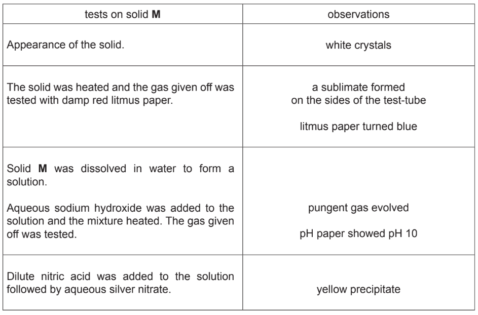
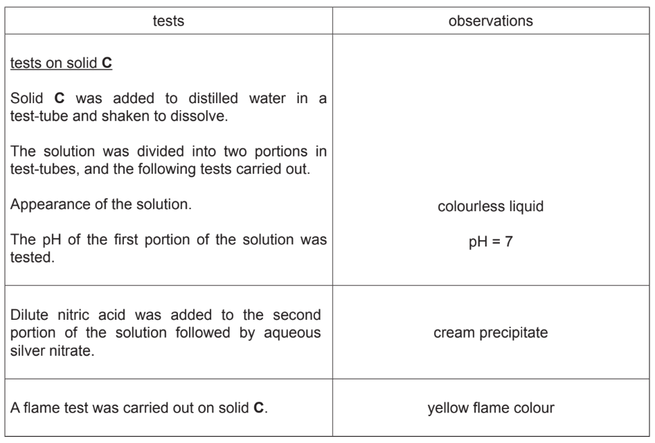
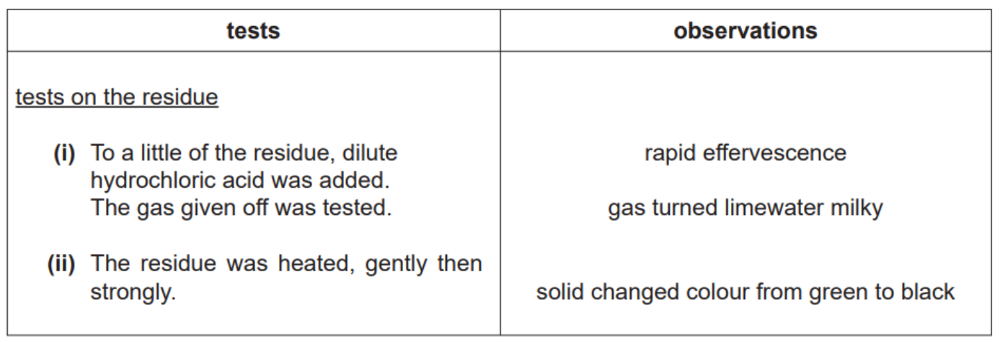
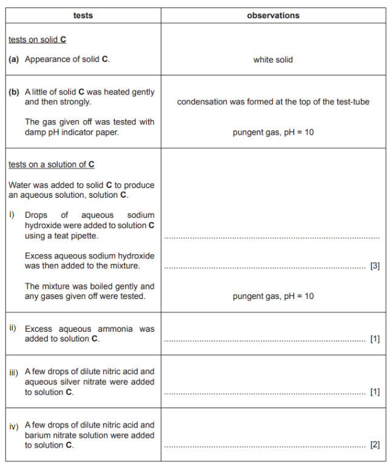
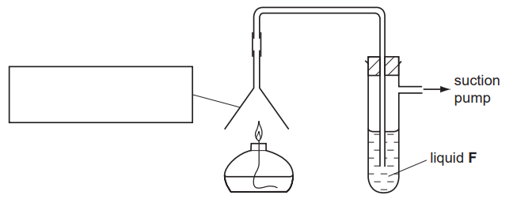
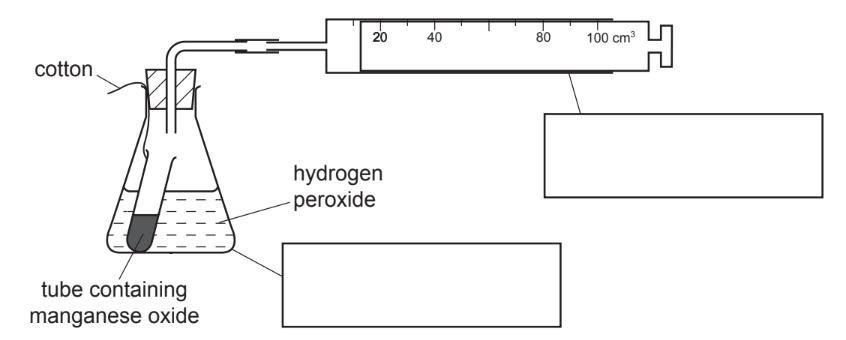
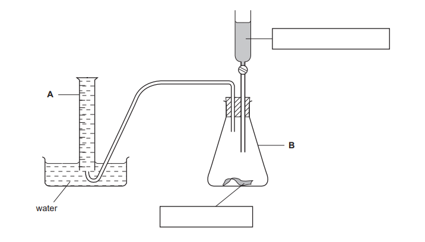
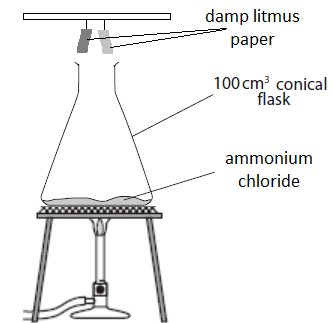

# Exam Questions — Identification of Ions & Gases
**12. Experimental Techniques & Chemical Analysis** · Cambridge (CIE) IGCSE chemistry (0620 & 0971)
> Source: [https://www.savemyexams.com/igcse/chemistry/cie/23/topic-questions/](https://www.savemyexams.com/igcse/chemistry/cie/23/topic-questions/) · 62 questions across 3 sets

## Alternative To Practical Questions (38 questions)

### Q1 — medium — 8 marks

**Q1** [6 marks]

Two different solutions, **X** and **Y**, were analysed. **X** was copper sulfate solution. The tests on the solutions, and some of the observations, are in the following table.

Complete the observations in the table.

| **Tests** | **Observations** |
|---|---|
| **Test 1**  Appearance of solution **X**. | i) ................................................................  [1] |
| **Test 2**  To a little of solution **X**, aqueous sodium hydroxide was added. | ii) ................................................................  [2] |
| **Test 3**  To a little of solution **X**, aqueous ammonia was added drop by drop and shaken. | iii) ................................................................  [1] |
| **Test 4**  Excess aqueous ammonia solution was then added to the test-tube of solution **X** in aqueous ammonia. | iv) ................................................................  [2] |
| **Test 5**  A little of solution **Y** was tested with Universal Indicator paper. The pH was recorded. | pH 1 |
| **Test 6**  To about 3 cm3 of solution **Y** a few drops of dilute hydrochloric acid and then aqueous barium chloride was added. | White precipitate |

*Source: 2010 O61 Q5*

**Q1** [2 marks]

**Extract:**

Two different solutions, **X** and **Y**, were analysed. **X** was copper sulfate solution.

Test 5: A little of solution **Y** was tested with Universal Indicator paper. The pH was recorded. Observation: pH 1

Test 6: To about 3 cm^3^ of solution **Y** a few drops of dilute hydrochloric acid and then aqueous barium chloride was added. Observation: White precipitate

Identify solution **Y**.

*Source: 2010 O61 Q5*

### Q2 — medium — 9 marks

**Q2** [4 marks]

A sample of a solution of acid **A** was analysed.

The tests on **A**, and some of the observations are in the following table.

Complete the observations in the table.

| **tests** | **observations** |
|---|---|
| 1) The pH of the solution was tested using indicator paper | orange,     pH 4 |
| The solution was divided into three test-tubes |   |
| 2) To the first portion was added a piece of magnesium ribbon. The gas was tested with a lighted splint. | i) ..................................................  [2] |
| 3) To the second portion of **A** was added sodium carbonate. The gas was tested with limewater. | ii) ..................................................  [2] |
| 4) To the third portion of liquid **A** was added a spatula measure of solid **B**. The mixture was boiled gently. By using a teat pipette the solution was transferred to another test tube. Excess aqueous ammonia was added. | green solution formed dark blue solution formed |

*Source: 2005 6 Q5*

**Q2** [1 mark]

**Extract:**

1) The pH of the solution was tested using indicator paper — orange, pH 4

What does test 1 tell you about the type of acid in solution **A**?

*Source: 2005 6 Q5*

**Q2** [2 marks]

**Extract:**

A sample of a solution of acid A was analysed. The tests on A: 2) To the first portion was added a piece of magnesium ribbon. The gas was tested with a lighted splint. 3) To the second portion of A was added sodium carbonate. The gas was tested with limewater.

i) Name the gas given off in test 2.

[1]

ii) Name the gas given off in test 3.

[1]

*Source: 2005 6 Q5*

**Q2** [2 marks]

**Extract:**

4) To the third portion of liquid **A** was added a spatula measure of solid **B**. The mixture was boiled gently. By using a teat pipette the solution was transferred to another test tube. Excess aqueous ammonia was added. | green solution formed dark blue solution formed

Explain the observations in test 4.

*Source: 2005 6 Q5*

### Q3 — medium — 12 marks

**Q3** [6 marks]

A solid compound **X** was analysed. Solid **X** was an aluminium salt. The tests on **X** and some of the observations are written below.

**Test 1**

One spatula measure of **X** was placed into a hard-glass test tube. The solid was heated gently then heated strongly. The gas was tested with pH indicator paper.

**Observations:**

Condensation at top of tube, paper went red

Complete the other observations.

**Test 2**

Distilled water was added to** X** and shaken to dissolve. The solution was divided into five portions in test-tubes.

i) To the** first portion**, drops of aqueous sodium hydroxide were added. Excess aqueous sodium hydroxide was then added.

**Observations:** ..........................................................................................................

[3]

ii) To the **second portion,** drops of aqueous ammonia were added. Excess ammonia was then added.

**Observations** ..........................................................................................................

[3]

To the **third portion **of solution, hydrochloric acid and barium chloride solution were added.

**Observations: **No visible change

To the **fourth portion** of solution, nitric acid and lead nitrate solution were added.

**Observations: **No visible change

To the fifth portion, aqueous sodium hydroxide and a spatula measure of aluminium granules were added. The mixture was warmed and the gas tested with indicator paper.

**Observations: **Pungent gas, paper went blue, pH 10

*Source: 2005 6 Q5*

**Q3** [1 mark]

**Extract:**

A solid compound X was analysed. Solid X was an aluminium salt.

Test 1

One spatula measure of X was placed into a hard-glass test tube. The solid was heated gently then heated strongly. The gas was tested with pH indicator paper.

Observations: Condensation at top of tube, paper went red

What does **Test 1 **tell you about the gas given off?

*Source: 2005 6 Q5*

**Q3** [2 marks]

**Extract:**

A solid compound X was analysed. Solid X was an aluminium salt.

To the third portion of solution, hydrochloric acid and barium chloride solution were added. Observations: No visible change

To the fourth portion of solution, nitric acid and lead nitrate solution were added. Observations: No visible change

What conclusions can you draw about **X** from the tests done to the **third **and** fourth portion** of solution in part a).

Third portion: .......................................................................

Fourth portion: ....................................................................

*Source: 2005 6 Q5*

**Q3** [1 mark]

**Extract:**

To the fifth portion, aqueous sodium hydroxide and a spatula measure of aluminium granules were added. The mixture was warmed and the gas tested with indicator paper. Observations: Pungent gas, paper went blue, pH 10

Identify the gas given off in the** fifth portion** in part a)

*Source: 2005 6 Q5*

**Q3** [2 marks]

**Extract:**

A solid compound **X** was analysed. Solid **X** was an aluminium salt.

**Test 1**
One spatula measure of **X** was placed into a hard-glass test tube. The solid was heated gently then heated strongly. The gas was tested with pH indicator paper.
**Observations:** Condensation at top of tube, paper went red

To the fifth portion, aqueous sodium hydroxide and a spatula measure of aluminium granules were added. The mixture was warmed and the gas tested with indicator paper.
**Observations:** Pungent gas, paper went blue, pH 10

What conclusions can you draw about substance** X**?

*Source: 2005 6 Q5*

### Q4 — medium — 12 marks

**Q4** [8 marks]

A mixture of two solids, **M** and** N**, was analysed. Solid **M** was zinc sulfate which is water-soluble and solid **N** was insoluble. The tests on the mixture, and some of the observations, are in the table.

Complete the observations in the table.

| **Tests** | **Observations** |
|---|---|
| Distilled water was added to the mixture in a boiling tube and shaken. The contents of the tube were filtered and the filtrate and residue kept for the following tests. |   |
| The filtrate was divided into four portions. |   |
| **Test 1**  (i) Drops of aqueous sodium hydroxide were added to the first portion of the filtrate. Excess aqueous sodium hydroxide was then added.  (ii) Drops of aqueous ammonia were added to the second portion of the filtrate. Excess aqueous ammonia was then added. |   |
| **Test 2**  About 1 cm3 of dilute nitric acid followed by silver nitrate solution was added to the third portion of the filtrate. |   |
| **Test 3**  About 1 cm3 of dilute nitric acid followed by barium nitrate solution was added to the fourth portion of the filtrate. |   |
| **Test 4**  Tests on the residue  Appearance of the residue. | black solid |
| **Test 5**  Dilute hydrochloric acid was added to a little of the residue. The mixture was heated and the gas given off was tested with damp blue litmus paper. | effervescence  pungent gas, bleached litmus paper |
| **Test 6**  Aqueous hydrogen peroxide was added to a little of the residue.  The gas given off was tested. | effervescence  glowing splint re-lit |

i) State the expected observation in **Test 1** part (i).

[3]

ii) State the expected observation in **Test 1** part (ii).

[2]

iii) State the expected observation in **Test 2**.

[1]

iv) State the expected observation in **Test 3**.

[2]

*Source: 2012 61 Q5*

**Q4** [1 mark]

**Extract:**

**Test 5** Dilute hydrochloric acid was added to a little of the residue. The mixture was heated and the gas given off was tested with damp blue litmus paper. Observation: effervescence, pungent gas, bleached litmus paper.

Identify the gas given off in **Test 5**.

*Source: 2012 61 Q5*

**Q4** [1 mark]

**Extract:**

Test 6: Aqueous hydrogen peroxide was added to a little of the residue. The gas given off was tested. Observations: effervescence, glowing splint re-lit.

Identify the gas given off in **Test 6**.

*Source: 2012 61 Q5*

**Q4** [2 marks]

**Extract:**

A mixture of two solids, M and N, was analysed. Solid M was zinc sulfate which is water-soluble and solid N was insoluble. Test 4 Tests on the residue - Appearance of the residue: black solid. Test 5 Dilute hydrochloric acid was added to a little of the residue. The mixture was heated and the gas given off was tested with damp blue litmus paper: effervescence, pungent gas, bleached litmus paper. Test 6 Aqueous hydrogen peroxide was added to a little of the residue. The gas given off was tested: effervescence, glowing splint re-lit.

What conclusions can you draw about solid **N**?

*Source: 2012 61 Q5*

### Q5 — medium — 9 marks

**Q5** [5 marks]

Three aqueous solutions **K**, **L** and **M**, were analysed. **L** was a solution of sodium hydroxide. The tests on the solutions and some of the observations are in the table.

Complete the observations in the table. Do not write any conclusions in the table.

| **Tests** | **Observations** |
|---|---|
| **Test 1**: Appearance of the solutions.  solution **K** solution **L** solution **M** | colourless liquid colourless liquid colourless liquid |
| **Test 2**: Universal Indicator paper was used to test the pH of each solution.  solution **K** solution **L** solution **M** | pH 10  pH .....  pH 2 |
| **Test 3**: Tests on solution **K**:  (i) Drops of solution **K** were added to copper sulfate solution in a test-tube. Excess of solution **K** was then added to the test-tube.  (ii) Part (i) was repeated using aqueous aluminium sulfate instead of aqueous copper sulfate.  (iii) A few drops of nitric acid and silver nitrate solution were added to solution **K**. | pale blue precipitate formed  deep blue solution formed  white precipitate formed  insoluble in excess  no visible reaction |
| **Test 4**: Tests on solution **L**:  Test 3 part (i) was repeated using solution **L**. |   |
| **Test 5**:  Test 3 part (ii) was repeated using solution **L**. |   |
| **Test 6**: Test on solution **M**: Test 3 part (iii) was repeated using solution **M**. | white precipitate formed |

i) State the pH of solution** L** in **Test 2**.

[1]

ii) State the expected observation in **Test 4**.

[1]

iii) State the expected observation in **Test 5**.

[3]

*Source: 2009 6 Q5*

**Q5** [2 marks]

**Extract:**

Three aqueous solutions **K**, **L** and **M**, were analysed. **L** was a solution of sodium hydroxide. The tests on the solutions and some of the observations are in the table.

Test 1: Appearance of the solutions. solution K colourless liquid.
Test 2: Universal Indicator paper was used to test the pH of each solution. solution K pH 10.
Test 3: Tests on solution K: (i) Drops of solution K were added to copper sulfate solution in a test-tube. Excess of solution K was then added to the test-tube. Observation: pale blue precipitate formed, deep blue solution formed. (ii) Part (i) repeated using aqueous aluminium sulfate: white precipitate formed, insoluble in excess. (iii) A few drops of nitric acid and silver nitrate solution were added to solution K: no visible reaction.

What conclusions can you make about solution **K**?

*Source: 2009 6 Q5*

**Q5** [2 marks]

**Extract:**

Three aqueous solutions **K**, **L** and **M**, were analysed. **L** was a solution of sodium hydroxide.

| **Tests** | **Observations** |
| --- | --- |
| **Test 2**: Universal Indicator paper was used to test the pH of each solution. solution **K** solution **L** solution **M** | pH 10 pH ..... pH 2 |
| **Test 3** (iii): A few drops of nitric acid and silver nitrate solution were added to solution **K**. | no visible reaction |
| **Test 6**: Test on solution **M**: Test 3 part (iii) was repeated using solution **M**. | white precipitate formed |

What conclusions can you make about solution **M**?

*Source: 2009 6 Q5*

### Q6 — medium — 10 marks

**Q6** [1 mark]

Two solids, **L** and **M**, were analysed. Solid **L** was copper(II) chloride and solid **M** was a different salt.

The tests on the solids, and some of the observations, are shown.

Tests on solid **L**

Describe the appearance of solid **L**.

*Source: 2016 62 Q3*

**Q6** [7 marks]

Distilled water was added to solid **L** (copper(II) chloride) and shaken to dissolve. The solution was divided into four equal portions in four test-tubes and the following tests carried out.

Describe the observation for each test.

i)

Drops of aqueous ammonia were added to the first portion of the solution. Excess ammonia solution was then added to the mixture and shaken. Observation:

[4]

ii)

Excess aqueous sodium hydroxide was added to the second portion of the solution. Observation:

[1]

iii)

Dilute nitric acid was added to the third portion of the solution followed by aqueous silver nitrate. Observation:

[1]

iv)

Dilute nitric acid was added to the fourth portion of the solution followed by aqueous barium nitrate. Observation:

[1]

*Source: 2016 62 Q3*

**Q6** [2 marks]

**Extract:**

tests on solid M

Appearance of the solid.
observations
white crystals

The solid was heated and the gas given off was tested with damp red litmus paper.
a sublimate formed on the sides of the test-tube
litmus paper turned blue

Solid M was dissolved in water to form a solution.
Aqueous sodium hydroxide was added to the solution and the mixture heated. The gas given off was tested.
pungent gas evolved
pH paper showed pH 10

Dilute nitric acid was added to the solution followed by aqueous silver nitrate.
yellow precipitate

Tests on solid **M**. Tests are carried out and the following observations made.

Identify solid **M**.

*Source: 2016 62 Q3*

### Q7 — medium — 9 marks

**Q7** [5 marks]

Solid **E** was analysed. **E** was an aluminium salt. The tests on the solid and some of the observations are in the following table.

Complete the observations in the table.

| **Tests** | **Observations** |
|---|---|
| **Test 1**  Appearance of solid **E**. | White crystalline solid |
| **Test 2**  A little of solid **E** was heated in a test-tube. | Colourless drops of liquid formed at the top of the tube |
| **Test 3**  A little of solid **E** was dissolved in distilled water. The solution was divided into four test-tubes and the following tests were carried out.  To the first test-tube of solution, drops of aqueous sodium hydroxide were added. Excess sodium hydroxide was then added to the test-tube. |   |
| **Test 4**  **Test 3 **was repeated using aqueous ammonia solution instead of aqueous sodium hydroxide. |   |
| **Test 5**  To the third test-tube of solution, dilute hydrochloric acid was added, followed by barium chloride solution. | No reaction |
| **Test 6**  To the fourth test-tube of solution, aqueous sodium hydroxide and aluminium powder were added. The mixture was heated. | Effervescence  Pungent gas given off  Turned damp litmus paper blue |

i) State the observations expected in **Test 3**.

[3]

ii) State the observations expected in **Test 4**.

[2]

*Source: 2010 61 Q5*

**Q7** [1 mark]

**Extract:**

Solid **E** was analysed. **E** was an aluminium salt. The tests on the solid and some of the observations are in the following table.

| **Tests** | **Observations** |
| Test 1 Appearance of solid E. | White crystalline solid |
| Test 2 A little of solid E was heated in a test-tube. | Colourless drops of liquid formed at the top of the tube |

What does **Test 2** tell you about solid **E**?

*Source: 2010 61 Q5*

**Q7** [1 mark]

**Extract:**

Test 6: To the fourth test-tube of solution, aqueous sodium hydroxide and aluminium powder were added. The mixture was heated. Observations: Effervescence; Pungent gas given off; Turned damp litmus paper blue.

Identify the gas given off in **Test 6**.

*Source: 2010 61 Q5*

**Q7** [2 marks]

**Extract:**

Solid **E** was analysed. **E** was an aluminium salt. The tests on the solid and some of the observations are in the following table.

| Tests | Observations |
| Test 1 Appearance of solid E. | White crystalline solid |
| Test 2 A little of solid E was heated in a test-tube. | Colourless drops of liquid formed at the top of the tube |
| Test 3 A little of solid E was dissolved in distilled water. The solution was divided into four test-tubes and the following tests were carried out. To the first test-tube of solution, drops of aqueous sodium hydroxide were added. Excess sodium hydroxide was then added to the test-tube. | |
| Test 4 Test 3 was repeated using aqueous ammonia solution instead of aqueous sodium hydroxide. | |
| Test 5 To the third test-tube of solution, dilute hydrochloric acid was added, followed by barium chloride solution. | No reaction |
| Test 6 To the fourth test-tube of solution, aqueous sodium hydroxide and aluminium powder were added. The mixture was heated. | Effervescence  Pungent gas given off  Turned damp litmus paper blue |

What conclusions can you draw about solid **E**?

*Source: 2010 61 Q5*

### Q8 — medium — 6 marks

**Q8** [2 marks]

Three unlabelled bottles of chemicals each contained one of the following liquids:

- sodium nitrate dissolved in water
- pure water
- hexene

Give a test by which you could identify sodium nitrate solution.

Test: ..........................................................................................................

Result: ..........................................................................................................

*Source: 2009 6 Q3*

**Q8** [2 marks]

**Extract:**

Three unlabelled bottles of chemicals each contained one of the following liquids: sodium nitrate dissolved in water, pure water, hexene.

Give a test by which you could identify pure water.

Test: ...................................................................................................... Result: ..................................................................................................

*Source: 2009 6 Q3*

**Q8** [2 marks]

**Extract:**

Three unlabelled bottles of chemicals each contained one of the following liquids:
- sodium nitrate dissolved in water
- pure water
- hexene

Give a test by which you could identify hexene.

Test: ............................................................................................. Result: .........................................................................................

*Source: 2009 6 Q3*

### Q9 — medium — 10 marks

**Q9** [2 marks]

Two substances, C and D, were analysed. Solid C was a salt and solution D was an aqueous solution of chromium(III) chloride.

The tests on solid C, and some of the observations, are in the following table.

Identify solid C.

*Source: 2016 61 Q3*

**Q9** [1 mark]

**Extract:**

Two substances, C and D, were analysed. Solid C was a salt and solution D was an aqueous solution of chromium(III) chloride.

Describe the appearance of solution** D**.

*Source: 2016 61 Q3*

**Q9** [6 marks]

**Extract:**

Two substances, C and D, were analysed. Solid C was a salt and solution D was an aqueous solution of chromium(III) chloride.

Tests were carried out on solution **D**. Complete the observations for tests 1, 2 and 3.

i) **Test 1**

Drops of aqueous sodium hydroxide were added to solution **D**.

Excess aqueous sodium hydroxide was then added to the mixture.

Observations:

[3]

ii) **Test 2**

Excess aqueous ammonia was added to solution **D**.

Observations:

[2]

iii) **Test 3**

Dilute nitric acid was added to solution **D** followed by aqueous silver nitrate.

Observations:

[1]

*Source: 2016 61 Q3*

**Q9** [1 mark]

**Extract:**

Two substances, C and D, were analysed. Solid C was a salt and solution D was an aqueous solution of chromium(III) chloride.

Chromium(III) can be converted to chromium(VI). Chromium(VI) is hazardous.

Suggest one safety precaution when using chromium(VI).

*Source: 2016 61 Q3*

### Q10 — medium — 7 marks

**Q10** [4 marks]

Two liquids, **L** and **M,** were analysed. **L** was aqueous potassium iodide. **M **was a colourless liquid. The tests on the liquids and some of the observations are in the following table.

Complete the observations in the table.

| **Tests** | **Observations** |
|---|---|
| **Test 1** on liquid **L** Appearance of liquid** L** |   |
| **Test 2**  Liquid **L** was divided into three equal portions in separate test-tubes. (i) An iodine crystal was added to the first portion of liquid L. The test-tube was stoppered and the contents shaken. (ii) An equal volume of liquid **M** was added to the test-tube, the contents shaken and left to stand for five minutes. | (i) liquid turned orange  (ii) two layers were formed, pink top layer and orange lower layer |
| **Test 3**  To the second portion of liquid **L**, dilute nitric acid and barium nitrate solution were added. |   |
| **Test 4**  To the third portion of liquid **L**, dilute nitric acid and silver nitrate solution were added. |   |

i) Describe the appearance of liquid **L** in **Test 1**.

[1]

ii) Describe the observation made as a result of **Test 3**.

[1]

iii) Describe the observation made as a result of **Test 4**.

[2]

*Source: 2013 61 Q4*

**Q10** [1 mark]

**Extract:**

Two liquids, L and M, were analysed. L was aqueous potassium iodide. M was a colourless liquid. Test 2: Liquid L was divided into three equal portions in separate test-tubes. (i) An iodine crystal was added to the first portion of liquid L. The test-tube was stoppered and the contents shaken. Observation (i): liquid turned orange.

Why does the colour of liquid **L** change in **Test 2** part (i)?

*Source: 2013 61 Q4*

**Q10** [2 marks]

**Extract:**

Two liquids, L and M, were analysed. L was aqueous potassium iodide. M was a colourless liquid. Test 2: Liquid L was divided into three equal portions in separate test-tubes. (i) An iodine crystal was added to the first portion of liquid L. The test-tube was stoppered and the contents shaken. (ii) An equal volume of liquid M was added to the test-tube, the contents shaken and left to stand for five minutes. Observations: (i) liquid turned orange (ii) two layers were formed, pink top layer and orange lower layer.

What conclusions can you draw about liquid **M** from Test 2 part (ii)?

*Source: 2013 61 Q4*

### Q11 — medium — 11 marks

**Q11** [1 mark]

A mixture of two solids, **E** and **F**, was analysed. Solid **E** was the water-soluble salt aluminium chloride, AlCl3, and solid** F** was an insoluble salt. The tests on the mixture and some of the observations are in the following tables. Complete the observations in the tables.

| **tests** | **observations** |
|---|---|
| Distilled water was added to the mixture in a boiling tube. The contents of the boiling tube were shaken and filtered, keeping the filtrate and residue for the following tests. |   |
| <u>tests on the filtrate</u>  The filtrate was divided into five portions in five test-tubes.  The first portion was used to describe the appearance of the filtrate | appearance ........................................ |

*Source: 2013 Ju61 Q4*

**Q11** [3 marks]

**Extract:**

A mixture of two solids, E and F, was analysed. Solid E was the water-soluble salt aluminium chloride, AlCl3, and solid F was an insoluble salt. The tests on the mixture and some of the observations are in the following tables.
Distilled water was added to the mixture in a boiling tube. The contents of the boiling tube were shaken and filtered, keeping the filtrate and residue for the following tests.
tests on the filtrate: The filtrate was divided into five portions in five test-tubes.

| **tests** | **observations** |
|---|---|
| Several drops of aqueous sodium hydroxide were added to the second portion of the solution. Excess aqueous sodium hydroxide was then added to the test-tube. |   |

*Source: 2013 Ju61 Q4*

**Q11** [2 marks]

**Extract:**

A mixture of two solids, E and F, was analysed. Solid E was the water-soluble salt aluminium chloride, AlCl3, and solid F was an insoluble salt. The tests on the mixture and some of the observations are in the following tables. Complete the observations in the tables.

Distilled water was added to the mixture in a boiling tube. The contents of the boiling tube were shaken and filtered, keeping the filtrate and residue for the following tests.

tests on the filtrate: The filtrate was divided into five portions in five test-tubes.

| **tests** | **observations** |
|---|---|
| Aqueous ammonia was added to the third portion, dropwise and then in excess. |   |

*Source: 2013 Ju61 Q4*

**Q11** [2 marks]

**Extract:**

A mixture of two solids, E and F, was analysed. Solid E was the water-soluble salt aluminium chloride, AlCl3, and solid F was an insoluble salt. The tests on the mixture and some of the observations are in the following tables. Distilled water was added to the mixture in a boiling tube. The contents of the boiling tube were shaken and filtered, keeping the filtrate and residue for the following tests. tests on the filtrate: The filtrate was divided into five portions in five test-tubes.

| **tests** | **observations** |
|---|---|
| To the fourth portion of the solution, dilute nitric acid and aqueous silver nitrate were added. |   |

*Source: 2013 Ju61 Q4*

**Q11** [1 mark]

**Extract:**

A mixture of two solids, E and F, was analysed. Solid E was the water-soluble salt aluminium chloride, AlCl3, and solid F was an insoluble salt. The tests on the mixture and some of the observations are in the following tables. Distilled water was added to the mixture in a boiling tube. The contents of the boiling tube were shaken and filtered, keeping the filtrate and residue for the following tests. tests on the filtrate: The filtrate was divided into five portions in five test-tubes.

| **tests** | **observations** |
|---|---|
| To the fifth portion of the solution, about 1 cm3 of dilute nitric acid and barium nitrate solution were added. |   |

*Source: 2013 Ju61 Q4*

**Q11** [2 marks]

**Extract:**

A mixture of two solids, E and F, was analysed. Solid E was the water-soluble salt aluminium chloride, AlCl3, and solid F was an insoluble salt. The tests on the mixture and some of the observations are in the following tables.

What conclusions can you draw about solid **F**?

*Source: 2013 Ju61 Q4*

### Q12 — medium — 8 marks

**Q12** [3 marks]

A solid **D**, which is a soluble metal sulfate, was analysed. The tests on **D**, and some of the observations, are in the following table.

Complete the observations in the table.

| **Tests** | **Observations** |
|---|---|
| **Test 1** on solid **D**  (i) Appearance of solid **D**. (ii) Solid **D** was heated in a test-tube gently and then strongly. | (i) Pale green crystals  (ii) Condensation formed at the top of the test-tube |
| **Test 2** on the aqueous solution  Solid **D** was added to distilled water and shaken to dissolve. The solution was divided into four equal portions in separate test-tubes. (i) Several drops of aqueous sodium hydroxide were added to the first portion of the solution. (ii) Excess aqueous sodium hydroxide was added to the mixture. (ii) Excess aqueous ammonia was added to the second portion of the solution. | (i) Green precipitate  (ii) Green precipitate remained  (iii) Green precipitate |
| **Test 3**  Aqueous silver nitrate and dilute nitric acid were added to the third portion of the solution. |   |
| **Test 4**  Aqueous barium nitrate and dilute nitric acid were added to the fourth portion of the solution. |   |

i) State the expected observation for **Test 3**.

[1]

ii) State the expected observation for **Test 4**.

[2]

*Source: 2014 61 Q5*

**Q12** [2 marks]

**Extract:**

A solid **D**, which is a soluble metal sulfate, was analysed. **Test 1** on solid **D**: (i) Appearance of solid **D** - Pale green crystals. (ii) Solid **D** was heated in a test-tube gently and then strongly - Condensation formed at the top of the test-tube.

What does **Test 1** tell you about solid **D?**

*Source: 2014 61 Q5*

**Q12** [3 marks]

**Extract:**

A solid **D**, which is a soluble metal sulfate, was analysed. The tests on **D**, and some of the observations, are in the following table.

| **Tests** | **Observations** |
| Test 1 on solid D (i) Appearance of solid D. (ii) Solid D was heated in a test-tube gently and then strongly. | (i) Pale green crystals (ii) Condensation formed at the top of the test-tube |
| Test 2 on the aqueous solution: Solid D was added to distilled water and shaken to dissolve. (i) Several drops of aqueous sodium hydroxide were added to the first portion. (ii) Excess aqueous sodium hydroxide was added. (iii) Excess aqueous ammonia was added to the second portion. | (i) Green precipitate (ii) Green precipitate remained (iii) Green precipitate |

What conclusions can you draw about the identity of solid **D**?

*Source: 2014 61 Q5*

### Q13 — medium — 11 marks

**Q13** [8 marks]

Salt** E**, which is ammonium chloride was tested.

Record all observations in the table.

| tests | observations |
|---|---|
| i)  Describe the appearance of **E** | ................................................................................  [2] |
| Using a spatula salt **E** was placed in a hard glass test-tube.  Inside the top of the tube was suspended a piece of damp   blue litmus paper next to a piece of damp red litmus paper.   **E **was heated gently until gas came out of the tube. | Red litmus went blue then blue litmus went red |
| **E **was dissolved in water to make an aqueous solution. The   solution was divided into three test-tubes:  ii)  To the first portion, was added a few drops of dilute nitric acid and about 1 cm3 of aqueous silver nitrate.  iii)  To the second portion of solution **E**, was added about 1 cm3 of lead nitrate solution.  iv)  To the third portion of solution **E**, was added about 1 cm3 of aqueous sodium hydroxide. The mixture was boiled gently and the gas given off was tested with indicator paper | ................................................................................  [2]  ................................................................................  [2]  ................................................................................  [2] |

*Source: 2004 6 Q5*

**Q13** [1 mark]

**Extract:**

Salt E, which is ammonium chloride was tested. iv)To the third portion of solution E, was added about 1 cm^3 of aqueous sodium hydroxide. The mixture was boiled gently and the gas given off was tested with indicator paper

Name the gas given off in test a) iv).

*Source: 2004 6 Q5*

**Q13** [2 marks]

**Extract:**

Salt E, which is ammonium chloride was tested. Using a spatula salt E was placed in a hard glass test-tube. Inside the top of the tube was suspended a piece of damp blue litmus paper next to a piece of damp red litmus paper. E was heated gently until gas came out of the tube. Observation: Red litmus went blue then blue litmus went red

Explain the litmus observations.

*Source: 2003 6 Q5*

### Q14 — medium — 11 marks

**Q14** [7 marks]

Solid **C** was analysed. Solid **C** was a mixture of salts containing aluminium ions, sulfate ions and another cation (positive ion). Tests on solid **C**, and some of the observations, are in the table.

Complete the observations in the table.

*Source: 2015 61 Q5*

**Q14** [1 mark]

**Extract:**

Solid **C** was analysed. Solid **C** was a mixture of salts containing aluminium ions, sulfate ions and another cation (positive ion). Tests on solid **C**, and some of the observations, are in the table.

What does the formation of condensation in test (b) tell you about the nature of solid **C**?

*Source: 2015 61 Q5*

**Q14** [1 mark]

**Extract:**

Solid **C** was analysed. Solid **C** was a mixture of salts containing aluminium ions, sulfate ions and another cation (positive ion). Tests on solid **C**, and some of the observations, are in the table.

iii) Observations when a few drops of dilute nitric acid and aqueous silver nitrate are added to solution **C** are:
- No reaction / no change / no precipitate / colourless solution;

What does test (iii) tell you about the nature of solid **C**?

*Source: 2015 61 Q5*

**Q14** [2 marks]

**Extract:**

Solid C was analysed. Solid C was a mixture of salts containing aluminium ions, sulfate ions and another cation (positive ion). Tests on solid C, and some of the observations, are in the table.
What does the formation of condensation in test (b) tell you about the nature of solid C?

i) Name the gas given off in test (b).

[1]

ii) What is your conclusion about the identity of the other cation in solid **C**?

[1]

*Source: 2015 61 Q5*

### Q15 — medium — 7 marks

**Q15** [4 marks]

Two different solids, **T** and **V**, were analysed. **T** was a calcium salt.

The tests on the solids and some of the observations are in the following table.

Complete the observations in the table.

| **tests** | **observations** |
|---|---|
| <u>tests on solid </u><u>**T **</u> <u> </u>Appearance of solid **T**. | white solid |
| A little of solid **T** was dissolved in distilled water. The solution was divided into three test-tubes.  i) The pH of the first portion of the solution was tested.  ii) To the second portion of solution was added excess aqueous sodium hydroxide.  iii) To the third portion of solution was added excess ammonia solution. | Orange     pH 5  ..................................................      ..................................................  [2]  ..................................................      ..................................................  [2] |

*Source: 2008 6 Q5*

**Q15** [2 marks]

**Extract:**

tests on solid T. Appearance of solid T: white solid. A little of solid T was dissolved in distilled water. The solution was divided into three test-tubes. i) The pH of the first portion of the solution was tested. Observation: Orange, pH 5

| **tests** | **observations** |
|---|---|
| <u>tests on solid </u><u>**V **</u> <u> </u>Appearance of solid **V**. | green crystals |
| A little of solid **V** was dissolved in distilled water. The solution was divided into three test-tubes. The smell of the solution was noted  i) The pH of the first portion of the solution was tested.  ii) To the second portion of solution was added excess aqueous sodium hydroxide.  iii) To the third portion of solution was added excess ammonia solution. | smells of vinegar  Orange     pH 6  pale blue precipitate  pale blue precipitate soluble in      excess to form a dark blue solution |

What do tests (i) tell you about solutions **T** and **V**?

*Source: 2008 6 Q5*

**Q15** [1 mark]

**Extract:**

tests on solid V - Appearance of solid V: green crystals. A little of solid V was dissolved in distilled water. The solution was divided into three test-tubes. The smell of the solution was noted. i) The pH of the first portion of the solution was tested. ii) To the second portion of solution was added excess aqueous sodium hydroxide. iii) To the third portion of solution was added excess ammonia solution. Observations: smells of vinegar; Orange pH 6; pale blue precipitate; pale blue precipitate soluble in excess to form a dark blue solution

What additional conclusions can you draw about solid **V**?

*Source: 2008 6 Q5*

### Q16 — medium — 12 marks

**Q16** [7 marks]

Three different liquids **P**, **Q** and **R** were analysed. **Q** was an aqueous solution of sodium hydroxide.

The tests on the liquids and some of the observations are shown in the following table.

Complete the observations in the table.

| **tests** | **observations** |
|---|---|
| 1. Test the pH of the liquids using indicator paper. Note the colour of the paper. | **   P** = red     pH 1  i)** Q** = ..........     pH ..........     [2]  **   R** = orange     pH 5 |
| 2. Add a 5 cm piece of magnesium to about 3cm3 of liquid **P** in a test–tube. Test the gas given off. | bubbles of gas given off lighted splint pops |
| 3. Repeat test 2 using liquids **Q** and **R**. Do not test for any gases. | ii)** Q** .................................................  **    R **..................................................  [2] |
| 4. To about 2cm3 of liquid, **P** add 1 spatula measure of sodium carbonate.  Test the gas given off. | iii) ............................................  ..................................................  ..................................................  [3] |
| 5. By using a teat pipette add aqueous silver nitrate to about 1 cm3 of liquid **P**. | white precipitate |
| 6. By using a teat pipette add liquid **Q** to about 1 cm3 of aqueous iron(II) sulfate. | green precipitate |

*Source: 2007 6 Q5*

**Q16** [1 mark]

**Extract:**

2. Add a 5 cm piece of magnesium to about 3cm^3^ of liquid P in a test–tube. Test the gas given off. | bubbles of gas given off lighted splint pops

Name the gas given off in test 2.

*Source: 2007 6 Q5*

**Q16** [1 mark]

**Extract:**

4. To about 2cm^3 of liquid, P add 1 spatula measure of sodium carbonate. Test the gas given off. Liquid P had pH 1 (acidic). P is an acid as its pH is 1, so will react with a carbonate to form a salt, water and carbon dioxide.

Name the gas given off in test 4.

*Source: 2007 6 Q5*

**Q16** [1 mark]

**Extract:**

Three different liquids P, Q and R were analysed. Q was an aqueous solution of sodium hydroxide. The tests on the liquids and some of the observations are shown in the following table.

| tests | observations |
| 1. Test the pH of the liquids using indicator paper. | P = red pH 1; Q = blue/purple pH 11-14; R = orange pH 5 |
| 5. By using a teat pipette add aqueous silver nitrate to about 1 cm^3 of liquid P. | white precipitate |

Identify liquid **P**.

*Source: 2007 6 Q5*

**Q16** [2 marks]

**Extract:**

Three different liquids P, Q and R were analysed. Q was an aqueous solution of sodium hydroxide. Test 1: Test the pH of the liquids using indicator paper. P = red pH 1, R = orange pH 5. Test 2: Add a 5 cm piece of magnesium to about 3cm^3 of liquid P in a test-tube. Test 3: Repeat test 2 using liquids Q and R. R = Bubbles / fizz.

What conclusions can you draw about liquid **R**?

*Source: 2007 6 Q5*

### Q17 — medium — 7 marks

**Q17** [1 mark]

A student investigated the products formed when ethanol was burned using the apparatus shown.

Complete the box to identify the piece of apparatus.

*Source: 2013 61 Q1*

**Q17** [1 mark]

**Extract:**

A student investigated the products formed when ethanol was burned using the apparatus shown.

Why is a suction pump used?

*Source: 2013 61 Q1*

**Q17** [3 marks]

**Extract:**

A student investigated the products formed when ethanol was burned using the apparatus shown.

i) Suggest the purpose and identity of liquid **F**.

identity ..........................................................................................................

purpose ..........................................................................................................

[2]

ii) Why is the end of the delivery tube below the surface of liquid **F**?

[1]

*Source: 2013 61 Q1*

**Q17** [2 marks]

**Extract:**

A student investigated the products formed when ethanol was burned using the apparatus shown.

Give **one **expected observation in the horizontal part of the delivery tube.

Explain your answer.

*Source: 2013 61 Q1*

### Q18 — medium — 6 marks

**Q18** [2 marks]

Describe a chemical test to distinguish between each of the following pairs of substances. An example is given potassium chloride and potassium iodide

test: add aqueous lead(II) nitrate result: potassium chloride gives a white precipitate, potassium iodide gives a yellow precipitate

water and ethanol test ..........................................................................................................

result with water ..........................................................................................................

result with ethanol  .........................................................................................................

*Source: 2004 6 Q7*

**Q18** [2 marks]

**Extract:**

Describe a chemical test to distinguish between each of the following pairs of substances. An example is given potassium chloride and potassium iodide

test: add aqueous lead(II) nitrate result: potassium chloride gives a white precipitate, potassium iodide gives a yellow precipitate

sulphuric acid and aqueous sodium sulphate

test ..........................................................................................................

result with sulphuric acid ..........................................................................................................

result with aqueous sodium sulphate  .........................................................................................................

*Source: 2004 6 Q7*

**Q18** [2 marks]

**Extract:**

Describe a chemical test to distinguish between each of the following pairs of substances. An example is given potassium chloride and potassium iodide

test: add aqueous lead(II) nitrate result: potassium chloride gives a white precipitate, potassium iodide gives a yellow precipitate

hydrochloric acid and nitric acid

test

..........................................................................................................result with hydrochloric acid

..........................................................................................................

result with nitric acid

..........................................................................................................

*Source: 2004 6 Q7*

### Q19 — medium — 5 marks

**Q19** [2 marks]

The apparatus below was used to make oxygen. The tube of manganese oxide was added to the hydrogen peroxide solution by releasing the cotton.

Complete the boxes to identify the pieces of apparatus.

*Source: 2009 6 Q1*

**Q19** [1 mark]

**Extract:**

The apparatus below was used to make oxygen. The tube of manganese oxide was added to the hydrogen peroxide solution by releasing the cotton.

Why was the tube of manganese oxide suspended in the flask?

*Source: 2009 6 Q1*

**Q19** [2 marks]

Give a test for oxygen. Test: ................................................................................. Result: .............................................................................

*Source: 2009 6 Q1*

### Q20 — medium — 11 marks

**Q20** [6 marks]

A mixture of two compounds, **B** and **C**, was tested.

Compound **B** was a water-soluble zinc salt and compound **C** was insoluble.

The tests and some of the observations are in the following table.

Complete the observations in the table.

| **tests** | **observations** |
|---|---|
| 1. One measure of the mixture was heated gently then heated strongly. The gas released was tested with cobalt chloride paper. | condensation at the top of the tube paper turned pink |

The rest of the mixture was added to about 25 cm3 of distilled water in a boiling tube. The contents of the tube were shaken and filtered. The following tests were carried out.

| **tests** | **observations** |
|---|---|
| **Tests on the filtrate** The solution was divided into 2 cm3 portions in four test-tubes. |   |
| 2. Drops of aqueous sodium hydroxide were added to the first portion of the solution. Excess aqueous sodium hydroxide was added. | i) ..............................................  ..................................................  ..................................................  [3] |
| 3. Using the second portion test 2 was repeated using aqueous ammonia instead of aqueous sodium hydroxide. | ii)...............................................  ..................................................  ..................................................  [3] |
| 4. To the third portion of sothe lution was added hydrochloric acid and barium nitrate solution. | white precipitate |
| 5. To the fourth portion of sothe lution was added nitric acid and silver nitrate solution. | no visible reaction |
| **Tests on the residue** |   |
| 6. Some of the residue was placed into a test-tube. Dilute hydrochloric acid was added and the gas given off was tested with limewater. | rapid effervescence  limewater turned milky |

*Source: 2006 6 Q5*

**Q20** [1 mark]

**Extract:**

1. One measure of the mixture was heated gently then heated strongly. The gas released was tested with cobalt chloride paper. | condensation at the top of the tube paper turned pink

What does test 1 indicate?

*Source: 2006 6 Q5*

**Q20** [2 marks]

**Extract:**

A mixture of two compounds, B and C, was tested. Compound B was a water-soluble zinc salt and compound C was insoluble.

Tests on the filtrate: The solution was divided into 2 cm^3 portions in four test-tubes.
4. To the third portion of the solution was added hydrochloric acid and barium nitrate solution. Observation: white precipitate
5. To the fourth portion of the solution was added nitric acid and silver nitrate solution. Observation: no visible reaction

What conclusions can you draw about compound **B**?

*Source: 2006 6 Q5*

**Q20** [2 marks]

**Extract:**

6. Some of the residue was placed into a test-tube. Dilute hydrochloric acid was added and the gas given off was tested with limewater. | rapid effervescence limewater turned milky

What does test 6 indicate?

*Source: 2006 6 Q5*

### Q21 — medium — 11 marks

**Q21** [7 marks]

Two solids, **S **and **V**, were analysed. **S** was copper(II) oxide. The tests on the solids, and some of the observations are in the following table.

Complete the observations in the table. Do not write any conclusions in the table.

| **Tests** | **Observations** |
|---|---|
| Appearance of solid **S** | Black solid |
| Hydrogen peroxide was added to solid **S** in a test tube, and a glowing splint then inserted into the tube. | Slow effervescence, splint relit |
| Dilute sulfuric acid was added to solid **S** in a test-tube. The mixture was heated to boiling point. | Blue solution formed |
| The solution was divided into three equal portions into test-tubes.  To the first portion of the solution, excess sodium hydroxide was added. | i) .....................................................  [1] |
| To the second portion of the solution, about 1 cm3 of aqueous ammonia solution was added. | ii) .....................................................  [2] |
| Excess ammonia solution was then added to the second portion. | iii) .....................................................  [2] |
| To the third portion of the solution, dilute hydrochloric acid was added followed by barium chloride solution. | iv) .....................................................  [2] |

*Source: 2009 61 Q5*

**Q21** [2 marks]

**Extract:**

Two solids, S and V, were analysed. S was copper(II) oxide.
Hydrogen peroxide was added to solid S in a test tube, and a glowing splint then inserted into the tube. Observation: Slow effervescence, splint relit.

The results from tests on the solid **V** are shown below.

| **Tests** | **Observations** |
|---|---|
| **Test 1**  Appearance of solid | Black solid |
| **Test 2**  Hydrogen peroxide was added to solid V in a test-tube. A glowing splint was inserted into the tube. | Rapid effervescence, splint relit |

i) Compare the reactivity of solid **S** and solid **V** with hydrogen peroxide.

[1]

ii) Identify the gas given off in **Test 2**.

[1]

*Source: 2009 61 Q5*

**Q21** [2 marks]

**Extract:**

The results from tests on the solid V are shown below.

Test 1 Appearance of solid: Black solid
Test 2 Hydrogen peroxide was added to solid V in a test-tube. A glowing splint was inserted into the tube: Rapid effervescence, splint relit

i) Compare the reactivity of solid S and solid V with hydrogen peroxide. - V is more reactive.
ii) The gas given off in Test 2 is Oxygen.

What conclusions can you draw about solid **V**?

*Source: 2009 61 Q5*

### Q22 — medium — 15 marks

**Q22** [6 marks]

A mixture of two solid compounds **D** and **E** was analysed. Solid **D** was a zinc salt which is soluble in water. Solid** E** was an insoluble metal carbonate. The tests on the mixture and some of the observations are in the following table.

**Test 1: **About half of the mixture of** D** and **E** was placed in a test-tube. The mixture was heated.

**Observations:  **Green to black, condensation formed

The rest of the mixture of **D** and **E** was added to distilled water in a boiling tube. The contents of the tube were filtered. The filtrate and the residue were kept for the following tests.

Complete observations for the following tests that were carried out on the residue

i) **Test 1: **The residue was transferred from the filter paper in to a test-tube. About 3 cm3 of dilute sulphuric acid was added. The gas was tested with limewater.

**Observations:** ..........................................................................................................

[2]

ii) **Test 2: **The solution obtained in (c) was divided into two equal portions.

The first portion was added excess aqueous sodium hydroxide, a little at a time.

**Observations:** pale blue precipitate

To the second portion was added excess aqueous ammonia, a little at a time.

**Observations:**  ..........................................................................................................

[4]

*Source: 2003 6 Q4*

**Q22** [6 marks]

**Extract:**

A mixture of two solid compounds D and E was analysed. Solid D was a zinc salt which is soluble in water. Solid E was an insoluble metal carbonate.
The rest of the mixture of D and E was added to distilled water in a boiling tube. The contents of the tube were filtered. The filtrate and the residue were kept for the following tests.

Three tests were carried out on the filtrate.

Complete the observations for each test.

The filtrate from (a) was divided into three approximately equal portions.

i) **Test 1:** To the first portion were added drops of aqueous sodium hydroxide, a little at a time with shaking.

**Observations**: ..........................................................................................................

[2]

Excess aqueous sodium hydroxide was added.

**Observations**:..................................................................................

[1]

ii) **Test 2**: To the second portion was added excess aqueous ammonia a little at a time.

**Observations**: ..........................................................................................................

[3]

**Test 3 : **To the third portion were added drops of dilute hydrochloric acid and aqueous barium chloride.

**Observations**: white precipitate

*Source: 2003 6 Q4*

**Q22** [2 marks]

**Extract:**

A mixture of two solid compounds D and E was analysed. Solid D was a zinc salt which is soluble in water. Solid E was an insoluble metal carbonate.
Test 1: About half of the mixture of D and E was placed in a test-tube. The mixture was heated. Observations: Green to black, condensation formed
Test 3: To the third portion were added drops of dilute hydrochloric acid and aqueous barium chloride. Observations: white precipitate

What conclusions can you draw about the identity of solid **D**?

*Source: 2003 6 Q4*

**Q22** [1 mark]

**Extract:**

A mixture of two solid compounds D and E was analysed. Solid D was a zinc salt which is soluble in water. Solid E was an insoluble metal carbonate.

Test 2: The solution obtained was divided into two equal portions. The first portion was added excess aqueous sodium hydroxide, a little at a time. Observations: pale blue precipitate

What conclusion can you draw about the identity of the cation in solid **E**?

*Source: 2003 6 Q4*

### Q23 — medium — 7 marks

**Q23** [3 marks]

A solid **U** was analysed. **U** was a soluble metal sulfate. The tests on **U**, and some of the observations are in the following table.

Complete the observations.

| **Tests** | **Observations** |
|---|---|
| **Test 1**: Appearance of solid **U**. | Pink crystals |
| **Test 2**: Solid U was heated gently and then strongly in a test-tube. | condensation droplets formed on the sides of the test-tube |
| Solid **U** was added to distilled water in a test-tube and shaken until dissolved. |   |
| **Test 3 part (i)**: The solution was divided into three equal portions in separate test-tubes and the following tests carried out. Several drops of aqueous sodium hydroxide were added to the first portion of the solution and the test-tube shaken. | pale brown precipitate |
| **Test 3 part(ii)**: Then hydrogen peroxide solution was added to the mixture and the gas given off was tested. | effervescence glowing splint re-lit |
| **Test 4**: Dilute nitric acid was added to the second portion of the solution followed by barium nitrate solution. |   |
| **Test 5**: Dilute nitric acid was added to the third portion of the solution followed by silver nitrate solution. |   |

i) State the expected observations for **Test 4**.

[2]

ii) State the expected observations for **Test 5**.

[1]

*Source: 2014 61 Q5*

**Q23** [1 mark]

**Extract:**

A solid U was analysed. U was a soluble metal sulfate. The tests on U... Test 5: Dilute nitric acid was added to the third portion of the solution followed by silver nitrate solution.
The observations for Test 5 are: No reaction / no change / no precipitate.

What does **Test 5** tell you about solid **U**?

*Source: 2014 61 Q5*

**Q23** [1 mark]

**Extract:**

A solid **U** was analysed. **U** was a soluble metal sulfate.
**Test 3 part (i)**: The solution was divided into three equal portions in separate test-tubes and the following tests carried out. Several drops of aqueous sodium hydroxide were added to the first portion of the solution and the test-tube shaken. | pale brown precipitate
**Test 3 part(ii)**: Then hydrogen peroxide solution was added to the mixture and the gas given off was tested. | effervescence glowing splint re-lit

Name the gas given off in **Test 3**.

*Source: 2014 61 Q5*

**Q23** [2 marks]

**Extract:**

A solid **U** was analysed. **U** was a soluble metal sulfate. The tests on **U**, and some of the observations are in the following table.

| Tests | Observations |
| Test 1: Appearance of solid U. | Pink crystals |
| Test 2: Solid U was heated gently and then strongly in a test-tube. | condensation droplets formed on the sides of the test-tube |
| Solid U was added to distilled water in a test-tube and shaken until dissolved. |
| Test 3 part (i): Several drops of aqueous sodium hydroxide were added to the first portion of the solution and the test-tube shaken. | pale brown precipitate |
| Test 3 part(ii): Then hydrogen peroxide solution was added to the mixture and the gas given off was tested. | effervescence glowing splint re-lit |

What conclusions can you draw about solid **U**?

*Source: 2014 61 Q5*

### Q24 — medium — 8 marks

**Q24** [4 marks]

A mixture of two calcium compounds** C **and **D** was tested. **C** is partially soluble in water and** D** is soluble in water

The mixture of **C** and** D** was added to distilled water in a boiling tube. The tube was shaken. The mixture was filtered.

The filtrate was divided into five equal portions.

Complete the observations for the identified tests.

i) To the **first portion** was added drops of aqueous sodium hydroxide, a little at a time, with shaking. Excess aqueous sodium hydroxide was added.

**Observations: **..........................................................................................................

[3]

ii) To the **second portion** was added excess aqueous ammonia, a little at a time.

**Observations: **..........................................................................................................

[1]

To the **third portion** was added dilute sodium hydroxide and aluminium powder. The mixture was boiled and the gas tested with damp litmus paper.

**Observations: **red litmus went blue

The pH of the **fourth portion** was tested with indicator paper.

**Observations: **pH about 10

Carbon dioxide was bubbled through the** fifth portion**

**Observations: **solution turned milky / cloudy

*Source: 2004 6 Q5*

**Q24** [1 mark]

**Extract:**

To the **third portion** was added dilute sodium hydroxide and aluminium powder. The mixture was boiled and the gas tested with damp litmus paper.

**Observations: **red litmus went blue

Name the gas given off in the test on the** third portion.**

*Source: 2004 6 Q5*

**Q24** [1 mark]

**Extract:**

Carbon dioxide was bubbled through the fifth portion

Observations: solution turned milky / cloudy

Suggest an explanation for the observation during the test to the** fifth portion.**

*Source: 2004 6 Q5*

**Q24** [2 marks]

**Extract:**

A mixture of two calcium compounds C and D was tested. C is partially soluble in water and D is soluble in water. The mixture of C and D was added to distilled water in a boiling tube. The tube was shaken. The mixture was filtered. The filtrate was divided into five equal portions.

To the third portion was added dilute sodium hydroxide and aluminium powder. The mixture was boiled and the gas tested with damp litmus paper. Observations: red litmus went blue.

The pH of the fourth portion was tested with indicator paper. Observations: pH about 10.

What conclusions can you draw about the identity of the anions in solids **C** and **D**?

*Source: 2004 6 Q5*

### Q25 — medium — 8 marks

**Q25** [2 marks]

Describe a chemical test to distinguish between each of the following pairs of substances. An example is given.

*Example: hydrogen and carbon dioxide* 
Test: lighted splint 
Result with hydrogen: gives a pop 
Result with carbon dioxide: splint is extinguished

Describe a test to distinguish between zinc carbonate and zinc chloride

Test: ..........................................................................................................

Result with zinc carbonate: .....................................................................

Result with zinc chloride: ..........................................................................

*Source: 2009 61 Q3*

**Q25** [3 marks]

**Extract:**

Describe a chemical test to distinguish between each of the following pairs of substances. An example is given.

*Example: hydrogen and carbon dioxide*

Test: lighted splint

Result with hydrogen: gives a pop

Result with carbon dioxide: splint is extinguished

Describe a test to distinguish between ammonia and chlorine:

Test: ..........................................................................................................

Result with ammonia: ...................................................................................................... Result with chlorine: .........................................................................................................

*Source: 2009 61 Q3*

**Q25** [3 marks]

Describe a test to distinguish between aqueous iron(II) sulfate and aqueous iron(III) sulfate.

Test: ..........................................................................................................

Result with aqueous iron(II) sulfate: ............................................................................

Result with aqueous iron(III) sulfate: ...........................................................................

*Source: 2009 61 Q3*

### Q26 — medium — 6 marks

**Q26** [2 marks]

Describe a chemical test to distinguish between each of the following pairs of substances.

An example is given.

*oxygen and carbon dioxide* *   *
*test: glowing splint* *   *
*result: re-lights in oxygen, no effect with carbon dioxide *

aqueous chlorine and aqueous sodium chloride test .................................................................................................. result with chlorine ......................................................................................................... result with sodium chloride ..........................................................................................................

*Source: 2004 6 Q6*

**Q26** [2 marks]

**Extract:**

Describe a chemical test to distinguish between each of the following pairs of substances. An example is given. oxygen and carbon dioxide test: glowing splint result: re-lights in oxygen, no effect with carbon dioxide

aqueous iron(II) chloride and aqueous iron(III) chloride

test
 ..................................................................................................

result with iron(II) chloride ..........................................................................................................

result with iron(III) chloride ..........................................................................................................

*Source: 2004 6 Q6*

**Q26** [2 marks]

**Extract:**

Describe a chemical test to distinguish between each of the following pairs of substances. An example is given. oxygen and carbon dioxide test: glowing splint result: re-lights in oxygen, no effect with carbon dioxide

copper sulphate and copper carbonate test ............................................................. result with copper sulphate ........................................................................ result with copper carbonate .....................................................................

*Source: 2004 6 Q6*

### Q27 — medium — 8 marks

**Q27** [1 mark]

Two metal salt solutions, **X** and **Y**, were analysed. Solution **X** was iron(II) chloride. The tests on **X** and **Y**, and some of the observations, are given in the following tables. Complete the observations in the tables.

| **test** | **observations** |
|---|---|
| <u>tests on solution </u><u>**X**</u>  Appearance of solution **X** | ............................................................................ |

*Source: 2015 O61 Q5*

**Q27** [1 mark]

**Extract:**

Two metal salt solutions, X and Y, were analysed. Solution X was iron(II) chloride. The tests on X and Y, and some of the observations, are given in the following tables.

The solution was divided into four equal portions.

| **tests** | **observations** |
|---|---|
| Dilute nitric acid and aqueous silver nitrate were added to the first portion of solution | ............................................................................ |

*Source: 2015 O61 Q5*

**Q27** [2 marks]

**Extract:**

Two metal salt solutions, X and Y, were analysed. Solution X was iron(II) chloride. The tests on X and Y, and some of the observations, are given in the following tables.
The solution was divided into four equal portions.

| **tests** | **observations** |
|---|---|
| Aqueous sodium hydroxide was added to the second portion of solution and the mixture shaken | ............................................................................ |

*Source: 2015 O61 Q5*

**Q27** [1 mark]

**Extract:**

Two metal salt solutions, X and Y, were analysed. Solution X was iron(II) chloride.
The solution was divided into four equal portions.

| **tests** | **observations** |
|---|---|
| Excess aqueous ammonia was added to the third portion of solution. | ............................................................................ |

*Source: 2015 O61 Q5*

**Q27** [2 marks]

**Extract:**

Two metal salt solutions, X and Y, were analysed. Solution X was iron(II) chloride.
The solution was divided into four equal portions.

| **tests** | **observations** |
|---|---|
| An oxidising agent was added to the fourth portion of the solution. Aqueous sodium hydroxide was then added to the mixture. | ............................................................................ |

*Source: 2015 O61 Q5*

**Q27** [1 mark]

| **tests** | **observations** |
|---|---|
| <u>tests on solution Y</u>  The solution was divided into three equal portions.  Dilute hydrochloric acid was added to the first portion of the solution. | white precipitate formed |
| Aqueous sodium hydroxide was added to the second portion of the solution and the mixture shaken. Aluminium powder was added to the mixture and it was warmed gently. The gas given off was tested with damp red litmus paper. | effervescence  pungent gas evolved, litmus paper turned blue |
| Aqueous potassium iodide was added to the third portion of the solution. | pale yellow precipitate |

What conclusions can you draw about solution **Y**?

*Source: 2015 O61 Q5*

### Q28 — medium — 10 marks

**Q28** [5 marks]

An aqueous solution of substance **X** was analysed. Substance **X** was an iron(III) salt containing one other cation. The tests on **X **and some of the observations are in the following table. Complete the observations in the table

| tests | observations |
|---|---|
| Colour of solution** X** | dark yellow |
| i)  Drops of aqueous sodium hydroxide were added to about 2 cm3 of the solution. Excess aqueous sodium hydroxide was added to the test-tube.  The mixture was heated. The gas given off was tested with damp indicator paper. | ..........................................................................................  ..........................................................................................  [3]  pungent smell, indicator turned blue,pH 10 |
| ii)  Experiment (i) was repeated using aqueous ammonia instead of aqueous sodium hydroxide | ..........................................................................................  ..........................................................................................  [2] |
| To about 2 cm3 of solution **X** was added dilute sulphuric acid. Two pieces of zinc were added. The mixture was heated and the gas given off tested.  After 10 minutes the mixture was filtered and test (a)(i) was repeated | lighted splint popped  green precipitate insoluble in excess |
| A few drops of hydrochloric acid were added to about 2 cm3 of solution **X**. About 1 cm3 of barium chloride solution was added to the mixture. | white precipitate |

*Source: 2003 6 Q4*

**Q28** [3 marks]

**Extract:**

An aqueous solution of substance X was analysed. Substance X was an iron(III) salt containing one other cation.
To about 2 cm^3^ of solution X was added dilute sulphuric acid. Two pieces of zinc were added. The mixture was heated and the gas given off tested. After 10 minutes the mixture was filtered and test (a)(i) was repeated. Observations: lighted splint popped, green precipitate insoluble in excess.

i) Name the gas given off when sulfuric acid was added to the solution.

[1]

ii) What type of chemical reaction occurs in (d). Explain your answer.

[2]

*Source: 2003 6 Q4*

**Q28** [2 marks]

**Extract:**

An aqueous solution of substance X was analysed. Substance X was an iron(III) salt containing one other cation. The tests on X and some of the observations are in the following table.
| tests | observations |
| Colour of solution X | dark yellow |
| i) Drops of aqueous sodium hydroxide were added to about 2 cm^3 of the solution. Excess aqueous sodium hydroxide was added to the test-tube. The mixture was heated. The gas given off was tested with damp indicator paper. | pungent smell, indicator turned blue, pH 10 |
| ii) Experiment (i) was repeated using aqueous ammonia instead of aqueous sodium hydroxide | |
| To about 2 cm^3 of solution X was added dilute sulphuric acid. Two pieces of zinc were added. The mixture was heated and the gas given off tested. After 10 minutes the mixture was filtered and test (a)(i) was repeated | lighted splint popped, green precipitate insoluble in excess |
| A few drops of hydrochloric acid were added to about 2 cm^3 of solution X. About 1 cm^3 of barium chloride solution was added to the mixture. | white precipitate |

What conclusions can you draw about the anion and the other cation in substance **X**?

anion ..........................................................................................................

cation ..........................................................................................................

*Source: 2003 6 Q4*

### Q29 — medium — 9 marks

**Q29** [3 marks]

A sample of solid **C** was analysed. **C** is a mixture of two salts, **D** and **E**. Solid **D** is insoluble lead carbonate and solid **E** is water-soluble.

The tests on **C**, and some of the observations are in the following table.

Complete the observations in the table.

| **tests** | **observations** |
|---|---|
| 1. Describe the appearance of **C**. | pale green solid |
| 2. Using a spatula, place a little of **C **in a hard glass test-tube. Inside the top of the tube suspend a piece of damp indicator paper. Heat **C** gently until gas comes out of the tube. | paper turns blue pH 8 to 11 |
| 3. Using a spatula, place a little of **C **in a test-tube. Add about 2cm3 of dilute nitric acid and test the gas. | .................................................. .................................................. |

Solid **C** was added to a boiling tube containing distilled water. The tube was shaken to mix the contents. The contents of the boiling tube were filtered.

| **tests on the residue in the filter paper** | **observations** |
|---|---|
| 4. Place the funnel in a test-tube. Pour dilute nitric acid onto the residue contained in the funnel. Add 2cm3 of potassium iodide to the solution collected in the tube. | yellow precipitate |

| **tests on the filtrate** | **observations** |
|---|---|
| Divide the filtrate into three test-tubes |   |
| 5. To the first portion add dilute hydrochloric acid and about 1cm3 of aqueous barium nitrate. | white precipitate |
| 6. To the second portion of solution, add excess aqueous ammonia. | green precipitate |
| 7. To the third portion of solution, add an equal volume of aqueous sodium hydroxide.   Warm the mixture gently. Test the gas with indicator paper. | green precipitate paper turned blue  pH 8 - 11 |

*Source: 2007 6 Q5*

**Q29** [1 mark]

**Extract:**

A sample of solid C was analysed. C is a mixture of two salts, D and E. Solid D is insoluble lead carbonate and solid E is water-soluble.
3. Using a spatula, place a little of C in a test-tube. Add about 2cm^3 of dilute nitric acid and test the gas.

Name the gas given off in test 3.

*Source: 2007 6 Q5*

**Q29** [1 mark]

**Extract:**

A sample of solid C was analysed. C is a mixture of two salts, D and E. Solid D is insoluble lead carbonate and solid E is water-soluble.

7. To the third portion of solution, add an equal volume of aqueous sodium hydroxide. Warm the mixture gently. Test the gas with indicator paper. | green precipitate paper turned blue pH 8 - 11

Name the gas given off in test 7.

*Source: 2007 6 Q5*

**Q29** [4 marks]

**Extract:**

A sample of solid **C** was analysed. **C** is a mixture of two salts, **D** and **E**. Solid **D** is insoluble lead carbonate and solid **E** is water-soluble.

Solid **C** was added to a boiling tube containing distilled water. The tube was shaken to mix the contents. The contents of the boiling tube were filtered.

tests on the filtrate — Divide the filtrate into three test-tubes
5. To the first portion add dilute hydrochloric acid and about 1cm^3 of aqueous barium nitrate. — white precipitate
6. To the second portion of solution, add excess aqueous ammonia. — green precipitate
7. To the third portion of solution, add an equal volume of aqueous sodium hydroxide. Warm the mixture gently. Test the gas with indicator paper. — green precipitate, paper turned blue, pH 8 - 11

What conclusions can you draw about salt **E**?

*Source: 20074 6 Q5*

### Q30 — medium — 7 marks

**Q30** [5 marks]

Two different liquids, **M** and **N**, were analysed. **N** was aqueous potassium iodide. The tests on the liquids and some of the observations are in the following table.

Complete the observations in the table.

| **Tests** | **Observations** |
|---|---|
| **Test 1**  Appearance of liquid **M**. | Colourless liquid with an antiseptic smell |
| **Test 2**  Appearance of liquid **N**. |   |
| **Test 3**  A few drops of **M** were transferred to a dry watch glass.  The liquid was touched with a lighted splint. | Burns with a yellow flame |
| **Test 4**  **Test 3 **was repeated using liquid **N**. |   |
| **Test 5**  A little of liquid** M** was added to a crystal of iodine in a test-tube.  The test-tube was shaken. | Orange-brown solution |
| **Test 6**  To a little of liquid **N**, a few drops of dilute nitric acid was added, followed by silver nitrate solution. |   |

i) State the appearance of liquid **N** in **Test 2**.

[2]

ii) State the observation from using liquid **N** in **Test 4**.

[1]

iii) State the observation in **Test 6**.

[2]

*Source: 2011 61 Q5*

**Q30** [2 marks]

**Extract:**

Two different liquids, M and N, were analysed. N was aqueous potassium iodide.

Test 1 Appearance of liquid M: Colourless liquid with an antiseptic smell
Test 3 A few drops of M were transferred to a dry watch glass. The liquid was touched with a lighted splint: Burns with a yellow flame
Test 5 A little of liquid M was added to a crystal of iodine in a test-tube. The test-tube was shaken: Orange-brown solution

What type of substance is liquid **M**?

*Source: 2011 61 Q5*

### Q31 — medium — 6 marks

**Q31** [6 marks]

Three bottles of liquids have lost their labels. The liquids are known to be:

Aqueous sodium iodide, Hexene, Dilute nitric acid.

Outline chemical tests you could use to distinguish between the liquids in the three bottles.

| **liquid** | **test** | **result** |
|---|---|---|
| aqueous sodium iodide |   |   |
| hexene |   |   |
| dilute nitric acid |   |   |

*Source: 2010 61 Q2*

### Q32 — medium — 5 marks

**Q32** [2 marks]

The apparatus below was used to make hydrogen. Dilute hydrochloric acid was added to zinc.

Identify the pieces of apparatus labelled

A ................................................................................

B................................................................................

*Source: 2004 6 Q1*

**Q32** [1 mark]

**Extract:**

The apparatus below was used to make hydrogen. Dilute hydrochloric acid was added to zinc.

Complete the boxes.

*Source: 2004 6 Q1*

**Q32** [2 marks]

Give a test for hydrogen.

Test ........................................................................................... Result ...........................................................................................

*Source: 2004 6 Q1*

### Q33 — medium — 13 marks

**Q33** [1 mark]

Two salt solutions **K** and **L** were analysed. Each contained the same chloride anion but different metal cations. **K** was a copper(II) salt.

The tests on the solutions and some of the observations are in the following table.

Complete the observations in the table.

| **tests** | **observations** |
|---|---|
| 1. Appearance of the solutions | **K** = ..................................................  **L** = yellow |
| 2. The pH of each solution was tested | **K** = pH 3  **L** = pH 2 |

*Source: 2008 6 Q5*

**Q33** [7 marks]

**Extract:**

Two salt solutions K and L were analysed. Each contained the same chloride anion but different metal cations. K was a copper(II) salt.

The tests on solution **K** and some of the observations are in the following table.

Complete the observations in the table.

| **tests** | **observations** |
|---|---|
| 3. Drops of aqueous sodium hydroxide were added to solution **K**. Excess aqueous sodium hydroxide was then added to the test-tube. | i) .............................................  .................................................  [2] |
| 4. Experiment 3 was repeated using aqueous ammonia instead of aqueous sodium hydroxide. | ii) drops  ........................................     [1]  iii) excess  ........................................     [2] |
| 5. A few drops of hydrochloric acid and about 1cm3 of barium chloride solution were added to a little of solution **K**. | iv) ..................................................  [1] |
| 6. A few drops of nitric acid and about 1cm3 of silver nitrate solution were added to a little of solution **K**. | v) ..................................................  [1] |

*Source: 2008 6 Q5*

**Q33** [2 marks]

**Extract:**

Two salt solutions **K** and **L** were analysed. Each contained the same chloride anion but different metal cations. **K** was a copper(II) salt.

1. Appearance of the solutions: **K** = ..., **L** = yellow
2. The pH of each solution was tested: **K** = pH 3, **L** = pH 2

The tests on solution **L,** and some of the observations, are in the following table.

Complete the observations in the table.

| **tests** | **observations** |
|---|---|
| 7. Drops of aqueous sodium hydroxide were added to solution **L**. Excess aqueous sodium hydroxide was then added to the test-tube. | red-brown precipitate |
| 8. Experiment 7 was repeated using aqueous ammonia instead of aqueous sodium hydroxide. | red-brown precipitate |
| 9. A few drops of hydrochloric acid and about 1cm3 of barium chloride solution were added to a little of solution **L**. | i) ..................................................  [1] |
| 10. A few drops of nitric acid and about 1cm3 of silver nitrate solution were added to a little of solution **L**. | ii) ..................................................  [1] |

*Source: 2008 6 Q5*

**Q33** [1 mark]

**Extract:**

Two salt solutions K and L were analysed. Each contained the same chloride anion but different metal cations. K was a copper(II) salt.

| tests | observations |
| 2. The pH of each solution was tested | K = pH 3, L = pH 2 |

What does test 2 indicate?

*Source: 2008 6 Q5*

**Q33** [2 marks]

**Extract:**

The tests on solution **L,** and some of the observations, are in the following table.

| tests | observations |
| 7. Drops of aqueous sodium hydroxide were added to solution L. Excess aqueous sodium hydroxide was then added to the test-tube. | red-brown precipitate |
| 8. Experiment 7 was repeated using aqueous ammonia instead of aqueous sodium hydroxide. | red-brown precipitate |

Identify the metal cation present in solution **L**.

*Source: 2008 6 Q5*

### Q34 — medium — 9 marks

**Q34** [6 marks]

Three different liquids **P**, **Q** and **R **were analysed. **P** was an aqueous solution of sulfuric acid. The tests on the liquids and some of the observations are in the following table.

Complete the observations in the table.

| **Tests** | **Observations** |
|---|---|
| i) The appearance of the liquids. | ** P** ............................................................... [1] ** ** **Q** colourless, smell of vinegar ** R** colourless, no smell |
| ii) The pH of the liquids was tested using Universal Indicator paper. | ** P** ............................................................... [1] ** ** **Q** pH 5 ** R** pH 7 |
| iii) A piece of magnesium ribbon was added to a little of each liquid. The gas given off by liquid **P** was tested. | ** P** .....................................................................   ................................................................. [2] ** ** **Q** slow effervescence ** R** no reaction |
| iv) To a little of liquid **P**, hydrochloric acid and aqueous barium chloride was added. | ............................................................... [2] |
| Liquid **R** was heated to boiling in a test-tube.  A thermometer was used to record the constant temperature of the vapour produced. | Temperature = 100 °C |

*Source: 2011 O61 Q5*

**Q34** [2 marks]

**Extract:**

Three different liquids P, Q and R were analysed. P was an aqueous solution of sulfuric acid. The tests on the liquids and some of the observations are in the following table.
i) The appearance of the liquids. Q colourless, smell of vinegar; R colourless, no smell
ii) The pH of the liquids was tested using Universal Indicator paper. Q pH 5; R pH 7
iii) A piece of magnesium ribbon was added to a little of each liquid. Q slow effervescence; R no reaction

What conclusions can you draw about liquid **Q**?

*Source: 2011 O61 Q5*

**Q34** [1 mark]

**Extract:**

Three different liquids P, Q and R were analysed. The tests on the liquids and some of the observations are in the following table.

i) The appearance of the liquids: R colourless, no smell
ii) The pH of the liquids was tested using Universal Indicator paper: R pH 7
iii) A piece of magnesium ribbon was added to a little of each liquid: R no reaction
Liquid R was heated to boiling in a test-tube. A thermometer was used to record the constant temperature of the vapour produced. Temperature = 100 °C

Identify liquid **R**.

*Source: 2011 O61 Q5*

## Multiple Choice Questions (22 questions)

### Q1 — medium — 1 marks

**Q1** [1 mark]

An aqueous solution of sodium carbonate is divided into two portions.

A flame test is carried out on the first portion. Dilute hydrochloric acid is added to the second portion and the gas produced is tested.

Which row gives the correct flame colour and the correct test for the gas produced?

|   | flame colour | test for the gas |
|---|---|---|
| **A** | lilac | turns limewater milky |
| **B** | yellow | 'pops' with a lighted splint |
| **C** | yellow | turns limewater milky |
| **D** | lilac | 'pops' with a lighted splint |

### Q2 — easy — 1 marks

**Q2** [1 mark]

Dilute sulfuric acid is electrolysed using inert electrodes. Hydrogen gas is produced at the cathode and oxygen gas is produced at the anode.

Which row shows the correct tests for these gases?

|   | test for hydrogen | test for oxygen |
|---|---|---|
| **A** | turns limewater milky | bleaches damp litmus paper |
| **B** | relights a glowing splint | 'pops' with a lighted splint |
| **C** | 'pops' with a lighted splint | relights a glowing splint |
| **D** | 'pops' with a lighted splint | bleaches damp litmus paper |

### Q3 — easy — 1 marks

**Q3** [1 mark]

A solution containing an unknown substance was analysed. On the addition of acidified silver nitrate solution a yellow precipitate formed. A flame test produced a lilac coloured flame.

What is the identity of the unknown solid?

### Q4 — easy — 1 marks

**Q4** [1 mark]

Halide ions in solution are detected using silver nitrate solution. Dilute nitric acid is used to acidify the solution first and then a few drops of silver nitrate solution are added. Each halide produces a different coloured silver halide precipitate.

Which row correctly describes the colour of the precipitate for each halide?

| ** ** | **chloride** | **bromide** | **iodide** |
|---|---|---|---|
| **A** | cream | white | silver |
| **B** | yellow | cream | white |
| **C** | white | cream | silver |
| **D** | white | cream | yellow |

### Q5 — easy — 1 marks

**Q5** [1 mark]

Which row correctly describes the test for each gas?

| ** ** | **oxygen** | **hydrogen** | **chlorine** |
|---|---|---|---|
| **A** | lighted splint pops | glowing splint relights | damp blue litmus paper turns red then white |
| **B** | glowing splint relights | lighted splint pops | damp blue litmus paper turns red then white |
| **C** | glowing splint relights | lighted splint pops | damp red litmus paper turns blue then white |
| **D** | lighted splint pops | glowing splint relights | damp red litmus paper turns blue then white |

### Q6 — easy — 1 marks

**Q6** [1 mark]

A student tested copper sulfate solution and potassium iodide solution using flame tests using the method shown.

1. Dip a metal wire loop in copper sulfate solution.
2. Put the metal wire loop in a Bunsen burner flame.
3. Record the flame colour produced.
4. Repeat steps 1 to 3 but using potassium iodide solution.

The student’s method did not produce the distinct lilac flame colour using potassium iodide solution.

Which statement would **not** cause the lack of lilac flame?

### Q7 — easy — 1 marks

**Q7** [1 mark]

Metal cations can be detected using flame tests.

Which row correctly describes the colour of the flame for each metal cation?

| ** ** | **Li****+** | **Ba****2+** | **Ca****2+** |
|---|---|---|---|
| **A** | lilac | green | yellow |
| **B** | red | green | orange |
| **C** | green | orange | red |
| **D** | red | blue | orange |

### Q8 — hard — 1 marks

**Q8** [1 mark]

A substance produces a gas which decolourises acidified aqueous potassium manganate(VII) when warmed with dilute HCl. It produces a yellow-coloured flame in the flame test.

What is the substance?

### Q9 — hard — 1 marks

**Q9** [1 mark]

A student analysed a solution and found it to contain ions of silver and barium. What could the identity of the anion be?

### Q10 — hard — 1 marks

**Q10** [1 mark]

A student is given a white insoluble solid to analyse. He first added hydrochloric acid and observed bubbles of colourless gas. He then added a small amount of aqueous ammonia to the solid-acid mixture and observed a white precipitate being formed. The precipitate dissolved in excess aqueous ammonia.

What is the identity of the white solid?

### Q11 — hard — 1 marks

**Q11** [1 mark]

Aqueous sodium hydroxide is used in chemical analysis.

Which statement about aqueous NaOH is correct?

### Q12 — hard — 1 marks

**Q12** [1 mark]

A student placed a small volume of an unknown solution into two separate test tubes labelled 1 and 2. He added a few drops of aqueous NaOH to each test tube and observed a green precipitate being formed. The precipitate dissolved on the addition of excess sodium hydroxide in test 1 but the precipitate remained in test tube 2.

Which ions must be present in test tubes 1 and 2?

| ** ** | **test tube 1** | **test tube 2** |
|---|---|---|
| **A** | Ca2+ | Cu2+ |
| **B** | Cu2+ | Ca2+ |
| **C** | Fe2+ | Cr3+ |
| **D** | Cr3+ | Fe2+ |

### Q13 — medium — 1 marks

**Q13** [1 mark]

The results of two tests on a solid are shown below.

| **Test** | **Observation** |
|---|---|
| Acidified silver nitrate added | Cream precipitate formed |
| Aqueous sodium hydroxide added | Red-brown precipitate formed |

What is the solid?

### Q14 — medium — 1 marks

**Q14** [1 mark]

Which statement about aqueous sodium hydroxide is correct?

### Q15 — medium — 1 marks

**Q15** [1 mark]

A solution of an unknown salt is tested by adding aqueous sodium hydroxide. A blue precipitate is formed which is insoluble in excess.

The mixture is then warmed and aluminium foil is added. A gas is released which turns damp red litmus paper blue.

What is the salt?

### Q16 — medium — 1 marks

**Q16** [1 mark]

The results of different chemical tests on a solution of compound **Y **are shown.

| **Test** | **Result** |
|---|---|
| Acidified barium nitrate added | White precipitate formed |
| Aqueous sodium hydroxide added | White precipitate formed, soluble in excess |
| Aqueous ammonia added | White precipitate formed, insoluble in excess |

What is compound **Y**?

### Q17 — medium — 1 marks

**Q17** [1 mark]

Which reaction would result in the production of a gas that would produce a squeaky pop with a lit splint?

## Theory Questions (14 questions)

### Q1 — hard — 11 marks

**Q1** [3 marks]

This question is about ammonium compounds.

The table shows the names and formulae of some ammonium compounds.

| **Name** | Ammonium nitrate | Ammonium carbonate |   |
|---|---|---|---|
| **Formula** | NH4NO3 |   | NH4Cl |

i) Complete the table by giving the missing information.

[2]

ii) When ammonia reacts with nitric acid, ammonium nitrate is formed.

Write a chemical equation for this reaction.

[1]

**Q1** [3 marks]

#### Extended Only

When ammonium chloride is heated, it undergoes thermal decomposition to form two gaseous products.

Describe the result of testing each product with damp universal indicator paper.

**Q1** [4 marks]

**Extract:**

When ammonium chloride is heated, it undergoes thermal decomposition to form two gaseous products. The products are ammonia / NH3 AND Hydrogen chloride / HCl. Ammonia is a base, which means that its gas will turn damp indicator paper blue / purple. Hydrogen chloride is a strong acid, which means that it will turn damp indicator paper red.

#### Extended Only

The diagram shows the apparatus used to heat ammonium chloride.

i) Suggest why the damp litmus paper is two different colours.

[1]

ii) Explain what happens to the damp litmus paper as the ammonium chloride is heated.

[3]

**Q1** [1 mark]

**Extract:**

When ammonium chloride is heated, it undergoes thermal decomposition to form two gaseous products.
The products are ammonia / NH3 AND Hydrogen chloride / HCl
The diagram shows the apparatus used to heat ammonium chloride.

#### Extended Only

Explain why a fine white powder formed on the inside of the neck of the conical flask in part (c).

### Q2 — easy — 3 marks

**Q2** [1 mark]

Complete the chemical equation for the complete combustion of propane.

2C3H6 + ......O2 → 6CO2 + 6H2O

**Q2** [2 marks]

Describe a test for carbon dioxide.

test ..................................................

observations ..................................................

### Q3 — medium — 5 marks

**Q3** [3 marks]

This question is about tests for ions.

Describe the test for a nitrate ion.

test ___________________________

result __________________________

*Source: 2020 Ju32 Q2A*

**Q3** [2 marks]

Describe a test for iodide ions.

test ______________________________

observations ______________________

*Source: 2020 Ju32 Q2B*

### Q4 — medium — 5 marks

**Q4** [1 mark]

#### Extended Only

Choose a gas from the following list to answer the questions below.

Each gas may be used once, more than once or not at all.

| **ammonia ** | **carbon dioxide ** | **carbon monoxide** | **fluorine** |
|---|---|---|---|
| **krypton** | **nitrogen** | **propene** | **hydrogen** |

It polymerises to form a poly(alkene).

*Source: 2014 Ju33 Q1B*

**Q4** [1 mark]

**Extract:**

Choose a gas from the following list to answer the questions below. Each gas may be used once, more than once or not at all. | ammonia | carbon dioxide | carbon monoxide | fluorine | | krypton | nitrogen | propene | hydrogen |

It is a noble gas.

*Source: 2014 Ju33 Q1C*

**Q4** [1 mark]

**Extract:**

Choose a gas from the following list to answer the questions below. Each gas may be used once, more than once or not at all. ammonia, carbon dioxide, carbon monoxide, fluorine, krypton, nitrogen, propene, hydrogen.

It is the main component of air.

*Source: 2014 Ju33 Q1D*

**Q4** [1 mark]

**Extract:**

Choose a gas from the following list to answer the questions below. Each gas may be used once, more than once or not at all. ammonia | carbon dioxide | carbon monoxide | fluorine | krypton | nitrogen | propene | hydrogen

It is a very reactive non-metal.

*Source: 2014 Ju33 Q1E*

**Q4** [1 mark]

**Extract:**

Choose a gas from the following list to answer the questions below. Each gas may be used once, more than once or not at all. ammonia | carbon dioxide | carbon monoxide | fluorine | krypton | nitrogen | propene | hydrogen

It burns to form water as the only product.

*Source: 2014 Ju33 Q1G*

### Q5 — medium — 10 marks

**Q5** [5 marks]

Choose a gas from the following list to answer the questions below. Each gas may be used once, more than once or not at all.

**ammonia    argon    chlorine   ethene    hydrogen   **

**carbon dioxide   nitrogen   carbon monoxide   oxygen**

Which gas

i) Is a noble gas?

[1]

ii) Is an acidic oxide?

[1]

iii) Can be polymerised?

[1]

iv) Is the active component of air?

[1]

v) Is used in the treatment of water?

[1]

*Source: 2006 O31 Q1A*

**Q5** [5 marks]

Complete the following table.

| **Gas** | **Test for Gas** |
|---|---|
| Ammonia |   |
|   | Bleaches damp litmus paper |
| Hydrogen |   |
|   | Relights a glowing splint |
|   | Turns limewater milky |

*Source: 2008 O31 Q1A*

### Q6 — easy — 6 marks

**Q6** [1 mark]

Hydrogen peroxide, H2O2, decomposes slowly to form water and oxygen.

Write the word equation for this reaction.

**Q6** [2 marks]

The decomposition of hydrogen peroxide also occurs in the presence of a manganese(IV) oxide, MnO2, catalyst. What is meant by the term **catalyst**?

**Q6** [2 marks]

Bubbles of oxygen gas are produced in when manganese(IV) oxide is added to hydrogen peroxide. Describe a test for oxygen gas. test ..................................................... observations ........................................................

**Q6** [1 mark]

The decomposition of hydrogen peroxide is exothermic. What is meant by the term **exothermic**?

### Q7 — medium — 6 marks

**Q7** [2 marks]

This question is about ammonia and ammonium salts.

Ammonia is a gas at room temperature. What is the test for ammonia gas? Describe the positive result of this test.

test .......................................................................

result ....................................................................

*Source: 2020 Ju31 Q4B*

**Q7** [3 marks]

Ammonia reacts with water to form ions.

NH3 + H2O $\rightleftharpoons$ NH4+ + OH–

Describe what is seen when aqueous ammonia is added to aqueous copper(II) sulfate, until no further change is seen.

*Source: 2020 Ju31 Q4B*

**Q7** [1 mark]

Barium sulfate is an insoluble salt.

Barium sulfate can be made from aqueous ammonium sulfate using a precipitation reaction.

Name a solution that can be added to aqueous ammonium sulfate to produce a precipitate of barium sulfate.

*Source: 2020 Ju32 Q1A*

### Q8 — easy — 7 marks

**Q8** [2 marks]

Describe a test for iron(II) ions.

test _________________________________

observations _________________________

*Source: 2020 Ju32 Q4B*

**Q8** [2 marks]

Describe a test for bromide ions.

test ___________________________

observations ___________________

*Source: 2020 Ju41 Q4A*

**Q8** [3 marks]

Nitric acid contains nitrate ions. Complete these sentences about the test for nitrate ions using words from the list.                   ** aluminium      ammonia      blue        chloride         copper** **                      green                iron         nitrate       oxygen           red** Aqueous sodium hydroxide and _____________________ foil are added to the solution being tested.    The mixture is warmed gently. The _________________ produced turns damp ___________________ litmus paper __________________ .

*Source: 2020 Ju61 Q3A*

### Q9 — easy — 6 marks

**Q9** [1 mark]

A list of symbols and formulae is shown.

| \| **CH****4**** ** \| **Cl****–** \| **CO****2** \| **Cr****3+** \| **Cu****2+** \| ** Fe****2+** \| \|---\|---\|---\|---\|---\|---\|  \| **H****2** \| **K****+**** ** \| **N****2** \| **O****2** \| **SO****2** \| \|---\|---\|---\|---\|---\| |
|---|

Which symbol or formula represents an ion which forms a blue precipitate when added to aqueous sodium hydroxide.

**Q9** [1 mark]

A solution is obtained by filtering a mixture of soil and water. The table shows the mass of some of the ions in 1000 cm3 of this solution.

| **name of ion** | **formula of ion** | **mass of ion in 1000 cm****3 ****of soil solution / mg** |
|---|---|---|
| aluminium | Al3+ | 0.2 |
|   | NH4+ | 22.0 |
| calcium | Ca2+ | 0.2 |
| iron(II) | Fe2+ | 79.0 |
| magnesium | Mg2+ | 0.1 |
| nitrate | NO3– | 28.0 |
| phosphate | PO43– | 14.0 |
| potassium | K+ | 39.0 |
|   | SO42– | 5.1 |

State the name of the SO42– ion.

*Source: Specimen 06 Q3E*

**Q9** [2 marks]

Describe a chemical test for calcium ions.

test ______________________________________ observations ______________________________

*Source: Specimen 06 Q3E*

**Q9** [2 marks]

When sodium reacts with carboxylic acids, hydrogen is produced.

Describe a test for hydrogen.

test ______________________________________ observations ______________________________

*Source: 2020 Ju31 Q3A*

### Q10 — easy — 5 marks

**Q10** [5 marks]

Many compounds and elements have important uses.

Complete the table to show the name, formula and use of each compound and element.

| name of compound or element | number of atoms in the formula | formula | use |
|---|---|---|---|
| chlorine | chlorine = 2 | Cl2 |   |
|   | carbon = 1 hydrogen = 4 | CH4 |   |
| calcium carbonate | calcium = 1 carbon = 1 oxygen = 3 |   |   |

### Q11 — medium — 4 marks

**Q11** [2 marks]

Table 1 shows the mass of ions present in a 100 cm3 sample of milk. **                                                                          **

**Table 1**

| ion | formula of ion | mass of ion in 100 cm3 milk / mg |
|---|---|---|
| calcium | Ca2+ | 125 |
| chloride | Cl − | 120 |
| magnesium | Mg2+ | 12 |
| negative ions of organic acids |   | 160 |
| phosphate | PO43− | 95 |
| potassium | K+ | 140 |
| sodium | Na+ | 58 |
| sulfate | SO42− | 30 |

Describe a test for chloride ions.

test ..................................................

positive result  ..................................................

**Q11** [2 marks]

Calcium reacts with cold water to form two products:

- a colourless gas, P, which ‘pops’ with a lighted splint
- a weakly alkaline solution, Q, which turns milky when carbon dioxide is bubbled through it.

i) Name gas P.

[1]

ii) Name the weakly alkaline solution Q.

[1]
