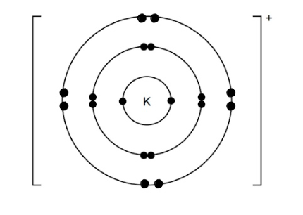
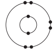

# Mark Schemes — Atomic Structure & the Periodic Table
**2. Atoms, Elements & Compounds** · Cambridge (CIE) IGCSE chemistry (0620 & 0971)

## Multiple Choice Questions (29 questions)

### Q1
**Final answer:** **The correct answer is A**

- To calculate the relative atomic mass (*A*r), you must multiply the mass of each isotope by its percentage abundance, add them together, and divide by 100
- First, find the abundance of the second isotope: 100% − 69% = 31% for 65Cu
- Then, apply the formula of *A*r : `A _ r = (% ab _ 1 x mass number of isotope 1 + % ab _ 2 x mass number of isotope 2 )/(100)` $A_{r} = \frac{69 \% \times 63 + 31 \% \times 65}{100}$ $A_{r}=63.6$

### Q2
**Final answer:** **The correct answer is B**

- Atoms X and Y both have an atomic number (proton number) of 3, meaning they are isotopes of the same element (Lithium).
- X and Y are neutral, therefore, they have the same number of protons than electrons

  - This implies that they have the same number of electrons in the outer shell
- Atoms have the **same chemical properties** because t**hey have the same number of electrons in the outer shell**

**A **is incorrect as X and Y have different amount of neutrons. X has 4 neutrons vs Y which has 5 neutrons

**C** & **D** are incorrect as isotopes generally have different physical properties (such as mass and density) because they have different masses due to the different numbers of neutrons

### Q3
**Final answer:** **The correct answer is D**

- Noble gases exist as **single atoms** (monatomic)
- They do not form molecules because they have a full outer electron shell
- A mixture of noble gases should **show different single, unbonded atoms, not joined in pairs**

**A**, **B** & **C** are incorrect as they show atoms **chemically bonded** together in pairs or clusters. If atoms are joined together, it represents a **mixture of molecules**, not monatomic atoms.

### Q4
**Final answer:** **The correct answer is A**

- X and Y are neutral atoms with 3 protons, showed by their atomic number

  - In neutral atoms, **protons = electrons**
  - Therefore, the electron configuration of X and Y is 2,1

- X and Y have the same atomic number but different mass number

  - Therefore, Y is an isotope of X

### Q5
**Final answer:** **The correct answer is C**

- The number of nucleons is the number of protons + neutrons
- The number of nucleons is the same as the mass number of carbon which is 12

**A** &** B** are incorrect because carbon is in Group IV and Period 2. This means that carbon has 4 outer electrons and 2 electron shells

**D** is incorrect because as carbon has 6 protons and 6 electrons, so its configuration is **2,4**. The configuration 2,8,2 belongs to magnesium

### Q6
**Final answer:** **The correct answer is C**

- A **compound **consists of two or more different elements **chemically bonded **together
- Mixtures are combinations in which substances are not chemically combined

  - One compound is represented by two black circles and one white circle
  - The other compound is represented by one black circle and one white circle

- The two different types of compounds are **not chemically bonded **to each other

**A** & **B** are incorrect because both of them just contain one substance, so they are not mixtures

**D** is incorrect because it shows a **mixture of elements **because the particles are single, unbonded atoms of different types

### Q7
**Final answer:** **The correct answer is**** C**** because:**

- Elements are arranged on the Periodic table in **increasing atomic number** where each element has one proton more than the element preceding it.
- The number of each Group is the same as the number of electrons in the** outer shell **of each element in that group.
- Element Q has an atomic number of 9, so its electronic configuration is 2,7.
- 7 electrons in the outer shell means that it is in Group VII, the halogens.

**A**,** B **and** D **are incorrect as element Q is fluorine which belongs in Group VII*.*

### Q8
**Final answer:** **The correct answer is ****D**** because:**

- A mixture contains** two** or more elements **or** compounds that are not chemically combined.
- Air for example is a mixture that contains nitrogen which is an **element **and carbon dioxide which is a **compound**.

**A **is incorrect as elements consist of only **one kind of atom**.

**B **is incorrect as compounds consist of elements which **chemically combine**.

**C **is incorrect as the components in a mixture are not chemically combined.

### Q9
**Final answer:** **The correct answer is**** A**** because**

- Isotopes are defined as atoms of the same element with the same number of protons, but different numbers of neutrons
- You need to compare elements Q-T to each other to see which ones fit in with this definition
- Q and S are the only two that have the same number of protons but different numbers of neutrons
- They both have 6 protons but Q has 7 neutrons and S has 8 neutrons

### Q10
**Final answer:** **The correct answer is**** D**** because:**

- Protons are positively charged, neutrons are neutral and electrons are negatively charged.
- The relative mass of protons and neutrons is 1, while that of an electron is 0.00054.

**A, B **and **C** are incorrect as only option **D** correctly describe the charges of the subatomic particles.

### Q11
**Final answer:** **The correct answer is**** D**** because:**

- There are 5 protons in the atom shown so the **atomic number** is 5.
- Elements are identified by their atomic number which is also the number of electrons present.
- Boron is the element which has an atomic number of 5.

**A**,** B **and **C** are incorrect as these elements do not match with the atomic structure shown in the diagram.

### Q12
**Final answer:** **The correct answer is ****A**** because: **

- Isotopes of the same element have the same number of electrons in their outer shells
- The number of outer shell electrons determines their chemistry, hence the chemical properties are the same

**B, C **and** D** are incorrect as these options do not correctly describe the structure and properties of the isotopes. The number of outer shell electrons for the isotopes will be the same, so the chemical properties won't differ.

### Q13
**Final answer:** **The correct answer is ****C**** because:**

- The notation is as follows:

$\text{Se} pre_{34} pre^{79^{2} -}$

- The 79 is the mass number, so it is the protons and neutrons added together
- The 34 is the atomic number, which means number of protons
- The number of neutrons is therefore 79-34 = 45
- A neutral atom contains the same number of electrons as protons
- A negative 2 ion means you need to add two electrons

### Q14
**Final answer:** **The correct answer is ****C**** because:**

- The number of outer electrons in the **outer shell **of an element determines which Group it is placed.
- Carbon for example has **four **outer electrons hence it is Group **IV.**
- The period number indicates the number of electron shells, so all of the Group **III **elements have **three **electron shells.

**A, B** and **D** are incorrect as these options do not correctly explain the Group and Period numbers and how these are linked to the electronic configuration of the elements.

### Q15
**Final answer:** **The correct answer is ****C**** because:**

- For isotopes P and Q, the formula for calculating the *RAM* is

$A_{r}=\frac{(\mathrm{mass}_{P}\times\mathrm{abundance}_{P})+(\mathrm{mass}_{Q}\times\mathrm{abundance}_{Q})}{100}$

- Substituting in the values given:

$A_{r}=\frac{(191\times62.7)+(193\times37.3)}{100}=191.7\,$

- When calculating the *A**r* you working out the weighted average for all the isotopes
- A question could give you the relative abundance as a number between 0 and 1, instead of percentage, in which case you don't need to divide by 100 in the final step
- Don't round your answer until the very end as the options could include choices that are very close to each other

### Q16
**Final answer:** **The correct answer is ****A ****because:**

- The X+ ion has 16 electrons
- This means that the element has 17 electrons

  - This means the electronic configuration of element X is 2.8.7 so it belongs in Group VII.
- Therefore, the atomic number / number of protons for element X is 17

  - This means that element X is chlorine, which is in group VII
- The nucleon number of 37 tells us we are dealing with a specific isotope of this element (Chlorine-37)

  - While this is useful information, it is not needed to determine the group number, which depends only on the electron configuration

**B, C **and **D **are incorrect as element X has 7 outer shell electrons so can only be placed in Group VII.

### Q17
**Final answer:** **The correct answer is**** D**** because:**

- Elements are arranged on the Periodic table in **increasing atomic number **where each element has one proton more than the element preceding it.
- The Group number gives the number of electrons in the **outer** shell of each element.
- X is in Group **IV **so has four electrons in its outer shell.
- X also has **125 neutrons**, which corresponds to lead (Pb) only (as lead has a mass number of 207 and an atomic number of 82, so  207- 82 = 125 neutrons).

**A** is incorrect as beryllium has 2 electrons in its outer shell and carbon has 4 in its outer shell.

**B **is incorrect as although carbon has 4 electrons in its outer shell, it has a mass number of 12 and therefore only 6 neutrons in its nucleus (12 - 6 =6).

**C **is incorrect as tin has 69 neutrons, 119 - 50 = 69.

### Q18
**Final answer:** **The correct answer is**** B**** because:**

- The atomic number of K is 19 and its electronic configuration is 2, 8, 8, 1.
- K donates its single outer shell electron, which means

  - It becomes a **positive** ion with a 1+ charge
  - The electronic configuration of the ion is **2, 8, 8.**
- The atomic number of F is 9 and its electronic configuration is 2, 7.
- F accepts the electron from potassium and achieves a full outer shell, which means

  - It becomes a **negative ion** with a 1- charge
  - The electronic configuration of the ion is **2, 8.**

**A** and **D **are incorrect as the charges on each ion are incorrect.

**C **is incorrect as the electronic configurations shown for each ion are incorrect.

### Q19
**Final answer:** **The correct answer is**** C**** because:**

- Lithium has **4 neutrons** as can be read from the Periodic Table.
- The atomic number of fluorine is **9** so it has 9 protons.
- The fluoride ion has **one negative **charge so it must have gained one more electron, so it has 9 + 1 = **10** electrons.

**A, B **and** D** are incorrect as these options do not correctly describe each particle*.*

### Q20
**Final answer:** **The correct answer is**** C**** because:**

- Element W is** lithium **and its electronic configuration is** 2, 1**.
- Element X is **nitrogen** and its electronic configuration is **2, 5**.
- Element Y is **magnesium** and its electronic configuration is **2, 8, 2**.
- Element Z is **argon** and its electronic configuration is **2, 8, 8.**

**A, B and D are incorrect as only the elements W and Y have the correct electronic configuration.**

### Q21
**Final answer:** **The correct answer is**** D**** because:**

- Element X contains 12 of each sub-atomic particle means that it contains 12 protons, 12 neutrons and 12 electrons

  - 12 protons mean an atomic number of 12, which is the Group 2 metal magnesium
  - 12 protons and 12 neutrons mean a mass number of 24, which is the Group 2 metal magnesium
  - 12 electrons mean an electronic configuration of 2,8,2
  
    - This means that the element is in Period 3
    - It contains 2 outer electrons, which means that it is in Group 2
    - The element that is in Period 3 and Group 2 is magnesium

**A**,** B **and** C **are incorrect as element X is magnesium which belongs to Group II

## Theory Questions (29 questions)

### Q1
a) The completed table should look as follows:

| particle | number of protons | number of electrons | electronic configuration | charge on particle |
|---|---|---|---|---|
| A | 12 | 10 | 2,8 | 2+ |
| B | **17**;** [1 mark]** | 18 | 2,8,8 | 1- |
| C | 18 | **18**; **[1 mark]** | 2,8,8 | 0 |
| D | 8 | 10 | **2,8**; **[1 mark]** | **2-**; **[1 mark]** |

**[Total: 4 marks]**

- *Particle B*

  - *The particle has a charge of 1-*
  
    - *Therefore, it must have 1 more electron than protons*
- *Particle C*

  - *The particle has a charge of 0*
  
    - *Therefore, the number of protons = number of electrons*
- *Particle D*

  - *The particle has 2 more electrons than protons*
  
    - *Therefore, the charge is -2*
  - *To determine the electronic configuration*
  
    - *1st shell can hold up to 2 electrons*
    - *Each subsequent shell can hold a maximum of 8 electrons*
b) The definition of the term element is:

- A substance that cannot be broken down into anything simpler
**OR**
** **A substance that cannot be broken down (by chemical means) 
**OR **
A substance containing atoms with the same atomic / proton number; **[1 mark]**

**[Total: 1 mark]**

- *The most common answer given is that an element is a substance that cannot be broken down (by chemical means)*
c) The completed table should look as follows:

| atom | number of protons | number of neutrons | number of electrons |
|---|---|---|---|
| $Ga_{31}^{69}$ | **31** | **38** | **31** |
| $Ga_{31}^{71}$ | **31** | **40** | **31** |
|   | Correct column;** [1 mark]** | Correct column;** [1 mark]** | Correct column;** [1 mark]** |

**[Total: 3 marks]**

- *For *$Ga_{31}^{69}$

  - *Number of protons = 31*
  - *Number of protons + number of neutrons = 71*
  
    - *Therefore, the number of neutrons = 69 - 31 = 38*
  - *The atom has no charge*
  
    - *Therefore, the number of electrons = number of protons = 31*
- *For *$Ga_{31}^{71}$

  - *Number of protons = 31*
  - *Number of protons + number of neutrons = 71*
  
    - *Therefore, the number of neutrons = 71 - 31 = 40*
  - *The atom has no charge*
  
    - *Therefore, the number of electrons = number of protons = 31*

### Q2
a) The completed table should look as follows:

| particle | number of protons | number of electrons | number of neutrons | symbol or formula |
|---|---|---|---|---|
| A | 9 | 10 | 10 | `F _ 9 ^ 19 ^ -` |
| B | 11 | 11 | 12 | $Na_{11}^{23}$; **[1 mark]** |
| C | 18 | 18 | 22 | $Ar_{18}^{40}$; **[1 mark]** |
| D | 15 | 18 | 16 | $\mathrm{P} pre_{15} pre^{31^{3} -}$ |
| E | 13 | 10 | 14 | `Al ^ 3 + _ 13 ^ 27` |

Particle D:

- Correct symbol, mass number and atomic number, e.g. `P _ 15 ^ 31`; **[1 mark]**
- Correct 3– charge; **[1 mark]**

Particle E:

- Correct symbol, mass number and atomic number, e.g. $Al_{13}^{27}$; **[1 mark]**
- Correct 3+ charge; **[1 mark]**

**[Total: 6 marks]**

- *The number of protons tells you which element it is*
- *The mass number (top number) = number of protons + number of neutrons*
- *You can figure out the charge by looking at the difference between the number of protons and electrons*
b) The atom in the table which is an isotope of the atom which has the composition 11p, 11e and 14n is:

- Particle **B** / $Na_{11}^{23}$ / sodium; **[1 mark]**
- (Because) they have the same proton number 
**OR **
(Because) they have the same number of protons (and electrons) 
**OR **
(Because) they have the same atomic number; **[1 mark]**

**[Total: 2 marks]**

- *Careful: **You will not get the mark for saying they have the same number of electrons *
- *Remember: **Isotopes have the same number of protons but a different number of neutrons*

  - *This means we are looking for the particle in the table with 11 protons*

### Q3
a) The completed table should look as follows:

| **name** | **symbol** | **relative mass** | **relative charge** |
|---|---|---|---|
| electron | e | 1/1840 **OR** 1/2000 **OR** 1/1837 **OR **negligible | -1 |
| proton | p | 1 | +1 |
| neutron | n | 1 | 0 |

- Each correct row;** [1 mark]**

**[Total: 3 marks]**

- *For the relative mass of an electron you don't need to remember the specific fraction, you can just say 0 or negligible for the mark*
- *It is more important you know the mass of an electron is insignificant compared to the size of a proton or neutron (which are the same)*
b) Using the information in the table to explain the following:

i) Atoms contain charged particles but they are electrically neutral because they have no overall charge:

- (They have) equal numbers of protons and electrons of positive and negative charges; **[1 mark]**
- (The) charges cancel / balance 
**OR **
(The) net charge = 0; **[1 mark]**

ii) Atoms can form positive ions when:

- (They) lose electron(s); **[1 mark]**
- (They have) more protons than electrons; **[1 mark]**

iii) Atoms of the same element can have different masses when:

Option 1:

- (They have) different numbers of neutrons;** [1 mark]**
- (But have the) same number of protons 
**OR **
They have the) same number of electrons; **[1 mark]**

Option 2:

- They are isotopes; **[2 marks]**

iv) Scientists are certain that there are no undiscovered elements missing from the Periodic Table from hydrogen to lawrencium.

- An element is known for each proton number 
**OR **
Any sensible idea, for example, no gaps between z = 1 and z = 103; **[1 mark]**

**[Total: 7 marks]**

- *For part ii) make sure you are specific and say which subatomic particle there is more of (e.g. protons than electrons)*

  - *It is not enough to just say there is more positive charge than negative*
- *For part iii) you have been asked to explain how atoms of the same element can have different masses*

  - *It is not enough to just identify that these would be isotopes, you need to explain what we mean by isotopes*
- *Elements can only have a whole number of protons*
- *We know elements exist corresponding to each whole number of protons between hydrogen and lawrencium*
- *This means there are no unknown elements left to discover between these two elements*

### Q4
Completing the table of atomic structure:

| particle | number of protons | number of neutrons | number of electrons |
|---|---|---|---|
| Co | 27 | 32 | 27 |
| Co2+ | 27 | 32 | 25 |

- First row correct; **[1 mark]**
- Second row correct; **[1 mark]**

**[Total: 2 marks]**

- *The periodic table shows you that cobalt is element 27, so it has 27 protons and 27 electrons*
- *The mass number is 59, so subtract the protons to get the number of neutrons: 59-27= 32*
- *A 2+ ion is formed by the loss of two electrons: 27 - 2 = 25*
i)  Isotopes are elements with:

- The same proton number / same atomic number / same number of protons / equal number of protons;  **[1 mark]**
- But a different nucleon number / different number of neutrons / different neutron number / different mass number;** [1 mark]**

*Do not accept the same number of electrons*

ii)  Two isotopes of the same element have identical chemical properties because they have the:

Any **one **from:

- Same electronic configuration
- Same electron arrangement
- Same number of outer shell electrons
- Same number of electrons in the outer shell
- Same number of valence electrons
- Same number of electrons

**[1 mark]**

*Do not accept the same number of shells or the same number of protons*

**[Total: 3 marks]**

- *For full marks in part (i), you must state both that isotopes have the same number of protons (or same atomic number) and a different number of neutrons (or different mass number). Stating only one of these will only earn 1 mark*
- *In part (ii), you cannot get credit for saying the same number of (electron) shells, as it is the number of electrons (in the outer shell) that determines the chemistry*

### Q5
The completed table should look as follows:

| particle | relative mass | relative charge |
|---|---|---|
| proton | **1** | **+1** |
| neutron | **1** | **0** |
| electron | $\frac{1}{1840}$ | **-1** |

- Proton relative mass = 1 
**AND**
Relative charge = +1;** [1 mark]**
- Neutron relative mass = 1 
**AND**
Relative charge = 0;** [1 mark]**
- Electron relative charge = -1;** [1 mark]**

**[Total: 3 marks]**

- *Remember: **You aren't required to know the exact relative mass of an electron*

  - *This is why you are given this value in the question*
- *Make sure you are comfortable filling in this table from memory as it is a common exam question*
i) Isotopes are:

- **Atom**(s) of the same element;** [1 mark]**
- With different numbers of neutrons / different neutron number / different nucleon number / different mass number; **[1 mark]**

ii)  The two isotopes of bromine have the same chemical properties because:

- (They both have) the same number of electrons / same number of valence electrons / same electronic configuration / same electron arrangement; **[1 mark]**
- In the outer shell / valence shell; **[1 mark]**

**[Total: 4 marks]**

- *The definition of Isotopes is one that comes up frequently in exams so make sure you learn it word for word*
- *Remember: **The number of **outer shell **electrons determines an element's chemical properties*

  - *This also determines what group the element is in*
  - *Hence why elements in the same group share similar chemical properties*
c) The completed table should look as follows:

| particle | number of protons | number of neutrons | number of electrons |
|---|---|---|---|
| $Li_{3}^{7}$ | **3** | **4** | **3** |
| $\mathrm{S} pre_{16} pre^{34^{2} -}$ | **16** | **18** | **18** |
| `K _ 19 ^ 41 ^ +` | 19 | 22 | 18 |

- Number of protons column correct; **[1 mark]**
- Number of neutrons column correct; **[1 mark]**
- Number of electrons column correct; **[1 mark]**

Particle:

- Correct mass number / 41 
**AND**
** **Correct atomic number  / 19; **[1 mark]**
- Correct charge / (1)+ 
**AND **
Correct symbol / K;** [1 mark]**

**[Total: 5 marks]**

- *The top number to the left of the element symbol represents the number of protons + neutrons*
- *The bottom number to the left of the element symbol represents the number of protons*
- *Any numbers to the top right of the element symbol represent a charge*
- *For Li*

  - *Protons + neutrons = 7*
  - *Protons = 3*
  
    - *Therefore, neutrons = 7 - 3 = 4*
  - *There is no charge so the number of protons = number of electrons = 3*
- *For S*

  - *Protons + neutrons = 34*
  - *Protons = 16*
  - *Therefore, neutrons = 34 - 16 = 18*
  - *The charge = -2*
  
    - *Therefore, there must be 2 more electrons than protons*
    - *Electrons = 16 + 2 = 18*
- *For the unknown particle*

  - *Protons = 19*
  - *Protons + neutrons = 19 + 22 = 41*
  - *The particle has 1 more proton than electron*
  - *Therefore, the charge = +1*

### Q6
a)

The completed table is:

| type of particle | relative charge | approximate relative mass |
|---|---|---|
| proton | **+1;**** [1 mark]** | 1 |
| neutron | **0 / no charge; **** ****[1 mark]** | **1; **** [1 mark]** |
| electron | −1 | **1/2000 **OR** 1/1840; **** ****[1 mark]** |

**[Total: 4 marks]**

- *Remember:** **P**rotons are **P**ositive, and **NEU**trons are **NEU**tral*
b) The number of electrons and neutrons in an atom of the isotope of potassium shown is:

- (Number of electrons) = 19; **[1 mark]**
- (Number of neutrons) = 22; **[1 mark]**

**[Total: 2 marks]**

- *The atomic number is 19 *
- *This is the number of protons *
- *In an atom, the number of protons equals the number of electrons so there are 19 electrons *
- *To calculate the number of neutrons, the atomic number is taken away from the mass number *

  - *41 - 19 = 22*

### Q7
a) The evidence from the table for each of the following is:

i) Particle **A** is an atom:

- (Particle **A** has the) same number of protons and electrons; **[1 mark]**

ii) They are all particles of the same element:

- (They) all have the same number of protons / same proton number / same atomic number; **[1 mark]**

iii) Particle **B** is a negative ion:

- (Particle **B** has) <u>more</u> electrons than protons **OR**
- The number of protons and electrons are not equal*; ***[1 mark]**

iv) Particles **A** and **C** are isotopes.:

- (Particles **A** and **C** have the) the same number of protons (and electrons) / same proton number / same atomic number; **[1 mark]**
- (But they have a) different number of neutrons / different mass number / different nucleon number; **[1 mark]**

**[Total: 5 marks]**

- *Make sure you understand the definitions of atoms, elements, isotopes and ions in terms of subatomic particles*
- *Also make sure you are specific for part iii as you have been asked why the particle is a **negative** ion, not just an ion*
b)

i)The electronic structure of particle **A **is:

- 2.8.5; **[1 mark]**

ii)The valency of the element is:

- 3; **[1 mark]**

iii)The element is a:

- Non-metal **AND **because it accepts electrons
**OR**
Non-metal **AND **because it needs 3 electrons to complete its outer energy level
**OR**
Non-metal **AND **because it is in Group V or has 5 electrons in its outer shell
**OR**
Non-metal **AND **because it has a low melting/boiling point (accept: does not have a high melting/boiling point); **[1 mark]**

**[Total: 3 marks]**

- *The valency of an element is the number of electrons its atoms lose, gain or share, to form a compound.  *

  - *As the element has 5 electrons in its outer shell it needs to gain 3 to obtain a full outer shell*
  - *Hence, its valency is 3*

> **[exam-tip]**
> Valency is a positive combining number, not an ionic charge, so never write it with a minus sign.

### Q8
a)

i) An element is:

- A substance containing only one type of atom;** [1 mark]**
- Which cannot be broken down into anything simpler by chemical means; **[1 mark]**

ii) A compound is:

- A substance containing atoms of two or more elements / two or more different elements;** [1 mark]**
- Chemically bonded / joined / combined together; **[1 mark]**

iii) A mixture is:

- Two or more substances / elements / compounds physically mixed
**OR**
Two or more substances / elements / compounds not chemically bonded together
**OR**
Two or more substances / elements / compounds that can be separated by physical means;** [1 mark]**

**[Total: 5 marks]**

- *These are basic definitions that you are required to know*
- *Make sure you learn them word for word *
- *For a compound you must say "different" elements*

  - *Two atoms of the same element bonded (e.g., **O**2**) is a molecule of an element, not a compound*
b)

i) Brass is classified as:

- A mixture; **[1 mark]**

ii) Carbon dioxide is classified as:

- A compound; **[1 mark]**

iii) Copper is classified as:

- An element; **[1 mark]**

**[Total: 3 marks]**

- *Brass is an alloy (mixture of metals) made from copper and zinc *
- *In carbon dioxide, the carbon and oxygen (two different elements) are held together by covalent bonds *
- *In copper, there are copper atoms **only** so copper is classified as an element*
c) The physical property used to distinguish between metals and non-metals is:

- Conductivity (of heat or electricity); **[1 mark]**

**[Total: 1 mark]**

- *Metals conduct electricity because they have delocalised electrons which are free to move and carry a charge throughout the structure *
- *Carbon is the only non-metal which can conduct when it is in the form of graphite, again due to delocalised electrons*

### Q9
a) A compound is:

- (Substance containing) atoms of two or more different elements bonded / joined together; **[1 mark]**

**[Total: 1 mark]**

- *Make sure you know the definition of a compound*
b) The completed table is:

|   | number of electrons | number of neutrons | number of protons |
|---|---|---|---|
| `S _ 16 ^ 34` | 16 | **18** | **16** |
| $\mathrm{O} pre_{8} pre^{18^{2} -}$ | **10** | 10 | **8** |

- Number of electrons in O2− ion = 10;** [1 mark]**
- Number of neutrons in S = 18; **[1 mark]**
- Number of protons in S = 16 
**AND**
Number of protons in O2− = 8; **[1 mark]**

**[Total: 3 marks]**

- *The atomic number (the bottom /smallest number shown by the element) is the number of protons*

  - *This is often shown in the key on the Periodic Table*
- *The mass number is calculated by subtracting the atomic number from the mass number *

  - *For sulfur, 34 - 16 = 18 *
- *In an atom, the number of protons equals the number of electrons *
- *An atom forms a negative ion by gaining electrons *
- *An atom of oxygen has 8 electrons*
- *An ion of oxygen with a 2- charge has gained 2 electrons so has 10 electrons*
c) The electronic configuration of a potassium ion is:

- Eight electrons in the outer shell 
**AND**
** **None added elsewhere; **[1 mark]**

**[Total: 1 mark]**

- *A potassium atom has the electronic configuration 2,8,8,1 *
- *The single positive charge indicates that the outer electron has been lost*
- *So, the electronic configuration of the ion is 2,8,8 *

### Q10
> **[mark-scheme]**
> The reason these two isotopes of chlorine have the same chemical properties is:
> 
> - Same number of electrons **[1 mark]**
> - Same electronic configuration **[1 mark]**
> 
> Stating the electronic configuration as 2,8,7 is accepted for the second mark.

> **[exam-tip]**
> The two isotopes differ only in their number of neutrons. Neutrons carry no charge and sit in the nucleus, so they take no part in bonding.
> 
> Chemical properties are set by the outer shell electrons. Both chlorine isotopes have 17 electrons arranged 2,8,7, which is why they react in exactly the same way.
> 
> A common answer here is 'they have the same number of protons'. That is true, but it is not what the question asks about, because it is the electrons that do the chemistry.
The completed table is:

|   | number of electrons | number of neutrons | number of protons |
|---|---|---|---|
| `{}_{17}^{35}{Cl}` | **Final answer:** **17** | **Final answer:** **18** | **Final answer:** **17** |
| `{}_{17}^{37}{Cl}^{-}` | **Final answer:** **18** | **Final answer:** **20** | **Final answer:** **17** |

**[3 marks]**

> **[mark-scheme]**
> 1 mark for both values in the number of electrons column
> 
> 1 mark for both values in the number of neutrons column
> 
> 1 mark for both values in the number of protons column

> **[exam-tip]**
> Work across one row at a time and take the two numbers in the symbol in turn.
> 
> The bottom number is the proton number, so both particles have 17 protons. That number never changes, because changing it would make it a different element.
> 
> The number of neutrons is the top number minus the bottom number:
> 
> - 35 - 17 = 18 neutrons.
> - 37 - 17 = 20 neutrons.
> 
> Electrons are where most marks are lost. A neutral atom has as many electrons as protons, so 35Cl has 17. The negative sign on the chloride ion means one electron has been gained, so 37Cl- has 18.
> 
> The trap is to assume the charge changes the number of protons. It never does. Only the electron count moves.
> **[mark-scheme]**
> The ways in which these sodium isotopes are the same and the ways they are different are:
> 
> - Same: they all have 11 protons **[1 mark]**
> - Same: they all have 11 electrons **[1 mark]**
> - Different: they have 11, 12 and 13 neutrons **[1 mark]**
> 
> Answers given in terms of atomic number and mass number are not accepted, because the question asks for protons, neutrons and electrons.

> **[exam-tip]**
> The question names three particles and asks for both a similarity and a difference, so check you have said something about protons, about electrons and about neutrons before you move on.
> 
> Give the actual numbers rather than describing them. 'They all have the same number of protons' does not score, because the question can be answered fully with '11 protons'.
> 
> The neutron counts come from the top number minus 11 in each case:
> 
> - 22 - 11 = 11.
> - 23 - 11 = 12.
> - 24 - 11 = 13.
> **[mark-scheme]**
> The reason all three isotopes have an overall charge of zero is:
> 
> - They have the same number of protons and electrons **[1 mark]**

> **[exam-tip]**
> A proton carries a charge of +1 and an electron carries a charge of -1, so 11 of each cancel exactly.
> 
> Neutrons are neutral, which is why the three isotopes can hold 11, 12 and 13 neutrons and still all come out at zero overall.
> 
> The answer has to mention both protons and electrons. Saying only that the isotopes are neutral atoms repeats the question rather than explaining it.

### Q11
a)

i) Element C is:

- Sb; **[1 mark]**

ii) The element in the list that does not form any compounds is:

- Xe / B; **[1 mark]**

iii) The  element in the list that forms a chloride of the type XCl2 is:

- Sr / A **OR** Te / D; **[1 mark]**

iv) The two elements that react together to form a compound of the type XY4 are:

- Sn **AND** I  
**OR** 
E **AND **F; **[1 mark]**

v) The element in the list that would react with cold water to form an alkaline solution and hydrogen is:

- Sr / A; **[1 mark]**

**[Total: 5 marks]**

- *You are told in the question these elements are from period 5*
- *Period 5 is the fifth row of the periodic table*

  - *Remember: **Hydrogen and helium are in Period 1*
- *Element C is Sb*

  - *Count the number of electrons in the configuration = 51*
  - *This corresponds to the atomic number of Sb*
- *The element in the list that does not form any compounds is Xe / B:*

  - *Noble gases are unreactive*
  - *By looking at the last number of the electronic configuration, you can see that this has a full outer shell of 8 electrons*

- *The elements in the list that forms a chloride of the type XCl**2** are A and D (Sr and Te)*

  - *Both atoms have a valency of 2 (as Sr is in Group II and Te is in Group VI)*
  - *Chlorine has a valency of 1 (as it is in Group VII)*
  - *The formula is found by multiplying one atom by the valency of the other atom*
  - *i.e. Sr / Te x 1; and Cl x 2 to give SrCl**2** or TeCl**2*

- *The two elements that react together to form a compound of the type XY**4** are E and F:*

  - *Iodine has a valency of 1 (as it is in Group VII)*
  - *Tin has a valency of 4 (as it is in Group IV))*
  - *The formula is found by multiplying one atom by the valency of the other atom*
  - *i.e. Sn x 1 and I x 4 to give SnI**4*

- *The element in the list that would react with cold water to form an alkaline solution and hydrogen is A / Sr*

  - *Elements in Groups 1 and 2 react with water to form an alkaline solution*
  - *From part (i), you have already identified this element*
b) Two differences in physical properties and two differences in chemical properties between rubidium and the transition metal niobium are:

**Physical**

Any **two** from:

- Niobium is <u>harder</u>; **[1 mark]**
- Niobium is <u>stronger</u>; **[1 mark]**
- Niobium has a <u>higher</u> melting / boiling point; **[1 mark]**
- Niobium has a <u>higher</u> density; **[1 mark]**

**Chemical**

Any **two** from:

- Niobium is <u>less</u> reactive; **[1 mark]**
- Niobium forms coloured compounds **AND **rubidium does not (form coloured compounds); **[1 mark]**
- Niobium forms complex ions **AND **rubidium does not (form complex ions); **[1 mark]**
- Niobium compounds have catalytic properties **AND **rubidium does not (have catalytic properties); **[1 mark]**
- Niobium has more than one oxidation state / number **AND **rubidium does not / rubidium has one oxidation state; **[1 mark]**
- Niobium has more than one valence electron **AND **rubidium does not / rubidium has one valence electron; **[1 mark]**

**[Total: 4 marks]**

- *You **must** give your answer as a comparison *
- *For example, you must say that niobium is hard**er** than rubidium, not just that it is hard*
- *Failure to do this will result in marks not being awarded*

### Q12
a) The letter of the atom that is in Group III of the Periodic Table is:

- B; **[1 mark]**

**[Total: 1 mark]**

- *Remember: **The Group number indicates the number of electrons in the outer shell *

  - *Atom B has three electrons in its outer shell so is in Group III*
b) The letter of the element that has 13 protons is:

- B; **[1 mark]**

**[Total: 1 mark]**

- *Remember: **The number of protons and electrons in an atom is equal *

  - *Atom B has 13 electrons so therefore has 13 protons*
c) The atom which is a noble gas is:

- E; **[1 mark]**

**[Total: 1 mark]**

- *Noble gases have full outer shells of electrons so are chemically stable *

  - *For helium, the outer shell is full with two electrons*
  - *For the rest of the noble gases, the outer shell is full with eight electrons *
- *E has eight electrons in its outer shell*
d) The atom that forms a stable ion with a single negative charge is:

- C; **[1 mark]**

**[Total: 1 mark]**

- *To achieve a single negative charge, the atom must gain one electron *
- *Atom C has seven electrons in its outer shell so can gain one to give it a full outer shell *

### Q13
a) The different types of particles found in the nucleus of this atom of X are:

- Protons;** [1 mark]**
- Neutrons;** [1 mark]**

**[Total: 2 marks]**

- *Electrons are found in the shells surrounding the nucleus*
b) The term for the total number of particles in the nucleus of an atom is:

- Nucleon number; **[1 mark]**

**[Total: 1 mark]**
c) The total number of particles found in the nucleus of this atom is:

- 34; **[1 mark]**

**[Total: 1 mark]**

- *Protons and neutrons are found in the nucleus of an atom*
- *There are 16 protons (as shown by the atomic number)*
- *There are 18 neutrons (mass number - atomic atomic) *
- *The total is therefore 16 + 18 = 34 *
d) The electronic structure of the ion X2– is:

- 2: 8: 8; **[1 mark]**

**[Total: 1 mark]**

- *An atom of element X has 16 protons, which means that it also has 16 electrons*
- *To form an ion with a 2- charge it gains 2 electrons to give a total of 18 *
- *A maximum of two electrons can occupy the first shell, eight in the second and eight in the third*
e) The term used to describe atoms of the same element with different numbers of particles in the nucleus is:

- Isotopes; **[1 mark]**

**[Total: 1 mark]**

- *Isotopes are atoms of the same element with the same number of protons but different numbers of neutrons*
f) The relative atomic mass of element **Y** is:

- (3 × 69) + (2 × 71); **[1 mark]**
- $\frac{349}{5}$= 69.8; **[1 mark]**
- Element Y = gallium / Ga; **[1 mark]**

**[Total: 3 marks]**

- *Usually, the relative atomic mass is found using:*

  - $\frac{ ( \text{mass} \text{number} of \text{isotope} 1 x \% \text{abundance} ) \times ( \text{mass} \text{number} of \text{isotope} 2 x \% \text{abundance} ) }{100}$
- *Although you have not been given the abundances as a percentage, it is still a ratio, so the same equation can be used: *

  - $\frac{( 3 \mathrm{x} 69 ) + ( 2 \mathrm{x} 71 )}{5 }$*= 69.8 *
- *Use your Periodic Table to identify the element with a relative atomic mass of 69.8*
g) Z behaves chemically as a non-metal because:

- It gains electrons; **[1 mark]**
- Three electrons (when forming ion); **[1 mark]**

**[Total: 2 marks]**

- *Non-metals gain electrons to form negative ions*
- *Metals lose electrons to form positive ions*

### Q14
a)

i) The **two** ions which have the same electronic structure are:

- Na+ / sodium 
**AND **
O2- **/ oxide; [1 mark]**

ii) The ion which has the same electronic structure as an atom of argon is:

- Ca2+ / calcium;** [1 mark]**

iii) The atom which can form an ion of the type X3– is:

- P / phosphorus;** [1 mark]**

iv) The atom which can form a hydride which has a formula of the type XH4 is:

- Si / silicon;** [1 mark]**

**[Total: 4 marks]**

- *For part i)*

  - *Na has 11 electrons*
  
    - *Na has the electron configuration 2,8,1*
    - *Na**+** will have the electron configuration 2,8*
  - *O has 8 electrons*
  
    - *O has the electron configuration 2,6*
    - *O**2-** will have the electron configuration 2,8*
- *For part ii)*

  - *Argon has 18 electrons*
  
    - *Argon has the electron configuration 2,8,8*
  - *Calcium has 20 electrons*
  
    - *Calcium has the electron configuration 2,8,8,2*
    - *Ca**2+** has the electron configuration 2,8,8*
- *For part iii)*

  - *Phosphorus is in group 5 so has 5 electrons in its outer shell*
  - *It will gain 3 electrons to form a full outer shell forming P**3-*
- *For part iv)*

  - *Each hydrogen has a charge of +1*
  - *Therefore the ion X must have a charge of 4-to balance the 4 hydrogens*
  - *We are looking for an element with 4 electrons in its outer shell meaning it must be in group 4*
  - *Silicon is the only element listed in group 4*
b)

i) The number of protons, neutrons and electrons in one copper(II) ion are:

Protons = 29

Neutrons = 35

Electrons = 27

- All three correct; **[2 marks]**
- Two correct;** [1 mark]**

ii) The number of nucleons and charged particles in one atom of scandium are:

- Nucleons = 45; **[1 mark]**
- Charged particles = 42; **[1 mark]**

**[Total: 4 marks]**

- *For part i)*

  - *Mass number of copper = 64*
  
    - *Number of protons + number of neutrons = 64*
  - *Atomic number = 29*
  
    - *Number of protons = 29*
  - *Number of neutrons = 64 - 29 = 35*
  - *Charge on the copper ion is +2 *
  
    - *Therefore the ion has two more protons than electrons*
    - *Number of electrons = 27*
- *For part ii)*

  - *Nucleons are protons and neutrons*
  - *This is the same as the mass number*
  
    - *Mass number = nucleon number = 45*
  - *The charged particles are protons and electrons*
  - *The scandium atom has 21 protons*
  - *As the scandium atom is not charged the number of protons = number of electrons*
  - *Therefore the total number of charged particles = 2 x 21 = 42*
c)

i) These two atoms have isotopes as:

- (They have the) have same proton number/ same element/ same atomic number; **[1 mark]**
- (But they have) different number of neutrons / nucleons / mass number; **[1 mark]**

ii) The atom of a different element with one more proton than sodium is:

- Mg/ magnesium; **[1 mark]**

**[Total: 3 marks]**

### Q15
a) The structure which is a compound is:

- C / lithium chloride / LiCl; **[1 mark]**

**[Total: 1 mark]**

- *A compound consists of two or more different elements chemically bonded together *
- *C contains lithium ions / Li**+** and chloride ions / Cl**–** bonded together to form lithium chloride*

  - *The lithium ions are formed from lithium atoms and the chloride ions are formed from chlorine atoms*
b) The term element means:

- A substance in which all the atoms have the same proton number 
**OR **
A substance containing (only) one type of atom; **[1 mark]**

**[Total: 1 mark]**

- *B shows the structure of diamond, which is made up of carbon atoms only*
- *You should be able to define the key terms, element, compound and mixture *
c) The diagram to show the electron arrangement in an oxygen atom is:

- 2 electrons in the inner shell
**AND** 
6 electrons in the outer shell 
**AND**
No additional shells of electrons; **[1 mark]**

**[Total: 1 mark]**

- *Oxygen has 8 electrons and an electronic configuration of 2.6*
- *This means that there are 2 electrons on the inner shell and 6 electrons on the outer shell*

  - *The outer electrons can drawn as 3 pairs, as 2 pairs and 2 single electrons or as 6 single electrons*
d) The completed table is:

|   | number of electrons | number of neutrons | number of protons |
|---|---|---|---|
| `S _ 16 ^ 34` | **16** | **18** | **16** |
| $\text{Cu} pre_{29} pre^{63^{2} +}$ | **27** | **34** | 29 |

- Electrons in S = 16; **[1 mark]**
- Electrons in Cu2+ = 27; **[1 mark]**
- Neutrons in S = 18 
**AND **
Neutrons in Cu2+ = 34; **[1 mark]**
- Protons in S = 16; **[1 mark]**

**[Total: 4 marks]**

- *The atomic number (bottom number) is the number of protons *
- *In an atom, like sulfur, the number of protons is equal to the number of electrons *
- *The copper ion has a 2+ charge, which indicates it has lost two electrons *
- *The number of neutrons is calculated using mass number - atomic number *

### Q16
The completed table is:

| shell | 1st | 2nd | 3rd | 4th |
|---|---|---|---|---|
| number of electrons | 2 | 8 | 8 | 2 |

- 2.8.8.2;** [1 mark]**

**[Total: 1 mark]**

- *A calcium atom contains 20 electrons *
- *A maximum of two electrons can occupy the first shell*
- *A maximum of eight electrons can occupy the second shell *
- *A maximum of eight electrons can occupy the third shell *
- *This leaves 2 electrons left over to occupy the fourth shell *
The electronic configuration of a strontium atom is similar to a calcium atom because:

- They (both) have the same number of outer electrons
 **OR**
** **They (both) have 2 outer electrons; **[1 mark]**

**[Total: 1 mark]**

- *Calcium and strontium are both in Group 2 of the Periodic Table*
- *The Group number is the number of electrons in the outer shell *
- *Atoms with the same number of electrons in their outer shell share similar chemical properties *
The electronic configuration of a strontium atom is different to a calcium atom because:

Any **one** from:

- Strontium / Sr has its outer electrons in the 5th shell
- Calcium / Ca has its outer electrons in the 4th shell
- Strontium / Sr has a different number of shells
- Strontium / Sr has more shells
**OR**
Calcium / Ca has less shells
- Strontium / Sr has 5 shells / electron shells **AND **calcium / Ca has 4 shells / electron shells
- Strontium / Sr is in Period 5 **AND **calcium / Ca is in Period 4)

**[1 mark]**

**[Total: 1 mark]**

- *This question is an unusual continuation from part (b)*

  - *This is why there does not appear to be an actual question, just half a sentence*
  - *From part (b), you can get 'Describe how the electronic configuration of a strontium atom is:'*
- *The rows in the Periodic Table are known as periods *
- *The Period number identifies the number of shells an atom has*

  - *Calcium is in Period 4, so it has 4 shells*
  - *Strontium is in Period 5, so it has 5 shells*

### Q17
a) The particles which are atoms are:

- A, D, E; **[1 mark]**
- (Because they have the) same number of protons and electrons 
**OR **
(Because they are) electronically neutral;** [1 mark]**

**[Total: 2 marks]**

- *Remember: **A particle with the same number of protons and electrons is an **atom*

  - *If the number of protons and electrons are different, it is an **ion*
b) The particle which is a negative ion is:

- C; **[1 mark]**
- (Because it has) more electrons than protons / 36e– and 34p+ / it has gained electrons;** [1 mark]**

**[Total: 2 marks]**

- *Ions always have a different number of protons and electrons*
- *We are looking for a negative ion so we need to identify the particle with more electrons than protons (particle C)*
c) The particles which are positive ions are:

- B **AND **F;** [1 mark]**

**[Total: 1 mark]**

- *Ions always have a different number of protons and electrons*
- *We are looking for positive ions so we need to identify the particle with more protons than electrons (particles B and F)*
- *Despite being for 1 mark, the question also says particle**s** suggesting you are looking for more than one *

  - *Be careful to read the question carefully as sometimes multiple correct answers are needed for a single mark*
d) Particle **A** and particle **D** are isotopes as:

- They have the same number of protons;** [1 mark]**
- (But they have) different number of neutrons / neutron number;** [1 mark]**

**[Total: 2 marks]**

- *Remembering the definition of an isotope is key to identifying which particles fit this definition*
- *Saying how the particles fit this definition is a good explanation for this type of question*

### Q18
Isotopes are:

- Atom(s) of the same element
**OR**
Atoms with same proton number 
**OR**
Atoms with the same atomic number
**OR**
Atoms with the same number of protons; **[1 mark]**

- (But a) different number of neutrons 
**OR**
A different neutron / nucleon number
**OR**
A different mass number; **[1 mark]**

**[Total: 2 marks]**

- *You must refer to atoms in your definition -- saying "an element with..." or "a substance with..." without the word "atoms" will lose the first mark*
- *Your definition must be based on subatomic structure (protons and neutrons), not on properties*

  - *Saying isotopes have "the same chemical properties" or "different masses" describes properties, not the definition*
- *The two key points are: *

  1. *Atoms of the same element / same proton number*
  2. *And different number of neutrons / different mass number*
The completed table should look as follows:

| particle | number of protons | number of electrons | number of neutrons | nucleon number | symbol or formula |
|---|---|---|---|---|---|
| **A** | 6 | 6 | 6 | 12 | C |
| **B** | 11 | 10 | 12 | 23;** [1 mark]** | Na+ |
| **C** | 8 | 10;** [1 mark]** | 8 | 16;** [1 mark]** | O2- |
| **D** | 13;** [1 mark]** | 10 | 15;** [1 mark]** | 28 | Al3+ |

For particle **B**

- Correct symbol (Na);** ****[1 mark]**
- Correct charge (+);** ****[1 mark]**

**[Total: 7 marks]**

- *Particle **A*

  - *nucleon number = number of protons + number of neutrons*
  - *number of neutrons = nucleon number - number of protons*
  
    - *number of neutrons = 12 - 6 =6*
- *Particle **B*

  - *nucleon number = number of protons + number of neutrons*
  
    - *nucleon number = 11 + 12 = 23*
  - *The particle has 11 protons so must be sodium*
  - *The particle has 1 more proton than electron*
  
    - *Therefore the charge = +1*
- *Particle **C*

  - *nucleon number = number of protons + number of neutrons*
  
    - *nucleon number = 8 + 8 = 16*
  - *The particle has a charge of 2-*
  - *Therefore it must have two more electrons than protons*
- *Particle **D*

  - *Aluminium has 13 protons*
  - *nucleon number = number of protons + number of neutrons*
  - *number of protons = nucleon number - number of neutrons*
  
    - *number of neutrons = 28 - 13 = 15*

### Q19
i) The definition of atomic number is:

Any **one **from:

- (The) number of protons
- (The) number of protons in an atom
- (The) number of protons in one atom of an element

**[1 mark]**

ii) The definition of nucleon number is:

- (The) number of protons and neutrons; **[1 mark]**
- In one atom (of an element);** [1 mark]**

**[Total: 3 marks]**

- *Make sure you are very specific about which subatomic particles you refer to, as they are key to these definitions*

  - *Atomic number = number of protons (not electrons, not neutrons)*
  - *Nucleon number = number of protons and neutrons (not electrons)*
- *For full marks on nucleon number, you must also state that this is in one atom of an element*
The completed table should look as follows:

| particle | number of protons | number of electrons | number of neutrons | symbol or formula |
|---|---|---|---|---|
| A | 6 | 6 | 6 | `C _ 6 ^ 12` |
| B | 12 | 12 | 12 | `Mg _ 12 ^ 24`; **[1 mark]** |
| C | 8 | **10**; **[1 mark]** | **8**; **[1 mark]** | $\mathrm{O} pre_{8} pre^{16^{2} -}$ |
| D | 11 | 10 | 13 | `Na _ 11 ^ 24 ^ +` |

For particle D

- Correct mass number / 24 
**AND**
** **Correct atomic number / 11; **[1 mark]**
- Correct symbol / Na** **
**AND** 
Correct charge / +; **[1 mark]**

**[Total: 5 marks]**

- *Particle B*

  - *Number of protons = 12*
  
    - *Therefore, we can use the periodic table to determine this must be magnesium*
  - *Mass number = number of protons + number of neutrons*
  
    - *12 + 12 = 24*
  - *Number of protons = number of electrons*
  
    - *Therefore, there is no charge*
- *Particle C*

  - *Number of protons = 8*
  - *Number of protons + number of neutrons = 16*
  
    - *Therefore, the number of neutrons = 16 - 8 = 8*
  - *There are two more electrons than protons*
  
    - *Therefore, the charge is -2*
- *Particle D*

  - *Mass number = protons + number of neutrons*
  
    - *Mass number = 11 + 13 = 24*
  - *Atomic number = number of protons*
  
    - *Atomic number = 11*
  - *There is 1 more proton than electrons*
  
    - *Therefore, the charge is +1*

### Q20
The completed table should look as follows:

| particle | number of protons | number of electrons | number of neutrons |
|---|---|---|---|
| `K _ 19 ^ 39`; **[1 mark]** | 19 | 19 | 20 |
| $Fe_{26}^{56}$ | 26 | 26 | 30 |
| `Li _ 3 ^ 7 ^ +`; **[1 mark]** | 3 | 2 | 4; **[1 mark]** |
| $\text{Ga} pre_{31} pre^{70^{3} +}$ | 31 | 28 | 39 |
| $\text{Se} pre_{34} pre^{79^{2} -}$; **[1 mark]** | 34 | 36 | 45 |

- All values in Fe row correct (26 protons, 26 electrons, 30 neutrons); **[1 mark]**
- All values in Ga row correct (31 protons, 28 electrons, 39 neutrons); **[1 mark]**

For Li and Se

- Correct atomic number, mass number and symbol correct; **[1 mark]**
- Correct charge; **[1 mark]**

**[Total: 8 marks]**

- *First row*

  - *The particle has 19 protons so must be potassium*
  - *mass number = number of protons + number of neutrons*
  
    - *mass number = 19 + 20 = 39*
  - *number of protons = number of electrons*
  
    - *Therefore charge = 0*
- *Second row*

  - *atomic number (bottom number) = number of protons*
  
    - *number of protons = 19*
  - *No charge so the number of protons = number of electrons*
  
    - *number of electrons = 19*
  - *mass number = number of protons + number of neutrons*
  - *number of neutrons = mass number - number of protons*
  
    - *number of neutrons = 56 - 26 = 30*
- *Third row*

  - *The particle has 3 protons so must be lithium*
  - *Lithium has a mass number of 7*
  - *number of neutrons = mass number - number of protons*
  
    - *number of neutrons = 7 - 3 = 4*
  - *The particle has 1 more proton than electron*
  
    - *Therefore charge = +1*
- *Fourth row*

  - *atomic number (bottom number) = number of protons*
  
    - *number of protons = 31*
  - *Charge = +3 so the particle has 3 more protons than electrons*
  
    - *number of electrons = 28*
  - *mass number = number of protons + number of neutrons*
  
    - *number of neutrons = mass number - number of protons*
    - *number of neutrons = 70 - 31 = 39*
- *Fifth row*

  - *The particle has 34 protons so must be selenium*
  - *mass number = number of protons + number of neutrons*
  
    - *mass number = 34 + 45 = 79*
  - *The particle has two more electrons than protons*
  
    - *Therefore the charge = 2-*

### Q21
a) The evidence for each of the following is:

i) Particle **A** is an atom.

- (Particle **A** has the) same number of protons and electrons; **[1 mark]**

ii) **A**, **B** and **C** are all particles of the same element.

- (Particles **A**, **B** and **C**) all have the same number of protons / same proton number / same atomic number; **[1 mark]**

iii) Particles **A** and **C** are isotopes of the same element.

- (Particles **A** and **C** have the) same number of protons / same proton number / same atomic number;** [1 mark]**
- (But a) different number of neutrons / different nucleon number / different mass number; **[1 mark]**

**[Total: 4 marks]**

- *Make sure you are aware of the difference between an atom, isotope and ion in terms of subatomic particles*

  - *Atoms of the same element have the same number of protons and electrons*
  - *Isotopes of the same element have different numbers of neutrons but the same number of protons*
  - *Ions of the same element have different numbers of electrons but the same number of protons*
b)

i) The electronic structure of particle **A** is:

- 2, 8, 5; **[1 mark]**

ii) Element **A **is a:

- Non-metal **AND **it accepts electrons / needs 3 electrons to complete outer energy level 
**OR**
** **Non-metal **AND **it is in Group V / has 5 electrons in the outer shell; **[1 mark]**

**[Total: 2 marks]**

- *Remember:** For electronic structures, the first shell can contain up to 2 electrons and each subsequent shell  can contain up to 8 electrons*
- *In general, the following rule applies*

  - *Metals (on the left-hand side of the periodic table) lose electrons to obtain a full outer shell*
  - *Non-metals (on the right-hand side of the periodic table) gain electrons to obtain a full outer shell*
- *Some questions require both the correct answer and reasoning to get the mark as your answer could just be a lucky guess so make sure you are always able to justify your answer*

### Q22
a) The term *proton number *means:

- The number of protons;** [1 mark]**
- In the nucleus of an atom; ** [1 mark]**

**[Total: 2 marks]**
b) The completed table is:

|   | number of protons | number of neutrons | number of electrons |
|---|---|---|---|
| $Mg_{12}^{24}$ | **Final answer:** **12** | **Final answer:** **12** | **Final answer:** **12** |
| $Mg_{12}^{26}$ | **Final answer:** **12** | **Final answer:** **14** | **Final answer:** **12** |

- Each row; **[1 mark]**

**[Total: 2 marks]**

- *The atomic number (bottom number) is the number of protons *
- *The number of protons is equal to the number of electrons *
- *The number of neutrons is calculated using mass number - atomic number *

  - *For **24**Mg: 24 - 12 = 12*
  - *For **26**Mg: 26 - 12 = 14*
c) The term used to describe these atoms is:

- Isotopes; **[1 mark]**

**[Total: 1 mark]**

- *Isotopes are atoms of the same element with the same number of protons and electrons but different numbers of neutrons*
d) The chemical properties are the same because:

- There are the same number of electrons; **[1 mark]**
- In the outer shell; **[1 mark]**

**[Total: 2 marks]**

- *Make sure you refer to **outer** **shell electrons, as it is these that determine the chemical properties of an element *
- *This is why elements in the same group of the Periodic Table react in the same way*
e) The completed table is:

|   | number of protons | number of neutrons | number of electrons |
|---|---|---|---|
| `Na _ 11 ^ 23 ^ +` | 11 | 12 | 10 |
| `Be _ 4 ^ 9` | 4 | 5 | 4 |
| `Cl _ 17 ^ 37 ^ -` | 17 | 20 | 18 |

- $Be_{4}^{9}$; **[1 mark]**
- `Cl _ 17 ^ 37 ^ -`; **[3 marks]**

**[Total: 4 marks]**

- *It should be straightforward to deduce beryllium for the first mark *

  - *The number of protons and electrons are the same so it is an atom, not an ion *
  - *Look in the Periodic Table to find the element that has four protons *
- *The formula for the chloride ion is worth three marks broken down as follows:*

  - *You will score 1 mark for giving any element symbol with a single negative charge *
  
    - *E.g. F**–**, Br**–*
  - *You will score 2 marks for this element being chlorine *
  
    - *Cl**–*
  - *You will score all 3 marks for   *`Cl _ 17 ^ 37 ^ -`
  - *Again, look at the number of protons to identify the element = chlorine*
  - *The mass number is found by adding the protons and neutrons together so 20 + 17 = 37 *
  - *There is one more electron than proton so the ion has a single negative charge*
f) The electronic structure of the atom and ion are:

- Al: 2, 8, 3; **[1 mark]**
- S2-: 2, 8, 8; **[1 mark]**

**[Total: 2 marks]**

- *Aluminium has an atomic number of 13 so has 13 electrons *

  - *Two occupy the first shell, eight occupy the second shell and three occupy the third shell *
- *A sulfur atom has 16 electrons*
- *An ion with a 2- charge has gained two electrons so it has 18 electrons in total *

  - *Two occupy the first shell, eight occupy the second shell and eight occupy the third shell*

### Q23
a) The two structures which are compounds are:

- A / CH4 / methane; **[1 mark]**
- B / NaCl / sodium chloride; **[1 mark]**

**[Total: 2 marks]**

- *Compounds are substances made from two or more elements chemically bonded together *
b) Two characteristics of a mixture are:

Any **two** from:

- Components / parts / substances in it can be separated (by physical means);** [1 mark]**
- Chemical properties of components / parts / substances do not change (when mixed); ** [1 mark]**
- Variable composition / substances present can be mixed in different quantities; ** [1 mark]**

**[Total: 2 marks]**
c) The completed table is:

|   | number of electrons | number of neutrons | number of protons |
|---|---|---|---|
| `S _ 16 ^ 36` | **Final answer:** **16** | **Final answer:** **20** | **Final answer:** **16** |
| $\text{Zn} pre_{30} pre^{67^{2} +}$ | **Final answer:** **28** | **Final answer:** **37** | 30 |

- Electrons in S = 16;** [1 mark]**
- Electrons in Zn2+ = 28; **[1 mark]**
- Neutrons in S =20 
**AND **
Neutrons in Zn2+ = 37; **[1 mark]**
- Protons in S = 16; **[1 mark]**

**[Total: 4 marks]**

- *The atomic number (bottom number) is the number of protons *
- *In an atom, like sulfur, the number of protons is equal to the number of electrons *
- *The zinc ion has a 2+ charge, which indicates it has lost two electrons *
- *The number of neutrons is calculated using mass number - atomic number *

  - *For S: 36 - 16 = 20 *
  - *For Zn**2+**: 67 - 30 = 37*
