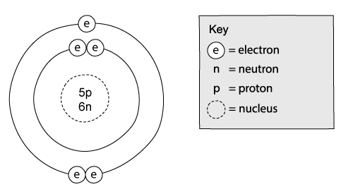
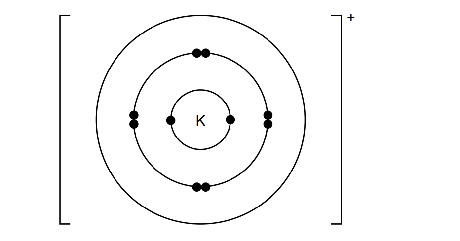
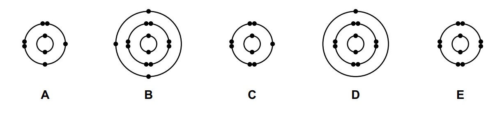
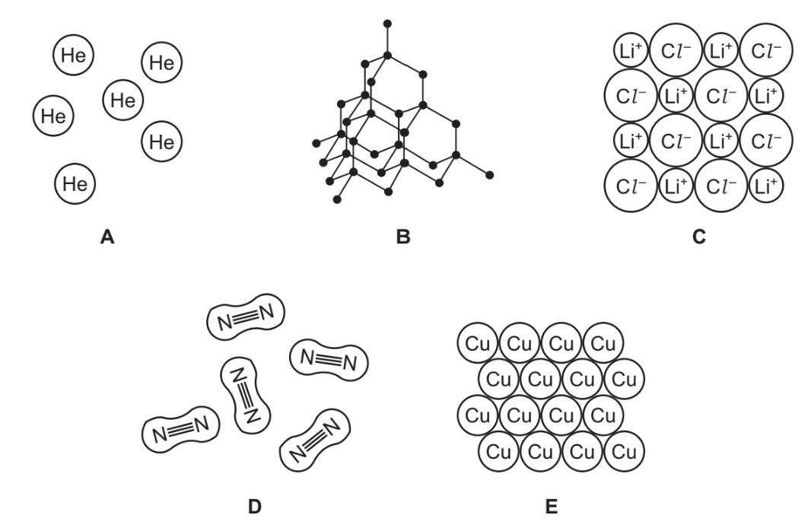
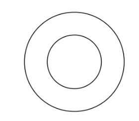

# Exam Questions — Atomic Structure & the Periodic Table
**2. Atoms, Elements & Compounds** · Cambridge (CIE) IGCSE chemistry (0620 & 0971)
> Source: [https://www.savemyexams.com/igcse/chemistry/cie/23/topic-questions/](https://www.savemyexams.com/igcse/chemistry/cie/23/topic-questions/) · 44 questions across 2 sets

## Multiple Choice Questions (29 questions)

### Q1 — hard — 1 marks

**Q1** [1 mark]

Copper has two naturally occurring isotopes, 63Cu and 65Cu. The relative abundance of 63Cu is 69%.

What is the relative atomic mass of copper?

### Q2 — medium — 1 marks

**Q2** [1 mark]

Two atoms, X and Y can be represented as shown

`X _ 3 ^ 7 Y _ 3 ^ 8`

Which statement is correct for both atoms?

### Q3 — medium — 1 marks

**Q3** [1 mark]

Which diagram shows a mixture of **noble gases**?

### Q4 — easy — 1 marks

**Q4** [1 mark]

Two atoms, X and Y** **can be represented as shown

`X _ 3 ^ 7 Y _ 3 ^ 8`

Which row is correct for both atoms?

|   | electron configuration of X | electron configuration of Y | Is Y an isotope of X? |
|---|---|---|---|
| **A** | 2,1 | 2,1 | Yes |
| **B** | 2,1 | 2,6 | Yes |
| **C** | 2,5 | 2,1 | No |
| **D** | 2,5 | 2,6 | No |

### Q5 — easy — 1 marks

**Q5** [1 mark]

Which statement about carbon is correct?

### Q6 — easy — 1 marks

**Q6** [1 mark]

Which diagram shows a mixture of compounds?

### Q7 — easy — 1 marks

**Q7** [1 mark]

The atomic number of element Q is 9 and its mass number is 19.

In which group of the Periodic Table should element Q be placed?

### Q8 — easy — 1 marks

**Q8** [1 mark]

Substances can be broadly classified into three categories which are elements, compounds and mixtures.

Which of the following statements is correct?

### Q9 — easy — 1 marks

**Q9** [1 mark]

The atomic structure of atoms Q, R, S and T are shown in the table.

| Atom | Number of protons | Number of neutrons | Number of electrons |
|---|---|---|---|
| Q | 6 | 7 | 6 |
| R | 7 | 7 | 7 |
| S | 6 | 8 | 6 |
| T | 8 | 8 | 8 |

Which two atoms are isotopes?

### Q10 — easy — 1 marks

**Q10** [1 mark]

Which option correctly describes the relative charges and masses of the subatomic particles?

|   | Proton | Neutron | Electron | Relative mass of proton |
|---|---|---|---|---|
| **A** | +1 | 0 | 0 | 0.00054 |
| **B** | 0 | +1 | +1 | 1 |
| **C** | 0 | +1 | -1 | 0.00054 |
| **D** | +1 | 0 | -1 | 1 |

### Q11 — easy — 1 marks

**Q11** [1 mark]

The diagram shows the atomic structure of an element.

Which element is it?

### Q12 — hard — 1 marks

**Q12** [1 mark]

#### Extended Only

Which row correctly describes the number of outer shell electrons and properties of isotopes?

|   | **Number of electrons** | **Chemical properties** |
|---|---|---|
| **A** | same | same |
| **B** | same | different |
| **C** | different | same |
| **D** | different | different |

### Q13 — hard — 1 marks

**Q13** [1 mark]

A selenide ion has the following notation.

$\text{Se} pre_{34} pre^{79^{2} -}$

Which row correctly describes the subatomic particles in a selenide ion?

|   | **Protons** | **Neutrons** | **Electrons** |
|---|---|---|---|
| **A** | 79 | 34 | 34 |
| **B** | 34 | 45 | 34 |
| **C** | 34 | 45 | 36 |
| **D** | 45 | 34 | 32 |

### Q14 — hard — 1 marks

**Q14** [1 mark]

Which row of the table correctly describes the link between outer shell electrons, Group number and Period number?

|   | **outer electrons same as** | **group number same as** | **period number same as** |
|---|---|---|---|
| **A** | group number | period number | outer electrons |
| **B** | period number | group number | outer electrons |
| **C** | group number | outer electrons | number of electron shells |
| **D** | outer electrons | group number | number of electron shells |

### Q15 — hard — 1 marks

**Q15** [1 mark]

#### Separate: Chemistry and Extended Only

Iridium has two isotopes, 191Ir and 193Ir. Calculate the relative atomic mass of iridium using the data given:

| Mass number | 191 | 193 |
|---|---|---|
| Percentage abundance | 62.7% | 37.3% |

### Q16 — hard — 1 marks

**Q16** [1 mark]

The X+ ion of element X has 16 electrons and a nucleon number of 37.

What is the correct Group number for element X?

### Q17 — medium — 1 marks

**Q17** [1 mark]

Element X contains 4 electrons in its outer shell and 125 neutrons in its nucleus. What is element X?

### Q18 — medium — 1 marks

**Q18** [1 mark]

Potassium fluoride is an ionic compound formed when one atom of potassium bonds with one atom of fluorine.

Which row correctly describes the charge and electronic configuration of each ion in the compound?

|   | Potassium ion | Fluorine ion |   |   |
|---|---|---|---|---|
| **A** | 1 - | 2, 8, 8 | 1 + | 2, 8 |
| **B** | 1 + | 2, 8, 8 | 1 - | 2, 8 |
| **C** | 1 + | 2, 8, 8 ,1 | 1 - | 2, 7 |
| **D** | 1 - | 2, 8, 8, 2 | 1 + | 2, 6 |

### Q19 — medium — 1 marks

**Q19** [1 mark]

The structure of four particles is described in the table.

| Particle | Number of protons | Number of neutrons | Number of electrons |
|---|---|---|---|
| Li | 3 | X | 3 |
| Li+ | 3 | 4 | 2 |
| F | Y | 10 | 9 |
| F- | 9 | 10 | Z |

What are the correct values for X, Y and Z?

|   | X | Y | Z |
|---|---|---|---|
| **A** | 4 | 7 | 9 |
| **B** | 3 | 9 | 9 |
| **C** | 4 | 9 | 10 |
| **D** | 3 | 7 | 10 |

### Q20 — medium — 1 marks

**Q20** [1 mark]

A section of the Periodic Table is shown below.

The electronic structure of elements W, X, Y and Z are shown in the table.

|   | Electronic structure |
|---|---|
| **W** | 2, 1 |
| **X** | 2, 4 |
| **Y** | 2, 8, 2 |
| **Z** | 2, 8 |

Which elements have the correct electronic structure?

### Q21 — medium — 1 marks

**Q21** [1 mark]

Element X contains 12 of each sub-atomic particle.

What is the correct Group number for element X?

## Theory Questions (29 questions)

### Q1 — medium — 8 marks

**Q1** [4 marks]

The table below gives information about particles.

Complete the table. The first line has been done for you.

| particle | number of protons | number of electrons | electronic configuration | charge on particle |
|---|---|---|---|---|
| A | 12 | 10 | 2,8 | 2+ |
| B |   | 18 | 2,8,8 | 1- |
| C | 18 |   | 2,8,8 | 0 |
| D | 8 | 10 |   |   |

*Source: 2016 Jan42 Q1*

**Q1** [1 mark]

**Extract:**

The table below gives information about particles.

| particle | number of protons | number of electrons | electronic configuration | charge on particle |
|---|---|---|---|---|
| A | 12 | 10 | 2,8 | 2+ |
| B |   | 18 | 2,8,8 | 1- |
| C | 18 |   | 2,8,8 | 0 |
| D | 8 | 10 |   |   |

Gallium is a Group III element.

Define the term *element*.

*Source: 2016 Jan42 Q1*

**Q1** [3 marks]

The following are gallium atoms.

$Ga_{31}^{69}$         $Ga_{31}^{71}$

Complete the following table.

| atom | number of protons | number of neutrons | number of electrons |
|---|---|---|---|
| $Ga_{31}^{69}$ |   |   |   |
| `Ga presubscript 31 presuperscript 71` |   |   |   |

*Source: 2016 Jan42 Q1*

### Q2 — hard — 8 marks

**Q2** [6 marks]

The table below gives the number of protons, neutrons and electrons in atoms or ions.

| particle | number of protons | number of electrons | number of neutrons | symbol or formula |
|---|---|---|---|---|
| A | 9 | 10 | 10 | `F _ 9 ^ 19 ^ -` |
| B | 11 | 11 | 12 |   |
| C | 18 | 18 | 22 |   |
| D | 15 | 18 | 16 |   |
| E | 13 | 10 | 14 |   |

Complete the table. The first line is given as an example.

*Source: 2008 Oct31 Q2*

**Q2** [2 marks]

**Extract:**

The table below gives the number of protons, neutrons and electrons in atoms or ions.

| particle | number of protons | number of electrons | number of neutrons | symbol or formula |
| A | 9 | 10 | 10 | F- |
| B | 11 | 11 | 12 |   |
| C | 18 | 18 | 22 |   |
| D | 15 | 18 | 16 |   |
| E | 13 | 10 | 14 |   |

Which atom in the table is an isotope of the atom which has the composition 11p, 11e and 14n?

Give a reason for your choice.

*Source: 2007 Oct31 Q2*

### Q3 — hard — 10 marks

**Q3** [3 marks]

Complete the table which gives the names, symbols, relative masses and relative charges of the three subatomic particles.

| **name** | **symbol** | **relative mass** | **relative charge** |
|---|---|---|---|
| electron |   |   |   |
| proton |   | 1 |   |
|   | n |   | 0 |

*Source: 2008 Ju31 Q2*

**Q3** [7 marks]

**Extract:**

Complete the table which gives the names, symbols, relative masses and relative charges of the three subatomic particles.

| **name** | **symbol** | **relative mass** | **relative charge** |
| electron | e | 1/1840 OR negligible | -1 |
| proton | p | 1 | +1 |
| neutron | n | 1 | 0 |

Use the information in the table to explain the following.

i) Atoms contain charged particles but they are electrically neutral because they have no overall charge.

[2]

ii) Atoms can form positive ions.

[2]

iii) Atoms of the same element can have different masses.

[2]

iv) Scientists are certain that there are no undiscovered elements missing from the Periodic Table from hydrogen to lawrencium.

[1]

*Source: 2008 Ju31 Q2*

### Q4 — easy — 5 marks

**Q4** [2 marks]

Cobalt is an element in Period 4 of the Periodic Table.

Use your copy of the Periodic Table to help you complete the table below.

| particle | number of protons | number of neutrons | number of electrons |
|---|---|---|---|
| Co |   |   |   |
| Co2+ |   |   |   |

*Source: 2011 O32 Q1A*

**Q4** [3 marks]

#### Extended Only

60Co is an isotope.

i) Explain the term isotope.

[2]

ii) Explain why two isotopes of the same element have identical chemical properties.

[1]

*Source: 2011 O32 Q1B*

### Q5 — medium — 12 marks

**Q5** [3 marks]

Protons, neutrons and electrons are subatomic particles.

Complete the table to show the relative mass and relative charge of a proton, a neutron and an electron.

| particle | relative mass | relative charge |
|---|---|---|
| proton |   |   |
| neutron |   |   |
| electron | $\frac{1}{1840}$ |   |

[3]

*Source: 2016 Jun41 Q1*

**Q5** [4 marks]

#### Extended Only

Bromine has two isotopes.

i) Define the term isotope.

[2]

ii) Explain why the two isotopes of bromine have the same chemical properties.

[2]

*Source: 2016 Jun41 Q1*

**Q5** [5 marks]

The table shows the number of protons, neutrons and electrons in some atoms and ions.

Complete the table.

| particle | number of protons | number of neutrons | number of electrons |
|---|---|---|---|
| `Li presubscript 3 presuperscript 7` |   |   |   |
| $\mathrm{S} pre_{16} pre^{34^{2} -}$ |   |   |   |
|   | 19 | 22 | 18 |

*Source: 2016 Jun41 Q1*

### Q6 — easy — 6 marks

**Q6** [4 marks]

Complete the table to show the relative charge and approximate relative mass of a proton, a neutron and an electron.

| type of particle | relative charge | approximate relative mass |
|---|---|---|
| proton |   | 1 |
| neutron |   |   |
| electron | −1 |   |

*Source: June 2020 0620/32 Q1B*

**Q6** [2 marks]

Deduce the number of electrons and neutrons in an atom of the isotope of potassium shown.

`K _ 19 ^ 41`

number of electrons:   number of neutrons:

*Source: June 202 0620/32 Q1C*

### Q7 — hard — 8 marks

**Q7** [5 marks]

The table gives the composition of three particles.

| particle | number of protons | number of electrons | number of neutrons |
|---|---|---|---|
| **A** | 15 | 15 | 16 |
| **B** | 15 | 18 | 16 |
| **C** | 15 | 15 | 17 |

What is the evidence in the table for each of the following?

i) Particle **A** is an atom.

[1]

ii) They are all particles of the same element.

[1]

iii) Particle **B** is a negative ion.

[1]

iv) Particles **A** and **C** are isotopes.

[2]

*Source: 2010 Oct31 Q1*

**Q7** [3 marks]

**Extract:**

The table gives the composition of three particles.

| particle | number of protons | number of electrons | number of neutrons |
| :---: | :---: | :---: | :---: |
| A | 15 | 15 | 16 |
| B | 15 | 18 | 16 |
| C | 15 | 15 | 17 |

i) What is the electronic structure of particle **A**?

[1]

ii) What is the valency of the element?

[1]

iii) Is the element a metal or a non-metal? Give a reason for your choice.

[1]

*Source: 2010 Oct31 Q1*

### Q8 — easy — 9 marks

**Q8** [5 marks]

Substances can be classified as:

elements    mixtures     compounds

Elements can be divided into:

metals       non-metals

Define each of the following terms.

i) element

[2]

ii) compound

[2]

iii)  mixture

[1]

*Source: 2013 Ju33 Q1*

**Q8** [3 marks]

**Extract:**

An element is:
Option 1:
- (A substance which) cannot be broken into anything simpler; [1 mark]
- By chemical means; [1 mark]
Option 2:
- Made up of one type of atom only; [2 marks]
A compound is:
- Two or more different elements; [1 mark]
- Chemically bonded together; [1 mark]
A mixture is:
- Two or more substances not chemically joined together; [1 mark]

Classify each of the following as either an element, compound or mixture.

i) brass ..........................................................................................................

[1]

ii) carbon dioxide .....................................................................................................

[1]

iii) copper ..........................................................................................................

[1]

*Source: 2013 Ju33 Q1*

**Q8** [1 mark]

Which physical property is used to distinguish between metals and non-metals?

It is possessed by all metals but by only one non-metal.

*Source: 2013 Ju33 Q1*

### Q9 — medium — 5 marks

**Q9** [1 mark]

Sulfuric acid is a compound.

Define the term compound.

*Source: Specimen 0620/03 Q4C*

**Q9** [3 marks]

Complete **Table 2.1  **to show the number of electrons, neutrons and protons in the sulfur atom and oxide ion.

**Table 2.1 **

|   | number of electrons | number of neutrons | number of protons |
|---|---|---|---|
| `S _ 16 ^ 34` | 16 |   |   |
| $\mathrm{O} pre_{8} pre^{18^{2} -}$ |   | 10 |   |

*Source: Specimen 0620/03 Q1B*

**Q9** [1 mark]

**Extract:**

A potassium atom has the electronic configuration 2,8,8,1
The single positive charge indicates that the outer electron has been lost
So, the electronic configuration of the ion is 2,8,8
Eight electrons in the outer shell

Complete **Figure 2.2** to show the electronic configuration of a potassium ion.

**Figure 2.2**

*Source: Specimen 0620/03 Q2A*

### Q10 — medium — 9 marks

**Q10** [2 marks]

#### Extended Only

Chlorine is in Group VII of the Periodic Table. Two isotopes of chlorine are chlorine‑35 and chlorine‑37

State why these two isotopes of chlorine have the same chemical properties.

*Source: June 2020 0620/43/04 Q3A*

**Q10** [3 marks]

Chlorine is in Group VII of the Periodic Table. Two isotopes of chlorine are chlorine‑35 and chlorine‑37.

Complete the table to show the number of electrons, neutrons and protons in each atom and ion.

|   | number of electrons | number of neutrons | number of protons |
|---|---|---|---|
| $Cl_{17}^{35}$ |   |   |   |
| `Cl _ 17 ^ 37 ^ -` |   |   |   |

*Source: June 2020 0620/43/04 Q3A*

**Q10** [3 marks]

$Na_{11}^{22}$, `Na presubscript 11 presuperscript 23` and $Na_{11}^{24}$ are isotopes of sodium.

Describe how these sodium isotopes are the same and how they are different in terms of the total number of protons, neutrons and electrons in each.

same:

different:

*Source: June 2019 0620/42/04 Q2A*

**Q10** [1 mark]

**Extract:**

![begin mathsize 16px style Na presubscript 11 presuperscript 22 end style], ![Na presubscript 11 presuperscript 23] and ![Na presubscript 11 presuperscript 24 end style] are isotopes of sodium.

- Protons: They all have 11 protons
- Electrons: They all have 11 electrons

Isotopes are defined as atoms of the same element with the same number of protons (and electrons) but different numbers of neutrons.

$Na_{11}^{22}$, `Na presubscript 11 presuperscript 23` and  `Na presubscript 11 presuperscript 24` are isotopes of sodium.

Why do all three isotopes have an overall charge of zero?

*Source: June 2019 0620/42/04 Q2A*

### Q11 — hard — 9 marks

**Q11** [5 marks]

This question is concerned with the elements in Period 5, Rb to Xe.

The electron distributions of some of these elements are given in the following list.

- element A    2 + 8 + 18 + 10
- element B    2 + 8 + 18 + 18 + 8
- element C    2 + 8 + 18 + 18 + 5
- element D    2 + 8 + 18 + 18 + 6
- element E    2 + 8 + 18 + 18 + 4
- element F    2 + 8 + 18 + 18 + 7

i) Identify element C.

[1]

ii) Which element in the list does not form any compounds?

[1]

iii) Which element in the list forms a chloride of the type XCl2?

[1]

iv) Which two elements would react together to form a compound of the type XY4?

[1]

v) Which element in the list would react with cold water to form an alkaline solution and hydrogen?

[1]

*Source: 2012 O32 Q1*

**Q11** [4 marks]

Predict two differences in physical properties and two differences in chemical properties between rubidium and the transition metal niobium.

physical .............................................................................................

chemical ............................................................................................

*Source: 2012 O32 Q1*

### Q12 — medium — 4 marks

**Q12** [1 mark]

**Figure 1.1 **shows the electronic configurations of five atoms, A, B, C, D and E.

**Figure 1.1**

Each letter may be used once, more than once or not at all.

Give the letter of the atom, A, B, C, D or E, that is in Group III of the Periodic Table.

*Source: Specimen 0620/03 Q1A*

**Q12** [1 mark]

**Extract:**

Figure 1.1 shows the electronic configurations of five atoms, A, B, C, D and E. Each letter may be used once, more than once or not at all.

Give the letter of the atom, A, B, C, D or E, that  has 13 protons.

*Source: Specimen 0620/03 Q1A*

**Q12** [1 mark]

**Extract:**

Figure 1.1 shows the electronic configurations of five atoms, A, B, C, D and E. Figure 1.1 ![~wdLeemf_q1_specimen-paper-0620-03-cie-igcse-chemistry] Each letter may be used once, more than once or not at all.

Give the letter of the atom, A, B, C, D or E, that  is a noble gas.

*Source: Specimen 0620/03 Q1A*

**Q12** [1 mark]

**Extract:**

Figure 1.1 shows the electronic configurations of five atoms, A, B, C, D and E. Figure 1.1 ![~wdLeemf_q1_specimen-paper-0620-03-cie-igcse-chemistry] Each letter may be used once, more than once or not at all.

Give the letter of the atom, A, B, C, D or E, that forms a stable ion with a single negative charge.

*Source: Specimen 0620/03 Q1A*

### Q13 — medium — 11 marks

**Q13** [2 marks]

This question is about elements **X**, **Y** and **Z.**

An atom of element **X **is represented as `X _ 16 ^ 34`

Name the different types of particles found in the nucleus of this atom of **X**.

*Source: June 202 0620/41 Q1A*

**Q13** [1 mark]

What is the term for the total number of particles in the nucleus of an atom?

*Source: June 2020 0620/41 Q1A*

**Q13** [1 mark]

**Extract:**

This question is about elements X, Y and Z. An atom of element X is represented as \$\$\_{16}^{34}X\$\$

What is the total number of particles in the nucleus of an atom of $X_{16}^{34}$ ?

*Source: June 202 0620/41 Q1A*

**Q13** [1 mark]

**Extract:**

This question is about elements X, Y and Z. An atom of element X is represented as _16^34 X

What is the electronic structure of the ion X2–?

*Source: June 2020 0620/41 Q1A*

**Q13** [1 mark]

What term is used to describe atoms of the same element with different numbers of particles in the nucleus?

*Source: June 2022 0620/41 Q1B*

**Q13** [3 marks]

#### Separate: Chemistry and Extended Only

Part of the definition of relative atomic mass is ‘the average mass of naturally occurring atoms of an element’. Some relative atomic masses are not whole numbers. Element Y has only two different types of atom, 69**Y** and 71**Y** The ratio of atoms present in element **Y** is shown.

69**Y** : 71**Y** = 3 : 2

- Calculate the relative atomic mass of element Y to one decimal place.

relative atomic mass: ..........

- Identify element **Y**.
- element **Y**: ..........

*Source: June 2020 0620/41 Q1C*

**Q13** [2 marks]

Element Z is in Period 3 and Group V.

Explain in terms of electron transfer why Z behaves chemically as a non-metal.

*Source: June 2020 0620/41 Q1D*

### Q14 — hard — 11 marks

**Q14** [4 marks]

The symbols of six particles are shown below.

| Na+ | Ca2+ | Kr | P | Si | O2- |
|---|---|---|---|---|---|

Select from the list of particles to answer the following questions. A particle may be selected once, more than once or not at all.

i) Which **two** ions have the same electronic structure?

[1]

ii) Which ion has the same electronic structure as an atom of argon?

[1]

iii) Which atom can form an ion of the type X3–?

[1]

iv) Which atom can form a hydride which has a formula of the type XH4?

[1]

*Source: 2015 Oct31 Q1*

**Q14** [4 marks]

i) How many protons, neutrons and electrons are there in one copper(II) ion $\text{Cu} pre_{29} pre^{64^{2} +}$

[2]

ii) $Sc_{21}^{45}$ represents an atom of scandium. How many nucleons and how many charged particles are there in one atom of scandium?

[2]

*Source: 2015 Oct31 Q1*

**Q14** [3 marks]

Two different atoms of sodium are `Na presubscript 11 presuperscript 23` and $Na_{11}^{24}$.

i) Explain why these two atoms are isotopes.

[2]

ii) `Na presubscript 11 presuperscript 24` is radioactive. It changes into an atom of a different element which has one more proton. Identify this element.

[1]

*Source: 2015 Oct31 Q1*

### Q15 — easy — 7 marks

**Q15** [1 mark]

The diagrams show part of the structures of five substances, A, B, C, D and E.

Answer the following questions about these structures.

Each structure may be used once, more than once or not at all.

Which one of these structures, A, B, C, D or E, is a compound?

*Source: June 2019 0620/31/03 Q1A*

**Q15** [1 mark]

**Extract:**

The diagrams show part of the structures of five substances, A, B, C, D and E.

Substance B is an element.

What is meant by the term *element* ?

*Source: June 2019 0620/31/03 Q1B*

**Q15** [1 mark]

Complete the diagram to show the electron arrangement in an oxygen atom.

*Source: June 2019 0620/31/03 Q3B*

**Q15** [4 marks]

Complete the table to show the number of electrons, protons and neutrons in the sulfur atom and copper ion shown.

|   | number of electrons | number of neutrons | number of protons |
|---|---|---|---|
| `S _ 16 ^ 34` |   |   |   |
| $\text{Cu} pre_{29} pre^{63^{2} +}$ |   |   | 29 |

*Source: June 2019 0620/31/03 Q6D*

### Q16 — easy — 3 marks

**Q16** [1 mark]

Magnesium, calcium and strontium are Group II elements.

Complete **Table 3.1 **to show the electronic configuration of a calcium atom.

**Table 3.1**

| shell | 1st | 2nd | 3rd | 4th |
|---|---|---|---|---|
| number of electrons |   |   |   |   |

*Source: Specimen 0620/04 Q21*

**Q16** [1 mark]

**Extract:**

Magnesium, calcium and strontium are Group II elements.

Complete Table 3.1 to show the electronic configuration of a calcium atom. The completed configuration is 2.8.8.2 (2 electrons in 1st shell, 8 in 2nd, 8 in 3rd, 2 in 4th).

Describe how the electronic configuration of a strontium atom is similar to the electronic configuration of a calcium atom.

*Source: Specimen 0620/04 Q2A*

**Q16** [1 mark]

**Extract:**

Magnesium, calcium and strontium are Group II elements. Complete Table 3.1 to show the electronic configuration of a calcium atom. Table 3.1 | shell | 1st | 2nd | 3rd | 4th | | number of electrons | 2 | 8 | 8 | 2 |

Describe how the electronic configuration of a strontium atom is different from the electronic configuration of a calcium atom.

*Source: Specimen 0620/04 Q2B*

### Q17 — medium — 7 marks

**Q17** [2 marks]

The table below gives the composition of six particles which are either atoms or ions.

| Particle | number of protons | number of neutrons | number of electrons |
|---|---|---|---|
| **A** | 33 | 40 | 33 |
| **B** | 19 | 20 | 18 |
| **C** | 34 | 45 | 36 |
| **D** | 33 | 42 | 33 |
| **E** | 13 | 14 | 13 |
| **F** | 24 | 28 | 21 |

Which particles are atoms? Explain your choice.

*Source: 2014 Ju31 Q1*

**Q17** [2 marks]

**Extract:**

The table below gives the composition of six particles which are either atoms or ions.

| Particle | number of protons | number of neutrons | number of electrons |
| A | 33 | 40 | 33 |
| B | 19 | 20 | 18 |
| C | 34 | 45 | 36 |
| D | 33 | 42 | 33 |
| E | 13 | 14 | 13 |
| F | 24 | 28 | 21 |

Which particle is a negative ion and why has this particle got a negative charge?

*Source: 2014 Ju31 Q1*

**Q17** [1 mark]

**Extract:**

The table below gives the composition of six particles which are either atoms or ions.

| Particle | number of protons | number of neutrons | number of electrons |
| A | 33 | 40 | 33 |
| B | 19 | 20 | 18 |
| C | 34 | 45 | 36 |
| D | 33 | 42 | 33 |
| E | 13 | 14 | 13 |
| F | 24 | 28 | 21 |

Which particles are positive ions?

*Source: 2014 Ju31 Q1*

**Q17** [2 marks]

**Extract:**

The table below gives the composition of six particles which are either atoms or ions.

| Particle | number of protons | number of neutrons | number of electrons |
| :---: | :---: | :---: | :---: |
| **A** | 33 | 40 | 33 |
| **B** | 19 | 20 | 18 |
| **C** | 34 | 45 | 36 |
| **D** | 33 | 42 | 33 |
| **E** | 13 | 14 | 13 |
| **F** | 24 | 28 | 21 |

Explain why particle **A** and particle **D** are isotopes.

*Source: 2014 Ju31 Q1*

### Q18 — easy — 9 marks

**Q18** [2 marks]

Define the term *isotope*.

*Source: 2015 Ja32 Q2*

**Q18** [7 marks]

The table gives information about four particles, **A**, **B**, **C** and **D**.

Complete the table.

The first line has been done for you.

| particle | number of protons | number of electrons | number of neutrons | nucleon number | symbol or formula |
|---|---|---|---|---|---|
| **A** | 6 | 6 | 6 | 12 | C |
| **B** | 11 | 10 | 12 |   |   |
| **C** | 8 |   | 8 |   | O2- |
| **D** |   | 10 |   | 28 | Al3+ |

*Source: 2015 Ja32 Q2*

### Q19 — medium — 8 marks

**Q19** [3 marks]

i) Define the term atomic number.

[1]

ii) Define the term nucleon number.

[2]

*Source: 2016 Jun42 Q2*

**Q19** [5 marks]

The table shows the number of protons, neutrons and electrons in some atoms or ions.

Complete the table. The first line is given as an example.

| particle | number of protons | number of electrons | number of neutrons | symbol or formula |
|---|---|---|---|---|
| A | 6 | 6 | 6 | $C_{6}^{12}$ |
| B | 12 | 12 | 12 |   |
| C | 8 |   |   | $O pre_{8} pre^{16^{2} - sign}$ |
| D | 11 | 10 | 13 |   |

*Source: 2016 Jun42 Q2*

### Q20 — easy — 8 marks

**Q20** [8 marks]

Complete the following table which gives the number of protons, electrons and neutrons in each of the five particles.

| particle | number of protons | number of electrons | number of neutrons |
|---|---|---|---|
|   | 19 | 19 | 20 |
| $Fe_{26}^{56}$ |   |   |   |
|   | 3 | 2 |   |
| $\text{Ga} pre_{31} pre^{70^{3} +}$ |   |   |   |
|   | 34 | 36 | 45 |

*Source: 2015 Ju32 Q1*

### Q21 — medium — 6 marks

**Q21** [4 marks]

The table gives the composition of three particles.

| particle | number of protons | number of electrons | number of neutrons |
|---|---|---|---|
| **A** | 15 | 15 | 16 |
| **B** | 15 | 15 | 16 |
| **C** | 15 | 15 | 17 |

What is the evidence in the table for each of the following?

i) Particle **A** is an atom.

[1]

ii) **A**, **B** and **C** are all particles of the same element.

[1]

iii) Particles **A** and **C** are isotopes of the same element.

[2]

*Source: 2016 specimen4 Q2*

**Q21** [2 marks]

**Extract:**

The table gives the composition of three particles.
| particle | number of protons | number of electrons | number of neutrons |
| A | 15 | 15 | 16 |
| B | 15 | 15 | 16 |
| C | 15 | 15 | 17 |

i) What is the electronic structure of particle **A**?

[1]

ii) Is element **A**, a metal or a non-metal? Give a reason for your choice.

[1]

*Source: 2016 specimen4 Q2*

### Q22 — medium — 13 marks

**Q22** [2 marks]

This question is about the structures of atoms and ions.

Define the term *proton number.*

*Source: June 2019 0620/41/04 Q1A*

**Q22** [2 marks]

Complete the table to show the number of protons, neutrons and electrons present in atoms of $Mg_{12}^{24}$ and $Mg_{12}^{26}$.

|   | number of protons | number of neutrons | number of electrons |
|---|---|---|---|
| `Mg presubscript 12 presuperscript 24` |   |   |   |
| `Mg presubscript 12 presuperscript 26` |   |   |   |

*Source: June 2019 0620/41/04 Q1B*

**Q22** [1 mark]

What term is used to describe atoms of the same element, such as $Mg_{12}^{24}$ and `Mg presubscript 12 presuperscript 26`?

*Source: June 2019 0620/41/04 Q1B*

**Q22** [2 marks]

**Extract:**

Complete the table to show the number of protons, neutrons and electrons present in atoms of ₁₂²⁴Mg and ₁₂²⁶Mg.

| | number of protons | number of neutrons | number of electrons |
| ₁₂²⁴Mg | 12 | 12 | 12 |
| ₁₂²⁶Mg | 12 | 14 | 12 |

#### Extended Only

Explain why the chemical properties of $Mg_{12}^{24}$ and $Mg_{12}^{26}$ are the same.

*Source: June 2019 0620/41/04 Q1B*

**Q22** [4 marks]

Complete the table to identify the atoms and ions which have the following numbers of protons, neutrons and electrons.

|   | number of protons | number of neutrons | number of electrons |
|---|---|---|---|
| `Na _ 11 ^ 23 ^ +` | 11 | 12 | 10 |
|   | 4 | 5 | 4 |
|   | 17 | 20 | 18 |

*Source: June 2019 0620/41/04 Q1C*

**Q22** [2 marks]

State the electronic structure of the following atom and ion.

Al*:*

S2–:

*Source: June 2019 0620/41/04 Q1D*

### Q23 — medium — 8 marks

**Q23** [2 marks]

The diagram shows part of the structures of five substances, **A**, **B**, **C**, **D** and **E**.

Answer the following questions about these structures. Each structure may be used once, more than once or not at all.

Which two of these structures, **A**, **B**, **C**, **D** or **E**, are compounds?

*Source: June 2019 0620/33/03 Q1A*

**Q23** [2 marks]

**Extract:**

The diagram shows part of the structures of five substances, **A**, **B**, **C**, **D** and **E**.

Answer the following questions about these structures. Each structure may be used once, more than once or not at all.

Substance **E** is present in air. Air is a mixture of different gases. Describe** two** characteristics of a mixture.

*Source: June 2019 0620/33/03 Q1B*

**Q23** [4 marks]

Complete the table to show the number of electrons, protons and neutrons in the sulfur atom and zinc ion shown.

|   | number of electrons | number of neutrons | number of protons |
|---|---|---|---|
| `S _ 16 ^ 36` |   |   |   |
| $\text{Zn} pre_{30} pre^{67^{2} +}$ |   |   | 30 |

*Source: June 2019 0620/33/03 Q6D*

