# Mark Schemes — Ions & Ionic Bonds
**2. Atoms, Elements & Compounds** · Cambridge (CIE) IGCSE chemistry (0620 & 0971)

## Multiple Choice Questions (25 questions)

### Q1
**Final answer:** **The correct answer is B**

- Statement 1 is incorrect

  - Sodium chloride has a giant ionic lattice
  - An ionic lattice is a **highly stable **structure in which oppositely charged ions are **strongly attracted**
  
    - It has a **high melting point** because a large amount of thermal energy is required to overcome the strong electrostatic forces of attraction
- Statement 2 is correct

  - When an ionic compound is dissolved in water (aqueous), the lattice breaks down and the ions become mobile (free to move)
  - The free movement of ions allows sodium chloride to conduct electricity
- Statement 3 is incorrect

  - Ionic compounds **do not conduct electricity in the solid **state because the ions are held tightly in fixed positions within the lattice
  - Since ions cannot move, they cannot carry the electric charge

### Q2
**Final answer:** **The correct answer is C**

- **Non-metals**, such as chlorine, **gain electrons **when forming ionic compounds
- Chlorine is in **Group VII**, so it needs to **gain one electron **to reach a stable noble gas electron configuration

  - Therefore, the answer is Cl-

**A** and **D** are incorrect because magnesium is the element that will lose electrons to form an ionic bond with chlorine

**B** is incorrect because chlorine cannot acquire a 2- charge because **it just needs one electron to have a full outer shell. **

> **[exam-tip]**
> Magnesium loses two electrons to become Mg2+. Each chlorine atom gains one electron to become Cl-.
> 
> **Chlorine (atom)** is not the same as **chloride (ion)**. This mix-up is very common in exams and it can lead you to lose easy marks. **Always double check the names**

### Q3
**Final answer:** **The correct answer is ****C**** because:**

- Magnesium is a **metal **so loses its outer shell electrons to form an ionic bond.
- It is a **Group II** metal so loses its **2** outer electrons to form the ion **Mg****2**+.
- Chlorine is a **Group VII **element so has **7** outer electrons.
- One magnesium atom donates both of its outer electrons, **1** each to **two **chlorine atoms, forming **MgCl****2**.

**A, B** and **D **are** **incorrect as the atoms do not combine in these ratios as they would not achieve the full outer shell configuration.

### Q4
**Final answer:** **The correct answer is ****B**** because:**

- In forming ionic compounds, metal atoms **lose** at least one **electron **from its outer shell.
- Electrons are completely **transferred** from the metal atom to the non-metal atom.

**A** and **C **are** **incorrect as in forming ionic compounds the metal atom **loses** its electron(s).

**D **is incorrect as electron sharing occurs in **covalent** bonding, not in ionic bonding*.*

### Q5
**Final answer:** **The correct answer is ****C**** because:**

- The positive and negatively charged ions are held together by the strong electrostatic forces of attraction
- This is what holds ionic compounds together

### Q6
**Final answer:** **The correct answer is ****C**** because:**

- Atoms have equal numbers of positive protons and negative electrons.
- To form a **negative** **ion**, an atom has to **gain** at least one negative **electron** so that it has more negative electrons than positive protons.

**A **is incorrect as an atom that loses electrons would have more protons than electrons, and would therefore have an overall positive charge.

**B **and **D** are incorrect as atoms do not lose or gain protons - protons are in the nucleus and play no part in bonding.

### Q7
**Final answer:** **The correct answer is ****B**** because:**

- In an ionic lattice of sodium chloride there is a regular arrangement of alternating cations and anions
- There are strong electrostatic forces of attraction between oppositely charged ions, this is the ionic bond
- The ions are held firmly in position by these forces of attraction so do not slide over each other easily

### Q8
**Final answer:** **The correct answer is ****B**** because:**

- **Q** is potassium; **R** is chlorine; **S** is silicon and** T** is argon.
- Potassium (K) has **1 **outer shell electron and chlorine (Cl) has** 7** outer electrons.
- Potassium donates **one** electron to chlorine and they form the ionic compound KCl where each atom obtains a full outer shell.

**A **and** D **are** **incorrect as these options contain T which is argon, a **noble gas** that does not combine with other elements.

**C **is incorrect as silicon and chlorine are both nonmetals and would combine via** covalent** bonds, not ionic.

### Q9
**Final answer:** **The correct answer is ****A**** because:**

- **X** is sodium (*A*r = 11) which has **1 **outer shell electron and **Y** is oxygen (*A*r = 8) which has **6 **outer shell electrons.
- Two Na atoms transfer their outer electron to the O atom, thereby achieving a **full **outer shell with the configuration** 2**.**8**.
- The oxygen atom gains **2** electrons and also achieves a **full **outer shell configuration of **2.8**.
- The ionic compound **Na**2**O** is thus formed, which is depicted by the formula **X**2**Y**.

**B, C** and **D **are** **incorrect as the atoms do not combine in these ratios as they would not achieve the full outer shell configuration.

### Q10
**Final answer:** **The correct answer is ****A**** because:**

- **Q** is carbon; **R **is neon; **S** is sodium and** T** is chlorine.
- Each atom of sodium has **1** outer shell electron and each atom of chlorine has **7** outer electrons.
- A sodium atom donates **one** electron to a chlorine atom and they form the ionic compound **sodium chloride** (NaCl) where each obtains a full outer shell.

**B **and** C **are** **incorrect as these options contain R which is neon, a **noble gas** that does not combine with other elements.

**D **is incorrect as carbon and chlorine are both nonmetals and combine via** covalent** bonds, not ionic.

### Q11
**Final answer:** **The correct answer is ****A**** because:**

- The **metal** atom transfers an electron(s) to the nonmetal atom.
- The **opposite ions attract **each other holding the ions close together in the lattice.

**B **is incorrect as opposite ions attract each other, they don’t repel.

**C **is incorrect as ionic compounds involve a metal and a nonmetal.

**D **is incorrect as the metal is the atom that transfers the electron and the nonmetal gains the electron*.*

### Q12
**Final answer:** **The correct answer is ****C**** because:**

- Ionic compounds are formed when electron transfer creates **oppositely charged** ions.
- These are held together by **strong electrostatic forces** which require a lot of energy to be overcome for melting to occur.

**A** and **B** are incorrect as ionic compounds are formed from metals and nonmetals.

**D** is incorrect as intermolecular forces occur in between the molecules of **covalent** substances and are very **weak.**

### Q13
**Final answer:** **The correct answer is ****C**** because:**

- The **ionic** **lattice** is a** giant structure** held together by **ionic** bonds formed by the electrostatic attraction between oppositely charged ions.
- **The electrostatic forces act in all directions.**

**A** and **B **are** **incorrect** **as ionic compounds form **giant lattice **structures.

**D **is** **incorrect** **as the electrostatic forces act in **all directions** in the lattice.

### Q14
**Final answer:** **The correct answer is ****D**** because:**

- **X** is fluorine (*A*r = 9) which has **7 **outer shell electrons and **Y** is lithium (*A*r = 3) which has **1 **outer shell electron.
- **One Li **atom transfers its outer electron to the **F** atom, thereby achieving a **full **outer shell with the configuration** 2**.
- The **F **atom gains **1 **electron and also achieves a **full **outer shell configuration of **2.8.**
- The ionic compound** LiF **is thus formed, which is depicted by the formula** XY.**

**A, B **and **C** are incorrect as the atoms do not combine in these ratios as they would not achieve a full outer shell configuration.

### Q15
**Final answer:** **The correct answer is ****C**** because:**

- Beryllium is a metal in **Group II** and thus has **metallic** bonding, not **covalent.**

**A **is incorrect as fluorine is a diatomic nonmetal molecule with covalent bonding.

**B **and **D **are incorrect as both of these compounds are **ionic compounds** formed from a metal and a nonmetal.

### Q16
**Final answer:** **The correct answer is ****B**** because:**

- Ionic compounds consist of **lattice **structures which have a **regular** and **repeating** **pattern**.
- The pattern is an **alternating** arrangement of **positive** and **negative** ions.

**A **is incorrect as the structure is based on a regular repeating pattern, not irregular.

**C **and** D **are** **incorrect as ionic structures are regular, not random.

### Q17
**Final answer:** **The correct answer is ****D**** because:**

- In ionic compounds the nonmetal atom **gains** an **electron(s)** by complete transfer from the **metal** atom.
- **Electrostatic forces** of attraction bind the ions together, forming the ionic bond.

**A **and** B **are** **incorrect as in ionic compounds the nonmetal atom **gains** the electron(s).

**C **is** **incorrect** **as electron sharing occurs in **covalent** bonding, not in ionic bonding.

### Q18
**Final answer:** **The correct answer is ****A**** because:**

- Lithium is a Group 1 metal so has one electron in its outer shell

  - It will lose one outer electron to another atom to gain a full outer shell of electrons
  - A positive lithium ion with the charge 1+ is formed
  - It now has 2 electrons in its outer shell which is complete as the shell closest to the nucleus can hold a maximum of 2 electrons
- Sulfur is a Group 6 non-metal so will need to gain two electrons to have a full outer shell of electrons

  - One electron will be transferred from the outer shell of a lithium atom to the outer shell of the sulfur atom
  - A second electron will be transferred from the outer shell of another lithium atom to the outer shell of the sulfur atom
  - A sulfur atom will gain two electrons to form a negatively charged sulfide ion with a charge of 2-

### Q19
**Final answer:** **The correct answer is ****D**** because:**

- The electronic structure of neon is **2**,**8**.
- Chlorine gains one electron, forming a Chloride ion with an electronic structure of **2**, **8**, **8**, the same as argon, not neon.

**A **is incorrect as a magnesium atom with **12** electrons loses two electrons to form a positive magnesium ion with the electronic structure **2,8**

**B **is incorrect as a fluorine atom with **9** electrons gains 1 electron to form a negative fluoride ion with the electronic structure **2,8**

**C **is incorrect as** **a sodium atom with **11** electrons loses 1 electron to form a positive sodium ion with the electronic structure **2,8**

### Q20
**Final answer:** **The correct answer is ****B**** because:**

- Ionic substances have high melting and boiling points due to the presence of strong electrostatic forces acting between the oppositely charged ions
- These forces act in all directions and a lot of energy is required to overcome them
- Ionic compounds can conduct electricity in the molten state as they have ions that can move and carry charge
- They cannot conduct electricity in the solid state as the ions are in fixed positions within the lattice and are unable to move

**A** is incorrect as substance **W** can conduct electricity when solid. Ionic compounds are unable to conduct when solid as the ions are unable to move

**C** and **D** are incorrect as substances **Y** and **Z** are unable to conduct electricity when liquid. Ionic compounds can conduct electricity when liquid as the ions can move

### Q21
**Final answer:** **The correct answer is ****D**** because **

- calcium atoms have **20 electrons**, with two electrons in its outermost shell. It **loses** these **two** electrons to form a 2+ positive ion.

**A **is incorrect as calcium ions do not lose electrons, calcium atoms do.

**B **and **C** are incorrect as calcium atoms need to **lose** 2 electrons to form positive ions.

### Q22
**Final answer:** **The correct answer is ****C**** because:**

- An electronic configuration of **2.8.8** has **18** **electrons** and as an ion it has **more **or **less electrons** than **protons**.
- The atomic number of S is **16** while Ca has an atomic number of **20**.
- The S ion is **S****2**- so it has **2** electrons **more** than the atomic number (**16**), therefore S2- has **18 electrons**.
- The Ca ion is **Ca****2+** so it has **2** electrons **less** than the atomic number (**20**), so  Ca2+ also has **18 electrons**.

**A, B **and** D **are** **incorrect as **2**.**8**.**8** is the electronic configuration of both Ca2+ and S2-.

## Theory Questions (19 questions)

### Q1
> **[mark-scheme]**
> - CaSO4 + H2O + CO2 (correct formulae of all products) **[1 mark]**
> - CaCO3 + H2SO4 → CaSO4 + H2O + CO2 (correct balanced equation) **[1 mark]**
> 
> State symbols are not required for obtaining the full marks
> **[mark-scheme]**
> - It has a giant ionic lattice/giant structure **[1 mark]**
> - There are strong electrostatic forces of attraction between oppositely charged ions / between ions of different charges / between cations and anions **[1 mark]**
> - A large amount of (thermal) energy is required to overcome/break these forces **[1 mark]**
> **[mark-scheme]**
> - Insoluble
> **OR**
> Nearly / almost insoluble **[1 mark]**
> **[mark-scheme]**
> - The rate of reaction increases/gets faster **[1 mark]**
> - The powder has a larger surface area (than granules) **[1 mark]**
> - This leads to more frequent collisions between particles / a higher frequency of successful collisions **[1 mark]**

> **[exam-tip]**
> Watch out!  A lot of students incorrectly explain this using **energy**.
> 
> Changing the **surface area** does **not change the energy of collisions**. Instead, powder has a larger surface area, so more particles are exposed, leading to more frequent successful collisions.
> 
> Focus your explanation on **collision frequency**, not energy. **Temperature is the only factor that affects the average kinetic energy of the particles.**
| particle | number of protons | number of neutrons | number of electrons |
|---|---|---|---|
| `Mg presubscript 12 presuperscript 24` | **Final answer:** **12** | **Final answer:** **12** | **Final answer:** **12** |
| `Be presubscript 4 presuperscript 9` | **Final answer:** **4** | **Final answer:** **5** | **Final answer:** **2** |

**[3 marks]**

> **[mark-scheme]**
> 1 mark for giving the correct number of protons (12 for Mg and 4 for Be2+)
> 
> 1 mark for giving the correct number of neutrons (12 for Mg and 5 for Be2+)
> 
> 1 mark for giving the correct number of electrons (12 for Mg and 2 for Be2+ since it has lost two electrons as indicated from its)

> **[exam-tip]**
> Make sure to remember that a **neutral atom has equal numbers of protons and electrons**. Protons are **positive** and electrons are **negative**, so their charges cancel out when the numbers are the same.
> 
> If the numbers are different, the atom is **not neutral**,  it is an ion.
> 
> **Cations** are positive (+) ions and they have lost electrons, while **anions **are negative (-) ions and they have gained electrons. The charge indicates how many electrons the ion has lost or gained.
For calculating the relative atomic mass, you must use the following equation:

`relative atomic mass ( A _ r ) = (% of isotope 1 x mass number of isotope 1 + % of isotope 2 x mass number of isotope 2 +...)/(100 %)`

- Note that this equation depends on the amount of isotopes given, therefore, it should go up to three isotopes

Using the values from the table:

$\text{relative} \text{atomic} \text{mass} ( A_{r} ) = \frac{24 \times 79.0 + 25 \times 10.0 + 26 \times 11.0}{100 \%}$ **[1 mark]**

Therefore, the calculated relative atomic mass for magnesium is:

relative atomic mass (*A*r) = **24.3** **[1 mark]**

> **[exam-tip]**
> Always check the **number of decimal places** requested in the question.
> 
> Even if your calculation is correct, writing 24.32 instead of 24.3 will lose the mark because the answer must match the specified precision.
> 
> Always **round your final answer exactly as instructed**.

**[3 marks]**

> **[mark-scheme]**
> 1 mark for magnesium ion has one shell with 8 electrons drawn
> 
> 1 mark for both chloride ions have 8 electrons in their outer shell 7 dots and one cross to show the transfer of one electron from Mg to each Cl
> 
> 1 mark for the correct charges for all ions Mg should have 2+ and Cl should have - **OR** 1-

> **[exam-tip]**
> **Remember! **Dots and crosses are just symbols to show where electrons come from. Examiners do not mind which symbol you use, as long use them consistently for each element.

### Q2
a) The dot-and-cross diagrams to show the electronic structures of one magnesium ion and one fluoride ion are:

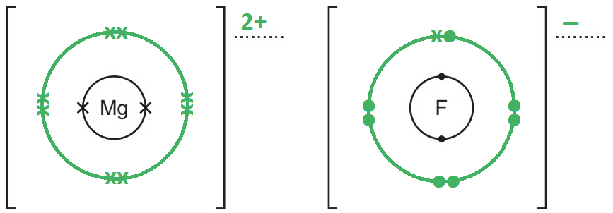

- Mg with a new outer shell containing 8 crosses; **[1 mark]**
- F with new outer shell containing 7 dots and 1 cross; **[1 mark]**
- 2+ charge on Mg 
**AND**
 – charge on F; **[1 mark]**

**[Total: 3 marks]**

- *Careful:** The question says to complete the dot-and-cross diagrams*

  - *There are not enough shells for each atom / ion given in the question which means you will have to add shells and electrons*
- *Magnesium has 12 electrons, 2.8.2, and will lose two outer electrons to form a 2+ magnesium ion*
- *Fluorine has 9 electrons, 2.7, and will gain one electron for a full outer shell forming a 1- fluoride ion*

  - *Therefore, two fluorines would be needed to use the two electrons from magnesium - 1 each*
  - *But, you are asked to draw the structure of only one fluoride ion - you would not be penalised for drawing the second fluoride ion unless one of the structures was incorrect*
b) To make solid magnesium fluoride conduct electricity, it should be:

- Heated until molten
**OR**
Dissolved in water; **[1 mark]**

Explanation:

- So there are moving / mobile ions; **[1 mark]**

**[Total: 2 marks]**

- *For ionic solids to be able to conduct, their ions must be able to move*
- *This requires the ionic solid to be dissolved or molten*

> **[exam-tip]**
> Name the mobile ions as the charge carriers \u2014 vague terms like "charged particles" or "free electrons" do not earn the mark
> 
> Say "mobile", not "free", and remember conduction here is by ions, not electrons
c) Magnesium fluoride has a high melting point because:

- The (electrostatic) forces of attraction between oppositely charged ions  
**OR **
The ionic bonds; **[1 mark]**
- Are strong
**OR**
Need a lot of energy to break / weaken; **[1 mark]**
*Allow must be linked to ionic bonds / electrostatic forces*
*Do not accept "strong" if attached to the wrong bond type (e.g."strong covalent bonds")*

**[Total: 2 marks]**

- *Magnesium fluoride is made from magnesium (a metal) and fluorine (a non-metal) *
- *A metal and a non-metal means that it is ionic bonding*
- *Compounds that have ionic bonding have high melting points *
- *This is because there are strong electrostatic forces of attraction which need large amounts of energy to overcome*

### Q3
a) The formula of the negative ion is:

- S– ; **[1 mark]**

**[Total: 1 mark]**

- *For the FeS**2** to have no overall charge *
- *If Fe has a 2+ charge*
- *Each S must have a 1- charge*
b) The student could distinguish between the two substances by:

Any **one **of the following pairs:

- Testing conductivity; **[1 mark]**
- Gold is a better conductor / gold can conduct electricity, pyrite can't; **[1 mark]**

**   OR**

- Malleability / hit with a hammer; **[1 mark]**
- Gold is malleable / only gold produces a ringing sound; **[1 mark]**

**   OR**

- Density; **[1 mark]**
- Gold is denser;** [1 mark]**

**   OR**

- Add acid/ any named/ formula of acid; **[1 mark]**
- Gold does not react (ignore products with pyrites);** [1 mark]**

**   OR**

- Heat (both strongly) in air/ oxygen; **[1 mark]**
- Iron pyrite reacts (ignore products); **[1 mark]**

**   OR**

- Melting point; **[1 mark]**
- Golds is lower; **[1 mark]**

**   OR**

- Heat with a more reactive metal than iron;** [1 mark]**
- Gold does not react;** [1 mark]**

**[Total: 2 marks]**

- *This question is asking you to give a difference in properties between an ionic compound, iron pyrite, and a metal, gold*
- *Make sure you don't just say what is different but how *

  - *E.g. don't just say they have different melting points, make sure to include golds would be lower*
- *This is very important in comparison questions*
c) A chemical equation for the reaction between iron pyrite and oxygen is:

4FeS2 + 11O2 → 2Fe2O3 + 8SO2

- All formulae correct; **[1 mark]**
- Correct balancing; **[1 mark]**

**[Total: 2 marks]**

- *You know the reactants are iron pyrite and oxygen*
- *You also know the products iron (III) oxide, Fe**2**O**3**, and sulphur dioxide*
- *Work across the equation from left to right, checking one element after another to make sure there are the same number on both sides*

### Q4
a) The completed table should look as follows:

| particle | number of protons | number of electrons | number of neutrons | symbol or formula |
|---|---|---|---|---|
| A | 4 | 4 | 5 | `Be presubscript 4 presuperscript 9` |
| B | 19 | 18 | 20 | `K _ 19 ^ 39 ^ +`; **[2 marks]** |
| C | 30 | 30 | 35 | $Zn_{30}^{65}$; **[1 mark]** |
| D | 8 | 10 | 8 | $O pre_{8} pre^{16^{2} - sign}$; **[2 marks]** |
| E | 31 | 31 | 39 | $Ga_{31}^{70}$; **[1 mark]** |

For particles B and D:

- Correct symbol, mass number and atomic number; **[1 mark]**
- Correct charge; **[1 mark]**

**[Total: 6 marks]**

- *You can determine which element each particle is by looking at the number of protons it has*
- *You can determine the mass number by adding up its protons and neutrons*

  - *mass number = number of protons + number of neutrons*
- *You can determine any charges by looking at the difference between the number of protons and electrons*
b) You can determine whether a particle is an atom, a negative ion or a positive ion from the data in the table as follows:

- If the number of protons is equal to the number of electrons then the particle is an atom; **[1 mark]**
- If the number of protons is  greater than the number of electrons then the particle is a positive ion; **[1 mark]**
- If the number of electrons is greater than the number of protons then the particle is a negative ion; **[1 mark]**

**[Total: 3 marks]**

### Q5
a)

i) A diagram which shows the formula of the compound is:

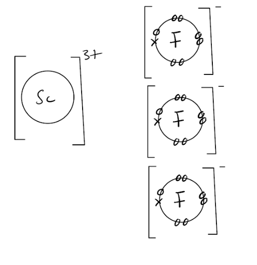

- Fluoride ion drawn correctly; **[1 mark]**
- Correct charge on scandium ion; **[1 mark]**
- One scandium ion and three fluoride ions; **[1 mark]**

ii) Scandium fluoride has a high melting point because:

- It has strong forces of attraction between oppositely charged ions  
**OR **
Ionic bonds are strong / require a lot of energy to break them; **[1 mark]**

**[Total: 4 marks]**

- *Read the question carefully- you do not need to show the outer electrons in the scandium ion, just the fluoride ions*
- *Scandium has three electrons in its outer shell, and fluorine has 7 seven*

  - *Fluorine only needs to gain one electron to achieve a full outer shell and so three fluorine atoms are needed in total*
  - *This shows the formula of scandium fluoride as being ScF**3*
- *The strong attraction between the positive scandium ions and the negative fluoride ions requires lots of energy to overcome so the melting point is high*
b)

i)  The structure of silicon(IV) oxide is:

Any **three **from:

- Each oxygen (atom) is joined to two silicons/atoms; **[1 mark]**
- Each silicon (atom) is joined to four oxygen atoms; **[1 mark]**
- Tetrahedral structure / similar to diamond; **[1 mark]**
- Linear around oxygen; **[1 mark]**

ii) The electrical conductivity of these two compounds differ because:

- Silicon oxide does not conduct electricity but scandium fluoride will conduct when molten / aqueous / in solution; **[1 mark]**

iii) The difference in conductivity is because:

- Molten / aqueous scandium fluoride has ions which can move; **[1 mark]**
- Silicon oxide has no free-moving / mobile charged particles; **[1 mark]**

**[Total: 6 marks]**

- *Check the number of marks the question is worth for these types of question*
- *For part iii) you must comment on both structures*

  - *Students often miss the second mark for this as they focus their explanation on the structure that can conduct and forget to explain why the other one can't*

### Q6
a) The symbol or formula which represents an ion formed when an atom gains an electron is:

- Cl* *- / chloride; **[1 mark]**

**[Total: 1 mark]**

- *Remember:** Electrons have a negative charge*
- *This means that you are looking for the formula with a single – charge*
b) The bonding and arrangement of particles in caesium chloride and carbon dioxide are:

Bonding:

Any **three **from**:**

- The bonding in caesium chloride is ionic; **[1 mark]**
- The bonding (between ions) in caesium chloride is strong; **[1 mark]**
- The bonding in carbon dioxide is covalent bonds; **[1 mark]**

Arrangement of particles:

- Caesium chloride has a regular (arrangement) / lattice 
**OR **
Caesium chloride is arranged in lines / columns; **[1 mark]**
- Carbon dioxide has a random / irregular arrangement; **[1 mark]**

**[Total: 5 marks]**

- *Caesium chloride is made from the metal caesium and the non-metal chlorine*

  - *Metal and non-metal = ionic bonding*
- *Carbon dioxide is made from the non-metal carbon and the non-metal oxygen*

  - *Non-metal + non-metal = covalent bonding*
- *From the diagrams, you can see that caesium chloride is a solid*

  - *Therefore, it has a regular arrangement of ions*
- *From the diagrams, you can see that carbon dioxide is a gas*

  - *Its particles / molecules are spread out and randomly arranged *
c) The ionic compound is:

- D / calcium oxide / CaO; **[1 mark]**

**[Total: 1 mark]**

- *Remember: **Ions are charged particles *
- *D is the only structure that has charged particles / ions*
d) Sodium ions have a charge of +1 because:

- They have 1 more proton than electrons 
**OR **
They have 11 protons and 10 electrons; **[1 mark]**

**[Total: 1 mark]**

- *All three chemical symbols show that the isotopes of sodium have 11 protons*

  - *An atom of sodium will also have 11 electrons since it atoms are electronically neutral*
- *Sodium is in Group 1, which means that it has 1 outer electron*

  - *When it becomes an ion, sodium loses this 1 outer electron*
  - *This means that a sodium ion has 11 protons and 10 electrons*

### Q7
a) The term ionic bonding refers to:

- The strong force of attraction; **[1 mark]**
- Between + and – ions / oppositely charged ions; **[1 mark]**

**[Total: 2 marks]**

- *You need to know this standard definition*

  - *An ionic bond is the strong electrostatic force of attraction between oppositely charged ions*
  - *Using the word particles instead of ions will sometimes get the second mark but this is not guaranteed *
b) The information in **Table 1.1 **which shows that potassium bromide is an ionic compound is:

- Does not conduct electricity when solid but conducts when molten; **[1 mark]**
- Higher boiling point; **[1 mark]**

**[Total: 2 marks]**

- *Ionic compounds cannot conduct electricity when they are solid as the ions are not able to move*

  - *Ionic compounds can conduct electricity when they are melted / molten or dissolved as the ions can now move*
- *The boiling point of ionic compounds is high as the strong (electrostatic) forces of attraction requires a large amount of energy to overcome*
c) The completed dot-and-cross diagram in **Figure 1.1 **of the ions in magnesium chloride is:

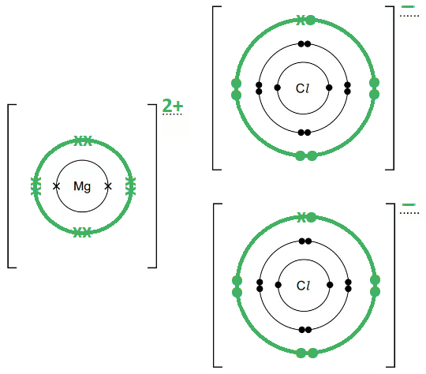

- Mg with a new outer shell containing 8 crosses; **[1 mark]**
- Both Cl with new outer shells each containing 7 dots and 1 cross; **[1 mark]**
- 2+ charge on Mg 
**AND**
 – charge on both Cl; **[1 mark]**

**[Total: 3 marks]**

- *Careful:** The question says to complete the dot-and-cross diagrams*

  - *There are not enough shells for each atom / ion given in the question which means you will have to add shells and electrons*
  - *Some answers will just have the charges and, therefore, miss out on 2 marks*
- *Magnesium has 12 electrons, 2.8.2, and will lose two outer electrons to form a 2+ magnesium ion*
- *Chlorine has 17 electrons, 2.8.7, and will gain one electron for a full outer shell forming a 1- chloride ion*

  - *Therefore, two chlorines are needed to use the two electrons from magnesium - 1 each*
d) Two other physical properties that are typical of ionic compounds are:

- High melting point 
**OR **
High boiling point; **[1 mark]**
- Good electrical conductivity when aqueous 
**OR **
Good electrical conductivity when molten; **[1 mark]**

**[Total: 2 marks]**

- *You need to know the properties of ionic compounds*

### Q8
a)

i) The noble gas is:

- D; **[1 mark]**

ii) The soft metal with a low density is:

- E; **[1 mark]**

ii) The substance that can form a covalent compound with element A is:

- B **OR** F; **[1 mark]**

iv) The giant covalent structure similar to diamond is:

- B; **[1 mark]**

v) The substance which forms a negative ion of the type X3- is:

- A; **[1 mark]**

**[Total: 5 marks]**

- *It is a noble gas*

  - *Noble gases have a full outer shell of electrons *
  - *D shows the formula, 2,8,18,8 which shows 8 electrons in the outer shell which is therefore full *
- *Soft metal with a low density*

  - *This is a property of Group 1 metals, so 2,8,18,8,1 is correct as it has 1 electron in the outer shell *
- *The substance that can form a covalent compound with element A is*

  - *Covalent compounds are formed between non- metals *
  - *By process of elimination, C and E are metals so would form ionic compounds and D is a noble gas which won't react leaving B and F*
- *A giant covalent structure similar to diamond*

  - *B has the electron configuration, 2,8,4 so an atomic number of 14 which is silicon*
  - *Silicon can form silicon dioxide and silicon (IV) which is a giant covalent structure *
- *It can form a negative ion of the type X**3-*

  - *A, 2,5 has 5 electrons in its outer shell so would gain three negative electrons to fill it giving it a 3- charge*
b)

i) A diagram to show the formula of this compound is:

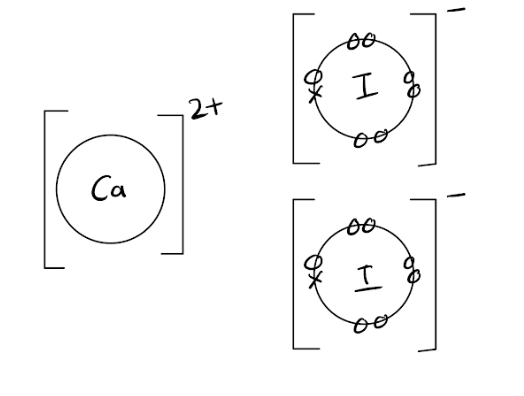

- Correct formula: CF2 or CaI2; **[1 mark] **
*Diagram shows CaI**2** but can use letters C and F alternatively* 
*The next two marks are conditional on correct formula*
- Correct charges on ions; **[1 mark]**
- 1x and 7o round F/I; **[1 mark]**

ii) **Two** properties of this compound are:

Any **two** from:** **

- High melting point or boiling point; **[1 mark]**
- Conducts when molten or in solution; **[1 mark]**
- Soluble in water; **[1 mark]**
- Brittle; **[1 mark]**
- Correct chemical properties; **[1 mark]**
- Hard; **[1 mark]**

**[Total: 5 marks]**

- *C has 2 electrons in its outer shell so will lose both to obtain a full outer shell*

  - *It will form an ion with a 2+ charge*
- *F has 7 electrons in its outer shell so gains one electron to obtain a full outer shell *

  - *It will form an ion with a 1- charge*
- *Two atoms of F are required to balance the charges (the overall charge on an ionic compound should be 0) so the formula is CF**2*
- *If you use your periodic table, these elements are calcium and iodine*

  - *Element C has 20 electrons (2 + 8 + 8 + 2 = 20), which is the atomic number of calcium*
  - *Element F has 53 electrons (2 + 8 + 8 + 18 + 17 = 53), which is the atomic number of iodine*

### Q9
a)

i) The melting points of Group I metals:

- Decreases down the group: **[1 mark]**

ii) The Group I metal with the highest density is:

- Caesium / francium; **[1 mark]**

iii) The equation when Rb reacts with cold water is:

**  **** 2**Rb + **2**H2O →** 2RbOH** + **H****2**

- Correct formulae; **[1 mark]**
- Correct balancing;** [1 mark]**

**[Total: 4 marks]**

- T*he density of Group I metals increases as you go down the group *
- *They all will react with water with the general equation (M represents the Group I metal):*

  - *2M + 2H**2**O → 2MOH + H**2*
b)

i) The formula of the lithium ion is:

- Li+;** [1 mark]**

ii)  The formula of the nitride ion is:

- N3-;** [1 mark]**

iii) The term *lattice *means:

- The regular arrangement of ions / particles / positive and negative ions alternate; **[1 mark]** *Do not allow atoms*

iv) The ratio of lithium ions to nitride ions in the lattice of lithium nitride is:

- 3:1; **[1 mark]**
- Reason: ratio to balance charges / reason in terms of valency;** [1 mark]**

**[Total: 5 marks]**

- *Ionic compounds will have no overall charge so the positive and negative charges must be equal in magnitude so that they cancel each other out*
- *A lithium atom has one electron in its outer shell as it is in Group I*

  - *When it reacts with a non-metal, it loses this outer electron forming an ion with a 1+ charge*
- *A nitrogen atom has 5 electrons in its outer shell as it is in Group V*

  - *When it reacts with a metal, it gains 3 electrons to form an ion with a 3- charge*
- *Ionic compounds will have no overall charge so the positive and negative charges must be equal in magnitude so that they cancel each other out*
- *Therefore lithium nitride will have 3 lithium ions for every 1 nitride ion*

  - *(3 x 1+) + (3-) = 0*
- *Lithium nitride will have the formula Li**3**N*

### Q10
a) A diagram, based on the correct formula, which shows the charges on the ions and the arrangement of the electrons around the negative ion:

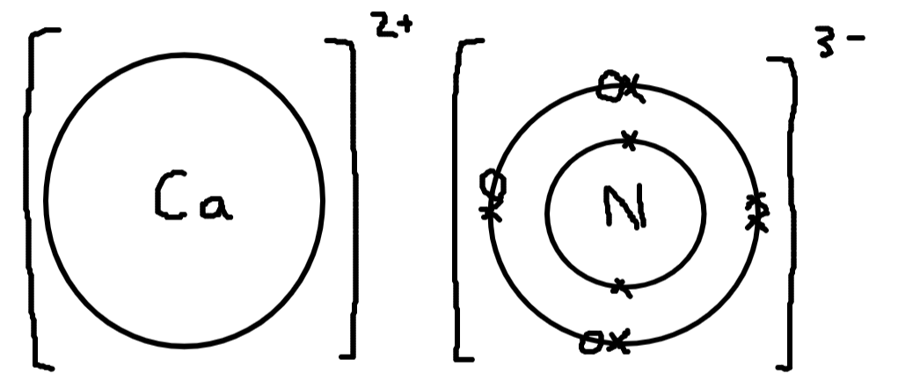

- Both correct charges of ions (calcium 2+ and nitrogen 3–); **[1 mark]**
- 8 electrons around nitrogen (can be 3 dots and 5 crosses or 5 crosses and 3 dots or all dots or all crosses, but reject any other combinations of dots and crosses); **[1 mark]**
- Two electrons on the inner shell on any nitride ions / nitrogen atom: allow 2x or 2o once; **[1 mark]**

**[Total: 3 marks]**

- *Calcium is in group 2 so will form a 2+ ion*

  - *Therefore it loses its two outer shell electrons*
- *Nitrogen is in group 5 so will form a 3- ion*

  - *Nitrogen accepts 3 electrons from calcium*
- *The question asks for you to draw the arrangement of electrons around the negative ion so you need to draw all electrons including inner shells*
b)

i) The term lattice means:

- A repeated / pattern / framework / periodic / ordered/ alternating / organised; **[1 mark]**
- (of) particles / atoms / molecules / ions / cations / anions; **[1 mark]**

ii) The ratio of ions is 3 : 2:

- (So that ionic) charges balance or cancel / charge = 0 / no charge / number of positive = number of negative charges / charge is neutral or neutralised; **[1 mark]**
- 3(–) × 2 = 2(+) × 3 ; **[1 mark]**

**[Total: 4 marks]**

- *As seen in part a), the charge on the calcium ion is 2+ as it has lost 2 electrons and the charge on the nitride ion is 3- as it has gained 3 electrons*
- *Overall, the compound will have no overall charge, therefore the positive charges must cancel the negative charges*
- *This means there must be 3 calcium ions, giving a total positive charge of 6+, for every 2 nitride ions, giving a total negative charge of 6-*
- *These will then cancel: (3 x +2) + (2 x -3) = 0*
- *You can also refer to electron transfer to gain the marks in part ii), e.g.:*

  - *The number of electrons transferred from calcium = the number of electrons transferred to nitrogen*
  - *3 calcium ions transfer 6 electrons to 2 nitride ions*
c) Calcium is the reducing agent as:

- Calcium / Ca (atom) loses / gives / donates electrons / e / e– ; **[1 mark]**
- (These are) gained by nitrogen/ N/ N2 ; **[1 mark]**
- Nitrogen / N / N2 is reduced so calcium / Ca is the reducing agent (these two statements could be split i.e. not in the same sentence) 
**OR **
Reducing agents are electron donors / give/ lose electrons 
**OR **
Calcium / Ca is oxidised (by electron loss) therefore calcium is the reducing agent (these two statements could be split, i.e. not in the same sentence);** [1 mark]**

**[Total: 3 marks]**

- *You could also use a half-equation with electrons on the left-hand or right-hand side*
- *When talking about oxidising or reducing agents it is always important to talk about the transfer of electrons*

  - *Think about which species are accepting or losing electrons*
- *Always be specific in your answers and avoid vague statements such as "oxidation is the gain of oxygen"*

### Q11
a)

i) The equation for the reaction between lithium and nitrogen is:

6Li + N2 → 2Li3N

- Correct formulae; **[1 mark]**
- Correct balancing; **[1 mark] **

ii) A correct diagram which shows the formula of lithium nitride, the charges on the ions and the arrangement of the valency electrons around the negative ion is:

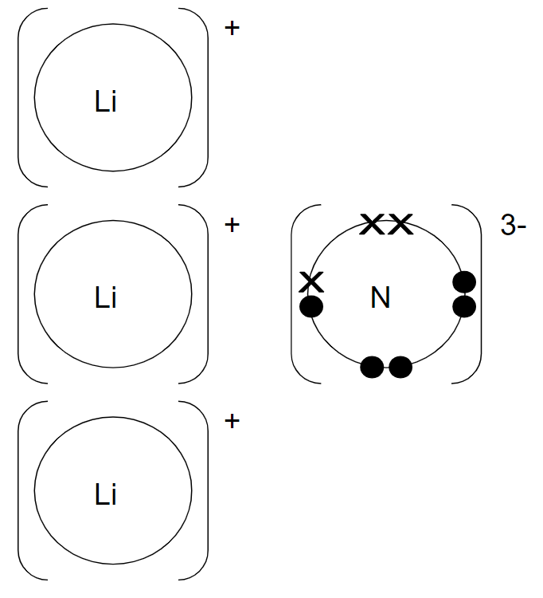

- N3– ion drawn correctly;** [1 mark]**
- Charges correct (minimum 1 × Li ion and 1 nitride ion); **[1 mark]**

**[Total: 4 marks]**

- *When writing the equation, ensure you use the correct formula for nitrogen - it exists as a diatomic molecule with a triple covalent bond between the two nitrogen atoms*
- *To balance, write the unbalanced equation:*

  - *Li + N**2** → Li**3**N*
- *There are 2 N atoms on the left-hand side, so to balance, add a 2 in front of Li**3**N:*

  - *Li + N**2** → 2Li**3**N*
- *Now there are 6 Li atoms on the right hand side which can be balanced by adding a 6 in front of the Li:*

  - *6Li + N**2** → 2Li**3**N*
- *Lithium is in Group I so will lose one electron to form an ion with a 1+ charge*
- *3 lithium atoms lose their outer electron which 1 nitrogen atoms gains*
- *Nitrogen is in Group V so will gain these three electrons and form a nitride ion with a 3- charge*
- *Careful**: Make sure you draw a square bracket around the ions and include the charges*
b)

i) A correct diagram showing the arrangement of the valency electrons in one molecule of the covalent compound nitrogen trifluoride, NF3 is:

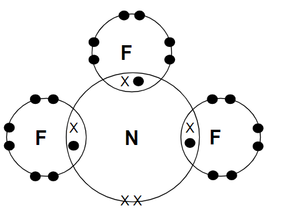

- 3 × shared pairs between N and 3 × F;** [1 mark]**
- Only 2 non-bonding electrons on N, 6 non-bonding electrons on each F; **[1 mark] ***Only award 2nd mark if 1st mark given*

ii) The melting points are different because:

- Strong attractive forces / strong ionic bonds in lithium nitride; **[1 mark]**
- Weak (attractive) forces between molecules in NF3; **[1 mark]**

**[Total: 4 marks]**

- *Ensure you draw the correct type of dot-and-cross diagram with electron shells overlapping to show the atoms sharing pairs of electron*
- *Nitrogen needs to share 3 pairs of electrons to obtain a full outer shell*
- *Fluorine needs to share 1 pair of electrons to obtain a full shell*
- *Check that there are 8 electrons on each electron shell after you have drawn the diagram to make sure you have drawn it correctly*
- *When explaining the properties of compounds, always refer to the bonding / forces of attraction in the structure *
- *Remember in a covalent molecule, such as LiN**3**, the strong covalent bonds within the molecules are not broken during melting/boiling; it is the weak forces of attraction between the molecules which are overcome*

### Q12
a) The extra number of protons, electrons and neutrons that there are in one atom of lanthanum than in one atom of caesium are:

- Number of protons = 2; **[1 mark]**
- Number of electrons =  2; **[1 mark]**
- Number of neutrons = 4; **[1 mark]**

**[Total: 3 marks]**

|   | > *Lanthanum* | > *Caesium* |
|---|---|---|
| > *Atomic number* | > *57* | > *55* |
| > *Mass number* | > *139* | > *133* |
| > *Number of protons = atomic number* | > *57* | > *55* |
| > *Number of electrons = number of protons* | > *57* | > *55* |
| > *Number of neutrons = mass - atomic number* | > *139 - 57 = 82* | > *133 - 55 = 78* |

- *The atomic number is the top number in the Periodic Table*
- *The mass number can be taken as the relative atomic mass which is the bottom number in the Periodic Table*
b)

i) The equation for the reduction of lanthanum ions at the negative electrode (cathode) is:

- La3+ + 3e- → La; **[1 mark]**

ii) The three products formed by the electrolysis of aqueous caesium bromide are:

- Hydrogen; **[1 mark]**
- Bromine; **[1 mark]**
- Caesium hydroxide; **[1 mark]**

**[Total: 4 marks]**

- *The number of electrons that a metal ion gains during electrolysis depend on the charge of the ion*
- *A neutral metal atom will be formed so it must gain the same number of electrons as the size of the positive charge on that ion*

  - *In this case, the lanthanum ion has a 3+ charge therefore it will gain 3 electrons to form a neutral atom*
- *During the electrolysis of aqueous solutions, not only are the ions present due to the ionic compound (Cs**3+** and Br**–**) but H**+** and OH**–** are also present due to water*
- *When halide ions are present, the corresponding halogen gas is discharged; in this case, bromide ions are present therefore bromine gas is given off at the anode*
- *At the cathode, either hydrogen or the metal will be discharged but you are told that the electrolysis of the aqueous halides does not produce the metal*
- *Therefore, hydrogen must be given off at the cathode*
- *The remaining ions in the solution are Cs**+** and OH**–** which form caesium hydroxide*
- *Careful: **The following are extra guidance for the marks in part (ii):*

  - *Bromide is not accepted*
  - *References to electrodes are ignored*
c) The word equation for the reaction of these metals with cold water is:

metal + water → **metal hydroxide** + **hydrogen**

- Metal hydroxide 
**OR** 
Hydroxide ions; **[1 mark]**
- Hydrogen; **[1 mark]**

**[Total: 2 marks]**

- *This is a general equation which is important to learn*
- *Only metals from calcium and above in the reactivity series will react with cold water*
- *Some other, less reactive metals will react will steam with the same general equation*
- *The least reactive metals will not react with steam *
d) A diagram that shows the formula of the compound, the charges on the ions and gives the arrangement of the valency electrons around the negative ion is:

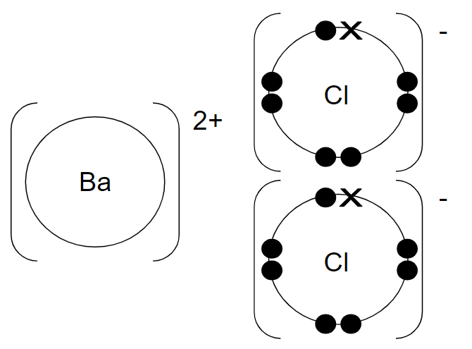

- Correct formula showing 1 barium ion to 2 chloride ions
- Charges correct
- 8 e- around the anion / chloride ion 
*All three points;*** [2 marks]** 
*Two points ONLY;*** [1 mark]** 
*If covalent; ***[0 marks]**

**[Total: 2 marks]**

- *Don't be put off by the complicated electron distribution - just look at the final number to see how many electrons it has in its outer shell*
- *It has 2 electrons in its outer shell so will lose these when it reacts with chlorine to form a 2+ ion*
- *Chlorine is in Group VII so will have 7 electrons in its outer shell *
- *Two chlorine atoms will each gain 1 electron from barium to gain a full outer shell and the resulting ions will have a 1- charge*
- *Remember**: Valency electrons mean the electrons in the outer shell*
e) A simple diagram showing the lattice structure of an ionic compound, such as caesium chloride is:

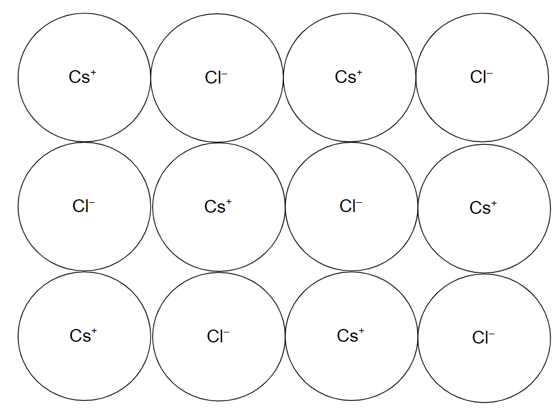

- Alternating (positive and negative); **[1 mark]**
- Pattern; **[1 mark]**

**[Total: 2 marks]**

- *Don't try drawing a 3D structure, which can be difficult to draw*
- *The question asks for a simple diagram so a 2D structure is sufficient*
- *You don't need to include the symbols to gain the marks for this question but they are shown here for completeness*
- *Cs forms a 1+ ion as it will lose its one outer electron*
- *Cl forms a 1- ion as it gains this electron*
f)

i) An example of bond forming in this reaction is:

- Barium - oxygen (bond) 
**OR **
Ionic;** [1 mark]**

ii) This reaction is exothermic because:

- In bond forming, energy is released / it is exothermic; **[1 mark]**
- In bond breaking, energy is taken in / it is endothermic; **[1 mark]**
- More energy released; **[1 mark]**

**[Total: 4 marks]**

- *Be careful with your wording here - many students get this explanation wrong by mixing up when energy is released and when it is taken in *
- *Another common mistake is to comment on the number of bonds broken compared to those formed when explaining if it is exothermic or endothermic*
- *To help you remember, think of compounds as being stable which need energy to separate the atoms within them, i.e. to break the bonds, so is endothermic*
- *Atoms are reactive; they don't have a full outer shell so will react readily forming compounds and becoming more stable*

  - *Energy is released as the atoms form new bonds, which is exothermic*
- *In an exothermic reaction, more energy is released in forming new bonds than is needed to break the bonds - overall energy is released*

### Q13
a) A diagram which shows the formula of magnesium bromide is:

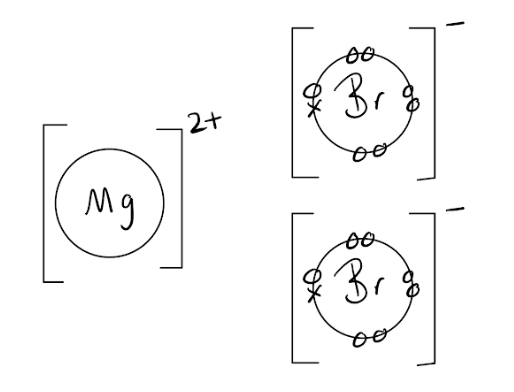

- Correct ratio MgBr2 or Mg : 2Br; **[1 mark]**
- correct charges Mg2+ and Br–; **[1 mark]**
- 8e around bromine; **[1 mark]**

**[Total: 3 marks]**

- *Magnesium is in Group 2 so has 2 outer shell electrons and will forms ions with a 2+ charge*
- *Bromine is in Group 7 so has 7 outer shell electrons and will form ions with a 1- charge*
- *Two bromide ions are therefore required to balance the charge on the magnesium ion resulting in a formula of MgBr**2*
b)

i) The term lattice means:

- Pattern** OR** order **OR** regular **OR** repeat **OR** alternate; **[1 mark]**
- Of positive and negative ions **OR** atoms **OR** molecules **OR** particles; **[1 mark]**

ii) The ratio of ions is 1:2 because:

- Charges must balance 
**OR** 
Based on valency 
**OR** 
Group II and group VII 
**OR** 
2e in outer level and 7e in outer level 
**OR** 
Magnesium loses 2 electrons and bromine gains 1 electron (per atom); **[1 mark]**

iii) The completed sentences are:

- Magnesium is the <u>reducing;</u> **[1 mark]** agent because it has <u>lost / given / donated / transferred</u>; **[1 mark]**  electrons.
- Bromine has been  <u>reduced</u>; **[1 mark]** because it has  <u>gained / accepted</u>; **[1 mark]**. electrons.

**[Total: 7 marks]**

- *Magnesium has two outer shell electrons forming an ion with a 2+ charge whereas bromine has seven outer shell electrons forming ions with a 1- charge, so to balance the charges two bromine atoms are required giving the ionic formula MgBr**2*
- *Remember: OIL RIG- Oxidation is Loss of electrons, Reduction is Gain of electrons *
- *Reducing agents donate electrons to another species causing the other species to be reduced*
- *Oxidising agents receive electrons from another species, causing the other species to be oxidised*

### Q14
a)

i) When a potassium atom reacts with an iodine atom:

- Electrons move from potassium to iodine; **[1 mark]**
- One electron is transferred (from potassium to iodine); **[1 mark]**

ii) The structure of solid potassium iodide:

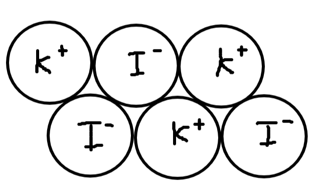

- A regular arrangement/ (giant) lattice of alternating; **[1 mark]**
- Positive potassium ions / K+ and negative iodide ions / I–; **[1 mark]**

iii) Potassium iodide has a high melting point because:

- (Potassium iodide has) strong (forces of) attraction (between oppositely charged ions) / ionic bonds are strong; **[1 mark]**
- Which require lots of energy to overcome/ break; **[1 mark]**

**[Total: 6 marks]**

- *If you decide to draw a diagram to show the bonding in an ionic substance make sure to include at least 2 rows of 3 ions*
- *The charges on the ions need to be shown and they need to be alternating*
b)

i) A pure dry sample of lead iodide could be made from solid potassium iodide and solid lead nitrate by:

- Dissolving the solids (in water) and mix/combine/ add; **[1 mark]**
- Filter ( to remove precipitate from the mixture);** [1 mark]**
- Wash the residue (with water); **[1 mark]**
- Leave to dry/place in oven/ dry between filter papers; **[1 mark]**

ii) An ionic equation for the formation of lead iodide, PbI2, when potassium iodide and lead nitrate react with each other:

Pb2+ + 2I– → PbI2

- Formulae of ions correct; **[1 mark]**
- Rest of equation correct; **[1 mark]**

**[Total: 6 marks]**

- *Make sure you are comfortable with the method for preparing an insoluble salt*
- *The full equation for the formation of lead iodide when potassium iodide and lead nitrate react with each other is:*
- *2KI + Pb(NO**3**)**2** → PbI**2** + 2K(NO**3**)*
- *We are told in the question both potassium iodide and lead nitrate are soluble*

  - *This means they will split up into their ions in solution*
- *From our solubility rules - we know all potassium salts are soluble*

  - *Hence potassium nitrate is also soluble*
  - *This means it will also split up into its ions in solution*
- *We can therefore write the equation as follows*

  - *2K**+** + 2I**-**  + Pb**2+ **+ 2NO**3**-** → PbI**2 **+ 2K**+** + 2NO**3**-*
- *We can then cancel out  ions which appear on either side of the equation*

  - *2K**+** + 2I**-**  + Pb**2+ **+ **2NO**3**-** → PbI**2 **+** 2K**+** + **2NO**3**-*
c)

i) The colour change expected in this reaction is:

- Start colour: colourless;** [1 mark]**
- End colour: brown; **[1 mark]**

ii) The reducing agent in this reaction is:

- Iodide/ I–; **[1 mark]**
- (Because) it is oxidised; 
**OR **
It loses electrons / it increases oxidation number/ it reduces the chlorine;** [1 mark]**

**[Total: 4 marks]**

- *The starting colour will be due to Cl**2*

  - *Cl**2** usually appears colourless in aqueous solution as it is very dilute*
- *The end colour will be due to I**2*

  - *I**2** is brown in an aqueous solution*
- *In this reaction Iodine has gone from*

  - *2I**-** → I**2*
  - *Hence its oxidation state has gone from -1 to 0*

### Q15
a) The dot-and-cross diagrams to show the electronic structures of one magnesium ion and one fluoride ion are:

- Mg with a new outer shell containing 8 crosses; **[1 mark]**
- O with a new outer shell containing 6 dots and 2 crosses; **[1 mark]**
- 2+ charge on Mg 
**AND**
 2– charge on O; **[1 mark]**

**[Total: 3 marks]**

- *Careful:** The question says to complete the dot-and-cross diagrams*

  - *There are not enough shells for each atom / ion given in the question which means you will have to add shells and electrons*
- *Magnesium has 12 electrons, 2.8.2, and will lose two outer electrons to form a 2+ magnesium ion*
- *Oxygen has 8 electrons, 2.6, and will gain two electrons for a full outer shell, forming a 2- oxide ion*
b) Magnesium oxide has a high melting point because:

- There are strong (electrostatic) forces of attraction (between oppositely charged ions); **[1 mark]**

**[Total: 1 mark]**

- *Magnesium oxide is made from magnesium (a metal) and oxygen (a non-metal) *
- *A metal and a non-metal means that it is ionic bonding*
- *Compounds that have ionic bonding have high melting points *
- *This is because there are strong electrostatic forces of attraction which need large amounts of energy to overcome*

  - *This question is unusual as it is for one mark and does not require the information about needing large amounts of energy to overcome the strong electrostatic forces of attraction*
c) Molten magnesium oxide can conduct electricity because:

- There are ions / Mg2+ and O2– / anions and cations that can move (throughout the structure) 
**OR **
There are mobile ions / Mg2+ and O2– / anions and cations; **[1 mark]**

**[Total: 1 mark]**

- *For ionic solids to be able to conduct, their ions must be able to move*
- *This requires the ionic solid to be dissolved or molten*

### Q16
a)

i) Sulfur chloride is a liquid at room temperature, 25 °C, because:

- Melting point is below 25 °C; ** [1 mark]**
- Boiling point above 25 °C; ** [1 mark]** 
*Accept  25 °C is between mp and bp for 2 marks*

ii) Both have chlorides of the type XCl2 because:

- Strontium loses 2 electrons;** [1 mark]**
- Sulfur gains 2 electrons;** [1 mark]**

iii) The difference in the electrical conductivity of liquid strontium chloride and liquid sulfur chloride is because:

- Molten strontium chloride has ions / ionic compound; **[1 mark]**
- Which can move; **[1 mark]**
- Sulfur chloride has no ions / only molecules / molecular / covalent;** [1 mark]**

**[Total: 7 marks]**

- *For part (ii), check which group of the periodic table the elements are in*

  - *Strontium is in Group II so loses two electrons*
  - *Sulfur is in Group VI so gains two electrons *
- *Check carefully the number of marks for questions about conductivity- even if a substance cannot conduct you are awarded a mark for explaining why not- lots of students focus their answers on the substance that can conduct*
b)

i) You know when excess strontium carbonate had been added in step 1 because:

- Strontium carbonate does not dissolve / no effervescence; ** [1 mark]**

ii) It is necessary to filter the mixture in step 2:

- To remove excess / unreacted / undissolved strontium carbonate; ** [1 mark]**

iii) You partially evaporate the filtrate rather than evaporate to dryness because:

- Water of crystallisation needed / 6H2O in crystals / would get anhydrous salt / would not get hydrated salt / crystals dehydrate; ** [1 mark]**

**[Total: 3 marks]**

- *Carbonates are insoluble, and so you will be able to see undissolved strontium carbonate once it has been added in excess *
- *This needs removing by filtration before heating the solution to obtain salt crystals *
c) To calculate the percentage yield:

- Number of moles of HCl used = 0.05 × 2 = 0.1;** [1 mark]**
- Number of moles of SrCl2.6 H2O which could be formed = 0.05; **[1 mark]**
- Theoretical yield of SrCl2.6 H2O = 0.05 × 267 = 13.35 g; ** [1 mark]**
- Percentage yield = 6.4/ 13.35 × 100 = 47.9% 
**OR** 
48%; ** [1 mark]**

**[Total: 4 marks]**

- *To calculate the number of moles use the equation: concentration x volume *

  - *Don't forget to convert volume into dm**3** by dividing by 1000*
  - *So 0.05 x 2 = 0.1 mol*
- *In the first equation, the molar ratio of HCl to SrCl**2** is 2:1 *

  - *So the number of moles of SrCl**2**.6H**2**O which could be formed is 0.01/2 = 0.05 mol *
- *To find the maximum (theoretical) mass that could be obtained use molar mass x number of moles*

  - *So 267 x 0.05 mol = 13.35 g*
- *Percentage yield is calculated using: *$\frac{\mathrm{actual} \mathrm{yield}}{\mathrm{theoretical} \mathrm{yield}}\times100$

  - *So *$\frac{6.4}{13.35} \times 100 = 47.9 \%$

### Q17
a)

i) The term* ionic lattice *means:

- Positive 
**AND** 
Negative ions; **[1 mark]**
- In a regular pattern / opposite charges closer than the same charge; **[1 mark]**

ii) This ratio varies in different ionic compounds:

- So that charges cancel 
**OR** 
(Because) ions may not have the same charge; **[1 mark]**

iii) Three physical properties of ionic compounds are:

Any **three** from:

- High melting point or boiling point; **[1 mark]**
- Hard; **[1 mark]**
- Brittle; **[1 mark]**
- Soluble in water / insoluble in organic solvents; **[1 mark]**
- Conduct (electricity) in a liquid state / an aqueous solution  
**OR** 
Poor conductor (when solid); **[1 mark]**

**[Total: 6 marks]**

- *Use the diagram to help you with part i) of this question*
- *Charges for ionic compounds should always cancel each other out*

  - *For example, in sodium chloride, sodium has a 1+ charge and chlorine a 1- charge so the formula is NaCl *
  - *However, in magnesium chloride, magnesium has a 2+ charge and chlorine a 1- charge so the formula is MgCl**2*
- *Make sure you learn all of the properties of ionic compounds *
- *They have giant structures hence the high melting / boiling points*
- *They cannot conduct electricity when they are solid as the ions cannot move, however when molten or dissolved in water, the ions are able to move and carry a charge*
b) The correct diagram is:

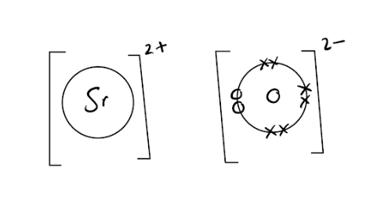

- Correct formula; **[1 mark]**
- Correct charges; **[1 mark]**
- 6x and 2o around oxygen; **[1 mark]**

**[Total: 3 marks]**

- *Notice the question states to only draw the valence (outer shell) electrons on the negative ion *
- *This shows that the formula of strontium oxide would be SrO as Sr has a charge of 2+ and oxide, 2- which balance out *

### Q18
a)

i) The name of this regular arrangement of particles is:

- Lattice; **[1 mark]**

ii) Two physical properties of an ionic compound are:

Any **two** from:

- High melting point or high boiling point; **[1 mark]**
- Poor conductor as solid; **[1 mark]**
- Good conductor as liquid, accept either aqueous or molten; **[1 mark]**
- Hard; **[1 mark]**
- Soluble in water; **[1 mark]**

**[Total: 3 marks]**

- *You must make sure you learn the properties of ionic, covalent and metallic substances!*
b)

i) The formula of the magnesium ion is:

- Mg2+; **[1 mark]**

ii) The formula of the nitride ion is:

- N3-; **[1 mark]**

iii) The formula of the ionic compound, magnesium nitride

- Mg3N2; **[1 mark]**

iv) The two ions are attracted to each other because:

- There are opposite charges 
**OR **
There is an electrostatic attraction; **[1 mark]**

**[Total: 4 marks]**

- *The Group number for the element can help you determine the charge*
- *Magnesium is in Group 2 and loses two electrons to gain a full outer shell hence the 2+ charge*
- *Nitrogen is in Group 5 so gains three electrons to gain a full outer shell hence the 3- charge*
- *The overall charge of an ionic compound is 0 so three magnesium and two nitrogen ions are required to do this *
- *There are strong electrostatic forces of attraction between the ions *
- *Careful: **In part (iv), the word attract is not accepted as an answer because it is in the question*

### Q19
An oxygen atom shares two pairs of electrons:

- To complete the outer shell (of oxygen) / full outer or valence shell / 8 (electrons) in outer shell / noble gas structure; [**1 mark]**

**[Total: 1 mark]**

- *References to the following are ignored:*

  - *Hydrogen atoms*
  - *Accepting, sharing or gaining electrons*
- *The dot and cross diagram for oxygen is:*

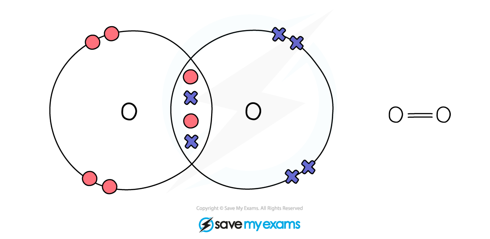
A potassium atom becomes a potassium ion by:

- Loses a / an / one electron; **[1 mark]**

*Do not accept loses electrons*

**[Total: 1 mark]**

- *Potassium atoms are in Group 1 of the periodic table so have one electron in their outer shell *
- *They lose this electron to gain a full outer shell*
- *There is one more proton than electron so the charge is 1+*
There is a bond between the ions in potassium chloride because:

- Opposite charges attract 
**OR **
There is an electrostatic attraction 
**OR **
Positive attracts negative / + and – attract; **[1 mark]**

**[Total: 1 mark]**

- *Ionic bonding requires positive and negative ions, which will be attracted to each other*
Solid potassium chloride is a poor conductor of electricity but when dissolved in water it is a good conductor because:

- In solid, ions cannot move / flow 
**OR**
In solid, there are no free ions 
**OR**
In solid, the ions are in a lattice / held in fixed positions; **[1 mark]**
- In solution, ions can move / flow
**OR**
There are mobile ions / the ions can move; **[1 mark]**

**[Total: 2 marks]**

- *You must use the word ions (not electrons, atoms, or particles) when explaining conductivity in ionic compounds *
- *Electrons carry charge in metals and graphite, but in ionic compounds it is the ions that carry charge *
- *Make sure you answer about dissolving in water (in solution), not about melting.*

  - *The question asks about dissolved potassium chloride, not molten potassium chloride *
  - *These are different situations even though both allow ions to move*
