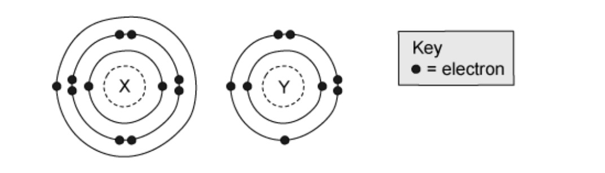
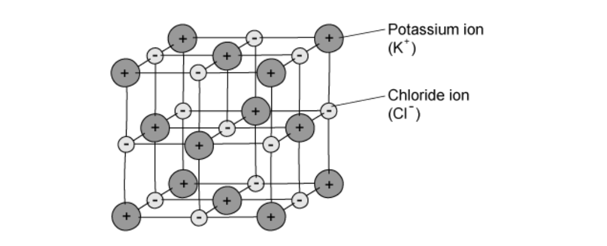
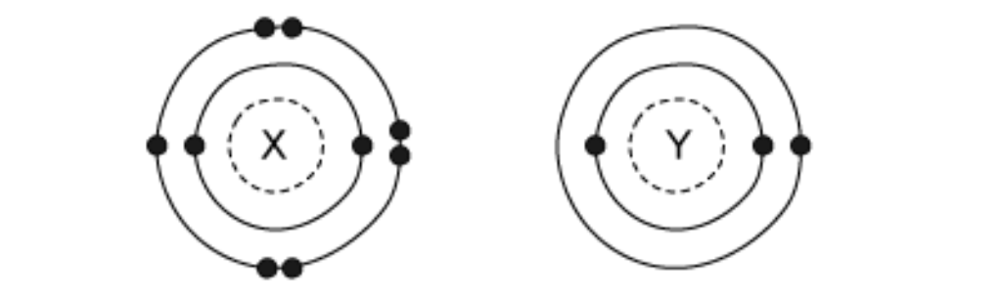
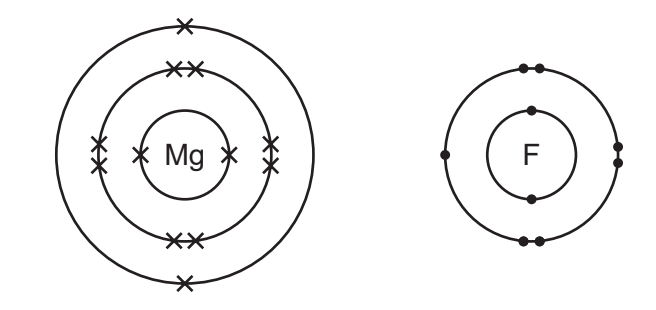
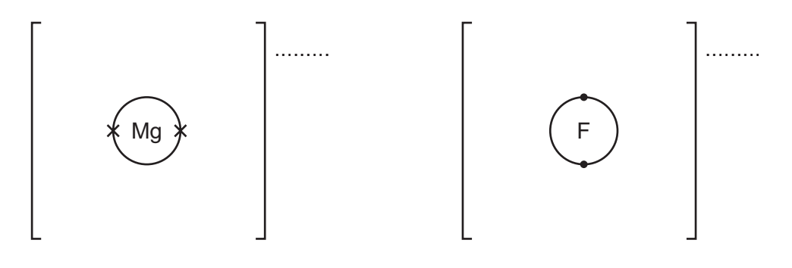
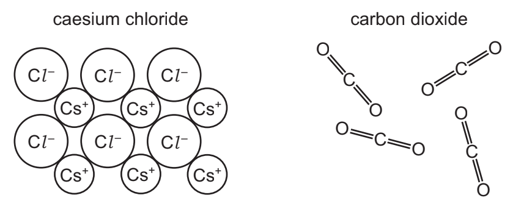
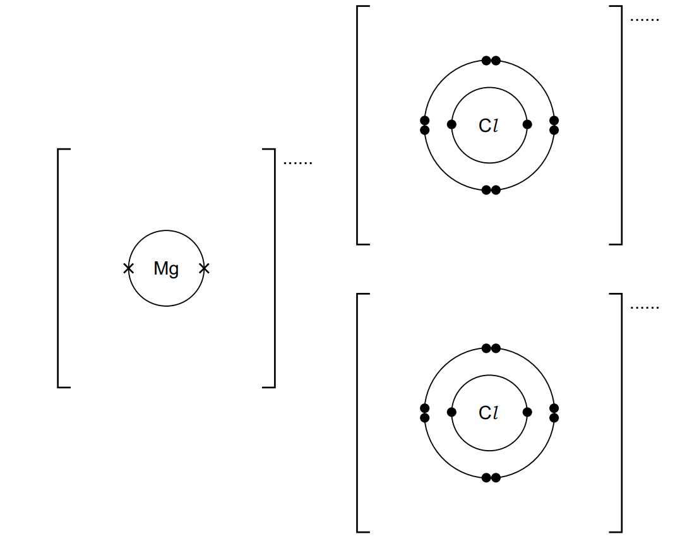
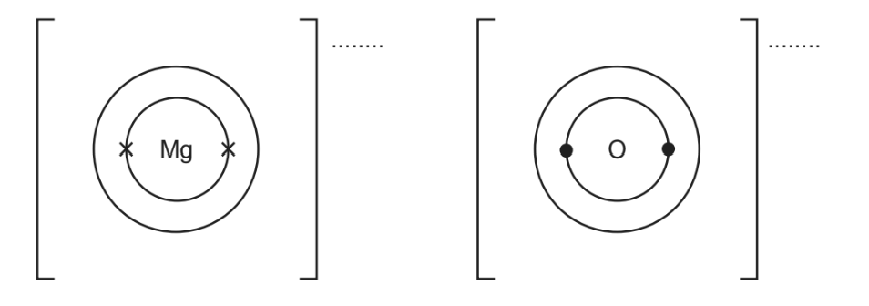
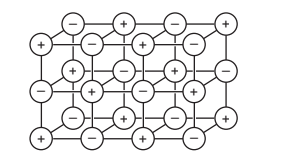
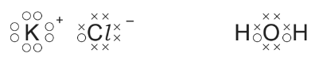

# Exam Questions — Ions & Ionic Bonds
**2. Atoms, Elements & Compounds** · Cambridge (CIE) IGCSE chemistry (0620 & 0971)
> Source: [https://www.savemyexams.com/igcse/chemistry/cie/23/topic-questions/](https://www.savemyexams.com/igcse/chemistry/cie/23/topic-questions/) · 41 questions across 2 sets

## Multiple Choice Questions (25 questions)

### Q1 — medium — 1 marks

**Q1** [1 mark]

Three statements about sodium chloride are shown.

1. Sodium chloride has a low melting point because the attractive forces between the ions in the lattice are weak.
2. Sodium chloride conducts electricity in aqueous solution because the ions are free to move.
3. Sodium chloride conducts electricity when solid because the ions can carry an electric current through the lattice.

Which statements are correct?

### Q2 — easy — 1 marks

**Q2** [1 mark]

One magnesium atom reacts with two chlorine atoms to form the ionic compound, MgCl2.

Which row shows the correct electron change taking place for chlorine and the correct formula of the ion formed?

|   | electron change | formula of ion formed |
|---|---|---|
| **A** | electron lost | Cl- |
| **B** | electron gained | Cl2- |
| **C** | electron gained | Cl- |
| **D** | electron lost | Cl2- |

### Q3 — easy — 1 marks

**Q3** [1 mark]

#### Extended Only

Magnesium is a **Group II** element and chlorine is a **Group VII** element.

These elements react together to form an ionic compound.

Which row is correct?

|   | Mg electron change | Mg ion formed | Formula of compound |
|---|---|---|---|
| **A** | gain | Mg2+ | Mg2Cl |
| **B** | gain | Mg+ | MgCl2 |
| **C** | lost | Mg2+ | MgCl2 |
| **D** | lost | Mg+ | Mg2Cl2 |

### Q4 — easy — 1 marks

**Q4** [1 mark]

Lithium and chlorine react together to form lithium chloride. During formation, each lithium atom…..**1**….. one …..**2**….. which is completely …..**3**….. to the chlorine atom.

What words correctly fill gaps **1**, **2** and **3**?

|   | **1** | **2** | **3** |
|---|---|---|---|
| **A** | gains | electron | shared |
| **B** | loses | electron | transferred |
| **C** | gains | proton | transferred |
| **D** | loses | proton | shared |

### Q5 — easy — 1 marks

**Q5** [1 mark]

Which of the statements describes ionic bonding?

### Q6 — easy — 1 marks

**Q6** [1 mark]

What change occurs to an atom when it forms a negative ion?

### Q7 — easy — 1 marks

**Q7** [1 mark]

#### Extended Only

The structure of an ionic compound, sodium chloride, is a lattice structure.

Which of the following statements about an ionic lattice structure is **not** true?

### Q8 — hard — 1 marks

**Q8** [1 mark]

Ionic compounds are formed when a metal reacts with a nonmetal.

Which two elements combine to form this kind of compound?

| **Element** | **Electronic structure** |
|---|---|
| Q | 2.8.8.1 |
| R | 2.8.7 |
| S | 2.8.4 |
| T | 2.8.8 |

### Q9 — hard — 1 marks

**Q9** [1 mark]

The electronic structures of atoms X and Y are shown.

X and Y combine by ionic bonding.

What is the formula of the compound produced?

### Q10 — hard — 1 marks

**Q10** [1 mark]

Ionic compounds are formed when a metal reacts with a nonmetal.

Which two elements combine to form this kind of compound?

| **Element** | **Electronic structure** |
|---|---|
| Q | 2.4 |
| R | 2.8 |
| S | 2.8.1 |
| T | 2.8.7 |

### Q11 — hard — 1 marks

**Q11** [1 mark]

Ionic compounds are formed when metals react with nonmetals.

Which row correctly describes the electron transfer when an ionic bond is formed and the nature of the bond?

|   | **Electron transfer** | **Nature of bond** |
|---|---|---|
| **A** | Metal to nonmetal | Opposite ions attract |
| **B** | Metal to nonmetal | Opposite ions repel |
| **C** | Metal to metal | Same ions repel |
| **D** | Nonmetal to metal | Opposite ions attract |

### Q12 — hard — 1 marks

**Q12** [1 mark]

#### Extended Only

A student analysed an ionic compound and a covalent compound using a melting point apparatus. She found the ionic compound had a much higher melting point than the covalent compound.

Which statement explains this observation?

### Q13 — hard — 1 marks

**Q13** [1 mark]

#### Extended Only

The ionic lattice structure of potassium chloride is shown below.

Which of the following statements best describes the bonding and structure of **KC*****l***?

### Q14 — hard — 1 marks

**Q14** [1 mark]

The electronic structures of atoms **X** and **Y** are shown.

**X **and **Y** combine by ionic bonding.

What is the formula of the compound produced?

### Q15 — hard — 1 marks

**Q15** [1 mark]

The table below shows four different substances.

Which substance does the type of bonding shown not match?

|   | **Substance** | **Type of bonding present** |   |   |
|---|---|---|---|---|
| Ionic | Covalent | Metallic |   |   |
| **A** | Fluorine |   | `✓` |   |
| **B** | Potassium chloride | `✓` |   |   |
| **C** | Beryllium |   | `✓` |   |
| **D** | Sodium bromide | `✓` |   |   |

### Q16 — hard — 1 marks

**Q16** [1 mark]

#### Extended Only

The bonding present in a substance determines the structure and properties of that substance.

Which of the following statements is a correct description of the structure of an ionic compound?

### Q17 — hard — 1 marks

**Q17** [1 mark]

Potassium and bromine chemically combine to form the compound potassium bromide.

During formation, each bromine atom…..**1**….. one electron which is completely …..**2**….. from the outer shell of the potassium atom. The …..**3**….. force of attraction is formed from the attraction between the opposite charges on each ion.

What words correctly fill gaps** 1**, **2** and **3**?

|   | **1** | **2** | **3** |
|---|---|---|---|
| **A** | loses | shared | electrical |
| **B** | loses | transferred | intermolecular |
| **C** | gains | shared | electrostatic |
| **D** | gains | transferred | electrostatic |

### Q18 — medium — 1 marks

**Q18** [1 mark]

#### Extended Only

Which of the following dot-and-cross diagrams shows the correct arrangement of electrons in lithium sulfide?

### Q19 — medium — 1 marks

**Q19** [1 mark]

Which element does not form a stable ion with the same electronic configuration as neon?

### Q20 — medium — 1 marks

**Q20** [1 mark]

The table below shows the properties of four substances, **W**,** X**, **Y** and **Z**.

| **Substance** | **Melting point** | **Boiling point ** | **Conducts electricity when** |   |
|---|---|---|---|---|
|   | **/ ****o ****C** | **/ ****o ****C** | **solid ** | **liquid** |
| **W** | 3410 | 5930 | yes | yes |
| **X** | 801 | 1413 | no | yes |
| **Y** | 3550 | 4830 | no | no |
| **Z** | -91 | 98 | no | no |

Use the information in the table to identify the substance that is an ionic compound.

### Q21 — medium — 1 marks

**Q21** [1 mark]

Calcium reacts with fluorine to form calcium fluoride

Which statement describes what happens to calcium atoms in this reaction?

### Q22 — medium — 1 marks

**Q22** [1 mark]

The electronic configuration of an ion was determined to be **2**.**8**.**8**.

What could the identity of the ion be?

|   | Ca2+ | S2- |
|---|---|---|
| **A** | $\times$ | `✓` |
| **B** | `✓` | $\times$ |
| **C** | `✓` | `✓` |
| **D** | $\times$ | $\times$ |

## Theory Questions (19 questions)

### Q1 — hard — 17 marks

**Q1** [2 marks]

Group II elements, such as beryllium, magnesium, and calcium, and their compounds have many important chemical and physical properties. A student investigates some of these substances.

The student reacts granules of calcium carbonate with dilute aqueous sulfuric acid. Write a balanced chemical equation for this reaction.

**Q1** [3 marks]

Calcium carbonate is an ionic compound. Explain, **in terms of structure and bonding**, why calcium carbonate has a high melting point.

**Q1** [1 mark]

State the solubility of calcium carbonate in water.

**Q1** [3 marks]

**Extract:**

The student reacts granules of calcium carbonate with dilute aqueous sulfuric acid.

The student decides to repeat the reaction using calcium carbonate powder instead of granules. All other conditions stay the same.

Explain, **in terms of collision theory**, the effect of using powder on the rate of the reaction.

**Q1** [3 marks]

Complete Table 6.1 to show the number of protons, neutrons, and electrons in an atom of magnesium and an ion of beryllium.

**Table 6.1**

| particle | number of protons | number of neutrons | number of electrons |
|---|---|---|---|
| $Mg_{12}^{24}$ |   |   |   |
| $\text{Be} pre_{4} pre^{9^{2} +}$ |   |   |   |

**Q1** [2 marks]

Magnesium has three naturally occurring isotopes as shown in Table 6.2.

**Table 6.2**

| isotope | percentage abundance / % |
|---|---|
| magnesium-24 | 79.0 |
| magnesium-25 | 10.0 |
| magnesium-26 | 11.0 |

Calculate the relative atomic mass of magnesium. Show your working. Give your answer to **one decimal place.**

relative atomic mass = ...............

**Q1** [3 marks]

Magnesium reacts with chlorine to form the ionic compound magnesium chloride, MgCl2. Complete the dot-and-cross diagram in Fig 6.1 to show the electron arrangement and charges of the ions in magnesium chloride. Show outer shell electrons only.

**Fig 6.1**

### Q2 — medium — 7 marks

**Q2** [3 marks]

Fluorine forms both ionic and covalent compounds. Magnesium reacts with fluorine to form the ionic compound magnesium fluoride. The electronic structures of an atom of magnesium and an atom of fluorine are shown.

Complete the dot-and-cross diagrams to show the electronic structures of one magnesium ion and one fluoride ion.

Show the charges on the ions.

*Source: 2020 Ju42 Q2A*

**Q2** [2 marks]

**Extract:**

Fluorine forms both ionic and covalent compounds. Magnesium reacts with fluorine to form the ionic compound magnesium fluoride.

#### Extended Only

Magnesium fluoride does not conduct electricity when it is solid.

What can be done to solid magnesium fluoride to make it conduct electricity?

In your answer explain why magnesium fluoride conducts electricity when this change is made.

*Source: 2020 Ju42 Q2B*

**Q2** [2 marks]

**Extract:**

Fluorine forms both ionic and covalent compounds. Magnesium reacts with fluorine to form the ionic compound magnesium fluoride.

#### Extended Only

The melting points of magnesium fluoride and carbonyl fluoride are shown.

|   | melting point / °C |
|---|---|
| magnesium fluoride | 1263 |
| carbonyl fluoride | −111 |

Explain, using your knowledge of structure and bonding, why magnesium fluoride has a high melting point.

*Source: 2020 Ju42 Q2C*

### Q3 — medium — 5 marks

**Q3** [1 mark]

#### Extended Only

Iron pyrite, FeS2, is known as Fool’s Gold because it is a shiny yellow solid which is similar in appearance to gold. Iron pyrite is an ionic compound. Gold is a metallic element.

Iron pyrite, FeS2, contains positive and negative ions. The positive ion is Fe2+.

Deduce the formula of the negative ion.

*Source: 2016 Ja42 Q6*

**Q3** [2 marks]

**Extract:**

Iron pyrite, FeS~2~, is known as Fool's Gold because it is a shiny yellow solid which is similar in appearance to gold. Iron pyrite is an ionic compound. Gold is a metallic element.

A student is provided with a sample of iron pyrite and a sample of gold. Suggest how the student could distinguish between the two substances.

*Source: 2016 Ja42 Q6*

**Q3** [2 marks]

**Extract:**

Iron pyrite, FeS~2~, is known as Fool's Gold which is a shiny yellow solid.

#### Extended Only

Sulfur dioxide is produced on a large scale by heating iron pyrite strongly in air. The iron pyrite reacts with oxygen in the air producing iron(III) oxide, Fe2O3, and sulfur dioxide.

Construct a chemical equation for the reaction between iron pyrite and oxygen.

*Source: 2016 Ja42 Q6*

### Q4 — easy — 9 marks

**Q4** [6 marks]

The table below gives the number of protons, neutrons and electrons in atoms or ions.

Complete the table. The first line is given as an example.

You will need to use the Periodic Table.

| particle | number of protons | number of electrons | number of neutrons | symbol or formula |
|---|---|---|---|---|
| A | 4 | 4 | 5 | $Be_{4}^{9}$ |
| B | 19 | 18 | 20 |   |
| C | 30 | 30 | 35 |   |
| D | 8 | 10 | 8 |   |
| E | 31 | 31 | 39 |   |

*Source: 2013 Ju32 Q2*

**Q4** [3 marks]

**Extract:**

The table below gives the number of protons, neutrons and electrons in atoms or ions.

| particle | number of protons | number of electrons | number of neutrons | symbol or formula |
| A | 4 | 4 | 5 | Be |
| B | 19 | 18 | 20 |   |
| C | 30 | 30 | 35 |   |
| D | 8 | 10 | 8 |   |
| E | 31 | 31 | 39 |   |

Using the data in the table, explain how you can determine whether a particle is an atom, a negative ion or a positive ion.

*Source: 2013 Ju32 Q2*

### Q5 — hard — 10 marks

**Q5** [4 marks]

#### Extended Only

The structure of an element or compound determines its physical properties. Scandium fluoride and silicon(IV) oxide have giant structures.

Scandium fluoride is an ionic compound.

i) The valency of scandium is three. Draw a diagram which shows the formula of the compound, the charges on the ions and the arrangement of the valency electrons around the negative ion.

Use x to represent an electron from a scandium atom. Use o to represent an electron from a fluorine atom.

[3]

ii) The melting point of scandium fluoride is 1552 °C. Explain why scandium fluoride has a high melting point.

[1]

*Source: 2011 O32 Q4*

**Q5** [6 marks]

**Extract:**

Scandium fluoride and silicon(IV) oxide have giant structures. Scandium fluoride is an ionic compound.

#### Separate: Chemistry and Extended Only

Silicon(IV) oxide has a macromolecular structure.

i) Describe the structure of silicon(IV) oxide. You may use a diagram.

[3]

ii) How does the electrical conductivity of these two compounds differ?

[1]

iii) Explain the difference in conductivity.

[2]

*Source: 2011 o32 Q4*

### Q6 — easy — 8 marks

**Q6** [1 mark]

A list of symbols and formulae is shown.

**CH****4** 
**C*****l***** ****–** 
**CO****2** 
**Cr****3+** 
**Cu****2+** 
**Fe****2+** 
**H****2** 
**K****+** 
**N****2** 
**O****2** 
**SO****2**

Which symbol or formula represents an ion formed when an atom gains an electron?

*Source: 2020 Ju32 Q8A*

**Q6** [5 marks]

The diagram shows part of the structures of caesium chloride and carbon dioxide.

Describe both caesium chloride and carbon dioxide in terms of:

- bonding
- arrangement of particles.

*Source: 2020 Ju32 Q8B*

**Q6** [1 mark]

The diagrams show part of the structures of five substances, A, B, C, D and E.

State which one of these structures, A, B, C, D or E is an ionic compound.

*Source: 2020 Ju32 Q8C*

**Q6** [1 mark]

$Na_{11}^{22}$, $Na_{11}^{23}$ and $Na_{11}^{24}$ are isotopes of sodium. Why do sodium ions have a charge of +1?

*Source: 2020 Ju32 Q8D*

### Q7 — medium — 9 marks

**Q7** [2 marks]

**Table 1.1 **shows the properties of four substances.

**Table 1.1**

| substance | boiling point | electrical conductivity of solid | electrical conductivity when molten | density in g / cm3 |
|---|---|---|---|---|
| aluminium | high | conducts | conducts | 2.70 |
| diamond |   |   |   | 3.51 |
| potassium bromide | high | does not conduct | conducts | 2.75 |
| sulfur | low | does not conduct |   |   |

State the meaning of the term ionic bonding.

*Source: Specimen 3 Q5A*

**Q7** [2 marks]

**Extract:**

Table 1.1 shows the properties of four substances.

Table 1.1

| substance | boiling point | electrical conductivity of solid | electrical conductivity when molten | density in g / cm^3 |
| aluminium | high | conducts | conducts | 2.70 |
| diamond | | | | 3.51 |
| potassium bromide | high | does not conduct | conducts | 2.75 |
| sulfur | low | does not conduct | | |

Identify which information in **Table 1.1 **shows that potassium bromide is an ionic compound.

*Source: Specimen 3 Q5B*

**Q7** [3 marks]

Magnesium, calcium and strontium are Group II elements

Magnesium reacts with chlorine to form magnesium chloride, MgCl2.

Magnesium chloride is an ionic compound.

Complete the dot-and-cross diagram in **Figure 1.1 **of the ions in magnesium chloride.

Show the charges on the ions.

**Figure 1.1**

*Source: Specimen 3 Q5C*

**Q7** [2 marks]

One physical property typical of ionic compounds, such as MgCl2, is that they are soluble in water.

Give two other physical properties that are typical of ionic compounds.

*Source: Specimen 3 Q5D*

### Q8 — easy — 10 marks

**Q8** [5 marks]

The following is a list of the electron distributions of atoms of unknown elements.

| **element** | **electron distribution** |
|---|---|
| **A** | 2,5 |
| **B** | 2,8,4 |
| **C** | 2,8,8,2 |
| **D** | 2,8,18,8 |
| **E** | 2,8,18,8,1 |
| **F** | 2,8,18,18,7 |

Choose an element from the list for each of the following descriptions.

i) It is a noble gas.

ii) It is a soft metal with a low density.

iii) It can form a covalent compound with element A.

iv) It has a giant covalent structure similar to diamond.

v) It can form a negative ion of the type X3-.

*Source: 2009 Ju31 Q3*

**Q8** [5 marks]

**Extract:**

The following is a list of the electron distributions of atoms of unknown elements.

| element | electron distribution |
| A | 2,5 |
| B | 2,8,4 |
| C | 2,8,8,2 |
| D | 2,8,18,8 |
| E | 2,8,18,8,1 |
| F | 2,8,18,18,7 |

Elements C and F can form an ionic compound.

i) Draw a diagram that shows the formula of this compound, the charges on the ions and the arrangement of the valency electrons around the negative ion. Use x to represent an electron from an atom of C. Use o to represent an electron from an atom of F.

[3]

ii) Predict **two** properties of this compound.

[2]

*Source: 2009 Ju31 Q3*

### Q9 — medium — 9 marks

**Q9** [4 marks]

The Group I metals show trends in both their physical and chemical properties.

i) How do their melting points vary down the Group?

[1]

ii) Which element in the Group has the highest density?

[1]

iii) All Group I metals react with cold water. Complete the following equation.

........Rb + ........H2O → ................ + ................

[2]

*Source: 2012 Ju31 Q3*

**Q9** [5 marks]

#### Extended Only

Lithium reacts with nitrogen to form the ionic compound, lithium nitride.

i) State the formula of the lithium ion.

[1]

ii) Deduce the formula of the nitride ion.

[1]

iii) In all solid ionic compounds, the ions are held together in a lattice. Explain the term *lattice*.

[1]

iv) What is the ratio of lithium ions to nitride ions in the lattice of lithium nitride? Give a reason for your answer.

[2]

*Source: 2012 Ju31 Q3*

### Q10 — hard — 10 marks

**Q10** [3 marks]

Calcium reacts with nitrogen to form the ionic compound calcium nitride, Ca3N2.

Draw a diagram, based on the correct formula, which shows the charges on the ions and the arrangement of the electrons around the negative ion.

Use o to represent an electron from a calcium atom. Use x to represent an electron from a nitrogen atom.

*Source: 2015 Ju32 Q3*

**Q10** [4 marks]

**Extract:**

Calcium reacts with nitrogen to form the ionic compound calcium nitride, Ca~3~N~2~.

Calcium is in group 2 so will form a 2+ ion. Nitrogen is in group 5 so will form a 3- ion.

#### Extended Only

In the lattice of calcium nitride, the ratio of calcium ions to nitride ions is 3 : 2.

i) What is meant by the term lattice?

[2]

ii) In terms of ionic charges, explain why the ratio of ions is 3 : 2.

[2]

*Source: 2015 Ju32 Q3*

**Q10** [3 marks]

**Extract:**

Calcium reacts with nitrogen to form the ionic compound calcium nitride, Ca3N2.

- Calcium is in group 2 so will form a 2+ ion
- Therefore it loses its two outer shell electrons
- Nitrogen is in group 5 so will form a 3- ion
- Nitrogen accepts 3 electrons from calcium

#### Extended Only

The reaction between calcium and nitrogen to form calcium nitride is a redox reaction. In terms of electron transfer, explain why calcium is the reducing agent.

*Source: 2015 Ju32 Q3*

### Q11 — medium — 8 marks

**Q11** [4 marks]

Nitrogen can form ionic compounds with reactive metals and covalent compounds with non-metals.

Nitrogen reacts with lithium to form the ionic compound lithium nitride, Li3N.

i) Write the equation for the reaction between lithium and nitrogen.

[2]

ii) Lithium nitride is an ionic compound. Draw a diagram which shows its formula, the charges on the ions and the arrangement of the valency electrons around the negative ion. Use x for an electron from a lithium atom. Use o for an electron from a nitrogen atom.

[2]

*Source: 2014 O31 Q7*

**Q11** [4 marks]

**Extract:**

Nitrogen can form ionic compounds with reactive metals and covalent compounds with non-metals. Nitrogen reacts with lithium to form the ionic compound lithium nitride, Li~3~N.

Nitrogen fluoride is a covalent compound.

i) Draw a diagram showing the arrangement of the valency electrons in one molecule of the covalent compound nitrogen trifluoride, NF3. Use x for an electron from a nitrogen atom. Use o for an electron from a fluorine atom.

[2]

ii) Lithium nitride has a high melting point, 813 °C. Nitrogen trifluoride has a low melting point, –207 °C. Explain why the melting points are different.

[2]

*Source: 2014 Ju31 Q4*

### Q12 — hard — 17 marks

**Q12** [3 marks]

The first three elements in Period 6 of the Periodic Table of the Elements are caesium, barium and lanthanum.

How many more protons, electrons and neutrons are there in one atom of lanthanum than in one atom of caesium. Use your copy of the Periodic Table of the Elements to help you.

Number of protons =

Number of electrons =

Number of neutrons =

*Source: 2003 Ju31 Q5*

**Q12** [4 marks]

#### Extended Only

All three metals can be obtained by the electrolysis of a molten halide. The electrolysis of the aqueous halides does not produce the metal.

i) Complete the equation for the reduction of lanthanum ions at the negative electrode (cathode).

La3+ + ................ → ................

[1]

ii) Name the three products formed by the electrolysis of aqueous caesium bromide.

[3]

*Source: 2003 Ju31 Q5*

**Q12** [2 marks]

**Extract:**

The first three elements in Period 6 of the Periodic Table of the Elements are caesium, barium and lanthanum.

All three metals react with cold water. Complete the word equation for these reactions.

metal + water → ................................. + .............................

*Source: 2003 Ju31 Q5*

**Q12** [2 marks]

Barium chloride is an ionic compound.

Draw a diagram that shows the formula of the compound, the charges on the ions and gives the arrangement of the valency electrons around the negative ion.

The electron distribution of a barium atom is 2.8.18.18.8.2 Use x to represent an electron from a barium atom. Use o to represent an electron from a chlorine atom.

*Source: 2003 Ju31 Q5*

**Q12** [2 marks]

#### Extended Only

Describe, by means of a simple diagram, the lattice structure of an ionic compound, such as caesium chloride.

*Source: 2003 Ju31 Q5*

**Q12** [4 marks]

#### Extended Only

The reactions of these metals with oxygen are exothermic.

2Ba (s) + O2 (g) → 2BaO (s)

i) Give an example of bond forming in this reaction.

[1]

ii) Explain using the idea of bond breaking and forming why this reaction is exothermic.

[3]

*Source: 2003 O31 Q5*

### Q13 — easy — 10 marks

**Q13** [3 marks]

Magnesium reacts with bromine to form magnesium bromide.

Magnesium bromide is an ionic compound. Draw a diagram that shows the formula of the compound, the charges on the ions and the arrangement of outer electrons around the negative ion. The electron distribution of a bromine atom is 2, 8, 18, 7. Use x to represent an electron from a magnesium atom. Use o to represent an electron from a bromine atom.

*Source: 2007 O31 Q3*

**Q13** [7 marks]

#### Extended Only

In the lattice of magnesium bromide, the ratio of magnesium ions to bromide ions is 1:2.

i) Explain the term lattice.

.[2]

ii) Explain why the ratio of ions is 1:2.

[1]

iii) The reaction between magnesium and bromine is redox. Complete the sentences.

Magnesium is the .................................... agent because it has .................................... electrons.

Bromine has been  ..................................... because it has  .................................... electrons.

[4]

*Source: 2007 O31 Q3*

### Q14 — medium — 16 marks

**Q14** [6 marks]

#### Extended Only

Potassium iodide is an ionic compound.

i) Describe what happens, in terms of electron loss and gain, when a potassium atom reacts with an iodine atom.

[2]

ii) Describe the structure of solid potassium iodide. You may draw a diagram.

[2]

iii) Explain why potassium iodide has a high melting point.

[2]

*Source: 2016 Ju43 Q4*

**Q14** [6 marks]

#### Separate: Chemistry and Extended Only

Potassium iodide and lead nitrate are both soluble. Lead iodide is insoluble.

i) Describe how a pure dry sample of lead iodide could be made from solid potassium iodide and solid lead nitrate.

[4]

ii) Write an ionic equation for the formation of lead iodide, PbI2, when potassium iodide and lead nitrate react with each other. State symbols are **not** required.

[2]

*Source: 2016 Ju43 Q4*

**Q14** [4 marks]

#### Separate: Chemistry and Extended Only

When chlorine gas is bubbled through an aqueous solution of potassium iodide, a redox reaction takes place.

2I– + Cl2 → I2 + 2Cl–

i) State the colour change expected in this reaction.

start colour .............

end colour ...............

[2]

ii) Identify the reducing agent in this reaction. Explain your answer.

[2]

*Source: 2016 Ju43 Q4*

### Q15 — medium — 5 marks

**Q15** [3 marks]

Magnesium exists as three isotopes, $Mg_{12}^{24}$, $Mg_{12}^{25}$ and $Mg_{12}^{26}$.

Magnesium reacts with oxygen to form the ionic compound magnesium oxide.

Complete the dot-and-cross diagrams to show the electronic structures of the ions in magnesium oxide.

Show the charges on the ions.

*Source: 2019 Ju43 Q2A*

**Q15** [1 mark]

#### Extended Only

Magnesium oxide melts at 2853 °C.

Why does magnesium oxide have a high melting point?

*Source: 2019 Ju43 Q2B*

**Q15** [1 mark]

**Extract:**

Magnesium reacts with oxygen to form the ionic compound magnesium oxide.

#### Extended Only

Explain why molten magnesium oxide can conduct electricity.

*Source: 2019 Ju43 Q2C*

### Q16 — hard — 14 marks

**Q16** [7 marks]

#### Extended Only

Both strontium and sulfur have chlorides of the type XCl2. The table below compares some of their properties.

|   | **strontium chloride** | **sulfur chloride ** |
|---|---|---|
| appearance | white crystals | red liquid |
| formula | SrCl2 | SCl2 |
| melting point / oC | 874 | -120 |
| boiling point / oC | 1250 | 59 |
| conductivity of liquid | good | poor |
| solubility in water | dissolves to form a neutral solution | reacts to form a solution of pH 1 |

i) Use the data in the table to explain why sulfur chloride is a liquid at room temperature, 25 °C.

[2]

ii) Strontium is a metal and sulfur is a non-metal. Explain why both have chlorides of the type XCl2. The electron distribution of a strontium atom is 2 + 8 + 18 + 8 + 2.

[2]

iii) Explain the difference in the electrical conductivity of liquid strontium chloride and liquid sulfur chloride.

[3]

*Source: 2012 O31 Q7*

**Q16** [3 marks]

Strontium chloride-6-water can be made from the insoluble compound, strontium carbonate, by the following reactions.

SrCO3 (s) + 2HCl (aq) → SrCl2 (aq) + CO2 (g) + H2O (l)

SrCl2 (aq) + 6H2O (l) → SrCl2.6H2O (s)

The following method was used to prepare the crystals.

1. Add excess strontium carbonate to hot hydrochloric acid.
2. Filter the resulting mixture.
3. Partially evaporate the filtrate and allow to cool.
4. Filter off the crystals of SrCl2.6H2O.
5. Dry the crystals between filter papers.

i) How would you know when excess strontium carbonate had been added in step 1?

[1]

ii) Why is it necessary to filter the mixture in step 2?

[1]

iii) In step 3, why partially evaporate the filtrate rather than evaporate to dryness?

[1]

*Source: 2012 O31 Q7*

**Q16** [4 marks]

**Extract:**

Strontium chloride-6-water can be made from the insoluble compound, strontium carbonate, by the following reactions.

SrCO~3 ~(s) + 2HCl (aq) → SrCl~2 ~(aq) + CO~2 ~(g) + H~2~O (l)

SrCl~2~ (aq) + 6H~2~O (l) → SrCl~2~.6H~2~O (s)

#### Separate: Chemistry and Extended Only

In the above experiment, 50.0 cm3 of hydrochloric acid of concentration 2.0 mol / dm3 was used. 6.4 g of SrCl2.6H2O was made.

Calculate the percentage yield.

number of moles of HCl used = ............................

number of moles of SrCl2.6H2O which could be formed = ............................

mass of one mole of SrCl2.6H2O is 267 g

theoretical yield of SrCl2.6H2O = ............................g

percentage yield = ............................%

*Source: 2012 O31 Q7*

### Q17 — hard — 9 marks

**Q17** [6 marks]

#### Extended Only

The diagram shows the lattice of a typical ionic compound.

i) Explain the term *ionic lattice*.

[2]

ii) In this lattice, the ratio of positive ions to negative ions is 1:1. In the lattice of a different ionic compound, the ratio of positive ions to negative ions is 1:2. Suggest why this ratio varies in different ionic compounds.

[1]

iii) Give **three **physical properties of ionic compounds.

[3]

*Source: 2013 O33 Q2*

**Q17** [3 marks]

#### Extended Only

Strontium oxide is an ionic compound.

Draw a diagram which shows its formula, the charges on the ions and the arrangement of the valency electrons around the negative ion.

The electron distribution of a strontium atom is 2 + 8 + 18 + 8 + 2. Use o to represent an electron from a strontium atom. Use x to represent an electron from an oxygen atom.

*Source: 2013 O33 Q2*

### Q18 — easy — 7 marks

**Q18** [3 marks]

#### Extended Only

The structure of a typical ionic compound is a regular arrangement of positive and negative ions.

i) What is the name of this regular arrangement of particles?

[1]

ii) Give **two** physical properties of ionic compounds.

[2]

*Source: 2005 o31 Q1*

**Q18** [4 marks]

#### Extended Only

Ions are formed by electron loss or gain. The electron distribution of a magnesium atom is 2 + 8 + 2 and of a nitrogen atom is 2 + 5.

i) Give the formula of the magnesium ion.

[1]

ii) Give the formula of the nitride ion.

[1]

iii) What is the formula of the ionic compound, magnesium nitride?

[1]

iv) In this compound there is an ionic bond. Why are the two ions attracted to each other?

[1]

*Source: 2005 O31 Q1*

### Q19 — easy — 5 marks

**Q19** [1 mark]

#### Extended Only

The diagrams below show the electron arrangement in two compounds.

In a water molecule, each hydrogen atom is bonded to the oxygen atom by sharing a pair of electrons.

Why does an oxygen atom share two pairs of electrons rather than just one pair?

*Source: 2010 O33 Q1*

**Q19** [1 mark]

**Extract:**

The diagrams below show the electron arrangement in two compounds.

In a water molecule, each hydrogen atom is bonded to the oxygen atom by sharing a pair of electrons.

Describe how a potassium atom becomes a potassium ion.

*Source: 2010 O33 Q1*

**Q19** [1 mark]

**Extract:**

The diagrams below show the electron arrangement in two compounds. (kcl-and-h2o-electrons)

Describe how a potassium atom becomes a potassium ion. (A potassium atom loses one electron to become a potassium ion.)

Why is there a bond between the ions in potassium chloride?

*Source: 2010 O33 Q1*

**Q19** [2 marks]

#### Extended Only

Solid potassium chloride is a poor conductor of electricity. When dissolved in water it is a good conductor. Explain

*Source: 2010 O33 Q1*

