# Mark Schemes — Simple Molecules & Covalent Bonds
**2. Atoms, Elements & Compounds** · Cambridge (CIE) IGCSE chemistry (0620 & 0971)

## Multiple Choice Questions (21 questions)

### Q1
**Final answer:** **The correct answer is D**

- The following diagram will give a better insight of how electrons are distributed in ethanoic acid molecule

![Dot-and-cross diagram of a two-carbon molecule.

Left carbon forms three C–H single bonds and one C–C single bond. In each C–H bond, one dot (from C) and one cross (from H) are shared. The C–C bond contains one dot and one cross.

Right carbon forms one C–C single bond, one C–O single bond to –OH, and one C=O double bond. The C–O single bond contains one dot and one cross. The C=O double bond contains two shared pairs, each made of one dot and one cross.

The oxygen in the –OH group forms one O–H single bond with one dot and one cross shared. Both oxygen atoms show two lone pairs each, drawn as crosses.](assets/002-dot-and-cross-diagram-of-a-two-carbon-molecule-l.png)

**Shared electrons (bonding electrons)**

- The total number of electrons involved in the covalent bonds
- Each single bond contains 2 shared electrons, and the double bond contains 4 shared electrons

  - 3 × C–H single bonds = 6 electrons
  - 1 × C–C single bond = 2 electrons
  - 1 × C=O double bond = 4 electrons
  - 1 × C–O single bond = 2 electrons
  - 1 × O–H single bond = 2 electrons
  - **Total shared electrons = 16**

**Non-bonding electrons (lone electrons)**

- These are the outer-shell electrons that are not involved in bonding
- Carbon and hydrogen have no non-bonding electrons
- Both oxygen atoms are in Group VI and have 6 outer electrons
- Each oxygen atom uses 2 electrons for bonding, leaving 4 non-bonding electrons (2 lone pairs) per oxygen atom

  - 2 oxygen atoms × 4 non-bonding electrons = **8 non-bonding electrons**.

**A** & **B** are incorrect as this is the result if a student forgets that the C=O double bond shares 4 electrons and counts it as a single bond, therefore, obtaining 14 shared electrons instead of 16

**C **is incorrect as this is the results of not counting the  non-bonding electrons because they are not shown in the displayed formula of ethanoic acid

> **[exam-tip]**
> If you are not sure on how electrons are connected in the outer shell, your best tool is drawing the dot-and-cross diagram to show which of them are shared, and which of them are not.

### Q2
**Final answer:** **The correct answer is B**

- **Lithium chloride is an ionic compound**, with a **giant ionic lattice** of Li⁺ and Cl⁻ ions in a fixed position / cannot move

  - Strong electrostatic attractions in the lattice give it a **high melting point**
- **Water is a simple molecular substance**, so it has **weak intermolecular forces** and a **low melting point**
- The reaction mixture components are lithium chloride and water
- **Lithium chloride is soluble in water**

  - When dissolved, the **ionic lattice breaks apart** and the ions become **free to move**
  
    - The free movement of ions allow electricity to be conducted / carry charge

### Q3
**Final answer:** **The correct answer is A**

- The dot-and-cross diagram for water does not have mistakes

  - Oxygen is in Group VI of the Periodic Table
  
    - It has 6 outer shell electrons represented by the crosses
    - Two of these electrons will form single covalent bonds with hydrogen
  - Hydrogen is in Group I of the Periodic Table
  
    - Both hydrogen atoms have one electron in the outer shell forming a single covalent bond with oxygen
- The dot-and cross diagram for methane have mistakes

  - Hydrogen can only have one electron in its outer shell
  - All four hydrogen atoms have an additional pair of electron in their outer shell
  
    - Therefore, the hydrogen atoms do not have a noble gas electron configuration
  - The **correct dot-and-cross diagram** for methane is shown in the diagram below
  
    - Each hydrogen shares one electron to carbon forming a single covalent bond
    - All atoms complete a noble gas electron configuration

### Q4
**Final answer:** **The correct answer is**** C**** because:**

- Statement **C** is **incorrect** as **covalent** bonding involves the **sharing of electrons **between atoms where ions are not formed.
- **A**,** B** and **D** are incorrect as these statements correctly describe covalent bonding, the question asked for an incorrect statement.

### Q5
**Final answer:** **The correct answer is**** A**** because:**

- Electron sharing is a characteristic of **covalent bonding** where the sharing of electron pairs between atoms occurs.
- Propane (C3H8) and carbon dioxide (CO2) both contain nonmetals only and so bond covalently.

**B, C** and **D** are incorrect as potassium and lithium are both metals and do not bond covalently. Metals donate electrons to nonmetals to form ionic compounds like potassium fluoride and lithium bromide.

### Q6
**Final answer:** **The correct answer is**** D**** because:**

- Simple covalent compounds have **low melting points **and **low** **boiling points** due to **weak intermolecular forces** between individual molecules holding them together.

**A**,** B** and **C **are incorrect as these options do not correctly describe the characteristics of simple covalent compounds.

### Q7
**Final answer:** **The correct answer is ****C**** because:**

- There are no free electrons in propane that are able to move and carry a charge

  - This is the case with simple molecules
- The dot cross diagram shows this

**A** is incorrect as weak intermolecular forces cause a low melting and boiling point in simple molecules

**B** is incorrect as the covalent bonds are strong, but this does not explain why propane can not conduct electricity

**D** is incorrect as propane does have a low boiling point, but this does not explain why propane can not conduct electricity

### Q8
**Final answer:** **The correct answer is**** B**** because:**

- In covalent compounds, hydrogen has one electron in its outer shell which means that it will share this electron with an electron from another element to form a shared pair of electrons / covalent bond.
- Nitrogen has **five** electrons in its outer shell and needs three more to have a complete outer shell.
- Two of the five electrons form a non-bonding electron pair.
- One each of the three remaining electrons form **three **bonding electron pairs with an electron from each of the hydrogen atoms.

**A** is incorrect as there are **three **shared pairs of electrons in an NH3 molecule..

**C **is incorrect as the hydrogen atoms are **not** bonded to each other in NH3.

**D **is incorrect as each hydrogen atom provides a **single electron **to the shared pair of electrons / covalent bond.

### Q9
**Final answer:** **The correct answer is**** C**** because:**

- The drawing correctly represents the number of electrons in ethene and how they are shared.

**A** is incorrect as each carbon atom donates 2 electrons to the carbon-carbon bond, forming a **double covalent** bond with 4 electrons being shared between the two atoms in ethene.

**B** is incorrect as each carbon and hydrogen atom donate **1** **electron** each to form the C-H bonds.

**D **is incorrect as the total number of shared electrons in ethene is **12**.

### Q10
**Final answer:** **The correct answer is**** A**** because:**

- The chlorine atom has **seven **electrons in its outer shell and by bonding with another chlorine atom it achieves a full outer shell by sharing one electron.
- The covalent molecule formed is Cl2 as shown.

**B**,** C** and **D **are incorrect as diagrams **correctly** depict the covalent bonding in HCl, H2 and CO2 respectively.

### Q11
**Final answer:** **The correct answer is ****C ****because:**

- Methane, CH4, is a simple molecular compound
- It has strong covalent bonds between the carbon and hydrogen atoms but only weak intermolecular forces between molecules
- The strong covalent bonds are not broken, just the intermolecular forces
- These require little energy to overcome, so the melting and boiling point of methane is low

**A** is incorrect as the melting point of methane is low

**B** is incorrect as covalent bonds between atoms are strong and not broken at the melting point

**D** is incorrect as the boiling point is low due to weak intermolecular forces

### Q12
**Final answer:** **The correct answer is ****B**** because:**

- Oxygen contains two shared pairs of electrons so four in total

**A** is incorrect as carbon dioxide has 8 shared electrons

**C** is incorrect as  nitrogen has 6shared electrons

**D **is incorrect as methane has 8 shared electrons

### Q13
**Final answer:** **The correct answer is**** D**** because:**

- **Carbon** is a Group **IV** element and **oxygen** is a Group **VI **element.
- In the CO2 molecule, the central carbon atom shares two electrons with each of the two oxygen atoms.
- Each oxygen atom also donates two electrons to form covalent bonds with the carbon atom, with the remaining two **nonbonding** **electron** **pairs** on the outer shell of each oxygen atom.
- Each atom now has a full outer shell with **two pairs of electrons** involved in each double covalent bond.
- This scenario is described correctly in the diagram for option **D** only.

**A**,** B** and **C **are incorrect as these dot and cross diagrams do not correctly display the arrangement of the outer electrons in CO2.

### Q14
**Final answer:** **The correct answer is**** B**** because:**

- Element **P** is hydrogen and **Q** is nitrogen, both are non-metals.
- Nitrogen has **5** outer electrons and requires **3** more to have an **octet**.
- Hydrogen has 1 electron in its outer shell, but since it's the first shell it requires only 2 electrons to be full, therefore each hydrogen atom requires just **1 more **electron to achieve a full outer shell.
- 3 atoms of H combine with 1 N and both atoms achieve full outer shells as shown.

**A**, **C** and **D** are incorrect as the combinations in these formulae do not provide a full outer shell for each atom.

### Q15
**Final answer:** **The correct answer is**** D**** because:**

- Element Z is a **Group 6** element since it has 6 electrons in its outer shell.
- Group **6** elements are nonmetals and metalloids that form covalent bonds by sharing electrons.
- By sharing **2** electrons with **2 **from another atom it achieves a full outer shell configuration.

**A**,** B **and** C **are incorrect as the combinations in these formulae do not provide a full outer shell for each atom.

### Q16
**Final answer:** **The correct answer is**** B ****because:**

- A single covalent bond is formed when each atom donates **one electron** to be shared.
- Fluorine is in Group 7 and requires only **one** more electron to complete its outer shell.
- Each fluorine atom thus donates one electron to the bond forming a single covalent bond.

**A** is incorrect as nitrogen forms a **triple covalent bond** in the N2 molecule.

**C **is incorrect as oxygen forms a **double covalent bond** in the O2 molecule.

**D **is incorrect as in CO2 each carbon forms a double covalent bond with the oxygen atom, so overall there are **two double covalent bonds** present.

### Q17
**Final answer:** **The correct answer is**** C**** because:**

- ** ****Oxygen **in water and **chlorine** in hydrogen chloride both have nonbonding electron pairs in their outer shells whereas methane does not as shown.

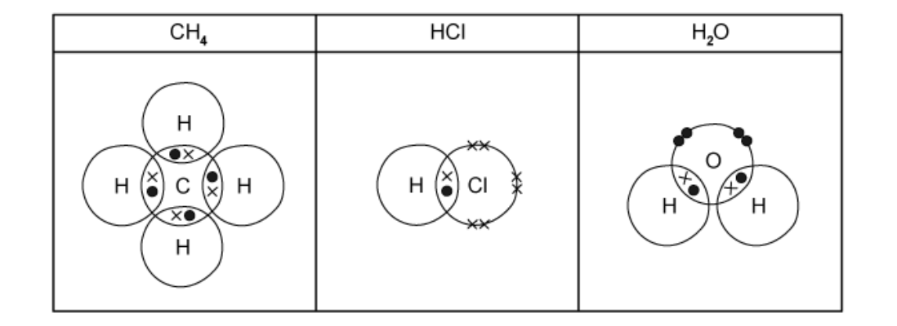

**A, B **and** D** are incorrect as in these options; there is either **carbon or hydrogen, **both of these atoms used all of their outer shell electrons in bonding.

### Q18
**Final answer:** **The correct answer is**** D**** because:**

- Elements **X** is carbon, element **Y** is fluorine and element **Z** is oxygen.
- These elements are all **nonmetals** and thus form covalent compounds.

**A**,** B** and **C** are incorrect as element **W** has 1 electron in its outer shell so it is in Group I, hence it is a metal. Metals form ionic bonds by electron transfer with non-metal elements (and metallic bonds when elements where they lose their outer shell electrons and attraction between positive metal ions and the delocalised electrons holds metallic structures together).

## Theory Questions (15 questions)

### Q1
a) The term *double covalent bond* means:

- Shared pairs(s) of electrons; scores** [1 mark]**
- <u>**2**</u> shared pairs of electrons; scores **[2 marks]**

**[Total: 2 marks]**

- *The command word 'suggest' indicates that you may not have learnt this specifically but you should apply your knowledge*
- *You should know what a covalent bond means - the first mark is to define a covalent bond*
- *'Double' means there are 2 shared pairs of electrons, identifying this gains the second mark*
- *You would not gain any marks if you stated that a double bond is just 'shared electrons' as this is insufficiently detailed*
b) The completed diagram to show the bonding arrangement in a molecule of sulfur monochloride is:

- 2 electrons in each area of overlap; **[1 mark]**
- 6 non-bonded electrons on each Cl atom; **[1 mark]**
- 4 non-bonded electrons on each S atom; **[1 mark]**

**[Total: 3 marks]**

- *Don't be put off by the unfamiliar compound*
- *You are told that the atoms are bonded with single bonds, so there must be a pair of electrons within each area of overlap between atoms*
- *The atoms will covalently bond to achieve a full outer shell, so both Cl and S atoms will have 8 electrons in their outer shell*
- *Go around each electron shell, adding in electrons outside of the areas between atoms that overlap to make it up to 8 electrons for each atom*
- *You can show the electrons as all dot, all crosses or another symbol, or a combination of these*
c) Two properties of sulfur monochloride are:

- Low boiling point / melting point 
**OR** 
Gas or liquid at room temperature; **[1 mark]**
- Poor conductor of electricity / heat; **[1 mark]**

**[Total: 2 marks]**

- *You do not need to know anything about the properties of sulfur monochloride specifically to answer this question, you need to apply your knowledge of the properties of simple molecular compounds*
d) A balanced symbol equation for the reaction to produce sulfur monochloride is:

S8 + 4Cl2 → 4S2Cl2

- Correct formulae; **[1 mark]**
- Correct balancing; **[1 mark]**

**[Total: 2 marks]**

- *You are not expected to know this equation but you should be able to construct it from a combination of information given in the question and your knowledge*
- *You are told that chlorine gas is fed into a flask containing elemental sulfur; you are given the formula of elemental sulfur and you should know the formula of chlorine is Cl**2*
- *This gives you the reactants and product:*

  - *S**8** + Cl**2** → S**2**Cl**2*
- *To balance, you  need 8 S atoms on the right-hand side:*

  - *S**8** + Cl**2** → **4**S**2**Cl**2*
- *Now balance the Cl atoms, you need 8 on the left-hand side:*

  - *S**8** + **4**Cl**2** → 4S**2**Cl**2*

### Q2
a) The two structures that are covalently bonded are:

- **B **/ diamond;** [1 mark]**
- **D** / nitrogen / N2**;[1 mark]**

**[Total: 2 marks]**

- *Covalent bonding occurs between non-metal atoms*
- *You should recognise structure **B** as diamond, which is made from carbon atoms covalently bonded to 4 other carbon atoms*
- *Structure **D** shows 2 atoms of the non-metal, nitrogen, in each molecule, joined together by a triple covalent bond*

  - *You do not need know that this is a triple bond to answer this question, you just need to reconise that it contains 2 non-metal atoms so will form covalent bonds*
- *Structure **A** does show non-metal atoms, but helium atoms do not form bonds as they already have a full outer shell of electrons*
- *Structure **C** is between metal and non-metal atoms so it will form ionic bonds*
- *Structure **E** is between metal atoms so it will form metallic bonding*
b) The strucutre that is a diatomic molecule is:

- **D **/ nitrogen / N2;** [1 mark]**

**[Total: 1 mark]**

- *A diatomic molecule is a molecule that contains two atoms - you are required to know this in relation to Group VII elements as they exist as diatomic molecules*
- *A molecule is a compound that contains covalent bonds*
- *The only structure that fits this description is nitrogen*

### Q3
a) The formula of methane is:

- CH4; **[1 mark]**

**[Total: 1 mark]**

- *The formula tells you the number of atoms for each element*
- *In this case you can see one carbon atom and four hydrogen atoms*
b) The type of bonding in methane is:

- Covalent;** [1 mark]**

**[Total: 1 mark]**

- *Carbon and hydrogen are both non-metals*
- *Covalent bonds form between non-metals*
- *Ionic bonds form between metals and non-metals*
- *Metallic bonds are found in metals and alloys*
c) The correct dot and cross diagram is:

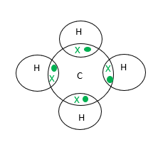

- Four shared pairs of electrons;** [1 mark]**
- No additional electrons on hydrogen atoms; **[1 mark]**

**[Total: 2 marks]**

- *Each atom wants to achieve a full outer shell of electrons*
- *Hydrogen atoms only have one shell so a full shell will only have two electrons*
- *Carbon has two shells so a full shell should have eight electrons*
- *Once you have finished adding the electrons in, count around each atom to check you don't have too few or too many electrons*
d) The boiling point of methane is

- -162 **°C**;** ****[1 mark]**

**[Total: 1 mark]**

- *For methane to be a gas at room temperature, its boiling point must be lower than room temperature*
- *-162 °C is the only temperature that is lower than room temperature, which is about 20 °C*
- *Methane is a simple molecule which typically have low boiling points*

### Q4
a) Group II and Group VI elements both have a valency of 2 because:

- Group II /2 elements / metals will lose 2e-; **[1 mark]**
- Group VI / 4 elements / non-metals will gain 2e-; **[1 mark]**

**[Total: 2 marks]**

- *Valency tells you:*

  - *How many bonds an atom can make with another atom or*
  - *How many electrons its atoms will lose / gain / share to form a compound*
b) A diagram showing the arrangement of the outer electrons in one covalent molecule of sulfur chloride is:

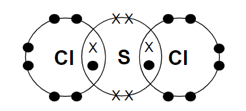

- SCl2; **[1 mark]**
- 8 e- around both chlorine atoms; **[1 mark]**
- 8 e- around sulfur with 4 non-bonded e- and 4 bonded e-; **[1 mark]** 
*If x and o reversed ignore if this is the only error*

**[Total: 3 marks]**

- *Sulfur will share 2 of its electrons to achieve a full outer shell*
- *Each chlorine will share 1 of its electrons to achieve a full outer shell*
- *Check your dot and cross diagram once you have drawn it to make sure that each electron shell contains 8 electrons*
c)

i) The difference in electrical conductivity between solid and liquid strontium chloride is:

- Ions cannot move in solid 
**OR** 
Ions can move in liquid; **[1 mark]**

ii) The difference in electrical conductivity between liquid strontium chloride and liquid sulfur chloride is:

- No ions in sulfur chloride 
**OR **
Sulfur chloride is covalent 
**OR**  
Sulfur chloride only contains molecules 
**OR**  
Only strontium chloride has ions; **[1 mark]**

**[Total: 2 marks]**

- *When explaining the electrical conductivity in ionic compounds, you need to refer to the movement of **ions **not electrons*

### Q5
a) A substance that has a simple molecular structure is:

- Water 
**OR** 
carbon dioxide; **[1 mark]**

**[Total: 1 mark]**

- *A simple molecular structure contains non-metal atoms*
- *Water and carbon dioxide both contain non-metal atoms only and both exist as simple molecules*
- *Calcium carbonate and magnesium oxide are ionic compounds that have giant lattice structures*
- *Copper has a giant metallic lattice*
b) Weak intermolecular forces between particles are found in:

- Carbon dioxide; **[1mark]**
- Water; **[1 mark]**

**[Total: 2 marks]**

- *Both have strong covalent bonds between atoms but weak intermolecular forces between particles*
c) The completed dot and cross diagram should be:

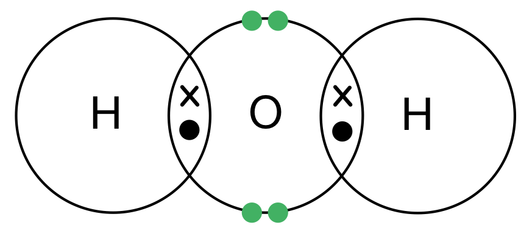

- Four electrons on the shell of the oxygen atom; **[1 mark] **

** [Total: 1 mark] **

- *Oxygen is located in Group VI of the Periodic Table so has six electrons in its outer shell*
- *Two have already been shared with the hydrogen atoms which leaves four remaining*
- *In total, the oxygen atom has eight electrons in its outer shell *
d) When a simple molecular substance melts:

- The intermolecular forces (are broken); **[1 mark]**

**[Total: 1 mark]**

- *The molecules remain intact when a substance melts, but the molecules become further apart so they are able to move past each other*
- *The intermolecular forces are weak, so only need a small about of energy to overcome*

### Q6
a) The bonding and arrangement of particles can be described as:

For bonding:

- Caesium chloride – bonding is ionic; **[1 mark]**
- Caesium chloride – strong bonding (between ions); **[1 mark]**
- Carbon dioxide – covalent bonds within molecules; **[1 mark]**

For arrangement of particles:

- Caesium chloride – regular (arrangement); **[1 mark]**
- Carbon dioxide – random / irregular; **[1 mark]**

**[Total: 5 marks]**

- *The differences in the bonding stem from the types of atoms that each compound is made from:*

  - *Caesium chloride is made from metal and non-metal atoms*
  
    - *Electrons from the metal transfer to the non-metal forming oppositely charged ions*
    - *The electrostatic attraction (also called an ionic bond) between the oppositely charged ions is strong*
  - *Carbon dioxide is made from non-metal atoms*
  
    - *These atoms share a pair of electrons to form a covalent bond*
- *To explain the differences in the arrangement of particles, you can see from the diagram that the ions in caesium chloride are arranged in a regular pattern and that the molecules of carbon dioxide are in a random order*

  - *This is because caesium chloride is a solid and carbon dioxide is a gas*
b) The dot-and-cross diagram of ethanal is:

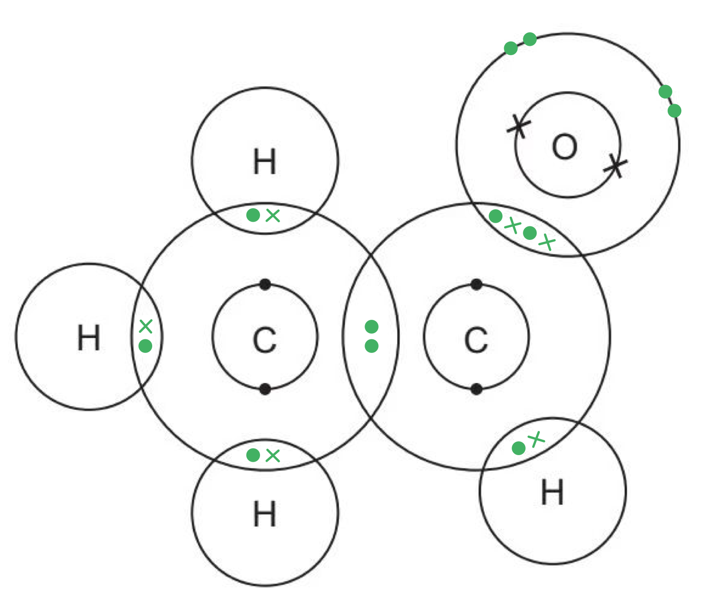

- 4 × C–H dot cross bonds 
**AND **
1 C–C dot cross bond; **[1 mark]**
- 1 × C=O dot cross bond; **[1 mark]**
- Non-bonding electrons on O; **[1 mark]**

**[Total: 3 marks]**

- *Do not be put off this question because it contains an unfamiliar compound - you are not expected to know about ethanal but you should use and apply your knowledge of bonding to answer this*
- *You are given the structural formula with all of the bonds shown*
- *Each single line represents a single bond which is a shared pair of electrons*
- *The double line between C and O represents a double bond, which is two shared pairs of electrons*
- *Add these shared pairs to the diagram:*

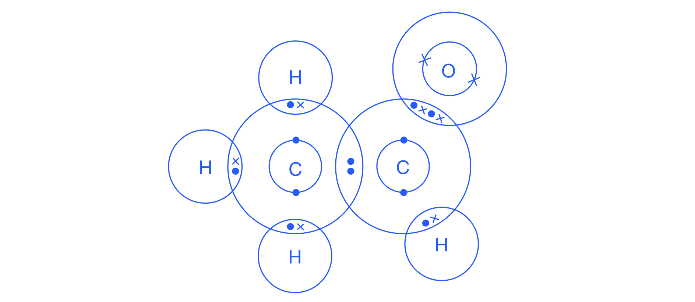

- *Now add in any non-bonding electrons*
- *Look at each atom and determine whether its outer shell is complete*

  - *H should have 2 electrons*
  - *C and O should have 8 electrons in their outer shell*
- *So, everything but O has a complete outer shell*

  - *O needs 4 more electrons which are not involved in bonding:*

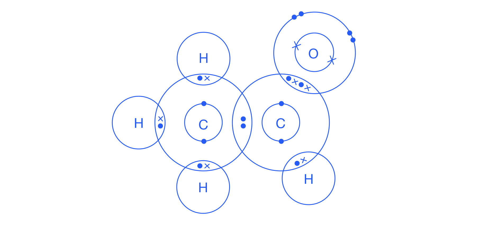
c) The completed dot-and-cross diagram of COF2 is:

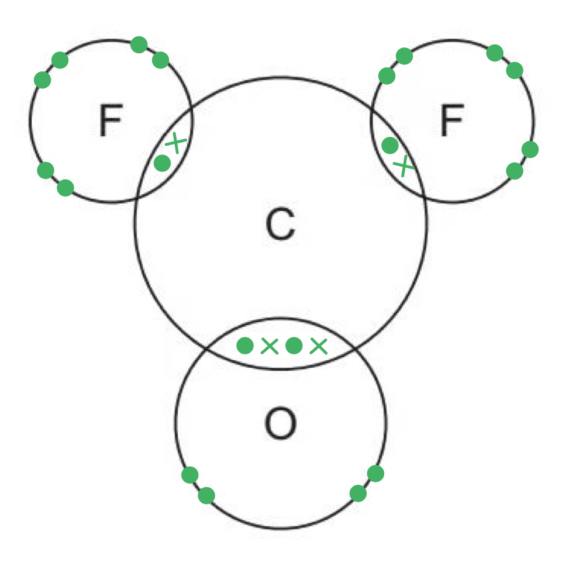

- Two single bonds; **[1 mark]**
- One double bond; **[1 mark]**
- Six non-bonding electrons on both F atoms and four non- bonding electrons on O atom; **[1 mark]**

**[Total: 3 marks]**

- *This is another unfamiliar compound and you can approach this question in a similar way to part (b)*
- *You are given the structural formula with all of the bonds shown*
- *Each single line represents a single bond which is a shared pair of electrons*
- *The double line between C and O represents a double bond, which is two shared pairs of electrons*
- *Add these shared pairs to the diagram:*

- *Now add in any non-bonding electrons*
- *Look at each atom and determine whether its outer shell is complete*

  - *F, C and O should have 8 electrons in their outer shell*
- *So, C has a full outer shell, but F and O do not*

  - *O needs 4 more electrons which are not involved in bonding*
  - *Each F needs 6 more electrons which are not involved in bonding: *

d) Carbonyl fluoride has a low melting point because:

- The forces of attraction between molecules;** [1 mark]**
- Are weak / need a small amount of energy to break / weaken;** [1 mark]**

**[Total: 2 marks]**

- *Carbonyl fluoride is a simple molecule with strong covalent bonds between atoms within a molecule but weak forces of attraction between molecules*

  - *These are also referred to as intermolecular forces*
- *During melting, it is the weak intermolecular forces that are overcome **NOT **the strong covalent bonds *
- *These forces only require a small amount of energy to overcome, therefore carbonyl fluoride has a low melting point*

### Q7
a) The two which could be metals are:

- C **AND** F; **[1 mark]**

**[Total: 1 mark]**

- *Metals conduct when solid and liquid, and typically have high melting and boiling points too*
b) The substance that could be nitrogen is:

- A ;** [1 mark]**

**[Total: 1 mark]**

- *Nitrogen is a simple covalent molecule, N**2**, and so does not conduct electricity when solid or liquid*
- *It is also a gas in the atmosphere at all natural air temperatures, therefore has to have a very low boiling point*
c) The substance that could be an ionic solid is:

- B;** [1 mark]**

**[Total: 1 mark]**

- *lonic substances can conduct when liquid but not when solid*

  - *In a solid, their ions are fixed in position and are unable to move to carry a charge*
  - *In a liquid, these ions become free so can able to move and carry a charge*
- *Ionic substances tend to have high melting and boiling points*
d) The substance that is liquid at room temperature is:

- D;** [1 mark]**

**[Total: 1 mark]**

- *Room temperature is around 20 **o**C, and so the melting point of the substance must be below this value and the boiling point must be above this value*
e) The substance that could have a giant covalent structure similar to diamond is:

- E;** [1 mark]**

**[Total: 1 mark]**

- *Diamond, and similar giant covalent structures, do not conduct electricity when solid or liquid*
- *They have high melting and boiling points as they have many strong covalent bonds that have to be broken in order to change states*
f) The **two** substances that could exist as simple covalent molecules are:

- A **AND** D;** [1 mark]**

**[Total: 1 mark]**

- *Simple covalent molecules do not conduct electricity when solid or liquid*
- *They tend to have low melting and boiling points compared to giant structures*

### Q8
a) The dot-and-cross diagram to show the bonding in PCl3 is:

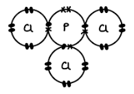

- One shared pair of electrons between the phosphorous atom and each chlorine atom; **[1 mark]**
- 2 non-bonded electrons on the phosphorous atom; **[1 mark]**
- 6 non-bonded electrons on each chlorine atom; **[1 mark]**

**[Total: 3 marks]**

- *Don't be put off by an unfamiliar compound*
- *Phosphorous is in Group V so will have 5 electrons in its outer shell*
- *The formula tells you that it bonds with 3 chlorine atoms*
- *Chlorine needs to share a pair of electrons with phosphorous to gain a full outer shell*
- *So, 3 electrons in the outer shell of phosphorus will be involved in bonding with chlorine, leaving 2 of its electrons non-bonded*
- *The structure of PCl**3** is similar to NH**3**, although H only has 2 electrons in its outer shell*

  - *Phosphorus is in the same group as nitrogen, and so can form three single bonds with 2 non-bonded electrons in a similar way to nitrogen*
b) To compare the bonding in phosphorous trichloride and ammonia:

Any **three **from the following:

- They both do / undergo covalent bonding; **[1 mark]**
- The phosphorous atom (in phosphorous trichloride) and the nitrogen atom (in ammonia) are the central atoms each with three shared pairs of electrons (and 2 non-bonded electrons); **[1 mark]**
- The chlorine atoms (in phosphorous trichloride) and hydrogen atoms (in ammonia) each have one shared pair of electrons; **[1 mark]**
- The chlorine atoms each have 6 non-bonded pairs of electrons 
**AND** 
The hydrogen atoms have no non-bonded electrons; **[1 mark]**

**[Total: 3 marks]**

- *Remember: The exam word "compare" basically means state what is the same and what is different*
c) The type of covalent bond that exists within diphosphorus is:

- Triple (covalent) bond; **[1 mark]**

**[Total: 1 mark]**

- *The question gives you some help by likening nitrogen to phosphorus*
- *You should be aware that nitrogen atoms share 3 pairs of electrons to form a triple bond*
- *As phosphorus is in the same group, it has the same number of outer electrons as nitrogen, so its structure in a molecule of P**2** will be similar to that of N**2*
- *The 2 phosphorus atoms will share 3 pairs of electrons, forming a triple bond:*

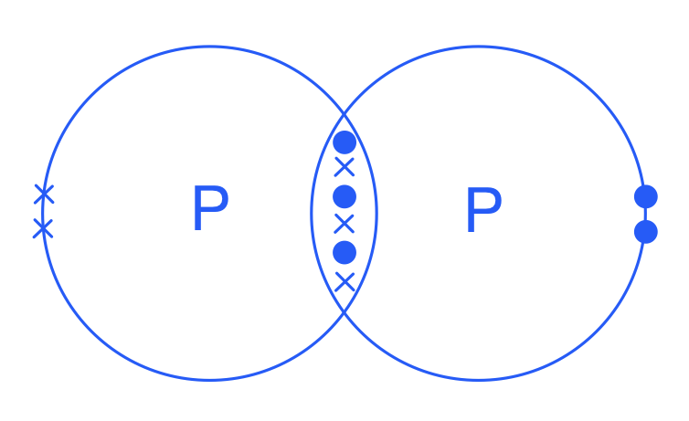
d) The bond energy of the bond between the two phosphorus atoms within the diphosphorus, P2 molecule is:

- Any value between 1 and 944 kJ/mol; **[1 mark]**

**[Total: 1 mark]**

- *This question requires you to apply your knowledge*
- *You should know that nitrogen is a stable molecule and you are told that phosphorous is unstable*
- *This suggests that the P*$\equiv$*P bond will break more easily, i.e. requires less energy, than to break the N*$\equiv$*N bond*

  - *The bond energy of P*$\equiv$*P must be smaller that the bond energy of N*$\equiv$*N, so 944 kJ/mol or less*
- *Energy is required to break bonds, which is an endothermic process, so bond energy must be a positive value*

### Q9
a) Reasons why iodine and bromine bond in a similar way are:

Any **two** of the following:** **

- Same group number;** ****[1 mark]**
- Same number of outer / valence electrons; **[1 mark]**
- Similar chemical properties; **[1 mark]**
- Both require just one outer shell electron to have a full outer shell / form an octet; **[1 mark]**

**[Total: 2 marks]**

- *Chlorine and iodine are in the same group, Group VII, so they have 7 electrons in their outermost shell *
- *This means they will react in a similar way therefore they will bond in a similar way *

  - *This is because they both need to gain 1 electron to have 8 in the outermost shell*
b) The bonding arrangement in an iodine molecule can be shown as:

- One bonding pair of electrons; **[1 mark]**
- 6 non-bonding electrons on each atom;* ***[1 mark]**

**[Total: 2 marks]**

- *Each iodine atom has 7 electrons in its outermost shell therefore it requires 1 more to have a full outer shell*
- *The shells overlap and each atom shares a pair of electrons*
- *Now each iodine atom has a full shell of electrons*
- *You can draw all dots, all crosses, or a combination** **of dots and crosses*
- *The centre of the symbols must be on or inside overlapping areas / space between the shells *
- *The non-bonded electrons do not need to be in pairs*
c) Iodine cannot conduct electricity because:

- Iodine has no delocalised / mobile electrons or ions; **[1 mark]**
- That can carry the charge; **[1 mark]**

**[Total: 2 marks]**

- *There are no free electrons in iodine*
- *Iodine is not made up of ions*
- *This is true of simple molecules*

  - *Simple covalent molecules do not conduct electricity as they do not contain free electrons or ions*
  - *Make sure you know this as it is a common question*
d) Xenon exists as an atom where as iodine exists as a molecule because:

- Iodine has 7 electrons in its outermost shell and requires 1 more electron to have a full outer shell; **[1 mark] **
- Forms a bond to gain 1 electron; **[1 mark] **
- Xenon already has 8 electrons in its outermost shell; **[1 mark] **
- Does not need to form a bond; **[1 mark] **

**[Total: 4 marks] **

- *You do not need to use the atomic numbers to answer this question - these numbers help you identify where the element is in the Periodic Table*
- *You should be confident with the fact that Group 0 elements have 8 electrons in the outermost shell and therefore do not need to form any bonds*

  - *This is also why they are inert*
- *As they consist of one atom, they can be described as monatomic*
- *The halogens such as iodine are diatomic as the molecules consist of two atoms bonded covalently*

### Q10
a) Neon exists as single atoms but fluorine exists as molecules because:

- Neon has full outer shell / energy level / valency shell / octet / 8 (electrons) in outer shell / neon does not need to lose or gain electrons;** [1 mark]**
- Fluorine atoms have 7 electrons / needs 1 to fill / has incomplete shell / forms bonds <u>with other fluorine atoms</u> / fluorine (atoms) form <u>covalent </u>bonds / shares electrons;** [1 mark]**

**[Total: 2 marks]**

- *Atoms react with other atoms when they have an incomplete outer electron shell, so you need to refer to electrons / electron shells in your response*
- *If you refer to fluorine making bonds, you either need to say it forms bonds with other fluorine atoms or it forms covalent bonds; just saying it forms bonds on its own is insufficient to gain a mark*
b) The order of the elements in a period is determined by:

- Atomic number / proton number / number of protons (in one atom); **[1 mark]**

**[Total: 1 mark]**

- *The atomic number tells you how many protons there are in an atom of that element*
c) The reason why the boiling point of nitrogen is very low even though the bond between the atoms in a nitrogen molecule is very strong is:

- Weak intermolecular (or between molecules) forces / Van der Waals forces between molecules / low amount of energy required to break bonds between molecules; **[1 mark]**
- Strong bonds don’t break / covalent bonds don’t break / (unnamed) bonds within molecules / between atoms don’t break; **[1 mark]**

**[Total: 2 marks]**

- *When a simple molecular structure boils, such as nitrogen, the molecules themselves remain intact but the molecules move further apart from each other*
- *So it is not the strong covalent bonds that are broken, but the weak intermolecular forces of attraction that are overcome*
- *Van der Waals forces are a type of intermolecular force; you are not expected to know this term but you would be awarded marks if you used it*
d) A diagram showing the arrangement of the outer shell electrons in a molecule of nitrogen is:

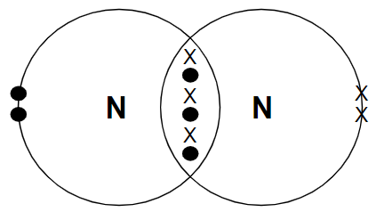

- 1 non-bonding pair on each nitrogen atom; **[1 mark]**
- 6 electrons between nitrogen atoms; **[1 mark]**

**[Total: 2 marks]**

- *Note**: You do not need to use different symbols for the electrons from each atom to gain marks*

  - *The non-bonded pair of electrons on each nitrogen atom does not need to be together*
- *Nitrogen has 5 electrons in its outer shell as it is in Group V*
- *The nitrogen atoms share 3 pairs of electrons to each gain a full outer shell of electrons*
- *This is known as a triple bond and is very strong*
- *It would require a lot of energy to overcome this triple bond, making nitrogen a very stable element - this is why nitrogen is so abundant in our atmosphere*

### Q11
a) The electrical conductivity of solid diamond and molten sulfur is:

- Solid diamond: does not conduct; **[1 mark]**
- Molten sulfur: does not conduct; **[1 mark]**

**[Total: 2 marks]**

- *In solid diamond, all the outer shell electrons in carbon are held in the four covalent bonds around each carbon atom, so there are no freely moving charged particles to carry the current thus it cannot conduct electricity*
- *Sulfur is a simple molecule, whose atoms are covalently bonded within each sulfur molecule*

  - *Therefore, in molten sulfur, there are no freely moving charged particles to carry the charge, so cannot conduct electricity*
b) One piece of evidence from the table that shows that sulfur is a simple molecular substance is:

- It has a low boiling point;** [1 mark]**

**[Total: 1 mark]**

- *Simple molecular substances are usually liquids or gases at room temperature*
- *Sulfur actually exists as a solid at room temperature but its boiling point is still low so will melt at relatively low temperatures*
- *Students taking the extended course need to be able to explain why they have low boiling points*

  - *Simple molecular substances have weak intermolecular forces which require little energy to overcome*
c) The dot-and-cross diagram of a molecule of chlorine is:

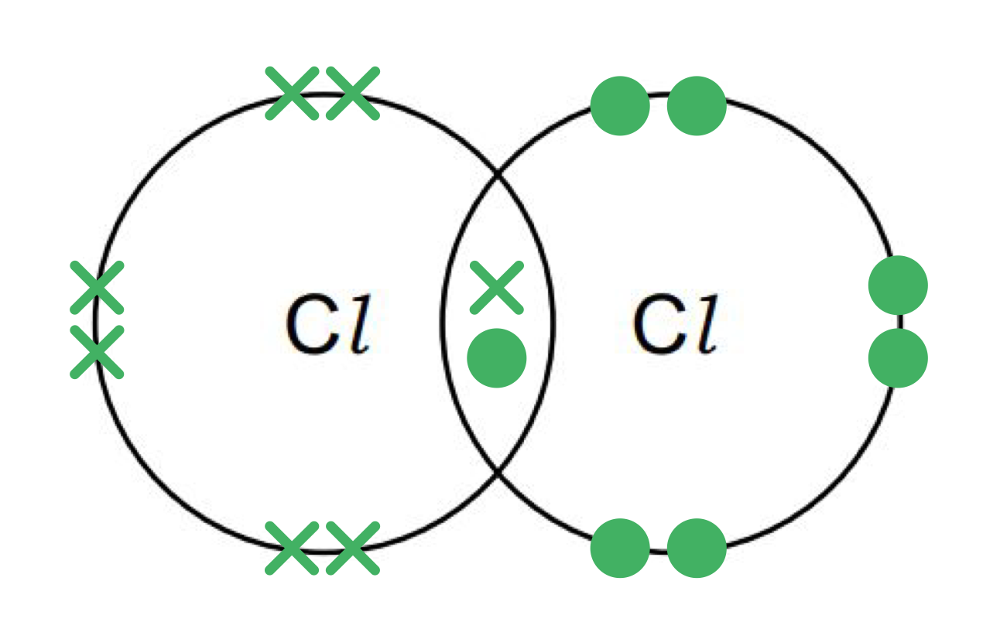

- A pair of electrons in overlap area between the atoms;** [1 mark]**
- Six unbonded electrons on each Cl atom in the molecule; **[1 mark]**

**[Total: 2 marks]**

- *You can use all dots, all crosses, or a combination to gain the marks*
- *Each chlorine atom has 7 electrons in its outer shell so they share a pair of electrons to gain a full outer shell of electrons*
- *Once you have completed the dot-and-cross diagram, count the number of electrons in each electron shell to ensure that they add up to 8*
d) A dot-and-cross diagram to show a molecule of ethene, CH2=CH2 is:

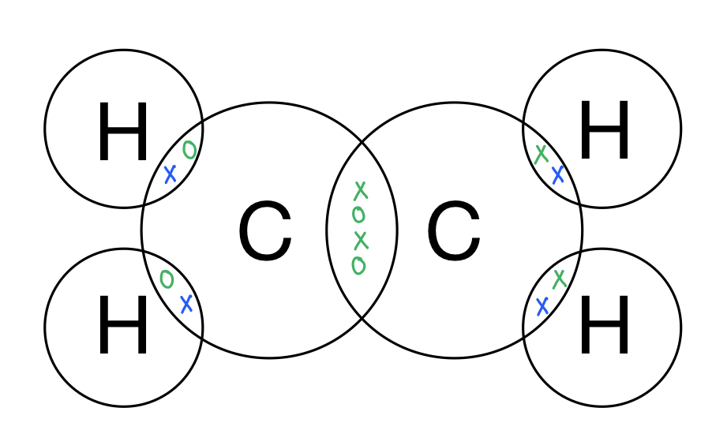

- One shared pair of electrons between each H and a C atom; **[1 mark]**
- Two shared pairs of electrons between the C atoms and no other unpaired electrons; **[1 mark]**

**[Total: 2 marks]**

- *In ethene, the two carbon atoms share 2 pairs of electrons*
- *This is known as a double bond, which is represented by '=' when writing the structural formula*
- *You can use all dots, all crosses, or a combination of these*
- *Check your diagram once you have completed it*

  - *Each carbon atom should have 8 electrons in its outer shell*
  - *Each hydrogen should have 2 electrons in its outer shell*

### Q12
a)

i) A process which can change light into chemical energy is:

- Photosynthesis 
**OR **
A photochemical reaction; **[1 mark]** 
*Do not allow an example, the question requires a process* 
*Do not allow devices which convert light into electricity*

ii) A device which can change chemical energy into electrical energy is:

- Cell; **[1 mark]** 
*Accept battery* *Do not allow generator*

**[Total: 2 marks]**

- *Photosynthesis is an endothermic reaction in which energy in the form of light is transferred from the environment to the chloroplasts in green plants to make glucose*
- *A simple electrolytic cell converts energy stored within chemicals to electrical energy*
b)

i) A diagram which shows the formula of this ionic compound, the charges on the ions and the arrangement of the outer electrons around the negative ion is:

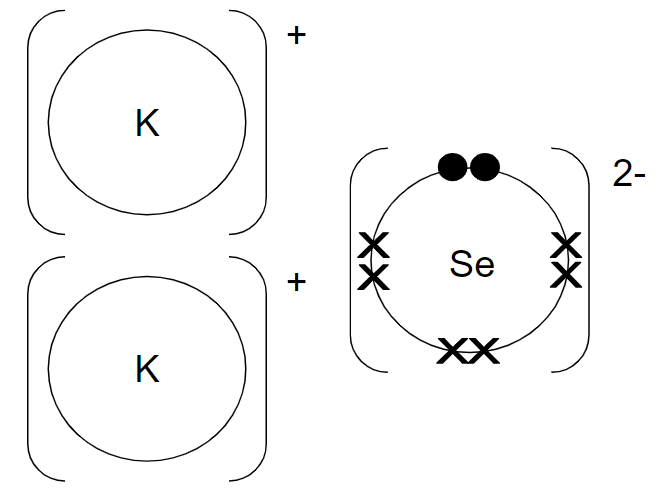

- Correct formula; **[1 mark]** 
*The following marks are conditional on the correct formula*
- Correct charges; **[1 mark]**
- 6x and 2o around negative ion; **[1 mark] **
*If covalent bonding is shown then only award a maximum of 1 mark *
*Do NOT penalise for incorrect coding Ignore electrons around potassium*

ii) A diagram showing the arrangement of the outer electrons in one molecule of the covalent compound selenium chloride is:

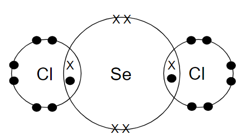

- Correct formula; **[1 mark]** *The following marks are conditional on the correct formula*
- 4 bonded electrons and 4 non-bonded electrons around selenium; **[1 mark]**
- 2 bonded electrons and 6 non-bonded electrons around both chlorine atoms; **[1 mark] ***If ionic bonding is shown then only award a maximum of 1 mark Electrons do not need to be shown in pairs*

iii) Two differences in the physical properties of these two compounds are:

Any **two **from:

- The ionic compound has a higher melting point / boiling point / is less volatile; **[1 mark]**
- The ionic compound conducts when molten or aqueous **AND** 
The covalent compound does not; **[1 mark]**
- The ionic compound is hard<u>er</u>; **[1 mark]**
- The ionic compound is soluble in water / insoluble in organic solvents 
**AND** 
The covalent compound is not soluble in water / is soluble in organic solvents; **[1 mark] ***Note there has to be comparison between the ionic compound and the covalent compound* *Do NOT allow density*

**[Total: 8 marks]**

- *You are not expected to be able to write the electronic structure / distribution for selenium *
- *Selenium is in Group VI so will have 6 electrons in its outer shell - this is confirmed in the final number of the electron distribution of selenium*
- *When reacting with potassium:*

  - *Potassium has 1 electron in its outer shell so 2 potassium atoms will each lose an electron to form 1- ions*
  - *Selenium will gain these 2 electrons to form a 2- charge*
  - *Overall the compound is neutral and the formula of the resulting compound is K**2**Se*
- *When reacting with chlorine:*

  - *Selenium needs to share 2 pairs of electrons and chlorine will share one pair of electrons to gain a full outer shell*
  - *The formula of the resulting compound is SeCl**2*
- *You should know the properties of ionic compounds and simple covalent molecules to allow you to compare them*
- *As the questions asks for the differences, you must refer to both structures or make a comparative statement, i.e. saying the ionic compound is hard is insufficient to gain a mark, but saying it is harder will gain a mark*
c) The type of reagent that the selenide ion is in this reaction is a:

- Base: **[1 mark]** 
*Do not allow alkali*
- (Because it) accepts a proton / hydrogen ion / H+;** [1 mark]**

**[Total: 2 marks]**

- *Don't be put off by the non-familiar reaction, look what is happening in the reaction:*

  - *Se**2+** gains H**+** from H**2**O to become HSe**-** *
  - *H**2**O loses H**+** to become OH**-*
- *A hydrogen ion is a proton (a hydrogen atom contains one proton and one electron, a hydrogen ion has had its electron removed, leaving just a proton)*
- *A base is a substance that accepts a proton / H**+*
- *An acid is a substance that donates a proton / H**+ **(so in this case, water is actually acting as an acid)*

### Q13
a) The compound that has the higher boiling point is:

- Propane / C3H8; **[1 mark]**
- (Because) propane / C3H8 is a larger molecule 
**OR**
 Methane / CH4 is a smaller molecule; **[1 mark]**
- So the intermolecular forces are stronger in C3H8 / weaker in CH4; **[1 mark]**
- More energy is needed to overcome (the intermolecular forces) in propane / C3H8 
**OR** 
Less energy is needed to overcome (the intermolecular forces) in methane / CH4; **[1 mark]**

**[Total: 4 marks]**

- *You must make a comparison in your answer, just stating that propane is a large molecule, for example, is insufficient*
- *You can describe intermolecular forces as being the forces of attraction between molecules*
- *As molecules get larger, more electrons are available which causes the intermolecular forces to become stronger*
- *This causes melting and boiling points to increase*
b) The number of covalent bonds a hydrogen atom can form and an explanation of why there is a difference are:

- Hydrogen can form one covalent bond; **[1 mark]**
- Because hydrogen only needs one more electron to fill its outer shell, which holds a maximum of 2 electrons; **[1 mark]**
- Carbon, however, needs four more electrons to fill its outer shell (which holds 8 electrons), so it forms four covalent bonds); **[1 mark]**

**[Total: 3 marks]**

- *Remember**: The first electron shell can only hold up to 2 electrons*
- *Hydrogen only has one electron in its outer shell, so to fill this shell, it only requires one more*
c) The dot-and-cross diagram for Ge2H6 is:

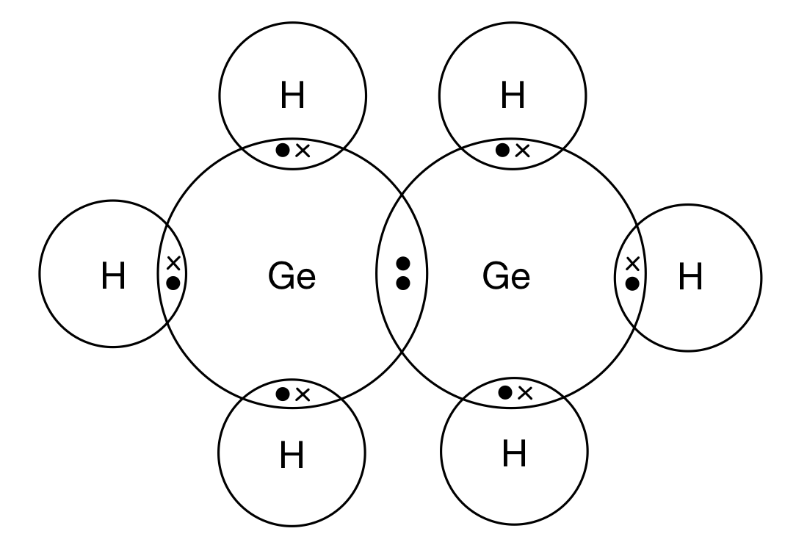

- A pair of electrons in each area of overlap between atoms; **[1 mark]**
- Rest of diagram correct; **[1 mark]**

**[Total: 2 marks]**

- *The information in the question draws a similarity between carbon and germanium as you are told that they both can form four covalent bonds*
- *This means that the dot-and-cross diagram of digermane, Ge**2**H**6**, showing the outer electrons will be the same as ethane, C**2**H**6**, which is a dot-and-cross diagram you should be familiar with*
d) Digermane does not conduct electricity because:

- It / digermane has no delocalised / mobile electrons or ions; **[1 mark]**
- That can carry the charge; **[1 mark]**

**[Total: 2 marks]**

- *This is a standard explanation of why simple molecules do not conduct electricity so make sure you learn it*
- *It is applicable to any simple molecule*

### Q14
a) A covalent bond is formed between two atoms when::

- (The atoms) share electron(s); scores **[1 mark]**
- (The atoms) share a <u>pair</u> of electrons; scores **[2 marks]**

**[Total: 2 marks]**

- *When two atoms share a pair of elctrons, each atom gains a full outer shell of electrons, giving them a noble gas electronic configuration*
- *Careful**: Make sure you use the word 'pair' to gain full marks for this question - this is a definition well worth learning*
b) The completed dot and cross diagram of ammonia is:

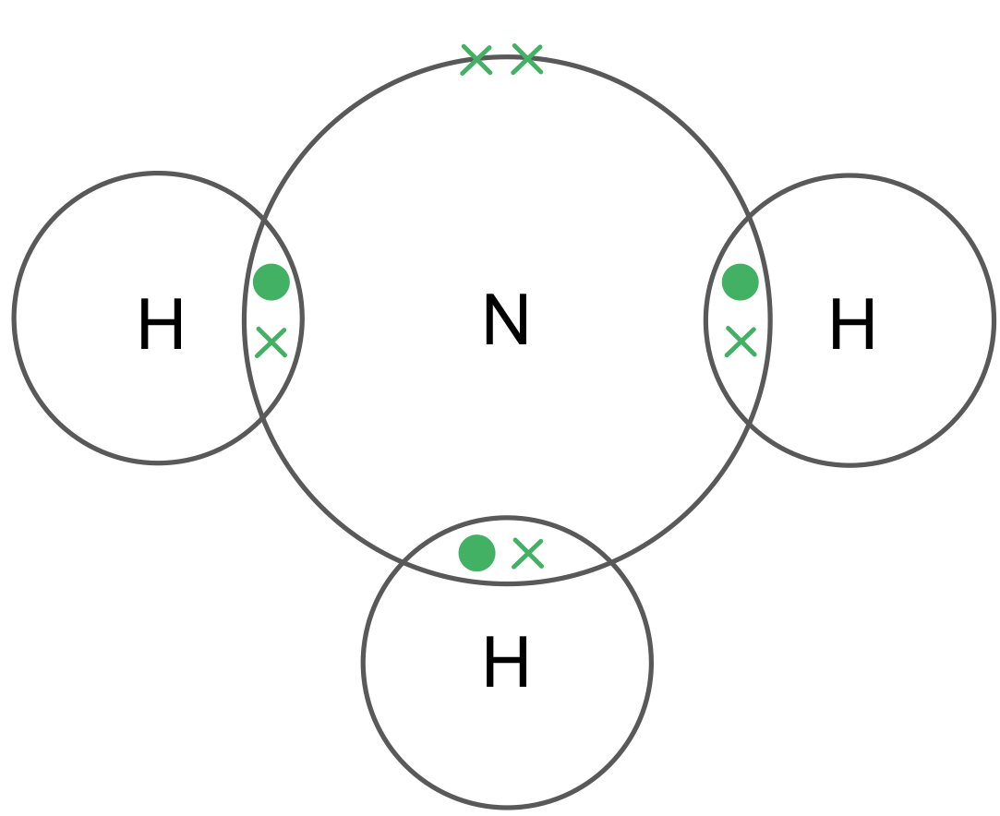

- 2 electrons in each of the areas of overlap between N and H; **[1 mark]**
- 2 non-bonded electrons on N atom; **[1 mark]**

**[Total: 2 marks]**

- *Each hydrogen atom has one electron and requires 2 electrons for a full outer shell, so each of the hydrogen atoms will share a pair of electrons with nitrogen*
- *Nitrogen is in Group V so will have 5 electrons in its outer shell, 3 of these are shared with the 3 hydrogen atoms, leaving 2 non-bonded electrons in its outer shell*
- *When you have finished drawing, check that each hydrogen atom has 2 electrons in its outer shell and nitrogen has 8 electrons*
- *You can draw the electrons as all dots, all crosses or a combination of dots and crosses*
c) The correct sentences are:

Ammonia is a simple molecule that has strong **covalent** bonds between atoms and **weak** intermolecular forces between molecules. Only a small amount of energy is needed to overcome the forces between the **molecules** so ammonia has a low boiling point.

- Covalent; **[1 mark]**
- Weak; **[1 mark]**
- Molecules; **[1 mark]**

**[Total: 3 mark]**

- *It is important to learn and use the correct terminology when referring to the structure of simple molecules to explain their properties*
- *When a substance melts or boils, the molecules themselves remain intact, so the strong covalent bonds between molecules are not broken*
- *It is the weak forces between molecules that are overcome*
d) The statement that explains why ammonia does not conduct electricity is:

| It does not contain any free ions | **✔** | ; **[1 mark]** |
|---|---|---|
|   |   |   |
| Its ions are in a fixed position |   |   |
|   |   |   |
| It does not contain any free electrons | **✔** | ; **[1 mark]** |
|   |   |   |
| It has delocalised electrons |   |   |

**[Total: 2 marks]**

- *Ammonia is a simple molecular substance so does not contain any ions*
- *It does not have any delocalised electrons*
- *In order for a substance to conduct electricity, it needs to have charged particles that are free to move through the structure*
- *Ammonia does not have any charged particles, either ions or electrons, that are free to move, therefore cannot conduct electricity*

### Q15
a) The type of bonding that exists between the atoms in a P4 molecule is:

- Covalent;** [1 mark]**

**[Total: 1 mark]**

- *When determining the type of bonding, think about the type of elements within the compound*
- *Phosphorous is a non-metal*
- *Non-metal elements participate in covalent bonding*
- *Remember**: a Non-metal and metal element will form an ionic bond, and metals will form metallic bonds*
b) P4 has a low melting point because:

- The forces of attraction between molecules 
**AND** 
Are weak / need a small amount of energy to break; **[1 mark]**

**[Total: 1 mark]**

- *P**4** is a simple molecule with strong covalent bonds between atoms within a molecule but weak forces of attraction between molecules*

  - *These are also referred to as intermolecular forces*
- *During melting, it is the weak intermolecular forces that are overcome **NOT **the strong covalent bonds *
- *These forces only require a small amount of energy to overcome, therefore P**4** has a low melting point*
c) Phosphorus is a non-conductor of electricity because:

- (It has) no moving / flowing / mobile charged particles / ions / electrons;** [1 mark]**

**[Total: 1 mark]**

- *In order for a substance to conduct electricity, it needs to have charged particles that are free to move through the structure*
- *Simple molecules do not have any ions or delocalised electrons, therefore cannot conduct electricity*
d)

The correct equation for the reaction between phosphorus(V) oxide and aqueous sodium hydroxide is:

P4O10 + 12NaOH → 4Na3PO4 + 6H2O

- Formula: Na3PO4; **[1 mark]**
- Rest of the equation completely correct; **[1 mark]**

**[Total: 2 marks]**

- *You are told that "phosphorus(V) oxide, P**4**O**10**, reacts with aqueous sodium hydroxide" and you should know the formula for sodium hydroxide*
- *This gives the reactants to be:*

  - *P**4**O**10** + NaOH →*
- *You are also told that they "form a salt containing the phosphate ion PO**4**3-**" - the salt will contain the negative phosphorus ion and the positive ion, Na**+** from the sodium hydroxide*
- *For the compound to be neutral overall, 3 Na**+** ions are required for every 1  PO**4**3-**, so its formula is Na**3**PO**4*

  - *P**4**O**10** + NaOH → Na**3**PO**4*
- *Finally, you are also told that water is the only other product which gives the unbalanced equation:*

  - *P**4**O**10** + NaOH → Na**3**PO**4 **+ H**2**O*
- *Now the equation needs balancing*
- *There are 4 P atoms on the left-hand side, so balance the right-hand side to give 4 P atoms:*

  - *P**4**O**10** + NaOH → **4**Na**3**PO**4 **+ H**2**O*
- *There are 12 Na atoms on the right-hand side, so balance the left-hand side to give 12 Na atoms:*

  - *P**4**O**10** + **12**NaOH → 4Na**3**PO**4 **+ H**2**O*
- *There are 12 H atoms on the left-hand side, so balance the right-hand side to give 12 H atoms:*

  - *P**4**O**10** + 12NaOH → 4Na**3**PO**4 **+ **6**H**2**O*
- *There are 22 O atoms on both sides of the equation, so the equation is now balanced*
