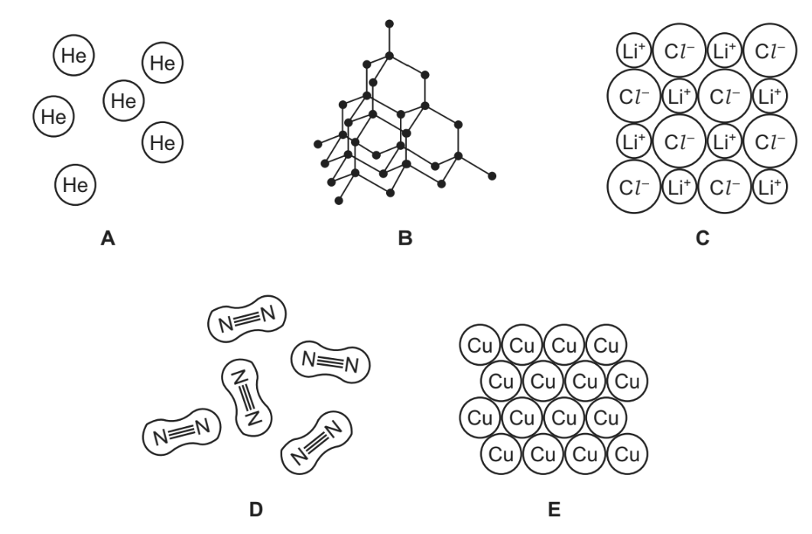
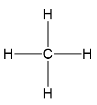
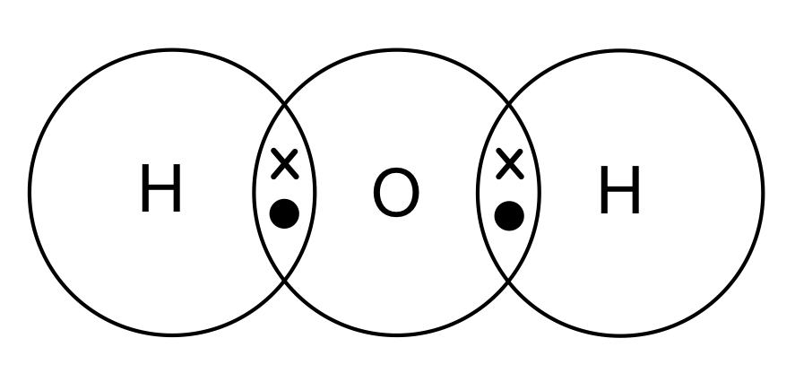
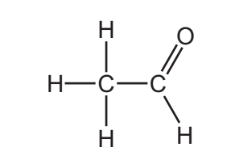
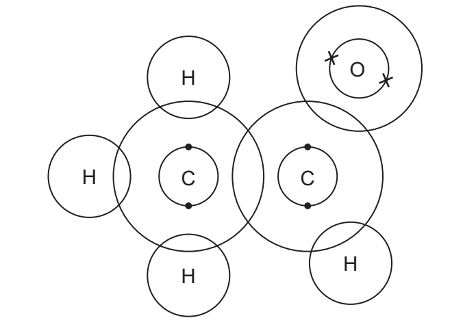
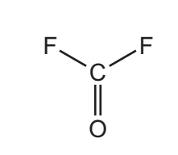
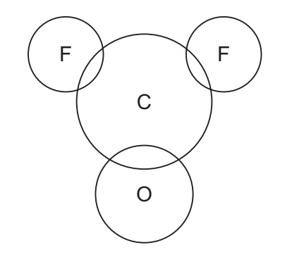
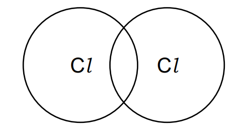
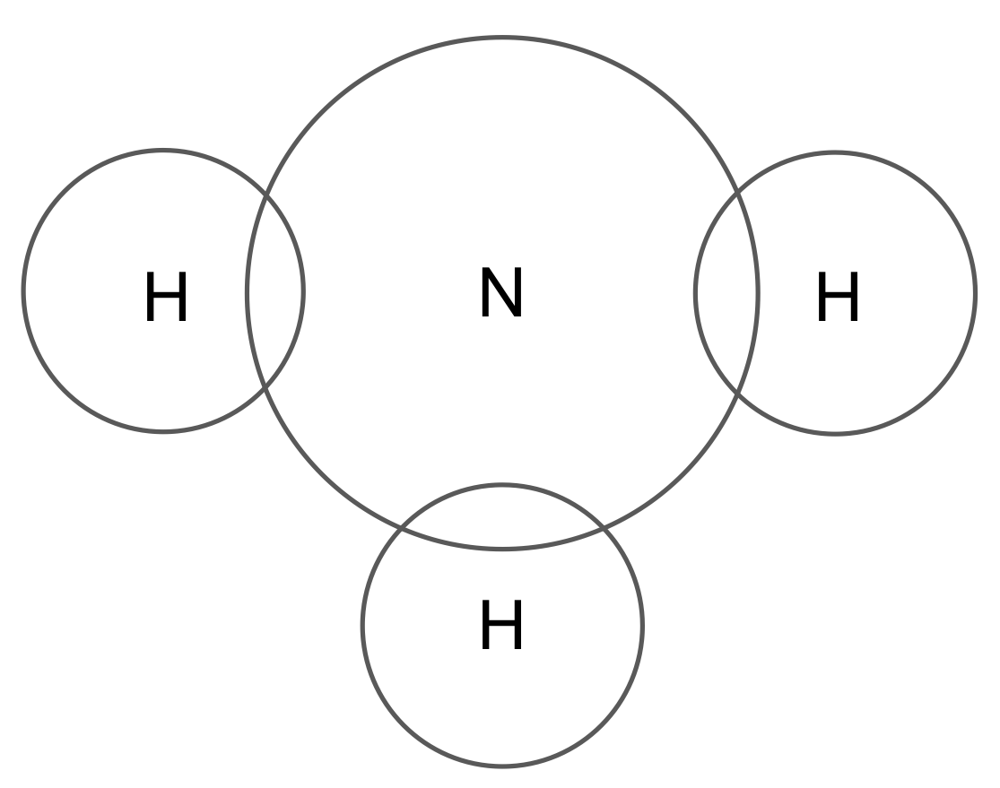

# Exam Questions — Simple Molecules & Covalent Bonds
**2. Atoms, Elements & Compounds** · Cambridge (CIE) IGCSE chemistry (0620 & 0971)
> Source: [https://www.savemyexams.com/igcse/chemistry/cie/23/topic-questions/](https://www.savemyexams.com/igcse/chemistry/cie/23/topic-questions/) · 33 questions across 2 sets

## Multiple Choice Questions (21 questions)

### Q1 — hard — 1 marks

**Q1** [1 mark]

The displayed formula of ethanoic acid is shown.

Which row shows the total number of shared electrons and the total number of non-bonding electrons in one molecule of ethanoic acid?

|   | total number of shared electrons | total number of non-bonding electrons |
|---|---|---|
| **A** | 14 | 0 |
| **B** | 14 | 8 |
| **C** | 16 | 0 |
| **D** | 16 | 8 |

### Q2 — easy — 1 marks

**Q2** [1 mark]

Lithium hydroxide reacts with hydrochloric acid to form lithium chloride and water.

Which row describes correctly the properties of the products and the final reaction mixture?

|   | melting point of lithium chloride | melting point of water | electricity conduction of the reaction mixture |
|---|---|---|---|
| **A** | high | high | good |
| **B** | high | low | good |
| **C** | low | high | poor |
| **D** | low | low | poor |

### Q3 — medium — 1 marks

**Q3** [1 mark]

Diagrams 1 and 2 show the electron arrangements in molecules of water and methane.

Which row describes the diagrams?

|   | water diagram | methane diagram |
|---|---|---|
| **A** | correct | incorrect |
| **B** | correct | correct |
| **C** | incorrect | incorrect |
| **D** | incorrect | correct |

### Q4 — easy — 1 marks

**Q4** [1 mark]

Which statement about bonding is not correct?

### Q5 — easy — 1 marks

**Q5** [1 mark]

Which of the following compounds are formed by covalent bonding?

| **1** | Potassium fluoride |
|---|---|
| **2** | Propane |
| **3** | Carbon dioxide |
| **4** | Lithium bromide |

### Q6 — easy — 1 marks

**Q6** [1 mark]

Which row correctly describes a simple covalent compound?

|   | low melting point | high boiling point |
|---|---|---|
| **A** | `✓` | `✓` |
| **B** | $\times$ | `✓` |
| **C** | $\times$ | $\times$ |
| **D** | `✓` | $\times$ |

### Q7 — easy — 1 marks

**Q7** [1 mark]

#### Extended Only

The structure of propane is shown below

Which correctly explains why propane can not conduct electricity?

### Q8 — easy — 1 marks

**Q8** [1 mark]

Ammonia is a covalent compound consisting of one nitrogen atom bonded to three hydrogen atoms.

Which statement is correct for a molecule of ammonia?

### Q9 — hard — 1 marks

**Q9** [1 mark]

#### Extended Only

A student has drawn a dot and cross diagram to represent a molecule of ethene, C2H4, as shown below.

What is wrong with the students drawing?

### Q10 — hard — 1 marks

**Q10** [1 mark]

#### Extended Only

Dot and cross diagrams for four covalent molecules are shown below.

Which diagram is incorrect?

### Q11 — hard — 1 marks

**Q11** [1 mark]

#### Extended Only

Which statement about methane is correct?

### Q12 — hard — 1 marks

**Q12** [1 mark]

#### Extended Only

A covalent molecule M contains a total of four shared electrons.

What is M?

### Q13 — hard — 1 marks

**Q13** [1 mark]

#### Extended Only

Carbon dioxide is a simple molecular substance in which the molecules are formed by covalent bonding between one carbon atom and two oxygen atoms.

Which dot and cross diagram below shows the correct outer shell arrangement of electrons in a molecule of CO2?

### Q14 — medium — 1 marks

**Q14** [1 mark]

Atoms P and Q have electronic structures as shown in the diagram. They react together to form a covalent compound.

What is the formula of the compound?

### Q15 — medium — 1 marks

**Q15** [1 mark]

The atom of element Z has 6 electrons in its outer shell. How would this element react?

### Q16 — medium — 1 marks

**Q16** [1 mark]

#### Extended Only

Which of the following molecules contains only single covalent bonds?

### Q17 — medium — 1 marks

**Q17** [1 mark]

CH4, H2O and HCl are covalent compounds.

Which atoms in these compounds do not use all of their outer shell electrons in bonding?

### Q18 — medium — 1 marks

**Q18** [1 mark]

The electronic configurations of four different atoms are shown below.

Which atoms form covalent compounds?

## Theory Questions (15 questions)

### Q1 — hard — 9 marks

**Q1** [2 marks]

#### Extended Only

Sulfur monochloride, S2Cl2, has a simple molecular structure.

It was suggested that the structure of sulfur monochloride included a double covalent bond between the two sulfur atoms.

Suggest what is meant by the term *double covalent bond*?

**Q1** [3 marks]

After analysis of the structure of sulfur monochloride, S2Cl2, it was found that only single covalent bonds were present in its structure. Complete the diagram below to show the bonding arrangement in a molecule of sulfur monochloride. Show the outer shell electrons only.

**Q1** [2 marks]

**Extract:**

Sulfur monochloride, S~2~Cl~2~, has a simple molecular structure.

Predict **two** properties of sulfur monochloride.

**Q1** [2 marks]

**Extract:**

Sulfur monochloride, S~2~Cl~2~, has a simple molecular structure.

Sulfur monochloride can be produced in the laboratory by feeding chlorine gas into a flask containing sulfur in its elemental form, S8.  Write a balanced symbol equation for this reaction.

### Q2 — easy — 3 marks

**Q2** [2 marks]

The diagrams show part of the structures of five substances, **A**, **B**, **C**, **D** and **E**.

Answer the following question about these structures. Each structure may be used once, more than once or not at all.

Which two of these structures, **A**, **B,** **C**, **D** or **E**, are covalently bonded?

*Source: 2020 Ju42/04 Q2C*

**Q2** [1 mark]

**Extract:**

The diagrams show part of the structures of five substances, A, B, C, D and E. [Diagram showing: A - He, B - diamond, C - Li+ Cl-, D - N≡N, E - Cu]

The diagrams show part of the structures of five substances, **A,** **B**, **C**, **D** and **E**.

Answer the following question about these structures. Each structure may be used once, more than once or not at all.

Which one of these structures, **A**, **B**, **C**, **D** or **E**, is a diatomic molecule?

*Source: 2019 Ju31/03 Q1A*

### Q3 — easy — 5 marks

**Q3** [1 mark]

This question is about the structure and bonding in methane.

A molecule of methane is shown below.** **

Give the formula of this methane molecule.

**Q3** [1 mark]

What type of bonding is found in methane?

Draw a circle around the correct answer.

| ** ionic** | ** covalent** | **metallic** |
|---|---|---|

**Q3** [2 marks]

The bonding in methane can be shown using a dot and cross diagram.

Carbon has four electrons in its outer shell, and hydrogen has one.

Complete the dot and cross diagram for methane.

**Q3** [1 mark]

Methane is a gas at room temperature.

Which **one **of the following temperature values could be the boiling point of methane?

Draw a circle around the correct answer.

| **312 °C** | ** -162 °C** | ** 162 °C** | **897 °C** |
|---|---|---|---|

### Q4 — medium — 7 marks

**Q4** [2 marks]

Strontium and sulfur chlorides both have a formula of the type XCl2 but they have different properties.

| **Property** | **Strontium chloride** | **Sulfur chloride** |
|---|---|---|
| Appearance | white crystalline solid | red liquid |
| Melting point / oC | 87 | -8 |
| Particles present | ions | molecules |
| Electrical conductivity of solid | poor | poor |
| Electrical conductivity of liquid | good | poor |

The formulae of the chlorides are similar because both elements have a valency of 2.

Explain why Group II and Group VI elements both have a valency of 2.

*Source: 2004 031 Q5*

**Q4** [3 marks]

**Extract:**

Strontium and sulfur chlorides both have a formula of the type XCl~2~ but they have different properties. The formulae of the chlorides are similar because both elements have a valency of 2.

Draw a diagram showing the arrangement of the outer electrons in one covalent molecule of sulfur chloride. Use x to represent an electron from a sulfur atom. Use o to represent an electron from a chlorine atom.

*Source: 2004 031 Q5*

**Q4** [2 marks]

**Extract:**

Strontium and sulfur chlorides both have a formula of the type XCl~2~ but they have different properties.

| **Property** | **Strontium chloride** | **Sulfur chloride** |
| :---: | :---: | :---: |
| Appearance | white crystalline solid | red liquid |
| Melting point / ^o^C | 87 | -8 |
| Particles present | ions | molecules |
| Electrical conductivity of solid | poor | poor |
| Electrical conductivity of liquid | good | poor |

Explain the difference in electrical conductivity between the following.

i) Solid and liquid strontium chloride

[1]

ii) Liquid strontium chloride and liquid sulfur chloride

[1]

*Source: 2004 031 Q5*

### Q5 — easy — 5 marks

**Q5** [1 mark]

This question is about bonding and structure in different substances.

The list shows different substances.

**carbon dioxide**

**calcium carbonate**

**copper**

**water**

**magnesium oxide**

Which **one** of these substances has a simple molecular structure?

**Q5** [2 marks]

**Extract:**

The list shows different substances. carbon dioxide, calcium carbonate, copper, water, magnesium oxide

#### Extended Only

Which **two** substances from part a) have weak intermolecular forces between particles?

**Q5** [1 mark]

**Extract:**

Oxygen is located in Group VI of the Periodic Table so has six electrons in its outer shell
Two have already been shared with the hydrogen atoms which leaves four remaining
In total, the oxygen atom has eight electrons in its outer shell

Complete the dot and cross diagram to show how electrons are shared in water.

Some of them have been done for you.

**Q5** [1 mark]

**Extract:**

A substance that has a simple molecular structure is:

- Water 

OR 

carbon dioxide; [1 mark]

- A simple molecular structure contains non-metal atoms
- Water and carbon dioxide both contain non-metal atoms only and both exist as simple molecules

Intermolecular forces between particles are found in:

- Carbon dioxide; [1mark]
- Water; [1 mark]

- Both have strong covalent bonds between atoms but weak intermolecular forces between particles

#### Extended Only

When a simple molecular substance melts, what is broken, the intermolecular forces or the bonds between atoms?

### Q6 — hard — 13 marks

**Q6** [5 marks]

The diagram shows part of the structures of caesium chloride and carbon dioxide.

Describe both caesium chloride and carbon dioxide in terms of:

- bonding:
- arrangement of particles:

*Source: 2020 Ju31 Q4A*

**Q6** [3 marks]

#### Extended Only

Ethanal is manufactured by two different processes.

The structural formula of ethanal is shown.

The C=O group in aldehydes is at the end of the carbon chain. This is a reactive part of the molecule.

Complete the dot-and-cross diagram to show the electron arrangement of a molecule of ethanal. Inner shells have been drawn.

*Source: 2020 Ju32 Q8A*

**Q6** [3 marks]

**Extract:**

- You are given the structural formula with all of the bonds shown
- Each single line represents a single bond which is a shared pair of electrons
- The double line between C and O represents a double bond, which is two shared pairs of electrons
- Add these shared pairs to the diagram:
- Now add in any non-bonding electrons
- Look at each atom and determine whether its outer shell is complete
- F, C and O should have 8 electrons in their outer shell
- So, C has a full outer shell, but F and O do not
- O needs 4 more electrons which are not involved in bonding
- Each F needs 6 more electrons which are not involved in bonding:

#### Extended Only

Fluorine forms both ionic and covalent compounds.

Carbonyl fluoride, COF2, is a covalent compound. The structure of a molecule of COF2 is shown.

Complete the dot-and-cross diagram to show the electron arrangement in a molecule of carbonyl fluoride. Show outer shell electrons only.

*Source: 2020 Ju41 Q5E*

**Q6** [2 marks]

**Extract:**

Fluorine forms both ionic and covalent compounds. Carbonyl fluoride, COF~2~, is a covalent compound. The structure of a molecule of COF~2~ is shown.

#### Extended Only

The melting points of magnesium fluoride and carbonyl fluoride are shown.

|   | **melting point / °C** |
|---|---|
| magnesium fluoride | 1263 |
| carbonyl fluoride | –111 |

Explain, using your knowledge of structure and bonding, why carbonyl fluoride has a low melting point.

*Source: 2020 Ju42/04 Q2B*

### Q7 — easy — 6 marks

**Q7** [1 mark]

#### Extended Only

The table gives the melting points, the boiling points and the electrical properties of six substances A to F.

| substance | melting point / °C | boiling point / °C | electrical conductivity as a solid | electrical conductivity as a liquid |
|---|---|---|---|---|
| A | -210 | -196 | does not conduct | does not conduct |
| B | 777 | 1627 | does not conduct | good conductor |
| C | 962 | 2212 | good conductor | good conductor |
| D | -94 | 63 | does not conduct | does not conduct |
| E | 1410 | 2355 | does not conduct | does not conduct |
| F | 1064 | 2807 | good conductor | good conductor |

Which **two** substances could be metals?

*Source: 2013 Oc32 Q1*

**Q7** [1 mark]

**Extract:**

The table gives the melting points, the boiling points and the electrical properties of six substances A to F.

| substance | melting point / °C | boiling point / °C | electrical conductivity as a solid | electrical conductivity as a liquid |
| A | -210 | -196 | does not conduct | does not conduct |
| B | 777 | 1627 | does not conduct | good conductor |
| C | 962 | 2212 | good conductor | good conductor |
| D | -94 | 63 | does not conduct | does not conduct |
| E | 1410 | 2355 | does not conduct | does not conduct |
| F | 1064 | 2807 | good conductor | good conductor |

Which substance could be nitrogen?

*Source: 2013 Oc32 Q1*

**Q7** [1 mark]

**Extract:**

The table gives the melting points, the boiling points and the electrical properties of six substances A to F.

| substance | melting point / °C | boiling point / °C | electrical conductivity as a solid | electrical conductivity as a liquid |
| A | -210 | -196 | does not conduct | does not conduct |
| B | 777 | 1627 | does not conduct | good conductor |
| C | 962 | 2212 | good conductor | good conductor |
| D | -94 | 63 | does not conduct | does not conduct |
| E | 1410 | 2355 | does not conduct | does not conduct |
| F | 1064 | 2807 | good conductor | good conductor |

Which substance could be an ionic compound?

*Source: 2013 Oc32 Q1*

**Q7** [1 mark]

**Extract:**

The table gives the melting points, the boiling points and the electrical properties of six substances A to F.

| substance | melting point / °C | boiling point / °C | electrical conductivity as a solid | electrical conductivity as a liquid |
| A | -210 | -196 | does not conduct | does not conduct |
| B | 777 | 1627 | does not conduct | good conductor |
| C | 962 | 2212 | good conductor | good conductor |
| D | -94 | 63 | does not conduct | does not conduct |
| E | 1410 | 2355 | does not conduct | does not conduct |
| F | 1064 | 2807 | good conductor | good conductor |

Which substance is a liquid at room temperature?

*Source: 2013 Oc32 Q1*

**Q7** [1 mark]

**Extract:**

The table gives the melting points, the boiling points and the electrical properties of six substances A to F.

| substance | melting point / °C | boiling point / °C | electrical conductivity as a solid | electrical conductivity as a liquid |
| :---: | :---: | :---: | :---: | :---: |
| A | -210 | -196 | does not conduct | does not conduct |
| B | 777 | 1627 | does not conduct | good conductor |
| C | 962 | 2212 | good conductor | good conductor |
| D | -94 | 63 | does not conduct | does not conduct |
| E | 1410 | 2355 | does not conduct | does not conduct |
| F | 1064 | 2807 | good conductor | good conductor |

Which substance could have a giant covalent structure similar to diamond?

*Source: 2013 Oc32 Q1*

**Q7** [1 mark]

**Extract:**

The table gives the melting points, the boiling points and the electrical properties of six substances A to F.

| substance | melting point / °C | boiling point / °C | electrical conductivity as a solid | electrical conductivity as a liquid |
| :---: | :---: | :---: | :---: | :---: |
| A | -210 | -196 | does not conduct | does not conduct |
| B | 777 | 1627 | does not conduct | good conductor |
| C | 962 | 2212 | good conductor | good conductor |
| D | -94 | 63 | does not conduct | does not conduct |
| E | 1410 | 2355 | does not conduct | does not conduct |
| F | 1064 | 2807 | good conductor | good conductor |

Which **two **substances could exist as simple covalent molecules?

*Source: 2013 Oc32 Q1*

### Q8 — hard — 8 marks

**Q8** [3 marks]

Phosphorous trichloride, PCl3, bonds covalently.

Draw a dot-and-cross diagram to show the bonding in PCl3. Show the outer electrons only.

**Q8** [3 marks]

**Extract:**

Phosphorous trichloride, PCl~3~, bonds covalently.

Compare the bonding in phosphorous trichloride and ammonia.

**Q8** [1 mark]

#### Extended Only

Like nitrogen, phosphorus can exist as a diatomic molecule, diphosphorus, P2, but it is unstable.

Suggest what type of covalent bond exists within diphosphorus.

**Q8** [1 mark]

**Extract:**

Like nitrogen, phosphorus can exist as a diatomic molecule, diphosphorus, P~2~, but it is unstable.
Suggest what type of covalent bond exists within diphosphorus.
The type of covalent bond that exists within diphosphorus is: Triple (covalent) bond;

#### Separate: Chemistry and Extended Only

The bond energy of the bond between the two nitrogen atoms within the nitrogen, N2, molecule is 945 kJ/mol.

Suggest the bond energy of the bond between the two phosphorus atoms within the diphosphorus, P2 molecule.

### Q9 — medium — 10 marks

**Q9** [2 marks]

Iodine and bromine are both halogens. The bonding in iodine is similar to the bonding in bromine.

Suggest **two** reasons why they bond in similar ways.

**Q9** [2 marks]

Complete the diagram below to show the bonding arrangement in a molecule of iodine.

Show the outer shell electrons only.

**Q9** [2 marks]

**Extract:**

Iodine and bromine are both halogens. The bonding in iodine is similar to the bonding in bromine.
Complete the diagram below to show the bonding arrangement in a molecule of iodine. Show the outer shell electrons only.

Explain why liquid iodine is unable to conduct electricity.

**Q9** [4 marks]

Iodine has an atomic number of 53 and xenon has an atomic number of 54.

Explain why xenon exists as an atom whereas iodine exists as a molecule.

### Q10 — medium — 7 marks

**Q10** [2 marks]

The table below includes information about some of the elements in Period 2.

| **Element** | **Carbon** | **Nitrogen** | **Fluorine** | **Neon** |
|---|---|---|---|---|
| **Symbol** | C | N | F | Ne |
| **Structure** | macromolecular | simple molecules N2 | simple molecules F2 | single atoms Ne |
| **Boiling point / ****o****C** | 4200 | -196 | -188 | -246 |

Why does neon exist as single atoms but fluorine exists as molecules?

*Source: 2012 Ju32 Q1*

**Q10** [1 mark]

What determines the order of the elements in a period?

*Source: 2012 Ju32 Q1*

**Q10** [2 marks]

#### Extended Only

When liquid nitrogen boils the following change occurs.

N2 (l) → N2 (g)

The boiling point of nitrogen is very low even though the bond between the atoms in a nitrogen molecule is very strong. Suggest an explanation.

*Source: 2012 Ju32 Q1*

**Q10** [2 marks]

Draw a diagram showing the arrangement of the outer shell electrons in a molecule of nitrogen.

*Source: 2013 Ju31 Q1*

### Q11 — medium — 7 marks

**Q11** [2 marks]

**Table 1.1 **shows the properties of four substances.

**Table 1.1 **

| substance | boiling point | electrical conductivity of solid | electrical conductivity when molten | density in g/cm3 |
|---|---|---|---|---|
| aluminium | high | conducts | conducts | 2.70 |
| diamond |   |   |   | 3.51 |
| potassium bromide | high | does not conduct | conducts | 2.75 |
| sulfur | low | does not conduct |   | 2.07 |

Complete **Table 1.1 **to show the electrical conductivity of solid diamond and molten sulfur.

*Source: Specimen 03 Q5A*

**Q11** [1 mark]

**Extract:**

Table 1.1 shows the properties of four substances.

| substance | boiling point | electrical conductivity of solid | electrical conductivity when molten | density in g/cm^3 |
| aluminium | high | conducts | conducts | 2.70 |
| diamond | | | | 3.51 |
| potassium bromide | high | does not conduct | conducts | 2.75 |
| sulfur | low | does not conduct | | 2.07 |

State one piece of evidence from the table that shows that sulfur is a simple molecular substance.

*Source: Specimen  03 Q5B*

**Q11** [2 marks]

Aqueous chlorine reacts with aqueous potassium bromide as shown.

Cl 2 + 2KBr → Br2 + 2KCl

Complete the dot-and-cross diagram in **Figure 1.1  **of a molecule of chlorine. Show outer shell electrons only.

**Figure 1.1**

*Source: Specimen  03 Q7B*

**Q11** [2 marks]

Alkynes and alkenes are homologous series of unsaturated hydrocarbons. All alkynes contain a C≡C triple bond. Ethene and but-2-ene are alkenes.

Draw a dot-and-cross diagram to show a molecule of ethene, CH2=CH2. Show outer shell electrons only.

*Source: Specimen  03 Q6C*

### Q12 — hard — 12 marks

**Q12** [2 marks]

#### Separate: Chemistry Only

Selenium and sulfur are in Group VI. They have similar properties.

One of the main uses of selenium is in photoelectric cells. These cells can change light into electrical energy.

i) Name a process which can change light into chemical energy.

[1]

ii) Name a device which can change chemical energy into electrical energy.

[1]

*Source: 2011 Ju31 Q2*

**Q12** [8 marks]

#### Extended Only

The electron distribution of a selenium atom is 2 + 8 + 18 + 6.

i) Selenium forms an ionic compound with potassium. Draw a diagram which shows the formula of this ionic compound,  the charges on the ions and the arrangement of the outer electrons around the negative ion. Use o to represent an electron from an atom of potassium. Use x to represent an electron from an atom of selenium.

[3]

ii) Draw a diagram showing the arrangement of the outer electrons in one molecule of the covalent compound selenium chloride. Use x to represent an electron from an atom of selenium. Use o to represent an electron from an atom of chlorine.

[3]

iii) Predict **two **differences in the physical properties of these two compounds.

[2]

*Source: 2011 Ju31 Q2*

**Q12** [2 marks]

#### Separate: Chemistry and Extended Only

The selenide ion reacts with water.

Se2– + H2O → HSe–+ OH–

What type of reagent is the selenide ion in this reaction? Give a reason for your choice.

*Source: 2011 Ju32 Q1*

### Q13 — hard — 11 marks

**Q13** [4 marks]

#### Extended Only

Methane, CH4, and propane, C3H8, are both simple molecular compounds that are gases at room temperature.

Predict which of the two compounds has the higher boiling point. Explain your answer.

**Q13** [3 marks]

A carbon atom can form up to four covalent bonds. A hydrogen atom cannot form four hydrogen bonds.

State how many covalent bonds a hydrogen atom can form and explain why there is a difference.

**Q13** [2 marks]

**Extract:**

A carbon atom can form up to four covalent bonds. A hydrogen atom cannot form four hydrogen bonds.

Germanium also will form up to four covalent bonds.

Draw the dot-and-cross diagram of the simple molecule digermane,Ge2H6.

**Q13** [2 marks]

**Extract:**

Germanium also will form up to four covalent bonds. Draw the dot-and-cross diagram of the simple molecule digermane, Ge~2~H~6~.

#### Extended Only

Explain why digermane does not conduct electricity.

### Q14 — easy — 9 marks

**Q14** [2 marks]

Ammonia gas, NH3, has a simple molecular structure containing covalent bonds.

State how a covalent bond is formed between two atoms.

**Q14** [2 marks]

Complete the diagram below to show the bonding arrangement in a molecule of ammonia.

Show the outer shell electrons only.

**Q14** [3 marks]

#### Extended Only

Ammonia is a gas at room temperature.

Complete the sentences about ammonia using words from the list.

| **molecules** | **covalent** | **weak** | **electrons** | **metallic** |
|---|---|---|---|---|
| **intermolecular** | **atoms** | **ions** | **ionic** | **strong** |

Ammonia is a simple molecule that has strong .............................. bonds between atoms and .............................. intermolecular forces between molecules.

Only a small amount of energy is needed to overcome the forces between the .............................. so ammonia has a low boiling point.

**Q14** [2 marks]

**Extract:**

Ammonia gas, NH~3~, has a simple molecular structure containing covalent bonds.

#### Extended Only

Ammonia does not conduct electricity. Which **two **of these statements explains why ammonia does not conduct electricity? Tick **two **boxes.

| It does not contain any free ions |   |
|---|---|
| Its ions are in a fixed position |   |
| It does not contain any free electrons |   |
| It has delocalised electrons |   |

### Q15 — medium — 5 marks

**Q15** [1 mark]

This question is about phosphorus and compounds of phosphorus. Phosphorus has the formula P4. Some properties of P4 are shown.

| melting point / °C | 45 |
|---|---|
| boiling point / °C | 280 |
| electrical conductivity | non-conductor |
| solubility in water | insoluble |

Name the type of bonding that exists between the atoms in a P4 molecule.

*Source: 2019 Ju31/03 Q1A*

**Q15** [1 mark]

**Extract:**

This question is about phosphorus and compounds of phosphorus. Phosphorus has the formula P~4.~ Some properties of P~4~ are shown.

| melting point / °C | 45 |
| boiling point / °C | 280 |
| electrical conductivity | non-conductor |
| solubility in water | insoluble |

Explain, in terms of attractive forces between particles, why P4 has a low melting point.

*Source: 2019 42/04 Q3*

**Q15** [1 mark]

**Extract:**

This question is about phosphorus and compounds of phosphorus. Phosphorus has the formula P~4.~ Some properties of P~4~ are shown.
| melting point / °C | 45 |
| boiling point / °C | 280 |
| electrical conductivity | non-conductor |
| solubility in water | insoluble |

Explain why phosphorus is a non-conductor of electricity.

*Source: 2019 Ju42/04 Q3*

**Q15** [2 marks]

Phosphorus(V) oxide, P4O10, is an acidic oxide. Phosphorus(V) oxide, P4O10, reacts with aqueous sodium hydroxide to form a salt containing the phosphate ion $\mathrm{PO}_{4}^{3-}$. Water is the only other product. Write a chemical equation for the reaction between phosphorus(V) oxide and aqueous sodium hydroxide.

*Source: 2019 Ju42/04 Q3*

