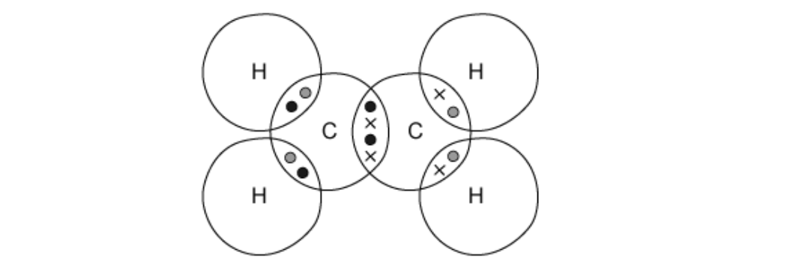
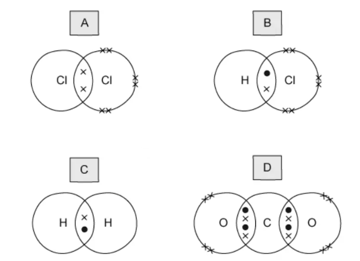
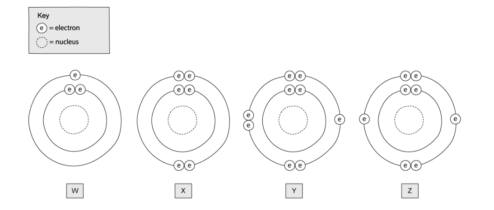

# Exam Questions — Simple Molecules & Covalent Bonds
**2. Atoms, Elements & Compounds** · Cambridge (CIE) IGCSE chemistry (0620 & 0971)
> Source: [https://www.savemyexams.com/igcse/chemistry/cie/23/topic-questions/](https://www.savemyexams.com/igcse/chemistry/cie/23/topic-questions/) · 18 questions across 1 sets

## Multiple Choice Questions (21 questions)

### Q1 — hard — 1 marks

**Q1** [1 mark]

The displayed formula of ethanoic acid is shown.

Which row shows the total number of shared electrons and the total number of non-bonding electrons in one molecule of ethanoic acid?

|   | total number of shared electrons | total number of non-bonding electrons |
|---|---|---|
| **A** | 14 | 0 |
| **B** | 14 | 8 |
| **C** | 16 | 0 |
| **D** | 16 | 8 |

### Q2 — easy — 1 marks

**Q2** [1 mark]

Lithium hydroxide reacts with hydrochloric acid to form lithium chloride and water.

Which row describes correctly the properties of the products and the final reaction mixture?

|   | melting point of lithium chloride | melting point of water | electricity conduction of the reaction mixture |
|---|---|---|---|
| **A** | high | high | good |
| **B** | high | low | good |
| **C** | low | high | poor |
| **D** | low | low | poor |

### Q3 — medium — 1 marks

**Q3** [1 mark]

Diagrams 1 and 2 show the electron arrangements in molecules of water and methane.

Which row describes the diagrams?

|   | water diagram | methane diagram |
|---|---|---|
| **A** | correct | incorrect |
| **B** | correct | correct |
| **C** | incorrect | incorrect |
| **D** | incorrect | correct |

### Q4 — easy — 1 marks

**Q4** [1 mark]

Which statement about bonding is not correct?

### Q5 — easy — 1 marks

**Q5** [1 mark]

Which of the following compounds are formed by covalent bonding?

| **1** | Potassium fluoride |
|---|---|
| **2** | Propane |
| **3** | Carbon dioxide |
| **4** | Lithium bromide |

### Q6 — easy — 1 marks

**Q6** [1 mark]

Which row correctly describes a simple covalent compound?

|   | low melting point | high boiling point |
|---|---|---|
| **A** | `✓` | `✓` |
| **B** | $\times$ | `✓` |
| **C** | $\times$ | $\times$ |
| **D** | `✓` | $\times$ |

### Q7 — easy — 1 marks

**Q7** [1 mark]

#### Extended Only

The structure of propane is shown below

Which correctly explains why propane can not conduct electricity?

### Q8 — easy — 1 marks

**Q8** [1 mark]

Ammonia is a covalent compound consisting of one nitrogen atom bonded to three hydrogen atoms.

Which statement is correct for a molecule of ammonia?

### Q9 — hard — 1 marks

**Q9** [1 mark]

#### Extended Only

A student has drawn a dot and cross diagram to represent a molecule of ethene, C2H4, as shown below.

What is wrong with the students drawing?

### Q10 — hard — 1 marks

**Q10** [1 mark]

#### Extended Only

Dot and cross diagrams for four covalent molecules are shown below.

Which diagram is incorrect?

### Q11 — hard — 1 marks

**Q11** [1 mark]

#### Extended Only

Which statement about methane is correct?

### Q12 — hard — 1 marks

**Q12** [1 mark]

#### Extended Only

A covalent molecule M contains a total of four shared electrons.

What is M?

### Q13 — hard — 1 marks

**Q13** [1 mark]

#### Extended Only

Carbon dioxide is a simple molecular substance in which the molecules are formed by covalent bonding between one carbon atom and two oxygen atoms.

Which dot and cross diagram below shows the correct outer shell arrangement of electrons in a molecule of CO2?

### Q14 — medium — 1 marks

**Q14** [1 mark]

Atoms P and Q have electronic structures as shown in the diagram. They react together to form a covalent compound.

What is the formula of the compound?

### Q15 — medium — 1 marks

**Q15** [1 mark]

The atom of element Z has 6 electrons in its outer shell. How would this element react?

### Q16 — medium — 1 marks

**Q16** [1 mark]

#### Extended Only

Which of the following molecules contains only single covalent bonds?

### Q17 — medium — 1 marks

**Q17** [1 mark]

CH4, H2O and HCl are covalent compounds.

Which atoms in these compounds do not use all of their outer shell electrons in bonding?

### Q18 — medium — 1 marks

**Q18** [1 mark]

The electronic configurations of four different atoms are shown below.

Which atoms form covalent compounds?
