# Mark Schemes — Giant Structures
**2. Atoms, Elements & Compounds** · Cambridge (CIE) IGCSE chemistry (0620 & 0971)

## Multiple Choice Questions (23 questions)

### Q1
**Final answer:** **The correct answer is A**

- Both silicon (Group IV) and phosphorus (Group V) are **non-metals**
- Non-metal oxides are **acidic** in nature and share electrons to form **covalent** bonds
- Silicon(IV) oxide has a **giant covalent** (macromolecular) structure, meaning a large amount of energy is required to break the strong covalent bonds, giving it a **high** melting point
- Phosphorus(V) oxide has a **simple molecular** structure, meaning only weak intermolecular forces need to be overcome, giving it a **low** melting point

**C** & **D** are incorrect as** ionic **compounds and **basic** oxides are **characteristics of metal oxides**

**B **is incorrect as silicon(IV) oxide has a giant covalent (macromolecular) structure, meaning it has a high melting point

### Q2
**Final answer:** **The correct answer is D**

- Graphite is a good conductor of electricity because each of its carbon atoms are bonded to three other carbon atoms
- Each carbon atom has a **delocalised / mobile** electron that allows electricity conduction

**A** is incorrect because each carbon atom in diamond is bonded to four other carbon atoms in a tetrahedral arrangement

**C** is incorrect because diamond has a three dimensional stable structure that is not arranged in layers, therefore, it is not possible to use it as a lubricant

**B** is incorrect because graphite does not contain mobile ions. Graphite is a giant covalent structure made of carbon atoms.

### Q3
**Final answer:** **The correct answer is**** B**** because:**

- Metals have a lattice structure where the metal atoms lose their valence electrons and become **positively charged ions**.
- The valence electrons no longer belong to any metal atom and are said to be **delocalised**.
- They move freely between the positive metal ions like a **sea of electrons** as shown.

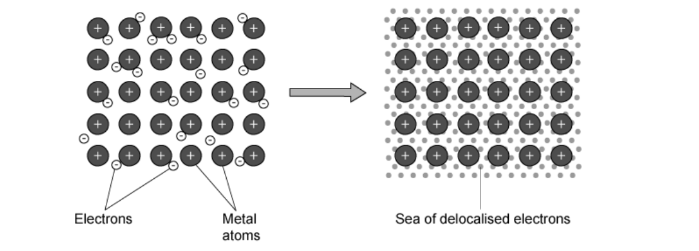

**A**,** C** and **D **are incorrect as the metal atoms form **positive ions** when they lose electrons.

### Q4
**Final answer:** **The correct answer is**** D**** because:**

- Metals have high melting and boiling points as there are many **strong metallic bonds **in giant metallic structures.
- Metals conduct electricity as there are **free electrons **available to move and carry charge.

**A**,** B** and **C **are incorrect as these options do not correctly describe the properties of metals.

### Q5
**Final answer:** **The correct answer is**** A**** because:**

- Graphite is **unreactive** but it still conducts electricity.
- This means it can carry out its function as a **conductor** but does not **interfere** with the chemistry of the electrolytic cell.

**B **is incorrect as graphite is a relatively soft material (but not that soft).

**C **is incorrect as graphite has a **high melting point **of 3600 oC.

**D **is incorrect as graphite is **insoluble** in water.

### Q6
**Final answer:** **The correct answer is**** A**** because:**

- Graphite has **delocalised** electrons so it can conduct **electricity**.
- This makes it useful for use in electrolysis.

**B** and **C **are incorrect as electrodes must conduct electricity, not insulate.

**D **is incorrect as the melting point of graphite is 3,600oC.

### Q7
**Final answer:** **The correct answer is**** A**** because:**

- X is **graphite** in which carbon atoms are arranged in layers where each carbon atom is bonded to **3** others.
- The layers slide over each other easily because there are only **weak** **forces** between them, making graphite soft and flaky and useful as a lubricant.
- Y is **diamond** in which each carbon atom is covalently bonded to **4** others forming a giant molecular structure.
- Diamond is **very** **hard** as it requires a lot of energy to break so many strong covalent bonds and so is used in glass cutters.

**B**,** C** and **D** are incorrect as these options do not match with the uses of graphite and diamond.

### Q8
**Final answer:** **The correct answer is**** A**** because:**

- As a **nonmetal oxide**, silicon(IV) oxide is acidic.
- Silicon(IV) oxide is a **giant molecular structure** forming an infinite array of bonds.
- Each silicon atom is covalently bonded to four oxygen atoms and each oxygen atom is covalently bonded to two silicon atoms.
- All of oxygen’s and silicon’s electrons are used in bonding, hence there are no free electrons. This means silicon(IV) oxide **cannot conduct electricity**.

**B**,** C** and **D **are incorrect as these options do not correctly describe the properties of SiO2.

### Q9
**Final answer:** **The correct answer is**** C**** because:**

- Layers of positive ions **can slide** over one another and take up different positions.
- Metallic bonding is not disrupted as the valence electrons do not belong to any particular metal atom so the delocalised electrons move with them.
- Metallic bonds are thus not broken and as a result metals can be manipulated into different shapes.

**A** and **D** are incorrect as the layers of atoms can move and slide over one another.

**B **is incorrect as the attractive forces are not broken rather they are flexible and allow metals to be forced into different shapes without shattering.

### Q10
**Final answer:** **The correct answer is**** B**** because:**

- Metallic bonds are a result of the attraction between the **positive metal ions **and the **negatively charged **delocalised electrons.
- This results in **many strong bonds **throughout the lattice structure.

**A** and **C** are incorrect as electrons are not transferred or shared between atoms in metallic bonding.

**D **is incorrect as there are no intermolecular forces involved in metallic bonding as metals form a lattice structure in which there are no molecules present.

### Q11
**Final answer:** **The correct answer is**** B ****because:**

- Each silicon atom is covalently bonded to **four oxygen** atoms.
- Each oxygen atom is covalently bonded to **two** **silicon** atoms.
- Hence the ratio is 2 oxygen atoms to every 1 silicon atom as shown.

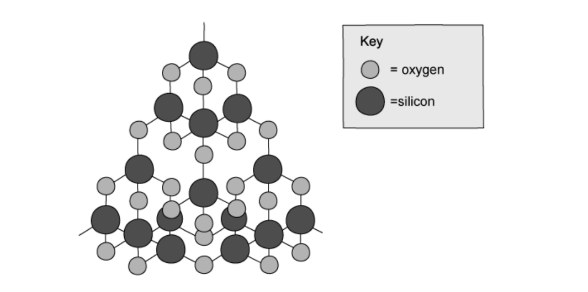

**A**,** C** and **D **are incorrect as these options do not correctly describe the bonding arrangement in SiO2.

### Q12
**Final answer:** **The correct answer is**** D**** because:**

- Statement 1 is incorrect as silicon(IV) is a **giant molecular compound**.
- Statement 2 is incorrect as diamond contains **carbon** **atoms** **only** hence it is not a compound, it is actually a solid form of the element carbon.
- Statement 3 is correct as both substances do have **high** **melting** **points** due to the large number of strong covalent bonds in their structures.
- Statement 4 is correct as silicon(IV) dioxide has a **large number of strong covalent **bonds in its structure.

**A, B **and** C **are incorrect as only statements 3 and 4 correctly describe the properties of both substances.

### Q13
**Final answer:** **The correct answer is**** D**** because:**

- Graphite is able to conduct electricity as it has **delocalised electrons**, hence it is used to produce electrodes.
- SiO2 is used in the production of **glass**.

**A** and **C** are incorrect as SiO2 is not used to produce plastics as it does not form polymers.

**B **is incorrect as graphite is used to make **electrodes**, not electrolytes.

### Q14
**Final answer:** **The correct answer is**** D**** because:**

- Macromolecular structures form giant crystals.
- All the atoms in the structure are linked to each other by **strong covalent** bonds.
- The atoms are joined to each other forming a **regular arrangement**.

**A** is incorrect as intermolecular forces are not present within the crystal structure.

**B** and **C** are incorrect as macromolecules are covalently bonded.

### Q15
**Final answer:** **The correct answer is ****B ****because:**

- Diamond has atoms that forms four equally strong covalent bonds, not three
- Both elements are made from the element carbon
- Diamond cannot conduct electricity as it has no delocalised electrons

### Q16
**Final answer:** **The correct answer is**** C**** because **

- Graphite has a giant covalent structure and these compounds have **high melting points** due to the high number of covalent bonds holding atoms together within them.

**A** is incorrect as in graphite the carbon atoms are arranged in **layers** which can slide over each other easily as there are only **weak** **forces** between the layers, making it useful as a lubricant.

**B** is incorrect as in diamond each carbon atom is covalently bonded to 4  others, forming a giant covalent structure. This makes it very hard as it requires a lot of energy to break so **many** **strong** **covalent** bonds and so it is useful as a tip for drills.

**D **is incorrect as diamond contains carbon atoms only and is in the **solid** **state**, hence it is an allotrope of carbon.

### Q17
**Final answer:** **The correct answer is**** B**** because:**

- Graphite can conduct electricity as it has **delocalised electrons** that can move and carry charge.
- In diamond all of the outer shell electrons in the carbon atoms are used in bonding so it does not conduct electricity as there are no free electrons.

**A, C** and **D** are incorrect as these properties are true for both graphite and diamond.

### Q18
**Final answer:** **The correct answer is**** C**** because:**

- Silicon(IV) oxide is the giant molecular compound SiO2.
- Like diamond, silicon dioxide has a** large number **of strong covalent bonds in its structure so it is **very** **hard** and has a very **high** **melting** point and **boiling** point
- Both statements are correct and the hardness of SiO2 comes from its giant molecular structure, hence **C** is correct.

**A**,** B** and **D** are incorrect as these options are not correct for statements 1 and 2.

## Theory Questions (25 questions)

### Q1
a)

i) In C60 fullerene, each carbon is bonded to:

- 3 (other carbons); **[1 mark]**

ii) In one molecule of fullerene there are:

- 70 (carbon atoms); **[1 mark]**

**[Total: 2 marks]**

- *Looking at the diagram you can see that each carbon (circled) has 3 bonds*

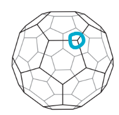

- *Although you aren't expected to be familiar with the structure of fullerene you should be used to seeing similar diagrams for the structure of diamond and graphite*
- *To figure out how many carbon atoms there are for part ii)*

  - *carbon has an atomic mass of 12*
  - *Therefore 840 / 12 = 70*
b) You could obtain crystals of fullerenes from soot as follows:

- Add octane (or another liquid hydrocarbon) (to soot); **[1 mark]**
- Filter (to remove insoluble forms of carbon); **[1 mark]**
- (Then allow to) evaporate 
**OR **
Heat / warm 
**OR **
Leave in the sun (to get crystals of fullerene); **[1 mark]**

**[Total: 3 marks]**

- *You can use your knowledge of preparing salts to help you answer this one*
- *You are told fullerene is soluble in liquid hydrocarbon *

  - *This is similar to the first step of preparing a soluble salt - adding water*
  - *However, you need to add liquid hydrocarbon instead of water to dissolve the fullerene*
- *The following steps are exactly the same as preparing other soluble salts*
c)

i) Another form of solid carbon which is a good conductor of electricity would be:

- Graphite; **[1 mark]**

ii) Metals, such as potassium, are good conductors of electricity because:

- (They have) delocalised electrons/ free electrons/ sea of electrons; **[1 mark]**
- (The electrons are able to) move/ are mobile; **[1 mark]**

iii) Two potassium compounds which could be formed when potassium is exposed to air are:

Any **two** from:

- Potassium oxide; **[1 mark]**
- Potassium hydroxide; **[1 mark]**
- Potassium carbonate; **[1 mark]**
- Potassium hydrogencarbonate (bicarbonate); **[1 mark]**

**[Total: 5 marks]**

- *Part iii) says **air** rather than **oxygen*

  - *Air contains oxygen, water vapour and carbon dioxide*
  - *Hence, potassium could react with any one of these components producing the products shown*

### Q2
a)

i) Diamond is hard because:

- Macromolecular / giant covalent / giant atomic 
**OR** 
All atoms held in position / in tetrahedral structure / to four other carbon; **[1 mark]**
- Atoms all / strong bonds; **[1 mark]**

ii) One use of diamond is:

Any **one **from:

- Jewellery / drilling / cutting / engraving / cutting edges in scalpel; **[1 mark]**

iii) Graphite is soft because:

- Layer structure / sheets; **[1 mark]** *Molecules / ions in layers = [0]*
- Layers can slide (over each other); **[1 mark]**

iv) One use of graphite is:

- Lubricant / pencils / electrodes; **[1 mark]** *Mark the first use offered*

**[Total: 6 marks]**

- *Comparing the properties of diamond and graphite is a common question*
- *Remember**: In diamond, each carbon is bonded to four other carbon atoms, whereas in graphite, each carbon is bonded to only three, resulting in this difference in properties*
b)

i) A diagram showing the arrangement of the valency electrons in one molecule of the covalent compound carbon dioxide is:

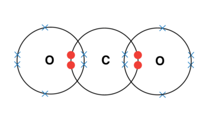

- 4e- between carbon and oxygens;** [1 mark]**
- 2 non-bonding pairs on both oxygens; **[1 mark]**
- Correct formula (award only if marks 1 and 2 achieved); **[1 mark]**

ii) The formula is SiO2 not SiO4 because:

- 4 O around each Si; **[1 mark]**
- 2 Si around each O; **[1 mark]** *Must refer to diagram not valencies or electron distributions*

iii)  Two differences in the physical properties of these two oxides are:

Any **two** from:

- SiO2 has higher melting point or boiling point; **[1 mark]**
- SiO2 is a solid, CO2 is a gas (at r.t.p.); **[1 mark]**
- (When both are solids) then SiO2 is harder; **[1 mark]**
- SiO2 has higher density; **[1 mark]**
- SiO2 insoluble, CO2 soluble; **[1 mark]**

**[Total: 7 marks]**

- *Carbon is in group 4 so has 4 electrons in its outer shell *
- *Oxygen is in group 6 so has 6 electrons in its outer shell*
- *For both atoms to obtain full outer shells, the carbon will share all of its electrons with oxygen each oxygen atom will share one pair of electrons with carbon*
- *There will be three non- bonded pairs of electrons on each oxygen as well*
- *Silicon (IV) oxide has the formula SiO**2** because each oxygen atom forms covalent bonds with two silicon atoms*

### Q3
a) The substance that is a macromolecular solid is:

- Silicon(IV) oxide; **[1 mark]**

**[Total: 1 mark]**** **

- *Silicon(IV) oxide (also known as silicon dioxide or silica), SiO**2**, is a macromolecule and has similar properties to diamond*
- *The other substances are:*

  - *Aluminium oxide - ionic lattice*
  - *Calcium oxide - ionic lattice*
  - *Ethanol - simple molecule*
  - *Nitrogen - simple molecule*
  - *Iron(III) oxide - ionic lattice*
  - *Methane - simple molecule*
  - *Oxygen - simple molecule      *
b) Two forms of the element carbon that have giant covalent structures are:

Any **two** of the following

- Diamond; **[1 mark]**
- Graphite; **[1 mark] **
- Graphene; **[1 mark] **

**[Total: 2 marks]**

- *These forms of carbon are called allotropes and you should be able to identify the structures of diamond and graphite*
- *Graphene is a single layer of graphite, which you are not required to know but it is a creditworthy response*
c) The structure and bonding in metals is:

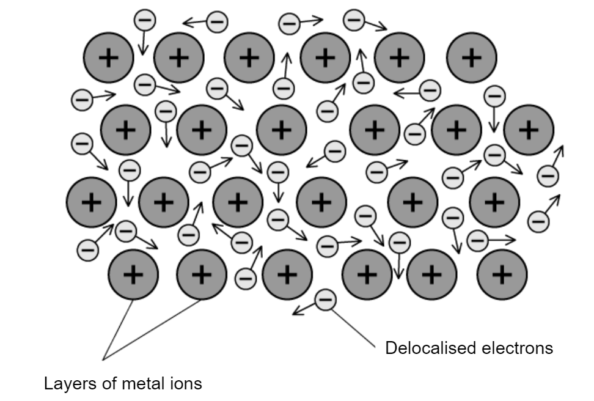

- (Lattice of) positive ions / cations;** [1 mark] **
- (Delocalised / sea of) electrons; **[1 mark] **
- Attraction / attract between positive and negative; **[1 mark] **

**[Total: 3 marks]**** **

- *The question asks for a labelled diagram so include clear labels and contain metal ions that have a positive charge*
- *Metallic bonds are strong and are a result of the attraction between the positive metal ions and the negatively charged delocalised electrons*

### Q4
a) Two properties that are characteristic of most metals are:

Any **two** of the following

- Conduct electricity / conduct heat; **[1 mark] **
- Ductile / can be drawn into wires; **[1 mark]**
- Malleable / can be hammered into different shapes;** [1 mark] **
- Lustrous / shiny; **[1 mark] **

**[Total: 2 marks] **

- *You should know the characteristics of metals as well as where there are located on the Periodic Table*
- *They lie to the left of the 'stair case' which begins underneath boron and steps down to the right*
b)

The bonding in magnesium is:

- Name = Metallic (bonding); **[1 mark]**

Description of bonding:

- (Delocalised / sea of) electrons; **[1 mark] **
- Positive ions / cations; **[1 mark] **
- Attraction between (electrons / negative and positive ions);** [1 mark] **

**[Total: 4 marks]**** **

- *You should be able to describe the bonding in metals*
- *Make sure you make reference to the electrons being delocalised in the structure*

  - *They are negatively charged and are attracted to the positively charged metal ions (cations)*

### Q5
a) Physical and chemical properties of caesium are:

Physical property:

Any **one **of the following:

- Soft / can be cut (with a knife);** [1 mark]**
- Low density / light;** [1 mark]**
- Low melting point;** [1 mark]**
- (Good) conductor (heat or electricity);** [1 mark]**
- Shiny (when freshly cut) / tarnishes quickly in air;** [1 mark]**
- Malleable / ductile;** [1 mark]**

Chemical property:

Any **one **of the following:

- Reacts with water **OR **(Very) reactive;** [1 mark]**
- Forms salts with halogens;** [1 mark]**
- Reacts vigorously with acids;** [1 mark]**
- Forms an alkaline or basic oxide;** [1 mark]**
- Fixed oxidation state / oxidation number **OR **Has a valency of +1 / has one outer shell electron;** [1 mark]**

**[Total: 2 marks]**

- *Make sure you get the physical and chemical properties the correct way around! Chemical properties are to do with reactions and electrons only*
- *The properties should focus on a Group 1 metal and not just metals in general*
b) A physical property of vanadium is:

Any** one** of the following:

- (Good) conductor (of heat / electricity); **[1 mark]**
- High melting point / high boiling point; **[1 mark]**
- Forms coloured compounds/coloured ions; **[1 mark]**
- Hard / strong; **[1 mark]**
- High density; **[1 mark]**
- Malleable / ductile; **[1 mark]**
- Silver / grey / lustrous / shiny solid; **[1 mark]**
- Sonorous; **[1 mark]**

A chemical property of vanadium is:

Any** one** of the following:

- Variable / different valency/oxidation state/oxidation number; **[1 mark]**
- Catalytic activity; **[1 mark]**
- Forms coloured compounds / coloured ions; **[1 mark]**
- Forms complex ions / complexes; **[1 mark]**
- Reducing agent; **[1 mark]**

**[Total: 2 marks]**

- *The properties of transition metals include the properties of metals and also some special characteristics, such as forming coloured compounds, that you should be aware of*
c) Physical and chemical properties of fluorine are:

Any** one** of the following:

- Colourless / yellow gas; **[1 mark]**
- Low melting / boiling point; **[1 mark]**
- Poor / non-conductor (of electricity) 
**OR **
Does not conduct electricity in any state; **[1 mark]**

A chemical property of fluorine is:

Any **one** of the following:

- Most reactive halogen / very reactive; **[1 mark]**
- Forms ionic fluorides / bonds with metals; **[1 mark]**
- Form covalent fluorides / bonds with non-metals; **[1 mark]**
- Powerful oxidant / gains one electron (to be stable); **[1 mark]**
- Fixed oxidation state / valency of –1 
**OR **
Forms F– ions; **[1 mark]**
- Forms acidic oxides 
**OR **
Forms an acid when reacted with hydrogen / hydride is acidic; **[1 mark]**

**[Total: 2 marks]**

- *Fluorine is a small simple molecule, so is a gas at room temperature*
- *It is in Group VII and so it is an extremely reactive element; it is not allowed in school so is not used in experiments but often comes up in exams so you can apply your Group VII knowledge in a slightly different context*

### Q6
a) Graphite is soft because:

- (There are) weak forces between layers/sheets/rows; **[1 mark]**
- Layers can slip/slide; **[1 mark]**

Graphite is a good conductor because:

- Electrons can move/ (are) mobile; **[1 mark]**

**[Total: 3 marks]**

- *Diamond has 4 covalent bonds per carbon atom whereas graphite only has 3*
- *It is this difference which leads to the very different properties of the two structures*
b) A use of graphite which depends on the above property:

- Lubricant
**OR**
Pencil lead; **[1 mark]**

**[Total: 1 mark]**

- *You only need to state **one use of graphite** for this question*
- *Acceptable answers include **lubricant** or **pencil lead (used for writing)*
- *Both uses depend on the same property of graphite*

  - *Its layers of carbon atoms can slide over each other easily*
- *Because this is a **1-mark “state” question**, no explanation of bonding or structure is required unless the question specifically asks for it*
c)

i) The macromolecular structure of silicon(IV) oxide can be described as:

- Every silicon atom is bonded / attached to 4 oxygen atoms 
**OR **
Every oxygen atom is bonded / attached to two silicon atoms; **[1 mark]**

ii) Two physical properties which diamond and silicon(IV) oxide have in common are:

**Final answer:** **Any ****two**** from:**

- High melting point/boiling point; **[1 mark]**
- Hard; **[1 mark]**
- Colourless crystals / shiny; **[1 mark]**
- Poor / non-conductor of electricity 
**OR **
Insulator; **[1 mark]**
- Insoluble in water; **[1 mark]**

**[Total: 3 marks]**

- *You need to be able to compare the structures and properties of various materials, including diamond and silicon dioxide*

### Q7
a)

i)  How the zinc oxide is obtained from zinc sulfide:

- Heat / roast / combustion / high temperature;** [1 mark]**

*Accept burn*

- In air / oxygen;** [1 mark]**

ii)  A balanced equation for the reduction of zinc oxide by carbon:

- ZnO + C → Zn + CO

**OR**

2ZnO + C → 2Zn + CO2 ;** [1 mark]**

iii)  A technique which could be used to separate these two metals:

- Fractional distillation;** [2 marks]**

**[Total: 5 marks]**

- *State symbols are not needed in part ii), but the equation must balance*
- *Carbon monoxide cannot be shown as a reactant as the question clearly states reduction by carbon*
- *The clue about the separation is the boiling points given*
- *It seems odd that you would separate two metals by fractional distillation, but a mixture of any two substances can be achieved by fractional distillation if the mixture can be melted vaporised; it might be an expensive process and energy intensive*
b)

i)  Two other uses of zinc are:

- Making alloys / brass / named alloy which contains zinc 
**OR **
Galvanising / one specific use which depends on galvanising; **[1 mark]**
- Zinc coated screws / roofing / buckets / sinks ; **[1 mark] ***Not just plating other metals*

ii)  The metallic bonding in zinc and why it is a good conductor of electricity:

- Metallic bonding consists of positive ions / cations; **[1 mark]**
- Delocalised / free / mobile or sea of electrons; **[1 mark]**
- The bond is an attraction between (positive) ions and delocalised electrons; **[1 mark]**
- It is a good conductor because there are delocalised / free / mobile electrons; **[1 mark]**

**[Total: 6 marks]**

- *Make sure you use the correct vocabulary in part ii) 'nuclei' or 'atoms' would not score you the mark in the description of the metallic bonding*
- *Note: **It must be clear that electrons are moving / carry charge / - the reason why it is a good conductor*

### Q8
a) The substance which could be a metal is:

- A;** [1 mark]**

**[Total: 1 mark]**

- *Metals have **high** melting and boiling points*

  - *There are many **strong** **metallic** **bonds** in giant metallic structures between the positive metal ion and delocalised electrons*
  - *A lot of heat energy is needed to break these bonds*
- *Metals **conduct** electricity as a solid*

  - *There are **free** **electrons** available to move through the structure and carry charge*
  - *Electrons entering one end of the metal cause a delocalised electron to displace itself from the other end*
  - *Hence electrons can flow so electricity is conducted*
- *Metals **conduct** electricity as a liquid*
- *The  free electrons are still able to move through the liquid structure and carry charge*
b) All the substances that could be a liquid at room temperature are:

- D

**   AND**

F; **[1 mark]**

**[Total: 1 mark]**

- *The highlighted word **all** in the question suggests that there is more than one substance and that each of these substances is needed for the mark*
- *To be a liquid at room temperature the melting point must be below room temperature*
c) The substance which could have a macromolecular structure similar to that of silicon(IV) oxide is:

- E;** [1 mark]**

**[Total: 1 mark]**

- *SiO**2** has lots of very strong covalent bonds and no intermolecular forces so it has similar properties to diamond*
- *It has a very **high** boiling point and does not conduct electricity (as a solid or liquid)*
d) The substance which could be propane is:

- B;** [1 mark]**

**[Total: 1 mark]**

- *The first four alkanes are gases at room temperature.*

  - *The next twelve are liquids.*
  - *The rest are solids.*
  - *Boiling points increase with chain length because the attraction between the molecules increases – so it takes more energy to separate them.*
- *Propane is the 3rd alkane in the homologous series so will be a gas*

  - *This means it will have a very low melting and boiling point*
- *Alkanes are also unable to conduct electricity as they don't contain charged particles which are able to move and carry a charge*

  - *All electrons are tied up in covalent bonds*
e) The substance which could be sodium chloride is:

- C;** [1 mark]**

**[Total: 1 mark]**

- *Sodium chloride is an ionic compound*

  - *As it consists of a metal and a non-metal*
- *Ionic compounds are usually **solid** at room temperature *
- *They have **high **melting and boiling points*
- *Ionic compounds are good conductors of electricity in the **molten** state (as a liquid) as the ions are free to move and carry charge*
- *Ionic compounds are not good conductors of electricity as solids as the ions are fixed and not free to move to carry charge*

### Q9
a) The variation in oxidation state across the period is:

- The number of e– gained or lost / the charge on the ion = numerical value of oxidation state; **[1 mark]**

The explanation is any **two **from:

- Na to Al (Si) lose e– / form positive ions; **[1 mark]**
- (Si) P to Cl gain e– / form negative ions; **[1 mark]**
- Si gains and loses e– / Si can form a positive or negative ion 
**OR **
Ar neither gains nor loses e– / Ar does not form ions; **[1 mark]**

**[Total: 3 marks]**

- *As the oxidation number of a monatomic ion is the same as the charge on the ion, the variation in oxidation number can be explained by the differences in the charges on the ions or whether they lose or gain electrons*
- *The variation in oxidation number that you should identify and explain is why some elements have:*

  - *a positive oxidation number, or*
  - *a negative oxidation number, or*
  - *either a positive or negative oxidation number, or*
  - *an oxidation number of zero*
b) The structure of a typical metal can be described as:

- Positive ions / cations / metallic ions; **[1 mark]**
- Arranged in a lattice / rows / layers; **[1 mark]**
- Sea of electrons / delocalised electrons; **[1 mark]**

**[Total: 3 marks]**

- *Metal atoms lose their outer electrons to form positive ions*
- *The electrons no longer belong to a particular atom and are said to be delocalised*
- *The electrons are free to move around the structure*
- *Metallic bonds are formed due to the electrostatic attraction between the positive metal ions and the negative delocalised electrons*
- *Metallic bonds are strong and can explain many properties of metals*
c) Na, Mg and Al are good conductors of electricity because:

- They have mobile electrons; **[1 mark]**

**[Total: 1 mark]**

- *As the delocalised electrons are free to move through the structure, they can carry charge*
- *Electricity is caused by a flow of charge, hence metals can conduct electricity*
d) The element that exists as diatomic molecules of the type X2 is:

- Chlorine;** [1 mark]**

**[Total: 1 mark]**

- *Chlorine (and all other halogens) form molecules of two atoms, i.e. they are diatomic molecules*
- *This is because a chlorine atom has 7 electrons in its outer shell so it will combine with another chlorine atom to share a pair of electrons *
- *This results in both chlorine atoms obtaining a full outer shell*

e) Silicon has the highest melting point in the period because:

- (It has) strong covalent bonds; **[1 mark]**
- In a giant lattice / macromolecule / giant (structure); **[1 mark]**

**[Total: 2 marks]**

- *SiO**2** has lots of very strong covalent bonds and extend in a giant lattice and no intermolecular forces so it has similar properties to diamond*
- *The many covalent bonds require a very large amount of heat energy to break the lattice thus it has a very high melting point*
f) Explanations for these differences in properties are:

Any **two** from:

- Sodium chloride is ionic and PCl3 is covalent;** [1 mark]**
- Ionic bonds are strong and intermolecular forces are weak; **[1 mark]**
- PCl3 reacts with water and NaCl does not; **[1 mark]**

**[Total: 2 marks]**

- *The 'suggest' command word used in this question indicates that you will have to apply your knowledge*
- *Whenever explaining properties, identify the type of structure / bonding within the structure*

  - *Sodium chloride is a giant **ionic **lattice as it contains a metal and a non-metal*
  - *PCl**3** is a simple **covalent **molecule as it contains non-metals*
- *The differences in state at room temperature arise from the differences in melting point*
- *They can be explained by the strength of the attraction between ions / molecules*

  - *The stronger the attraction, the higher the melting point*
  - *NaCl contains strong ionic bonds therefore will have a high melting point, and it is a solid at room temperature*
  - *PCl**3** has weak intermolecular forces so will have a much lower melting point, resulting in it being a liquid at room temperature*
- *Ionic compounds tend to be soluble, i.e. they dissolve as opposed to react with water and you are given the information that PCl**3** forms an acidic solution with water thus indicating a reaction*
g) You could show that magnesium oxide is a basic oxide and not an amphoteric oxide as:

- MgO will react with / dissolve in / neutralise hydrochloric acid / acid / acid oxide;** [1 mark]**
- If amphoteric, MgO will react with / dissolve in / neutralise hydrochloric acid / acid / acid oxide 
**AND **
MgO will react with dissolve in / neutralise sodium hydroxide / alkali / base / basic oxide;** [1 mark]**

**[Total: 2 marks]**

- *A basic oxide will react with an acid (i.e. behaves as a base)*
- *An amphoteric oxide can react with an acid and a base (i.e. can behave as an acid or a base)*
- *So a basic oxide will not react with a base, whereas an amphoteric oxide will*
- *MgO will not react with sodium hydroxide / alkali / base / basic oxide would achieve both marks*
h) A dot-and-cross diagram showing the bonding in magnesium oxide can be drawn as:

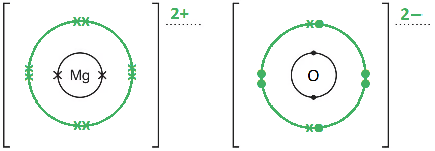

- Magnesium with 8 or 0 outer shell electrons; **[1 mark]**
- Oxygen with 8 outer shell electrons 
**AND **
2 electrons are indicated differently from the other 6 / matching the Mg electrons if these have been shown; **[1 mark]**
- Correct charges; **[1 mark]**

**[Total: 3 marks]**

- *The inner electrons are not required for this answer*

  - *However, if they are included they must be correct*
- *Magnesium is in Group II so will have 2 outer electrons which it will lose forming a 2+ ion*
- *Oxygen is in Group VI so has 6 outer electrons*

  - *It will gain 2 electrons from magnesium to form an oxide ion with a 2- charge*
- *This can be shown on a dot-and-cross diagram by the oxide ion having 6 electrons indicated by a cross and 2 electrons by a dot (or vice versa)*
- *The magnesium ion can be shown as either having an empty outer shell with no electrons in or as full with 8 electrons in*
- *When drawing the dot-and-cross diagrams of ionic compounds, don't forget to include square brackets around each ion and the charge of each ion*

### Q10
The completed table is:

| type of structure | particles present | electrical conductivity of solid | electrical conductivity of liquid | example |
|---|---|---|---|---|
| ionic | positive and negative ions | poor | **good**;** [1 mark]** | any correct ionic compound; **[1 mark]**  e.g. sodium chloride |
| macromolecular | atoms of two different elements in a giant covalent structure | poor | poor | silicon **OR** silicon (IV) oxide **OR** sand **OR** silicon dioxide; **[1 mark]** |
| metallic | **electrons**; **[1 mark]**  and  **positive ions**; **[1 mark]** | good | **good**; **[1 mark]** | copper |

**[Total: 6 marks]**

- *Summary tables such as this are a great way of testing your overall knowledge of bonding *
- *You should be able to describe the structure, give properties and examples of each substance*
- *Some questions will ask you to further explain these properties such as conductivity so make sure you learn them!*

### Q11
a) The densities of the first three alkenes are much lower than the density of pentene and hexene because:

- They are gases; **[1 mark] **

**[Total: 1 mark]**

- *You can see from the data given in the table that the boiling point of the alkenes is increasing as the number of carbon atoms increases*
- *The boiling point of the ethene and propene are below room temperature, therefore they are gases at room temperature *
b) The structure used in cutting tools is:

- B / Diamond; **[1 mark] **

**[Total: 1 mark]**** **

- *Diamond is very strong as it has many covalent bonds throughout its structure*

  - *Each carbon atom in diamond is bonded to 4 other carbon atoms*
- *None of the following structures are strong enough to be used as cutting tools*

  - *A is helium gas (simple molecular)*
  - *C is lithium chloride (ionic lattice)*
  - *D is nitrogen gas (simple molecular) *
  - *E is copper (metal)*
c) Graphite is used as a lubricant because:

- Layers can slide (over each other); **[1 mark]**

**[Total: 1 mark]**** **

- *Graphite is an allotrope of carbon, each carbon atom is bonded to three other carbon atoms by covalent bonds*
- *The covalent bonds within the layers are very strong, but the layers are attracted to each other by weak intermolecular forces*

### Q12
a) A diagram for sodium nitride is:

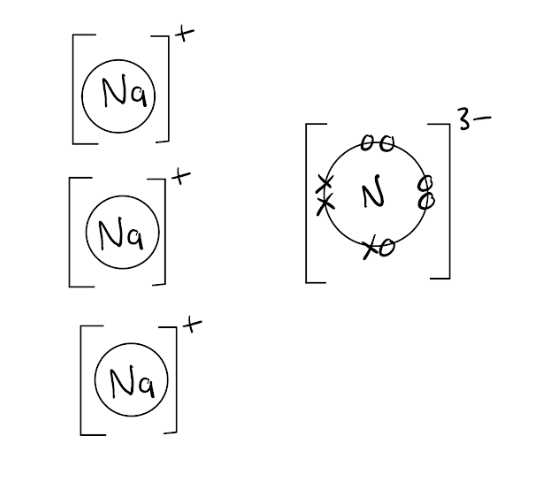

- Correct ratio, 3Na : 1N; **[1 mark]**
- Correct charges; **[1 mark]**
- 8 electrons around N; **[1 mark]** 
*If no symbols then must have correct key* 
*If covalent only mark 1* 
*Ignore electrons around sodium* 
*If the response includes both a correct and an incorrect answer* 
*Do not select correct one, mark = [0]*

**[Total: 3 marks]**

- *Sodium is in Group I of the periodic table so will lose one electron to form ions with a 1+ charge*
- *Nitrogen is in Group V of the periodic table so will gain three electrons to form ions with a 3- charge*
- *Three sodium ions are needed to balance the 3- charge on the nitrogen ion resulting in the formula NaN**3*
- *Make sure you read the question carefully so you know exactly what you are required to show, for example, in this question you only need to show the outer shell electrons on the nitride ion and not the sodium ions*
b)

i) Metallic bonding is:

- Positive ions;** [1 mark] **
*Do not accept atoms or particles*
- Arranged in layers / lattice / a regular pattern; ** [1 mark]**
- With delocalised / free / mobile  electrons; ** [1 mark]**

ii) Metals are good conductors of electricity because:

- Delocalised / free electrons can move and carry a charge; ** [1 mark]**

Metals are malleable because:

- Layers / ions / atoms / particles; ** [1 mark]** *NB be more flexible than 2(b)(i)*
- Can slip or move past each other or bonding non-directional; ** [1 mark]**

**[Total: 6 marks]**

- *Make sure you look at the number of marks for these questions- describing the structure of a metal is almost always three marks so it is good to learn this description word for word *
c)

i) Silicon dioxide:

- Tetrahedral; **[1 mark]**
- 1 Si : 4 O bonded;** [1 mark]**
- 1 O : 2 Si; **[1 mark] **
*NOT molecules of oxygen, etc.* 
*NOT intermolecular forces* 
*ONLY tetrahedral can score for either of the above*

ii) Two physical properties common to both diamond and silicon (IV) oxide are:

Any **two** from:

- Hard; **[1 mark]**
- High melting / boiling point; **[1 mark]**
- Colourless / shiny / translucent ; **[1 mark]**
- Poor conductor; **[1 mark]**
- Brittle; **[1 mark]**
- Insoluble; **[1 mark]**

**[Total: 5 marks]**

- *In silicon dioxide, each oxygen atom forms covalent bonds with 2 silicon atoms and each silicon atom in turn forms covalent bonds with 4 oxygen atoms resulting in a tetrahedral structure*
- *You must make sure you learn the properties of the three giant covalent structures on the specification- silicon dioxide, diamond and graphite*

### Q13
a) The structure of germanium is:

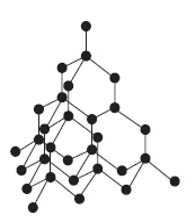

- 4 Ge atoms around 1 Ge; **[1 mark] **
- Tetrahedral; **[1 mark] **

**Final answer:** **[Total: 2 marks] **

- *The question states that the structure of germanium is very similar to that of diamond*
- *Carbon atoms which make up diamond are changed for germanium in the diagram *
- *The tetrahedral structure means that each Ge atom is bonded to four other Ge atoms*
b)

i) Graphite is soft and is a good conductor of electricity because:

- It / graphite has layers; **[1 mark] **
- That can move / slip** ** 
**OR ** 
There are weak bonds between layers; **[1 mark]**
- It /graphite has delocalised / free / mobile electrons; **[1 mark]**

ii) A property and use of graphite is:

Any** one** property **and** use from the following:

- Soft 
**AND **
Lubricant **OR **pencils; **[1 mark]**
- Good conductor 
**AND **
Electrodes **OR **in electric motors; **[1 mark]**

**Final answer:** **[Total: 4 marks] **

- *In graphite, the covalent bonds within the layers are very strong, but the layers are attracted to each other by weak intermolecular forces*
- *Imagine graphite like a stack of plain A4 paper*

  - *You can easily slide the individual pieces of paper over one another, but it is more difficult to actually pull (not tear) the pieces of paper apart*
c)

i) The formula for both oxides is:

- CO2 ** ** 
**AND **
SiO2 / XO2 ; **[1 mark] **

ii) The structures are different:

- CO2 molecular or simple molecules or simple covalent; **[1 mark] **
- SiO2 macromolecular or giant covalent; **[1 mark] **

**[Total: 3 marks]**** **

- *In silicon dioxide each oxygen atom forms covalent bonds with 2 silicon atoms and each silicon atom in turn forms covalent bonds with 4 oxygen atoms*
- *The formula of carbon dioxide should be pretty familiar to you*

### Q14
a) A physical property of bromine is:

Any** one** of the following:

- Reddish-brown / brown liquid; **[1 mark]**
- Volatile liquid/low boiling point liquid; **[1 mark]**
- Poor / non-conductor (of electricity); **[1 mark]**
- Soluble in water; **[1 mark]**
- Soluble in organic/non-polar solvents; **[1 mark]**

A chemical property of bromine is:

Any **one** of the following:

- Reacts with water; **[1 mark]**
- Reacts with iodides (in solution); **[1 mark]**
- Displaces iodine; **[1 mark]**
- Reacts with alkenes/named alkene/unsaturated hydrocarbons; **[1 mark]**
- Reacts with alkane in UV/named alkane in UV; **[1 mark]**
- Valency/oxidation state(–)1; **[1 mark]**
- Forms Br–; **[1 mark]**
- Gains / shares 1 electron; **[1 mark]**
- Combines / reacts with metals/named metal; **[1 mark]**
- Combines / reacts with non-metals/named non-metal; **[1 mark]**
- Oxidising agent; **[1 mark]**
- Bleaches litmus paper/indicator paper; **[1 mark]**
- Corrosive; **[1 mark]**
- Forms acidic oxides; **[1 mark]**

**[Total: 2 marks]**

- *Make sure you are aware of the difference between physical and chemical properties*
b) A physical property of graphite is:

Any** one** of the following:

- (Good) conductor (of electricity); **[1 mark]**
- Soft; **[1 mark]**
- Lubricant; **[1 mark]**
- High melting point/high boiling point; **[1 mark]**
- Grey black / black solid; **[1 mark]**
- Slippery / greasy (to touch); **[1 mark]**
- Brittle/breaks when subjected to stress; **[1 mark]**
- Insoluble in water**; [1 mark]**

A chemical property of graphite is:

Any** one** of the following:

- Reducing agent; **[1 mark]**
- Reduces metal oxides / named metal oxide; **[1 mark]**
- Reacts with/burns in air / oxygen; **[1 mark]**
- Forms an acidic oxide (CO2); **[1 mark]**
- Valency / oxidation state of 2 or 4**; [1 mark]**

**[Total: 2 marks]**

- *Make sure you know the difference between physical and chemical properties *
c) A physical property of manganese is:

Any** one** of the following:

- (Good) conductor (of heat / electricity); **[1 mark]**
- High melting / boiling point; **[1 mark]**
- Forms coloured compounds / coloured ions; **[1 mark]**
- Hard / strong; **[1 mark]**
- High density; **[1 mark]**
- Malleable / ductile; **[1 mark]**
- Sonorous / shiny; **[1 mark]**

A chemical property of manganese is:

Any** one** of the following:

- Variable / different valency / oxidation state / oxidation number; **[1 mark]**
- Catalytic activity; **[1 mark]**
- Forms coloured compounds/coloured ions; **[1 mark]**
- Forms complex ions/complexes; **[1 mark]**
- Reacts with acids; **[1 mark]**
- Reducing agent; **[1 mark]**
- Reacts with non-metals; **[1 mark]**

**[Total: 2 marks]**

- *Make sure that you are aware of the difference between physical and chemical properties*
- *Manganese is a transition metal, so it has their physical and chemical properties *

### Q15
a)

i) There are attractive forces in a metallic structure because:

- (There are attractive forces between) positive ions; **[1 mark]**
- And (negative) electrons; **[1 mark]** 
*Opposite charges attract ONLY, award [1 mark]* *Electrostatic attraction ONLY, award [1 mark]*

ii) A metal, such as lead, is malleable because:

- The lattice / rows / layers of lead ions / cations / positive ions; **[1 mark]** 
*Do NOT allow: atoms / protons / nuclei*
- Can slide past each other / the bonds are non-directional; **[1 mark]**

**[Total: 4 marks]**

- *Be careful with terminology when describing the metallic structure and be specific about what particles have the opposite charges responsible for the attractive forces*
b) When silica gel absorbs water it changes from blue to pink because:

- Anhydrous cobalt chloride becomes hydrated; **[1 mark]** *ACCEPT: hydrous*

**[Total: 1 mark]**

- *Cobalt(II) chloride turns blue to pink** **on the addition of water. *
- *The equation is:*

  - *anhydrous cobalt(II) chloride + water *$\rightleftharpoons$* hydrated cobalt(II) chloride*
  - *CoCl**2 **(s) + 6H**2**O (l) *$\rightleftharpoons$* CoCl**2**.6H**2**O (s)*
c) The formula of basic lead(II) carbonate can be found by:

- Number of moles of CO2 formed = mass/molar mass = 2.112/44 = 0.048 moles; **[1 mark]**
- Number of moles of H2O formed = mass/molar mass = 0.432/18 = 0.024; **[1 mark]**
- x = (0.048/0.024 =) 2 and y = (0.024/0.024 =) 1 
**AND **
Formula of basic lead(II) carbonate is 2PbCO3.Pb(OH)2 / Pb(OH)2. 2PbCO3; **[1 mark]**

**[Total: 3 marks]**

- *Whilst the formula of the compound is complicated and unfamiliar, the principle behind working out the formula is the same as for a more straightforward empirical formula*
- *The number of moles of CO**2** and H**2**O is the same as the number of moles of PbCO**3** and Pb(OH)**2 **respectively as shown in the equations given:*

  - *1 mole of CO**2** is produced by 1 mole of PbCO**3** and 1 mole of H**2**O is produced by 1 mole of Pb(OH)**2*
- *You can then divide by the smallest number of moles to find the value of x and y*

### Q16
a) The completed table should look as follows:

|   | carbon dioxide | silicon (IV) oxide |
|---|---|---|
| formula | CO2; **[1 mark]** | SiO2 |
| melting point / °C | –56 | 1610 |
| physical state at 25 °C | gas | solid; **[1 mark]** |
| conduction of electricity | non-conductor | poor conductor / non-conductor; **[1 mark]** |
| structure | simple molecular / simple (covalent); **[1 mark]** | macromolecular |

**[Total: 4 marks]**

- *You can figure out the formula of carbon dioxide from its name*

  - *di**oxide means there are **two** oxygens in each molecule*
- *SiO**2** has lots of very strong covalent bonds and no intermolecular forces so it has similar properties to diamond*
- *It has a very **high** boiling point and does not conduct electricity*
- *Small molecules are compounds, such as carbon dioxide, made up of molecules that contain just a few atoms **covalently bonded** together*
- *They have** low** melting and boiling points so covalent compounds are usually **liquids** or **gases** at room temperature*
b)

i) The type of bonds that exist between the atoms in silicon(IV) oxide are

- Covalent;** [1 mark]**

ii) Silicon(IV) oxide has a very high melting point because:

- All the bonds are (very) strong bonds 
**OR **
The bonds need a lot of energy or heat to break 
**OR **
(There are) no weak bonds /no (weak) intermolecular forces; **[1 mark]**

iii) Carbon dioxide has a very low melting point because:

- There are weak forces between molecules 
**OR** 
There are weak intermolecular forces or weak van der Waals’ forces; 
**OR** 
A low amount of energy is needed to break intermolecular/ van der Waals’ forces; **[1 mark]**

iv) Carbon dioxide is a non-conductor of electricity because:

- There are no (moving) ions / no mobile or moving electrons / all electrons used in bonding/ made of uncharged molecules; **[1 mark]**

**[Total: 4 marks]**

- *Remember:** Melting/boiling points are to do with breaking the intermolecular forces between molecules*

  - *Carbon dioxide has weak intermolecular forces between its molecules*
  - *Silicon (IV) oxide does not have intermolecular forces *
  
    - *It is a giant structure with lots of strong covalent bonds*
- *To conduct electricity a substance must have charged particles (such as electrons or ions) which are able to move and carry a charge*

  - *Carbon dioxide has covalent bonds and does not contain free electrons or ions which can move*
c)

i)  The type of chemical reaction in which carbon dioxide is produced from fossil fuels is:

- Combustion / burning; **[1 mark]**

ii) The chemical process in which green plants convert carbon dioxide into carbohydrates is:

- Photosynthesis; **[1 mark]**

**[Total: 2 marks]**

- *You should know the names of these processes from Biology as well as Chemistry*

### Q17
a)

i) The structural formula of the hydride which contains three germanium atoms per molecule is:

- GeH3GeH2GeH3; **[1 mark]**

ii) The general formula of the germanium hydrides is:

- GenH2n+1; **[1 mark]**

**[Total:2 marks]**

- *You cannot give answers that use C instead of Ge*

  - *This will cost you at least one mark*
- *The structural formula and general formula are exactly the same as they would be for alkanes, the only difference is that the carbon atoms are replaced by germanium atoms*
b) A diagram showing the arrangement of the valency electrons in one molecule of the covalent compound germanium(IV) chloride, GeCl4 is:

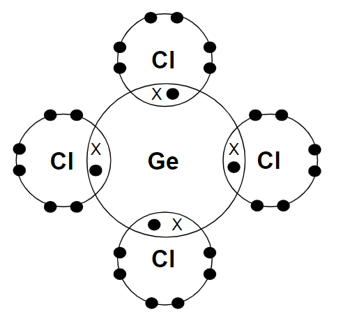

- 4 bonded pairs of electrons around the germanium atom; **[1 mark]**
- 3 non-bonded pairs of electrons 
**AND **
1 bonded pair of electrons around <u>each</u> chlorine atom; **[1 mark]**

**[Total: 2 marks]**

- *Whilst this is an unfamiliar compound, the principles behind drawing the dot-and-cross diagram are the same as more straightforward molecules*
- *Germanium is in Group IV so will have 4 electrons in its outer shell i.e. 4 valency electrons*

  - *Germanium will share a pair of electrons with 4 chlorine atoms*

- *Chlorine is in Group VII so will have 7 electrons in its outer shell, i.e. 7 valency electrons*

  - *Each chlorine atom will share a pair of electrons with the germanium atom*
- *When you have drawn your dot-and-cross diagram check that each electron shell has 8 electrons in *
c) The structure of the giant covalent compound germanium(IV) oxide, GeO2 is:

- Four oxygen atoms around each germanium atom; **[1 mark]**
- Two germanium atoms around each oxygen atom; **[1 mark]**
- Tetrahedral; **[1 mark]**

**[Total: 3 marks]**

- *This is another question which requires you to apply your knowledge*
- *You should recall that in silicon(IV) oxide, each oxygen atom forms covalent bonds with 2 silicon atoms and each silicon atom, in turn, forms covalent bonds with 4 oxygen atoms*
- *This forms a tetrahedron with one silicon atom and four oxygen atoms, similar to diamond *
- *Germanium(IV) oxide has a similar structure but the silicon atoms are replaced by germanium atoms*
d) The change GeCl2 to GeCl4 is:

- Oxidation; **[1 mark]**
- Because there is an increase in oxidation number 
**OR **
Because there is electron loss;** [1 mark]**

**[Total: 2 marks]**

- *The second mark is only awarded if the first mark has been achieved*
- *The oxidation number of a compound is zero*
- *The oxidation of a chlorine is -1*
- *In GeCl**2**, the oxidation number of germanium must be +2*

  - *Oxidation number of germanium + 2 x oxidation number of chlorine = 0*
  - *+2 + (2 x -1) = 0*
- *In GeCl**4**, the oxidation number of germanium must be +4*

  - *Oxidation number of germanium + 4 x oxidation number of chlorine = 0*
  - *+4 + (4 x -1) = 0*
- *Therefore oxidation has occurred as the oxidation number of germanium has increased from +2 to +4*

### Q18
a)

i) Three properties of silicon carbide are:

Any **three** from:

- Strong;** [1 mark]**
- Hard;** [1 mark]**
- Light or low density;** [1 mark]**
- High melting point;** [1 mark]**

ii) The description of the structure of silicon carbide is:

- Each carbon atom is bonded to four **silicon** atoms;** [1 mark]**
- Each silicon atom is bonded to **four **carbon atoms;** [1 mark]**

**[Total: 5 marks]**

- *For part (i), think about the properties of aluminium which would make it suitable to construct spacecraft with*

  - *You can say that it has a high strength to weight ratio for 2 marks as this includes points 1 and 3*
  - *The properties of silicon carbide would need to share these properties, otherwise it would not be suitable for its use*
- *The structure of silicon carbide is similar to diamond in which every carbon atom is bonded to 4 other carbon atoms*

  - *In silicon carbide, it will have a similar structure but as both silicon and carbon are present, each will be bonded to four atoms of the other element*
b) The diagram of the structural formula of germanium(IV) oxide should include:

- Each germanium atom bonded 4 oxygen atoms; **[1 mark]**
- Each oxygen atom bonded to 2 germanium atoms; **[1 mark]**
- Looks / stated to be tetrahedral; **[1 mark]**

**[Total: 3 marks]**

- *The word “tetrahedral” scores the third mark even if te diagram does not look tetrahedral *
- *You should know that in silicon(IV) oxide, each oxygen atom forms covalent bonds with 2 silicon atoms and each silicon atom in turn forms covalent bonds with 4 oxygen atoms*
- *The same is true for germanium(IV) oxide so you just need to replace Si with Ge atoms* 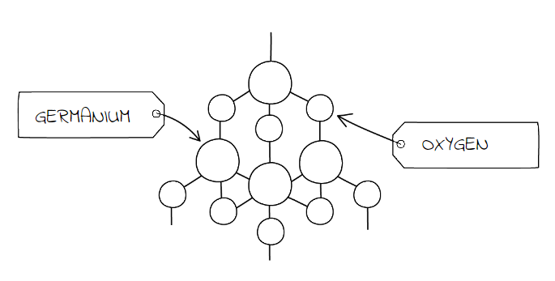
c)

i) The structural formula of the hydride which contains four germanium atoms per molecule is:

- GeH3GeH2GeH2GeH3 / GeH3-GeH2-GeH2-GeH3; **[1 mark]**

ii) The products of the complete combustion of this hydride are:

- Germanium(IV) oxide 
**OR **
Germanium dioxide 
**OR **
Germanium oxide;** [1 mark]**
- Water; **[1 mark]**

**[Total: 3 marks]**

- *You are told in the question that the germanium hydrides are similar to alkanes so the structural formula of the hydride that contains 4 Ge atoms will be similar to that of butane (the alkane containing 4 carbon atoms)  but with the C atoms replaced with Ge*

  - *The structural formula of butane is CH**3**CH**2**CH**2**CH**3*
  - *Replacing the C atoms with Ge gives GeH**3**GeH**2**GeH**2**GeH**3*
- *The products of the complete combustion of alkanes are carbon dioxide and water, so the product of the complete combustion of this germanium hydride will be similar, but with the C atom replaced with a Ge atom*

  - *Instead of carbon dioxide + water, germanium(IV) oxide (GeO**2**) + water*

### Q19
a) Graphite is a soft material which is used as a lubricant because:

- Weak forces are between layers / between (hexagonal) rings 
**OR** 
Weak bonds between layers / between (hexagonal) rings 
**OR** 
Van der Waals forces between layers / between (hexagonal) rings; **[1 mark]**
- (layers/rings) slip / slide (over each other) / move over each other; **[1 mark]**

**[Total: 2 marks]**

- *Each carbon atom is bonded to three other carbons forming these layers *
- *Be careful- there are strong covalent bonds between atoms but only weak forces between the layers*
b) Diamond is a very hard material which is used for drilling and cutting because:

- Strong bonds (between atoms) / covalent bonds (between atoms); **[1 mark]**
- All bonds are covalent / strong / each atom covalently bonded / carbon (atoms) is bonded to four others / bonds are directional / (atoms are arranged) tetrahedrally; **[1 mark]** 
*Accept: carbon has four bonds*

**[Total: 2 marks]**

- *Each carbon is bonded to four other carbons (unlike graphite which we said was three) *
- *These are strong covalent bonds making diamond very hard*
- *You must make sure you learn all the properties of diamond and graphite *
c) Graphite is a good conductor of electricity and diamond is a poor conductor because:

- Graphite has delocalised / mobile / free electrons; **[1 mark]**
- Diamond (outer shell) electrons used / fixed / localised in bonding / no delocalised electrons / no mobile electrons / no free electrons; **[1 mark]**

**[Total: 2 marks]**

- *Make sure you comment on both diamond AND graphite, as the question is two marks*
- *One common mistake is to focus on one substance*
- *Remember:** In diamond each carbon is bonded to four other bond atoms, so there are no free electrons, whereas in graphite each carbon is bonded to three meaning there is one free electron per atom*

### Q20
a)

i) The structure of silicon(IV) oxide is:

Any **three **from:

- Each oxygen is joined to two silicons/atoms; **[1 mark]**
- Each silicon is joined to four oxygens /atoms; **[1 mark]**
- Tetrahedral (around silicon)/ similar to diamond; **[1 mark]**
- Linear around oxygen; **[1 mark]**

ii) Three properties that silicon(IV) oxide and diamond have in common are:

Any **three** from:

- High melting point/ boiling point; **[1 mark]**
- Hard; **[1 mark]**
- Strong; **[1 mark]**
- (Colourless) crystalline (solid); **[1 mark]**
- Brittle / not malleable; **[1 mark]**
- Poor / non-conductor (of electricity) **OR **Insulator; **[1 mark]**
- Insoluble (in water); **[1 mark]**

iii)  You could show that silicon(IV) oxide is acidic and not basic or amphoteric by:

- SiO2 does not react with / dissolves in / neutralises an acid or acidic oxide; **[1 mark]** SiO2 does react / dissolve in / neutralise an alkali or base or basic oxide; **[1 mark]**

**[Total: 8 marks]**
b) The physical properties of carbon dioxide are different from those of diamond and silicon(IV) oxide as:

- Carbon dioxide has a simple molecular structure; **[1 mark]**

**[Total: 1 mark]**

- *Both diamond and silicon (IV) oxide have giant structures with lots of strong covalent bonds*
- *Carbon dioxide has a simple molecular structure with covalent bonds within molecules and weak intermolecular forces between the molecules*

### Q21
a) The other chemical that is needed to burn this fuel is:

- Oxygen; **[1 mark]**

**[Total: 1 mark]**

- *With any combustion reaction, oxygen is required*
- *Careful**: Whilst oxygen is present in the air, you won't be awarded a mark for saying the air as this is a mixture of compounds and elements*
b)

i) One atom of either element can form four covalent bonds because:

- Both have four outer / valency electrons; **[1 mark]**
- They need to share four more 
**OR** 
They need four more to complete energy level;** [1 mark]**

ii) Two physical properties of silicon are:

Any **two** from:

- Hard; **[1 mark]**
- Brittle; **[1 mark]**
- High melting / boiling point;** [1 mark]**
- Poor conductor of electricity 
**OR** 
semi-conductor;** [1 mark]**

iii) A different element that has a similar structure and properties to silicon is:

- Germanium 
**OR** 
Carbon;** [1 mark]**

**[Total: 5 marks]**

- *Elements in the same group will share similar properties and form similar structures*
c)

i) The balanced equation is:

SiO2 + **2**C + → Si + **2**CO

- Correctly balanced;** [1 mark]**

ii) The silicon(IV) oxide is said to be reduced because:

- (It has) lost oxygen 
**OR **
decrease in oxidation number; **[1 mark]**

iii) The structure of silicon(IV) oxide can be described by:

- 4 oxygen atoms around 1 silicon atom; **[1 mark]**
- 2 silicon atoms around 1 oxygen; **[1 mark]**
- Tetrahedral 
**OR **
Diagram that looks tetrahedral; **[1 mark]**

**[Total: 5 marks]**

- *There are often extra marking points associated with questions like this*

  - *For instance, you can only score a maximum of 2 marks if there is some incorrect Chemistry in your answer*
- *Reduction is the loss of oxygen, which silicon(IV) oxide does in this reaction to form a silicon atom*

  - *Reduction can also be described as the gain of electrons*
- *A suitable diagram would be:*

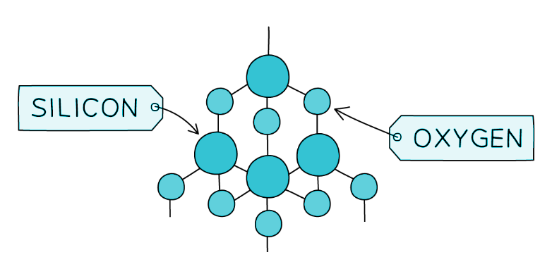

### Q22
a) This substance has a giant covalent structure:

- E;** [1 mark]**
- **Evidence**: high melting point / mp / mpt 
**OR **
High boiling point / bp / bpt; **[1 mark]**
- Poor / non conductor (when liquid and/or solid); **[1 mark]**

**[Total: 3 marks]**

- *Giant covalent structures have many covalent bonds which require large amounts of energy to break*

  - *This means they have high melting points*
- *They do not contain ions or have any free electrons (with the exception of graphite) so cannot conduct electricity as either a solid or liquid*
b) This substance is a metal:

- B;** [1 mark]**
- **Evidence**: (good) conductor when solid (and liquid) / in any state; **[1 mark]**

**[Total: 2 marks]**

- *Metals contain free electrons which can carry charge so they conduct electricity as either a solid or liquid*
- *Just stating that the substance has a high melting and boiling point is insufficient as this on its own cannot identify it as a metal*

  - *Substances C and E also have high melting and boiling points but it is the conductivity of electricity which identifies B as a metal*
c) This substance is a liquid at room temperature:

- A;** [1 mark]**

Option 1:

- **Evidence**: melting point / –7 (°C) is below room temperature / 25 (°C) / r.t.p. 
**OR** 
Room temperature / 25 (°C) / r.t.p. is above melting point / –7 (°C); **[1 mark]**
- Boiling point / 59 (°C) is above room temperature / 25 (°C) / r.t.p. 
**OR** 
Room temperature / 25 (°C) / r.t.p. is below boiling point / 59 (°C); **[1 mark]**

Option 2:

- 25 (°C) / room temperature / r.t.p. is in between –7 (°C) and 59 (°C) 
**OR **
25 (°C) / room temperature / r.t.p. is between the melting point and boiling point; **[2 marks]**

**[Total: 3 marks]**

- *Substances will be a liquid between their melting point and boiling point*

  - *Below their melting point, they will be a solid*
  - *Above their boiling point, they will be a gas*
d) This substance is an ionic solid:

- C;** [1 mark]**
- **Evidence**: high melting point/ mp/ mpt 
**OR **
High boiling point/ bp/ bpt; **[1 mark]**
- Poor / non conductor when solid 
**AND **
good conductor when liquid / molten 
**OR **
Only conduct when liquid; **[1 mark**

**[Total: 3 marks]**

- *Ionic substances have a high melting point due to the many strong ionic bonds resulting from the electrostatic attraction between oppositely charged ions*
- *They are able to conduct electricity when molten as the ions are free to move*
- *When solid, the ions are in a fixed position in a lattice so cannot move and are unable to conduct electricity*
- *Careful**: Ionic compounds do not conduct electricity due to free electrons - this is the explanation of why metals conduct electricity!*
