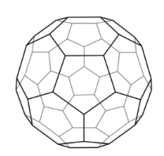
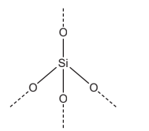
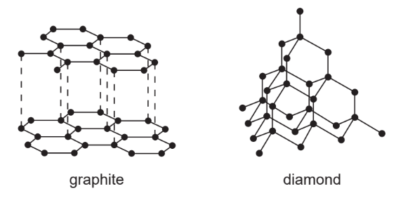
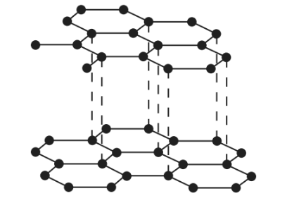
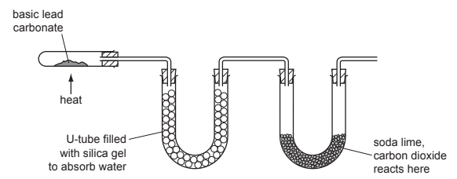

# Exam Questions — Giant Structures
**2. Atoms, Elements & Compounds** · Cambridge (CIE) IGCSE chemistry (0620 & 0971)
> Source: [https://www.savemyexams.com/igcse/chemistry/cie/23/topic-questions/](https://www.savemyexams.com/igcse/chemistry/cie/23/topic-questions/) · 40 questions across 2 sets

## Multiple Choice Questions (23 questions)

### Q1 — medium — 1 marks

**Q1** [1 mark]

Silicon(IV) oxide and phosphorus(V) oxide are oxides of elements in Period 3 of the Periodic Table.

Which row describes the correct properties of these two oxides?

|   | nature of the oxides | type of bonding | melting point of silicon(IV) oxide | melting point of phosphorus(V) oxide |
|---|---|---|---|---|
| A | acidic | covalent | high | low |
| B | acidic | covalent | low | low |
| C | basic | ionic | high | low |
| D | basic | ionic | low | low |

### Q2 — easy — 1 marks

**Q2** [1 mark]

Which statement about carbon allotropes is correct?

### Q3 — easy — 1 marks

**Q3** [1 mark]

#### Extended Only

Which statement correctly describes the bonding in metals?

### Q4 — easy — 1 marks

**Q4** [1 mark]

#### Extended Only

Which row provides a correct description of the properties of metals?

|   | **melting point** | **boiling point** | **conducts electricity** |
|---|---|---|---|
| **A** | high | low | $\times$ |
| **B** | low | high | `✓` |
| **C** | low | low | $\times$ |
| **D** | high | high | `✓` |

### Q5 — easy — 1 marks

**Q5** [1 mark]

Graphite is used to produce electrodes due to its ability to conduct electricity.

What other property does graphite have that makes it useful for this application?

### Q6 — easy — 1 marks

**Q6** [1 mark]

Graphite is used extensively as a lubricating material. It is also used in pencils and in the manufacture of electrodes for electrolysis.

Which row describes how graphite can be used in electrolysis?

|   | **property** | **use** |
|---|---|---|
| **A** | delocalised electrons | conducts electricity |
| **B** | delocalised electrons | acts as an insulator |
| **C** | low melting point | acts as an insulator |
| **D** | low melting point | conducts electricity |

### Q7 — easy — 1 marks

**Q7** [1 mark]

The structures of two solids X and Y are shown below.

What are the correct uses of these structures?

|   | **X** | **Y** |
|---|---|---|
| **A** | industrial lubricating | glass cutters |
| **B** | industrial lubricating | industrial lubricating |
| **C** | glass cutters | industrial lubricating |
| **D** | glass cutters | glass cutters |

### Q8 — hard — 1 marks

**Q8** [1 mark]

#### Separate: Chemistry and Extended Only

Which row provides a correct description of the structure and properties of silicon(IV) oxide?

|   | **forms an acidic oxide** | **has a giant structure** | **conducts electricity** |
|---|---|---|---|
| **A** | `✓` | `✓` | $\times$ |
| **B** | `✓` | $\times$ | `✓` |
| **C** | $\times$ | `✓` | $\times$ |
| **D** | $\times$ | $\times$ | `✓` |

### Q9 — hard — 1 marks

**Q9** [1 mark]

#### Extended Only

Metals are malleable and ductile and can be hammered and pulled into useful shapes.

Which statement correctly explains these properties?

### Q10 — hard — 1 marks

**Q10** [1 mark]

#### Extended Only

Metallic bonds are very strong and give metals their properties. Which of the following definitions is correct for a metallic bond?

### Q11 — hard — 1 marks

**Q11** [1 mark]

#### Separate: Chemistry and Extended Only

Which statement correctly describes the arrangement of atoms in silicon dioxide?

### Q12 — hard — 1 marks

**Q12** [1 mark]

#### Separate: Chemistry and Extended Only

Which of the following statements about silicon(IV) dioxide and diamond are correct?

| **1** | Silicon(IV) dioxide forms a giant ionic lattice structure. |
|---|---|
| **2** | They are both compounds. |
| **3** | They both have very high melting points. |
| **4** | There are strong covalent bonds in silicon(IV) dioxide. |

### Q13 — hard — 1 marks

**Q13** [1 mark]

#### Separate: Chemistry and Extended Only

Which row correctly describes the use of graphite and silicon(IV) dioxide?

|   | **graphite** | **silicon(IV) dioxide** |
|---|---|---|
| **A** | electrodes | production of plastics |
| **B** | electrolyte | production of glass |
| **C** | electrolyte | production of plastics |
| **D** | electrodes | production of glass |

### Q14 — medium — 1 marks

**Q14** [1 mark]

Which statement correctly describes the structure of macromolecules?

### Q15 — medium — 1 marks

**Q15** [1 mark]

Statements 1, 2 and 3 are about diamond and graphite.

1. They have atoms that form three equally strong bonds
2. They are both formed from the same element
3. They each conduct electricity

Which statement(s) is / are correct?

### Q16 — medium — 1 marks

**Q16** [1 mark]

Which statement about graphite and diamond is not correct?

### Q17 — medium — 1 marks

**Q17** [1 mark]

Which of the following statements about graphite and diamond are incorrect?

| **1** | They are allotropes of carbon. |
|---|---|
| **2** | They both conduct electricity. |
| **3** | They form different numbers of bonds within their structures. |
| **4** | They have different uses. |

### Q18 — medium — 1 marks

**Q18** [1 mark]

#### Separate: Chemistry and Extended Only

The following statements describe the structure and properties of silicon(IV) oxide.

1. Giant covalent structure held together by many strong covalent bonds.
2. It is a very hard substance.

Which of the following is correct for statements 1 and 2?

## Theory Questions (25 questions)

### Q1 — hard — 10 marks

**Q1** [2 marks]

In 1985 the fullerenes were discovered. They are solid forms of the element carbon. The structure of the C60 fullerene is given below.

i) In the C60 fullerene, how many other carbon atoms is each carbon atom bonded to?

[1]

ii) Another fullerene has a relative molecular mass of 840. How many carbon atoms are there in one molecule of this fullerene?

[1]

*Source: 2014 Oct33 Q3*

**Q1** [3 marks]

**Extract:**

In 1985 the fullerenes were discovered. They are solid forms of the element carbon. The structure of the C60 fullerene is given below.

Fullerenes are soluble in liquid hydrocarbons such as octane. The other solid forms of carbon are insoluble.

Describe how you could obtain crystals of fullerenes from soot which is a mixture of fullerenes and other solid forms of carbon.

*Source: 2014 Oct33 Q3*

**Q1** [5 marks]

#### Extended Only

A mixture of a fullerene and potassium is an excellent conductor of electricity.

i) Which other form of solid carbon is a good conductor of electricity?

[1]

ii) Explain why metals, such as potassium, are good conductors of electricity.

[2]

iii) The mixture of fullerene and potassium has to be stored out of contact with air. There are substances in unpolluted air which will react with potassium. Name **two** potassium compounds which could be formed when potassium is exposed to air.

[2]

*Source: 2014 Oct33 Q3*

### Q2 — hard — 13 marks

**Q2** [6 marks]

Carbon and silicon are elements in Group IV. Both elements have macromolecular structures.

Diamond and graphite are two forms of the element carbon.

i) Explain why diamond is a very hard substance.

[2]

ii) Give **one **use of diamond.

[1]

iii) Explain why graphite is a soft material.

[2]

iv) Give **one **use of graphite.

[1]

*Source: 2010 Ju31 Q5*

**Q2** [7 marks]

**Extract:**

Carbon and silicon are elements in Group IV. Both elements have macromolecular structures.

#### Separate: Chemistry and Extended Only

Two of the oxides of these elements are carbon dioxide, CO2, and silicon(IV) oxide, SiO2.

i) Draw a diagram showing the arrangement of the valency electrons in one molecule of the covalent compound carbon dioxide.

Use o to represent an electron from a carbon atom. Use x to represent an electron from an oxygen atom.

[3]

ii) A section of the macromolecular structure of silicon(IV) oxide is given below.

[2]

Use this diagram to explain why the formula is SiO2 not SiO4.

iii) Predict **two **differences in the physical properties of these two oxides.

[2]

*Source: 2010 Ju31 Q5*

### Q3 — medium — 6 marks

**Q3** [1 mark]

#### Separate: Chemistry and Extended Only

The names of eight substances are given.

** aluminium oxide           calcium oxide       ethanol            nitrogen**

**                     iron(III) oxide          methane         oxygen         silicon(IV) oxide**

State which substance is a macromolecular solid.

*Source: 2019 Ju0620/42/04 Q1F*

**Q3** [2 marks]

Carbon is an element which exists in different forms. Name two forms of the element carbon that have giant covalent structures.

*Source: 2019 Ju0620/42/04 Q2B*

**Q3** [3 marks]

#### Extended Only

Magnesium is a metal. Describe the structure and bonding of metals. Include a labelled diagram in your answer.

*Source: 2019 Ju0620/42/04 Q2C*

### Q4 — easy — 6 marks

**Q4** [2 marks]

#### Extended Only

The diagram shows part of the structures of caesium chloride and carbon dioxide.

Caesium is a metal. Describe two properties that are characteristic of most metals.

*Source: 2020 Ju0620/31 Q4A) III)*

**Q4** [4 marks]

**Extract:**

The diagram shows part of the structures of caesium chloride and carbon dioxide.

#### Extended Only

Magnesium is a metal.

Name and describe the bonding in magnesium.

name:

description of bonding:

*Source: 2020 Ju0620/32 Q8D*

### Q5 — medium — 6 marks

**Q5** [2 marks]

#### Extended Only

For each of the following unfamiliar elements predict one physical and one chemical property.

Caesium (Cs)

Physical property ..........................................................................................................
 Chemical property ..........................................................................................................

*Source: 2010 Ju32 Q1*

**Q5** [2 marks]

**Extract:**

For each of the following unfamiliar elements predict one physical and one chemical property.

Vanadium (V)

Physical property .........................................................................................................

Chemical property ..........................................................................................................

*Source: 2010 Ju32 Q1*

**Q5** [2 marks]

**Extract:**

For each of the following unfamiliar elements predict one physical and one chemical property.

Fluorine (F)

Physical property ..........................................................................................................

Chemical property ..........................................................................................................

*Source: 2010 Oc32 Q1*

### Q6 — easy — 7 marks

**Q6** [3 marks]

Two macromolecular forms of carbon are graphite and diamond. The structures of graphite and diamond are given below.

Explain in terms of its structure why graphite is soft and is a good conductor of electricity.

*Source: 2014 Oct31 Q2*

**Q6** [1 mark]

**Extract:**

Two macromolecular forms of carbon are graphite and diamond. Explain in terms of its structure why graphite is soft and is a good conductor of electricity.
Graphite is soft because: (There are) weak forces between layers/sheets/rows; Layers can slip/slide.

State** one** use of graphite that depends on this property..

*Source: 2014 Oct31 Q2*

**Q6** [3 marks]

**Extract:**

Two macromolecular forms of carbon are graphite and diamond. The structures of graphite and diamond are given below.

#### Separate: Chemistry and Extended Only

Silicon(IV) oxide also has a macromolecular structure.

i) Describe the macromolecular structure of silicon(IV) oxide.

[1]

ii) Predict **two** physical properties which diamond and silicon(IV) oxide have in common.

[2]

*Source: 2014 Oct31 Q2*

### Q7 — hard — 11 marks

**Q7** [5 marks]

#### Extended Only

An ore of the important metal zinc is zinc blende, ZnS. This is changed into zinc oxide which is reduced to the impure metal by carbon reduction.

i) How is zinc oxide obtained from zinc sulfide?

[2]

ii) Write a balanced equation for the reduction of zinc oxide by carbon.

[1]

iii) The major impurity in the zinc is cadmium. The boiling point of zinc is 907°C and that of cadmium is 767 °C.

Name a technique which could be used to separate these two metals.

[2]

*Source: 2010 O32 Q2*

**Q7** [6 marks]

In common with most metals, zinc is a good conductor of electricity. It is used as an electrode in cells.

i) Give two other uses of zinc.

[2]

ii) Describe the metallic bonding in zinc and then explain why it is a good conductor of electricity.

[4]

*Source: 2010 O32 Q2*

### Q8 — medium — 5 marks

**Q8** [1 mark]

#### Extended Only

The following table gives information about six substances.

| substance | melting point / °C | boiling point / °C | electrical conductivity as a solid | electrical conductivity as a liquid |
|---|---|---|---|---|
| **A** | 839 | 1484 | good | good |
| **B** | –188 | -42 | poor | poor |
| **C** | 776 | 1497 | poor | good |
| **D** | –117 | 78 | poor | poor |
| **E** | 1607 | 2227 | poor | poor |
| **F** | -5 | 102 | poor | good |

Which substance could be a metal?

*Source: 2016 specimen4 Q1*

**Q8** [1 mark]

**Extract:**

The following table gives information about six substances.

| substance | melting point / °C | boiling point / °C | electrical conductivity as a solid | electrical conductivity as a liquid |
| A | 839 | 1484 | good | good |
| B | –188 | -42 | poor | poor |
| C | 776 | 1497 | poor | good |
| D | –117 | 78 | poor | poor |
| E | 1607 | 2227 | poor | poor |
| F | -5 | 102 | poor | good |

State **all** the substances that are liquid at room temperature.

*Source: 2016 specimen4 Q1*

**Q8** [1 mark]

**Extract:**

The following table gives information about six substances.

| substance | melting point / °C | boiling point / °C | electrical conductivity as a solid | electrical conductivity as a liquid |
| A | 839 | 1484 | good | good |
| B | –188 | -42 | poor | poor |
| C | 776 | 1497 | poor | good |
| D | –117 | 78 | poor | poor |
| E | 1607 | 2227 | poor | poor |
| F | -5 | 102 | poor | good |

#### Separate: Chemistry and Extended Only

Which substance could have a macromolecular structure similar to that of silicon(IV) oxide?

*Source: 2016 specimen4 Q1*

**Q8** [1 mark]

**Extract:**

The following table gives information about six substances.

| substance | melting point / °C | boiling point / °C | electrical conductivity as a solid | electrical conductivity as a liquid |
| A | 839 | 1484 | good | good |
| B | –188 | -42 | poor | poor |
| C | 776 | 1497 | poor | good |
| D | –117 | 78 | poor | poor |
| E | 1607 | 2227 | poor | poor |
| F | -5 | 102 | poor | good |

Which substance could be propane?

*Source: 2016 specimen4 Q1*

**Q8** [1 mark]

**Extract:**

The following table gives information about six substances.

| substance | melting point / °C | boiling point / °C | electrical conductivity as a solid | electrical conductivity as a liquid |
| :---: | :---: | :---: | :---: | :---: |
| **A** | 839 | 1484 | good | good |
| **B** | –188 | -42 | poor | poor |
| **C** | 776 | 1497 | poor | good |
| **D** | –117 | 78 | poor | poor |
| **E** | 1607 | 2227 | poor | poor |
| **F** | -5 | 102 | poor | good |

Which substance could be sodium chloride?

*Source: 2016 specimen4 Q1*

### Q9 — medium — 17 marks

**Q9** [3 marks]

#### Separate: Chemistry and Extended Only

The table below shows the elements in the third period of the Periodic Table, the number of electrons in their outer energy  level, their oxidation state in their common compounds and their melting points.

| **Element** | **Na** | **Mg** | **Al** | **Si** | **P** | **S** | **Cl** | **Ar** |
|---|---|---|---|---|---|---|---|---|
| **Number of outer electrons** | 1 | 2 | 3 | 4 | 5 | 6 | 7 | 8 |
| **Oxidation state** | +1 | +2 | +3 | +4/-4 | -3 | -2 | -1 | 0 |
| **Melting point / ****o****C** | 98 | 650 | 660 | 1414 | 317 | 115 | -101 | -189 |

Describe and explain the variation in oxidation state across the period.

*Source: 2015 O32 Q6*

**Q9** [3 marks]

#### Extended Only

The first three elements, Na, Mg and Al, are metals.

Describe the structure of a typical metal.

*Source: 2015 O32 Q6*

**Q9** [1 mark]

**Extract:**

The first three elements, Na, Mg and Al, are metals. Describe the structure of a typical metal. Mark scheme: Positive ions / cations / metallic ions; Arranged in a lattice / rows / layers; Sea of electrons / delocalised electrons. The electrons are free to move around the structure.

#### Extended Only

Explain why Na, Mg and Al are good conductors of electricity.

*Source: 2015 O32 Q6*

**Q9** [1 mark]

**Extract:**

The table below shows the elements in the third period of the Periodic Table, the number of electrons in their outer energy level, their oxidation state in their common compounds and their melting points.

| Element | Na | Mg | Al | Si | P | S | Cl | Ar |
| Number of outer electrons | 1 | 2 | 3 | 4 | 5 | 6 | 7 | 8 |
| Oxidation state | +1 | +2 | +3 | +4/-4 | -3 | -2 | -1 | 0 |
| Melting point / oC | 98 | 650 | 660 | 1414 | 317 | 115 | -101 | -189 |

Which element exists as diatomic molecules of the type X2?

*Source: 2015 O32 Q6*

**Q9** [2 marks]

**Extract:**

The table below shows the elements in the third period of the Periodic Table, the number of electrons in their outer energy level, their oxidation state in their common compounds and their melting points.

| Element | Na | Mg | Al | Si | P | S | Cl | Ar |
| Number of outer electrons | 1 | 2 | 3 | 4 | 5 | 6 | 7 | 8 |
| Oxidation state | +1 | +2 | +3 | +4/-4 | -3 | -2 | -1 | 0 |
| Melting point / °C | 98 | 650 | 660 | 1414 | 317 | 115 | -101 | -189 |

#### Separate: Chemistry and Extended Only

Silicon has a similar structure to diamond.

Explain why silicon has the highest melting point in the period.

*Source: 2015 O32 Q6*

**Q9** [2 marks]

**Extract:**

The table below shows the elements in the third period of the Periodic Table, the number of electrons in their outer energy  level, their oxidation state in their common compounds and their melting points.

| **Element** | **Na** | **Mg** | **Al** | **Si** | **P** | **S** | **Cl** | **Ar** |
|---|---|---|---|---|---|---|---|---|
| **Number of outer electrons** | 1 | 2 | 3 | 4 | 5 | 6 | 7 | 8 |
| **Oxidation state** | +1 | +2 | +3 | +4/-4 | -3 | -2 | -1 | 0 |
| **Melting point / ****o****C** | 98 | 650 | 660 | 1414 | 317 | 115 | -101 | -189 |

#### Extended Only

Sodium chloride is a crystalline solid with a high melting point. It dissolves in water to give a neutral solution. Phosphorus trichloride is a liquid at room temperature. It reacts with water to form an acidic solution. Suggest an explanation for these differences in properties.

*Source: 2015 O32 Q6*

**Q9** [2 marks]

Describe how you could show that magnesium oxide is a basic oxide and not an amphoteric oxide.

*Source: 2015 O32 Q6*

**Q9** [3 marks]

#### Extended Only

Draw a dot-and-cross diagram showing the bonding in magnesium oxide. Show outer electrons only.

*Source: 2015 O32 Q6*

### Q10 — easy — 6 marks

**Q10** [6 marks]

#### Extended Only

Complete the following table.

| type of structure | particles present | electrical conductivity of solid | electrical conductivity of liquid | example |
|---|---|---|---|---|
| ionic | positive and negative ions | poor | ........................ | ........................ |
| macromolecular | atoms of two different elements in a giant covalent structure | poor | poor | ........................ |
| metallic | ........................ and  ........................ | good | ........................ | copper |

[6]

*Source: 2007 Ju31 Q2*

### Q11 — medium — 3 marks

**Q11** [1 mark]

The properties of five alkenes at room temperature are shown in **Table 1.1**

**Table 1.1**

| alkene | number of carbon atoms in a molecule | state at room temperature | density in g / cm3 | boiling point / °C |
|---|---|---|---|---|
| ethene | 2 | gas | 0.0012 | –104 |
| propene | 3 | gas | 0.0018 | –47 |
| butene | 4 | gas | 0.0024 |   |
| pentene | 5 | liquid | 0.64 | 30 |
| hexene | 6 | liquid | 0.67 | 63 |

Answer this question using only the information in the table.

Suggest why the densities of the first three alkenes are much lower than the density of pentene and hexene.

*Source: 2020 Ju0620/41 Q2A*

**Q11** [1 mark]

The diagrams show part of the structures of five substances, A, B, C, D and E.

Answer the following question about these structures.

Which one of these structures, A, B, C, D or E, is used in cutting tools?

*Source: 2019 Ju0620/31/03 Q1A*

**Q11** [1 mark]

**Extract:**

Graphite is an allotrope of carbon, each carbon atom is bonded to three other carbon atoms by covalent bonds. The covalent bonds within the layers are very strong, but the layers are attracted to each other by weak intermolecular forces. Layers can slide (over each other).

Part of the structure of graphite is shown.

Use the information from the diagram to explain why graphite is used as a lubricant.

*Source: 2019 Ju0620/31/03 Q8C*

### Q12 — hard — 14 marks

**Q12** [3 marks]

There are three types of giant structure – ionic, metallic and macromolecular.

Sodium nitride is an ionic compound. Draw a diagram that shows the formula of the compound, the charges on the ions and the arrangement of the valency electrons around the negative ion.

Use x to represent an electron from a sodium atom. Use o to represent an electron from a nitrogen atom.

*Source: 2008 O31 Q2*

**Q12** [6 marks]

i) Describe metallic bonding.

[3]

ii) Use the above ideas to explain why: metals are good conductors of electricity, metals are malleable.

[3]

*Source: 2008 O31 Q2*

**Q12** [5 marks]

#### Separate: Chemistry and Extended Only

Silicon(IV) oxide has a macromolecular structure.

i) Describe the structure of silicon(IV) oxide (a diagram is not acceptable).

[3]

ii) Diamond has a similar structure and consequently similar properties. Give **two **physical properties common to both diamond and silicon(IV) oxide.

[2]

*Source: 2008 O31 Q2*

### Q13 — hard — 9 marks

**Q13** [2 marks]

The first three elements in Group IV are

Carbon

Silicon

Germanium

The element germanium has a diamond-type structure. Describe the structure of germanium. A diagram is acceptable.

*Source: 2006 Ju31 Q4A*

**Q13** [4 marks]

Unlike diamond, graphite is soft and is a good conductor of electricity.

i) Explain why graphite has these properties.

[3]

ii) Give a use of graphite that depends on one of these properties.

Property .................................

Use .................................

[1]

*Source: 2006 Ju31 Q4B*

**Q13** [3 marks]

#### Separate: Chemistry and Extended Only

Carbon dioxide and silicon(IV) oxide have similar formulae but different types of structure.

i) Give the formulae of these oxides.

[1]

ii) How are their structures different?

[2]

*Source: 2006 Ju31 Q4C*

### Q14 — easy — 6 marks

**Q14** [2 marks]

For each of the following elements give one physical property and one chemical property.

bromine (Br2)

physical property .....................................

chemical property ....................................

*Source: 2014 Oct33 Q1*

**Q14** [2 marks]

**Extract:**

For each of the following elements give one physical property and one chemical property.

carbon graphite (C)

physical property ...........................

chemical property .........................

*Source: 2014 Oct33 Q1*

**Q14** [2 marks]

**Extract:**

For each of the following elements give one physical property and one chemical property.

manganese (Mn)

physical property .................................

chemical property ................................

*Source: 2014 Oct33 Q1*

### Q15 — hard — 8 marks

**Q15** [4 marks]

#### Extended Only

Lead is an excellent roofing material. It is malleable and resistant to corrosion. Lead rapidly becomes coated with basic lead carbonate which protects it from further corrosion.

Lead has a typical metallic structure which is a lattice of lead ions surrounded by a ‘sea’ of mobile electrons. This structure is held together by attractive forces called a metallic bond.

i) Explain why there are attractive forces in a metallic structure.

[2]

ii) Explain why a metal, such as lead, is malleable.

[2]

*Source: 2013 O31 Q6*

**Q15** [1 mark]

Basic lead(II) carbonate is heated in the apparatus shown below. Water and carbon dioxide are produced.

Silica gel absorbs water. Silica gel often contains anhydrous cobalt(II) chloride. When this absorbs water it changes from blue to pink. Suggest a reason.

*Source: 2013 O31 Q6*

**Q15** [3 marks]

#### Separate: Chemistry and Extended Only

Basic lead(II) carbonate has a formula of the type xPbCO3.yPb(OH)2 where x and y are whole numbers. Determine x and y from the following information.

PbCO3  → PbO + CO2 Pb(OH)2 → PbO + H2O

When heated, the basic lead(II) carbonate gave 2.112 g of carbon dioxide and 0.432 g of water. Mass of one mole of CO2 = 44 g Mass of one mole of H2O = 18 g Number of moles of CO2 formed = .....................

[1]

Number of moles of H2O formed = .....................

[1]

x = ..................... and y = .....................

Formula of basic lead(II) carbonate is ........................................................................

[1]

*Source: 2013 O31 Q6*

### Q16 — medium — 10 marks

**Q16** [4 marks]

#### Separate: Chemistry and Extended Only

Carbon dioxide and silicon(IV) oxide are oxides of Group IV elements.

Complete the following table.

|   | carbon dioxide | silicon (IV) oxide |
|---|---|---|
| formula |   | SiO2 |
| melting point / °C | –56 | 1610 |
| physical state at 25 °C | gas |   |
| conduction of electricity | non-conductor |   |
| structure |   | macromolecular |

*Source: 2016 Ja42 Q3*

**Q16** [4 marks]

**Extract:**

Carbon dioxide and silicon(IV) oxide are oxides of Group IV elements.

| | carbon dioxide | silicon (IV) oxide |
| formula | CO2 | SiO2 |
| melting point / °C | –56 | 1610 |
| physical state at 25 °C | gas | solid |
| conduction of electricity | non-conductor | poor conductor / non-conductor |
| structure | simple molecular | macromolecular |

#### Separate: Chemistry and Extended Only

i) Name the type of bonds that exist between the atoms in silicon(IV) oxide.

[1]

ii) Explain why silicon(IV) oxide has a very high melting point.

[1]

iii) Explain, in terms of attractive forces between particles, why carbon dioxide has a very low melting point.

[1]

iv) Explain, in terms of particles, why carbon dioxide is a non-conductor of electricity.

[1]

*Source: 2016 Ja42 Q3*

**Q16** [2 marks]

#### Separate: Chemistry Only

i) Name the type of chemical reaction in which carbon dioxide is produced from fossil fuels.

[1]

ii) Name the chemical process in which green plants convert carbon dioxide into carbohydrates.

[1]

*Source: 2016 Ja42 Q3*

### Q17 — medium — 9 marks

**Q17** [2 marks]

Germanium is an element in Group IV. The electron distribution of a germanium atom is 2 + 8 + 18 + 4. It has oxidation states of +2 and +4.

Germanium forms a series of saturated hydrides similar to the alkanes.

i) Draw the structural formula of the hydride which contains three germanium atoms per molecule.

[1]

ii) Predict the general formula of the germanium hydrides.

[1]

*Source: 2013 Ju33 Q4*

**Q17** [2 marks]

**Extract:**

Germanium is an element in Group IV. The electron distribution of a germanium atom is 2 + 8 + 18 + 4. It has oxidation states of +2 and +4.

Draw a diagram showing the arrangement of the valency electrons in one molecule of the covalent compound germanium(IV) chloride, GeCl4. Use o to represent an electron from a chlorine atom. Use x to represent an electron from a germanium atom.

*Source: 2013 Ju33 Q4*

**Q17** [3 marks]

**Extract:**

Germanium is an element in Group IV. The electron distribution of a germanium atom is 2 + 8 + 18 + 4. It has oxidation states of +2 and +4.

#### Separate: Chemistry and Extended Only

Describe the structure of the giant covalent compound germanium(IV) oxide, GeO2. It has a similar structure to that of silicon(IV) oxide.

*Source: 2013 Ju33 Q4*

**Q17** [2 marks]

**Extract:**

Germanium is an element in Group IV. The electron distribution of a germanium atom is 2 + 8 + 18 + 4. It has oxidation states of +2 and +4.

#### Separate: Chemistry and Extended Only

Is the change GeCl2 to GeCl4 reduction, oxidation or neither? Give a reason for your choice.

*Source: 2013 Ju33 Q4*

### Q18 — medium — 11 marks

**Q18** [5 marks]

The first three elements in Group IV are carbon, silicon and germanium. The elements and their compounds have similar properties.

The compound, silicon carbide, has a macromolecular structure similar to that of diamond.

i) A major use of silicon carbide is to reinforce aluminium alloys which are used in the construction of spacecraft. Suggest **three **of its physical properties.

[3]

ii) Complete the following description of the structure of silicon carbide. Each carbon atom is bonded to four ................................. atoms. Each silicon atom is bonded to ................................. carbon atoms.

[2]

*Source: 2009 O31 Q5*

**Q18** [3 marks]

**Extract:**

The first three elements in Group IV are carbon, silicon and germanium. The elements and their compounds have similar properties.

The compound, silicon carbide, has a macromolecular structure similar to that of diamond.

#### Separate: Chemistry and Extended Only

Germanium(IV) oxide, GeO2, has the same macromolecular structure as silicon(IV) oxide. Draw the structural formula of germanium(IV) oxide.

*Source: 2009 O31 Q5*

**Q18** [3 marks]

Germanium forms a series of hydrides comparable to the alkanes.

i) Draw the structural formula of the hydride which contains four germanium atoms per molecule.

[1]

ii) Predict the products of the complete combustion of this hydride.

[2]

*Source: 2009 O31 Q5*

### Q19 — easy — 6 marks

**Q19** [2 marks]

Diamond and graphite are different forms of the same element, carbon.

Explain the following in terms of their structure.

Graphite is a soft material which is used as a lubricant.

*Source: 2012 Ju32 Q2*

**Q19** [2 marks]

**Extract:**

Diamond and graphite are different forms of the same element, carbon. Explain the following in terms of their structure.

Diamond is a very hard material which is used for drilling and cutting.

*Source: 2012 Ju32 Q2*

**Q19** [2 marks]

**Extract:**

Diamond and graphite are different forms of the same element, carbon.

Graphite is a good conductor of electricity and diamond is a poor conductor.

*Source: 2012 Ju32 Q2*

### Q20 — medium — 9 marks

**Q20** [8 marks]

#### Separate: Chemistry and Extended Only

Carbon and silicon are elements in Group IV. They both form oxides of the type XO2

Silicon(IV) oxide, SiO2, has a macromolecular structure.

i) Describe the structure of silicon(IV) oxide

[3]

ii) State **three** properties which silicon(IV) oxide and diamond have in common.

[3]

iii) How could you show that silicon(IV) oxide is acidic and not basic or amphoteric?

[2]

*Source: 2015 Oct31 Q6*

**Q20** [1 mark]

**Extract:**

Carbon and silicon are elements in Group IV. They both form oxides of the type XO~2~

Silicon(IV) oxide, SiO~2~, has a macromolecular structure.

Explain why the physical properties of carbon dioxide are different from those of diamond and silicon(IV) oxide.

*Source: 2015 Oct31 Q6*

### Q21 — hard — 11 marks

**Q21** [1 mark]

#### Extended Only

It was reported from America that a turbine engine, the size of a button, might replace batteries. The engine would be built  from silicon which has suitable properties for this purpose.

The engine will run on a small pack of jet fuel. What other chemical is needed to burn this fuel?

*Source: 2004 Ju31 Q1*

**Q21** [5 marks]

#### Extended Only

Silicon has the same type of macromolecular structure as diamond.

i) Explain why one atom of either element can form four covalent bonds.

[2]

ii) Predict **two **physical properties of silicon.

[2]

iii) Name a different element that has a similar structure and properties to silicon.

[1]

*Source: 2004 Ju31 Q1*

**Q21** [5 marks]

#### Separate: Chemistry and Extended Only

Silicon is made by the carbon reduction of the macromolecular compound, silicon(IV) oxide.

i) Balance the equation for the reduction of silicon(IV) oxide.

SiO2 + .......... C + → Si + ..........CO

[1]

ii) Explain why the silicon(IV) oxide is said to be reduced.

[1]

iii) Describe the structure of silicon(IV) oxide. You may use a diagram.

[3]

*Source: 2004 Ju31 Q1*

### Q22 — medium — 11 marks

**Q22** [3 marks]

The table shows the melting points, boiling points and electrical properties of five substances, A to E.

| Substance | Melting point / oC | Boiling point / oC | Electrical conductivity of solid | Electrical conductivity of liquid |
|---|---|---|---|---|
| **A** | -7 | 59 | poor | poor |
| **B** | 1083 | 2567 | good | good |
| **C** | 755 | 1387 | poor | good |
| **D** | 43 | 181 | poor | poor |
| **E** | 1607 | 2227 | poor | poor |

Choose a substance from the table above to match each of the following descriptions. A substance may be used once,  more than once or not at all.

Justify each choice with evidence from the table.

One has been completed as an example.

**This substance is covalent and is a solid at room temperature (25 °C)**: D

**Evidence**: Its melting point is above room temperature. It has a low melting point and it does not conduct as a liquid, so it is covalent.

This substance has a giant covalent structure:

Evidence:

*Source: 2015 Ju32 Q2*

**Q22** [2 marks]

**Extract:**

The table shows the melting points, boiling points and electrical properties of five substances, A to E.

| Substance | Melting point / ^o^C | Boiling point / ^o^C | Electrical conductivity of solid | Electrical conductivity of liquid |
| :---: | :---: | :---: | :---: | :---: |
| **A** | -7 | 59 | poor | poor |
| **B** | 1083 | 2567 | good | good |
| **C** | 755 | 1387 | poor | good |
| **D** | 43 | 181 | poor | poor |
| **E** | 1607 | 2227 | poor | poor |

Choose a substance from the table above to match each of the following descriptions. A substance may be used once, more than once or not at all. Justify each choice with evidence from the table.

#### Extended Only

This substance is a metal:

Evidence:

*Source: 2015 Ju32 Q2*

**Q22** [3 marks]

**Extract:**

The table shows the melting points, boiling points and electrical properties of five substances, A to E.

| Substance | Melting point / ^o^C | Boiling point / ^o^C | Electrical conductivity of solid | Electrical conductivity of liquid |
| :---: | :---: | :---: | :---: | :---: |
| **A** | -7 | 59 | poor | poor |
| **B** | 1083 | 2567 | good | good |
| **C** | 755 | 1387 | poor | good |
| **D** | 43 | 181 | poor | poor |
| **E** | 1607 | 2227 | poor | poor |

Choose a substance from the table above to match each of the following descriptions. A substance may be used once, more than once or not at all. Justify each choice with evidence from the table.

This substance is a liquid at room temperature.

*Source: 2015 Ju32 Q2*

**Q22** [3 marks]

**Extract:**

The table shows the melting points, boiling points and electrical properties of five substances, A to E.

| Substance | Melting point / ^o^C | Boiling point / ^o^C | Electrical conductivity of solid | Electrical conductivity of liquid |
| :---: | :---: | :---: | :---: | :---: |
| **A** | -7 | 59 | poor | poor |
| **B** | 1083 | 2567 | good | good |
| **C** | 755 | 1387 | poor | good |
| **D** | 43 | 181 | poor | poor |
| **E** | 1607 | 2227 | poor | poor |

Choose a substance from the table above to match each of the following descriptions. A substance may be used once, more than once or not at all. Justify each choice with evidence from the table.

This substance is an ionic solid.

*Source: 2015 Ju32 Q2*

