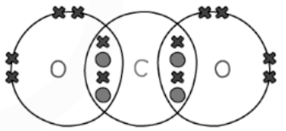

# Mark Schemes — Formulae & Relative Masses
**3. Stoichiometry** · Cambridge (CIE) IGCSE chemistry (0620 & 0971)

## Multiple Choice Questions (24 questions)

### Q1
**Final answer:** **The correct answer is B**

- To deduce the correct formula, you must know the formulae and charges of the individual ions:

  - The ammonium ion is NH4+ (it has a charge of 1+)
  - The sulfate ion is SO42− (it has a charge of 2-)
- To make a neutral compound, the total positive charge must balance the total negative charge
- Therefore, you need **two** ammonium ions for every **one** sulfate ion

  - Verify that the charge is 0 overall charge = 2 x NH4+ + 1 x SO42− overall charge = 2 x (1+) + 1 x (2-) overall charge = 2 - 2 = 0
- When there is more than one of a compound ion, brackets must be used, making the correct formula **(NH****4****)****2****SO****4**

**A** is incorrect as it  assumes both ions have the same charge (e.g., 1+ and 1-, or 2+ and 2-), failing to balance the 2- charge of the sulfate

**C **is incorrect as** **it incorrectly swaps the charges, assuming the ammonium ion is 2+ and the sulfate ion is 1-

**D** is incorrect as this uses the formula for ammonia (NH3) instead of the ammonium ion (NH4+)

### Q2
**Final answer:** **The correct answer is D**

- The products of this reaction are calcium chloride and water

  - Calcium is in Group II and it has a valency of 2
  - Chlorine is in Group VII and it has a valency of 1
  - Therefore, the formula of calcium chloride is CaCl2
- Once the correct formula of calcium chloride is identified, the amount of atoms in reactants and products need be balanced |   | **reactants** | **products** |
|---|---|---|
| **Ca** | **1** | **1** |
| **O** | **2 ** | 2 x 1 = **2** |
| **H** | 2 + 2 x 1 = **4** | 2 x 2 = **4** |
| **Cl** | 2 x 1 = **2** | **2** |

**B **and **C **are incorrect because the formula of calcium chloride is CaCl2, not CaCl

**A ** is incorrect because the chemical equation does not have coefficients to balance the atoms

|   | **reactants** | **products** |
|---|---|---|
| **Ca** | **1** | **1** |
| **O** | **2 ** | ** 1** |
| **H** | 2 + 1 = **3** | **2** |
| **Cl** | **1 ** | **2** |

### Q3
**Final answer:** **The correct answer is B**

- To calculate the relative molecular mass, *M*r of ethanoic acid
- Determine the number of atoms of each element:

  - From the displayed formula, ethanoic acid has **2 carbon atoms**, **4 hydrogen atoms**, and **2 oxygen atoms**
- Use relative atomic masses from the Periodic Table: **C = 12**, **H = 1**, **O = 16**
- Calculate total for carbon: 2 × 12 = 24
- Calculate total for hydrogen: 4 × 1 = 4
- Calculate total for oxygen: 2 × 16 = 32
- Calculate the relative molecular mass by adding the total for each element

24 + 4 + 32 = 60

- Therefore,* * ***M******r***** = 60**

### Q4
**Final answer:** **The correct answer is**** D**** because:**

- Hydrogen and fluorine exist as **diatomic gases** where 2 atoms bond covalently and form stable F一F and H一H molecules.
- The hydrogen fluoride molecule consists of 1 hydrogen atom bonded to 1 fluorine atom, so the correct nomenclature is HF.
- Since there are 2 atoms of H and 2 of F, then the balanced equation would produce 2 molecules of HF **since** **2** **H一F**  bonds are formed

**A** and **C **are incorrect as the correct nomenclature is H2 and F2, not 2H or  2F, which indicate individual, non-bonded atoms.

**B **is incorrect as H2F2 is one molecule which is not possible since the valency of H and F is one.

### Q5
**Final answer:** **The correct answer is A because:**

- The question gives you the equation as well as the Ar values

  - MgCO3 (s) → MgO (s) + CO2 (g)
- The *M*r of MgCO3 is 84 (24 + 12 + (16 x 3)) which is four times the mass of MgCO3 used, 21 g
- To calculate the mass of MgO formed

  - *M*r of MgO = 24 + 16 = 40
  - Therefore the mass of MgO formed = $\frac{40}{4}$= 10 g

**B** is incorrect as 11 is the mass of CO2 (*M*r = 44) formed ($\frac{44}{4}$) = 11

**C** is incorrect as this would be the mass of MgO formed if 42 g of MgCO3 was used

**D** is incorrect as this would be the mass of CO2 formed if 42 g of MgCO3 was used

### Q6
**Final answer:** **The correct answer is**** B**** because:**

| **Step** | **Working out** |   |
|---|---|---|
| 1 | Starting from a point on the **cyclic** structures, count the atoms in the structures going clockwise. | C = 5, N = 4 |
| 2 | Count the atoms attached to the cyclic structures. | O = 2, C = 2, H = 8 |
| 3 | Add up the numbers of each type of atom to obtain the formula. | C7H8N4O2 |

**A**,** C** and **D **are incorrect as these options do not give the correct formula for theobromine.

### Q7
**Final answer:** **The correct answer is**** D**** because:**

- Leucine contains:

  - Carbon x 6
  - Nitrogen x 1
  - Oxygen x 2
  - Hydrogen x 13
- The relative atomic masses are:

  - Carbon = 12
  - Nitrogen = 14
  - Oxygen = 16
  - Hydrogen = 1
- The total relative atomic mass for each element is:

  - Carbon = 12 x 6 = 72
  - Nitrogen = 14 x 1 = 14
  - Oxygen = 16 x 2 = 32
  - Hydrogen = 1 x 13 = 13
- So, the total relative atomic mass for leucine is:

  - 72 + 14 + 32 + 13 = 131

**A**,** B** and **C **are incorrect as these options do not give the correct relative formula mass.

### Q8
**Final answer:** **The correct answer is**** B**** because:**

- Write down a **general formula** based on the information given, letting *x* be equal to the number of each atom present
- The number of carbon atoms = *x*, then the number of oxygen atoms is also equal to x but the number of hydrogens = 2*x*.
- The general formula is thus C*x*H2*x*O*x *
- Only option B matches the general formula.

**A**,** C** and **D** are incorrect as these formulae do not match with the ratio of atoms in the molecule.

### Q9
**Final answer:** **The correct answer is**** A**** because**

| **Step** | **Working out** |   |
|---|---|---|
| **1** | The ratio of N2 : NH3 is  14 : 16.8. Divide across by the smallest number (14) to find the simplest **ratio**. | The ratio of N2 : NH3 is   1 : 1.2.  So for every 1 tonne of nitrogen, **1.2 **tonnes of ammonia are produced. |
| **2** | Divide the amount of NH3 desired (51 tonnes) by 1.2 to calculate the amount of nitrogen required. | $\frac{51}{1.2}=42.5$ |

**B**,** C** and **D **are incorrect as these options do not give the correct amount.

### Q10
**The correct answer is**** A**** because:**

| **Step** | **Working out** |   |
|---|---|---|
| **1** | The number of each atom on either side of the reaction **without coefficients** is shown. SO4 and OH remain intact and are treated as **whole species**. | Fe2(SO4)3 + NaOH → Fe(OH)3 + Na2SO4  \| Fe x 2  SO4 x 3  Na x 1  OH x 1 \| Fe x 1  SO4 x 1  Na x 2  OH x 3 \| \|---\|---\| |
| **2** | There are unequal numbers of Fe, SO4, Na and OH. Change the numbers of each to match by adjusting the **coefficients**. | Fe2(SO4)3 + **6**NaOH → **2**Fe(OH)3 + **3**Na2SO4  \| Fe x **2**  SO4 x 3  Na x **6**  OH x **6** \| Fe x **2**  SO4 x 3  Na x **6 **(3 x 2)  OH x **6 **(2 x 3) \| \|---\|---\| |

**B**,** C **and **D **are incorrect as these options do not provide the correct balanced equation.

### Q11
**Final answer:** **The correct answer is**** D**** because:**

- The** full ionic equation **including state symbols is:

[Mg2+(aq) + 2 NO3-(aq)] + [2 Na+(aq) + CO32-(aq)] → [Mg2+(s) + CO32-(s)] + [2 Na+(aq) + NO3-(aq)]

- Ions that have **not changed state **are spectator ions and can be crossed out:

[Mg2+(aq) + (aq)] + [+(aq) + CO32-(aq)] → [Mg2+(s) + CO32-(s)] + [+(aq) + (aq)]

- The remaining ions **have changed state **and thus form the net ionic equation:

Mg2+(aq)  + CO32-(aq) → MgCO3(s)

**A**,** B** and **C **are incorrect as these options do not provide the correct net ionic equation.

### Q12
**Final answer:** **The correct answer is**** C**** because:**

- The** full ionic equation **including state symbols is

[H+(aq) + NO3-(aq)] + [K+(aq) + OH-(aq)] → [K+(aq) + NO3-(aq)] + [H+(l) + OH-(l)]

- Ions that have **not changed state **are spectator ions and can be crossed out:

[H+(aq) + -(aq)] + [+(aq) + OH-(aq)] → [+(aq) + -(aq)] + [H+(l) + OH-(l)]

- The remaining ions **have changed state **and thus form the net ionic equation:

H+(aq)  + OH-(aq) → H2O(l)

**A**,** B** and **D **are incorrect as these options do not provide the correct net ionic equation.

### Q13
**The correct answer is**** D**** because:**

| **Step** | **Working out** |   |
|---|---|---|
| **1** | The symbol and number of each atom on the left of the reaction is shown. | Cu x 3, O x 3, N x 2, H x 6 |
| **2** | Only option D matches the number of atoms on the left and nitrogen is correctly written as N2. | A: Cu x 3, O x 3, N x 2 and H x 6  B: Cu x 3, O x 9, N x 3 and H x 3  C: Cu x 3, O x 1, N x 2 and H x 2  D: Cu x 3, O x 3, N x 2 and H x 6 |

**A **is incorrect as although it does have the correct number of atoms of each element, 2N is incorrect as nitrogen exists as a **diatomic molecule**, represented as N2.

**B** and **C **are incorrect as these options do not have the same number of each atom on the right as on the left.

### Q14
**Final answer:** **The correct answer is**** C**** because:**

| **Step** | **Working out** |   |
|---|---|---|
| **1** | The information given in the questions is used to find the **ratio** in grams of each reactant. | 48 g O2 : 6 g H2  Divide by 6 to get the smallest ratio, so  8 g O2 : 1 g H2 |
| **2** | The mass of oxygen that combines with 2 g of hydrogen is found by multiplying across by 2, since the amount of hydrogen has been **doubled**. | So for 2 g of H2 then 16 g of oxygen is needed. |

**A**,** B **and** D **are incorrect as these options do not give the correct amount.

### Q15
**The correct answer is**** D**** because:**

| **Step** | **Working out** |   |
|---|---|---|
| **1** | The number of each atom on either side of the reaction **without coefficients** is shown. | CH4(g) + O2(g) → CO2(g) + H2O(g)  \| C x 1  H x 4  O x 2 \| C x 1  H x 2  O x 3 \| \|---\|---\| |
| **2** | There are **equal** numbers of C but **unequal **numbers of H and O on either side. Change the numbers of H and O to match by adjusting the **coefficients**. | CH4(g) + **2 **O2(g) → CO2(g) + **2 **H2O(g)  \| C x 1  H x 4  O x **4** \| C x 1  H x **4**  O x **4** \| \|---\|---\| |

**A**,** B** and **C **are incorrect as these options do not provide the correct balanced equation.

### Q16
**Final answer:** **The correct answer is**** C**** because:**

- Sulfuric acid is an **aqueous** **solution** (all acids are in solution), so (aq) is the correct state symbol for H2SO4
- Barium chloride is a **soluble** **salt** and dissolves easily in water, hence the symbol for BaCl2 is (aq).
- Barium sulfate is an **insoluble solid**, so its state symbol is (s) and hydrochloric acid is **aqueous**, so its state symbol is (aq).

**A**,** B** and **D **are incorrect as these options do not provide the correct state symbol for each species in the reaction.

### Q17
**Final answer:** **The correct answer is**** B**** because:**

- Calcium is in Group II so its valency is **+2**.
- Oxygen and hydrogen bond together to form a **hydroxyl** **ion**, OH-
- OH- has an overall valency of **-1**, since oxygen is -2 and hydrogen is +1.
- One Ca atom bonds with two OH- ions to form the neutral compound Ca(OH)2.
- As OH- is a **polyatomic** ion, **brackets** show that the subscript 2 applies to the entire OH- ion, not just to the H atom.

**A **is incorrect as there are **too many** oxygen and hydrogen atoms.

**C **is incorrect as the norm in chemical formulae is to write the **metal first**.

**D **is incorrect as although it is numerically correct it does not correctly show the **bonding arrangement** of the atoms in Ca(OH)2.

### Q18
**Final answer:** **The correct answer is**** B**** because:**

- Ionic compounds are electrically neutral as the positive and negative charges of the constituent ions **cancel out **and add up to give 0.
- In Fe2F3 the charge of the iron is 2 x 2 = **+4**.
- The charge on the fluorine is 3 x **-1.**
- Adding up the charges gives** +4 + (-3) = 1 ≠ 0.**

**A is incorrect as each Li is +1 and S is -2, so 2 + (-2) = 0.**

**C is incorrect as each Al is +3 and the SO****4**** is -2, so (2 x 3) + (3 x -2) = 0.**

**D is incorrect as Mg +2 and NO****3 ****is -1, so 2 + (2 x -1) = 0.**

## Theory Questions (17 questions)

### Q1
a) The chemical formula for lead nitrate is:

- Pb(NO3)2; **[1 mark]**

**[Total: 1 mark]**

- *The overall charge on the ionic compound should be 0 *
- *Therefore two nitrate ions are needed for every one lead ion *
- *To show that there are two lead ions, brackets need to be around the nitrate ion as the nitrate ion contains more than one element*
b) The percentage by mass of oxygen in lead nitrate, Pb(NO3)2 is:

- Relative formula mass of lead nitrate = 207 + (14 x 2) + (16 x 6) = <u>331</u>; **[1 mark]**
- Percentage by mass of oxygen = $\frac{16\times6}{331}\times100$= 29.0%;** [1 mark] **

**[Total: 2 marks]**

- *Remember:**  *`% mass of an element = (A _ r x number of atoms of the element)/(M _ r of the compound) x 100`
- *In this question, you are being asked about the six oxygen atoms so make sure you include them all in your calculation*
- *In the actual exam, you might be given the atomic masses that you need to use but there is also the possibility that you will be expected to look them up on the Periodic Table*
c) The balanced symbol equation, including state symbols, for this reaction is:

Pb(NO3)2 (aq) + 2KI (aq) → PbI2 (s) + 2KNO3 (aq)

- Correct formula of lead(II) iodide = PbI2 
**AND **
Correct formula of potassium nitrate = KNO3; **[1 mark]**
- All reactant chemical formulae correct 
**AND **
Equation correctly balanced; **[1 mark]**
- All state symbols correct; **[1 mark]**

**[Total: 3 marks]**** **

- *You are told (in this and previous questions) the chemical formula and physical state of both lead nitrate and potassium iodide*

  - *Pb(NO**3**)**2** (aq) + KI (aq)** →*
- *The iodide ion and nitrate ion both have a 1– charge which means that they are interchangeable in this displacement reaction*

  - *Pb(NO**3**)**2** (aq) + KI (aq) → **PbI**2** + KNO**3** *
- *You are told that lead iodide is solid and potassium nitrate is aqueous*

  - *Pb(NO**3**)**2** (aq) + KI (aq) → PbI**2** **(s)** + KNO**3** **(aq)*
- *You then have to balance the equation*

  - *Pb(NO**3**)**2** (aq) + **2**KI (aq) → PbI**2** (s) + **2**KNO**3** (aq)*
d) The chemical that is responsible for the yellow colour is:

- Lead iodide;** [1 mark]**
- (Because) the lead iodide is solid; **[1 mark] **

**[Total: 2 marks]**

- *The line before the main question tells you that a yellow precipitate is formed*

  - *A precipitate is an insoluble solid that is formed during a chemical reaction*
- *The two products of this reaction are potassium nitrate and lead iodide*

  - *Table 1 **tells you that all nitrates are soluble*
  
    - *Therefore, the precipitate cannot be potassium nitrate*
  - *Table 1 **also tells you that lead chloride is insoluble, so it would be a fair assumption that lead iodide would be insoluble*
  
    - *This may not always be true as groups often show trends in reactions as you move up or down the group*
    - *Theoretically, this assumption should be a safe assumption because the silver halide salts become less soluble as you move down the group - think testing for the halide ions*

### Q2
a) The formula for magnesium fluoride is:

- MgF2; **[1 mark]**

**[Total: 1 mark]**

- *Magnesium has two outer shell electrons *
- *Fluorine has seven outer shell electrons *

  - *It can only gain one electron to achieve a full outer shell *
  - *Two fluorine atoms are therefore needed for every one magnesium atom when an ionic bond forms*
b) The balanced equation for this reaction  is:

Cu + **2**H2SO4 → CuSO4 + SO2 + **2**H2O

- Left hand side; **[1 mark]**
- Right hand side; **[1 mark]**

**[Total: 2 marks]**

- *There are two sulfur atoms on the right hand side and one on the left hand side*
- *Add a 2 in front of H**2**SO**4** *

  - *Cu + **2**H**2**SO**4 **→ CuSO**4** + SO**2** + H**2**O*
- *There are now four hydrogen atoms on the left hand side*
- *Add 2 in front of H**2**O *

  - *Cu + **2**H**2**SO**4 **→ CuSO**4** + SO**2** + **2**H**2**O*
  - *This also balances the oxygen atoms*
c) The balanced equation for this reaction  is:

2NH3 + H2SO4 → (NH4)2SO4

- Correct formulae; **[1 mark]**
- Correct balancing; **[1 mark]**

**[Total: 2 marks]**

- *The formula for sulfuric acid has been given in part b) - H**2**SO**4*
- *You are expected to know the formula of ammonia is NH**3 *
- *To deduce the formula of ammonium sulfate:*

  - *The ammonium ion is NH**4**+*
  - *The sulfate ion is SO**4**2-*
  - *The overall charge of the compound is 0 so these charges should cancel each other out *
  - *You therefore need two ammonium ions for every one sulfate ion, (NH**4**)**2**SO**4*
- *The balancing should be straightforward once the equation has been written*
d) An ionic equation for this reaction is:

Ba2+ (aq) + SO42- (aq) → BaSO4 (s)

- Correct formulae; **[1 mark]**
- Correct state symbols;** [1 mark]**

**[Total: 2 marks]**

- *Barium ions have the formula Ba**2+*
- *Sulfate ions have the formula SO**4**2-*
- *One of each ion is needed for the charges to cancel each other out and give an overall charge of 0*
- *You are told in the question that ammonium sulfate is aqueous so the sulfate ions should have the state symbol, aq *
- *Precipitates are represented using the state symbol, s*
e) The balanced equation for this reaction  is:

2KClO3 → 2KCl + 3O2

- Correct formulae; **[1 mark]**
- Correct balancing; **[1 mark]**

**[Total: 2 marks]**

- *You are given the formula of the reactant: *
- *You are told the only products are potassium chloride and oxygen*

  - *You are expected to know the formula of both of these, KCl and O**2*
- *The unbalanced equation is:*

  - *KClO**3** → KCl + O**2*
  - *There are an uneven number of oxygen atoms on the left hand side *
  - *To make this an even number put a 2 in front of **KClO**3*
  
    - *2**KClO**3** → KCl + O**2*
  - *Balance the oxygen atoms*
  
    - *2**KClO**3** → KCl + **3**O**2*
  - *Balance the chlorine and potassium atoms*
  
    - *2**KClO**3** → **2**KCl + **3**O**2*

### Q3
a) The word equation for magnesium displacing copper from copper sulfate solution is:

Mg (s) +  CuSO4 (aq) →  Cu (s) + MgSO4 (aq)

- Correct reactants and products; **[1 mark] **
- Correct state symbols; **[1 mark] **

**[Total: 2 marks]**

- *Remember:** Displacement reactions are where a more reactive metal displaces / swaps places with the less reactive metal that is in a compound*
- *This means that magnesium sulfate must be the other product formed*
b) **Two **changes that will be observed are:

Any **two** from:

- Solution changes from <u>blue</u> to colourless 
**OR **
Blue colour (in solution) fades / disappears; **[1 mark]**
- Magnesium dissolves / displaces into solution; **[1 mark]**
- Solid copper appears; **[1 mark]**

**[Total: 2 marks]**

- *It is likely that you would be told that copper sulfate solution is blue*
- *You should be able to talk about copper appearing and magnesium "disappearing" from the displacement reaction information given in the previous question parts*
c) The ionic equation for the displacement of copper from copper sulfate by magnesium is:

Mg (s) + Cu2+ (aq) → Mg2+ (aq) + Cu (s)

- All chemical formulae correct; **[1 mark]**
- All state symbols correct;** [1 mark]**

**[2 marks]**

- *The balance symbol equation is *

  - *Mg (s) + CuSO**4** (aq) → MgSO**4** (aq) + Cu (s)*
- *Identify the ionic substances and write the ions out separately*

  - *Mg (s) + Cu**2+** (aq) +  SO**4**2-** (aq) → Mg**2+** (aq)  + SO**4**2-** (aq) + Cu (s)*
- *Eliminate the ions which appear on both sides of the equation*
- *These are known as spectator ions and in this case are the sulfate ions*

  - *Mg (s) + Cu**2+** (aq) +  **SO**4**2-** **(aq) → Mg**2+** (aq)  + **SO**4**2-** **(aq) + Cu (s)*
  - *Mg (s) + Cu**2+** (aq) → Mg**2+** (aq) + Cu (s)*
  - *Don't forget state symbols!*
d) The displacement reaction between magnesium and copper sulfate is both reduction and oxidation because:

- The magnesium / Mg atom is oxidised **AND **it loses electrons **OR **
Mg → Mg2+ + 2e– **AND** which is oxidation; **[1 mark]**
- The copper ion / Cu2+ is reduced **AND i**t gains electrons 
**OR **
Cu2+ + 2e– → Cu **AND** which is reduction; **[1 mark]**

**[Total: 2 marks]**

- *Remember:** OIL-RIG, oxidation is loss of electrons and reduction is gain of electrons*

### Q4
a) The letter of the compound that has the empirical formula CH2 is:

- C;** [1 mark]**

**[Total: 1 mark]**

- *The molecular formula is the actual number of atoms of each element in a compound*
- *The empirical formula is the simplest ratio of atoms of each element in a compound *
- *C has the molecular formula C**3**H**6 *
- *This can be simplified to CH**2** *
b) The balanced equation for this reaction  is:

- **2**Ca(NO3)2 → **2**CaO + **4**NO2 + O2; **[1 mark]**

**[Total: 1 mark]**

- *There are six oxygen atoms on the left hand side, and five on the right hand side*
- *Placing a 2 in front of CaO gives six oxygen atoms on the right hand side *

  - *Ca(NO**3**)**2** → **2**CaO + NO**2** + O**2**;*
  - *If you placed a two in front of the other molecules, this would result in 7 oxygen atoms on the right hand side and you would not be able to balance the reactants correctly *
- *Balance the calcium atoms next:*

  - *2**Ca(NO**3**)**2** → **2**CaO + NO**2** + O**2*
- *There are now four nitrogen atoms on the right hand side, and 12 oxygen atoms*
- *To balance these, add 4 in front of NO**2** *

  - *2**Ca(NO**3**)**2** → **2**CaO + **4**NO**2** + O**2*

### Q5
i) The colour change you would observe is:

- (Black to) pink / brown / orange; **[1 mark] ***Ignore red*

ii) The copper must be allowed to cool before it is exposed to air because:

- (Hot) copper reacts / is oxidised; **[1 mark]**
- With oxygen / air; **[1 mark]**

iii) Another gas that can reduce copper(II) oxide to copper is:

- Carbon monoxide / ammonia / methane; **[1 mark]**

iv) A solid that can reduce copper(II) oxide to copper is:

- Carbon / graphite or any metal more reactive than copper; **[1 mark]**

**[Total: 5 marks]**

- *Copper(II) oxide is a black compound. As it reduces, copper is formed which has a pink / brown / orange colour*
- *Copper reacts with oxygen slowly in air, if copper is hot this reaction will occur much more readily and copper(II) oxide would be reformed*
- *Carbon monoxide is used to reduce FeO during the extraction of iron from hematite and can act as a reducing agent when reacted with copper(II) oxide*
- *Anything above copper in the reactivity series is able to reduce copper(II) oxide*
i) The completed table is:

| **source of** **copper(II) oxide** | **mass of** **copper(II) oxide / g** | mass of copper / g | percentage copper / % |
|---|---|---|---|
| CuCO3 | 2.37 | 1.89 | 79.7 |
| Cu(OH)2 | 2.51 | 1.99 | **79.28** |
| Cu(NO3)2 | 2.11 | 1.68 | **79.6205853** |
| Cu and O2 | 2.29 | 1.94 | **84.7161572** |

- All three correct; **[2 marks]**
- Two correct; **[1 mark]**
- 0 or one correct;** [0 marks]** *Answers must be to a minimum of 3 significant figures* *Allow rounding or truncating*

ii) The impure sample is:

- The last one 
**OR **
Cu and O2 
**OR **
The one from copper; **[1 mark]** *Allow ecf from calculations in (i)*

Explanation of why the percentage of copper in this sample is bigger than in the other three samples:

- Not all the copper oxidised 
**OR **
The outside of the pieces of copper oxidised but the inside did not 
**OR** 
(Still) contains copper (metal); **[1 mark]**

**[Total: 4 marks]**

- *The percentage of copper is calculated by *$\frac{\mathrm{mass} \mathrm{of} \mathrm{copper}}{\mathrm{mass} \mathrm{of} \mathrm{copper}(\mathrm{II})\mathrm{oxide}}\times100$
- *If you are not sure how to calculate it, use the numbers in the first row and try different calculations using these until you get the answer 79.7, then repeat for the other rows*

  - *There are only a few ways that you can do this, and as it is a percentage, you will have to multiply by 100 as well*

### Q6
a) Define the term relative atomic mass:

- The average mass of the isotopes of an element;** [1 mark] **
- Compared to 1/12th of the mass of an atom of 12C; **[1 mark] **

**[Total: 2 marks]**

- *This is the specification definition that you are required to learn*
- *Remember:** Scientists needed a way of comparing the masses of atoms so use carbon-12 as the standard which has a fixed mass of 12 units*
b) The mass number of the other isotope is:

- Relative abundance of unknown isotope: 100 – 63.25 = 36.75; **[1 mark]**
- Calculation of mass number of unknown isotope of gallium with suitable working: $\frac{( 69 \mathrm{x} 63.25 ) + ( \mathrm{M} \mathrm{x} 36.75 )}{100} = 69.735$ **OR** $43.64+\frac{36.75M}{100}=69.735$ **AND** M = 71; **[1 mark]**

**[Total: 2 marks]**

- *This question is asking you to manipulate the equation used to calculate RAM to find the abundance of one of the isotopes:*

  - *RAM = *$\frac{ ( \text{abundance} of \text{isotope} 1 \mathrm{x} \text{mass} \text{number} ) + ( \text{abundance} of \text{isotope} 2 \mathrm{x} \text{mass} \text{number} ) }{100}$
- *You only get one mark if you give an answer with no working out*
- *To calculate M:*

  - $\frac{(69x63.25)+(Mx36.75)}{100}=69.735$
  - *4364.25 + (M x 36.75) = 6973.5*
  - *(M x 36.75) = 2609.25*
  - *M = *$\frac{2609.25}{36.75}$
  - *M = 71*
c) The term empirical formula means:

- The simplest whole number ratio of the different atoms or ions in a compound; **[1 mark]**

**[Total: 1 mark]**

- *Remember: **The molecular formula is the actual number of atoms of each element in a compound*

  - *E.g C**3**H**6*
  - *The empirical formula is the actual number of atoms of each element as a whole number ratio*
  - *The empirical formula for C**3**H**6** is CH**2*
d) The empirical formula is:

- Percentage of hydrogen is 9%; **[1 mark]**
- Each percentage is divided by relevant *A*r  C = $\frac{18}{12}$ = (1.5)                       H= $\frac{9}{1}$ = ( 9 )                 O = $\frac{73}{16}$=  ( 4.5625 ); **[1 mark]**
- Empirical formula is CH6O3; **[1 mark]**

**[Total: 3 marks]**

- *Don't forget to find the percentage of hydrogen in the compound: 100 - 73 - 18 = 9 %*
- *Once you have divided the percentage of each elements by its **A**r** you must find the simplest ratio by dividing all answers by the smallest value, in this case 1.5*
- *Sometimes answers might come out as 3.0415 but it is fine to round in this case *
- *If an answer comes out as 3.5 for example, you would need to multiply it by 2 to achieve a whole number, and do the same to the other values *

### Q7
a) The balanced equation is:

6CoO + O2 → 2Co3O4

- 6; **[1 mark]**

**[Total: 1 mark]**

- *There are six cobalt atoms on the right-hand side so a 6 needs to be placed in front of CoO on the left*
b) The relative molecular mass is:

- 98; **[2 marks]**

**[Total: 2 marks]**

- *The completed table is:*

| > *atom* | > *number of atoms* | > *relative atomic mass* |   |
|---|---|---|---|
| > *hydrogen* | > *2* | > *1* | > *2 × 1 = 2* |
| > *sulfur* | > *1* | > *32* | > *1 x 32 = 32* |
| > *oxygen* | > *4* | > *16* | > *4 x 16 = 64* |

- *If you haven't got an answer of 98 then you can score 1 mark for  S = (1 x 32) = 32 **OR **O = (4 x 16) = 64*
c) The balanced equation is:

2H2 (g) + O2 (g) → 2H2O (l)

- 2H2 
**AND**
2H2O (l); **[1 mark]**

**[Total: 1 mark]**

- *Balance the oxygen atoms first by placing a two in front of the H**2**O*

  - *There are two on the left hand side and one on the right hand side *
- *There are now four hydrogen atoms on the right hand side so a two is placed in front of the hydrogen*
d) The meaning of (g) and (l) are:

- (g) = gas; ** [1 mark]**
- (l) = liquid;** [1 mark]**

**[Total: 2 marks]**

- *The four state symbols you should know are:*

  - *(g) = gas*
  - *(l) = liquid*
  - *(s) = solid*
  - *(aq) = aqueous*

### Q8
a) A symbol equation for this reaction is:

4X + 3O2 → 2X2O3

- Correct formulae; **[1 mark]**
- Correct balancing; **[1 mark]**

**[Total: 2 marks]**

- *You are given the formula for the product*
- *You should know that the formula for a Group 3 metal is represented as single atom*
- *You should know the formula for oxygen is O**2** *
- *Write the unbalanced equation *

  - * X + O**2** → X**2**O**3*
- *Get the oxygen atoms to equal an even number:*

  - * X +  3O**2** →  2X**2**O**3*
- *Balance the number of X atoms *

  - *4X +  3O**2** →  2X**2**O**3*
b) An ionic equation for this reaction with state symbols is:

Ag+ (aq) + Cl– (aq) → AgCl (s)

- Correct formulae; **[1 mark]**
- Correct state symbols; **[1 mark]**

**[Total: 2 marks]**

- *The white precipitate formed is silver chloride *
- *The question asks for the ionic equation for the reaction that forms silver chloride *
- *You should know that charge for both ions, and be able to deduce the formula for silver chloride *
- *The silver chloride should have no charge overall so one of each ion is required *
- *Silver ions and chloride ions are in solution so are represented using (aq)*
- *A precipitate is a solid so is represented using (s)*
c) The balanced equation for this reaction  is:

**5**Cl2 + 2P → **2**PCl5

- Left hand side; **[1 mark]**
- Right hand side; **[1 mark]**

**[Total: 2 marks]**

- *Balance the phosphorus atoms first and then balance the chlorine atoms*
d) The balanced equation for this reaction  is:

**4**KI + **2**CuSO4 → **2**CuI + I2 + **2**K2SO4

- Left hand side; **[1 mark]**
- Right hand side; **[1 mark]**

**[Total: 2 marks]**

- *There is an odd number of iodine atoms on the right hand side *

  - *To make it even, place a 2 in front of CuI*
  
    - *KI + CuSO**4** → **2**CuI + I**2** + K**2**SO**4*
  - *Balance the copper atoms *
  
    - *KI + **2**CuSO**4** → **2**CuI + I**2** + K**2**SO**4*
  - *Balance the sulfur and oxygen atoms*
  
    - *KI + **2**CuSO**4** → **2**CuI + I**2** + **2**K**2**SO**4*
  - *Finally, balance the potassium and iodine atoms*
  
    - *4**KI + **2**CuSO**4** → **2**CuI + I**2** + **2**K**2**SO**4*

### Q9
a) The balanced equation for this reaction  is:

- C  +  O2  →  CO2 ; **[1 mark]**

**[Total: 1 mark]**

- *You are expected to know the formulae for carbon, oxygen and carbon dioxide*
- *No balancing is required *
b) The balanced equation for this reaction  is:

**Br****2**** **+ H2S  → **2**HBr + S

- Br2 on left; **[1 mark]**
- 2 (HBr) on right; **[1 mark]**

**[Total: 2 marks]**

- *You are told the other reactant is bromine*
- *You are expected to know that bromine is diatomic with a formula Br**2*
- *There are two bromine and two hydrogen atoms on the left hand side which can be balanced with a 2 in front of HBr on the right hand side *
c) The relative formula mass is:

- 155; **[2 marks]**

**[Total: 2 marks]**

- *The completed table is:*

| > *type of atom* | > *number of atoms* | > *relative atomic mass* |   |
|---|---|---|---|
| > *cobalt* | > *1* | > *59* | > *1 x 59 * |
| > *sulfur* | > *1* | > *32* | > *1 × 32 = 32* |
| > *oxygen* | > *4* | > *16* | > *4 x 16 = 64* |

- *If you did not score 2 marks for your answer you will score 1 mark for Co= (1 x 59) = 59 **OR **O= (4 x 16) = 64*
- *To calculate the relative formula mass: 59 + 32 + 64 = 155*

### Q10
The balanced equation for this reaction  is:

2C + O2 →  2CO

- 2 (C); **[1 mark]**
- O2; **[1 mark]**

**[Total: 2 marks]**

- *You are expected to know the formula of oxygen as O**2*
- *There are two atoms of each element on the right hand side so the carbon needs balancing by placing a 2 in front of the C*
The molecular formula for this compound is:

- Fe2C9O9
**OR**
Fe2(CO)9;** [1 mark]**

**[Total: 1 mark]**

- *Count each type of atom carefully from the diagram: 2 iron, 9 carbon, 9 oxygen*
- *You can write the molecular formula as Fe**2**C**9**O**9** or Fe**2**(CO)**9** as both are accepted *
- *Make sure you use correct capitalisation for element symbols (Fe not fe, C not c, O not o)*
The balanced equation for this reaction  is:

**2**Na2S2O3 + I2 → Na2S4O6 +  **2**NaI

- 2 (Na2S2O3); **[1 mark]**
- 2 (NaI); **[1 mark]**

**[Total: 2 marks]**

- *The unbalanced equation is:*

  - *.....Na**2**S**2**O**3** + I**2** → Na**2**S**4**O**6** + .....NaI*
  - *Balance the iodine atoms first:*
  
    - *....Na**2**S**2**O**3** + I**2** → Na**2**S**4**O**6** + **2**NaI*
  - *Then balance the sodium, sulfur and oxygen atoms *
  
    - *2**Na**2**S**2**O**3** + I**2** → Na**2**S**4**O**6** +  **2**NaI*
The relative formula mass is:

- 160; **[2 marks]**

**[Total: 2 marks]**

- *The completed table is:*

| > *type of atom* | > *number of atoms* | > *relative atomic mass* |   |
|---|---|---|---|
| > *copper* | > *1* | > *64* | > *1 × 64 = 64* |
| > *sulfur* | > *1* | > *32* | > *1 x 32 = 32* |
| > *oxygen* | > *4* | > *16* | > * 4 x 16 = 64* |

- *If you haven't got an answer of 98 then you can score 1 mark for (1 x 32) = 32 **OR** (4 x 16= 64)= 64 *
- *The relative formula mass is found by: 64 + 32 + 64 = 160*

### Q11
a) The balanced equation for this reaction  is:

**2**Fe + **3**Cl2 → Fe2Cl6

- 2Fe; **[1 mark]**
- 3Cl2; **[1 mark]**

**[Total: 2 marks]**
b) The molecular formula is:

- (FeC6N6)4– / (Fe(CN)6)4–; **[1 mark]**

**[Total: 1 mark]**

- *The molecular formula is the actual number of atoms of each element in a substance *
- *Identify the elements present:*

  - *Fe, C and N *
- *Count the number of atoms for each one *

  - *Fe= 1*
  - *C= 6*
  - *N= 6*
- *You must show brackets and a charge, like the diagram does to score the mark *
c) The balanced equation for this reaction  is:

C10H16 + 8Cl2   →  **10**C  +  **16**HCl

- 10 (C); **[1 mark]**
- 16 (HCl); **[1 mark]**

**[Total: 2 marks]**
d) The mass of zinc oxide formed when 63.0 g of anhydrous zinc sulfate is heated is:

- 31.7 (g); **[1 mark]**

**[Total: 1 mark]**

- *63.0 g is five times more than 12.60 *
- *The mass of zinc sulfate produced from 12.60 g is multiplied by 5*

  - *6.34 x 5 = 31.7 g*
e) The relative formula mass is:

- 161; **[2 marks]**

**[Total: 2 marks]**

- *The completed table is:*

| > *type of atom* | > *number of atoms* | > *relative atomic mass* |   |
|---|---|---|---|
| > *zinc* | > *1* | > *65* | > *1 × 65 = 65* |
| > *sulfur* | > *1* | > *32* | > *1 x 32 = 32* |
| > *oxygen* | > *4* | > *16* | > *4 x 16 = 64* |

- *If you haven't got an answer of 161 then you can score 1 mark for S= (1 x 32) = 32 **OR **O= (4 x 16) = 64 *
- *The relative formula mass is found by: 65 + 32 + 64 = 161*

### Q12
a) The  electronic structure of the ion X2– is:

- 2: 8 : 8; **[1 mark]**

**[Total: 1 mark]**

- *The atomic number for the atom is 16 so it has 16 protons *
- *In an atom the number of protons and electrons are equal so there are 16 electrons*
- *The 2- charge indicates that two electrons have been gained so there are 18 electrons in total *
- *Two electrons will occupy the first shell, eight will occupy the second and eight will occupy the third *
- *This is the electronic structure of a noble gas, which is what atoms achieve when they lose / gain electrons*
b) The atom against which the relative masses of all other atoms are compared is:

- 12C / carbon-12; **[1 mark]**

**[Total: 1 mark]**

- *Accept carbon-12 or carbon 12 written in words*
- *You will not score the mark for just stating 'carbon'*

> **[exam-tip]**
> Always specify the isotope, not just the element 'carbon' alone will not score.
c) The chemical equation for the reaction that occurs when magnesium burns in oxygen is:

2Mg + O2 → 2MgO

- Correct species;** [1 mark]**
- Correct balancing;** [1 mark]**

**[Total: 2 marks]**

- *You are given the formula of magnesium oxide*
- *You are expected to know that magnesium, as a metal, has the formula Mg and that oxygen is diatomic, O**2**. *

  - *The unbalanced equation is Mg + O**2** → MgO*
  - *Balance the oxygen atoms first:  Mg + O**2** → **2**MgO*
  - *The balance the magnesium atoms: **2**Mg + O**2** → **2**MgO*

### Q13
a) The balanced symbol equation for this reaction is:

TiO2 + 2C + 2Cl2 ⟶ TiCl4 + 2CO

- TiO2 + C + Cl2 as reactants; **[1 mark]**
- TiCl4 + CO as products; **[1 mark]**
- Correct balancing;** [1 mark]**

**[Total: 3 marks]**

- *You have all the information to be able to write a word equation:*

  - *Titanium dioxide + carbon + chlorine → titanium tetrachloride + carbon monoxide*
- *You would be expected to deduce the formula of titanium dioxide and titanium tetrachloride from their names*

  - *Titanium = Ti*
  - *Dioxide = two oxygens (O**2**)*
  
    - *Therefore, titanium dioxide is TiO**2*
  - *Tetrachloride = four chlorine (Cl**4**)*
  
    - *Therefore, titanium tetrachloride is TiCl**4** *
- *You are expected to know the chemical symbol/formula of some substances, e.g. C, Cl**2**, CO*
- *Balancing the equation:*

  - *You must use 2Cl**2** to have enough chlorine to make the TiCl**4** *
  - *You must form 2CO using the TiO**2*
  - *This means that you must have 2C to make the 2CO*
b) The chemical symbol equation in part (a) demonstrates the law of conservation of mass because:

- There is the same amount / number of each atom on the reactants and products 
**OR **
There is the same amount / number of each atom on the left and right hand side of the equation; **[1 mark]**

**[Total: 1 mark]**

- *Don't be put off by the question starting with the phrase "explain how your answer to part (a)"*
- *The answer to this question is true for any balanced chemical symbol equation*

  - *There should always be the same number of each atom in the reactants and products*
  - *This is because any chemical reaction does not have any atoms being added or removed, they are simply rearranged to make other chemicals*
c) **Two** hazards associated with Stage 1 are:

Any **two** from:

- Chlorine is toxic / poisonous; **[1 mark]**
- Carbon monoxide is toxic / poisonous; **[1 mark]** *Ignore harmful / deadly / dangerous*
- Titanium chloride is corrosive; **[1 mark]**

**[Total: 2 marks]**

- *You are expected to use the correct chemical term when talking about hazards*

  - *Harmful is not a correct term as this suggests that it can make you ill*
  - *Toxic and poisonous imply that it can kill*
  - *Dangerous and deadly are not acceptable as they are not specific*
- *Careful: **Stage 1 does not produce carbon dioxide so answers relating to carbon dioxide will be ignored*
d) The percentage, by mass, of chlorine in titanium tetrachloride is:

- Relative molar mass of TiCl4 = 48 + (4 x 35.5) = 190;** [1 mark]**
- Percentage by mass = $\frac{4\times35.5}{190}\times100$= 74.7%; **[1 mark]**

**[Total: 2 marks]**

- *Careful: **There are four chlorine in titanium tetrachloride, so you have to calculate the percentage by mass for all four chlorines*
- *You will not score the second mark if your answer is not to three significant figures *
- *In the actual exam, you might be given the atomic masses that you need to use but there is also the possibility that you will be expected to look them up on the Periodic Table*
- *If the formula of titanium tetrachloride is given as TiCl**2** in part (a), then error carried forward is allowed giving a final answer of 59.7% for 1 mark*
- *If the formula of titanium tetrachloride is given as TiCl in part (a), then error carried forward is allowed giving a final answer of 42.5% for 1 mark*

### Q14
a) The formula for calcium nitrate is:

- Ca(NO3)2; **[1 mark]**

**[Total: 1 mark]**

- *You can work this formula out from the information in the question *
- *Sodium is a Group 1 element and the salt has the formula NaNO**3*

  - *There is one nitrate group*
- *Magnesium is a Group 2 element and the salt has the formula Mg(NO**3**)**2*

  - *There are two nitrate groups*
- *Aluminium is in Group 3 and the salt has the formula** **Al(NO**3**)**3*

  - *There are three nitrate groups*
- *Calcium is a Group 2 element so will have the formula Ca(NO**3**)**2*
b) The balanced equation for this reaction  is:

2Na +  **2**NaOH → **2**Na2O + H2

- Left hand side; **[1 mark]**
- Right hand side; **[1 mark]**

**[Total: 2 marks]**

- *Balance the hydrogen atoms first: *

  - *2Na +  **2**NaOH → Na**2**O + H**2*
- *Balance the oxygen and sodium atoms: *

  - *2Na + ** **2NaOH → **2**Na**2**O + H**2*
c) The formula of this carboxylic acid to show the number of atoms of carbon, hydrogen and oxygen is:

- C5H10O2; **[1 mark]**

**[Total: 1 mark]**

- *You will score the mark for the elements being written in any order*

### Q15
a) The formula of the negative ion in FeS2 is:

- S-; **[1 mark]** 
*Allow S**2**2-*

**[Total: 1 mark]**

- *Overall, the compound is neutral so the charges on the ions must cancel out*
- *The negative charges must total 2- to cancel the 2+ charge on the Fe ion*
- *As there are 2 sulfide ions, each one must have a 1- charge, giving the formula S**-*
b) The student could distinguish between iron pyrite and gold by:

- Test their conductivity; **[1 mark] **Gold conducts / iron pyrite does not conduct; **[1 mark]** 
**OR** 
Malleability / hit with a hammer; **[1 mark]** Gold malleable / only gold produces ringing sound / or reverse argument; **[1 mark]** 
**OR** 
Density; **[1 mark]** Gold is denser / iron pyrite is less dense; **[1 mark]** 
**OR** 
Add acid / any named / formula of acid; **[1 mark]** Gold does not react (ignore products with pyrites) / or reverse argument; **[1 mark]** 
**OR** 
Heat (both strongly) in air/ oxygen; **[1 mark]** iron pyrite reacts (ignore products); **[1 mark]** 
**OR** 
Melting point; **[1 mark]** Gold is lower / iron pyrite is higher; **[1 mark]** 
**OR** 
Heat with a more reactive metal than iron; **[1 mark]** Gold does not react / or reverse argument; **[1 mark]**

**[Total: 2 marks]**

- *The key to this question is to recognise that iron is a metal whilst iron sulfide is an ionic compound*
- *Then you need to compare the properties and reactions of metals and ionic compounds to see how they differ*
- *As can be seen from the mark scheme, there are many acceptable ways to tell the difference due to the many differences in their properties and reactions*
c) A chemical equation for the reaction between iron pyrite and oxygen is:

4FeS2 + 11O2 → 2Fe2O3 + 8SO2

- All formulae correct; **[1 mark]**
- Balancing correct; **[1 mark]**

**[Total: 2 marks]**

- *Use the information in the question to construct an unbalanced equation:*

  - *FeS**2** + O**2** → Fe**2**O**3** + SO**2*
- *To balance, it is a good idea to make the number of oxygen atoms on the product side an even number first so put a 2 in front of Fe**2**O**3*

  - *FeS**2** + O**2** → 2Fe**2**O**3** + SO**2*
- *Now there are 4 Fe atoms on the products side, to balance, add a 4 in front of FeS**2**:*

  - *4FeS**2** + O**2** → 2Fe**2**O**3** + SO**2*
- *There are 8 S atoms on the reactant side, so add an 8 in front of SO**2*

  - *4FeS**2** + O**2** → 2Fe**2**O**3** + 8SO**2*
- *There are 22 O atoms on the product side, so add an 11 in front of O**2**:*

  - *4FeS**2** + 11O**2** → 2Fe**2**O**3** + 8SO**2*

### Q16
a) The formula of each of the compounds is:

1. Aluminium fluoride: AlF3; **[1 mark]**
2. Arsenic oxide: As2O3;** [1 mark]**
3. Silicon bromide: SiBr4;** [1 mark]**

**[Total: 3 marks]**

- *To deduce the formula of a compound using valencies:*

  - *Valencies are determined by the Group the element is in:*
  
    - *Group I and VII elements have a valency of 1*
    - *Group II and VI elements have a valency of 2*
    - *Group III and V elements have a valency of 3*
    - *Group VI elements have a valency of 4*
    - *Group VIII elements have a valency of 0*
  - *Write out the symbols of each element and write down their valencies underneath*
  - *The formula is calculated by cross-multiplying each atom with the number opposite:*

1. *Write the symbols of each element with their valency underneath*
2. *The formula is calculated by cross-multiplying each atom with the opposite number*
3. *This gives the formula of the compound*

| *Al*  > *3* | *F*  > *1* |
|---|---|
| *Al*  > *1* | *F*  > *3* |
| > *AlF**3* |   |

| *As*  > *3* | *O*  > *2* |
|---|---|
| *As*  > *2* | *O*  > *3* |
| *As**2**O**3* |   |

| *Si*  > *4* | *Br*  > *1* |
|---|---|
| *Si*  > *1* | *Br*  > *4* |
| > *SiBr**4* |   |
b) The formula of the ions is:

1. Phosphide: P3-;** [1 mark]**
2. Barium: Ba2+;** [1 mark]**
3. Francium: Fr+; **[1 mark]**

**[Total: 3 marks]**

- *The Periodic Table can help work out the charge on many elements:*

  - *Group I elements form ions with a 1+ charge*
  - *Group II elements form ions with a 2+ charge*
  - *Group III elements form ions with a 3+ charge*
  - *Group V elements form ions with a 3- charge*
  - *Group VI elements form ions with a 2- charge*
  - *Group VII elements form ions with a 1- charge*
c) A diagram showing the arrangement of the valency electrons in one molecule of the covalent compound carbon dioxide is:

- 2 double bonds, one between each O and the C atom; **[1 mark]**
- Each O has 8 outer electrons; **[1 mark]**
- Each C has 8 outer electrons;** [1 mark]**

**[Total: 3 marks]**

- *Carbon has 4 electrons in the outer shell so needs to share 4 more electrons*
- *Oxygen has 6 electrons in the outer shell so needs to share 2 more electrons*
- *A carbon atom shares 2 pairs of electrons with each oxygen atom in order for all atoms to achieve a full outer shell*
- *This forms a double bond between each carbon and oxygen atom*

### Q17
a) The word equation for the reaction is:

Calcium carbonate → Calcium oxide + carbon dioxide

- Correctly places calcium carbonate and calcium oxide in the equation; **[1 mark]**
- Correctly identifies carbon dioxide as the second product; **[1 mark]**

**[Total: 2 marks]**

- *The question tells you most of the information that you need*

  - *Heating calcium carbonate suggests that you start with calcium carbonate*
  
    - *Calcium carbonate →*
  - *Produces calcium oxide and one other gaseous product suggests that calcium oxide is one of the products*
  
    - *Calcium carbonate → calcium oxide + *
  - *You have to deduce what the other gaseous product is*
  
    - *The carbon (from the carbonate) has not been used and there is oxygen available, so carbon dioxide is a safe assumption*
    - *Calcium carbonate → calcium oxide + carbon dioxide*
b) The balanced chemical equation for heating calcium carbonate, CaCO3, to form calcium oxide, CaO, and one other gaseous product is:

- CaCO3 → CaO + CO2; **[1 mark]**

**[Total: 1 mark]**

- *You are given the chemical formulae for calcium carbonate and calcium oxide*
- *In part (a), you should have deduced that the other gaseous product is carbon dioxide and you are expected to know that its formula is CO**2** *

  - *CaCO**3** → CaO + CO**2** *
- *There is no balancing required for this reaction as there is one calcium, one carbon and three oxygen atoms on both sides of the equation*
- *Tip: **If you have to write the balanced symbol equation with no support **and** it is for one mark, then it is likely that there is no balancing required -** beware**, this may not always be true!*
c) The mass of calcium hydroxide that is produced is:

- 112 + 36 = <u>148</u> g; **[1 mark]**

**[Total: 1 mark]**

- *The Law of Conservation of Mass states that no matter is lost or gained during a chemical reaction*
- *The total mass of the reactants equals the total mass of the products *
- *This means that if you have 112 g of calcium carbonate reacting with 36 g of water, then the amount of calcium hydroxide that is formed must be 112 + 36 = 148 g*
d) To calculate the relative formula mass (*M*r) of calcium carbonate:

- 40 + 12 + (3 x 16); **[1 mark]**
- 100;** [1 mark]**

**[Total: 2 marks]**

- *Remember:** The chemical formula tells you how many of each atom there are in any given chemical*

  - *Be aware that for ionic compounds, the formula that you see will be the simplest ratio of atoms (sometimes with some structural detail) rather than the true formula*
- *CaCO**3** contains one calcium, one carbon and three oxygen atoms*

  - *40 + 12 + (3 x 16) = 100*
e) To calculate the percentage of oxygen in calcium carbonate, CaCO3:

- $\frac{(16\times3)}{100}\times100$; **[1 mark]**
- 48%; **[1 mark]**

**[Total: 2 marks]**

- *Careful: **There are three oxygen atoms in calcium carbonate*
