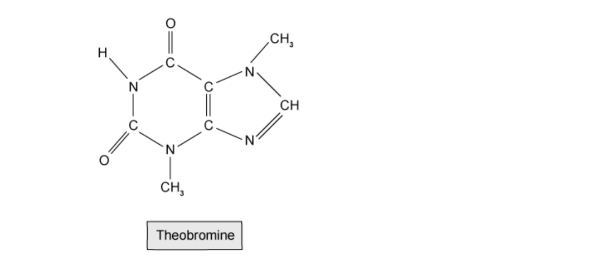
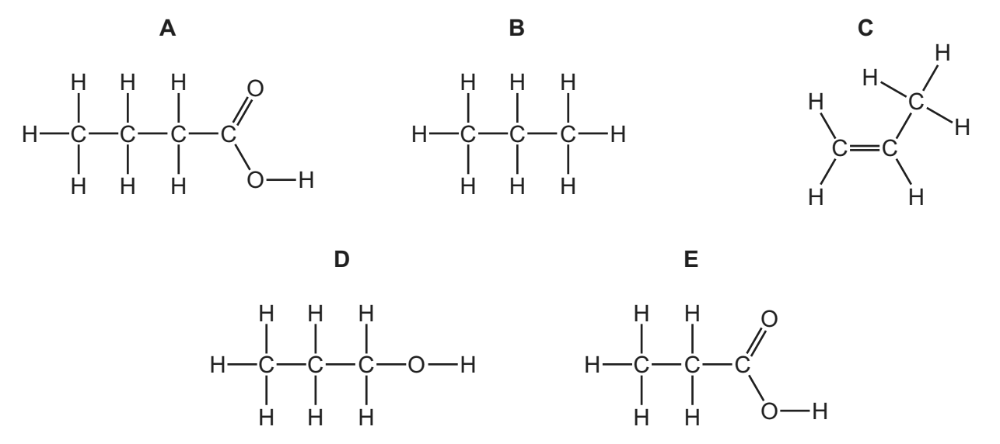
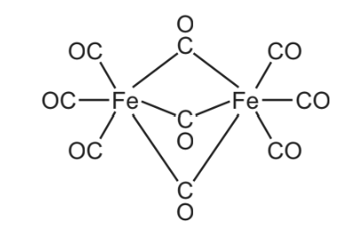
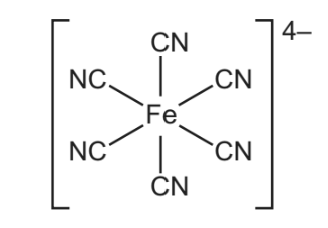
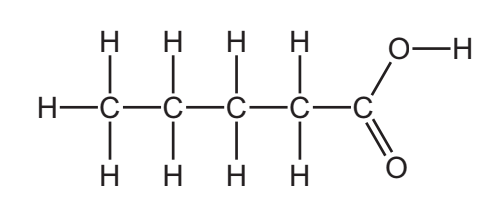

# Exam Questions — Formulae & Relative Masses
**3. Stoichiometry** · Cambridge (CIE) IGCSE chemistry (0620 & 0971)
> Source: [https://www.savemyexams.com/igcse/chemistry/cie/23/topic-questions/](https://www.savemyexams.com/igcse/chemistry/cie/23/topic-questions/) · 35 questions across 2 sets

## Multiple Choice Questions (24 questions)

### Q1 — medium — 1 marks

**Q1** [1 mark]

What is the correct formula for ammonium sulfate?

### Q2 — medium — 1 marks

**Q2** [1 mark]

Which equation represents the reaction between calcium hydroxide and hydrochloric acid?

### Q3 — medium — 1 marks

**Q3** [1 mark]

Vinegar is a mixture of water and ethanoic acid. The displayed formula of ethanoic acid is drawn below.

Calculate the relative molecular mass, *M*~*r*~, of ethanoic acid.

### Q4 — easy — 1 marks

**Q4** [1 mark]

Hydrogen reacts with elements from Group VII to produce compounds called hydrogen halides. An example is when a molecule of hydrogen reacts with a molecule of fluorine to produce hydrogen fluoride.

What is the correct equation for the reaction?

### Q5 — easy — 1 marks

**Q5** [1 mark]

When magnesium carbonate is heated, the products are magnesium oxide and carbon dioxide.

MgCO3 (s) → MgO (s) + CO2 (g)

What mass of magnesium oxide is formed when 21 g of magnesium carbonate thermally decomposes?

(*A*r = Mg = 24, C = 12, O = 16)

### Q6 — easy — 1 marks

**Q6** [1 mark]

Theobromine is a stimulant found in chocolate and in tea leaves and is closely related to caffeine, the stimulant found in coffee.

What is the formula of theobromine?

### Q7 — easy — 1 marks

**Q7** [1 mark]

Leucine is an essential amino acid used in the synthesis of proteins in the body.

What is the relative molecular mass of leucine?

### Q8 — easy — 1 marks

**Q8** [1 mark]

A molecule contains carbon, hydrogen and oxygen. For every carbon atom there are twice as many hydrogen atoms but the same number of oxygen atoms.

What is the formula of the molecule?

### Q9 — hard — 1 marks

**Q9** [1 mark]

Ammonia is manufactured by the reaction of hydrogen and nitrogen in the Haber process, as shown in the equation below:

N2 + 3 H2 → 2 NH3

16.8 tonnes of ammonia can be produced from 14 tonnes of nitrogen.

How much nitrogen is needed to produce 51 tonnes of ammonia?

### Q10 — hard — 1 marks

**Q10** [1 mark]

What is the balanced equation for the reaction between aqueous NaOH and Fe2(SO4)3?

### Q11 — hard — 1 marks

**Q11** [1 mark]

#### Extended Only

Magnesium nitrate and sodium carbonate react as shown.

Mg(NO3)2(aq) + Na2CO3(aq)  → MgCO3(s) + 2 NaNO3(aq)

Which row describes the spectator ions and the net ionic equation for the reaction?

|   | **spectator ions** | **net ionic equation** |
|---|---|---|
| **A** | Mg2+ and CO32- | Mg2+(aq) + CO32-(aq) → MgCO3(s) |
| **B** | NO3- and Na+ | NO3-(aq) + Na+(aq) → NaNO3(aq) |
| **C** | Mg2+ and CO32- | NO3-(aq) + Na+(aq) → NaNO3(aq) |
| **D** | NO3- and Na+ | Mg2+(aq) + CO32-(aq) → MgCO3(s) |

### Q12 — hard — 1 marks

**Q12** [1 mark]

#### Extended Only

Nitric acid and potassium hydroxide react in a neutralisation reaction to produce salt and water, as shown by the equation below:

HNO3(aq) + KOH(aq) → KNO3(aq) + H2O(l)

Which row describes the spectator ions and the net ionic equation for the reaction?

|   | **spectator ions** | **net ionic equation** |
|---|---|---|
| **A** | NO3- and K+ | NO3-(aq) + K+(aq) → KNO3(aq) |
| **B** | H+ and OH- | NO3-(aq) + K+(aq) → KNO3(aq) |
| **C** | NO3- and K+ | H+(aq) + OH-(aq) → H2O(l) |
| **D** | H+ and OH- | H+(aq) + OH-(aq) → H2O(l) |

### Q13 — hard — 1 marks

**Q13** [1 mark]

The left hand side for the reaction between ammonia and copper(II) oxide is shown. What are the products of the balanced equation?

3 CuO + 2 NH3 →

### Q14 — medium — 1 marks

**Q14** [1 mark]

6 g of hydrogen react with 48 g of oxygen to form water. A chemist performs the same reaction using 2 g of hydrogen.

What mass of oxygen is required to combine with the hydrogen?

### Q15 — medium — 1 marks

**Q15** [1 mark]

What is the balanced equation for the reaction of methane and oxygen?

### Q16 — medium — 1 marks

**Q16** [1 mark]

#### Extended Only

Dilute sulfuric acid and barium chloride solution react to produce barium sulfate and hydrochloric acid, as shown in the reaction below:

H2SO4 + BaCl2 → BaSO4 + 2 HCl

Which row represents the correct state symbols for the reaction?

|   | **H****2****SO****4** | **BaCl****2** | **BaSO****4** | **HCl** |
|---|---|---|---|---|
| **A** | (aq) | (l) | (s) | (aq) |
| **B** | (l) | (aq) | (aq) | (l) |
| **C** | (aq) | (aq) | (s) | (aq) |
| **D** | (l) | (aq) | (l) | (aq) |

### Q17 — medium — 1 marks

**Q17** [1 mark]

#### Extended Only

A compound contains two atoms of oxygen and one atom of calcium. It also contains hydrogen in sufficient amounts so that the overall charge of the molecule is neutral.

What is the molecular formula for the compound?

### Q18 — medium — 1 marks

**Q18** [1 mark]

#### Extended Only

The formula and charge for positive and negative ions are shown.

| **cation** | **anion** |
|---|---|
| Al3+, Mg2+, Cu2+, Fe2+, Li+ | F-, CO32-, NO3-, S2-, SO42- |

The table shows the name and formula of common ionic compounds formed from the ions. Which row is not correct?

|   | **name** | **formula** |
|---|---|---|
| **A** | lithium sulfide | Li2S |
| **B** | iron(II) fluoride | Fe2F3 |
| **C** | aluminium sulfate | Al2(SO4)3 |
| **D** | magnesium nitrate | Mg(NO3)2 |

## Theory Questions (17 questions)

### Q1 — hard — 8 marks

**Q1** [1 mark]

#### Extended Only

This question is about lead nitrate.

Lead nitrate is an ionic compound.

It consists of Pb2+ and NO3- ions.

What is the chemical formula of lead nitrate?

**Q1** [2 marks]

**Extract:**

The chemical formula for lead nitrate is: Pb(NO3)2.

#### Separate: Chemistry and Extended Only

Calculate the percentage by mass of oxygen in lead nitrate, Pb(NO3)2.

**Q1** [3 marks]

**Extract:**

This question is about lead nitrate. Lead nitrate is an ionic compound. It consists of Pb^2+^ and NO~3~^-^ ions. The chemical formula for lead nitrate is Pb(NO~3~)~2~.

#### Extended Only

A displacement reaction occurs between solutions of lead nitrate and potassium iodide, KI, to form solid lead(II) iodide and aqueous potassium nitrate.

Write the balanced symbol equation, including state symbols, for this reaction.

**Q1** [2 marks]

**Extract:**

Pb(NO3)2 (aq) + 2KI (aq) → PbI2 (s) + 2KNO3 (aq)

Table 1
| Soluble | Insoluble |
| All nitrates |   |
| Most common chlorides | Silver chloride, lead chloride |
| Most common sulfates | Lead sulfate, barium sulfate, calcium sulfate |
| Sodium carbonate, potassium carbonate, ammonium carbonate | Most common carbonates |
The displacement reaction between lead nitrate and potassium iodide forms a yellow precipitate.

#### Separate: Chemistry Only

**Table 1 **summarises the solubility of a selection of ionic compounds in water.

**Table 1**

| **Soluble** | **Insoluble** |
|---|---|
| All nitrates |   |
| Most common chlorides | Silver chloride, lead chloride |
| Most common sulfates | Lead sulfate, barium sulfate, calcium sulfate |
| Sodium carbonate, potassium carbonate, ammonium carbonate | Most common carbonates |

The displacement reaction between lead nitrate and potassium iodide forms a yellow precipitate.

Justify which chemical is responsible for the yellow colour.

### Q2 — hard — 9 marks

**Q2** [1 mark]

#### Extended Only

Fluorine forms both ionic and covalent compounds. Magnesium reacts with fluorine to form the ionic compound magnesium fluoride. The electronic structures of an atom of magnesium and an atom of fluorine are shown.

What is the formula of magnesium fluoride?

*Source: June 2020 0620/42/04 Q2A*

**Q2** [2 marks]

When copper is reacted with hot concentrated sulfuric acid, sulfur dioxide gas is formed.

Balance the chemical equation for this reaction.

Cu + .......H2SO4 → CuSO4 + SO2 + .......H2O

*Source: June 2020 620/42/04 Q3D*

**Q2** [2 marks]

**Extract:**

When copper is reacted with hot concentrated sulfuric acid, sulfur dioxide gas is formed. Balance the chemical equation for this reaction. Cu + .......H~2~SO~4~ → CuSO~4~ + SO~2~ + .......H~2~O

#### Extended Only

When sulfuric acid reacts with ammonia the salt produced is ammonium sulfate.

Write the chemical equation for this reaction.

*Source: June 2020 620/42/04 Q3F*

**Q2** [2 marks]

#### Extended Only

Barium sulfate is an insoluble salt. Barium sulfate can be made from aqueous ammonium sulfate using a precipitation reaction.

Write an ionic equation for this precipitation reaction. Include state symbols.

*Source: June 2020 620/42/04 Q3G*

**Q2** [2 marks]

#### Extended Only

Oxygen is produced by the decomposition of hydrogen peroxide. Manganese(IV) oxide is the catalyst for this reaction.

Oxygen can also be produced by the decomposition of potassium chlorate(V), KClO3.

The only products of this decomposition are potassium chloride and oxygen.

Write a chemical equation for this decomposition.

*Source: June 2020 620/42/04 Q4F*

### Q3 — hard — 8 marks

**Q3** [2 marks]

#### Extended Only

Magnesium displaces copper from copper sulfate solution.

Write the balanced symbol equation for the reaction.

You should include state symbols.

**Q3** [2 marks]

**Extract:**

Magnesium displaces copper from copper sulfate solution.
Mg (s) + CuSO4 (aq) → Cu (s) + MgSO4 (aq)

#### Extended Only

State **two **changes that would be observed during the displacement reaction.

**Q3** [2 marks]

**Extract:**

Mg (s) + CuSO4 (aq) → Cu (s) + MgSO4 (aq)

#### Extended Only

Write the ionic equation for the displacement of copper from copper sulfate by magnesium. You should include state symbols.

**Q3** [2 marks]

**Extract:**

Mg (s) + Cu^2+ (aq) → Mg^2+ (aq) + Cu (s)

#### Extended Only

Displacement reactions are examples of redox reactions.

Explain why the displacement reaction between magnesium and copper sulfate is both reduction and oxidation.

### Q4 — medium — 2 marks

**Q4** [1 mark]

#### Separate: Chemistry and Extended Only

The structures of five organic compounds, A, B, C, D and E, are shown. Answer the questions that follow. Each letter may be used once, more than once or not at all.

Give the letter of the compound that has the empirical formula CH2.

*Source: June 2020 0620/43/04 Q1A*

**Q4** [1 mark]

An endothermic reaction occurs when calcium nitrate is heated.

Balance the equation for this reaction.

.....Ca(NO3)2 → .....CaO + .....NO2 + .....O2

*Source: June 2020 0620/43/04 Q6A*

### Q5 — medium — 9 marks

**Q5** [5 marks]

Copper oxide can be reduced to copper by heating in hydrogen.

i) What colour change would you observe during the reduction?

[1]

ii) Explain why the copper must be allowed to cool in hydrogen before it is exposed to air.

[2]

iii) Name another gas which can reduce copper(II) oxide to copper.

[1]

iv) Name a solid which can reduce copper(II) oxide to copper.

[1]

*Source: 2015 Ju33 Q5*

**Q5** [4 marks]

The table below shows the results obtained by reducing the copper(II) oxide produced by different methods to copper.

i) Complete the table.

| **source of** **copper(II) oxide** | **mass of** **copper(II) oxide / g** | mass of copper / g | percentage copper / % |
|---|---|---|---|
| CuCO3 | 2.37 | 1.89 | 79.7 |
| Cu(OH)2 | 2.51 | 1.99 |   |
| Cu(NO3)2 | 2.11 | 1.68 |   |
| Cu and O2 | 2.29 | 1.94 |   |

[2]

ii) One of the samples of copper(II) oxide is impure. Identify this sample and suggest an explanation why the percentage of copper in this sample is bigger than in the other three samples.

[2]

*Source: 2015 Ju33 Q5*

### Q6 — hard — 8 marks

**Q6** [2 marks]

The relative atomic mass, *A*r, for each element is shown in the Periodic Table.

Define the term relative atomic mass.

**Q6** [2 marks]

#### Separate: Chemistry and Extended Only

The element gallium has a relative atomic mass of 69.735 and only contains two isotopes. A sample of gallium contained the isotope 69Ga, with a relative abundance of 63.25 %. Calculate the mass number of the other isotope. You **must** show all your working.

**Q6** [1 mark]

#### Extended Only

Define the term empirical formula.

**Q6** [3 marks]

#### Separate: Chemistry and Extended Only

An unknown compound contains carbon, hydrogen and oxygen.

It consists of 18% carbon,and 73 % oxygen.

Calculate the empirical formula of the unknown compound

### Q7 — easy — 6 marks

**Q7** [1 mark]

When cobalt(II) oxide, CoO, is heated in air an oxide with the formula Co3O4 is formed.

Balance the equation for this reaction.

…....... CoO + O2 → 2Co3O4

*Source: Specimen 0620/03 Q3E*

**Q7** [2 marks]

Sulfuric acid is a compound.

The formula of sulfuric acid is H2SO4.

Complete **Table 1.1** to calculate the relative molecular mass of sulfuric acid.

**Table 1.1**

| atom | number of atoms | relative atomic mass |   |
|---|---|---|---|
| hydrogen | 2 | 1 | 2 × 1 = 2 |
| sulfur |   |   |   |
| oxygen |   |   |   |

relative molecular mass = .............................

*Source: Specimen 0620/03 Q4C*

**Q7** [1 mark]

Hydrogen is a fuel which can be obtained from water by electrolysis.

Refinery gas and petrol are fuels obtained by the fractional distillation of petroleum.

Complete the equation for the burning of hydrogen.

.......... H2 (g) + O2 (g) → ..........H2O (l)

*Source: Specimen 0620/03 Q8A*

**Q7** [2 marks]

**Extract:**

Complete the equation for the burning of hydrogen.
.......... H~2 ~(g) + O~2 ~(g) → ..........H~2~O (l)

State the meaning of (g) and (l).

(g):

(l):

*Source: Specimen 0620/03 Q8A*

### Q8 — medium — 8 marks

**Q8** [2 marks]

#### Extended Only

Element **X** can undergo the following physical changes.

Element **X** is a Group III metal. It burns in air to form an oxide X2O3.

Write a symbol equation for this reaction.

*Source: Specimen 0620/04 Q1C*

**Q8** [2 marks]

#### Extended Only

Aqueous silver nitrate is added to aqueous magnesium chloride. A white precipitate forms. Write an ionic equation for this reaction. Include state symbols.

*Source: Specimen 0620/04 Q2E*

**Q8** [2 marks]

Complete the chemical equation for the reaction of chlorine with phosphorus.

......Cl2 + 2P → ......PCl5

*Source: June 202 0620/32 Q5D*

**Q8** [2 marks]

Aqueous potassium iodide reacts with aqueous copper(II) sulfate to produce iodine.

Balance the chemical equation for this reaction.

KI + CuSO4 → CuI + I2 + K2SO4

*Source: June 2019 0620/41/04 Q3E*

### Q9 — easy — 5 marks

**Q9** [1 mark]

**Extract:**

- Accept "->", "-->", "=>" or the word "arrow" in place of the reaction arrow symbol.

This question is about iron and compounds of iron.

Iron can be converted into steel in a basic oxygen converter.

Oxygen is blown into the impure molten iron to remove some of the impurities.

Oxygen reacts with the carbon in the impure iron to form carbon dioxide.

Write a chemical equation for this reaction.

*Source: June 2019 0620/32/03 Q2A*

**Q9** [2 marks]

This question is about bromine and compounds of bromine.

Bromine reacts with hydrogen sulfide, H2S.

Complete the chemical equation for this reaction.

....... + H2S →  .....HBr + S

*Source: June 2019 0620/32/03 Q4D*

**Q9** [2 marks]

This question is about cobalt and compounds of cobalt.

Complete the table to calculate the relative formula mass of anhydrous cobalt(II) sulfate, CoSO4. Use your Periodic Table to help you.

| type of atom | number of atoms | relative atomic mass |   |
|---|---|---|---|
| cobalt |   |   |   |
| sulfur | 1 | 32 | 1 × 32 = 32 |
| oxygen |   |   |   |

relative formula mass =   ______________

*Source: June 2019 0620/32/03 Q6B*

### Q10 — easy — 7 marks

**Q10** [2 marks]

In a blast furnace used for the extraction of iron, carbon reacts with oxygen from the air to form carbon monoxide.

Complete the chemical equation for this reaction.

....C + ..... →  2CO

*Source: June 2019 0620/31/03 Q2B*

**Q10** [1 mark]

The structure of a compound of iron is shown.

Deduce the molecular formula of this compound to show the number of iron, carbon and oxygen atoms.

*Source: June 2019 0620/31/03 Q2F*

**Q10** [2 marks]

Iodine reacts with aqueous sodium thiosulfate, Na2S2O3.

Balance the chemical equation for this reaction.

.....Na2S2O3 + I2 → Na2S4O6 + .....NaI

*Source: June 2019 0620/31/03 Q4D*

**Q10** [2 marks]

Complete the table to calculate the relative formula mass of anhydrous copper(II) sulfate, CuSO4.

Use your Periodic Table to help you.

| type of atom | number of atoms | relative atomic mass |   |
|---|---|---|---|
| copper | 1 | 64 | 1 × 64 = 64 |
| sulfur |   |   |   |
| oxygen |   |   |   |

relative formula mass =_______________

*Source: June 2019 0620/31/03 Q6C*

### Q11 — medium — 8 marks

**Q11** [2 marks]

This question is about iron and iron compounds.

Iron reacts with chlorine to form iron(III) chloride, Fe2Cl6.

Balance the chemical equation for this reaction.

.....Fe + .....Cl2 → Fe2Cl6

*Source: June 2019 0620/33/03 Q2C*

**Q11** [1 mark]

The structure of an ion is shown.

Deduce the molecular formula of this ion to show the number of iron, carbon and nitrogen atoms.

*Source: June 2019 0620/33/03 Q2D*

**Q11** [2 marks]

This question is about chlorine and compounds of chlorine.

Chlorine reacts with warm turpentine, C10H16.

Balance the chemical equation for this reaction.

C10H16 + 8Cl2   → .....C + .....HCl

*Source: June 2019 0620/33/03 Q4D*

**Q11** [1 mark]

The equation shows the effect of heat on anhydrous zinc sulfate.

ZnSO4 $\overset{\mathrm{heat}}{\rightarrow}$ ZnO + SO3

When 12.60 g of anhydrous zinc sulfate is heated, the mass of zinc oxide formed is 6.34 g.

Calculate the mass of zinc oxide formed when 63.0 g of anhydrous zinc sulfate is heated.

mass of zinc oxide = _______________

*Source: June 2019 0620/33/03 Q6B*

**Q11** [2 marks]

Complete the table to calculate the relative formula mass of anhydrous zinc sulfate, ZnSO4. Use your Periodic Table to help you.

| type of atom | number of atoms | relative atomic mass |   |
|---|---|---|---|
| zinc | 1 | 65 | 1 × 65 = 65 |
| sulfur |   |   |   |
| oxygen |   |   |   |

relative formula mass = _________________

*Source: June 2019 0620/33/03 Q6C*

### Q12 — medium — 4 marks

**Q12** [1 mark]

This question is about elements X, Y and Z. An atom of element X is represented as `X _ 16 ^ 34`

What is the electronic structure of the ion X2–?

*Source: June 2020 0620/41 Q1A*

**Q12** [1 mark]

This question is about elements X, Y and Z.

Identify the atom against which the relative masses of all other atoms are compared.

*Source: June 2020 0620/41 Q1B*

**Q12** [2 marks]

#### Extended Only

Magnesium oxide, MgO, is formed when magnesium burns in oxygen.

Write the chemical equation for the reaction that occurs when magnesium burns in oxygen.

### Q13 — hard — 8 marks

**Q13** [3 marks]

#### Extended Only

This question is about titanium.

Titanium is a transition metal that is extracted from titanium dioxide in a two-stage industrial process.

In the first stage, titanium dioxide reacts with carbon and chlorine to form titanium tetrachloride and carbon monoxide.

Write the balanced symbol equation for this reaction.

**Q13** [1 mark]

**Extract:**

In the first stage, titanium dioxide reacts with carbon and chlorine to form titanium tetrachloride and carbon monoxide. Write the balanced symbol equation for this reaction.
The balanced symbol equation for this reaction is: TiO~2~ + 2C + 2Cl~2~ ⟶ TiCl~4~ + 2CO

Explain how your chemical symbol equation in part (a) demonstrates the law of conservation of mass.

**Q13** [2 marks]

**Extract:**

This question is about titanium. Titanium is a transition metal that is extracted from titanium dioxide in a two-stage industrial process. In the first stage, titanium dioxide reacts with carbon and chlorine to form titanium tetrachloride and carbon monoxide.

Identify **two** hazards associated with Stage 1.

**Q13** [2 marks]

**Extract:**

This question is about titanium. Titanium is a transition metal that is extracted from titanium dioxide in a two-stage industrial process. In the first stage, titanium dioxide reacts with carbon and chlorine to form titanium tetrachloride and carbon monoxide.
TiO~2~ + 2C + 2Cl~2~ ⟶ TiCl~4~ + 2CO

#### Separate: Chemistry and Extended Only

Calculate, to three significant figures, the percentage by mass of chlorine in titanium tetrachloride.

(*A*r:  Ti = 48   Cl = 35.5)

### Q14 — easy — 4 marks

**Q14** [1 mark]

#### Extended Only

The names and formulae for some compounds are shown.

**aluminium nitrate, Al(NO****3****)****3** **magnesium nitrate, Mg(NO****3****)****2** **sodium nitrate, NaNO****3**

Deduce the formula for calcium nitrate.

*Source: June 2020 0620/32 Q2C*

**Q14** [2 marks]

Sodium reacts with molten sodium hydroxide.

Complete the chemical equation for this reaction.

2Na + ......NaOH → ......Na2O + H2

*Source: June 2020 0620/32 Q3C*

**Q14** [1 mark]

The structure of a carboxylic acid is shown.

Deduce the formula of this carboxylic acid to show the number of atoms of carbon, hydrogen and oxygen.

*Source: June 2020 0620/32 Q4B*

### Q15 — medium — 5 marks

**Q15** [1 mark]

#### Extended Only

Iron pyrite, FeS2, is known as Fool’s Gold because it is a shiny yellow solid which is similar in appearance to gold. Iron pyrite is an ionic compound. Gold is a metallic element.

Iron pyrite, FeS2, contains positive and negative ions. The positive ion is Fe2+. Deduce the formula of the negative ion.

*Source: 2016 Ja42 Q6*

**Q15** [2 marks]

**Extract:**

Iron pyrite, FeS~2~, is known as Fool's Gold because it is a shiny yellow solid which is similar in appearance to gold. Iron pyrite is an ionic compound. Gold is a metallic element.

A student is provided with a sample of iron pyrite and a sample of gold.

Suggest how the student could distinguish between the two substances.

*Source: 2016 Ja42 Q6*

**Q15** [2 marks]

**Extract:**

Iron pyrite, FeS~2~, is known as Fool’s Gold because it is a shiny yellow solid which is similar in appearance to gold. Iron pyrite is an ionic compound.

Sulfur dioxide is produced on a large scale by heating iron pyrite strongly in air. The iron pyrite reacts with oxygen in the air producing iron(III) oxide, Fe2O3, and sulfur dioxide.

Construct a chemical equation for the reaction between iron pyrite and oxygen.

*Source: 2016 Ja42 Q6*

### Q16 — medium — 9 marks

**Q16** [3 marks]

#### Extended Only

Use your copy of the Periodic Table to help you answer these questions.

Predict the formula of each of the following compounds.

i) aluminium fluoride

[1]

ii) arsenic oxide

[1]

iii) silicon bromide

[1]

*Source: 2015 Ju33 Q1*

**Q16** [3 marks]

#### Extended Only

Deduce the formula of each of the following ions.

i) phosphide

[1]

ii) barium

[1]

iii) francium

[1]

*Source: 2015 Ju33 Q1*

**Q16** [3 marks]

#### Extended Only

Draw a diagram showing the arrangement of the valency electrons in one molecule of the covalent compound carbon dioxide.

Use o to represent an electron from a carbon atom. Use x to represent an electron from an oxygen atom.

*Source: 2015 Ju33 Q1*

### Q17 — easy — 8 marks

**Q17** [2 marks]

This question is about reactions involving calcium compounds.

Heating calcium carbonate, CaCO3, produces calcium oxide, CaO, and one other gaseous product.

Write the word equation for this reaction.

**Q17** [1 mark]

**Extract:**

This question is about reactions involving calcium compounds. Heating calcium carbonate, CaCO~3~, produces calcium oxide, CaO, and one other gaseous product.

#### Extended Only

Write a balanced chemical equation for heating calcium carbonate, CaCO3, to form calcium oxide, CaO, and one other gaseous product.

**Q17** [1 mark]

Calcium hydroxide, Ca(OH)2 can be made by the reaction of calcium oxide, CaO, with water.

CaO + H2O → Ca(OH)2

112 g of calcium oxide reacts with 36 g of water.

Calculate the mass of calcium hydroxide that is produced.

____________________ g

**Q17** [2 marks]

Calcium hydroxide can be used to test for the presence of carbon dioxide.

If carbon dioxide is present, the calcium hydroxide will form a milky white precipitate of calcium carbonate.

The formula of calcium carbonate is CaCO3

Calculate the relative formula mass (*M*r) of calcium carbonate.

Relative atomic masses (*A*r): C = 12   O = 16   Ca = 40

**Q17** [2 marks]

**Extract:**

Calculate the relative formula mass (M~r~) of calcium carbonate. Relative atomic masses (A~r~): C = 12   O = 16   Ca = 40
Mark scheme: 40 + 12 + (3 x 16) = 100

Calculate the percentage of oxygen in calcium carbonate, CaCO3, using the following equation.

Percentage by mass = $\frac{A_{r}\times\mathrm{number} \mathrm{of} \mathrm{atoms}}{M_{r}\mathrm{of} \mathrm{the} \mathrm{compound}}\times100$
