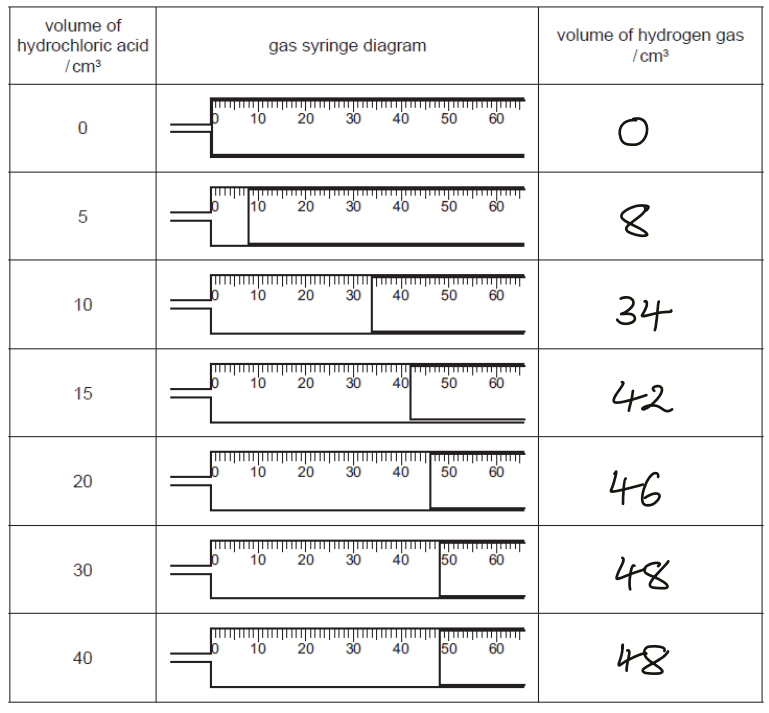
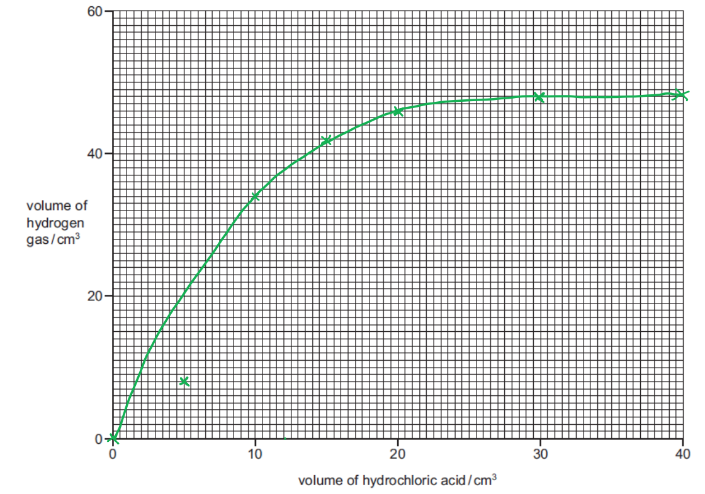
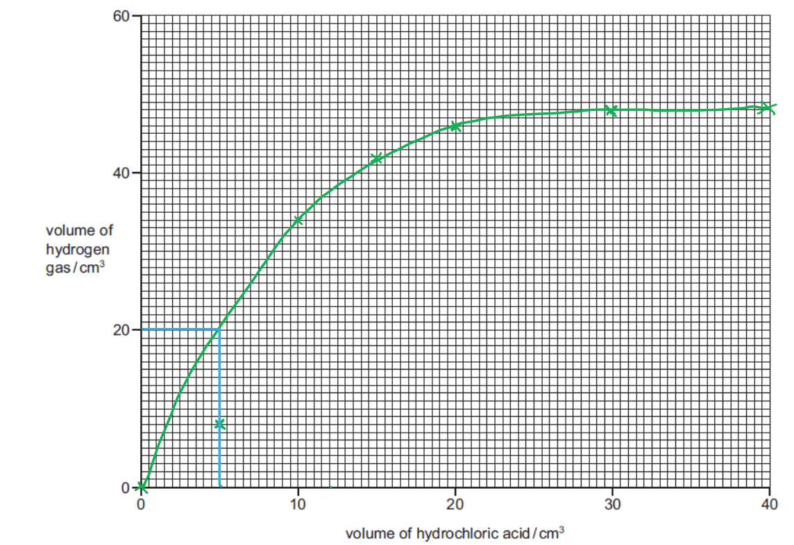
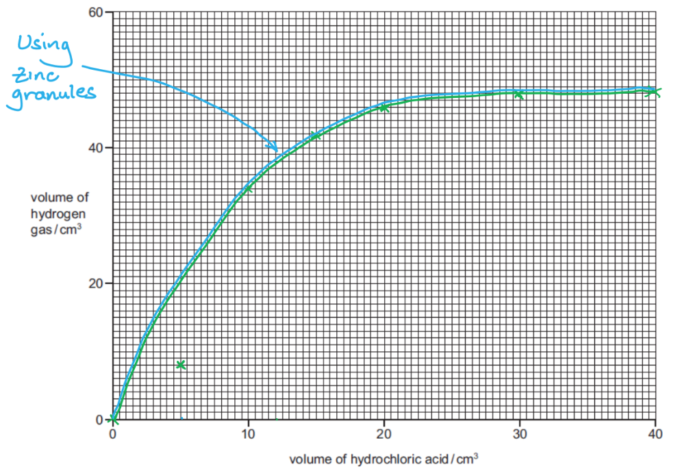
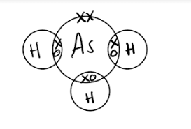
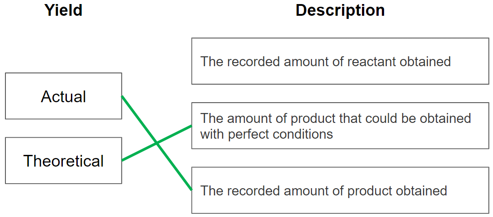
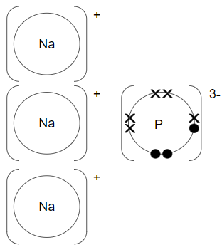
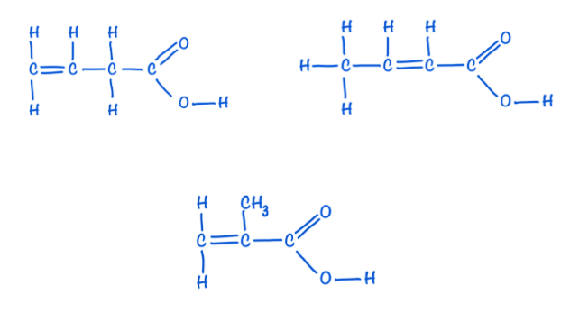

# Mark Schemes — The Mole & the Avogadro Constant
**3. Stoichiometry** · Cambridge (CIE) IGCSE chemistry (0620 & 0971)

## Alternative To Practical Questions (4 questions)

### Q1
To find out the percentage of shell material in a given sample of beach sand:

Any **six** from:

- Measure out a known mass of beach sand; **[1 mark]**
- Add dilute hydrochloric acid; **[1 mark]** *Add excess hydrochloric acid for two marks*
- Filter the solution; **[1 mark]**
- Wash the residue; **[1 mark]**
- Dry the residue; **[1 mark]**
- Weigh the sand; **[1 mark]**
- Correct calculation; **[1 mark]**

**[Total: 6 marks]**

- *You have measured out your mass of beach sand, for example 5 g*
- *This mass is a combination of sand and shell (calcium carbonate)*
- *When HCl is added to the mixture, the calcium carbonate will react to form calcium chloride solution *
- *When you filter this solution, the sand will remain in the filter paper (the residue) and the calcium chloride solution will pass through the paper (the filtrate) *
- *The sand / residue in the filter paper is washed and dried to ensure there is no excess water that could contribute to its mass and then reweighed *
- *If the mass of the sand is 3 g, then the mass of the calcium carbonate must have been 2 g *
- *The question specifically asks for the percentage of calcium carbonate in the shell *
- *This would be found by:  *$\frac{\mathrm{mass} \mathrm{of} \mathrm{calcium} \mathrm{carbonate}}{\mathrm{total} \mathrm{mass} \mathrm{of} \mathrm{sample}}\times100$* so for this example *$\frac{2}{5} \times 100 = 40 \%$
- *There should be some indication of how to calculate this mass in your answer*

### Q2
a)   The recorded volumes of hydrogen gas in the table:

- Volumes of hydrogen completed correctly; **[3 marks]**

*Guidance: 7 correct (3); 6 correct (2); 5 correct (1); 4 or fewer correct (0)*

**[Total: 3 marks]**
b)  The points plotted and a smooth line drawn:

- Points plotted correctly including origin; **[3 marks]**

*Guidance: 7 correct (3); 6 correct (2); 5 correct (1); 4 or fewer correct (0)*

- Smooth curve missing anomalous point; **[1 mark]**

**[Total: 4 marks]**

- *When drawing graphs plot the points in pencil so you can easily erase if you make a mistake*
- *Make sure your points are clearly visible by drawing small crosses- you don't want to obscure the points when you draw a line of best fit as the examiner will check the accuracy of your points and it can be hard to do this if they are covered over*
c)

i) The point which is inaccurate is:

- The point at 5 cm3 / 8 cm3 H2 / second point; **[1 mark]**

ii)  A possible reason for this inaccurate measurement.

- Leak / loss / escape of gas or wrong amount / too little HCl or zinc; **[1 mark]**

*Allow: syringe sticking*

iii)   The volume that would be expected to be formed:

- Reading from graph ± half small square; **[1 mark]**
- Indication on graph; **[1 mark]**

*For example, around 20 cm**3*

**[Total: 4 marks]**
d)   Why the volume of hydrogen gas does not increase after 30 cm3 of hydrochloric acid:

- There is an excess of acid; **[1 mark]**
- All the zinc reacted / was used up; **[1 mark]**

**[Total: 2 marks]**
e)  A sketch if the experiments were repeated using the same mass of zinc granules:

- Sketch curve identical; **[2 marks]**

**OR**

- A different curve levelling out at 48 cm3; **[1 mark]**

**[Total: 2 marks]**

- *Remember this is not a rate of reaction graph although the question is trying to fool you into think it is*
- *The rate of reaction will be slower using granules, but the volume of hydrogen given off for each volume of acid will be the same, since the same mass of zinc has been used*
- *There must be an indication that you have drawn a second identical curve to score the marks, so its best to use another colour or pen/pencil to signify this*
- *You still get some credit if you should a curve levelling off at 48 cm**3** as it shows you understand the acid is in excess after 30 cm**3** so the amount of hydrogen does not depend whether the zinc is powder or granules*

### Q3
An experiment to find the mass of water absorbed by a packet of silica gel crystals:

**Max **6 marks from

- Find the mass of silica gel crystals; **[1 mark]**
- Heat in an oven >100 oC; **[1 mark]**
- For a specified time /  until they turn blue; **[1 mark]**
- Reweigh the crystals; **[1 mark]**
- Record the result; **[1 mark]**
- Heat in the oven again to check for constant mass / indication of a colour change; **[1 mark]**
- Calculate the difference in mass of the crystals ; **[1 mark]**

**[Total: 6 marks]**

### Q4
To determine the maximum mass of oxygen that combines to form calcium oxide when 2 g of calcium granules are burnt in air:

Any **six** from:

- Weigh calcium; **[1 mark]**
- With lid / cover; **[1 mark]**
- Heat / burn; **[1 mark]**
- Allow air to enter / lift lid; **[1 mark]**
- Cool; **[1 mark]**
- Reweigh CaO; **[1 mark]**
- Reheat to constant mass; **[1 mark]**
- Calculate / find the difference; **[1 mark]**

**[Total: 6 marks]**

- *The mass of calcium has been weighed as 2 g*
- *The metal is placed in a crucible with a lid and the mass measured, for example,  2.8 g  *
- *The sample is heated by placing it on a pipe clay triangle over a Bunsen burner*
- *The lid is lifted occasionally to allow air to enter*
- *The sample is cooled, weighed and reheated until constant mass is achieved- this is to ensure that all of the calcium has reacted (if the mass keeps increasing this indicates that some calcium remains unreacted in the crucible)*
- *The constant mass achieved, for example, 3.5 g is the mass of calcium oxide, crucible and lid*
- *To determine the mass of oxygen added, find the difference between 3.5 and 2.8 = 0.7 g*
- *This method could be used to find the formula of calcium oxide*

## Multiple Choice Questions (22 questions)

### Q1
**Final answer:** **The correct answer is C**

**Step 1:** Write the balanced symbol equation for the reaction

Mg + 2HCl → MgCl2 + H2

**Step 2:** Calculate the number of moles of magnesium used

- Relative atomic mass (Ar) of Mg = 24

$\mathrm{moles} \mathrm{of} \mathrm{magnesium}=\frac{\mathrm{mass}}{M_{r}}$

$\mathrm{moles} \mathrm{of} \mathrm{magnesium}=\frac{5.0g}{24g\mathrm{mol}^{-1}}$

$\mathrm{moles} \mathrm{of} \mathrm{magnesium}=0.2083\mathrm{moles}$

**Step 3:** Calculate the moles of hydrogen gas produced, using the ratio from the equation

The ratio of Mg to H2 is **1:1** according to the balanced equation

moles of H2 = 0.2083 mol

**Step 3:** Calculate the volume of hydrogen gas produced

`volume of hydrogen ( H _ 2 ) = moles x 24 dm ^3 mol ^ - 1`

`volume of hydrogen ( H _ 2 ) = 0.2083 mol x 24 dm ^3 mol ^ - 1`

`volume of hydrogen ( H _ 2 ) = 5.0 dm ^3`

### Q2
**Final answer:** **The correct answer is D**

**Step 1:** Calculate the relative formula mass (*M*r) of Mg(NO3)2 using the relative atomic masses from the Periodic Table

*M*r = 24 + (2×14) + (6×16)

*M*r =24 + 28 + 96 = 148

**Step 2:** Calculate the number of moles of Mg(NO3)2

$\mathrm{moles}=\frac{\mathrm{mass}}{M_{r}}$

$\mathrm{moles}=\frac{10.0g}{148g\mathrm{mol}^{-1}}$

$\mathrm{moles}=0.06757\mathrm{moles}$

**Step 3:** The fundamental unit of an ionic compound is a formula unit, therefore, the next step is calculating the number of formula units in Mg(NO3)2

$\mathrm{fundamental} \mathrm{units}=\mathrm{moles}\times\mathrm{Avogadro} \mathrm{constant}$

$\text{fundamental} \text{units} = 0.06757 \text{mol} \times ( 6.02 \times 10^{23} \text{mol} ^{ - } 1 )$

$\mathrm{fundamental} \mathrm{units}=4.0677\times10^{22}\mathrm{formula} \mathrm{units}$

**Step 4: **Calculate the number of oxygen atoms

According to the chemical formula**, one formula unit of Mg(NO****3****)****2 ****contains 6 oxygen atoms**, therefore:

$\mathrm{number} \mathrm{of} \mathrm{oxygen} \mathrm{atoms}=\mathrm{formula} \mathrm{units}\times6$

$\mathrm{number} \mathrm{of} \mathrm{oxygen} \mathrm{atoms}=4.0677\times10^{22}\times6$

$\mathrm{number} \mathrm{of} \mathrm{oxygen} \mathrm{atoms}=2.44\times10^{23}\mathrm{oxygen} \mathrm{atoms}$

> **[exam-tip]**
> In multiple-choice calculation questions, the wrong options are often based on **common mistakes**. They usually match answers you would get if you **stop too early** or **misuse the formula**.
> 
> Always complete every step carefully and check the formula before choosing your answer!

### Q3
**Final answer:** **The correct answer is**** C**** because:**

- Statement 1 is correct as the empirical formula shows the **simplest** **whole** **number** **ratio** of atoms and is often the same as the molecular formula for simple compounds.
- Statement 3 is correct as 1 mole of any gas occupies 24 dm3 at room temperature and pressure. The reaction produces **3 moles** of gaseous products, so the volume of gas is therefore 3 x 24 = **72** **dm****3**.

**A** and **B **are incorrect as statement 2 is incorrect as each molecule of CH4 has **5 atoms**, therefore 1 mole of methane contains **5 moles** of atoms.

**D **is incorrect as statement 4 is incorrect as 1 mole of methane gas occupies **24 dm****3****.**

### Q4
**Final answer:** **The correct answer is ****D**** because:**

- The percentages can be assumed to be masses, i.e. 40% carbon = 40 g

| **Element** | **Carbon** | **Hydrogen** | **Oxygen** |
|---|---|---|---|
| **Value from question** | **40** | **6.67** | **53.33** |
| **Atomic mass** | **12** | **1** | **16** |
| **Calculate moles ** | $\frac{40.0}{12}$** = 3.3** | $\frac{6.67}{1}$** = 6.67** | $\frac{53.33}{16}$** = 3.33** |
| **Ratio (divide by smallest)** | $\frac{3.33}{3.33}$** = 1** | $\frac{6.67}{3.33}$** = 2** | $\frac{3.33}{3.33}$** = 1** |

- Therefore, the empirical formula is CH2O

### Q5
**Final answer:** **The correct answer is**** D****:**

| **Step** | **Working out** |   |
|---|---|---|
| **1** | Write down the molar ratio using the balanced equation. | CaCO3 → CaO + CO2  1  → 1 : 1  **1 mole** CaCO3 forms **1** **mole** CaO |
| **2** | Calculate the moles of CaO produced using the molar ratio. | *M*r CaCO3 = 100  *n *CaCO3 = 60 ÷ 100  = **0.60**  Ratio is 1 : 1 so *n *CaO = **0.60** |
| **3** | Convert moles to mass. | *M*r of CaO = 56  Mass CaO = 0.60 x 56 = **33.6 g** |

**A**,** B** and **C **are incorrect as these options do not give the correct mass.

### Q6
**Final answer:** **The correct answer is**** C****:**

| **Step** | **Working out** |   |
|---|---|---|
| **1** | Write down the molar ratio using the balanced equation. | MgCO3 + 2HCl → MgCl2 + H2O + CO2  1 : 2 → 1 : 1 : 1  **1** **mole** MgCO3 forms **1** **mole** CO2 |
| **2** | Calculate the moles of CO2 produced using the molar ratio. | *M*r MgCO3 = 84  *n *MgCO3 = 21 ÷ 84  = **0.25 **  Ratio is 1 : 1 so *n *CO2 = **0.25** |
| **3** | Convert moles to volume. | Volume CO2 = 0.25 x 24 = **6 dm****3** |

**A**,** B** and **D **are incorrect as these options do not give the correct volume.

### Q7
**Final answer:** **The correct answer is ****A**** because:**

- One mole is the amount of a substance that contains** **$6.02\times10^{23}$ particles and is known as **Avogadro's constant.**
- 1 mole of oxygen, which is a diatomic molecule O2, contains** **$6.20\times10^{23}$ **molecules** of oxygen but ** **$2 \times ( 6.02 \times 10^{23} )$ **atoms** of oxygen.
- One mole of any element is equal to the **relative atomic mass** of that element in **grams.** 
E.g. Ca has an *A*r of 40, so one mole of Ca has a mass of 40g.
- For a molecule, the relative atomic masses are **added** together. E.g. one mole of NaOH has a mass of 23 + 16 + 1 = 40g.

**B** and **D** are incorrect as the mole refers to the **mass number,** not the atomic number.

**C **is incorrect as the value of Avogadro's constant is  $6.02\times10^{23}.$

### Q8
**Final answer:** **The correct answer is**** B because:**

- One mole of gas at RTP (room temperature and pressure) occupies a volume of 24 dm3
- To determine the volume of a gas produced, in this case ethyne, the following equation is used:

  - volume of gas= number of moles of gas x 24 dm3
- The number of moles of water is found using** **$\frac{\mathrm{mass}}{M_{r}}$** = **$\frac{45}{18}$= 2.5 mol
- Two moles of water produce one mole of ethyne

  - So, the number of moles of ethyne is $\frac{2.5}{2}$= 1.25 mol
- Therefore, the volume of gas produced is 1.25 x 24 = 30 dm3

**A**,** C** and **D **are incorrect as these options do not give the correct volume.

### Q9
**Final answer:** **The correct answer is**** B****:**

| **Step** | **Working out** |   |
|---|---|---|
| **1** | Write down the molar ratio using the balanced equation. | 2Mg + O2 → 2MgO  2 : 1  → 2  **2 moles** Mg requires **1 mole **of O2 |
| **2** | Calculate the moles of each reactant used. | *n *Mg = 0.6 ÷ 24 (*M*r Mg) = **0.025 moles**  1 mole of any gas occupies 24 dm3  So *n *O2 = 0.6** **÷ 24  = **0.025 moles** |
| **3** | Divide the moles of each reactant by its coefficient from the balanced equation. The substance with the smallest number is the limiting reactant. | Magnesium: 0.025 ÷ 2 = **0.0125 moles**  Oxygen: 0.025 ÷ 1 = **0.025 moles**  Magnesium is less than oxygen hence it is the limiting reactant and is used up first. Oxygen is in excess. |

**A**,** C **and** D **are incorrect as these options do not correctly describe the reaction.

### Q10
**Final answer:** **The correct answer is**** B****:**

| **Step** | **Working out** |   |
|---|---|---|
| **1** | Write down the molar ratio using the balanced equation. | Mg3N2 + 6H2O → 3Mg(OH)2 + 2NH3  1 : 6  → 3 : 2  **1 mole** Mg3N2 forms **3** **moles** Mg(OH)2 |
| **2** | Calculate the moles of Mg(OH)2 desired using the molar ratio. | *M*r of Mg(OH)2 = 58  *n *Mg(OH)2 = 87 ÷ 58 =** 1.5**  Ratio is 1 : 3 so *n *Mg3N2 needed is **0.50** |
| **3** | Convert moles to mass. | *M*r of Mg3N2 = 100  Mass Mg3N2 = 0.50 x 100 = **50 g** |

**A, C** and **D **are incorrect as these options do not give the correct mass.

### Q11
**Final answer:** **The correct answer is**** C****:**

| **Step** | **Working out** |   |
|---|---|---|
| **1** | Write down the molar ratio using the balanced equation. | 4Al + 3O2 → 2Al2O3  4 : 3  → 2  **4 moles** Al forms **2** **moles** Al2O3, so **2** : **1** |
| **2** | Calculate the moles of aluminium oxide produced using the molar ratio and converting the mass to grams. | *M*r Al = 27  *n *Al = 5400 ÷ 27 = **200**  Ratio is 2 : 1 so *n *Al2O3 = **100** |
| **3** | Convert moles to mass. | *M*r of Al2O3 = 102  Mass Al2O3 = 100 x 102 = **10,200 g**  Convert to kg (÷1000) = **10.2 kg** |

**A**,** B** and **D **are incorrect as these options do not give the correct mass.

### Q12
**Final answer:** **The correct answer is**** D****:**

| **Step** | **Working out** |   |
|---|---|---|
| **1** | Write the balanced equation for the reaction and find the **molar ratio**. | H2SO4 + 2NaOH → Na2SO4 + 2H2O  1 : 2  → 1 : 2  **1 mole** H2SO4 reacts with **2** **moles** NaOH |
| **2** | Convert the average titre and volume of the acid to dm3. | Average titre = 18 ÷ 1000 = **0.018 dm****3**  Vol H2SO4 = 25 ÷ 1000 = **0.025 dm****3** |
| **3** | Calculate the number of moles in the average titre using  c = *n* ÷ V. | Rearrange for n:  *n* = c x V = (0.1 x 0.018) = **0.0018 moles** |
| **4** | Calculate the concentration of the acid in mol dm-3 using the molar ratio. | The molar ratio is 1 : 2, so moles of acid is  0.0018 ÷ 2 = **0.0009**  c = 0.0009 ÷ 0.025 = **0.036 mol dm****-3** |
| **5** | Calculate the concentration of the undiluted acid in mol dm-3. | Dilution factor = 250 ÷ 25 = 10  10 x 0.036 = **0.36 mol dm****-3** |
| **6** | Convert to g dm-3 using the formula mass = moles x *M*r | *M*r H2SO4 = (2 x 1) + 32 + (4 x 16) = 98  Concentration of original H2SO4 in g dm-3  = 0.36 x 98 = **35.28 g dm****-3** |

**A**,** B** and **C **are  incorrect as these options do not give the correct value for the concentration.

### Q13
**Final answer:** **The correct answer is**** A****:**

| **Step** | **Working out** |   |
|---|---|---|
| **1** | Calculate moles of NaOH present in the solution. | *M*r of NaOH = 40  *n *NaOH = 16 ÷ 40 = **0.4** |
| **2** | Divide volume of solution by 1000 to convert to dm3. | 200 ÷ 1000 = **0.2** **dm****3** |
| **3** | Calculate the concentration in moles using c = *n* ÷ V | c* *= 0.4 ÷ 0.2 = **2** **mol dm****-3**** ** |

**B**,** C** and **D **are incorrect as these options do not give the correct value for the concentration.

### Q14
**Final answer:** **The correct answer is**** B****:**

| **Step** | **Working out** |   |
|---|---|---|
| **1** | Write down the molar ratio using the balanced equation. | CuCO3 → CuO + CO2  ** ** 1  → 1 : 1  **1 mole** CuCO3 forms **1 mole **of CuO |
| **2** | Calculate the theoretical yield using the molar ratio. | *M*r CuCO3 = 64 + 12 + (3 x 16) = 124  *n *CuCO3 = 24.8 ÷ 124  = 0.2 moles.  So **0.2 moles** CuO is the theoretical yield as the molar ratio is 1 : 1 |
| **3** | Convert the theoretical yield to mass. | *M*r CuO = 80  Mass CuO = 80 x 0.2 = **16 g** |
| **4** | Calculate the percentage yield. | % yield = (11.2 ÷ 16) x 100 = **70%** |

**A**,** C** and **D **are incorrect as these options do not give the correct percentage yield.

### Q15
**Final answer:** **The correct answer is**** D****:**

| **Step** | **Working out** |   |
|---|---|---|
| **1** | Convert % to g by expressing the % of each element out of 100g. | \| Element \| **K** \| **Cr** \| **O** \| \|---\|---\|---\|---\| \| Mass \| 26.57 g \| 35.36 g \| 38.07 g \| |
| **2** | Divide each by its relative atomic mass to determine the molar ratio. | \| Element \| **K** \| **Cr** \| **O** \| \|---\|---\|---\|---\| \| Mol ratio \| 0.6813 \| 0.6800 \| 2.379 \| |
| **3** | Divide by the lowest number (0.026) to find the number of each atom. | \| Element \| **K** \| **Cr** \| **O** \| \|---\|---\|---\|---\| \| No Atom \| 1 \| 1 \| 3.49 \| |
| **4** | Multiply across by 2, rounding up for O which gives **K****2****Cr****2****O****7** | \| Element \| **K** \| **Cr** \| **O** \| \|---\|---\|---\|---\| \| Formula \| **2** \| **2** \| **7** \| |

**A**,** B** and **C **are incorrect as these options do not give the correct empirical formula.

### Q16
**Final answer:** **The correct answer is**** B****:**

| **Step** | **Working out** |   |
|---|---|---|
| **1** | Write the balanced equation for the reaction and find the molar ratio. | HCl + NaOH → NaCl + H2O  1 : 1  → 1 : 1  **1 mole** HCl reacts with **1** **mole** NaOH |
| **2** | Convert the average titre and volume of the acid to dm3. | Average titre = 30 ÷ 1000 = **0.03 dm****3**  Volume HCl = 25 ÷ 1000 = **0.025 dm****3** |
| **3** | Calculate the number of moles in the average titre using  c = *n* ÷ V. | Rearrange for n:  *n* = c x V = (0.1 x 0.03) = **0.003 moles** |
| **4** | Calculate the concentration of the acid using the molar ratio. | The molar ratio is 1 : 1, so there are 0.003 moles of HCl in 0.025 dm3 of the solution.  c = 0.003 ÷ 0.025 = **0.12 mol dm****-3** |

**A**,** C** and **D **are  incorrect as these options do not give the correct value for the concentration.

### Q17
**Final answer:** **The correct answer is**** B****:**

| **Step** | **Working out** |   |
|---|---|---|
| **1** | Write down the molar ratio using the balanced equation. | CaCO3 + 2HCl → CaCl2 + CO2 + H2O  1 + 2  → 1 : 1 : 1  **1 mole** CaCO3 forms **1 mole **of CO2 |
| **2** | Convert the volume of CO2 gas to moles. | 1 mole of gas = 24 dm3 at r.t.p  So *n *CO2 = 0.36 ÷ 24 = **0.015** |
| **3** | Calculate mass of CaCO3 in the sample using the molar ratio. | *M*r CaCO3 = 40 + 12 + (3 x 16) = 100  Molar ratio is 1 : 1 so there are 0.015 moles of CaCO3 in the sample.  Mass CaCO3 = 0.015 x 100 = **1.5 g** |
| **4** | Calculate the percentage purity. | % purity = (1.5 ÷ 1.7) x 100 = **88%** |

**A**,** C** and **D **are incorrect as these options do not give the correct percentage purity.

### Q18
**Final answer:** **The correct answer is**** C****:**

| **Step** | **Working out** |   |
|---|---|---|
| **1** | Convert % to g by expressing the % of each element out of 100 g. | \| Element \| **C** \| **H** \| **O** \| \|---\|---\|---\|---\| \| Mass \| 40.00 g \| 6.67 g \| 53.33 g \| |
| **1** | Divide across by the lowest value (6.67) to find the mass ratio. | \| Element \| **C** \| **H** \| **O** \| \|---\|---\|---\|---\| \| Ratio \| 5.99 \| 1 \| 7.99 \| |
| **2** | Divide each by its relative atomic mass to determine the molar ratio. | \| Element \| **C** \| **H** \| **O** \| \|---\|---\|---\|---\| \| Mol ratio \| 0.49 \| 1 \| 0.49 \| |
| **3** | Divide by the lowest number (0.49) which gives the empirical formula. | \| Element \| **C** \| **H** \| **O** \| \|---\|---\|---\|---\| \| Integers \| 1 \| 2 \| 1 \| |
| **4** | Divide *M*r of X by *M*r of empirical formula and multiply the subscript of each atom by the result. | *M*r CH2O = 12 + (2 x 1) + 16 = 30  60 ÷ 30 = 2  Molecular formula of X is **C****2****H****4****O****2** |

**A**,** B** and **D **are incorrect as these options do not give the correct molecular formula.

## Theory Questions (30 questions)

### Q1
a) The empirical formula of a compound that contains 72% magnesium and 28% nitrogen is:

- Mg = 72/24 
**OR **
3 **AND **N = 28/14** **
**OR** 
2; **[1 mark]**
- Empirical formula: Mg3N2; [**1 mark] ***Accept just formula for [2 marks] even with incorrect or no working* ***NOT ****ecf*

**[Total: 2 marks]**

- *To calculate the empirical formula when given percentages, it is easiest to assume that you have 100 g of the sample, then you can work out the number of moles of each element in 100 g by using the **M**r**:*

|   | > *Mg* | > *N* |
|---|---|---|
| > *Calculate the number of moles of each element in 100g (%/**M**r**)* | $\frac{72}{24}\,=3$ | $\frac{28}{14}\,=2$ |

- *Normally when performing these calculations you would divide by the smallest number to find the smallest ratio, then multiply, if necessary, to give a whole number ratio*
- *However, in this calculation, this first step gives you the simplest whole number ratio so no further steps are necessary*
b) A balanced equation for this reaction is:

- Al4C3 + 12H2O = 4Al(OH)3 + 3CH4;** [1 mark]**

**[Total: 1 mark]**

- *To balance the equation:*
- *Write the unbalanced equation with the formulae as given in the question, don't forget to include water as a reactant:*

  - *Al**4**C**3** + H**2**O → Al(OH)**3** + CH**4*
- *To work out the balancing numbers of Al**4**C**3**, Al(OH)**3** and CH**4** divide the number of moles of each compound present by the smallest number of moles (= 0.03):*

  - *Al**4**C**3** = 0.03 ÷ 0.03 = 1*
  - *Al(OH)**3 **= 0.12 ÷ 0.03 = 4*
  - *CH**4 **= 0.09 ÷ 0.03 = 3*
- *Add these to your equation:*

  - *Al**4**C**3** + H**2**O → 4Al(OH)**3** + 3CH**4*
- *Now work out how many H**2**O molecules are needed to balance the equation:*

  - *On the RHS, there are 24 H atoms and 12 oxygen atoms, therefore 12 molecules of water are needed*
- *The balanced symbol equation is therefore:*

  - *Al**4**C**3** + 12H**2**O → 4Al(OH)**3** + 3CH**4*
c)

i) The limiting reagent, with a reason why, is:

- Silicon is limiting reagent; **[1 mark]**
- 0.07 moles of Si and (mass / molar mass = 25 / 160 =) 0.156 moles of Br2; **[1 mark]**
- Because 0.14 (2 × 0.07) < 0.156; **[1 mark]** *If 80 is used to find moles of Br**2** the mark 1 and 3 are still available, arguments based on masses can be used*

ii) The number of moles of SiBr4 that are formed is:

- 0.07; **[1 mark]**

**[Total: 4 marks]**

- *To find the number of moles, use the equation mass ÷ molar mass*

  - *The molar mass of Br**2** is 2 x 80 = 160*
  - *The number of moles of Br**2 **= 25 ÷ 160 = 0.156 moles*
- *The balanced symbol equation shows that 1 mole of Si reacts with 2 moles of Br**2*
- *So 0.07 moles of Si will need to react with 2 x 0.07 = 0.14 moles of Br**2*
- *As 0.156 moles of Br**2** are present, there are more moles of Br**2** than are needed therefore Br**2** is in excess, and Si is the limiting reactant*
- *The limiting reactant will determine the amount of product formed as all of it will be used up in the reaction*
- *The balanced symbol equation shows that for every 1 mole of Si used, 1 mole of SiBr**4** is produced*
- *Therefore 0.07 moles of SiBr**4** are produced*

### Q2
a)

i) The mass of unreacted nickel carbonate can be calculated by:

- Moles of NiCO3 reacted = 0.08;** [1 mark]**
- Mass of nickel carbonate reacted = (0.08 x 119 =) 9.52 g;** [1 mark]**
- Mass of nickel carbonate unreacted = (12.0 - 9.52 =) 2.48 g;** [1 mark]**

ii) The percentage yield can be calculated by:

- Maximum number of moles of hydrated salt = 0.08;** [1 mark]**
- Maximum mass of salt = 0.08 x 281 = 22.48 g;** [1 mark]**
- Percentage yield 10.4/22.48 x 100 = 46 % / 46.3%;** [1 mark]**

**[Total: 6 marks]**

- *NiCO**3** is in excess so the number of moles of it that reacts will be determined by the limiting reactant, H**2**SO**4*
- *The balanced symbol equation shows that the reacting ratio is 1:1 and the question tells you that 0.08 moles of H**2**SO**4** were used, therefore the same number of moles of NiCO**3** is used*
- *The mass can be determined by the equation mass = moles x molar mass*
- *The molar mass is given in the question = 119 g per 1 mole*
- *Mass of NiCO**3 **= 0.08 x 119 = 9.52 g*
- *12.0 g of nickel carbonate was initially so you can find the mass of the unreacted nickel carbonate by 12.0 - 9.52 = 2.48 g*
- *In the first equation, 0.08 moles of NiSO**4** must be produced according to the reacting ratio given in the balanced symbol equation*
- *In the second equation, 0.08 moles of NiSO**4** will produce the same number of moles of the hydrated NiSO**4** as per the reacting ratio (1:1)*
- *The percentage yield is calculated by the following equation:*

  - $\mathrm{percentage} \mathrm{yield}=\frac{\mathrm{actual} \mathrm{yield}}{\mathrm{theoretical} \mathrm{yield}}\times100$
- *Percentage yield must be less than 100% so if you get an answer greater than this, check you have not divided the theoretical yield by the actual yield - this is a common mistake to make!*
b)

i) A brief description of how the soluble salt, rubidium sulphate could be made from the soluble base, rubidium hydroxide should contain:

- Sulphuric acid; **[1 mark]**
- Repeat titration without an indicator 
**OR **
with carbon / (activated) charcoal; **[1 mark]**
- Evaporation; **[1 mark] **
2*nd and 3rd marks only allowed if a description of titration is given*

ii) A method that could be used to make the insoluble salt, calcium fluoride is:

- Suitable reactants calcium chloride 
**AND **
sodium fluoride; **[1 mark]**
- Filter; **[1 mark]**
- Wash and dry precipitate; **[1 mark] **
*2nd and 3rd marks only allowed upon correct reagents*

**OR**

Accept synthesis

- Calcium; **[1 mark]**
- Fluorine; **[1 mark]**
- Burn or heat; **[1 mark]**

**[Total: 6 marks]**

- *It is important that you know the two different methods to prepare salts, depending on whether the salt is soluble or insoluble*
- *NOTE**: The spelling of sulphate / sulphuric acid, they mean the same as sulfate and sulfuric acid*

  - *They come from the British English spelling of sulphur*
  - *IUPAC decided to standarise the spelling to sulfur but many resources remain with the previous way of spelling*

### Q3
a) A rock which is made up of calcium carbonate is:

- Limestone / marble / chalk; **[1 mark]** 
*Allow coral or calcite or aragonite*

**[Total: 1 mark]**

- *You should know this from learning about the use of limestone in the extraction of iron from hematite*
- *Limestone / marble chips are also used in many rates of reaction experiments*
b)

i) The relative formula masses are:

- CaCO3 = 40 + 12 + (3 x 16) = 100; **[1 mark]**
- CaO = 40 + 16 = 56; **[1 mark]**

ii) The mass of calcium carbonate heated was:

- 7.00 kg is 1/8 of 56; **[1 mark]**
- 1/8 of 100 kg is 12.5 kg; **[1 mark]** 
*Give both marks for correct answer without explanation* *Ignore missing units but penalise wrong units*

**OR**

- Moles of calcium oxide = mass/molar mass = 7.0 x 1000/56 = 125 moles; **[1 mark]**
- Mass of calcium carbonate = moles x molar mass = 125 x 100 = 12500 g / 12.5 kg; **[1 mark]**

**[Total: 4 marks]**

- *You can either calculate the mass of calcium carbonate by calculating the number of moles of CaO, then using this to find the number of moles of CaCO**3** (it is a 1:1 reacting ratio so the number of moles of CaO = number of moles of CaCO**3**) and then finally calculating the mass of CaCO**3*
- *An alternative way to think about it is:*

  - *1 mole of CaCO**3** has a mass of 100 g and 1 mole of CaO is 56 g*
  - *So, 100 g CaCO**3 **will decompose to form 56 g of CaO*
  - *Scaling up using this ratio, 100 kg CaCO**3 **will decompose to form 56 kg of CaO*
  - *Therefore, 100/8 = 12.5 kg CaCO**3 **will decompose to form 56/8 = 7 kg of CaO*

### Q4
a) The  colour of methyl orange in aqueous sodium hydroxide is:

- Yellow; **[1 mark]**

**[Total: 1 mark]**

- *You should recognise aqueous sodium hydroxide as an alkali - hydroxides are common alkalis*
- *Methyl orange is red in acids and yellow in alkalis*
- *There are 2 other indicators that you need to know the colours of in acids and alkalis*

  - *Litmus is red in acid and blue in alkali*
  - *Thymolphthalein is colourless in acids and blue in alkalis*
b) To determine the concentration of the dilute sulfuric acid:

- Number of moles of NaOH = 0.2(00) × 25(.0) ÷ 1000 = 5(.00) × 10–3 
**OR** 
0.005(00) (mol); **[1 mark]**
- Number of moles of H2SO4 added = 5(.00) × 10–3 ÷ 2 = 2.5(0) × 10–3 
**OR** 
0.0025(0) (mol); **[1 mark]**
- Concentration of H2SO4 in mol/dm3 = 2.5(0) × 10–3 × 1000 ÷ 20(.0) = 0.125 (mol / dm3); **[1 mark]**
- Concentration of H2SO4 in g/dm3 = 0.125 × 98 = 12.3 (g / dm3) 
**OR** 
12.25 (g / dm3); **[1 mark]**

**[Total: 4 marks]**

- *To find the number of moles of NaOH, use the equation:*

  - *moles = concentration x volume (dm**3**)*
- *Remember to convert from cm**3** to dm**3** by dividing the volume in cm**3** by 1000*
- *The balanced symbol equation shows that 2 moles of NaOH react with 1 mole of H**2**SO**4*

  - *So, 0.0050 moles of NaOH will react with 0.0050 ÷ 2 = 0.0025 moles of H**2**SO**4*
- *To find the concentration of H**2**SO**4**, use the equation:*

  - *concentration = *$\frac{moles}{volume ( dm^{3} )}$
- *Again, remember to convert from cm**3** to dm**3** by dividing the volume in cm**3** by 1000*
- *To convert from the concentration in mo/dm**3** to g/dm**3**, multiply the concentration in mol/dm**3** by the **M**r** of H**2**SO**4*

  - *M**r **= (2 x 1) + 32 + (4 x 16) = 98*
c) To calculate the mass of magnesium carbonate needed:

- Moles of HCl = 2.00 × $\frac{50.0}{1000}$ = 0.1(00) mol; **[1 mark]**
- Moles of MgCO3 = $\frac{0.1}{2}$ = 0.05(00); **[1 mark]**
- *M*r of MgCO3 = 24 + 12 + (3 x 16) = 84; **[1 mark]**
- Mass of MgCO3 = 84 × 0.05(00) = 4.2(0) g; **[1 mark]**

**[Total: 4 marks]**

- *To find the moles of HCl, use the equation:*

  - *moles = concentration x volume (dm**3**)*
- *Remember to convert from cm**3** to dm**3** by dividing the volume in cm**3** by 1000*
- *The balanced symbol equation shows that 2 moles of HCl react with 1 mole of MgCO**3*

  - *So, 0.010 moles of HCl will react with 0.010 ÷ 2 = 0.0050 moles of MgCO**3*
- *To find the mass of MgCO**3**, use the equation:*

  - *mass = moles x **M**r*
- *So you also need to calculate the **M**r** of MgCO**3*

### Q5
a)

i) An equation for the reaction which forms hydrogen is:

Zn + 2HCl  →  ZnCl2 + H2

- Correct species; **[1 mark]**
- Correct balancing; **[1 mark]**

ii) A diagram which shows the arrangement of the outer electrons in one molecule of the covalent compound arsine is:

- 3 bonding pairs and 1 non bonding pair around As; **[1 mark]**
- 1 bonding pair on each hydrogen atom; **[1 mark] **
*Electrons do NOT need to be shown in pairs*

**[Total: 4 marks]**

- *When a metal and acid are reacted together, a salt and hydrogen gas is formed*
- *The metal forms the first part of the salt name, and the acid the second *

  - *Hydrochloric acids form chlorides*
- *The electron configuration given to you for arsenic states there are five electrons in the outer shell*

  - *It needs an additional three to obtain a complete outer shell*
  - *Each hydrogen electron has one electron, so needs one more to complete its outer shell *
- *The diagram will be the same as that of NH**3 **which you are required to know as part of the specification*
- *Start by drawing the electrons from each hydrogen atom, then arsenic electrons being shared with hydrogen, and finally the unbonded electrons*
- *Always count around the shells to check the atoms have the full outer shell *
b)

i) The empirical formula is:

- (97.4 / 75 =) 1.3 and (2.6 / 1 = ) 2.6; **[1 mark]**
- empirical formula AsH2; **[1 mark]** *note: correct formula with no working = 1 mark*

ii) The molecular formula is:

- As2H4; **[1 mark]**

iii) The structural formula is:

- H2As–AsH2 / AsH2–AsH2; **[1 mark]**

**[Total: 4 marks]**

- *The empirical formula is the simplest ratio of atoms of each element in a compound *
- *It is calculated by dividing the percentage of each element by its relative atomic mass *

  - *As = 1.3 and H = 2.6 *
  - *Then divide both values by the smallest value *
  - *As= 1.3 / 1.3 = 1            H= 2.6 / 1.3 = 2*
  - *Hence AsH**2*
- *The molecular formula is the actual number of atoms of each element in a compound*
- *You are told the mass of one mole of this is 154 g*
- *You divide the mass of one mole by the relative formula mass of AsH**2 **(77)*

  - *154 / 77 = 2*
  - *You must then multiple this formula, AsH**2, **by two so As**2**H**4*
c)

i)  It is necessary to include the oxidation states in the name of the compound because:

- Cu and As have more than one oxidation state; **[1 mark]**

ii) The ionic equation for the formation of copper(II) arsenate(V) is:

3Cu2+ + 2AsO43-  → Cu3(AsO4)2

- Left hand side correct; **[1 mark]**
- Right hand side correct; **[1 mark]**

**[Total: 3 marks]**

- *You can work out the formula for copper(II) arsenate(V) using the charges on the ions in the equation*
- *The copper ion has a charge of 2+ and AsO**4 **has a charge of 3-*
- *To balance out these charges there must be three copper atoms, and two** **AsO**4** ions = Cu**3**(AsO**4**)**2*
- *Don't forget to include brackets around the AsO**4** group *
- *Then balance the equation so that the number of atoms is equal on both sides*

### Q6
a) The name of the amount of any substance that contains 6.02 × 1023 particles is:

- A mole; **[1 mark]**

**[Total: 1 mark]**

- *A mole is the SI unit of the amount of substance*
- *It can refer to any type of particle, for example:*

  - *1 mole of magnesium contains 6.02 x 10**23** magnesium atoms*
  - *1 mole of chlorine (Cl**2**) contains 6.02 x 10**23** molecules of chlorine*
b) The name of the constant is:

- Avogadro constant / Avogadro's constant / Avogadros constant;** [1 mark]**

**[Total: 1 mark]**

- *You need to know this name*
- *This was named after Amadeo Avogadro, although the number was determined after Avogadro died*
- *Avogardo hypothesised that equal volumes of gas have the same number of molecules under the same temperature and pressure - this is known as Avogadro's Law*
c) The percentage by mass of sulfur in sulfur trioxide, SO3 is:

- *M*r of SO3 = (32 + (3 x 16)) = 80; **[1 mark]**
- $\frac{32}{80}$ x 100 = 40(%); **[1 mark]**

**[Total: 2 marks]**

- *To calculate the percentage by mass, use the equation:*

  - `% of an element = (total mass of the element in the compound)/(M _ r of the compound) x 100`
- *There is 1 atom of sulfur in sulfur trioxide and its **A**r** is 32 - so this is the total mass of the element in the compound*
- *The **M**r** is calculated by adding the **A**r** of all the atoms present*
- *Then, substitute these values into the equation above to give the percentage by mass of sulfur in SO**3*
d) To calculate the concentration of the H2SO4(aq) in mol/dm3:

- Moles of NaOH in 25.0 cm3 = 0.0400 x $\frac{25.0}{1000}$= 0.001(00) (mol); **[1 mark]**
- Moles of moles of H2SO4 = $\frac{0.001}{2}$ = 0.0005(00) (mol); **[1 mark]**

- Concentration of H2SO4 = $\frac{0.0005}{0.020}$= 0.025 (mol/dm3); **[1 mark]**

**[Total: 3 marks]**

- *To find the number of moles of NaOH, use the equation:*

  - *moles = concentration x volume (dm**3**)*
- *Remember to convert from cm**3** to dm**3** by dividing the volume in cm**3** by 1000*
- *The balanced symbol equation for the reaction is:*

  - *2NaOH + H**2**SO**4** → Na**2**SO**4** + 2H**2**O*
- *This shows that 2 moles of NaOH react with 1 mole of H**2**SO**4*

  - *So, 0.0010 moles of NaOH will react with 0.0010 ÷ 2 = 0.0005 moles of H**2**SO**4*
- *To find the concentration of H**2**SO**4**, use the equation:*

  - *concentration = *$\frac{moles}{volume ( dm^{3} )}$
- *Again, remember to convert from cm**3** to dm**3** by dividing the volume in cm**3** by 1000*
e) The concentration of the 0.0400 mol/dm3 NaOH (aq) in g/dm3 is:

- Use of 40 g/mol; **[1 mark]**
- 40 × 0.04 = 1.6 (g/dm3); **[1 mark]**

**[Total: 2 marks]**

- *To convert from the concentration in mol/dm**3** to g/dm**3**, multiply the concentration in mol/dm**3** by the **M**r** of NaOH*

  - *M**r **= 23 + 16 + 1 = 40*

### Q7
a) The volume of oxygen, measured at r.t.p., which is formed when 1.60 g of CuO reacts is:

- Moles of CuO = (1.60 ÷ 80) = 0.02(00) (mol); **[1 mark]**
- Moles of O2 = (0.02 ÷ 4) = 0.005(00) (mol); **[1 mark]**
- Volume of O2 = 0.005 × 24.0 = 0.12(0) dm3; **[1 mark]**

**[Total: 3 marks]**

- *To calculate the moles of CuO, use the equation:*

  - *moles = mass ÷ **M**r*
- *So, you need to calculate the **M**r** of CuO to find the moles of CuO*

  - *M**r** = 64 + 16 = 80*
- *4 moles of CuO form 1 mole of O**2**, so 0.02 moles of CuO form 0.02 ÷ 4 = 0.005 moles of O**2*
- *1 mole of any gas occupies 24.0 dm**3** at r.t.p.*

  - *So 0.005 moles of O**2** will occupy 0.005 x 24 = 0.12 dm**3*
b) The concentration of aqueous hydrogen peroxide at the start of the experiment is:

- Moles of oxygen = $\frac{48.0}{24000}$ 
**OR **
Moles of oxygen = 0.002 (mol); **[1 mark]**
- Moles of hydrogen peroxide = 0.002 × 2  
**OR **
Moles of hydrogen peroxide = 0.004 (mol); **[1 mark]**
- Concentration = 0.004 ÷ 0.025 = 0.16 (mol/dm3); **[1 mark]**

**[Total: 3 marks]**

- *To calculate the moles of oxygen, use the equation:*

  - *Moles = *$\frac{volume ( cm^{3} )}{24 000}$
- *The balanced symbol equation shows that 2 moles of H**2**O**2** produce 1 mole of O**2*
- *So, to produce 0.002 mol of O**2**, 2 x 0.002 = 0.004 mol of H**2**O**2** were used*
- *To calculate the concentration, use the equation:*

  - *Concentration = *$\frac{moles}{volume ( dm^{3} )} = \frac{0.004}{0.025}$*= 0.16 mol/dm**3*
- *Remember**: Convert 25 cm**3** to dm**3** by dividing by 1000*

### Q8
a)

i) The catalyst used is:

- Vanadium(V) oxide; **[1 mark]** *Accept vanadium oxide or V**2**O**5** or vanadium pentoxide* *Oxidation state not essential but if given it has to be (V)*

ii) 300°C is not used because:

- The rate would be too slow 
**OR**  
The rate would not be economic;** [1 mark]**

**[Total: 2 marks]**

- *The temperature conditions used for industrial processes, such as the Contact process and the Haber process, are often a compromise between yield and rate of reaction*
- *A lower temperature will produce a higher yield for exothermic reactions, such as this equation in the Contact process*
- *However, the rate of reaction will be slower so less product will be obtained in a given amount of time*
- *By using a compromise temperature, whilst the yield is lower, the speed at which it is obtained is quicker, so more product can be made in a given amount of time *
b)

i) You could show that the first reaction is reversible by:

- Add water to yellow powder / to anhydrous salt; **[1 mark]**
- It would go green; **[1 mark]**

ii) When acidified potassium manganate(VII) is added to a solution containing this acid, you would see:

- Colour change from purple or pink; **[1 mark]**
- To colourless; **[1 mark]** *Do NOT allow clear*

iii) An explanation of why sulfurous acid in contact with air changes into sulfuric acid is:

- It reacts with oxygen in the air; **[1 mark]**

**[Total: 5 marks]**

- *Potassium manganate(VII), KMnO**4**, is an oxidising agent which is often used to test for the presence of reducing agents *
- *When acidified potassium manganate(VII) is added to a reducing agent its colour changes from purple to colourless*
- *Careful**: Clear does not mean the same as colourless; a clear solution is one that is transparent, i.e. all of the solute has dissolved in it*
- *A clear solution may be coloured, e.g. copper(II) sulfate solution which is blue*
- *Part (iii) uses the command word 'suggest' which means you need to apply your knowledge and the information given*
- *Look at the formulae of the two acids and you can see that sulfurous acid has one less oxygen atom than sulfuric acid *
- *Oxygen is present in the air so when sulfurous acid is in contact with the air, it will react with oxygen and gain an oxygen atom forming sulfuric acid*

  - *2H**2**SO**3** + O**2** → 2H**2**SO**4*
c) The mass of iron(III) oxide formed and the volume of sulfur trioxide, at r.t.p., formed can be calculated by:

- Number of moles of FeSO4 used = mass/molar mass = 9.12/152 = 0.06 moles; **[1 mark]**
- Number of moles of Fe2O3 formed = 0.06/2 = 0.03 moles; **[1 mark]**
- Mass of one mole of Fe2O3 = (2 x 56) + (3 x 16) = 160 g; **[1 mark]**
- Mass of iron(III) oxide formed = moles x molar mass = 0.03 x 160 = 4.8 g; **[1 mark]**
- Number of moles of SO3 formed = 0.03 moles; **[1 mark]**
- Volume of sulfur trioxide formed = moles x 24 = 0.03 x 24 = 0.72 dm3;  **[1 mark]** *Apply ecf to number of moles of Fe**2**O**3** when calculating volume of sulfur trioxide*

**[Total: 6 marks]**

- *Use the balanced symbol equation to work out the number of moles of Fe**2**O**3 **formed:*
- *2 moles of FeSO**4 **produces 1 mole Fe**2**O**3*
- *Therefore 0.06 moles FeSO**4 **produce 0.06/2 = 0.03 moles of Fe**2**O**3*
- *Using the balanced symbol equation you can see that the number of moles of SO**3** will be the same as the number of moles of Fe**2**O**3*
- *One mole of gas occupies 24 dm**3**, so to find the volume of gas, multiply the number of moles by 24*

### Q9
a)

i) The term hydrocarbon means:

- (A chemical that) contains hydrogen and carbon <u>only</u>;** [1 mark]**

ii) The term saturated means:

- Contains only single bonds;** [1 mark]**

**[Total: 2 marks]**

- *The definitions of various words are easy questions for examiners to ask and there are a lot related to Organic Chemistry, so you need to learn them*
b)

i) The general formula for the homologous series of alkanes is:

- CnH2n+2; **[1 mark]**

ii) The mass of one mole of an alkane with 14 carbon atoms is:

- C14H30; **[1 mark]**
- (14 × 12) + 30 = 198 (g) **[1 mark]**

**[Total: 3 marks]**

- *This question tests your ability to apply the C**n**H**2n+2** general formula to an alkane with 14 carbons*
- *If n = 14, then 2n + 2 = 30 which gives the molecular formula for this alkane as C**14**H**30** *
- *You can now use the periodic table to calculate the mass of one mole of the alkane as shown in the answer*
c)

i) The equation for the complete combustion of nonane, C9H20 is:

C9H20 + 14O2 → 9CO2 + 10H2O

- Correct reactants and products; **[1 mark]**
- Correct balancing; **[1 mark] **

ii) To deduce the formula of the hydrocarbon and the equation for its combustion:

| General equation | CxHy + | O2 | → | CO2 + | H2O |
|---|---|---|---|---|---|
| Volume in cm3 | 20 | 200 - 40 = 160 |   | 100 |   |
| Ratio | 1 | 8 |   | 5 |   |
| Unbalanced equation | CxHy + | 8O2 | → | 5CO2 + | H2O |
| Fully balanced equation | C5H12 + | 8O2 | → | 5CO2 + | 6H2O |

- Evidence of 1 : 8 : 5 ratio; **[1 mark]**
- Unbalanced equation; **[1 mark]**
- Identification of C5H12  **AND **Fully balanced equation; **[1 mark]**

**[Total: 5 marks]**

- *Balancing chemical equations is a skill that you are expected to have in exams*
- *Part (ii) is a more challenging question*

  - *First you have to calculate how much oxygen was used, 200 - 40 = 160 cm**3** *
  - *Since the volumes are all in cm**3** and measured at room temperature, there is no need to calculate moles *
  - *You can use the volumes as a ratio of 20 : 160 : 100 which simplifies to 1 : 8 : 5*
  - *This tells you that 1 mole of the hydrocarbon reacted with 8 moles of oxygen to form 5 moles of carbon dioxide, e.g. C**x**H**y** + 8O**2** → 5CO**2** + H**2**O*
  - *The 5 moles of carbon dioxide gives you the number of carbons in the hydrocarbon,  e.g. C**5**H**y** + 8O**2** → 5CO**2** + H**2**O*
  - *There are 16 oxygen atoms on the reactant side*
  - *There are 10 oxygen atoms in the carbon dioxide product which means that there must be 6 waters to account for the remaining oxygen atoms,  e.g. C**5**H**y** + 8O**2** → 5CO**2** + 6H**2**O*
  - *This now means that there are 12 hydrogen atoms and gives the final balanced equation of  C**5**H**12** + 8O**2** → 5CO**2** + 6H**2**O*
d)

i) Uses for each of the three products listed are:

- Short-chain alkanes: petrol / fuel / solvent; **[1 mark]**
- Alkenes: to make alcohols / plastics / polymers / solvents; **[1 mark]**
- Hydrogen: to make ammonia / fuel / fuel cells; **[1 mark]**

ii) The equation for the cracking of decane, C10H22, which produces two different alkenes and hydrogen as the only products is:

- A correctly balanced equation; **[1 mark]** 
For example: C10H22 → C8H16 + C2H4 + H2

**[Total: 4 marks]**

- *Uses of certain chemicals is something that you will have to know because they can be scattered in various questions to check your knowledge*
- *The key parts of part (ii) are:*

  - *That the number of reactant carbon and hydrogen atoms equals the number of product carbon and hydrogen atoms*
  - *The two alkenes that you give in your answer must be different and agree with the C**n**H**2n** general formula for an alkene*
e)

i) The essential condition for the reaction is:

- UV light / sunlight; **[1 mark]** 
*Accept lead tetraethyl / catalyst / high temperature*

ii) The structural formula of a different product is:

- CH3–CHCl–CH3; **[1 mark]**

**[Total: 2 marks]**

- *The equation shows that one of the hydrogen atoms is being substituted by a chlorine atom*
- *This is a standard substitution / photochemical reaction for alkanes *

  - *This means that light (specifically UV or sunlight) is needed*
- *To make a different product, the only place that a chlorine atom can substitute is on the middle carbon*

### Q10
a) You would continue the experiment to obtain pure dry crystals of hydrated lithium sulfate by:

- Repeat without indicator / repeat using same volumes of acid and alkali 
**OR** 
Use carbon / charcoal to remove indicator; **[1 mark]**
- Evaporate / heat / warm / boil / leave in sun; **[1 mark]**
- Until most of the water has gone / some water is left / saturation (point) / crystallisation point; **[1 mark]**
- Leave / allow to cool / allow to crystallise; **[1 mark]**
- Filter (off crystals) / wash (with distilled water) / dry crystals with filter paper / dry crystals in a warm place / oven / windowsill; **[1 mark]**

**[Total: 5 marks]**

- *It is important to remember the first step otherwise the resulting crystals would contain the indicator as an impurity*
b) The percentage yield can be calculated by:

- Number of moles of LiOH used (= concentration x volume in dm3 = 2.48 x 0.025 ) = 0.062; **[1 mark]**
- Number of moles of Li2SO4.H2O which could be formed = 0.031; **[1 mark]**
- Mass of one mole of Li2SO4.H2O = 128g
- Maximum yield of Li2SO4.H2O (= moles x molar mass = 0.031 x 128) = 3.97 g; **[1 mark]**
- Percentage yield (= $\frac{2.20}{3.97}$ x 100) = 55.4%; **[1 mark]**

**[Total: 4 marks]**

- *Convert cm**3** to dm**3** by diving by 1000, so 25.0 cm**3** = 25.0/1000 = 0.025 dm**3*
- *Use the balanced symbol equation to find how many moles of Li**2**SO**4**.H**2**O are formed from 0.062 moles of LiOH:*

  - *2 moles of LiOH forms 1 mole of Li**2**SO**4** *
  - *1 mole of Li**2**SO**4 **forms 1 mole** **Li**2**SO**4**.H**2**O*
  - *So 2 moles of LiOH form 1 mole of Li**2**SO**4**.H**2**O*
  - *Therefore 0.062 moles of LiOH form 0.062 / 2 = 0.031 moles of Li**2**SO**4**.H**2**O*
- *Percentage yield is calculated by the equation:*

$\mathrm{percentage} \mathrm{yield}=\frac{\mathrm{actual} \mathrm{yield}}{\mathrm{theoretical} \mathrm{yield}}\times100$

- *Remember**: Percentage yield cannot be greater than 100% so if your value is larger than 100%, make sure you haven't divided the theoretical yield by the actual yield*
c)

i) The reason for heating to constant mass is:

- (To prove) all water driven off or evaporated or boiled/ no water remains / to make salt anhydrous; **[1 mark]**

ii) You could show that the hydrated salt has one mole of water of crystallisation per mole of the anhydrous salt by:

- m1– m2 = mass of water; **[1 mark]**
- (Calculate) moles of water 
**AND **
moles of hydrated or anhydrous salt; **[1 mark]**
- 1:1 ratio / number of moles of hydrated or anhydrated should be equal the number of moles of water; **[1 mark]**

**[Total: 4 marks]**

- *This type of calculation is an application of empirical formula calculations*
- *Instead of using the mass / percentage of each element to find the molar ratio, you use the mass of the anhydrous salt and the mass of the water of crystallisation to find the molar ratio of salt:water*
- *The mass of the water of crystallisation can be found experimentally by heating a sample of hydrated salt to remove the water, forming the anhydrous salt*
- *The mass lost in this process is the mass of the water of crystallisation*
- *Use the mass of the anhydrous salt and the mass of the water of crystallisation to find the number of moles of each *
- *Find the molar ratio by dividing the moles of both by the smallest number (this should be the number of moles of anhydrous salt)*
- *The ratio will show the molar ratio of salt:water and will be in the form 1:x*
- *In this case, the molar ratio is 1:1 which is shown in the formula Li**2**SO**4**.H**2**O*

### Q11
a) The complete sentences to explain why a 100% yield is not achieved are:

Reactants and products can be left behind during **transfer** from one container to another.

**Reversible** reactions can never have a 100% yield because the products are forming reactants.

A reaction might not go to completion because of **side reactions** or the presence of an impurity. These reactions are described as **incomplete**.

- Transfer; **[1 mark]**
- Reversible; **[1 mark]**
- Side reactions; **[1 mark]**
- Incomplete; **[1 mark]**

**[Total: 4 marks]**

- *Answers must be in the order shown to gain the marks*
- *If you are not sure for questions like these, try reading it in your head as certain words are more / less suitable for certain gaps*

  - *e.g. A reaction might not go to completion because of _______________ or the presence of an impurity*
  - *The best fit answer for this gap is probably side reactions*
  - *Other answers such as reversible or incomplete do not work in this space*
b) The correct pairs are:

- Correctly matches actual with the recorded amount of product obtained: **[1 mark]**
- Correctly matches theoretical with the amount of product that could be obtained with perfect conditions: **[1 mark]**

**[Total: 2 marks]**

- *Careful: **Yield is all about the amount of product that is formed*

  - *Actual is the amount of product that you do get*
  - *Theoretical is the amount of product that you could get*
c) To calculate the number of moles of magnesium that the student used:

- $\mathrm{Moles}=\frac{\mathrm{mass}}{M_{r}}=\frac{4.8}{24}$= 0.2 moles; **[1 mark]**

**[Total: 1 mark]**

- *Calculating moles is often the first step in a longer percentage yield calculation as you have to determine the theoretical yield from the information that you are given*
d) To calculate the theoretical yield of copper:

- Maximum number of moles of copper = 0.2 moles; **[1 mark]**
- Maximum mass of copper = moles x *M*r = 0.2 x 63.5 = 12.7 g; **[1 mark]**

**[Total: 2 marks]**

- *Using the balanced symbol equation given in part (c), you can see that the number of moles of magnesium reacted should produce the same number of moles of copper, so the first marking point should use your answer from part (c)*
- *This means that 0.2 moles of magnesium will displace 0.2 moles of copper out of copper(II) sulfate*
e) The percentage yield of the student's experiment is:

- Percentage yield = $\frac{\mathrm{actual} \mathrm{yield}}{\mathrm{theoretical} \mathrm{yield}}\times100$ = $\frac{10.16}{12.7}\times100$; **[1 mark]**
- Percentage yield = 80%; **[1 mark]**

**[Total: 2 marks]**

- *If you are not given the equation, then you should:*

  1. *Write down the equation that you are going to use*
  2. *Substitute the values into the equation*
  3. *Write down the final answer*
- *Following these steps helps show your working in a clear way for the examiner*

  - *This means that if you make a mistake the examiner can identify the single mistake and potentially only take one mark*
  - *Without any working, the examiner will have to take all the marks if you get the wrong answer*
- *The most common mistake in percentage yield calculations is to have the two numbers the wrong way up which gives over 100%*

  - *Remember: **A percentage yield of over 100% is not possible*

### Q12
a)

The percentage yield of NO in this reaction is:

- 75 (%);** [1 mark]**

**[Total: 1 mark]**

- *The percentage yield is calculated by:*

  - *percentage yield = *$\frac{\mathrm{actual} \mathrm{yield}}{\mathrm{theoretical} \mathrm{yield}}$*x 100*
- *Substituting the values given in the question:*

  - *percentage yield = *$\frac{384}{512}$* x 100 = 75%*
- *The most common mistake with calculating percentage yield is to divide the theoretical yield by the actual yield which would give a value of over 100%*
- *Remember**: Percentage yield cannot be greater than 100% - if your value is greater, check your calculations!*
- *The only other reason that you may obtain a value greater than 100% is if there is an error in the method used to obtain the product*

  - *For example, some impurities could remain in the product, which would cause the actual yield to be a greater value than it should be*
b) To calculate the volume of O2 gas that reacts:

- *M*r of HNO3 = 1 + 14 + (3 x 16) = 63; **[1 mark]**
- Moles of HNO3 = 1260 ÷ 63 = 20 (mol); **[1 mark]**
- Moles of O2 that reacted = 20 ÷ 4 = 5 (mol); **[1 mark]**
- Volume of O2 gas that reacts = 5 x 24 = 120 (dm3); **[1 mark]**

**[Total: 4 marks]**

- *To calculate the moles of HNO**3**, use the equation:*

  - *moles = mass ÷ **M**r*
- *So, you need to calculate the **M**r** of HNO**3** to find the moles of HNO**3*

  - *M**r** = (1 x H) + (1 x N) + (3 x O) = 1 + 14 + (3 x 16) = 63*
- *4 moles of HNO**3** are produced from 1 mole of O**2**, so 20 moles of HNO**3** are produced from 20 ÷ 4 = 5 moles of O**2*
- *1 mole of any gas occupies 24.0 dm**3** at r.t.p.*

  - *So 5 moles of O**2** will occupy5 x 24 = 120 dm**3*

### Q13
a) The *mole* means:

Any **one** from:

- Avogadro’s constant / number of particles; **[1 mark]**
- Formula mass in grams; **[1 mark]**
- 6 x 1023 particles; **[1 mark]** 
*Accept atoms, ions and molecules*
- As many particles as there are carbon atoms in 12.00 g of 12C; **[1 mark]**

**[Total: 1 mark]**
b)

i) The reactant in excess, and the reason, why is:

- Moles of Mg (= mass / molar mass = 3/24) = 0.125; **[1 mark]**
- Moles of CH3COOH (= mass / molar mass = 12/60) = 0.200;** [1 mark]**
- Magnesium is in excess; **[1 mark]**

**OR**

- 3.0 g of magnesium react with 15 g of acid; **[1 mark]**
- Only 12.0 g of acid present; **[1 mark]**
- Magnesium is in excess; **[1 mark]**

ii) The number of moles of hydrogen formed was:

- Moles of H2 = 0.1; **[1 mark]**

iii) The volume of hydrogen formed, measured at r.t.p., is:

- Volume of hydrogen = 0.1 x 24;** [1 mark]**
- = 2.4 dm3; **[1 mark]**

**[Total: 6 marks]**

- *0.125 moles of Mg would require 2 x 0.125 = 0.250 moles of CH**3**COOH because of the reacting ratio shown in the balanced symbol equation*
- *Only 0.200 moles of CH**3**COOH are present therefore this is the limiting reactant and Mg must be in excess*
- *The number of moles of CH**3**COOH present will determine the number of moles of H**2** that are produced*
- *Every 2 moles of CH**3**COOH will produce 1 mole of H**2**, therefore the number of moles of H**2** present = 0.200 ÷ 2 = 0.100 moles*
- *Remember**: 1 mole of gas occupies 24 dm**3** at r.t.p*

  - *This is given to you on the Periodic Table*
c)

i) The number of moles of NaOH in 25.0 cm3 of 0.4 mol / dm3 solution is:

- Moles of NaOH (= volume (in dm3) x concentration =25/1000 x 0.4) = 0.01; **[1 mark]**

ii) The number of moles of H2C2O4 in 20 cm3 of solution is:

- Moles of acid = 0.01/2 = 0.005;** [1 mark]**

iii) The concentration, mol / dm3, of the aqueous oxalic acid is:

- Concentration of acid = 0.005 $\div$ (20/1000);** [1 mark]**
- = 0.25 mol / dm3;** [1 mark]**

**[Total: 4 marks]**

- *When performing calculations involving concentration in mol / dm**3**, it is important to remember to convert the volume in cm**3** to dm**3** by dividing by 1000*
- *These types of calculations always follow the same steps:*
- *Calculate the number of moles of the reactant you know both the concentration and volume of:*

  - *moles = concentration (mol / dm**3**) x volume (dm**3**)*
- *Use the reacting ratio in the balanced symbol equation to determine the number of moles used in the other reactant*
- *Use this to determine either the concentration or volume of this other reactant, depending on what the question asks you to calculate:*

  - *concentration (mol / dm**3**) = *$\frac{\mathrm{moles}(\mathrm{mol})}{\mathrm{volume}(\mathrm{dm}^{3})}$
  - *volume (dm**3**) = *$\frac{\mathrm{moles}(\mathrm{mol})}{\mathrm{concentration}(\mathrm{mol}/\mathrm{dm}^{3})}$

### Q14
a) It is usually necessary to include a number in the name of the compounds of transition elements because:

- A transition element has more than one oxidation state / number or valency; **[1 mark]**
 *Accept different oxidation states*

**[Total: 1 mark]**

- *In some exam questions / resources, the term oxidation state is used instead of oxidation number*
- *For any element that can have more than one charge, when naming, the charge on the ion is shown by using a Roman numeral after the element's name*
b) The presence of coke ensures the maximum yield of the metal chloride by:

- Removing oxygen: concentration of O2 decreases;** [1 mark]**
- Prevents the reverse reaction / equilibrium shifts to right;** [1 mark]**

**[Total: 2 marks]**

- *As the concentration of oxygen decreases, according to Le Chatalier's principle, the equilibrium will shift to oppose the change*
- *The position of equilibrium shifts to the right to restore the oxygen concentration by favouring the forward reaction and increasing the yield of oxygen*
c) The change, titanium(IV) chloride to titanium, is reduction because:

- Oxidation number reduced (from (+) 4 to 0); **[1 mark]** 
*Allow accepts electrons or accepts four electrons* 
*If a number is given, it must be 4*

**[Total: 1 mark]**

- *The oxidation number of titanium in titanium(IV) chloride is given by the Roman number, so +4*
- *The oxidation number of an uncombined element, such as Ti, is zero*
- *Whan a species is reduced, its oxidation number decreases during the reaction*
d)

i) The percentage of oxygen in this titanium compound is:

- Percentage of oxygen (= 100 - 36.8 - 31.6) = 31.6%; **[1 mark]**

ii) The number of moles of atoms for each element is:

- Number of moles of Ti = 31.6/48 = 0.66 
**AND** 
Number of moles of O = 31.6/16 = 1.98 accept 2; **[1 mark]** *Both must be correct for one mark*

iii) The simplest ratio for the moles of atoms, Fe : Ti : O is:

- Fe : Ti : O is 1 : 1 : 3; **[1 mark]**

iv) The formula of this titanium compound is:

- Formula is FeTiO3 / TiFeO3; **[1 mark]** 
*Must be whole numbers from (iii) or cancelled numbers from (iii)* *Mark ecf throughout*

**[Total: 4 marks]**

- *To calculate the number of moles, divide the percentage of each element by its molar mass, as shown for Fe in the question*
- *To determine the simplest ratio for the moles of atoms, divide the number moles of each element by the smallest number of moles, 0.66 moles:*

  - *Fe: 0.66/0.66 = 1*
  - *Ti: 0.66/0.66 = 1*
  - *O: 1.98/0/66 = 3*

### Q15
a)

i) Two physical properties of boron are:

Any **two** from:

- High melting or boiling point; **[1 mark]**
- Hard; **[1 mark]**
- Poor conductor of electricity or heat; **[1 mark]**
- Brittle; **[1 mark]**

ii) Another element and a compound that have macromolecular structures are:

- Element: carbon,  silicon, germanium; **[1 mark] ***Allow graphite, diamond*
- Compound: silicon (IV) oxide / silica / silicon dioxide / silicon oxide / sand / silicon carbide / named polymer; **[1 mark]**

iii) The structure of one of the above macromolecular substances can be drawn as:

- Four atoms around one atom; **[1 mark]**
- Structure looks tetrahedral or shows continuation; **[1 mark]** **OR**
- For graphite, layers shown; **[1 mark]**
- Weak bonds between layers; **[1 mark]** 
**OR**
- For polymer, repeat unit given; **[1 mark]**
- Continuation; **[1 mark]** 
*Accept any macromolecule, no link with (iii)*

**[Total: 6 marks]**

- *To predict the properties of boron, you need to use the information that is given telling you that boron is a non-metal and a macromolecule*
- *This question is asking you to apply your knowledge of these types of structures, think of the common properties of non-metallic giant structures. You could predict boron to have any of these properties*
- *Examples of some structures of other macromolecules are:*
b) The reactions of zinc and copper(II) ions with an excess of aqueous sodium hydroxide are:

i) With zinc ions:

- White precipitate (is formed); **[1 mark]**
- Which dissolves in excess or forms solution; **[1 mark]** 
*Only allow 2nd mark if formation of a precipitate is given*

ii) With copper(II) ions:

- Blue precipitate (is formed); **[1 mark]**
- Which does not dissolve in excess; **[1 mark]** 
*Only allow 2nd mark if formation of a precipitate is given*

**[Total: 4 marks]**

- *You need to learn the colour of the precipitate produced when various metal ions react with sodium hydroxide and whether the precipitate dissolves in excess sodium hydroxide*
- *Make sure you use the term 'precipitate' as you would not gain a mark for purely stating the colour*
- *When performing this test, a few drops of sodium hydroxide are added initially to see if a precipitate is formed and the colour of the precipitate*
- *An excess of sodium hydroxide is then added to see if the precipitate dissolves*
- *If it doesn't dissolve in excess sodium hydroxide, the metal hydroxide is insoluble in water*
c)

i) The number moles of CaCO3 there are in one tablet is calculated by:

- Number of moles CO2 = 0.24/24 = 0.01; **[1 mark]**
- Number of moles of CaCO3 and MgCO3 = 0.01; **[1 mark]**
- Number of moles of CaCO3 = 0.005; **[1 mark]**

ii) The volume of hydrochloric acid, 1.0 mol / dm3, needed to react with one tablet is calculated by:

- Number of moles of HCl needed to react with one tablet = 0.02; **[1 mark]**
- Volume of hydrochloric acid, 1.0 mol / dm3, needed to react with one tablet = 0.02 dm3 or 20 cm3; **[1 mark]**

**[Total: 5 marks]**

- *1 mole of gas occupies 24 dm**3** so 0.24 dm**3** of CO**2** occupies 0.24/24 = 0.01 dm**3*
- *The balanced symbol equations show that 1 mole of CaCO**3**  produces 1 mole of CO**2** and 1 mole of MgCO**3**  produces 1 mole of CO**2*

  - *You are also told that the tablet contains the same number of moles of CaCO**3 **and MgCO**3*
  - *Therefore, the number of moles of CO**2** = number of moles of CaCO**3 **+ MgCO**3 ** = 0.01 moles*
  - *The number of moles of CaCO**3 **will be half this value = 0.01 / 2 = 0.005 moles*
- *For both CaCO**3 **and MgCO**3 **twice the number of moles of acid are needed = 2 x 0.01 = 0.02 moles*
- *The volume of HCl is calculated by moles / concentration = 0.02 / 1.0 = 0.02 dm**3** = 20 cm**3*

### Q16
b)

i) This reaction is important industrially to:

- Make sulfuric acid 
**OR** 
In the Contact process; **[1 mark]**

ii) The completed word equation is:

- sulfur dioxide + <u>**oxygen**</u> → sulfur trioxide; **[1 mark]**

iii) The conditions for this reaction are:

Any **two** from:

- Vanadium oxide / vanadium(V) oxide / V2O5 / vanadium pentoxide as catalyst; **[1 mark]** *Oxidation number not required but if given it must be (V)*
- 400 to 500 °C; **[1 mark]**
- Pressure less than 10 atm; **[1 mark]**

**[Total: 4 marks]**

- These are easy marks if you have learnt the Contact process thoroughly!
b)

i) The colour change that would be observed when an excess of aqueous sulphur dioxide is added to an acidic solution of potassium manganate(VII) is:

- From pink 
**OR **
purple; **[1 mark]**
- To colourless; **[1 mark]** *Do NOT allow clear *

ii) The white precipitate formed when bromine is added is:

- Barium sulphate; **[1 mark]**
- (Because) bromine oxidises or reacts with; **[1 mark]**
- Sulphur dioxide to form sulphate ion; **[1 mark]**

**[Total: 5 marks]**

- *In this reaction, SO**2** is being oxidised which means it is acting as a reducing agent as it is losing electrons *
- *Potassium manganate(VII), KMnO**4**, is an oxidising agent which is often used to test for the presence of reducing agents*
- *When acidified potassium manganate(VII) is added to a reducing agent its colour changes from purple to colourless*
- *Barium chloride is used to detect the presence of sulfate ions - a white precipitate is produced upon the formation of insoluble barium sulfate*
- *When aqueous sulphur dioxide and acidified barium chloride solution are added together, the solution remains clear, meaning that no sulfate ions are present*
- *When bromine is added, a white precipitate is formed, which means that sulfate ions must be present in the reaction mixture*
- *It must be the addition of bromine that caused these sulfate ions to be present*
- *Therefore bromine must have reacted with sulfur dioxide to form sulfate ions*
c) The mass of sulphuryl chloride formed by this mixture can be calculated by:

- The number of moles of SO2 in the mixture = mass/molar mass = 8.0/(32 + (2 x 16)) = 0.125 moles; **[1 mark]**
- The number of moles of Cl2 in the mixture = mass/molar mass = 14.2/(2 x 35.5) = 0.20 moles; **[1 mark]**
- The reagent not in excess: SO2; **[1 mark]**
- The number of moles of SO2Cl2 formed = 0.125 moles; **[1 mark]**
- The mass of sulphuryl chloride formed = moles x molar mass = 0.125 x 135 = 16.9 g; **[1 mark]**

**[Total: 5 marks]**

- *According to the balanced symbol equation, 1 mole of SO**2 **reacts with 1 mole of Cl**2*
- *Therefore 0.125 moles of will react with 0.125 moles of Cl**2*
- *This means that there is more Cl**2** than can react with SO**2** so Cl**2** is in excess and SO**2** is the limiting reagent (note: limiting reactant means the same)*
- *The number of moles of SO**2**Cl**2** formed will be the same as the limiting reagent because 1 mole of SO**2** forms 1 mole of SO**2**Cl**2*

### Q17
a) To calculate the concentration of sulfuric acid:

- Moles of KOH used ( = 2.53 x 0.025 =) 0.06325 / 0.063; **[1 mark]**
- Number of moles of H2SO4 needed to neutralise the KOH = 0.031625 / 0.032;** [1 mark]**
- Concentration of dilute sulfuric acid = ( 0.031625 / 0.0282 =) 1.121 / 1.1 (mol / dm3); **[1 mark]**

**[Total: 3 marks]**

- *To calculate the moles of KOH, use the equation:*

  - *Amount of substance (mol) = concentration (mol / dm**3**) x volume (dm**3**)*
  - *Volume of KOH used = 25.0 cm**3** = 0.025 dm**3*
  - *Therefore, amount of KOH (mol) = 2.53 x 0.025 = 0.06325 mol*
- *Remember**: You must convert cm**3** to dm**3** before using this equation by dividing the volume in cm**3** by 1000*
- *Use the balanced symbol equation to find the reacting ratio, in this case it the ratio of KOH to H**2**SO**4 **is 2:1** **so half the number of moles of H**2**SO**4** are needed to neutralise KOH*

  - *0.06325 ÷ 2 = 0.031625 mol*
- *To calculate the concentration of H**2**SO**4, **use the following equation, remembering to convert cm**3** to dm**3**:*

  - *Concentration (mol / dm**3**) = *$\frac{\mathrm{amount} \mathrm{of} \mathrm{substance}(\mathrm{mol})}{\mathrm{volume}(\mathrm{dm}^{3})}$
  - *Volume of H**2**SO**4 **used = 28.2 cm**3** = 0.0282 dm**3*
  - *Therefore, concentration = *$\frac{0.031625}{0.0282}=1.121\mathrm{mol}/\mathrm{dm}^{3}$
b)

i) A solution of potassium sulfate without the indicator could be made by:

- Repeat experiment from part (a) using same volume/ amount of (same) H2SO4; **[1 mark]**
- And same volume / amount of (same) KOH; **[1 mark]**

**OR**

- (Add activated) charcoal / carbon; **[1 mark]**
- Filter out the charcoal; **[1 mark]**

**OR**

- Mix volumes / amounts of H2SO4 and KOH in the ratio 1:2;** [1 mark]**
- (Of the) same concentration;** [1 mark]**

ii) You could make a solution of potassium hydrogen sulfate without using an indicator by:

- Make solution of potassium sulfate as above; **[1 mark]**
- Add same volume / amount of acid from part (a) again; **[1 mark]**

**OR**

- Same volume / amount of KOH (from part (a)); **[1 mark]**
- Add double the volume / amount of H2SO4 (from part (a)); **[1 mark]** *25cm**3** KOH + 56.4 cm**3** H**2**SO**4** = ***[2 marks]**

**OR**

- Same volume / amount of H2SO4 (from part (a)); **[1 mark]**
- Add half the volume/ amount of KOH (from part (a)); **[1 mark]** *12.5cm**3** KOH + 28.2 cm**3** H**2**SO**4** = ***[2 marks]**

**OR**

- Mix equal volumes / amounts of H2SO4 and KOH; **[1 mark]**
- Of the same concentration; **[1 mark]** *Mix solutions containing equal numbers moles of KOH and H**2**SO**4** = ***[2 marks]**

**[Total: 4 marks]**

- *To prepare a soluble salt from an acid and an alkali (a soluble base), it is necessary to have the quantities of the acid and alkali present in the molar ratio given in the balanced equation*
- *Activated charcoal can be added to the mixture to remove the indicator, the charcoal would need to be filtered off to produce a solution of potassium sulfate without the indicator*
- *Potassium hydrogen sulfate can be produced from the equation given in the question so would need the acid and alkali adding in a 1:1 reacting ratio of H**2**SO**4**:KOH as opposed to the 1:2 reacting ratio in the reaction in (i)*
- *Potassium hydrogen sulfate can also be produced by reacting potassium sulfate with sulfuric acid:*

  - *K**2**SO**4** + H**2**SO**4** →2KHSO**4** *
- *So it can be produced in a two-step reaction*

  - *First by reacting KOH and H**2**SO**4** to produce K**2**SO**4** as per part (i)*
  - *Then by reacting an equal amount of the acid again with the K**2**SO**4** produced (because of the 1:1 reacting ratio)*
c) A suitable test and result to distinguish aqueous solutions of potassium sulfate and sulfuric acid is:

Any **one **test with the corresponding **result **from:

- Test: reactive metal / name or formula of suitable metal, e.g. Mg/Fe/Zn;** [1 mark]**
- Result: bubbles or gas or hydrogen or H2 evolved / dissolves;** [1 mark]**]
- Test: insoluble carbonate or name / formula of suitable insoluble carbonate, e.g. CaCO3;** [1 mark]**
- Result: bubbles or gas or carbon dioxide or CO2 evolved / dissolves provided that carbonate is insoluble; **[1 mark]**
- Test: alkali or name / formula of suitable alkali, e.g. NaOH/KOH; **[1 mark]**
- Result: temperature change; **[1 mark]**
- Test: alkali or name / formula of suitable alkali, e.g. NaOH/KOH and indicator; **[1 mark]**
- Result: colour change; **[1 mark]**
- Test: insoluble base or name / formula of suitable insoluble base; **[1 mark]**
- Result: dissolves; **[1 mark]**
- Test: indicator, e.g. blue litmus; **[1 mark]**
- Result: colour change (colour need not be specified); **[1 mark]**
- Test: measure pH / pH paper / UI paper / pH meter; **[1 mark]**
- Result: pH 0–3 or indicator red / orange or pH lower than pH of K2SO4; **[1 mark]**

**[Total: 2 marks]**

- *There are many different ways to distinguish between aqueous solution of potassium sulfate and sulfuric acid*
- *The key is to identify the types of substances these are and apply your knowledge of these substances*
- *Potassium sulfate is a neutral salt and sulfuric acid is an acid so will undergo typical reactions of an acid and can be distinguished from potassium sulfate based on differences in pH*

### Q18
a) When aqueous sulfur dioxide is added to acidified potassium manganate(VII) you would see:

- (A colour change) from purple / pink; **[1 mark]** 
*Do ****not ****allow red*
- To colourless; **[1 mark]** 
*Do ****not ****allow clear*

**[Total: 2 marks]**

- *Potassium manganate(VII), KMnO**4**, is often used to test for the presence of reducing agents*
- *When acidified potassium manganate(VII) is added to a reducing agent its colour changes from purple to colourless*
- *Careful: **Clear does not mean the same as colourless - a solution can have a colour and still be clear!*
b) The maximum volume, measured at r.t.p., of sulfur dioxide which could be formed is calculated by:

- Number of moles of Na2SO3 =  mass/molar mass = 3.15/126 = 0.025; **[1 mark]**
- Number of moles of SO2 formed = 0.025; **[1 mark]**
- Volume of SO2 = 0.025 x 24 = 0.6 dm3 / litres or 600 cm3; **[1 mark]** 
*Allow ecf* *Note: need correct units for last mark*

**[Total: 3 marks]**

- *To find the number of moles of SO**2**, use the balanced symbol equation to find the reacting ratio:*

  - *1 mole of Na**2**SO**3** produces 1 mole of SO**2*
  - *Therefore, 0.025 moles of Na**2**SO**3** produce 0.025 moles of SO**2*
- *1 mole occupies 24 dm**3**, so when using the equation volume = moles x 24, the calculated volume is in dm**3*

  - *To obtain a value in cm**3**, multiply this by 1000*

### Q19
a) The next steps in the method of preparing dry crystals of the soluble salt cobalt(II) chloride-6-water from the insoluble base cobalt(II) carbonate are:

- Filter / centrifuge / decant; **[1 mark]**
- (Partially) evaporate / heat / boil; **[1 mark]**
- Allow to crystallise / cool / let crystals form; **[1 mark]**
- Dry crystals / dry between filter paper / leave in a warm place to dry; **[1 mark]**

**[Total: 4 marks]**

- *The number of marks available should give you some indication of how much detail you need to give*
- *It can be useful to bullet point your answer so that your answer is concise*
- *Aim to get as many points as there are marks available*
b)

i) The maximum yield of cobalt(II) chloride-6-water is and showing that the cobalt(II) carbonate was in excess can be calculated by:

**Maximum yield:**

- Number of moles of HCl used (= concentration x volume (dm3) = $2.0\times\frac{40}{1000}$) = 0.08;** [1 mark]**
- Number of moles CoCl2 formed = 0.04; **[1 mark]**
- Number of moles CoCl2.6H2O formed = 0.04; **[1 mark]**
- Maximum yield of CoCl2.6H2O (= moles x molar mass = 0.04 x 238) = 9.52 (g); **[1 mark]** *Allow: 9.5* *Allow: ecf on number of moles of HCl*

**To show that cobalt(II) carbonate is in excess:**

- Number of moles of HCl used = 0.08 *Note: must use their value*
- Number of moles of CoCO3 in 5.95g of cobalt(II) carbonate (= $\frac{\mathrm{mass}}{\mathrm{molar} \mathrm{mass}}$ = $\frac{5.95}{119}$) = 0.05; **[1 mark]**

ii) These calculations show that cobalt(II) carbonate is in excess because:

- 0.05 > 0.04 or stated in words; **[1 mark]** *Allow: ecf on number of moles of CoCl**2** formed*

**[Total: 6 marks]**

- *Using the first equation, you can see that for every mole of HCl used, half the amount of CoCl**2 **is produced*
- *Using the second equation, the number of moles of hydrated salt produced from CoCl**2** will be the same*
- *The necessary molar masses are given in the question*
- *0.08 moles of HCl requires 0.08 ÷ 2 = 0.04 moles of cobalt(II) carbonate*
- *0.05 moles of cobalt(II) carbonate are present therefore this is in excess*

### Q20
a)

i) The oxidation states increase from sodium to silicon because:

- Number of outer electrons increases 
**OR **
Number of electrons to be lost increases; **[1 mark]** Accept clear examples Do NOT accept just different groups or valencies

ii) After Group(IV) the oxidation states are negative and decrease across the period because:

- (They) gain electrons; **[1 mark]**
- The number of electrons to be gained is less across period **OR** 
The number of outer electrons increases;**[1 mark]**

**[Total: 3 marks]**

- *Oxidation state / number shows how many electrons an atom of an element has gained, lost or shared when it forms a compound*
- *As the number of outer electrons increases from sodium to silicon, the number of electrons that an atom loses to form a compound increases, so its oxidation state / number increases*
- *Oxidation numbers are negative when electrons are added to an atom*
- *From Group (V), when an atom of an element forms a compound, electrons will be added to it so their oxidation number will be negative*
- *The number of outer electrons from Group(V) onwards increases, so the number of electrons that which will be added to the element will decrease*
- *Therefore the oxidation numbers decrease from Group(V)*
b) The formula of aluminium sulfide is:

- Al2S3; **[1 mark]**

**[Total: 1 mark]**

- *The formula of the compounds can be determined using the swap and drop method:*

  - *Write the charges on each ion:*
  
    - *Al**3+**S**2-*
  - *Swap the charges over and drop them:*
  
    - *Al**2-**S**3+*
  - *Remove the signs:*
  
    - *Al**2**S**3*
c)

i) The element that has a similar structure to diamond is:

- Silicon; **[1 mark]**

ii) The element that reacts violently with cold water to form a solution pH = 14 is:

- Sodium; **[1 mark]**

iii) The element that has a gaseous oxide of the type XO2, which is acidic is:

- Sulfur **OR** Chlorine; **[1 mark]**

**[Total: 3 marks]**

- *When sodium reacts with water, sodium hydroxide + hydrogen are formed*
- *Sodium hydroxide is a strong alkali so will have a pH of 14*
- *Non-metals form acidic oxides*
- *The formula of sulfur dioxide is SO**2*
- *Chlorine also forms an oxide with the formula ClO**2**, chlorine dioxide, however, you are not expected to know this *
d) A diagram that shows the arrangement of the outer electrons in the ionic compound sodium phosphide is:

- 3 Na ion to 1 P ion; **[1 mark]**
- Correct charges; **[1 mark]**
- 8 e- around P; **[1 mark]** *If covalent then only one mark for 3 Na to 1 P*

**[Total: 3 marks]**

- *Each sodium atom will lose its one outer electron, forming a 1+ ion*
- *Phosphorous has 5 electrons (it is in Group V) so will gain these 3 electrons to form an ion with a 3- charge*
e)

i) Number of moles of sodium atoms reacted is:

- (Mass / molar mass = 11.5/23) = 0.5 (moles); **[1 mark]**

ii) The number of moles of sulfur atoms that reacted is:

- (0.5/2 =) 0.25 (moles); **[1 mark]**

iii) The mass of sulfur reacted, in grams is:

- (Moles x molar mass = 0.25 x 32) = 8 g; **[1 mark]**

iv) The mass of sulfur left unreacted, in grams is:

- (10 – 8 =) 2 g;**[1 mark]**

**[Total: 4 marks]**

- *Use the reacting ratio to find the number of moles of sulfur atoms that reacted:*

  - *2 moles of Na react with 1 mole of S*
  - *Therefore, 0.5 moles of Na will react with 0.5/2 = 0.25 moles of S*
- *Sulfur is in excess so there is more available than will react with sulfur*
- *There were 10 g of sulfur initially and 8 g reacted, therefore 10 - 8 = 2 g remain*

### Q21
The mass of iron(III) oxide formed and the volume of sulphur trioxide produced when 10.0 g of iron(III) sulphate was heated can be calculated by:

- Number of moles of Fe2(SO4)3 (= mass / molar mass = 10 / 400) = 1/40 
**OR **
0.025; **[1 mark]**
- Number of moles of Fe2O3 formed = 1/40 
**OR** 
0.025; **[1 mark]**
- Mass of iron(III) oxide formed (= moles x molar mass = 0.025 x 160) = 4 g; **[1 mark]**
- Number of moles of SO3 produced = 3/40 
**OR **
0.075; **[1 mark]**
- Volume of sulphur trioxide at r.t.p. = 0.075 x 24 = 1.8 dm3; **[1 mark]** 
*Mark consequentially to any error but not involving simple integers* 
*There has to be some evidence that the candidate has attempted to work through the calculation and not merely inserted whole numbers.* 
*For example 2, 1, 160 or 1, 0.5, 80*

**[Total: 5 marks]**

- *To calculate the number of moles of Fe**2**O**3** and SO**2** formed, refer to the balanced symbol equation which shows that*

  - *1 mole of Fe**2**(SO**4**)**3 **will produce the same number of moles of Fe**2**O**3*
  
    - *0.0025 moles of Fe**2**(SO**4**)**3 **will produce 0.0025 moles of Fe**2**O**3*
    - *M**r** of iron(III) oxide = (2 x 56) + (3 x 16) = 160*
  - *1 mole of Fe**2**(SO**4**)**3 **will produce 3 moles of SO**2*
  
    - *0.0025 moles of Fe**2**(SO**4**)**3 **will produce 3 x 0.0025 = 0.075 moles of SO**2*
- *At r.t.p. 1 mole of any gas occupies 24 dm**3** - this information is provided on your Periodic Table, so by multiplying the number of moles of gas by 24, this will give the volume occupied by the gas*

### Q22
a) Effervescence is seen during the reaction because:

- Carbon dioxide / a gas is given off; **[1 mark]**

**[Total: 1 mark]**

- *Effervescence means bubbling or fizzing which is a sign that a gas is given off*
- *The equation shows you that carbon dioxide is a gas as its state symbol is (g)*
i) Methyl orange indicator in the hydrochloric acid would be:

- Red; **[1 mark]**

ii) The number of moles of hydrochloric acid used was:

- Moles = concentration (mol / dm3) x $\frac{\mathrm{volume}(\mathrm{cm}^{3})}{1000}=0.100\times\frac{10.0}{1000}=0.001(\mathrm{mol}/\mathrm{dm}^{3})$ ; **[1 mark]**

iii) The number of moles of sodium carbonate that reacted was:

- 0.001 ÷ 2 = 0.0005 (mol); **[1 mark]**

iv) The concentration of the sodium carbonate solution in mol / dm3 is:

- $\frac{\mathrm{moles}}{\mathrm{volume} \mathrm{in} \mathrm{dm}^{3}}=\frac{0.0005}{0.0162}=0.031(\mathrm{mol}/\mathrm{dm}^{3})$; **[2 marks] ***Allow 1 mark for answer to (iii) ÷ 0.0162*

**[Total: 5 marks]**

- *When calculating concentration, remember to convert the volume to dm**3** from cm**3** by dividing by 1000*
- *Use the balanced symbol equation to work out the reacting ratio:*

  - *In this case, 2 moles of hydrochloric acid are used for every mole of sodium carbonate therefore the number of moles of sodium carbonate will be half the number of moles of hydrochloric acid*
c) The maximum volume of carbon dioxide gas that could be made (at r.t.p) is:

- Moles of carbon dioxide = 0.020 (mol);** [1 mark]**
- Volume of carbon dioxide = 0.020 x 24; **[1 mark]**
- = 0.48 (dm3); **[1 mark] ***Award 3 marks for 0.48 (dm**3**) with no working*   **   **

**[Total: 3 marks]**

- *The number of moles of carbon dioxide produced will be the same as the number of moles of sodium carbonate used as the reaction ratio is 1:1 shown in the balanced symbol equation*
- *At r.t.p. the volume of one mole of gas is 24 dm**3 **so to calculate the volume of 0.020 mol of gas, multiply 0.020 by 24*

### Q23
a)

i) The equation for the equilibrium present in the region **BC** is:

- (X(s) $\rightleftharpoons$) X(l); **[1 mark]**

ii) The significance of temperature t°C is:

- It is the melting point / freezing point (of X); **[1 mark]**

iii) The physical state of compound X in the region **EF **is:

- Gas / gaseous 
**OR **
vapour; **[1 mark]**

iv)  The difference in the region **BC** if an impure sample of X had been used would be:

- The line is not horizontal 
**OR **
line slopes 
**OR **
line is lower; **[1 mark]**

**[Total: 4 marks]**

- *The horizontal sections on a heating / cooling curve of a pure substance show the temperature at which the state changes, i.e. the melting point and boiling point*
- *Pure substances have a fixed boiling / melting point but an impure substance will have a range of boiling / melting points so will not be a horizontal line corresponding to a fixed temperature*
b)

i) The percentage of hydrogen in the compound is:

- 14.3 (%); **[1 mark]**

ii) The empirical formula of compound X is found by:

- (Moles of) C = 85.7/12 
**OR **
7.14 **AND** (Moles of) H = 14.3/1 
**OR **
14.3; **[1 mark]**
- Ratio of C:H is 1:2;** [1 mark]**
- Empirical formula: CH2; **[1 mark]**

**OR**

- 85.7 × 84 ÷ 100 
**OR** 
71.988/72 **AND **14.3 × 84 ÷ 100 
**OR **
12/12.012; **[1 mark]**
- 6:12 or ratio of C:H is 1:2; **[1 mark]**
- Empirical formula: CH2; **[1 mark]**

iii) The molecular formula of compound X is:

- C6H12;** [1 mark]**

**[Total: 5 marks]**

- *To calculate the empirical formula when given percentages, it is easiest to assume that you have 100 g of the sample, then you can workout the number of moles of each element in 100 g by using the **M**r**:*

|   | > *C* | > *H* |
|---|---|---|
| > *Calculate the number of moles of each element in 100g (%/**M**r**)* | $\frac{85.7}{12}\,=7.14$ | $\frac{14.3}{1}\,=14.3$ |
| > *Divide by the smallest number to find the smallest ratio* | > * 7.17/7.14 = 1* | > * 14.3/7.14 = 2* |

- *The empirical formula is therefore CH**2*
- *The **M**r** of CH**2** is 12 + (2 x 1) = 14*
- *The **M**r** of X is 84*
- *84/14 = 6*
- *So the molecular formula is 6 x CH**2** = C**6**H**12*

### Q24
a) The mass of calcium ions present in a 20 cm3 sample of this milk is:

- 25 (mg); **[1 mark]**

**[Total: 1 mark]**

- *The table shows that there are 125 mg of Ca**2+** present in 100 cm**3*
- *20 cm**3** is a fifth of this volume, so a fifth of the calcium ions will be present in 20 cm**3*

  - *125 ÷ 5 = 25 mg*
b) The positive ion present in the highest concentration in the 100 cm3 sample of milk is:

- Potassium / K+;** [1 mark]**

**[Total: 1 mark]**

- *Remember**: Concentration can be measured in g/dm**3*
- *The positive ion that is present in the highest concentration will be the ion that has the greatest mass per 100 cm**3*
- *In this case, potassium has the highest mass per 100 cm**3** of the positive ions*
c) The negative ion that has the lowest concentration is:

- Sulfate / SO42-; **[1 mark]**

**[Total: 1 mark]**

- *This is similar to the previous question but this time you are looking for the lowest concentration, which will be the negative ion with the smallest mass per 1000 cm**3** of soil*
- *Careful: **It is easy to just look for the lowest value in the table, which would be magnesium at 0.1 g per 1000 cm**3**, however, the question specifically states the negative ion, so you should only be looking at the nitrate, phosphate and sulfate ions*
d) The mass of nitrate ions in 200 cm3 of this solution is:

- 5.6 (mg); **[1 mark]**

**[Total: 1 mark]**

- *From the table, you can see that 28 mg of nitrate ions are in 1000 cm*3* of the solution*
- *200 cm**3** is a fifth of 1000 cm**3**, so will contain a fifth of the nitrate ions*

  - *28 ÷ 5 = 5.6 mg*

### Q25
a)

i) The formula of benzoic acid is:

- C6H5COOH / C6H5CO2H; **[1 mark]** 
*Do NOT accept C**7**H**6**O**2** / C**6**H**6**COO*

ii) A word equation for the reaction between benzoic acid and sodium hydroxide is:

- Sodium hydroxide + benzoic acid = sodium benzoate + water; **[1 mark]** 
*Correct spelling is needed NOT benzenoate*

iii) Two other compounds that would react with benzoic acid to form sodium benzoate are:

Any **two** from:

- Sodium carbonate; **[1 mark]**
- Oxide; **[1 mark]**
- Hydrogencarbonate; **[1 mark]** 
*Do NOT accept Na*

**[Total: 4 marks]**

- *When a salt is formed, the hydrogen ion of the acid is placed by a metal ion *
- *The formula of the salt is C**6**H**5**COONa so the Na ion must have replaced a hydrogen ion: C**6**H**5**COOH*
- *Despite this being an unfamiliar acid, it will obey the general equations that are characteristic of acids that you have learnt so you need to apply your knowledge*
b)

i) The percentage of hydrogen in benzene is:

- 7.7%; **[1 mark]**

ii) The ratio of moles of C atoms: moles of H atoms in benzene is:

- For any number: equal number ratio; **[1 mark]** 
*For example 1:1 or 6:6*

iii) Its empirical formula and molecular formula are:

- Empirical formula is CH; **[1 mark]**
- Molecular formula is C6H6; **[1 mark]** 
*Do not allow e.c.f.* *Award of marks is not dependent on (ii)*

**[Total: 4 marks]**

- *The question tells you that benzene is a hydrocarbon, therefore it only contains carbon and hydrogen atoms*
- *92.3% is carbon, so the rest of the mass must be due to hydrogen*

  - *100 - 92.3 = 7.7%*
- *Calculate the molar ratio by dividing the percentage of each element by its **A**r**:*

  - *Carbon: *$\frac{92.3}{12}=7.69$
  - *Hydrogen: *$\frac{7.7}{1}=7.7$
- *So the molar ratio is 7.69 : 7.7, or, more simply, 1:1*
- *Therefore, its empirical formula is CH*
- *The **M**r** of its empirical formula is 12 + 1 = 13*
- *The **M**r** of the molecular formula is 78/13 = 6 times greater than the **M**r** of its empirical formula, so there must be 6 times the number of atoms in its formula: C**6**H**6*
c)

i) Its molecular formula is:

- C6H8O6; **[1 mark]**

ii) The two functional groups which are circled are:

- Carbon – carbon double bond / alkene; **[1 mark]**
- Alcohol / hydroxyl / hydroxy; **[1 mark]** 
*NOT hydroxide* *Hydroxide and alcohol = 0 marks*

**[Total: 3 marks]**

- *The molecular formula tells you the actual number of atoms of each element in one molecule of the compound or element*
- *Use the diagram to count the number of atoms of each element*

### Q26
a) The conditions required for fermentation are:

Any **two **from:

- Yeast; **[1 mark]**
- 20–40°C; **[1 mark]**
- Anaerobic 
**OR **
without oxygen 
**OR **
without air / (aqueous) solution or water or aqueous; **[1 mark]**

**[Total: 2 marks]**

- *It is important to learn these conditions*
- *You also need to know the conditions for the production of ethanol via the hydration of ethene*
- *These are easy marks to pick up if you know them!*
b)

i) The number of moles of glucose in 30.0 g is:

- *M*r = 180; **[1 mark]**
- (30/180) = 0.167 moles; **[1 mark]**

ii) The maximum mass of ethanol that could be obtained from 30.0 g of glucose is:

- 2 × 0.167 **OR **2 × 46 **OR **0.333 **OR **92 ; **[1 mark]**
- (2 × 0.167 × 46) = 15.3(33) (g); **[1 mark]**

iii)  The volume of carbon dioxide at room temperature and pressure that can be obtained from 30.0 g of glucose is:

- (2 × 0.167 × 24 ) = 8 (dm3); **[1 mark]**

**[Total: 5 marks]**

- *The** M**r** of glucose is calculated by adding the **A**r** of all the atoms present in the formula:*

  - *(6 x C) + (12 x H) + (12 x O)*
  - *(6 x 12) + (12 x 1) + (6 x 16) = 180*
- *The number of moles can be found from the equation moles = *$\frac{\mathrm{mass}}{\mathrm{molar} \mathrm{mass}}$* where the molar mass is the **M**r** in grams*

  - *moles = 30 ÷ 180 = 0.167 moles*
- *The balanced symbol equation shows you that 1 mole of glucose produces 2 moles of ethanol so the number of moles of ethanol produced will be double the number of moles of glucose that was calculated in (ii)*

  - *2 x 0.167 = 0.334 moles*
- *The** M**r** of ethanol is calculated by:*

  - *(2 x C) + (6 x H) + (1 x O) *
  - *(2 x 12) + (6 x 1) + (1 x 16) = 46*
- *To calculate the mass of ethanol, use the equation mass = moles x molar mass*

  - *mass = 0.334 x 46 = 15.3 g*
- *The number of moles of carbon dioxide produced will be the same as the number of moles of ethanol, as shown from the balanced symbol equation = 2 x 0.167 = 0.334 moles*
- *The mole of gas will occupy 24 dm**3** at r.t.p. so the volume of carbon dioxide produced is calculated by 0.334 x 24 = 8 dm**3*
c)

i) The raw material which is the source of ethene is:

- Crude oil / petroleum;** [1 mark]**

ii) The balanced equation for the manufacture of ethanol from ethene is:

- C2H4 + H2O → C2H5OH / CH3CH2OH; **[1 mark]**

**[Total: 2 marks]**

- *Longer chain alkanes undergo catalytic cracking to form shorter chain alkanes and alkenes*
- *The alkanes are obtained from fractional distillation of crude oil*
- *Ethanol can be produced from the hydration of ethene in which a mixture of ethene and steam is passed over a hot catalyst of phosphoric acid at a temperature of approximately 300 °C*
- *The pressure used is 60 atmospheres (6000 kPa)*
- *The gaseous ethanol is then condensed into a liquid for use*

### Q27
a) You would continue the experiment to obtain pure, dry crystals of sodium sulphate-10-water by:

- Repeat experiment without indicator or use carbon to remove indicator; **[1 mark]**
- (Partially) evaporate or boil or heat; **[1 mark]**
- Allow to cool or crystallise or crystals; **[1 mark]**
- Dry crystals; **[1 mark]** 
*MUST be in correct order* *NB evaporate to dryness, marks one and two ONLY*

**[Total: 4 marks]**

- *The first marking point is sometimes left out by students*
- *If this step was omitted, then the resulting crystals would not be pure as the indicator would be present in the crystals*
- *The purpose of using the indicator is to determine exactly what quantity of acid is needed to neutralise the alkali*
- *Repeating the titration without the indicator but using the exact quantity of acid to neutralise the alkali means that the resulting mixture will only contain the salt and water*
- *The salt can then be crystallised*
- *Alternatively, carbon can be added which removes the indicator, the carbon would then need to be filtered off before crystallising the salt*
b) To calculate the percentage yield:

- Number of moles of NaOH used (= volume in dm3 x concentration = 0.025 x 2.24) = 0.056; **[1 mark]**
- Maximum number of moles of Na2SO4.10H2O that could be formed (= 0.056 / 2) = 0.028; **[1 mark]** 
Mass of one mole of Na2SO4.10H2O = 322g
- Maximum yield of sodium sulphate–10-water (moles x molar mass = 0.028 x 322 ) = 9.02g; **[1 mark]**
- Percentage yield (= $\frac{\mathrm{actual} \mathrm{yield}}{\mathrm{theoretical} \mathrm{yield}}\times100=\frac{3.86}{9.02}\times100$) = 42.8%; **[1 mark]** 
*Mark ecf but NOT to simple integers* *If ecf marking, mark to at least one place of decimals* *If percentage > 100% then 3 marks maximum*

**[Total: 4 marks]**

- *When calculating the number of moles from concentration, it is important to convert the units of volume to dm**3** from cm**3** by dividing by 1000:*
- *25 cm**3** = 25/1000 = 0.025 dm**3*
- *When finding the number of moles of Na**2**SO**4**.10H**2**O that could be formed, you must refer to the balanced symbol equations:*

  - *The first equation shows that 2 moles of NaOH produce 1 mole of Na**2**SO**4*
  - *The second equation shows that 1 mole of Na**2**SO**4 **produces 1 mole of Na**2**SO**4**.10H**2**O*
  - *Therefore 2 moles of NaOH produce 1 mole of Na**2**SO**4**.10H**2**O*
  - *So 0.056 moles of NaOH produces 0.056 / 2 = 0.028 moles of Na**2**SO**4**.10H**2**O*
- *Percentage yield must be less than 100%,*

  - *If you get a value greater than 100%, ensure you have not divided the theoretical yield by the actual yield - a common mistake!*
  - *If your value is very small, ensure you remembered to times by 100 to convert it to a percentage*

### Q28
a)

i) The importance of the reaction to form sulphur trioxide is important industrially in:

- Making sulphuric acid or Contact Process; **[1 mark]**

ii) The missing reactant in the word equation is:

- Oxygen; **[1 mark]**

iii) The conditions for this reaction are:

Any **two** from:

- Vanadium oxide as catalyst (ignore oxidation state); **[1 mark]**
- 400 to 500 °C; **[1 mark]**
- Pressure less than 10 atm; **[1 mark]**

**[Total: 4 marks]**

- *The Contact process is a multi-step process which produces sulfuric acid*
- *You only need to know about this second step involving the formation of sulfur trioxide*
- *Make sure you learn the conditions*
- *Be prepared to explain why these conditions are used too*
b) The colour change that would be observed when an excess of aqueous sulphur dioxide is added to an acidic solution of potassium manganate(VII) is:

- Pink or purple; **[1 mark]**
- (To) colourless; **[1 mark]** 
*Do NOT allow clear*

**[Total: 2 marks]**

- *A reducing agent  is one that reduces another substance and it is oxidised during the process*
- *As sulfur dioxide is oxidised in this reaction, i.e. it loses electrons, it means that sulfur dioxide is a reducing agent in this reaction*
- *Potassium manganate(VII), KMnO**4**, is an oxidising agent *
- *Potassium manganate(VII), KMnO**4**, is an oxidising agent which is often used to test for the presence of reducing agents*
- *When acidified potassium manganate(VII) is added to a reducing agent its colour changes from purple to colourless*
c) The mass of sulphuryl chloride formed by the mixture can be calculated by:

- The number of moles of SO2 in the mixture (= mass / molar mass = 8.0 / 64) = 0.125; **[1 mark]**
- The number of moles of Cl2 in the mixture (= mass / molar mass = 14.2 / 71) = 0.2; **[1 mark]**
- The reagent not in excess is SO2; **[1 mark]**
- Moles of SO2Cl2 formed = 0.125; **[1 mark]**
- The mass of sulphuryl chloride formed (=  moles x molar mass = 0.125 x 135) = 16.9 g; **[1 mark]**

**[Total: 5 marks]**

- *Don't be put off with this equation because it forms a product that you are not familiar with, the principles behind calculating reacting masses and using limiting reactants are just the same*
- *The molar masses of SO**2** and Cl**2** are needed to calculate the number of moles present:*

  - *M**r** of SO**2** = 32 + (2 x 16) = 64*
  - *M**r** of Cl**2** = 2 x 35.5 = 71*
- *It is a 1:1 reacting ratio between SO**2** and Cl**2** so 0.125 moles of SO**2** would react with 0.125 moles of Cl**2** *
- *There is more Cl**2** than will react with SO**2** and therefore Cl**2** is in excess and SO**2** is the limiting reactant*
- *The moles of SO**2**Cl**2 **formed is determined by the limiting reactant*
- *It is a 1:1 reacting ratio between SO**2** and SO**2**Cl**2 **so an equal number of moles of SO**2**Cl**2 **will be formed*

### Q29
a)

i) The definition of the mole is:

- (The number of particles which is equal to the number of atoms in) 12 g of carbon 12 
**OR** 
The mass in grams which contains the Avogadro’s constant number of particles 
**OR** 
Avogadro’s constant or 6 to 6.02 × 1023 of atoms / ions / molecules / electrons / particles 
**OR** 
(The amount of substance which has a mass equal to) its relative formula mass / relative atomic mass / relative molecular mass in grams 
**OR** 
(The amount of substance which has a volume equal to) 24 dm3 of a gas at r.t.p.; **[1 mark]**

ii) The definition of the Avogadro constant is:

- (Avogadro’s constant is the) number of particles / atoms / ions / molecules in one mole of a substance 
**OR** 
The number of carbon atoms in 12 g of C(12). 
**OR** 
The number of particles / molecules in 24 dm3 of a gas at r.t.p. 
**OR** 
6 to 6.02 × 1023 (particles / atoms / ions / molecules / electrons); **[1 mark]**

**[Total: 2 marks]**

- *The concept of the mole is one that causes difficulties for many Chemistry students*
- *The mole is simply a word that is used to represent a number (6.02 x 10**23**) in a similar way to the way that we use the word dozen to represent the number 12*
- *If you wanted 3 dozen eggs, you would know to multiply 12 by 3 to give you 36 eggs*
- *In a similar way, if you want 3 moles of atoms, you multiply 6.02 x 10**23** by 3 to give you 1.806 x 10**24** atoms*
- *The numbers are larger but the concept is exactly the same!*
b) The two which contain the same number of molecules with suitable workings are:

- CH4 and SO2;** [1 mark]**
- (Mass / molar mass = ) 2/16 = 1/8 
**OR **
0.125 moles of CH4 **AND **(Mass / molar mass = ) 8/64 = 1/8 **OR **
0.125 moles of SO2;** [1 mark]**

**[Total: 2 marks]**

- *You need to work out the number of moles of each using the following equation, where molar mass is the **M**r** in grams:*

  - $\mathrm{number} \mathrm{of} \mathrm{moles}=\frac{\mathrm{mass}}{\mathrm{molar} \mathrm{mass}}$
- *Number of moles of methane, CH**4** *$=\frac{2.0}{12+(4\times1)}=0.125\mathrm{moles}$
- *Number of moles of oxygen, O**2** *$=\frac{8.0}{2\times16}=0.250\mathrm{moles}$
- *Number of moles of ozone, O**3** *$=\frac{2.0}{3\times16}=0.0417\mathrm{moles}$
- *Number of moles of sulfur dioxide, SO**2** *$=\frac{8.0}{32+(2\times16)}=0.125\mathrm{moles}$
c)

i) The number of moles of Ca and H2O are:

- (Mass / molar mass =) 4.8/40 = 0.12 moles of Ca 
**AND** 
(Mass / molar mass =) 3.6/18 = 0.2 moles of H2O; **[1 mark]**

ii) The reagent that is in excess, with a reason, is:

- Ca is in excess 
**AND** 
(because 0.12 moles of Ca need) 0.24 moles / 4.32 g of H2O to react; **[1 mark]**
- There is not enough / there are 0.2 moles / 3.6 g of H2O; **[1 mark] **

**OR**

- Ca is in excess 
**AND **
(because 0.2 moles / 3.6 g of water will react with) 0.1 moles /4 .0 g of Ca; **[1 mark]**
- There is more than that / there are 0.12 moles / 4.8 g of Ca; **[1 mark] **

**OR**

- Ca is in excess 
**AND** 
because the mole ratio Ca : H2O is 3:5 / mass ratio 4:3; **[1 mark]**
- Which is bigger than the required mole ratio of 1:2 / mass ratio 10:9; **[1 mark] **

**OR**

- Ca is in excess 
**AND** 
because the mole ratio H2O : Ca is 5:3 / mass ratio 3:4; **[1 mark]**
- Which is smaller than the required mole ratio of 2:1 / mass ratio 9:10; **[1 mark]**

iii) The mass of the reagent named in (ii) which remained at the end of the experiment is:

- 0.02 × 40 = 0.8 (g); **[1 mark]**

**[Total: 4 marks]**

- *There are no marks for just stating that Ca is in excess, you must give a reason why this is the case too*
- *The term limiting reagent means the same as limiting reactant and you may see either term used in past papers*
- *The limiting reactant / reagent is the reactant that is used up first in the reaction*
- *Careful:** You must use the reacting ratio from the balanced symbol equation when determining the limiting reactant*
- *If it is a 1:1 reacting ratio, then you can compare the number of moles of each reactant directly, the reactant with the least number of moles present will be the limiting reactant*
- *However, if it is not 1:1 as in this question, you must consider the reacting ratio*
- *Here, the reacting ratio of Ca to H**2**O is 1:2 so twice the number of moles of H**2**O are required compared with the number of moles of Ca*
- *There are 0.12 moles of Ca which will require 2 x 0.12 = 0.24 moles of H**2**O*
- *Only 0.2 moles of H**2**O are present so this is the limiting reactant, therefore Ca is in excess*
- *This means that all 0.2 moles of H**2**O will be used up leaving some Ca remaining*
- *The amount of Ca that is used in the equation will be half the number of moles of H**2**O (remember the reacting ratio of Ca : H**2**O of 1:2) so the number of moles of Ca used = 0.2 ÷ 2 = 0.1 moles*
- *The initial amount of Ca was 0.12 moles, therefore the amount remaining is 0.12 - 0.1 = 0.02 moles*
- *This value can then be multiplied by the **M**r** of Ca (= 40) to give the mass of Ca remaining at the end of the experiment*

### Q30
a)

i) This proves that compound **X** contains only carbon, hydrogen and oxygen because:

- Percentages add up to 100%;** [1 mark]**

ii) To work out the empirical formula of compound **X**:

- Moles of C = 55.85/12 
**OR **
4.65 **AND **moles of H = 6.97/1 
**OR **
6.97 **AND **mole of O = 37.18/16 
**OR **
2.32; **[1 mark]**
- Empirical formula: C2H3O;** [1 mark]** 
*Award 2 marks for correct answer with no working*

iii) The molecular formula for compound **X** is found by:

- *M*r of C2H3O = 43;** [1 mark]**
- (86/43 = 2 therefore molecular formula is) C4H6O2;** [1 mark] ***Award 2 marks for correct answer with no working*

**[Total: 5 marks]**

- *To calculate the empirical formula when given percentages, it is easiest to assume that you have 100 g of the sample, then you can workout the number of moles of each element in 100 g by using the **M**r**:*

|   | > *C* | > *H* | > *O* |
|---|---|---|---|
| > *Calculate the number of moles of each element in 100g (%/**M**r**)* | $\frac{55.85}{12}\,=4.65$ | $\frac{6.97}{1}\,=6.97$ | $\frac{37.18}{16}\,=2.32$ |
| > *Divide by the smallest number to find the smallest ratio* | > * 4.65/2.32 = 2* | > * 6.97/2.32 = 3* | > * 2.32/2.32 = 1* |

- *The empirical formula is therefore C**2**H**3**O*
- *Compound **X** has twice the** M**r** of the empirical formula, therefore compound **X** must contain twice the number of atoms that appears in the empirical formula*
b)

i) Bromine water changing from brown to colourless when added to **X **tells you**:**

- **X** is unsaturated / contains C=C double bond / is an alkene;** [1 mark]**

ii) Hydrogen being evolved when magnesium is added to an aqueous solution of **X** tells you:

- **X** is and (organic / carboxylic) acid 
**OR** 
Contains / releases H+ / hydrogen ions;** [1 mark]**

iii) The structural formula of **X **is:

- CH3CH=CHCOOH / CH2=CHCH2COOH / CH2=C(CH3)COOH; **[1 mark]**

**[Total: 3 marks]**

- *Bromine water is used to distinguish between alkanes and alkenes*
- *If alkenes are present, the bromine atoms will add across the C=C double bond, removing the orange colour bromine from the solution*
- *Carboxylic acids undergo typical acidic reactions, therefore will react with metal to form a salt and hydrogen gas*
- *Part (a) gave the molecular formula of **X** to be C**4**H**6**O**2** and part bi) and bii) show that it must contain a double bond and the carboxylic acid functional group -COOH*
- *There are 3 different isomers with this molecular formula which are:*

