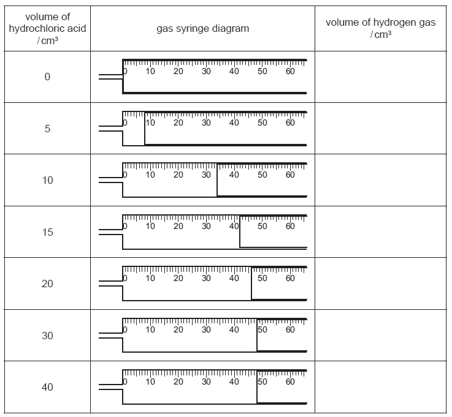
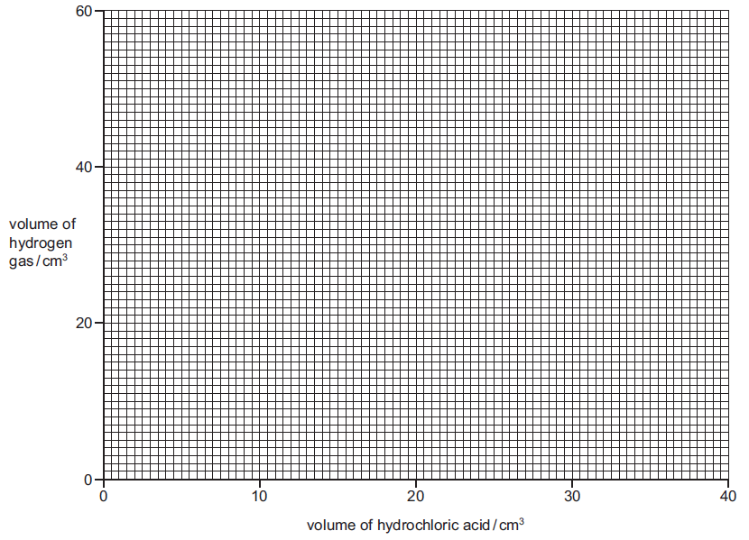
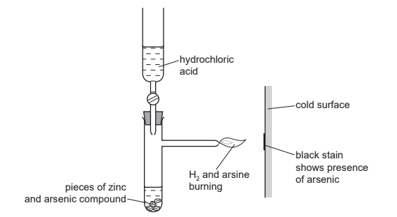
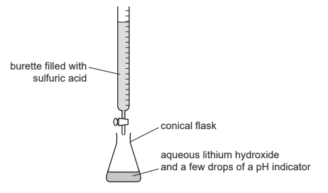
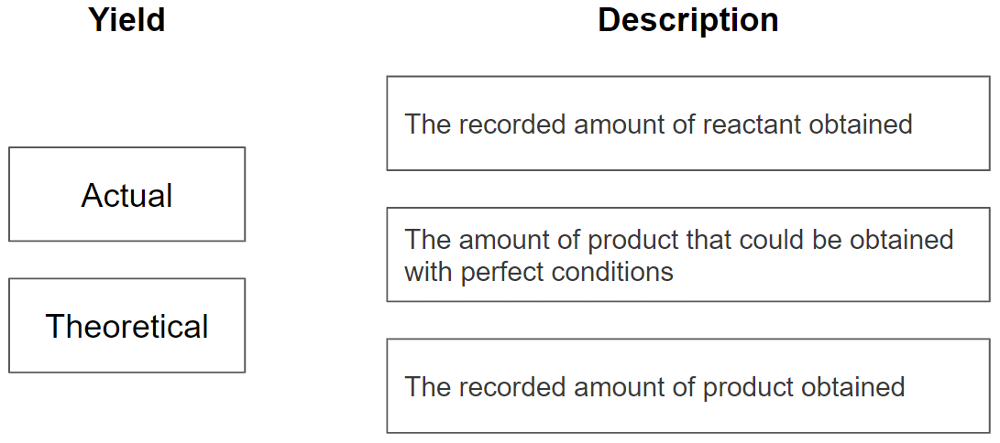
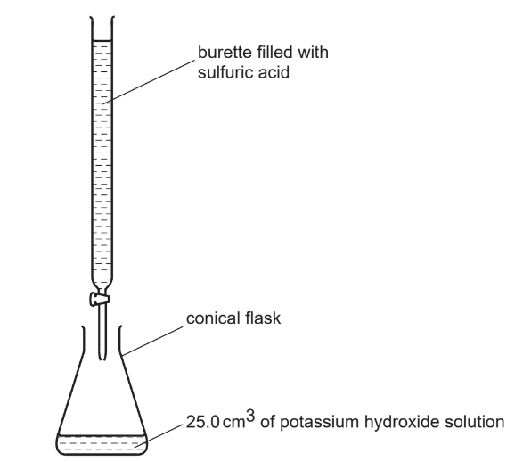
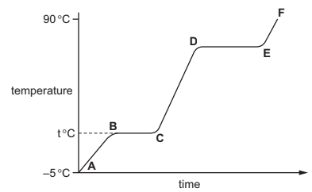
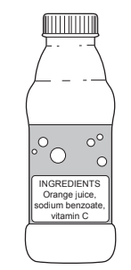
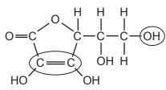
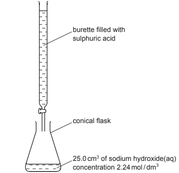

# Exam Questions — The Mole & the Avogadro Constant
**3. Stoichiometry** · Cambridge (CIE) IGCSE chemistry (0620 & 0971)
> Source: [https://www.savemyexams.com/igcse/chemistry/cie/23/topic-questions/](https://www.savemyexams.com/igcse/chemistry/cie/23/topic-questions/) · 52 questions across 3 sets

## Alternative To Practical Questions (4 questions)

### Q1 — medium — 6 marks

**Q1** [6 marks]

Beach sand is a mixture of sand and broken shells (calcium carbonate). Calcium carbonate reacts with dilute hydrochloric acid to form a solution of calcium chloride.

Plan an investigation to find out the percentage of shell material in a given sample of beach sand.

*Source: 2003 6 Q6*

### Q2 — medium — 15 marks

**Q2** [3 marks]

A student investigated the reaction of zinc powder with dilute hydrochloric acid using the apparatus below.

The same mass of zinc was added to different volumes of hydrochloric acid at room temperature, 20 oC. The total volume of hydrogen gas given off in each experiment was measured.

Use the gas syringe diagrams to record the volumes of hydrogen gas in the table.

[3]

*Source: 2014 61 Q3*

**Q2** [4 marks]

**Extract:**

A student investigated the reaction of zinc powder with dilute hydrochloric acid using the apparatus below. The same mass of zinc was added to different volumes of hydrochloric acid at room temperature, 20 °C. The total volume of hydrogen gas given off in each experiment was measured. Use the gas syringe diagrams to record the volumes of hydrogen gas in the table.

On the grid, plot the points and draw a smooth line graph.

*Source: 2014 61 Q3*

**Q2** [4 marks]

**Extract:**

A student investigated the reaction of zinc powder with dilute hydrochloric acid using the apparatus below. The same mass of zinc was added to different volumes of hydrochloric acid at room temperature, 20 °C. The total volume of hydrogen gas given off in each experiment was measured.

On the grid, plot the points and draw a smooth line graph.

i) Which point is inaccurate?

[1]

ii) Suggest a possible reason for this inaccurate measurement.

[1]

iii) Use your graph to work out the volume that would be expected to be formed.

Show clearly on the grid how you got your answer.

[2]

*Source: 2014 61 Q3*

**Q2** [2 marks]

**Extract:**

A student investigated the reaction of zinc powder with dilute hydrochloric acid using the apparatus below. The same mass of zinc was added to different volumes of hydrochloric acid at room temperature, 20 °C. The total volume of hydrogen gas given off in each experiment was measured.

Explain why the volume of hydrogen gas does not increase after 30 cm3 of hydrochloric acid.

*Source: 2014 61 Q3*

**Q2** [2 marks]

**Extract:**

A student investigated the reaction of zinc powder with dilute hydrochloric acid using the apparatus below. The same mass of zinc was added to different volumes of hydrochloric acid at room temperature, 20 °C. The total volume of hydrogen gas given off in each experiment was measured.

Sketch on the grid the graph you would expect if the experiments were repeated using the same mass of zinc granules.

### Q3 — medium — 6 marks

**Q3** [6 marks]

Some documents are stored in containers with packets of silica gel crystals. These crystals absorb water from air that enters the container. Water could damage the documents. Anhydrous cobalt(II) chloride is added to the silica gel. As the crystals absorb water they change colour from blue to pink. Heating the silica gel in an oven removes the water from the crystals so that the crystals can be reused.

Plan an experiment to find the mass of water absorbed by a packet of silica gel crystals.

*Source: 2013 61 Q6A*

### Q4 — medium — 6 marks

**Q4** [6 marks]

Calcium burns in air to form calcium oxide. The reaction is vigorous and some of the calcium oxide can be lost as smoke.

Plan an investigation to determine the maximum mass of oxygen that combines to form calcium oxide when 2 g of calcium granules are burnt in air.

You are provided with common laboratory apparatus and calcium granules.

*Source: 2016 6 Q4*

## Multiple Choice Questions (22 questions)

### Q1 — hard — 1 marks

**Q1** [1 mark]

What is the volume of hydrogen gas produced, measured at room temperature and pressure (r.t.p.), when 5.0 g of magnesium reacts with an excess of dilute hydrochloric acid?

(The volume of one mole of any gas is 24 dm3 at r.t.p.)

### Q2 — hard — 1 marks

**Q2** [1 mark]

How many oxygen atoms are there in 10.0 g of magnesium nitrate, Mg(NO3)2?

(The Avogadro constant, L, is 6.02 × 1023 mol−1)

### Q3 — easy — 1 marks

**Q3** [1 mark]

#### Extended Only

The complete combustion of methane produces carbon dioxide and steam.

CH4(g) + 2 O2(g) → 2 H2O(g) + CO2(g)

Which statements are about the reaction correct?

1. The empirical formula of methane is CH4
2. The number of atoms in 1 mole of methane is 4 x Avogadro’s constant
3. 1 mole of methane produces 72 dm3 of gaseous products at r.t.p
4. 1 mole of methane occupies a volume of 12 dm3 at r.t.p

### Q4 — easy — 1 marks

**Q4** [1 mark]

#### Separate: Chemistry and Extended Only

Substance **X** was analysed and found to contain 40.00% carbon, 6.67% hydrogen and 53.33% oxygen by mass.

What is the empirical formula of **X**?

### Q5 — easy — 1 marks

**Q5** [1 mark]

#### Extended Only

Calcium carbonate undergoes thermal decomposition at high temperatures to form calcium oxide and carbon dioxide.

CaCO3 → CaO + CO2

What mass of calcium oxide (*M*r = 56) is formed when 60 g of calcium carbonate (*M*r = 100) is completely decomposed?

### Q6 — easy — 1 marks

**Q6** [1 mark]

#### Extended Only

Magnesium carbonate and hydrochloric acid react to produce salt, water and carbon dioxide.

MgCO3 (s) + 2HCl (aq) → MgCl2 (aq) + H2O (l) + CO2 (g)

What is the volume of CO2 produced when 21 g of magnesium carbonate (*M*r = 84) reacts completely with excess hydrochloric acid?

One mole of gas occupies 24.0 dm3 at room temperature and pressure.

### Q7 — easy — 1 marks

**Q7** [1 mark]

#### Extended Only

Which row correctly describes the mole and the value of Avogadro’s constant?

|   | **one mole of a substance is equal to** | **one mole of a substance contains** |
|---|---|---|
| **A** | the substances relative atomic or molecular mass in grams | 6.02 x 1023 atoms, molecules or formula units |
| **B** | the substances atomic number in grams | 6.02 x 1023 atoms, molecules or formula units |
| **C** | the substances relative atomic or molecular mass in grams | 12.04 x 1023 atoms, molecules or formula units |
| **D** | the substances atomic number in grams | 12.04 x 1023 atoms, molecules or formula units |

### Q8 — hard — 1 marks

**Q8** [1 mark]

#### Extended Only

Calcium carbide and water react to produce ethyne and calcium hydroxide.

CaC2 (s) + 2H2O (l) → C2H2 (g) + Ca(OH)2 (s)

What is the volume of C2H2 produced, at standard temperature and pressure, when 45 g of water reacts completely with calcium carbide?

### Q9 — hard — 1 marks

**Q9** [1 mark]

#### Extended Only

A chemist reacted 0.6 g of magnesium with 0.6 dm3 of oxygen in a sealed container to produce magnesium oxide.

2Mg + O2 → 2MgO

Which row correctly describes the limiting reactant?

|   | **limiting reactant** | **reason** |
|---|---|---|
| **A** | Mg | in excess |
| **B** | Mg | is used up first |
| **C** | O2 | is used up first |
| **D** | O2 | in excess |

### Q10 — hard — 1 marks

**Q10** [1 mark]

#### Extended Only

Magnesium nitride and water react to produce a precipitate of magnesium hydroxide and ammonia gas.

Mg3N2 + 6 H2O → 3 Mg(OH)2 + 2 NH3

How much magnesium nitride is needed to produce 87 g of the precipitate in excess water?

### Q11 — hard — 1 marks

**Q11** [1 mark]

#### Extended Only

Aluminium and oxygen react to produce aluminium oxide.

4 Al + 3 O2 → 2 Al2O3

How many kilograms of aluminium oxide are formed when 5.4 kg of aluminium react with excess oxygen?

### Q12 — hard — 1 marks

**Q12** [1 mark]

#### Separate: Chemistry and Extended Only

A student was asked to find the concentration in g / dm3 of a solution of sulfuric acid. She transferred 25 cm3 of the acid to a 250 cm3 volumetric flask and made it up to the mark. She titrated 25 cm3 of the diluted acid against a standard solution of sodium hydroxide of 0.1 mol dm-3. The average titre of sodium hydroxide was 18 cm3.

What is the concentration of the original acid in grams per decimetre?

### Q13 — medium — 1 marks

**Q13** [1 mark]

#### Separate: Chemistry and Extended Only

What is the concentration in mol dm-3 of a solution of sodium hydroxide that contains 16 g of NaOH in 200 cm3 of distilled water?

### Q14 — medium — 1 marks

**Q14** [1 mark]

#### Separate: Chemistry and Extended Only

A student thermally decomposes 24.8 g of copper carbonate and obtains 11.2 g of copper(II) oxide and carbon dioxide gas which is released.

CuCO3 → CuO + CO2

What is the percentage yield of CuO?

### Q15 — medium — 1 marks

**Q15** [1 mark]

#### Separate: Chemistry and Extended Only

A substance was analysed and found to contain 26.57 % potassium, 35.36 % chromium, and 38.07 % oxygen by mass.

What is the empirical formula of the substance?

### Q16 — medium — 1 marks

**Q16** [1 mark]

#### Separate: Chemistry and Extended Only

A student was given a sample of hydrochloric acid and asked to find its concentration in mol dm-3. She titrated 25 cm3 of the acid against a standard solution of sodium hydroxide of 0.1 mol dm-3. The average titre of sodium hydroxide was 30 cm3.

What is the concentration of the acid?

### Q17 — medium — 1 marks

**Q17** [1 mark]

#### Separate: Chemistry and Extended Only

A sample of chalk (limestone) with a mass of 1.70 g was reacted with excess HCl and the amount of carbon dioxide given off was measured using a gas syringe. 0.36 dm3 of CO2 gas was collected at r.t.p.

CaCO3 + 2 HCl → CaCl2 + CO2 + H2O

What is the percentage purity of the chalk?

### Q18 — medium — 1 marks

**Q18** [1 mark]

#### Separate: Chemistry and Extended Only

Substance X was analysed and found to contain 40.00 % carbon, 6.67 % hydrogen and 53.33 % oxygen by mass. The compound has a relative molecular mass of 60.0 g mol-1.

What is the molecular formula of X?

## Theory Questions (30 questions)

### Q1 — medium — 7 marks

**Q1** [2 marks]

#### Separate: Chemistry and Extended Only

Quantities of chemicals, expressed in moles, can be used to find the formula of a compound, to establish an equation and to determine reacting masses.

A compound contains 72% magnesium and 28% nitrogen. What is its empirical formula?

*Source: 2009 Ju31 Q9*

**Q1** [1 mark]

A compound, Al4C3, contains only aluminium and carbon. 0.03 moles of this compound reacted with excess water to form 0.12 moles of Al(OH)3 and 0.09 moles of CH4.

Write a balanced equation for this reaction.

*Source: 2009 Ju31 Q9*

**Q1** [4 marks]

#### Extended Only

0.07 moles of silicon reacts with 25 g of bromine.

Si + 2Br2 → SiBr4

i) Which one is the limiting reagent? Explain your choice.

[3]

ii) How many moles of SiBr4 are formed?

[1]

*Source: 2009 Ju31 Q9*

### Q2 — hard — 12 marks

**Q2** [6 marks]

#### Separate: Chemistry and Extended Only

The following method is used to make crystals of hydrated nickel sulphate. An excess of nickel carbonate, 12.0 g, was added to 40 cm3 of sulphuric acid, 2.0 mol/dm3. The unreacted nickel carbonate was filtered off and the filtrate evaporated to obtain the crystals.

NiCO3 + H2SO4  → NiSO4 + CO2 + H2O

NiSO4 + 7H2O  → NiSO4.7H2O

Mass of one mole of NiSO4.7H2O = 281 g Mass of one mole of NiCO3 = 119 g

i) Calculate the mass of unreacted nickel carbonate.

Number of moles of H2SO4 in 40 cm3 of 2.0 mol/dm3 acid = 0.08 Number of moles of NiCO3 reacted = ......................................  
Mass of nickel carbonate reacted = ...................................... g Mass of unreacted nickel carbonate =  ...................................... g

[3]

ii) The experiment produced 10.4 g of hydrated nickel sulphate. Calculate the percentage yield.

The maximum number of moles of NiSO4.7H2Othat could be formed = ...................................... 
The maximum mass of NiSO4.7H2O that could be formed = ...................................... g 
The percentage yield = ...................................... %

[3]

*Source: 2005 O31 Q6*

**Q2** [6 marks]

**Extract:**

The following method is used to make crystals of hydrated nickel sulphate. An excess of nickel carbonate, 12.0 g, was added to 40 cm^3^ of sulphuric acid, 2.0 mol/dm^3^. The unreacted nickel carbonate was filtered off and the filtrate evaporated to obtain the crystals.

#### Extended Only

In the above method, a soluble salt was prepared by neutralising an acid with an insoluble base. Other salts have to be made by different methods.

i) Give a brief description of how the soluble salt, rubidium sulphate could be made from the soluble base, rubidium hydroxide.

[3]

ii) Suggest a method of making the insoluble salt, calcium fluoride.

[3]

*Source: 2005 O31 Q6*

### Q3 — easy — 5 marks

**Q3** [1 mark]

Calcium carbonate is an important raw material.

Name a rock which is made up of calcium carbonate.

*Source: 2006 O31 Q3*

**Q3** [4 marks]

When calcium carbonate is heated strongly, it decomposes.

CaCO3 → CaO + CO2

i) Calculate the relative formula mass of:    CaCO3

CaO

[2]

ii) 7.00 kg of calcium oxide was formed. What mass of calcium carbonate was heated?

[2]

*Source: 2006 O31 Q3*

### Q4 — medium — 9 marks

**Q4** [1 mark]

In a titration, a student added 25.0 cm3 of 0.200 mol/dm3 aqueous sodium hydroxide to a conical flask. The student then added a few drops of methyl orange to the solution in the conical flask. Dilute sulfuric acid is then added from a burette to the conical flask. The volume of dilute sulfuric acid needed to neutralise the aqueous sodium hydroxide was 20.0 cm3 The reaction is shown by the equation.

2NaOH + H2SO4 → Na2SO4 + 2H2O

State the colour of methyl orange in aqueous sodium hydroxide.

*Source: Specimen 04 Q4*

**Q4** [4 marks]

**Extract:**

In a titration, a student added 25.0 cm^3 of 0.200 mol/dm^3 aqueous sodium hydroxide to a conical flask. The student then added a few drops of methyl orange to the solution in the conical flask. Dilute sulfuric acid is then added from a burette to the conical flask. The volume of dilute sulfuric acid needed to neutralise the aqueous sodium hydroxide was 20.0 cm^3. The reaction is shown by the equation. 2NaOH + H2SO4 → Na2SO4 + 2H2O

#### Separate: Chemistry and Extended Only

Determine the concentration of the dilute sulfuric acid in g/dm3 using the following steps.

- Calculate the number of moles of aqueous sodium hydroxide added to the conical flask.

..................... mol

- Calculate the number of moles of dilute sulfuric acid added from the burette.

...................... mol

- Calculate the concentration of the dilute sulfuric acid in mol/dm3.

............ mol/dm3

- Calculate the concentration of the dilute sulfuric acid in g/dm3.

............... g/dm3

*Source: Specimen 04 Q4*

**Q4** [4 marks]

#### Separate: Chemistry and Extended Only

Ethanoic acid is a weak acid and hydrochloric acid is a strong acid. Both ethanoic acid and hydrochloric acid dissociate in aqueous solution.

Hydrochloric acid produces salts called chlorides. Magnesium carbonate reacts with hydrochloric acid to produce magnesium chloride.

MgCO3 + 2HCl→ MgCl2 + H2O + CO2

A student used 50.00 cm3 of 2.00 mol/dm3 hydrochloric acid in an experiment to produce magnesium chloride.

Calculate the mass, in g, of magnesium carbonate needed to react exactly with 50.00 cm3 of 2.00 mol/dm3 hydrochloric acid using the following steps.

- Calculate the number of moles of HCl present in 50.00 cm3 of 2.00 mol/dm3 HCl.

.............................. mol

- Determine the number of moles of MgCO3 which would react with 50.00 cm3 of 2.00 mol/dm3 HCl.

.............................. mol

- Calculate the relative formula mass, *M*r, of MgCO3.

*M*r of MgCO3 = ..............................

- Calculate the mass of MgCO3 needed to react exactly with 50.00 cm3 of 2.00 mol/dm3 HCl.

mass = .............................. g

*Source: 2019 41/04 Q4*

### Q5 — hard — 11 marks

**Q5** [4 marks]

Until recently, arsenic poisoning, either deliberate or accidental, has been a frequent cause of death. The symptoms of arsenic poisoning are identical with those of a common illness, cholera. A reliable test was needed to prove the presence of arsenic in a body.

In 1840, Marsh devised a reliable test for arsenic

Hydrogen is formed in this reaction. Any arsenic compound reacts with this hydrogen to form arsine which is arsenic hydride, AsH3.

i) The mixture of hydrogen and arsine is burnt at the jet and arsenic forms as a black stain on the glass. Write an equation for the reaction which forms hydrogen.

[2]

ii) Draw a diagram which shows the arrangement of the outer electrons in one molecule of the covalent compound arsine. The electron distribution of arsenic is 2 + 8 + 18 + 5. Use x to represent an electron from an arsenic atom. Use o to represent an electron from a hydrogen atom.

[2]

*Source: 2012 O33 Q6*

**Q5** [4 marks]

**Extract:**

Hydrogen is formed in this reaction. Any arsenic compound reacts with this hydrogen to form arsine which is arsenic hydride, AsH~3~.

#### Separate: Chemistry and Extended Only

Another hydride of arsenic has the composition below.

arsenic 97.4% hydrogen 2.6%

i) Calculate the empirical formula of this hydride from the above data. Show your working.

[2]

ii) The mass of one mole of this hydride is 154 g. What is its molecular formula?

[1]

iii) Deduce the structural formula of this hydride.

[1]

*Source: 2012 O33 Q6*

**Q5** [3 marks]

#### Separate: Chemistry and Extended Only

In the 19th Century, a bright green pigment, copper(II) arsenate(V) was used to kill rats and insects. In damp conditions, micro-organisms can act on this compound to produce the very poisonous gas, arsine.

i) Suggest a reason why it is necessary to include the oxidation states in the name of the compound.

[1]

ii) The formula for the arsenate(V) ion is AsO43–.

Complete the ionic equation for the formation of copper(II) arsenate(V).

......Cu2+ + ......AsO43– → ..................................

[2]

*Source: 2012 O33 Q6*

### Q6 — medium — 9 marks

**Q6** [1 mark]

#### Extended Only

This question is about elements X, Y and Z.

What is the name of the amount of any substance that contains 6.02 × 1023 particles?

*Source: 2020 41 Q1B*

**Q6** [1 mark]

#### Extended Only

The constant 6.02 × 1023 has a name. What is the name of this constant?

*Source: 2020 Ju41 Q1B*

**Q6** [2 marks]

#### Separate: Chemistry and Extended Only

Sulfur dioxide, SO2, is used in the manufacture of sulfuric acid.

The next stage of the process is a reaction which can reach equilibrium. The equation for this stage is shown.

2SO2 (g) + O2 (g) $\underset{}{\rightleftharpoons}$ 2SO3 (g)

Calculate the percentage by mass of sulfur in sulfur trioxide, SO3.

percentage = ..............................%

*Source: 2020 Ju41 Q4D*

**Q6** [3 marks]

#### Separate: Chemistry and Extended Only

This question is about reactions of bases and acids.

A student wanted to find the concentration of some dilute sulfuric acid by titration. The student found that 25.0 cm3 of 0.0400 mol/dm3 NaOH (aq) reacted exactly with 20.0 cm3 of H2SO4 (aq). Calculate the concentration of the H2SO4(aq) in mol/dm3 using the following steps.

- Calculate the number of moles of NaOH in 25.0 cm3.

moles = ..............................

- Deduce the number of moles of H2SO4 that reacted with the 25.0 cm3 of NaOH (aq).

moles = ..............................

- Calculate the concentration of H2SO4 (aq) in mol/dm3.

concentration = .............................. mol/dm3

*Source: 2020 Ju41 Q4D*

**Q6** [2 marks]

#### Separate: Chemistry and Extended Only

A student wanted to find the concentration of some dilute sulfuric acid by titration. The student found that 25.0 cm3 of 0.0400 mol/dm3 NaOH (aq) reacted exactly with 20.0 cm3 of H2SO4 (aq).

Calculate the concentration of the 0.0400 mol/dm3 NaOH (aq) in g/dm3.

concentration = .............................. g/dm3

*Source: 2020 Ju41 Q4D*

### Q7 — medium — 6 marks

**Q7** [3 marks]

#### Extended Only

When copper(II) oxide is heated at 800 °C it undergoes the reaction shown by the equation.

4CuO → 2Cu2O + O2

Calculate the volume of oxygen, measured at r.t.p., which is formed when 1.60 g of CuO reacts as shown in the equation.

*Source: Specimen 04 Q3B*

**Q7** [3 marks]

#### Separate: Chemistry and Extended Only

Oxygen is produced by the decomposition of hydrogen peroxide. Manganese(IV) oxide is the catalyst for this reaction. The equation for the decomposition of hydrogen peroxide is shown.

2H2O2 (aq) → 2H2O (l) + O2 (g)

25.0 cm3 of aqueous hydrogen peroxide forms 48.0 cm3 of oxygen at room temperature and pressure (r.t.p.). Calculate the concentration of aqueous hydrogen peroxide at the start of the experiment using the following steps.

- Calculate the number of moles of oxygen formed.
- Deduce the number of moles of hydrogen peroxide that decomposed.
- Calculate the concentration of hydrogen peroxide in mol/dm3.

*Source: 2020 Ju42/04 Q4E*

### Q8 — hard — 13 marks

**Q8** [2 marks]

#### Separate: Chemistry and Extended Only

Sulfuric acid is made by the Contact process.

2SO2 + O2 $\rightleftharpoons$ 2SO3

This is carried out in the presence of a catalyst at 450°C and 2 atmospheres pressure.

i) Name the catalyst used.

[1]

ii) If the temperature is decreased to 300°C, the yield of sulfur trioxide increases. Explain why this lower temperature is not used.

[1]

*Source: 2009 O31 Q6*

**Q8** [5 marks]

#### Separate: Chemistry and Extended Only

Sulfuric acid was first made in the Middle East by heating the mineral, green vitriol, FeSO4.7H2O. The gases formed were cooled. FeSO4.7H2O (s) → FeSO4 (s) + 7H2O (g) green crystals      yellow powder 2FeSO4 (s) → Fe2O3 (s) + SO2 (g) + SO3 (g) On cooling SO3 + H2O → H2SO4 sulfuric acid SO2 + H2O → H2SO3 sulfurous acid

i) How could you show that the first reaction is reversible?

[2]

ii) Sulfurous acid is a reductant (reducing agent). What would you see when acidified potassium manganate(VII) is added to a solution containing this acid?

[2]

iii) Suggest an explanation why sulfurous acid in contact with air changes into sulfuric acid.

[1]

*Source: 2009 O31 Q6*

**Q8** [6 marks]

**Extract:**

9.12 g of anhydrous iron(II) sulfate was heated. Calculate the mass of iron(III) oxide formed and the volume of sulfur trioxide, at r.t.p., formed. 

2FeSO4 (s) → Fe2O3 (s) + SO2 (g) + SO3 (g)

mass of one mole of FeSO4 = 152 g

#### Extended Only

9.12 g of anhydrous iron(II) sulfate was heated. Calculate the mass of iron(III) oxide formed and the volume of sulfur trioxide, at r.t.p., formed.

2FeSO4 (s) → Fe2O3 (s) + SO2 (g) + SO3 (g)

mass of one mole of FeSO4 = 152 g number of moles of FeSO4 used = _____________ number of moles of Fe2O3 formed = _____________  mass of one mole of Fe2O3 = _____________ g mass of iron(III) oxide formed = _____________ g number of moles of SO3 formed = _____________  volume of sulfur trioxide formed = _____________ dm3

*Source: 2009 O31 Q6*

### Q9 — medium — 16 marks

**Q9** [2 marks]

The alkanes are a family of saturated hydrocarbons. Their reactions include combustion, cracking and substitution.

i) What is meant by the term *hydrocarbon*?

[1]

ii) What is meant by the term *saturated*?

[1]

*Source: 2014 Ju33 Q6A*

**Q9** [3 marks]

#### Separate: Chemistry Only

i) What is the general formula for the homologous series of alkanes?

[1]

ii) Calculate the mass of one mole of an alkane with 14 carbon atoms.

[2]

*Source: 2014 Ju33 Q6B*

**Q9** [5 marks]

#### Extended Only

The complete combustion of hydrocarbons produces carbon dioxide and water only.

i) Write the equation for the complete combustion of nonane, C9H20.

[2]

ii) 20cm3 of a gaseous hydrocarbon was mixed with an excess of oxygen, 200 cm3. The mixture was ignited. After cooling, 40 cm3 of oxygen and 100 cm3 of carbon dioxide remained.

Deduce the formula of the hydrocarbon and the equation for its combustion. All volumes were measured at r.t.p..

[3]

*Source: 2014 Ju33 Q6C*

**Q9** [4 marks]

Cracking is used to obtain short-chain alkanes, alkenes and hydrogen from long-chain alkanes.

i) Give a use for each of the three products listed above.

short-chain alkanes ..................................................

alkenes ..................................................

hydrogen ..................................................

[3]

ii) Write an equation for the cracking of decane, C10H22, which produces two different alkenes and hydrogen as the only products.

[1]

*Source: 2014 Ju33 Q6D*

**Q9** [2 marks]

#### Separate: Chemistry and Extended Only

Chlorine reacts with propane in a substitution reaction to form 1-chloropropane.

CH3–CH2–CH3 + Cl2 → CH3–CH2–CH2–Cl + HCl

i) What is the essential condition for the above reaction?

[1]

ii) There is more than one possible substitution reaction between chlorine and propane.

Suggest the structural formula of a different product.

[1]

*Source: 2014 Ju33 Q6E*

### Q10 — hard — 13 marks

**Q10** [5 marks]

The soluble salt hydrated lithium sulfate is made by titration from the soluble base lithium hydroxide.

The sulfuric acid is added slowly from the burette until the indicator just changes colour. The volume of sulfuric acid  needed to just neutralise the lithium hydroxide is noted.

Describe how you would continue the experiment to obtain pure dry crystals of hydrated lithium sulfate.

*Source: 2014 Ju32 Q7*

**Q10** [4 marks]

#### Separate: Chemistry and Extended Only

Using 25.0 cm3 of aqueous lithium hydroxide, concentration 2.48 mol / dm3, 2.20 g of hydrated lithium sulfate was obtained.

Calculate the percentage yield, giving your answer to one decimal place.

2LiOH + H2SO4 → Li2SO4 + 2H2O Li2SO4 + H2O → Li2SO4.H2O

Number of moles of LiOH used = .......................

Number of moles of Li2SO4.H2O which could be formed = .......................

Mass of one mole of Li2SO4.H2O = 128g

Maximum yield of Li2SO4.H2O = ....................... g

Percentage yield = .......................%

*Source: 2014 Ju32 Q7*

**Q10** [4 marks]

#### Separate: Chemistry and Extended Only

An experiment was carried out to show that the formula of the hydrated salt is Li2SO4.H2O. A sample of the hydrated salt was weighed and its mass recorded. It was then heated and the anhydrous salt was weighed. This procedure was repeated until two consecutive masses were the same. This procedure is called ‘heating to constant mass’.

i) What is the reason for heating to constant mass?

[1]

ii) The mass of the hydrated salt is m1 and the mass of the anhydrous salt is m2. Explain how you could show that the hydrated salt has one mole of water of crystallisation per mole of the anhydrous salt.

[3]

*Source: 2014 Ju32 Q7*

### Q11 — easy — 11 marks

**Q11** [4 marks]

#### Separate: Chemistry and Extended Only

This question is about the yield of chemical reactions.

In practice, scientists aim for a 100% yield but this is rarely achieved.

Complete the sentences to explain why a 100% yield is not achieved using words from the list.

| **side reactions** | **transfer** | **complete** | **incomplete** |
|---|---|---|---|
| **purification** | **reversible** | **irreversible** | **mixing** |

Reactants and products can be left behind during _______________ from one container to another.

_______________ reactions can never have a 100% yield because the products are forming reactants.

A reaction might not go to completion because of _______________ or the presence of an impurity. These reactions are described as _______________ .

**Q11** [2 marks]

#### Separate: Chemistry and Extended Only

There are different types of yield.

The percentage yield compares the actual yield to the theoretical yield.

Draw **one** line from each yield to its description.

**Q11** [1 mark]

#### Extended Only

A student completed an experiment using magnesium to displace copper from copper(II) sulfate.

Mg + CuSO4 → Cu + MgSO4

The student added 4.8 g of magnesium to a solution of copper(II) sulfate.

Calculate the number of moles of magnesium that the student used.

Relative atomic mass (*A*r):     Mg = 24

Use the equation:

$\mathrm{moles}=\frac{\mathrm{mass}}{M_{r}}$

**Q11** [2 marks]

**Extract:**

A student completed an experiment using magnesium to displace copper from copper(II) sulfate.

Mg + CuSO~4~ → Cu + MgSO~4~

The student added 4.8 g of magnesium to a solution of copper(II) sulfate.

Calculate the number of moles of magnesium that the student used. Moles = mass/Mr = 4.8/24 = 0.2 moles

#### Separate: Chemistry and Extended Only

Using your answer to part (c), calculate the theoretical yield of copper.

Relative atomic mass (*A*r):     Cu = 63.5

Theoretical yield of copper = ________ g

**Q11** [2 marks]

**Extract:**

A student completed an experiment using magnesium to displace copper from copper(II) sulfate. Mg + CuSO~4~ → Cu + MgSO~4~ The student added 4.8 g of magnesium to a solution of copper(II) sulfate. Relative atomic mass (Ar): Mg = 24, Cu = 63.5.
Using part (c), the theoretical yield of copper: Maximum number of moles of copper = 0.2 moles; Maximum mass of copper = moles x Mr = 0.2 x 63.5 = 12.7 g.

#### Separate: Chemistry and Extended Only

Another student completes the same experiment using 4.8 g of magnesium.

They obtain 10.16 g of copper.

What is the percentage yield of this student's experiment?

### Q12 — medium — 5 marks

**Q12** [1 mark]

#### Separate: Chemistry and Extended Only

Ammonia, NH3, is used to produce nitric acid, HNO3. This happens in a three-stage process. Stage 1 is a redox reaction.

4NH3 + 5O2 → 4NO + 6H2O

In this reaction the predicted yield of NO is 512 g. The actual yield is 384 g. Calculate the percentage yield of NO in this reaction.

percentage yield of NO = ................................ %

*Source: 2020 Ju43/04 Q2D*

**Q12** [4 marks]

**Extract:**

Ammonia, NH~3~, is used to produce nitric acid, HNO~3~. This happens in a three-stage process. Stage 1 is a redox reaction.

#### Extended Only

The equation for the reaction in stage 3 is shown.

4NO2 + 2H2O + O2 → 4HNO3

Calculate the volume of O2 gas, at room temperature and pressure (r.t.p.), needed to produce 1260 g of HNO3.

Use the following steps.

- Calculate the number of moles of HNO3.

moles of HNO3 = ..............................

- Deduce the number of moles of O2 that reacted.

moles of O2 = ..............................

- Calculate the volume of O2 gas that reacts at room temperature and pressure (r.t.p.).

volume of O2 gas = .............................. dm3

*Source: 2020 Ju43/04 Q2D*

### Q13 — medium — 11 marks

**Q13** [1 mark]

#### Extended Only

Chemists use the concept of the mole to calculate the amounts of chemicals involved in a reaction.

Define *mole*.

*Source: 2004 Ju31 Q7*

**Q13** [6 marks]

#### Extended Only

3.0 g of magnesium was added to 12.0 g of ethanoic acid.

Mg + 2CH3COOH → (CH3COO)2Mg + H2

The mass of one mole of Mg is 24 g.

The mass of one mole of CH3COOH is 60 g.

i) Which one, magnesium or ethanoic acid, is in excess? You must show your reasoning.

[3]

ii) How many moles of hydrogen were formed?

[1]

iii) Calculate the volume of hydrogen formed, measured at r.t.p.

[2]

*Source: 2004 Ju31 Q7*

**Q13** [4 marks]

#### Separate: Chemistry and Extended Only

In an experiment, 25.0 cm3 of aqueous sodium hydroxide, 0.4 mol / dm3, was neutralised by 20.0 cm3 of aqueous oxalic acid, H2C2O4.

2NaOH + H2C2O4 → Na2C2O4 +2H2O

i) Calculate the number of moles of NaOH in 25.0 cm3 of 0.4 mol / dm3 solution.

[1]

ii) Use your answer to (i) and the mole ratio in the equation to find out the number of moles of H2C2O4 in 20 cm3 of solution.

[1]

iii) Calculate the concentration, mol / dm3, of the aqueous oxalic acid.

[2]

*Source: 2004 Ju31 Q7*

### Q14 — medium — 8 marks

**Q14** [1 mark]

#### Separate: Chemistry and Extended Only

Titanium is a transition element. It is isolated by the following reactions.

titanium ore → titanium(IV) oxide → titanium(IV) chloride → titanium

TiO2                          TiCl4                  Ti

Why is it usually necessary to include a number in the name of the compounds of transition elements?

*Source: 2010 Ju31 Q7*

**Q14** [2 marks]

#### Separate: Chemistry and Extended Only

Titanium(IV) chloride is made by heating the oxide with coke and chlorine.

TiO2 + 2Cl2 $\rightleftharpoons$ TiCl4 + O2

2C + O2 $\rightleftharpoons$ 2CO

Explain why the presence of coke ensures the maximum yield of the metal chloride.

*Source: 2010 Ju31 Q7*

**Q14** [1 mark]

**Extract:**

Titanium is a transition element. It is isolated by the following reactions. titanium ore → titanium(IV) oxide → titanium(IV) chloride → titanium, TiO~2~ TiCl~4~ Ti

#### Separate: Chemistry and Extended Only

Explain why the change, titanium(IV) chloride to titanium, is reduction.

*Source: 2010 Ju31 Q7*

**Q14** [4 marks]

#### Separate: Chemistry and Extended Only

The titanium ore contains 36.8% iron, 31.6% titanium and the remainder is oxygen.

i) Determine the percentage of oxygen in this titanium compound.

[1]

ii) Calculate the number of moles of atoms for each element. The number of moles of Fe is shown as an example. Number of moles of Fe = 36.8/56 = 0.66

[1]

iii) What is the simplest ratio for the moles of atoms, Fe : Ti : O?

[1]

iv) What is the formula of this titanium compound?

[1]

*Source: 2010 Ju31 Q7*

### Q15 — hard — 15 marks

**Q15** [6 marks]

Calcium and other minerals are essential for healthy teeth and bones. Tablets can be taken to provide these minerals.

Healthy Bones

*Each tablet contains *calcium magnesium zinc copper boron

Boron is a non-metal with a macromolecular structure.

i) Predict two physical properties of boron.

[2]

ii) Name another element and a compound that have macromolecular structures.

[2]

iii) Sketch the structure of one of the above macromolecular substances.

[2]

*Source: 2003 Ju31 Q2*

**Q15** [4 marks]

Describe the reactions, if any, of zinc and copper(II) ions with an excess of aqueous sodium hydroxide.

i) Zinc ions Addition of aqueous sodium hydroxide: Excess sodium hydroxide:

[2]

ii) Copper(II) ions

Addition of aqueous sodium hydroxide: Excess sodium hydroxide:

[2]

*Source: 2003 Ju31 Q2*

**Q15** [5 marks]

#### Extended Only

Each tablet contains the same number of moles of CaCO3 and MgCO3. One tablet reacted with excess hydrochloric acid to produce 0.24 dm3 of carbon dioxide at r.t.p.

CaCO3 + 2HCl → CaCl2 + CO2 + H2O MgCO3 + 2HCl → MgCl2 + CO2 + H2O

i) Calculate how many moles of CaCO3 there are in one tablet. Number of moles CO2 = Number of moles of CaCO3 and MgCO3 = Number of moles of CaCO3 =

[3]

ii) Calculate the volume of hydrochloric acid, 1.0 mol / dm3, needed to react with one tablet. Number of moles of CaCO3 and MgCO3 in one tablet =  Use your answer to (c)(i). Number of moles of HCl needed to react with one tablet =

Volume of hydrochloric acid, 1.0 mol / dm3, needed to react with one tablet =

[2]

*Source: 2003 Ju31 Q2*

### Q16 — hard — 14 marks

**Q16** [4 marks]

#### Separate: Chemistry and Extended Only

Sulfur dioxide, SO2, and sulfur trioxide, SO3, are the two oxides of sulfur.

Sulfur trioxide can be made from sulfur dioxide.

i) Why is this reaction important industrially?

[1]

ii) Complete the word equation.

sulfur dioxide + .............................................. → sulfur trioxide

[1]

iii) What are the conditions for this reaction?

[2]

*Source: 2003 O31 Q5*

**Q16** [5 marks]

#### Separate: Chemistry and Extended Only

Sulphur dioxide is easily oxidised in the presence of water.

SO2 + 2H2O – 2e– → SO42– + 4H+

i) What colour change would be observed when an excess of aqueous sulphur dioxide is added to an acidic solution of potassium manganate(VII)?

[2]

ii) To aqueous sulphur dioxide, acidified barium chloride solution is added. The mixture remains clear. When bromine is  added, a thick white precipitate forms. What is the white precipitate? Explain why it forms.

[3]

*Source: 2003 O31 Q5*

**Q16** [5 marks]

#### Extended Only

Sulphur dioxide reacts with chlorine in an addition reaction to form sulphuryl chloride.

SO2 + Cl2 → SO2Cl2

8.0 g of sulphur dioxide was mixed with 14.2 g of chlorine. The mass of one mole of SO2Cl2 is 135 g. Calculate the mass of sulphuryl chloride formed by this mixture.

Calculate the number of moles of SO2 in the mixture = ..................

Calculate the number of moles of Cl2 in the mixture = ..................

Which reagent was not in excess? ...............................

How many moles of SO2Cl2 were formed = ...................

Calculate the mass of sulphuryl chloride formed = ............. g

*Source: 2003 O31 Q5*

### Q17 — medium — 9 marks

**Q17** [3 marks]

#### Separate: Chemistry and Extended Only

Two salts can be made from potassium hydroxide and sulfuric acid. They are potassium sulfate, K2SO4, and the acid salt potassium hydrogen sulfate, KHSO4. They are both made by titration.

25.0 cm3 of potassium hydroxide, concentration of 2.53 mol / dm3, was neutralised by 28.2 cm3 of dilute sulfuric acid.

2KOH (aq) + H2SO4 (aq) → K2SO4 (aq) + 2H2O (l)

Calculate the concentration of the sulfuric acid. number of moles of KOH used = ............................ number of moles of H2SO4 needed to neutralise the KOH = ............................ concentration of dilute sulfuric acid = ............................ mol / dm3

*Source: 2015 O33 Q7*

**Q17** [4 marks]

**Extract:**

Two salts can be made from potassium hydroxide and sulfuric acid. They are potassium sulfate, K~2~SO~4~, and the acid salt potassium hydrogen sulfate, KHSO~4~. They are both made by titration.

25.0 cm^3 ^of potassium hydroxide, concentration of 2.53 mol / dm^3^, was neutralised by 28.2 cm^3^ of dilute sulfuric acid.

2KOH (aq) + H~2~SO~4 ~(aq) → K~2~SO~4 ~(aq) + 2H~2~O (l)

In the conical flask there is a neutral solution of potassium sulfate which still contains the indicator used in the titration.

i) Describe how you could obtain a solution of potassium sulfate without the indicator.

[2]

ii) Potassium hydrogen sulfate can be made by the following reaction.

KOH (aq) + H2SO4 (aq) → KHSO4 (aq) + H2O (l)

Suggest how you could make a solution of potassium hydrogen sulfate without using an indicator.

[2]

*Source: 2015 O33 Q7*

**Q17** [2 marks]

Describe a test which would distinguish between aqueous solutions of potassium sulfate and sulfuric acid.

Test:

Result:

*Source: 2015 O33 Q7*

### Q18 — medium — 5 marks

**Q18** [2 marks]

#### Separate: Chemistry and Extended Only

The food additive E220 is sulfur dioxide. It is a preservative for a variety of foods and drinks.

Sulfur dioxide is a reductant (reducing agent). Describe what you would see when aqueous sulfur dioxide is added to acidified potassium manganate(VII).

*Source: 2012 O32 Q5*

**Q18** [3 marks]

#### Extended Only

Sulfur dioxide can also be made by the reaction between a sulfite and an acid.

Na2SO3 + 2HCl → 2NaCl + SO2 + H2O

Excess hydrochloric acid was added to 3.15 g of sodium sulfite. Calculate the maximum volume, measured at r.t.p., of sulfur dioxide which could be formed. The mass of one mole of Na2SO3 is 126 g.

*Source: 2012 O32 Q5*

### Q19 — hard — 10 marks

**Q19** [4 marks]

Soluble salts can be made using a base and an acid.

Complete this method of preparing dry crystals of the soluble salt cobalt(II) chloride-6-water from the insoluble base cobalt(II) carbonate.

**step 1**    Add an excess of cobalt(II) carbonate to hot dilute hydrochloric acid.   **step 2**

**step 3**

**step 4**

*Source: 2016 Specimen4 Q6*

**Q19** [6 marks]

i)

5.95 g of cobalt(II) carbonate were added to 40 cm3 of hydrochloric acid, concentration 2.0 mol / dm3. Calculate the maximum yield of cobalt(II) chloride-6-water and show that the cobalt(II) carbonate was in excess.

CoCO3 + 2HCl → CoCl2 + CO2 + H2O CoCl2 + 6H2O → CoCl2.6H2O

**maximum yield: **

number of moles of HCl used = .........................................

number of moles of CoCl2 formed = ................................

number of moles of CoCl2.6H2O formed = .......................................................

mass of one mole of CoCl2.6H2O = 238 g

maximum yield of CoCl2.6H2O = ...................................................................g

**to show that cobalt(II) carbonate is in excess: **

number of moles of HCl used = ..................................... (use your value from above)

mass of one mole of CoCO3 = 119 g

number of moles of CoCO3 in 5.95 g of cobalt(II) carbonate = ..............................

[5]

ii) Explain how these calculations show that cobalt(II) carbonate is in excess.

[1]

*Source: 2016 Specimen4 Q6*

### Q20 — hard — 14 marks

**Q20** [3 marks]

#### Separate: Chemistry and Extended Only

The elements in Period 3 and some of their common oxidation states are shown below.

| **Element** | Na | Mg | Al | Si | P | S | I | Ar |
|---|---|---|---|---|---|---|---|---|
| **Oxidation state** | +1 | +2 | +3 | +4 | -3 | -2 | -1 | 0 |

i) Why do the oxidation states increase from sodium to silicon?

[1]

ii) After Group(IV) the oxidation states are negative and decrease across the period. Explain why.

[2]

*Source: 2002 031 Q3*

**Q20** [1 mark]

**Extract:**

The elements in Period 3 and some of their common oxidation states are shown below.
| Element | Na | Mg | Al | Si | P | S | I | Ar |
| Oxidation state | +1 | +2 | +3 | +4 | -3 | -2 | -1 | 0 |

Aluminium sulfide contains two elements. Predict its formula.

*Source: 2002 O31 Q3*

**Q20** [3 marks]

**Extract:**

The elements in Period 3 and some of their common oxidation states are shown below.

| **Element** | Na | Mg | Al | Si | P | S | I | Ar |
| **Oxidation state** | +1 | +2 | +3 | +4 | -3 | -2 | -1 | 0 |

#### Separate: Chemistry and Extended Only

Choose a different element from Period 3 that matches each description.

i) It has a similar structure to diamond.

[1]

ii) It reacts violently with cold water to form a solution pH = 14.

[1]

iii) It has a gaseous oxide of the type XO2, which is acidic.

[1]

*Source: 2002 O31 Q3*

**Q20** [3 marks]

#### Extended Only

Draw a diagram that shows the arrangement of the outer electrons in the ionic compound sodium phosphide. Use o to represent an electron from sodium. Use x to represent an electron from phosphorus.

*Source: 2002 O31 Q3*

**Q20** [4 marks]

#### Extended Only

Sodium reacts with sulphur to form sodium sulfide.

2Na + S → Na2S

An 11.5 g sample of sodium is reacted with 10 g of sulfur. All of the sodium reacted but there was an excess of sulfur.

Calculate the mass of sulfur left unreacted.

i) Number of moles of sodium atoms reacted =  [2 moles of Na react with 1 mole of S]

[1]

ii) Number of moles of sulfur atoms that reacted =

[1]

iii) Mass of sulfur reacted, in grams =

[1]

iv) Mass of sulfur left unreacted, in grams =

[1]

*Source: 2002 O31 Q3*

### Q21 — medium — 5 marks

**Q21** [5 marks]

#### Extended Only

Iron(III) sulphate decomposes when heated. Calculate the mass of iron(III) oxide formed and the volume of sulphur trioxide produced when 10.0 g of iron(III) sulphate was heated.  Mass of one mole of Fe2(SO4)3 is 400 g.

Fe2(SO4)3 (s)→ Fe2O3 (s) + 3SO3 (g)

Number of moles of Fe2(SO4)3 =

Number of moles of Fe2O3 formed =

Mass of iron(III) oxide formed in g =

Number of moles of SO3 produced =

Volume of sulphur trioxide at r.t.p. in dm3 =

[5]

*Source: 2004 O31 Q7*

### Q22 — medium — 9 marks

**Q22** [1 mark]

Dilute hydrochloric acid reacts with sodium carbonate solution.

2HCl (aq) + Na2CO3 (aq) → 2NaCl (aq) + H2O (l) + CO2 (g)

Explain why effervescence is seen during the reaction.

*Source: 2016 Ju43 Q5*

**Q22** [5 marks]

**Extract:**

Dilute hydrochloric acid reacts with sodium carbonate solution.
2HCl (aq) + Na~2~CO~3 ~(aq) → 2NaCl (aq) + H~2~O (l) + CO~2 ~(g)

#### Separate: Chemistry and Extended Only

Dilute hydrochloric acid was titrated with sodium carbonate solution.

- 10.0 cm3 of 0.100 mol / dm3 hydrochloric acid were placed in a conical flask.
- A few drops of methyl orange indicator were added to the dilute hydrochloric acid
- The mixture was titrated with sodium carbonate solution.
- 16.2 cm3 of sodium carbonate solution were required to react completely with the acid.

i) What colour would the methyl orange indicator be in the hydrochloric acid?

[1]

ii) Calculate how many moles of hydrochloric acid were used.

[1]

iii) Use your answer to (b)(ii) and the equation for the reaction to calculate the number of moles of sodium carbonate that reacted.

[1]

iv) Use your answer to (b)(iii) to calculate the concentration of the sodium carbonate solution in mol / dm3.

[2]

*Source: 2016 Ju43 Q5*

**Q22** [3 marks]

**Extract:**

Dilute hydrochloric acid reacts with sodium carbonate solution. 2HCl (aq) + Na~2~CO~3 ~(aq) → 2NaCl (aq) + H~2~O (l) + CO~2 ~(g)

#### Extended Only

In another experiment, 0.020 mol of sodium carbonate were reacted with excess hydrochloric acid.

Calculate the maximum volume (at r.t.p.) of carbon dioxide gas that could be made in this reaction.

*Source: 2016 Ju43 Q5*

### Q23 — easy — 9 marks

**Q23** [4 marks]

#### Extended Only

Compound X is a colourless liquid at room temperature.

A sample of pure X was slowly heated from –5.0 °C, which is below its melting point, to 90 °C, which is above its boiling point. Its temperature is measured every minute and the results are represented on the graph.

i) Complete the equation for the equilibrium present in the region **BC**. X(s) $\rightleftharpoons$ ....................

[1]

ii) What is the significance of temperature t°C?

[1]

iii) What is the physical state of compound X in the region **EF**?

[1]

iv) What would be the difference in the region **BC** if an impure sample of X had been used?

[1]

*Source: 2014 O33 Q2*

**Q23** [5 marks]

#### Separate: Chemistry and Extended Only

Compound X is a hydrocarbon. It contains 85.7% of carbon. The mass of one mole of X is 84g.

i) What is the percentage of hydrogen in the compound?

[1]

ii) Calculate the empirical formula of X. Show your working.

[3]

iii) What is the molecular formula of compound X?

[1]

*Source: 2014 O33 Q2*

### Q24 — easy — 4 marks

**Q24** [1 mark]

**Table 1.1** shows the mass of ions present in a 100 cm3 sample of milk.

**Table 1.1**

| ion | formula of ion | mass of ion in 100 cm3 milk / mg |
|---|---|---|
| calcium | Ca2+ | 125 |
| chloride | Cl− | 120 |
| magnesium | Mg2+ | 12 |
| negative ions of organic acids |   | 160 |
| phosphate | $\mathrm{PO}_{4}^{3-}$ | 95 |
| potassium | K+ | 140 |
| sodium | Na+ | 58 |
| sulfate | $\mathrm{SO}_{4}^{2-}$ | 30 |

Calculate the mass of calcium ions present in a 20 cm3 sample of this milk.

mass of calcium ions: .................................... mg

*Source: Specimen 03 Q2*

**Q24** [1 mark]

**Extract:**

Table 1.1 shows the mass of ions present in a 100 cm^3^ sample of milk.

Table 1.1

| ion | formula of ion | mass of ion in 100 cm^3^ milk / mg |
| calcium | Ca^2+^ | 125 |
| chloride | Cl^−^ | 120 |
| magnesium | Mg^2+^ | 12 |
| negative ions of organic acids |   | 160 |
| phosphate | PO4^3-^ | 95 |
| potassium | K^+^ | 140 |
| sodium | Na^+^ | 58 |
| sulfate | SO4^2-^ | 30 |

Identify the positive ion present in the highest concentration in the 100 cm3 sample of milk.

*Source: Specimen 03 Q2*

**Q24** [1 mark]

**Extract:**

| name of ion | formula of ion | mass of ion in 1000 cm^3 of soil solution / mg |
| aluminium | Al ^3+^ | 0.2 |
| ammonium | NH4^+^ | 22.0 |
| calcium | Ca^2+^ | 0.2 |
| iron(II) | Fe^2+^ | 79.0 |
| magnesium | Mg^2+^ | 0.1 |
| nitrate | NO3^-^ | 28.0 |
| phosphate | PO4^3-^ | 14.0 |
| potassium | K^+^ | 39.0 |
| sulfate | SO4^2-^ | 5.1 |

A solution is obtained by filtering a mixture of soil and water. The table shows the mass of some of the ions in 1000 cm3 of this solution.

| name of ion | formula of ion | mass of ion in 1000 cm3 of soil solution / mg |
|---|---|---|
| aluminium | Al 3+ | 0.2 |
| ammonium | $\mathrm{NH}_{4}^{+}$ | 22.0 |
| calcium | Ca2+ | 0.2 |
| iron(II) | Fe2+ | 79.0 |
| magnesium | Mg2+ | 0.1 |
| nitrate | $\mathrm{NO}_{3}^{-}$ | 28.0 |
| phosphate | $\mathrm{PO}_{4}^{3-}$ | 14.0 |
| potassium | K+ | 39.0 |
| sulfate | $\mathrm{SO}_{4}^{2-}$ | 5.1 |

Answer this question using the information in the table.

Which negative ion has the lowest concentration?

*Source: 2020 Ju32 Q2*

**Q24** [1 mark]

A solution is obtained by filtering a mixture of soil and water. The table shows the mass of some of the ions in 1000 cm3 of this solution.

| name of ion | formula of ion | mass of ion in 1000 cm3 of soil solution / mg |
|---|---|---|
| aluminium | Al 3+ | 0.2 |
| ammonium | $\mathrm{NH}_{4}^{+}$ | 22.0 |
| calcium | Ca2+ | 0.2 |
| iron(II) | Fe2+ | 79.0 |
| magnesium | Mg2+ | 0.1 |
| nitrate | $\mathrm{NO}_{3}^{-}$ | 28.0 |
| phosphate | $\mathrm{PO}_{4}^{3-}$ | 14.0 |
| potassium | K+ | 39.0 |
| sulfate | $\mathrm{SO}_{4}^{2-}$ | 5.1 |

Answer this question using the information in the table.

Calculate the mass of nitrate ions in 200 cm3 of this solution.

mass = .............................. mg

*Source: 2020 Ju32 Q2*

### Q25 — medium — 11 marks

**Q25** [4 marks]

Across the world, food safety agencies are investigating the presence of minute traces of the toxic hydrocarbon, benzene, in soft drinks. It is formed by the reduction of sodium benzoate by vitamin C.

Sodium benzoate is a salt, it has the formula C6H5COONa. It can be made by the neutralisation of benzoic acid by sodium hydroxide.

i) Deduce the formula of benzoic acid.

[1]

ii) Write a word equation for the reaction between benzoic acid and sodium hydroxide.

[1]

iii) Name two other compounds that would react with benzoic acid to form sodium benzoate.

[2]

*Source: 2008 O31 Q4*

**Q25** [4 marks]

#### Separate: Chemistry and Extended Only

Benzene contains 92.3% of carbon and its relative molecular mass is 78.

i) What is the percentage of hydrogen in benzene?

[1]

ii) Calculate the ratio of moles of C atoms: moles of H atoms in benzene.

[1]

iii) Calculate its empirical formula and then its molecular formula. The empirical formula of benzene is ................... The molecular formula of benzene is ...................

[2]

*Source: 2008 O31 Q4*

**Q25** [3 marks]

The structural formula of Vitamin C is drawn below.

i) What is its molecular formula?

[1]

ii) Name the two functional groups which are circled.

[2]

*Source: 2010 Ju31 Q8*

### Q26 — easy — 9 marks

**Q26** [2 marks]

Ethanol is manufactured from glucose, C6H12O6, by fermentation according to the following equation.

C6H12O6 → 2C2H5OH + 2CO2

State the conditions required for this reaction.

*Source: 2015 Ja32 Q7*

**Q26** [5 marks]

**Extract:**

Ethanol is manufactured from glucose, C~6~H~12~O~6~, by fermentation according to the following equation. C~6~H~12~O~6 ~→ 2C~2~H~5~OH + 2CO~2~

#### Extended Only

In an experiment, 30.0 g of glucose was fermented.

i) Calculate the number of moles of glucose in 30.0 g.

[2]

ii) Calculate the maximum mass of ethanol that could be obtained from 30.0 g of glucose.

[2]

iii) Calculate the volume of carbon dioxide at room temperature and pressure that can be obtained from 30.0 g of glucose.

[1]

*Source: 2015 Ja32 Q7*

**Q26** [2 marks]

Ethanol can also be manufactured from ethene.

i) Name the raw material which is the source of ethene.

[1]

ii) Write a balanced equation for the manufacture of ethanol from ethene.

[1]

*Source: 2015 Ja32 Q7*

### Q27 — hard — 8 marks

**Q27** [4 marks]

Crystals of sodium sulphate-10-water, Na2SO4.10H2O, are prepared by titration.

25.0 cm3 of aqueous sodium hydroxide is pipetted into a conical flask. A few drops of an indicator are added. Using a burette, dilute sulphuric acid is slowly added until the indicator just changes colour. The volume of acid needed to neutralise the alkali is noted.

Suggest how you would continue the experiment to obtain pure, dry crystals of sodium sulphate-10-water.

*Source: 2008 Ju31 Q7*

**Q27** [4 marks]

#### Separate: Chemistry and Extended Only

Using 25.0 cm3 of aqueous sodium hydroxide, 2.24 mol / dm3, 3.86 g of crystals were obtained. Calculate the percentage yield.

2NaOH + H2SO4 → Na2SO4 + 2H2O

Na2SO4 + 10H2O → Na2SO4.10H2O

Number of moles of NaOH used = Maximum number of moles of Na2SO4.10H2O that could be formed = Mass of one mole of Na2SO4.10H2O = 322g Maximum yield of sodium sulphate-10-water, in g = Percentage yield =

*Source: 2008 Jul31 Q7*

### Q28 — medium — 11 marks

**Q28** [4 marks]

#### Separate: Chemistry and Extended Only

Sulphur trioxide can be made from sulphur dioxide.

i) Why is this reaction important industrially?

[1]

ii) Complete the word equation. sulphur dioxide + .............................................. → sulphur trioxide

[1]

iii) What are the conditions for this reaction?

[2]

*Source: 2003 O31 Q5*

**Q28** [2 marks]

#### Separate: Chemistry and Extended Only

Sulphur dioxide is easily oxidised in the presence of water.

SO2 + 2H2O – 2e– → SO42- + 4H+

What colour change would be observed when an excess of aqueous sulphur dioxide is added to an acidic solution of potassium manganate(VII)?

*Source: 2003 O31 Q5*

**Q28** [5 marks]

#### Extended Only

Sulphur dioxide reacts with chlorine in an addition reaction to form sulphuryl chloride.

SO2 + Cl2 → SO2Cl2

8.0 g of sulphur dioxide was mixed with 14.2 g of chlorine. The mass of one mole of SO2Cl2 is 135 g.

Calculate the mass of sulphuryl chloride formed by this mixture.

Calculate the number of moles of SO2 in the mixture =

Calculate the number of moles of Cl2 in the mixture =

Which reagent was not in excess?

How many moles of SO2Cl2 were formed =

Calculate the mass of sulphuryl chloride formed in g =

*Source: 2003 O31 Q5*

### Q29 — medium — 8 marks

**Q29** [2 marks]

#### Extended Only

Define the following

i) The mole

[1]

ii) The Avogadro constant

[1]

*Source: 2013 Ju32 Q8*

**Q29** [2 marks]

#### Extended Only

Which two of the following contain the same number of molecules? Show how you arrived at your answer.    2.0 g of methane, CH4    8.0 g of oxygen, O2    2.0 g of ozone, O3    8.0 g of sulfur dioxide, SO2

*Source: 2013 Ju32 Q8*

**Q29** [4 marks]

#### Extended Only

4.8 g of calcium is added to 3.6 g of water. The following reaction occurs.

Ca + 2H2O → Ca(OH)2 + H2

i) The number of moles of Ca = .................... The number of moles of H2O = ....................

[1]

ii) Which reagent is in excess? Explain your choice.

[2]

iii) Calculate the mass of the reagent named in (ii) which remained at the end of the experiment.

[1]

*Source: 2013 Ju32 Q8*

### Q30 — medium — 8 marks

**Q30** [5 marks]

#### Separate: Chemistry and Extended Only

A compound, **X**, contains 55.85% carbon, 6.97% hydrogen and 37.18% oxygen.

i) How does this prove that compound **X** contains only carbon, hydrogen and oxygen?

[1]

ii) Use the above percentages to calculate the empirical formula of compound **X**.

[2]

iii) The* M*r of **X** is 86. What is its molecular formula?

[2]

*Source: 2015 O31 Q5*

**Q30** [3 marks]

**Extract:**

A compound, X, contains 55.85% carbon, 6.97% hydrogen and 37.18% oxygen. The Mr of X is 86. Its molecular formula is C4H6O2 (empirical formula C2H3O).

#### Separate: Chemistry Only

i) Bromine water changes from brown to colourless when added to **X**.

What does this tell you about the structure of **X**?

[1]

ii) Magnesium powder reacts with an aqueous solution of **X**. Hydrogen is evolved. What does this tell you about the structure of **X**?

[1]

iii) **X** contains two different functional groups. Draw a structural formula of **X**.

[1]

*Source: 2015 O31 Q5*

