# Mark Schemes — Electrolysis
**4. Electrochemistry** · Cambridge (CIE) IGCSE chemistry (0620 & 0971)

## Alternative To Practical Questions (10 questions)

### Q1
a) **One **other observations expected when the lead bromide is heated is :

Any **one **from:

- Bulb lights up; **[1 mark]**
- Fizzing ; **[1 mark]**
- Silver liquid forms; **[1 mark]**
- Metal forms;** [1 mark]**
- Bubbles;** [1 mark]**

**[Total: 1 mark]**

- *When the lead bromide is heated to become molten it will be able to conduct electricity as the ions can move *
- *The bulb will therefore light up *
- *Positive lead ions will move to the cathode where they will gain electrons to form lead atoms, a metal, which appears silver *
- *Negative bromide ions will move to the anode where they will lose electrons to form brown bromine gas (as stated in the question)*
- *Although bromine in its standard state is a liquid, it forms a gas here which will cause bubbles*
b)

i) A suitable material for the electrodes is:

- Carbon / graphite 
**OR **
Platinum; **[1 mark]**

ii) The labelled electrodes are:

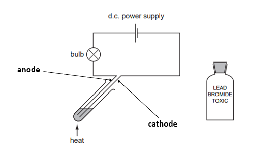

- Correctly labelled cathode; **[1 mark]**

**[Total: 2 marks]**

- *The question does not specify whether the material is a metal or non-metal so any unreactive material can be used*
- *The symbol for the cell comprises of one longer line and one shorter line: the longer line represents the positive terminal and the shorter line represents the negative terminal*
- *Remember**: In an electrolytic cell, the anode is the positive electrode and the cathode is the negative electrode*

  - *To help remember this, use the mnemonic **PANIC**: **P**ositive **A**node, **N**egative **I**s **C**athode*
c) The brown gas is, and forms at the:

- Bromine;** [1 mark]**
- Positive electrode / anode; ** [1 mark]**

**[Total: 2 marks]**

- *As discussed in the commentary in part a) negative bromide ions will move to the positive anode where they will lose electrons to form brown bromine gas *
d) This experiment is carried out in a fume cupboard because:

- Reference to toxicity of bromine / lead bromide; **[1 mark]**

**[Total: 1 mark]**

- *Bromine and lead bromide are toxic if inhaled so it needs to be carried out in a well ventilated area *

### Q2
a) A suitable material for the electrodes is:

- Carbon / graphite 
**OR** 
Platinum; **[1 mark]**

**[Total: 1 mark]**

- *The question does not specify whether the material is a metal or non-metal so either can be given as an answer*
b) The test for hydrogen gas is:

- Lighted / burning splint; **[1 mark]**
- Pops; **[1 mark]**

**[Total: 2 marks]**

- *Do not get confused with the test for oxygen gas which uses a glowing splint- this will not be accepted for the first mark*
c) Bubbles of gas were not seen immediately in 2 because:

- The gas dissolves in the solution; **[1 mark]**

**[Total: 1 mark]**
d) The colour change at each electrode is caused by:

- (Negative electrode) alkali / sodium hydroxide; **[1 mark]**
- (Positive electrode) chlorine / bleach; **[1 mark] **
*Not chloride or chlorine ions*

**[Total: 2 marks]**

- *The ions present in the solution are: H**+**, Na**+**, OH**-** and Cl**-*
- *The solution turned blue around the negative electrode because:*

  - *Both sodium and hydrogen ions will move to the negative electrode as they are positively charged ions*
  - *Only hydrogen ions will be discharged with the sodium ions remaining in solution*
  - *This is because hydrogen is less reactive than sodium *
  - *The sodium ions will react with the hydroxide ions that have also remained in solution to form sodium hydroxide which is an alkali*
- *The solution is colourless near the positive electrode *

  - *At the positive electrode, chloride ions are preferentially discharged over the hydroxide ions, so hydroxide ions also remained in solution *
  - *The chloride ions lose electrons to form chlorine gas*

### Q3
a) The apparatus labelled is:

- Top box: Electrode / anode / cathode (either); **[1 mark]** *Allow electrodes labelled the wrong way around*
- Bottom box: Bulb / lamp / light; **[1 mark]**

**[Total: 2 marks]**

- *Although you are awarded the mark for getting the electrodes the wrong way round in this case, that might not be the case for all questions*
- *For electrolytic cells, the anode is positive and the cathode is negative*
b) The test for hydrogen gas is:

- Lighted / burning splint; **[1 mark]**
- Pops; **[1 mark]**

**[Total: 2 marks]**

- *Do not get confused with the test for oxygen gas which uses a glowing splint - this will not be accepted for the first mark*
c) A sample of the gas given off at the positive electrode could be collected and its volume measured by:

- Graduated test-tube / measuring cylinder; **[1 mark]** *Not: carbon / platinum* *Not: gas syringe as will not work*
- Filled with electrolyte / acid / water inverted over electrode / owtte; **[1 mark]**

**[Total: 2 marks]**

- *Careful with which apparatus you include, you cannot simply use a test tube as this will not measure the volume of gas*
d)

i) The solution formed is:

- Sodium hydroxide; **[1 mark]**

ii) A test to show the presence of this product is:

- Universal indicator with pH above 7 / litmus turns blue; **[1 mark]** *Do not award second mark if first mark incorrect *

**[Total: 2 marks]**

- *Aqueous sodium chloride solution contains the ions: H**+**, Na**+**, Cl**- **and OH**- *
- *Hydrogen ions will be discharged at the cathode over sodium ions, as hydrogen is less reactive than sodium *
- *When halide ions are present, these are discharged at the anode over hydroxide ions *
- *This leaves sodium and hydroxide ions present to form sodium hydroxide solution*
- *This is an alkali so will turn universal indicator purple or litmus blue*

### Q4
a) This process is called:

- Electrolysis; **[1 mark]**

**[Total: 1 mark]**
b) One observation which could be made during this experiment is:

- Bubbles / bulb lights; **[1 mark]**

**[Total: 1 mark]**

- *Dilute sulfuric acid can conduct electricity as the ions can move and carry a charge*
- *The bulb will therefore light up *
- *Bubbles of hydrogen gas (at the cathode) and oxygen gas (at the anode) will also be seen*
c) A suitable metal for the inert metal electrodes is:

- Platinum; **[1 mark]**

**[Total: 1 mark]**

- *Careful**: The question asks you for a suitable metal so carbon / graphite cannot be given in this instance*
d) A test for oxygen gas is:

- Glowing splint; **[1 mark]**
- Relights; **[1 mark]**

**[Total: 2 marks]**

- *Do not get confused with the test for hydrogen gas which uses a burning / lighted splint*
e) Hydrogen forms at the negative electrode because:

- Hydrogen ions are positive / opposites attract; **[1 mark]**

**[Total: 1 mark]**

- *The question is only one mark so no further detail about what happens at the electrodes is required*
f) This experiment was carried out in a fume cupboard because:

- Chlorine is produced; **[1 mark]**
- Which is poisonous / toxic; **[1 mark]**

**[Total: 2 marks]**

### Q5
a) The completed diagram:

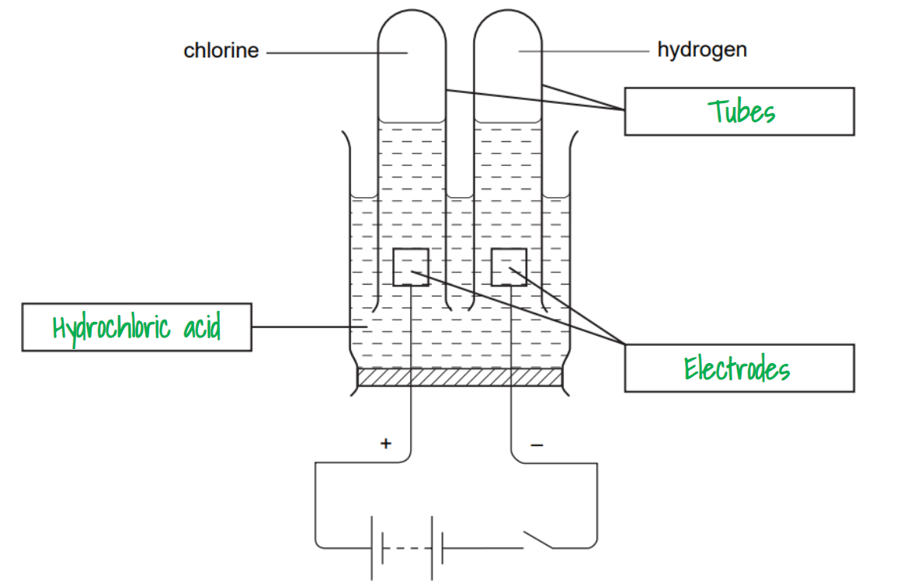

- Tubes; **[1 mark]**
- Hydrochloric acid; **[1 mark]**
- Electrodes; **[1 mark]**

**[Total: 3 marks]**

- *Sometimes students get confused by seeing electrolysis circuits like this*
- *This is a useful setup to collect the gas produced at the electrodes*
- *Sometimes inverted burettes are used, then the gas can be extracted by opening the tap*
b) This process is:

- Electrolysis; **[1 mark]**

**[Total: 1 mark]**

- *-lysis means breaking down or decomposing, so electrolysis means breaking down using electricity*
- *Here, hydrochloric acid is broken down into hydrogen and chlorine with the use of electricity*
c) A test for chlorine is:

- Test: (damp) litmus paper; **[1 mark]**
- Result: bleaches / turns white; **[1 mark]**

**[Total: 2 marks]**

- *This is one of the gas tests that you must know, together with what a positive result looks like*

### Q6
a) The labelled electrodes are:

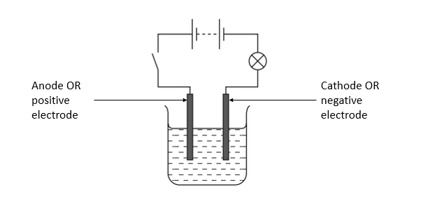

- Anode 
**AND **
cathode correctly labelled; **[1 mark]**

**[Total: 1 mark]**

- *The symbol for the cell comprises of one longer line and one shorter line: the longer line represents the positive terminal and the shorter line represents the negative terminal*
- *Remember**: In an electrolytic cell, the anode is the positive electrode and the cathode is the negative electrode*

  - *To help remember this, use the mnemonic **PANIC**: **P**ositive **A**node, **N**egative **I**s **C**athode*
b) Three observations when the circuit is switched on are:

Any **three** from:

- Bubbles at positive electrode; **[1 mark]**
- Bubbles at negative electrode; **[1 mark]**
- Bulb lights up; **[1 mark]**
- Smells of bleach; **[1 mark]**
- Greenish gas; **[1 mark]**

**[Total: 3 marks]**

- *Concentrated aqueous sodium chloride solution will conduct electricity when the circuit is switched on because the ions can move and carry a charge, the bulb will therefore light up *
- *The ions present in the solution are: H**+**, Na**+**, OH**-** and Cl**-*
- *At the negative electrode:*

  - *Both sodium and hydrogen ions will move there as they are positively charged ions*
  - *Only hydrogen ions will be discharged with the sodium ions remaining in solution*
  - *This is because hydrogen is less reactive than sodium *
  - *The hydrogen gas formed will produce bubbles *
- *At the positive electrode *

  - *Chloride ions are preferentially discharged over the hydroxide ions, so hydroxide ions also remained in solution *
  - *The chloride ions lose electrons to form chlorine gas which will produce bubbles, and the smell of bleach *
  - *Chlorine is a greenish coloured gas so that can also be given as an observation*
- *Sodium hydroxide solution, an alkali would also form but you would only be able to observe the presence of this if universal indicator was added, which would turn purple*
c)

i) The product formed at the positive electrode is:

- Chlorine; **[1 mark]**

ii) A  test and result for this product is:

- Litmus / indicator; **[1 mark]**
- Bleaches / colourless; **[1 mark]**

**[Total: 3 marks]**

- *At the positive electrode, chloride ions are preferentially discharged over the hydroxide ions*
- *The chloride ions lose electrons to form chlorine gas*
- *Testing for chlorine gas is one of the gas tests you need to learn*

### Q7
a)

i) The electrodes should be:

- BOTH correctly labelled; **[1 mark]**

ii) A suitable material for the electrodes is:

- Carbon / Graphite 
**OR** 
Platinum; **[1 mark]**

**[Total: 2 marks]**

- *The question does not specify whether the material is a metal or non-metal so any unreactive material can be used*
- *The symbol for the cell comprises of one longer line and one shorter line: the longer line represents the positive terminal and the shorter line represents the negative terminal*
- *Remember**: In an electrolytic cell, the anode is the positive electrode and the cathode is the negative electrode*

  - *To help remember this, use the mnemonic **PANIC**: **P**ositive **A**node, **N**egative **I**s **C**athode*
b) **Two** observations expected when the lead bromide is heated to melting point are:

Any **two **from:

- Bulb lights up; **[1 mark]**
- Lead bromide melts in the tube ; **[1 mark]**
- Silver beads form; **[1 mark]**
- Bubbles;** [1 mark]**
- Red / brownish orange gas / liquid;** [1 mark]**

**[Total: 2 marks]**

- *When the lead bromide is heated to become molten it will be able to conduct electricity as the ions can move *
- *The bulb will therefore light up *
- *Positive lead ions will move to the cathode where they will gain electrons to form lead atoms which appear silver *
- *Negative bromide ions will move to the anode where they will lose electrons to form brown bromine gas*
- *Although bromine in its standard state is a liquid, it forms a gas here due to heat however you are still awarded the mark for liquid*
c) **Two** different safety precautions when carrying out this experiment are:

- Any correct protective clothing e.g. gloves / lab coat / goggles / safety glasses;** [1 mark]**
- Fume cupboard / well ventilated room;** [1 mark]**

**[Total: 2 marks]**

- *Bromine is toxic if inhaled so it needs to be carried out in a well ventilated area *

### Q8
a) Another observation is:

Any **one** from:

- Bulb lights up; **[1 mark]**
- Silver grey liquid **OR** solid forms; **[1 mark]**
- Bubbles; **[1 mark]**

**[Total: 1 mark]**

- *Molten lead(II) bromide can conduct electricity because the ions can move and carry a charge- this would cause the bulb to light up *
- *Bromine gas would be formed at the anode which could be observed as bubbles*
- *Lead will form at the cathode which is silver in colour*
b)

i) A non-metal that could be used for the electrodes is:

- Carbon / graphite; **[1 mark]**

ii) Iron is not used for the electrodes because:

- It reacts / is reactive; **[1 mark]**

**[Total: 2 marks]**

- *Careful**: The question asks for a non-metal so carbon / graphite are the only answer*
- *If the question had not specified whether it wanted a metal or non-metal, platinum could also have been given as an answer*
- *The electrodes must be unreactive so as not to react with the electrolyte*
c)

i) The brown gas formed is:

- Bromine / Br2 ; **[1 mark]**

ii) The result of testing this gas with damp blue litmus paper is:

- Bleaches / turns white; **[1 mark]**

**[Total: 2 marks]**

- *For lead(II) bromide, there are only two ions present, lead and bromide*
- *Bromide ions are negatively charged so are attracted to the anode *
- *Here they lose electrons to form bromine which is a brown gas:*

  - *2Br**-** → Br**2** + 2e**-*
- *Similar to chlorine, bromine will bleach litmus paper*
d)The product formed at the negative electrode is:

- Lead; **[1 mark]**

**[Total: 1 mark]**

- *Lead ions are positively charged and so are attracted to the negative electrode (cathode) *
- *Here, they gain electrons to form lead atoms:*

  - *Pb**2+** + 2e**-** → Pb*
e) One safety precaution that should be used when doing this experiment is:

- Fume cupboard / well ventilated area; **[1 mark]**

**[Total: 1 mark]**

- *Bromine is toxic so the electrolysis needs to be done in a well ventilated area to prevent inhalation*

### Q9
a) The observation at both electrodes is:

- Bubbles / fizzing / effervescence;** [1 mark]**

**[Total: 1 mark]**

- *Careful**: The question asks for an observation at both electrodes*
- *For the electrolysis of aqueous sodium chloride you should know the product formed at each electrode*

  - *At the anode it is chlorine*
  - *At the cathode it is hydrogen*
- *Both of these substances would produce bubbles of gas *
b) The indicator turned purple at the negative electrode because:

- An alkali formed; ** [1 mark]**

**[Total: 1 mark]**

- *This question requires no understanding of what has happened in the electrolysis process- as you should be aware an alkali has a pH above 7 so will turn universal indicator purple*
- *The purple colour is due to sodium hydroxide solution*
- *Both sodium and hydrogen ions will move to the negative electrode but only hydrogen ion are discharged with the sodium ions remaining in solution*
- *This is because hydrogen is less reactive than sodium *
- *At the positive electrode, chloride ions were preferentially discharged over the hydroxide ions, so hydroxide ions also remained in solution *
- *Sodium and hydroxide ions form sodium hydroxide solution turning the indicator purple*
c)

i) The product formed at the positive electrode is:

- Chlorine; ** [1 mark]**

ii) The effect of this product on the Universal Indicator is:

- Indicator is bleached / decolourised; ** [1 mark]** *Allow yellow*

**[Total: 2 marks]**

- *The negative ions present are chlorine, Cl**-** and OH**-** *
- *Halide ions are preferentially discharged at the anode over hydroxide ions *
- *Chloride ions will lose electrons to form chlorine atoms*
- *You have learned that chlorine bleaches litmus paper, so although this question is referring to universal indicator, the question uses the command word 'suggest' indicating you need to apply your knowledge to this context*

### Q10
a) A suitable material for the electrodes is:

- Carbon / graphite / platinum; **[1 mark]**

**[Total: 1 mark]**

- *The question does not specify whether the material should be a metal or non-metal so any of the above options can be given*
b) Copper was deposited at the:

- Negative electrode / cathode;** [1 mark]**

**[Total: 1 mark]**

- *You should be aware that copper ions are positive, Cu**2+*
- *They are therefore attracted to the negative electrode*
c) One observation seen during the electrolysis is:

- Bubbles / fizz / colour of solution pales; **[1 mark]** *Not gas given off *

**[Total: 1 mark]**

- *In copper(II) sulfate solution the following ions are present: Cu**2+**, H**+**, OH**-** and SO**4**2-*
- *For solutions containing more than one positively charged or negatively charged ion, you need to know which one is preferentially discharged at each electrode*
- *We already know from part b) that copper was deposited at the negative electrode (this is because copper is less reactive than hydrogen)*
- *Copper(II) sulfate solution is a blue colour due to the presence of copper ions, therefore as the copper ions leave the solution, the blue colour will turn a paler shade*
- *Hydroxide ions are discharged at the positive electrode over sulfate ions, and form oxygen gas *
- *This will be seen as bubbles / fizzing*
d)

i) The electrode was washed with:

- <u>Distilled </u>water / <u>pure</u> water; **[1 mark]**

ii) The electrode could by dried quickly by:

- Use of a hairdryer / oven; **[1 mark]** 
*Allow heat / heater *

**[Total: 2 marks]**

- *Both these questions require a level of application from other areas, you may not have specifically covered them but can use common sense that some form of heat is required to dry the electrodes*
- *You should also be aware that distilled / pure water contains no additional ions other than H**+** and OH**-** so will not interfere with the electrolysis*
e) The completed table is:

| time / min | mass of electrode / g | total increase in mass / g |
|---|---|---|
| 0 | 3.75 | 0.00 |
| 10 | 4.00 | 0.25 |
| 20 | 4.25 | 0.50 |
| 30 | 4.50 | **0.75** |
| 40 | 4.75 | **1.00** |
| 50 | 4.90 | **1.15** |
| 60 | 4.90 | **1.15** |
| 70 | 4.90 | **1.15** |

- Increase in masses completed correctly; **[1 mark]**

**[Total: 1 mark]**

- *The mass of the electrode is 3.75 g prior to electrolysis starting *
- *Therefore the increase in mass is compared to this, so 4.00 - 3.75 = 0.25 g *
- *This needs to be completed for the remainder of the results*
- *Careful**: The mass stops increasing at 50 seconds so the last three increases in mass should be the same*
f) The correctly plotted graph is:

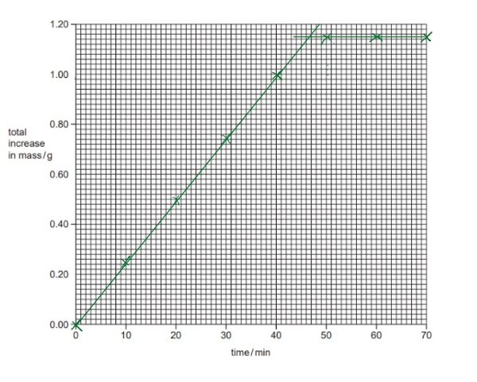

- All points plotted correctly for two marks; **[2 marks]** 
*Deduct 1 mark for any incorrect points *
- Two straight lines through the points; **[1 mark]**

**[Total: 3 marks]**

- *Graphs are easy marks to achieve*
- *Take care to ensure you understand the scale, as you are not allowed much wiggle room when plotting points - usually ± half a square*
g) The last three readings were the same because:

- Reaction finished / all copper deposited owtte / all copper sulfate used up; **[1 mark]**

**[Total: 1 mark]**

- *This is a common question that arises in the rates of reaction section of the course*
- *When a graph levels out it is because the reaction has finished *

## Multiple Choice Questions (25 questions)

### Q1
**Final answer:** **The correct answer is B**

To determine the products of electrolysis for an **aqueous** solution, you must consider the ions from the ionic compound as well as the ions from the water (H+ and OH−).

- **At the cathode (-):**

  - Both Magnesium ions (Mg2+) and Hydrogen ions (H+) are attracted to the cathode
  - Magnesium is highly reactive (above hydrogen in the reactivity series)
  - Elements higher in the reactivity series prefer to stay in solution as ions
  - The H+ ions are discharged instead, producing hydrogen gas
  - The observation is **bubbles of a colourless gas**
- **At the anode (+):**

  - Both Chloride ions (Cl−) and Hydroxide ions (OH−) are attracted to the anode
  - In a **concentrated halide solution**, the halide ion is discharged
  - Chloride ions lose electrons to form chlorine gas
  - The syllabus specifies the appearance of chlorine gas as a **pale yellow-green gas**

**A **is incorrect as chlorine is a pale yellow-green gas, not colourless

**C **& **D **are incorrect as a gas is produced at the cathode, not a metal

### Q2
**Final answer:** **The correct answer is C**

- Statement 1 is incorrect

  - During the electrolysis, **bromine gas **is produced at the **anode **(**positive electrode**)
  - Bromine gas is **red-brown**
  
    - A green gas refers to chlorine
- Statement 2 is correct

  - At the **cathode **(**negative electrode**), lead ions (Pb2+ ) from the the molten lead bromide will gain two electrons
  - When lead is formed a **shiny grey liquid **will be produced at the electrode
- Statement 3 is correct

  - The electrodes must be inert materials, such as graphite, so they **do not react **during the electrolysis

> **[exam-tip]**
> Use the PANIC mnemonic to remember which electrode is the positive and which is the negative:
> 
> **Positive (is) Anode Negative Is Cathode **

### Q3
**Final answer:** **The correct answer is ****B**** because:**

- The electrolyte is a concentrated aqueous solution of sodium chloride.
- Chlorine gas is the main product formed at the anode and hydrogen gas is formed at the cathode.

**A **is incorrect as hydrogen ions are positive and chloride ions are negative.

**C** and **D **are incorrect as sodium ions do not form at either electrode, they remain in solution.

### Q4
**Final answer:** **The correct answer is ****A**** because:**

- Molten metal bromides consist of positive metal ions and negative bromide ions
- The positive metal ion will be discharged at the cathode (negative electrode) where they will gain electrons to form the metal
- The negative bromide ions will be discharged at the anode (positive electrode) where they will lose electrons to form bromine

**B**, **C** and **D** are incorrect as the products at the electrodes are incorrect

### Q5
**Final answer:** **The correct answer is ****B**** because:**

- The negative electrode is the **cathode**.
- In electrolysis, the cathode attracts positively charged ions (**cations**), which in this case are the hydrogen ions (H+).
- At the cathode, hydrogen ions **gain electrons** in a **reduction** reaction to form hydrogen gas.
- The half-equation for this process is:

2H+ (aq) + 2e- → H2 (g)

**A** is incorrect as electrons are **added** to hydrogen ions (reduction), not removed (oxidation).

**C** is incorrect as electrons are **removed from** chloride ions at the positive electrode (anode), not added to them.

**D** is incorrect as electrons travel through the **external circuit** (the wires), not through the electrolyte solution. It is the ions that move through the solution.

### Q6
**Final answer:** **The correct answer is ****A**** because:**

- Solid zinc chloride will not conduct electricity because the ions cannot move freely and carry a charge
- The solid zinc chloride either needs to be molten or in solution to enable the ions to move

### Q7
**Final answer:** **The correct answer is ****D**** because:**

- Hydrogen forms positive ions and is attracted to the cathode.
- Cathodes are the negatively charged electrodes.
- In the electrolysis of concentrated HCl, hydrogen is formed at the electrode 2 as  hydrogen is the only positive ion formed and migrates towards the negatively charged cathode.
- In the electrolysis of aqueous substances, the H+ and OH- ions formed from the water compete with the ions from the substance dissolved at the electrodes, where only 1 product can be formed.
- A more reactive metal will remain in the ion form as it does not accept electrons as readily as the less reactive H+ ions do.
- In the electrolysis of aqueous NaCl, hydrogen is formed at electrode 4 as sodium is higher on the reactivity series than hydrogen.

### Q8
**Final answer:** **The correct answer is ****C**** because:**

- The following products are made at the electrode for each experiment:

|   | **Anode** | **Cathode ** |
|---|---|---|
| ** Experiment 1:  **concentrated aqueous sodium chloride | chlorine | hydrogen |
| ** Experiment 2:  **dilute sulfuric acid | oxygen | hydrogen |
| ** Experiment 3:  **lead bromide | bromine | lead |

- The gas hydrogen was produced at the cathode for experiment 1 and 2 only as lead was produced in experiment 3

**A** is incorrect as metal ions are positive so would only form at the cathode

**B **is incorrect as hydrogen is produced instead of sodium at the cathode in experiment 1

**D** is incorrect as chlorine gas is also produced in experiment 1 at the anode

### Q9
**Final answer:** **The correct answer is ****B**** because:**

- The ions present in the dilute sulfuric acid are H+ and OH- (from the water) and H+ and SO42- (from the sulfuric acid)
- During electrolysis, hydrogen gas is produced at the cathode and oxygen is produced at the anode
- At the cathode: 4H+ + 4e- →  2H2
- At the anode: 4OH- → O2 + 2H2O + 4e-
- For every 4 electrons flowing through the circuit, 1 molecule of oxygen is produced and 2 molecules of hydrogen are produced
- Therefore, the ratio of the volume of hydrogen gas to oxygen gas is roughly 2:1
- Twice the volume of gas is produced at the cathode than the anode

**A** is incorrect as no gas is formed at the cathode, instead zinc would be formed

**C** is incorrect as hydrogen and bromine gas are formed in equal quantities

**D **is incorrect as hydrogen and chlorine gas are formed in equal quantities

### Q10
**Final answer:** **The correct answer is ****B**** because:**

- During the electrolysis of aqueous sodium chloride, chlorine is produced at the anode and hydrogen is produced at the cathode
- The correct gas test for hydrogen is using a burning splint and a squeaky pop sound being made

**A **is incorrect as this is the test for oxygen gas

**C** is incorrect as this is the test for chlorine (which is produced at the anode)

**D** is incorrect as an alkali would turn red litmus paper blue

### Q11
**Final answer:** **The correct answer is ****C**** because:**

- Positively charged hydrogen ions are attracted to the negative electrode (cathode) so hydrogen gas, H2, is formed at the cathode.
- Hydrogen ions are reduced, meaning they gain electrons, therefore electrons must on the left hand side of the equation.

**A** and **B **are incorrect as chlorine gas would form at the anode.

**D **is incorrect as the electrons must be on the left hand side of the equation since the hydrogen ions are reduced.

### Q12
**Final answer:** **The correct answer is ****D**** because:**

- During the electrolysis of concentrated aqueous sodium chloride, **positively** **charged** **hydrogen** **ions** are attracted to the **negative** **cathode** where they are reduced to form hydrogen gas.
- At the **positive** **anode**, the Cl- ions are oxidized to form chlorine gas.
- The ions that remain in solution are Na+ ions and the OH- ions.
- These produce an **alkaline** solution so at the **cathode** the colour is **blue**.
- At the **anode** the solution is surprisingly colourless. This is because chlorine gas is a powerful bleaching agent and removes the colour from litmus.

**A, B** and **C **are incorrect as these colours do not match with the correct results.

### Q13
**Final answer:** **The correct answer is ****A**** because: **

- During the electrolysis of molten sodium oxide, sodium and oxygen are formed
- At the anode:

  - Negatively charged oxide ions are attracted due to their opposite charges
  - They lose electrons and are oxidised to form oxygen, a colourless gas

2O2- → O2 + 4e-

- At the cathode:

  - Positively charged sodium ions are attracted due to their opposite charges
  - They gain electrons and are reduced to form sodium metal

Na+ + e-  → Na

**B** is incorrect as the green gas described is chlorine. Chloride ions would be attracted to the anode not the cathode

**C** is incorrect as lead ions are positively charged and will be attracted to the cathode

**D** is incorrect as hydrogen gas is formed at the cathode due to hydrogen ions being less reactive than the other positively charged ion, sodium

### Q14
**Final answer:** **The correct answer is ****B**** because:**

- In experiment 1, oxygen gas is formed at the anode and hydrogen gas at the cathode.
- In experiment 2, copper electrodes are used rather than carbon. Copper is a metal and although unreactive it does influence the outcome at each electrode.
- The negative sulfate ions SO42- from the copper sulfate and OH- ions from the water are attracted to the anode but both are too stable and so remain in solution.
- The copper anode is oxidised in preference and releases Cu2+ copper ions into solution hence there is no observable product formed at the anode in experiment 2.
- The end result is a transfer of copper ions from the anode to the cathode which is why this method is used to purify copper.
- In experiment 3, chlorine gas is formed at the anode which is a yellow green colour and hydrogen gas is evolved at the cathode.
- In experiment 4 oxygen gas is formed at the anode and hydrogen gas at the cathode.

A colourless gas is formed at the anode in experiment 1 and 4 only so B is correct.

You might think that since the cathode is the negative electrode then the electrons would not move towards it as like charges repel. The cathode is the negative electrode because it is where reduction takes place (electrons are gained). When it comes to direction of electron flow in electrolysis, remember that they flow in alphabetical order: from the **A**node to the **C**athode.

### Q15
**Final answer:** **The correct answer is ****D ****because:**

- The ions present in sulfuric acid are H+ and SO42-
- The ions present in water are H+ and OH- 
- The positive hydrogen ions are attracted to the cathode (negative electrode) where they gain electrons to form hydrogen gas

2H+  +   2e-    ⟶   H2

- At the anode, oxygen is produced unless a halide ion is present in which case a halogen is produced

4OH–    ⟶    O2   +   2H2O   +   4e–

**A** is incorrect as the oxygen is made at the anode, not the cathode and sulfur is not made at the anode

**B **is incorrect as sulfur is not produced at the anode

**C** is incorrect as the products are correct but they have been formed at the incorrect electrode

### Q16
**Final answer:** **The correct answer is ****C**** because:**

- During the electrolysis of concentrated aqueous sodium chloride, negatively charged chlorine ions are attracted to the positive anode where they are oxidised to form chlorine gas.
- The electrons must be on the right hand side of the equation as electrons are lost.

**A** and **D **are incorrect as chlorine gas exists as a molecule, Cl2.

**B **is incorrect as the electrons are on the left hand side of the equation.

### Q17
**Final answer:** **The correct answer is ****D**** because:**

- The ions present in the electrolysis of aqueous copper(II) sulfate are: H+ and OH- (from the aqueous solution), Cu2+  and SO42-
- The H+ and Cu2+ ions are attracted to the cathode and the OH- and SO42- ions are attracted to the anode.
- At the cathode (negative electrode) the Cu2+ ions are less reactive than the hydrogen  ions and are reduced to copper metal:

  - Cu2+ + 2 e- → Cu
- At the anode (positive electrode) the OH- ions are less reactive than SO42- ions are oxidised to produce oxygen and water:

  - 4 OH- → O2 + H2O + 4 e-

**A **is incorrect as copper ions are positive so copper metal is produced at the negative electrode (the cathode), not the positive electrode.

**B **is incorrect as electrons in the external circuit flow from the negative terminal of the battery to the positive terminal, not from positive to negative.

**C **is incorrect as the electrons do not flow in the electrolyte, it is the ions that move and carry the current.

### Q18
**Final answer:** **The correct answer is ****B**** because:**

- The **anode** is the **positive electrode** and so attracts the negative **Br****-**** **and** OH****-**** **anions.
- The **cathode** is the **negative electrode **and so attracts the positive **K****+** and **H****+**** **cations
- The** K****+**** **and** Br****-** ions come from the potassium bromide and the **H****+** and **OH****-**** **ions are produced by the dissociation of water (H2O) in aqueous solutions.

**A, C** and **D **are incorrect as only option B correctly describes the movement of the ions.

### Q19
**Final answer:** **The correct answer is ****B**** because:**

- In electrolysis the electrons move toward the cathode in the external circuit.
- In the diagram below the arrows indicate the direction of movement of electrons.

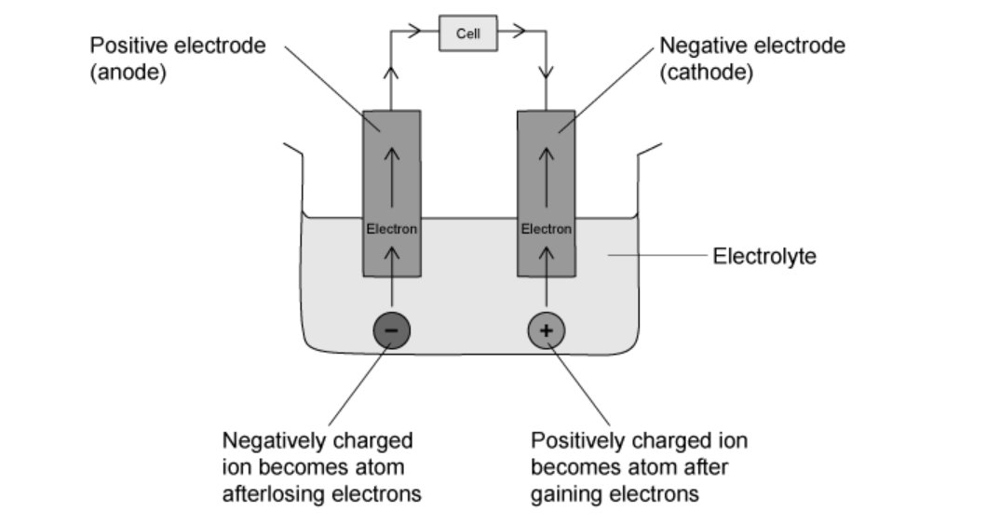

You might think that since the cathode is the negative electrode then the electrons would not move towards it since like charges repel. The cathode is the negative electrode because it is where reduction takes place (electrons are gained). When it comes to direction of electron flow in electrolysis, remember that they flow in alphabetical order: from the Anode to the Cathode.

### Q20
**Final answer:** **The correct answer is ****A**** because:**

- Hydrogen is formed at the cathode as sodium ions are much higher than  hydrogen on the reactivity series and will stay in solution.
- Chlorine is formed at the anode as it is a halide in a concentrated solution.
- Cl- is a simple ion which will discharge instead of the oxygen from the OH- ion, as is the case when the ion is more complex such as NO3- or SO42-.

**B **is incorrect as chlorine gas is formed at the anode over oxygen.

**C** and **D **are incorrect as sodium is not formed at the cathode.

## Theory Questions (26 questions)

### Q1
- The bracket right next to the name of a metal indicates its valency

  - Therefore, the valency of lead is 2
- Iodine is in Group VII, it needs one electron to complete the octet

  - Therefore, the valency of iodine is 1
- When crossing the valencies, the formula will be:

** PbI****2 **** ****[1 mark]**

> **[mark-scheme]**
> 1 mark for correct formula of lead(II) iodide, PbI2
| Ion | Number of protons | Number of electrons |
|---|---|---|
| Pb2+ | 82 | **80 ****[1]** |
| I− | **53 ****[1]** | 54 |

> **[exam-tip]**
> Remember! The **number of protons never changes**. It always equals the **atomic number**. You can find it in the Periodic Table.
> 
> To find the number of electrons, look at the **charge**:
> 
> - A **2+ charge** means the atom has **lost 2 electrons**.
> - A **1− charge** means the atom has **gained 1 electron**.
> 
> **positive ion (cation) =** lost electrons
> 
> **negative ion (anion) = **gained electrons.
> **[mark-scheme]**
> - (Strong) electrostatic attraction **[1 mark]**
> - between oppositely charged ions **[1 mark]**
> **[mark-scheme]**
> It has mobile delocalised electrons **[1 mark]**
> **[mark-scheme]**
> Any **two** from:
> 
> - High melting point / high boiling point
> - Soluble in water
> - Crystalline solid
> - Conducts electricity when aqueous / conducts electricity when mixed with water
> 
> **[2 marks]**
> **[mark-scheme]**
> The **observation at X** is:
> 
> - Purple gas / purple vapour / bubbles of purple gas / fumes of purple gas **[1 mark]**
> 
> The **observation at Y** is:
> 
> - Silvery liquid / grey liquid / shiny liquid / molten metal / beads of silvery metal **[1 mark]**

> **[exam-tip]**
> Watch out, when a question asks for an **observation**, only write what you can **see**, not the name of the substance. A very common mistake is writing a **product name** instead of a **physical change**, which loses marks.
> 
> You cannot see “hydrogen” in a test tube, you only see **bubbles or fizzing**, so save chemical names for questions that ask you to **identify the products formed.**

### Q2
The products formed are:

- Positive electrode: Oxygen gas; **[1 mark]**
- Negative electrode: Copper metal; **[1 mark]**

Observation:

- Blue solution fades; **[1 mark]**

**[Total: 3 marks]**

- *When copper(II) sulfate undergoes electrolysis using graphite electrodes copper metal and oxygen gas are formed*
- *For the observation of the electrolyte;*

  - *If **inert electrodes** (like platinum or graphite) are used, copper is **not added** back into the solution at the anode*
  - *This means:*
  
    - *Cu**2+** ions are **removed** at the cathode*
    - *But **not replaced** at the anode*
    - *So the concentration of Cu**2+** in the electrolyte solution **decreases over time*
The process by which copper ions form atoms at the cathode during electrolysis is:

- Copper ions / Cu2+ ions  attracted to cathode; **[1 mark]**
- Cu2+ ions gain electrons/ are reduced; **[1 mark]**

**[Total: 2 marks]**

- *Remember that reduction always takes place at the cathode*
- *You can remember this by thinking of 'Red Cat'*
Balanced half equation provided:

4OH⁻ → O2 + 2H2O + 4e⁻

- Correct balancing of OH⁻, O2, and H2O; **[1 mark]**
- Correct balancing of electrons; **[1 mark]**

**[Total: 2 marks]**

- *It is worth taking your time when balancing ionic half equations as they must be balanced for atoms and charge*
- *This is one of the more challenging equations that you are required to balance as it contains two different elements and electrons*
- *To balance the equation:*

  - *To balance oxygen atoms*
  
    - *Left:** OH⁻ = 1 oxygen atom*
    - *Right:** O**2** (2 O atoms) + 2H**2**O (2 O atoms) = **4 oxygen atoms*
    - *Place a 4 in front of OH**-*
    - *The O atoms are balanced*
  - *Balance hydrogen atoms*
  
    - *Left:** 4OH⁻ = 4 H atoms*
    - *Right:** 2H**2**O = 4 H atoms*
    - *The H atoms are balanced*
  - *Balance charges with electrons*
  
    - *Left:** 4OH⁻ = −4 charge*
    - *Right:** All products are neutral, so net charge = 0*
    - *You need **4 electrons on the right** to match −4 on the left:*
  - *4OH⁻ → O**2 **+ 2H**2**O + 4e⁻*
i) The mass of the cathode increases during electrolysis because:

- Copper(II) ions (Cu²⁺) gain electrons at the cathode and are deposited as solid copper
**OR**
Cu²⁺ ions are reduced to copper atoms at the cathode)

ii) The concentration of Cu²⁺ ions in the solution does not change because:

- Copper atoms at the anode lose electrons and form Cu²⁺ ions, replacing the Cu²⁺ ions removed at the cathode
**OR**
The number of Cu²⁺ ions entering the solution equals the number leaving it

**[Total: 2 marks]**

- *For part i) *

  - *Examiners often comment that students do not make the distinction between atoms and ions*
  - *In the electrolyte copper ions are present and when they are attracted to cathode they gain electrons and become atoms*

> *Cu**2+** (aq) + 2e**-** → Cu (s)*

- *For part ii)*

  - *If **inert electrodes** (like platinum or graphite) are used, copper is **not added** back into the solution at the anode*
  - *This means:*
  
    - *Cu**2+** ions are **removed** at the cathode*
    - *But **not replaced** at the anode*
    - *So the concentration of Cu**2+** **decreases over time*
    - *The concentration of the solution does not change only when the electrodes are made of copper*
- *Only with copper electrodes** is copper removed and replaced at equal rates, keeping the solution’s concentration unchanged.*

### Q3
i) The electrolyte is:

- Molten or aqueous substance undergoing electrolysis **[1 mark]**

ii) The cathode is:

- Negative electrode
**OR**
Site of reduction; **[1 mark]**

**[Total: 2 marks]**

- *It is really important to learn your definitions for electrolysis as they are bases of all other questions that you are required to answer*
These ions become neutral atoms at the cathode by:

- Positive ions;** [1 mark]**
- Are reduced / gain electrons at the cathode; **[1 mark]**
- Forming atoms; **[1 mark]**

> *[Total: 3 marks]*

- *Examiners often comment that students do not make the distinction between atoms and ions*
- *Remember to state that it is positive ions that are attracted to the negative cathode;*

  - *Opposite charges attract*
- *When the ions reach the cathode, they gain electrons to become atoms*
- *This is called reduction *
The balanced half-equation is:

2Br⁻ → Br₂ + 2e⁻

- Correct reactant (Br⁻) **[1 mark]**
- Correct product and electrons (Br₂ and 2e⁻) **[1 mark]**

**[Total: 2 marks]**

- *It is worth taking your time when balancing ionic half equations as they must be balanced for atoms and charge*
- *Students often forget to place a 2 in front of the Br**-** ion in this equation;*

  - *Make sure you check your equation thoroughly*
The mass of sodium can be calculated by:

- Moles of NaF = $\frac{8.4}{42}$ = 0.2 moles; **[1 mark]**
- Mass of sodium produced = 0.2 x 23 = 4.6 g; **[1 mark]**

**[Total: 2 marks]**

- *Take your time with these calculations and take a step by step approach*
- *The ratio for the moles of NaF to Na is 2:2 so can be simplified to 1:1 *
- *Therefore the number of moles of NaF is equal to the moles of Na*
- *To find the mass of Na, you need to use;*

  - *mass = moles x **M**r*

### Q4
The gas produced at the anode is:

- Oxygen; **[1 mark]**

**[Total: 1 mark1]**

- *During the electrolysis of water two products are produced*

  - *Cathode**: Hydrogen gas (H**2**) is produced*
  - *Anode**: Oxygen gas (O**2**) is produced*
Platinum electrodes are used because:

- Platinum is inert and does not react with products formed at electrodes; **[1 mark]**

**[Total: 1 mark]**

- *Platinum is low in the reactivity series so they** are **inert** *
- *Inert means that the substance **does react** with any other substance*
- Use a lighted splint, hydrogen gas produces a squeaky pop; **[1 mark]**

**[Total: 1 mark]**

- *Hydrogen gas is produced from H⁺ ions*
- *Students often get confused with the test for oxygen and hydrogen gas so learn these thoroughly*
- *You need to know how to test for the following gases*

  - *Hydrogen*
  - *Oxygen*
  - *Carbon dioxide*
  - *Chlorine *
  - *Ammonia*
  - *Sulfur dioxide*
- *Remember to give the test and result to gain the mark*
Balanced half equation provided:

2H+ + 2e⁻ → H2

- Correct balancing of equation; **[1 mark]**

**[Total: 1 mark]**

- *It is worth taking your time when balancing ionic half equations as they must be balanced for atoms and charge*
- *Students often forget to place a 2 in front of the H**+** ion in this equation*

  - *Make sure you check your equation thoroughly*

### Q5
The completed word equation is:

- (Sodium chloride →) sodium + chlorine; **[1 mark]**

**[Total: 1 mark]**

- *Electrolysis of molten ionic compounds splits up them into its elements*
- *Careful; students can often write chloride instead of chlorine*
- *You must give the element form of the non-metal*
- *Final answer:*

  - *Sodium chloride → sodium + chlorine*
The gases produced at each electrode and tests are:

Positive Electrode:

- Chlorine gas; **[1 mark]**
- Use damp litmus paper, bleached white;** [1 mark]**

Negative Electrode

- Hydrogen; **[1 mark]**
- Use a lighted splint, gives a 'pop' sound;** [1 mark]**

**[Total: 4 marks]**

- *For the positive electrode*

  - *Cl**- **ions are attracted to the positive electrode (anode)*
  - *Chlorine gas is produced from Cl⁻ ions*
  - *Hold damp blue or red litmus paper near the gas*
  - *It will be bleached white if chlorine is present*
- *For the negative electrode*

  - *Hydrogen gas is produced from H⁺ ions (from water, if electrolyte is aqueous)*
  - *Use a lighted splint near the gas*
  - *It makes a ‘pop’ sound if hydrogen is present*
- *Remember to give the test and result to gain the mark*
Balanced half equation provided:

2H2O → O2 + 4H⁺ + 4e⁻

- Correct balancing of reactants; **[1 mark]**
- Correct balancing of products;** [1 mark]**

**[Total: 2 marks]**

- *It is worth taking your time when balancing ionic half equations as they must be balanced for atoms and charge*
- *Step 1:** *

  - *Start with water on the left, oxygen gas on the right.*
  - *Balance the number of **O atoms**:*
  
    - *2H**2**O → O**2** (both sides have 2 oxygen atoms)*
- *Step 2:** *

  - *Balance **H atoms**:*
  
    - *2H**2**O = 4 H → 4 H⁺ on the right*
- *Step 3:*

  - * Add **electrons (e⁻)** to balance charge:*
  
    - *Left = 0 charge*
    - *Right = +4 so add **4 e⁻** to the right*
The preparation steps are:

- Heat copper(II) oxide with sulfuric acid; **[1 mark]**
- Filter off the (excess) copper(II) oxide ; **[1 mark]**
- Heat the filtrate / (copper sulfate) solution to the point of crystallisation; **[1 mark]**
- Dry between filter papers / dry in drying oven; **[1 mark]**

**[Total: 4 marks]**

- *This is a common question so make sure you know the steps*
- *Students often miss out *

  - *Using  excess base*
  - *Stop heating as soon as crystals begin to form, as the rest happens as it cools*

### Q6
The names of the products formed are:

- Cathode: lead; **[1 mark]**
- Anode: chlorine; **[1 mark]**

**[Total: 2 marks]**

- *When molten PbCl**2** is electrolysed, it breaks into **Pb**2+** and Cl**-** ions*
- *The positive ions (Pb**2+**)** go to the **negative electrode (cathode)** and gain electrons and form **lead metal forms*
- *The negative ions (Cl**-**)** go to the **positive electrode (anode)** and lose electrons and form **chlorine gas forms*
- *Remember; for molten electrolytes*

  - *Cathode = **metal is formed*
  - *Anode = **non-metal (gas) is formed *
You can explain why the electrolyte must be molten as follows:

- Ions are free to move when molten; **[1 mark]**
- Ions fixed in position when solid and cannot conduct electricity; **[1 mark]**

**[Total: 2 marks]**

- *This is a common question *
- *Ions must be free to move** in the electrolyte for electrolysis to happen*
- *In solid PbCl**2**, the **ions are locked in a lattice** and cannot move*
- *When molten, **the ionic lattice breaks down** and ions are **mobile*
- *Only **mobile ions** carry electric current and allow electrolysis*
The direction of electron flow is:

- Electrons flow from the anode to the cathode; **[1 mark]**

**[Total: 1 mark]**

- *Electrons flow **through the external circuit** from **anode (positive) to cathode (negative)*
- *This is because the power source **pushes electrons** toward the cathode*
- *Easy tip: **Electrons always move toward where reduction happens** (cathode)*
- *You can also think of alphabetical order to remember this*

  - *anode to cathode *
  - *a to c*
The *M*r of  lead(II) chloride, PbCl2.

- *M*r =  207 + (2 × 35.5); **[1 mark]**
- *M*r = 278; **[1 mark]**

**[Total: 2 marks]**

- *Step 1:** Write the formula: **PbCl**2*
- *Step 2:** Use the atomic masses from the Periodic Table:*

  - *Pb = **207*
  - *Cl = **35.5*
- *Step 3:** Multiply the number of each atom by its atomic mass:*

  - *1 × 207 = **207*
  - *2 × 35.5 = **71*
- *Step 4:** Add them together:*

  - *207 + 71 = **278*
- *Always double-check how many atoms of each element are in the formula before multiplying!*

### Q7
a) A use of copper that depends on the following is

i)  The ability of the ions in the lattice to move past each other

Any **one** from:

- Jewellery; **[1 mark]**
- Wires; **[1 mark]**
- Sheets; **[1 mark]**
- Pipes; **[1 mark]** *Accept any use that depends on malleability *

ii) The presence of mobile electrons

Any **one** from:

- Electrical wires; **[1 mark]**
- Cooking utensils; **[1 mark]**
- Electrodes; **[1 mark]**

iii) The ability to accommodate ions of a different metal in the lattice

- Making alloys 
**OR** 
Named alloy; **[1 mark]**

**[Total: 3 marks]**

- *The ability of the ions in the lattice to move past each other enable a metal to be hammered into shape *
- *The presence of mobile electrons enables it to conduct electricity so the use needs to be related to this*
- *The ability to accommodate ions of a different metal in the lattice is referring to alloys which are a mixture of metals*
b)

i) An ionic equation for the reaction at the negative electrode (cathode) is:

- Cu2+ + 2e– → Cu; **[1 mark]**

ii) A colourless gas was given off at the positive electrode (anode) and the solution changes from blue to colourless because:

- Oxygen is given off; **[1 mark]**
- (Copper sulfate) changes to sulfuric acid  
**OR** 
Copper ions are removed from the solution; **[1 mark]**

**[Total: 3 marks]**

- *Copper and hydrogen ions will be attracted to the cathode but copper is discharged as it is less reactive than hydrogen *
- *Copper(II) sulfate is a blue solution*

  - *As the copper ions leave the solution the solution will become paler blue and eventually colourless*
- *Hydroxide ions are more easily discharged than sulfate ions at the anode where they are oxidised and oxygen gas is given off in the following reaction*

  - *4OH**–   ** ⟶    O**2   **+   2H**2**O   +   4e**–*
c)

i) The word equation for the reaction at the positive electrode is:

- Copper atoms - electrons = copper ions;** [1 mark]**

ii) The colour of the solution does not change because:

- Concentration of copper ions does not change 
**OR** 
Number of copper ions does not change; **[1 mark]**

iii)  The large scale use of this electrolysis is:

- Copper plating  
**OR** 
Refining copper;** [1 mark]**

**[Total: 3 marks]**

- *Although you may not have studied this example specifically, with copper electrodes, the information in the intro gives you enough information to answer the individual parts of the question*

  - *You are told that the copper positive electrode becomes smaller:*
  
    - *The only way this could happen would be the copper atoms in the anode losing electrons to form copper ions*
  - *You are told that the solution doesn't change colour:*
  
    - *The concentration of copper ions must be the same*
    - *If the solution gets paler blue/colourless, the concentration of copper ions has decreased*
    - *If the solution gets darker blue, the concentration of copper ions has increased*

### Q8
a) The main ore of aluminium is:

- Bauxite; **[1 mark]**

**[Total: 1 mark]**
b) The extraction of aluminium from its ore involves:

- Electrolyte alumina / aluminium oxide dissolved in molten cryolite; **[1 mark]**
- Use cryolite to reduce mp/ comparable idea/temperature of electrolyte 900 to 1000 oC; **[1 mark]**
- Electrodes carbon;** [1 mark]**
- Aluminium formed at cathode / Al3+ + 3e- → Al; **[1 mark]**
- Oxygen formed at anode / 2O2– → O2 + 4e-; ** [1 mark]**
- Anode burns / reacts to form carbon dioxide / C + O2 → CO2; ** [1 mark]**

**[Total: 6 marks]**

- *Aluminium oxide has an extremely high melting point due to strong electrostatic forces between oppositely charged ions *
- *The cryolite reduces the melting point, thus reducing the amount of energy required to melt the aluminium oxide and reducing costs *
- *Aluminium ions are reduced at the cathode (gain electrons)*
- *Oxide ions are oxidised at the anode (lose electrons)*
- *Make sure the charges on either side of the arrow in the half equations are balanced*
- *The electrodes are made from carbon- when the oxygen and carbon react at the anode it begins to wear away which means it needs replacing regularly *
c)

i) A use of aluminium oxide is:

- Food containers / window frames / cooking foil / cars / bikes / drink cans; **[1 mark]**

ii) The completed equations are:

- 4OH–→ O2 + 2H2O + 4e-; **[2 marks] **
*Accept 1 mark for correct formulae and 1 mark for correct balancing*
- 4Al + 3O2 → 2Al2O3; **[2 marks] **
*Accept 1 mark for O2 as the reactant, and 1 mark for correct balancing *

**[Total: 5 marks]**

- *You are given enough information that you can work out these half equations without having to remember them from scratch*
- *For the first one*

  - *Balance the OH**-** by calculating the number of hydrogen and oxygen atoms on the right hand side which is four*
  - *You can then see there are 4OH**-** on the left hand side so there need to be four electrons on the right hand side to balance the charges *
- *For the second equation you should know the formula for oxygen and can balance the equation from there*

### Q9
a) The products at each electrode are:

| **Electrode ** | **Product ** |
|---|---|
| Anode | Oxygen; **[1 mark] ** |
| Cathode | Hydrogen; **[1 mark] ** |

- **[1 mark]** for each correct answer

**[Total: 2 marks] **

- *Sulfuric acid, H**2**SO**4** contains three ions, H**+** (from the acid and water), SO**4** and OH**–** (from water)*
- *Hydrogen ions which are positive are attracted to the negative cathode*
- *Both sulfate ions and OH**–** are negative are attracted to the positive anode*

  - *The OH**–** are discharged lose electrons and form oxygen gas and water*
- *You need to know which way round the anode and cathode are in electrolysis *

  - *You can remember this by PANIC*
  
    - *Positive Anode, Negative Is Cathode*
b) The test for the gases are:

Oxygen

- Glowing splint; **[1 mark]**
- Relights; **[1 mark] **

Hydrogen

- Lit splint; **[1 mark] **
- Burns with a (squeaky) pop; **[1 mark] **

**[Total: 4 marks] **

- *These are common tests which you should know*
- *Careful:** Make sure you write lit splint for hydrogen, not just burns with a squeaky pop*
- *For oxygen, you must have a glowing splint, not a lit splint*
c) The completed table is:

| **Electrode** | **Observation ** |
|---|---|
| Anode | Bubbles of gas produced; **[1 mark] ** |
| Cathode | Pink / orange / brown solid formed; **[1 mark]** |

**[Total: 2 marks] **

- *You have been asked for observations, not the products, so you must say what you would see*
- *For example, oxygen gas is formed at the anode so you would see bubbles of gas*
- *You are told copper is formed, but must state the observation*

  - *Copper is formed at the cathode as copper ions in solution are positive*
d) The completed ionic half equation is:

Cu2+ (aq) +  2e– → Cu (s)

- 2e(–) 
**AND**
Cu;** [1 mark] **

**[Total: 1 mark] **

- *Copper ions are discharged at the cathode, gain electrons and are reduced to form copper metal*
- *Copper ions have 2+ charge, so they need to gain two electrons*

  - *Cu**2+   **+   2e**-**   →   Cu*

### Q10
a)

i) Two products formed at the anode in this electrolysis are:

- Oxygen; **[1 mark]**
- Carbon dioxide/ flourine/ carbon monoxide; **[1 mark]**

ii) Two reasons why the electrolyte must contain cryolite are:

- To decrease the melting point of aluminium oxide  
**OR** 
To reduce energy requirements; **[1 mark]**
- To dissolve the aluminium oxide  
**OR** 
To improve conductivity  
**OR** 
To allow the aluminium oxide to conduct electricity/ make the ions free to move; **[1 mark]**

**[Total: 4 marks]**

- *Negatively charged ions will be attracted to the anode *
- *The electrolyte is molten aluminium oxide so oxide ions will be discharged, lose electrons and form oxygen gas*
- *This oxygen could react with the graphite electrodes forming either carbon dioxide or monoxide*
- *The fluoride ions present in the cryolite could also be discharged at the electrode to form fluorine*
b)

i) Sodium hydroxide is made from concentrated aqueous sodium chloride by:

- Electrolysis; **[1 mark]**
- Chlorine is formed at the anode  
**OR** 
2Cl– → Cl2 + 2e–;**[1 mark] **
*Award mark if the half equation is incorrect as long as Cl**2** is the product and anode is specified*
- Hydrogen is formed at the cathode 
**OR** 
2H+ + 2e– → H2; **[1 mark] **
*Award mark if the half equation is incorrect as long as Cl**2** is the product and anode is specified *
- Solution remaining contains Na+ and OH– 
**OR** 
Sodium hydroxide remains in solution; **[1 mark]**
- One correct half equation present; **[1 mark]**

ii) Two other chemicals made are:

- Hydrogen **AND** Making ammonia 
**OR** 
Making margarine/ fats 
**OR** 
Fuel; **[1 mark]**
- Chlorine **AND** Bleach 
**OR** 
Kills bacteria/water treatment/swimming pools; **[1 mark]** *Accept any correct use of hydrogen and chlorine*

**[Total: 7 marks]**

- *Concentrated aqueous sodium chloride has the following ions: Na**+**, H**+**, Cl**–**, OH**–*
- *Hydrogen ions are discharged at the cathode as hydrogen is less reactive than sodium*
- *At the cathode, they gain electrons (are reduced) to form hydrogen gas*
- *In a concentrated halide solution, the halide ions are discharged at the anode and oxidised, so in this case chlorine forms *
- *The sodium and hydroxide ions remain in solution forming sodium hydroxide*
- *This is a common example to ask about so make sure you don't get confused about which ions are discharged and which ones remain in solution*

### Q11
a)

i) The phrase zinc alloy means

- Zinc has been mixed with another element/metal/non-metal; **[1 mark]**

ii) The bonding in zinc is:

- Positive metal ions in a sea of delocalised electrons; **[1 mark]**
- There is an attraction between the positive ions and negative electrons; **[1 mark]**
- The layers of ions./particles can slide over each other; **[1 mark]**

iii)  The introduction of a different atom into the structure makes the alloy less malleable than the pure metal because:

- The different atom is a different size; **[1 mark]**
- The layers of atoms/ions/particles cannot move/slip/slide; **[1 mark]**

**[Total: 6 marks]**

- *Questions often blend asking about the structure of a metal and compare it to the structure of an alloy*
- *You should be able to explain and draw a diagram for both *

  - *For example, a diagram for the bonding in a metal could look like this - make sure it is clearly labelled *

b)

i) Zinc oxide is reduced to zinc by:

- Heating  with carbon or coke or carbon monoxide;** [1 mark]**

ii)  A balanced symbol equation for zinc oxide and sulfuric acid is:

ZnO + H2SO4 → ZnSO4 + H2O

- Correct reactants; **[1 mark]**
- Correct products; **[1 mark]**

iii) The addition of zinc powder produces pure zinc sulfate solution by:

- Zinc (not: ions) more reactive than silver and lead; **[1 mark]**
- Zinc displaces both metals / silver and lead produced / ions become atoms / zinc reduces silver ions and lead ions; **[1 mark]**
- (Silver and lead) can be removed by filtering / centrifugation / decanting; **[1 mark]**
- Zn + 2 Ag+→  Zn2+ + 2Ag 
**OR** Zn + Pb2+  → Zn2+ + Pb;** [1 mark]**

iv) The labelled apparatus is:

- Cathode labelled as carbon/zinc/ platinum; **[1 mark]**
- Zinc deposited at the cathode; **[1 mark]**
- Oxygen formed at anode; **[1 mark]**
- Electrolyte has remaining H+ and SO42-; **[1 mark]**

**[Total: 4 marks]**

> *For part i)*

- *Make sure you state that heat is required, the reaction you describe must be feasible *
- *Many students forgot to mention heat so missed out on the mark*
- *Using **carbon or carbon monoxide** to reduce zinc oxide is useful because the only other product is **carbon dioxide gas**, which is easy to separate from the zinc metal.*
- *If a **more reactive metal** were used instead, zinc would still be produced, but it would be harder to separate  because a **solid metal oxide** would also form, making the process more complicated.*

> *For part ii)*

- *Make sure both sides of the equation have the **same number of atoms*
- *Remember that metal oxides react with acids to form a **salt** and **water*

> *For part iii)*

- *This part tests your knowledge of the reactivity series*
- *Zinc is **more reactive** than silver and lead.*
- *This means zinc will **displace silver and lead ions** from the solution.*
- *Write at least one **ionic equation** to show this:*

  - *Zn + 2Ag**+** → Zn²**+** + 2Ag*
  - *or **Zn + Pb²**+** → Zn²**+** + Pb*
- * These are **redox reactions**:*

  - *Zinc **loses electrons** (oxidised)*
  - *Silver/lead ions **gain electrons** (reduced)*
- *The **silver and lead metals form as solids**, which can be **filtered out**, leaving behind a **pure zinc sulfate solution*

> *For part iv)*

- *The question tells you that the electrolysis of zinc sulfate is similar to that of copper(II) sulfate solution and obtains zinc*
- *Copper(II) sulfate solution produces copper at the cathode and oxygen at the anode *
- *Therefore, zinc sulfate produces zinc at the cathode and oxygen at the anode *
- *The ions present were Zn**2+**, H**+**, SO**4**2–**, and OH**–*

  - *Zn**2+** forms Zn*
  - *OH**-** forms O**2*
  - *Therefore, the remaining ions in solution are H**+** and SO**4**2–*

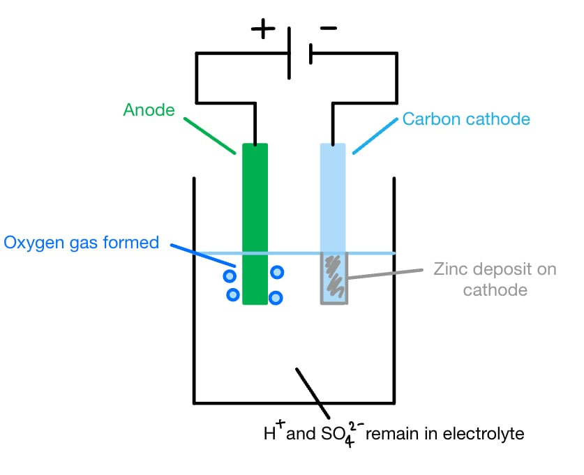

- *Although zinc is more reactive than hydrogen (so hydrogen is usually discharged at the cathode in aqueous solutions), zinc **can** still be deposited if the right conditions are used, such as applying a high enough voltage*
- *The exam question assumes these conditions*

### Q12
i) Complete the sentence: A cell will change ................................................ energy into electrical energy:

- Chemical; **[1 mark]**

ii) Complete the equation for the reaction

Br2 + 2e- → 2Br –

- For Br – as product; **[1 mark]**
- Correctly balanced; **[1 mark]**

iii) The change in part iii) is:

- Reduction because electron gain / because oxidation number decreases; **[1 mark]**

iv) Completing the sentence: Fe2+ changes into ..........................:

- Fe3+; **[1 mark]**

v) An explanation for the voltage changes is:

- Any correct discussion of the reactivity of the halogens, e.g. the more reactive the halogen the higher the voltage; **[1 mark]**

*Do not allow 'better conductor'*

**[Total: 6 marks]**

- *You are expected to know that whilst aqueous halogen solutions are coloured, halide solutions are colourless. Do not say clear, as this just means see-through and does not necessarily mean an absence of colour!*
- *The greater voltage will occur when the energy change of the reaction is greatest, which is with a more reactive halogen present*

### Q13
The completed table is:

| **electrolyte** | **change at negative electrode** | **change at positive electrode** | **change to electrolyte** |
|---|---|---|---|
| molten lead(II) bromide | lead formed | bromine formed | used up |
| molten potassium iodide;  **[1 mark]** | potassium formed | iodine formed | used up |
| dilute aqueous sodium chloride | hydrogen;  **[1 mark]** | oxygen;  **[1 mark]** | No change  **OR** Sodium chloride remains;  **[1 mark]** |
| aqueous copper(II) sulfate | copper; **[1 mark]** | oxygen;  **[1 mark]** | sulfuric acid; **[1 mark]** |
| Concentrated aqueous potassium bromide; **[1 mark]** | hydrogen formed | bromine formed | potassium hydroxide formed |

**[Total: 8 marks]**

- *For dilute halide aqueous solutions, oxygen is formed at the anode (positive electrode)*
- *For concentrated halide aqueous solutions, the halide is formed at the anode *
- *For any aqeuous solutions, if the metal is more reactive than hydrogen, then hydrogen is formed at the negative electrode *
- *If a highly reactive metal is produced at the negative electrode, it can be deduced that hydrogen ions are not present *
- *The ions that are not discharged at the electrodes remain in the solution*

### Q14
a)

i) The ionic equation for the reaction at the negative electrode is:

Al3+ + 3e- → Al

- Formula of Al3+; **[1 mark]**
- Rest of equation correct; **[1 mark]**

ii) The completed ionic equation for the reaction at the positive electrode is:

(2O2- →) O2   (+)   4e-

- Correct formulae for all species; **[1 mark]**
- Correct balancing; **[1 mark]**

iii) The reaction is:

- Endothermic 
**AND** 
(Because electrical) energy is supplied; **[1 mark]**

**[Total: 5 marks]**

- *Remember:** Positive ions at the cathode will gain electrons and negative ions at the anode will lose electrons*
- *You must make sure that the charges on each side of the equation are balanced *
b) An equation for the complete combustion of propane is:

C3H8 + 5O2 → 3CO2 + 4H2O;

- Correct formulae for reactants and products; **[1 mark]**
- Correct balancing;** [1 mark]**

**[Total: 2 marks]**

- *Remember**: Combustion is when a substance burns in air thereby reacting with oxygen*
- *For complete combustion, carbon dioxide and water are produced*
- *Balance the carbon atoms first, then the hydrogen atoms, and finally the oxygen atoms *
c)

i) The light from photosynthesis comes from:

- The sun/sunlight; **[1 mark]**

ii) The word equation for photosynthesis is:

- carbon dioxide + water → glucose + oxygen; **[1 mark]**

**[Total: 2 marks]**

- *Photosynthesis is an example of an endothermic reaction, as it takes in light energy *
- *This allows carbon dioxide and water to react and form glucose and oxygen*

### Q15
a)

i) Sulfur dioxide is converted into sulfur trioxide by:

- (React with) oxygen or air; **[1 mark]** *Do NOT accept burnt / burn in air / oxygen*

Any **two conditions **from:

- 450 °C; **[1 mark]**
- Vanadium oxide / vanadium(V) oxide / vanadium pentoxide / V2O5 catalyst; **[1 mark]** *If oxidation number is given it has to be correct*
- Pressure of 1 to 10 atmospheres / 100 to 1000 kPa; **[1 mark]** *High pressure is incorrect, MAX 10 atm If four conditions are given which include high pressure then MAX [2 marks] *

ii) A fertiliser made from sulfuric acid is:

- Ammonium sulfate / superphosphate 
**OR** 
Potassium / magnesium sulphate;** [1 mark]**

**[Total: 4 marks]**

- *The ammonium ion is a source of water-soluble nitrogen*
b)

i) The equation for the zinc forming at the electrode is:

- Zn2+ + 2e- → Zn;** [1 mark]**

ii) The equation for the reaction at the positive electrode (anode) is:

4OH– – 4e–  →  O2 + 2H2O **   **
**OR**    
4OH– → O2 + 2H2O + 4e– **   **
**OR**    
2H2O → 4H+ + O2 + 4e– **   **
**OR**    
2H2O – 4e–  → 4H+ + O2

- Oxygen as product; **[1 mark]**
- Rest of the equation; **[1 mark]**

iii) The electrolyte changes from aqueous zinc sulfate to:

- Sulfuric acid; **[1 mark]**

**[Total: 4 marks]**

- *Although the electrolysis of aqueous zinc sulfate is not one of the examples you have to learn specifically, the question tells you that it is similar to the electrolysis of aqueous copper sulfate so you need to apply your knowledge to this example*
- *In the electrolysis of aqueous copper sulfate, the metal is formed at the cathode and oxygen gas at the anode*
- *Zinc ions are reduced at the cathode to form zinc metal, i.e. they gain electrons*
- *Hydroxide ions are oxidised to form oxygen gas and water, i.e. the lose electrons*
- *The H**+** and SO**4**2-** remain in solution to form H**2**SO**4*
c) Two uses of zinc are:

Any **two** from:

- Making brass or making alloys; **[1 mark]** Do NOT allow making bronze; **[1 mark]**
- Sacrificial protection / galvanising / preventing iron from rusting; **[1 mark]**
- Electroplating / as an electrode in electrolysis; **[1 mark]**
- Cells; **[1 mark]**
- Roofing; **[1 mark]**
- Coinage; **[1 mark]**

**[Total: 2 marks]**

- *You are not expected to know all of these uses but you should know that zinc is used to make brass (with copper) and that it is used in sacrificial protection and for galvanising*

### Q16
a)

i) The arrow should be:

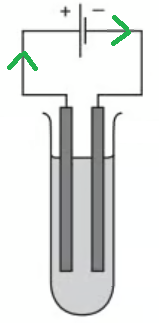

- From the negative terminal of battery
**OR**
From the anode / left-hand electrode; **[1 mark]**

ii) Electrons are supplied:

- From battery / power supply / cell; **[1 mark]**
- From negative electrode of battery to external circuit 
**OR** 
From iodide ion losing electron 
**OR** 
Oxidation of anion; **[1 mark]**

iii) Solid lithium iodide does not conduct electricity but when molten it is a good conductor because:

- Ions cannot move in solid / ions can move in liquid; **[1 mark]**

**[Total: 4 marks]**

- *Electrons always flow from the negative terminal of the battery*
- *The lithium iodide needs to be molten as the ions need to be able to move and carry a charge which they cannot do in the solid state *
b) The completed table is:

| **electrolyte** | **electrodes** | **product at cathode** | **product at anode** | **change to electrolyte** |
|---|---|---|---|---|
| molten lithium iodide | carbon | lithium | iodine | used up |
| aqueous copper (II) sulfate | platinum | copper;** [1 mark]** | oxygen | sulfuric acid; **[1 mark]** |
| concentrated aqueous potassium chloride | carbon | hydrogen; ** [1 mark]** | chlorine | potassium hydroxide **[1 mark]** |

- *For aqueous copper (II) sulfate*

  - *The ions are: Cu**2+**, H**+,** OH**–** and SO**4**2- *
  - *Copper is less reactive than hydrogen so copper ions are discharged at the cathode where they are reduced to copper atoms *
  - *The H**+** and SO**4**2-** ions remain in solution to form sulfuric acid, H**2**SO**4 *
- *For concentrated aqueous potassium chloride:*

  - *The ions are: K**+**, H**+**, Cl**-**, and OH**–*
  - *Hydrogen is less reactive than potassium so hydrogen ions are discharged at the cathode where they are reduced to hydrogen gas *
  - *The chlorine has been discharged at the anode*
  - *The K**+** and OH**–** have remained in solution to form potassium hydroxide, KOH*
  - *Remember: for concentrated halide solutions, the halogen is formed at the anode, but for dilute halide solutions oxygen is formed at the anode*
c)

i)  The equation for the reaction at the negative electrode is:

2H+ + 2e*– *→ H2

- Correct formulae ;**[1 mark]**
- Correctly balanced; **[1 mark]**

ii) The equation for the reaction at the positive electrode (anode) is:

- 4OH*–*    →  O2 + 2H2O + 4e*–* ; **[1 mark]**

iii) The concentration of the sulfuric acid increases because:

- Water used up; **[1 mark]**

**[Total: 4 marks]**

- *The question tells you the ions present are:*

  - *H**+ **(aq), OH**–** (aq) and SO**4**2– **(aq)*
  - *Hydrogen ions are attracted to the cathode as they are the only positive ion present in the solution *
  - *At the cathode, the ions gain electrons (are reduced) to form hydrogen gas *
  - *Make sure the charges are balanced on either side of your half equation *
- *To complete the half equation for the reaction at the anode:*

  - *Balance the hydrogen and oxygen atoms *
  - *Balance the charges- There are 4OH**–** on the right hand side so you need 4e**–** to balance this*

### Q17
a)

i)  The ions in the solid state:

- Vibrate (around fixed positions); **[1 mark]**

ii)  Ionic bonding is:

- Electrostatic force of) attraction; **[1 mark]**
- (between) Positive ions and negative ions /oppositely charged ions / unlike charged ions / cations and anions; **[1 mark]**

iii) An ionic lattice is:

- Regular arrangement; **[1 mark]**
- (Of) positive and negative ions /oppositely charged ions / cations and anions / unlike charged ions; **[1 mark]**

**[Total: 5 marks]**

- *Only ionic compounds undergo electrolysis so you can expect to be asked about ionic bonding within electrolysis questions *
b)

i) The electrons should be flowing:

- Towards the negative electrode; **[1 mark]**

ii) An ionic equation for the reaction at the negative electrode (cathode) is:

- Li+ + e–  →  Li; **[1 mark]**

iii) An ionic equation for the reaction at the positive electrode (anode) is:

2Br –  →   Br2   + 2e–;

- Correct formulae**; [1 mark]**
- Correctly balanced; **[1 mark]**

iv) The ion oxidised is:

- Bromide ions; **[1 mark]**
- (Because) it loses electrons  
**OR** 
Has an increased oxidation number; **[1 mark]**

**[Total: 6 marks]**

- *Molten lithium bromide consists of only Li**+** and Br **–*
- *Lithium ions will migrate to the cathode, and bromide ions to the anode due to the opposite charges attracting *
- *You must be able to write half equations for the reaction at each electrode*
- *The ions lose or gain electrons to form the element*
c) We can explain these observations by:

- Hydrogen (given off at cathode) / H2; **[1 mark]**
- Hydroxide ions / lithium hydroxide/OH– / LiOH are alkali(ne); **[1 mark]**
- 2LiBr + 2H2O → 2LiOH + H2 + Br2 
**OR** 
2H+ + 2e – → H2 / 2H+ → H2 – 2e– **OR** 
2Br– - 2e– → Br2; **OR** 
2Br– → Br2 + 2e– 
**OR** 
2H+ + 2Br – → H2 + Br2; **[1 mark]**

**[Total: 3 marks]**

- *When lithium bromide is aqueous and not molten, there are H**+** and OH**–** ions that need considering *
- *Hydrogen is less reactive than lithium so hydrogen ions will be discharged at the cathode instead of lithium, gaining electrons and forming hydrogen gas*
- *Bromide ions will be discharged at the anode, leaving lithium and hydroxide ions in solution to form lithium hydroxide *
- *The question states you need 'an' equation in your answer*

  - *If the question does not specify which one you are able to include any reaction that occurs within the process*

### Q18
a)

i) An equation at the negative electrode is:

2H++ 2e$\rightleftharpoons$  H2

- H2 on the RHS; **[1 mark]**
- Rest of equation correct; **[1 mark]**

ii) The concentration of hydroxide ions increases because:

- H+ is removed/ used up; **[1 mark]**
- Equilibrium moves to the right hand side 
**OR** 
Forward reaction is favoured; **[1 mark]**

iii) The gas formed when a dilute solution of sodium chloride is used is:

- Oxygen; **[1 mark]**

iv) An example of an inert electrode is:

- Carbon 
**OR** 
Platinum 
**OR** 
Graphite; **[1 mark]**

**[Total: 6 marks]**

- *Hydrogen ions form hydrogen atoms at the negative electrode so reduction occurs*
- *Make sure the charges are balanced on either side of your half equation*
- *According to Le Chatelier's principle, any change made to the conditions of the system will result in the system opposing this change*
- *If the concentration of hydrogen ions are reduced, the rate of the forward reaction increases to oppose this change resulting in the increase of the hydroxide ions *
- *Inert electrodes are unreactive, with usually graphite or platinum being used *
b)

i) A use of hydrogen is

Any **one** from:

- To make ammonia; **[1 mark]**
- Fuel; **[1 mark]**
- Make margarine; **[1 mark]**
- Makes HCl; **[1 mark]** *Accept any correct use of hydrogen*

ii) Chlorine is used to treat the water supply because:

- It kills bacteria/microbes/germs; **[1 mark]**

**[Total: 2 marks]**

### Q19
a) A *catalyst* is:

- A substance that speeds up a reaction/increases rate; **[1 mark]**
- That lowers the activation energy 
**OR** 
The catalyst is not used up at the end; **[1 mark] **

**[Total: 2 mark]**

- *You need to make sure you know the definition of a catalyst*
- *It increases the rate of a reaction by providing an alternative pathway with a lower activation energy** *
b) Two reasons why a temperature lower than 700 °C is not used are:

- Too slow; **[1 mark]**
- Lower yield produced 
**OR** 
Equilibrium shifts to the left/towards reactants; **[1 mark]**

**[Total: 2 marks]**

- *When determining what temperature a reversible reaction should be carried out at both yield and the rate of reaction need to be considered*
- *Although we are not told that the forward reaction is endothermic, this is implied by the fact you are asked for two reasons why low temperatures are **not** used *
- *If a low temperature is used the system will shift the position of the equilibrium to oppose the change, and favour the exothermic reaction which in this case must be the reverse reaction*
c) One advantage of using a pressure greater than one atmosphere is:

- It increases the rate of reaction; **[1 mark]**

**[Total: 1 mark]**

- *The question is about a reaction involving gaseous molecules so increasing the pressure will mean the particles are closer together and increase the frequency of successful collisions*
d) One disadvantage of using a pressure greater than one atmosphere is:

Any **one **from:

- Less product is produced; **[1 mark]**
- Lower yield is made; **[1 mark]**
- Equilibrium shifts to the left; **[1 mark]**
- Reverse reaction is favoured; **[1 mark]**

**[Total: 1 mark]**

- *The forward reaction produced four molecules and the reverse two molecules*
- *If a greater pressure is used, the system will shift the position of the equilibrium to oppose the change and favour the reaction that produces few molecules of gas *
- *In this case, that is the reverse reaction so more reactant will be made and less product *
e)

i) Electrolysis is:

- Breakdown of an ionic compound when molten or in aqueous solution; **[1 mark]**
- (Using) electricity/electric current/electrical energy; **[1 mark]**

ii) An inert electrode is:

- Carbon/ platinum/ graphite; **[1 mark]**

iii) An ionic equation to produce hydrogen is:

- 2H+  +   2e– →  H2; **[1 mark]**

iv) Hydrogen is produced at:

- Cathode/ negative electrode; **[1 mark]**

v) A test for chlorine is:

- Damp blue litmus paper; **[1 mark]**
- Bleaches/loses colour/turns white/turns colourless; **[1 mark]**

**[Total: 7 marks]**

- *Inert electrodes are unreactive, common ones being graphite and platinum*
- *Hydrogen ions will migrate to the negative electrode (cathode) because they have a positive charge*
- *The are reduced (gain electrons) to form hydrogen atoms *
- *You should be able to write half equations for reactions which happen at the cathode and anode *
- *Because the solution is concentrated, chloride ions would migrate to the anode, lose electrons and form chlorine gas*
f)  A chemical equation to represent this reaction this:

2NaCl + 2H2O → 2NaOH + H2 + Cl2

- Correct formula; **[1 mark]**
- Correct balancing; **[1 mark]**

**[Total: 2 marks]**

- *You are expected to know the formulae for all the reactants and products in this equation*

> **[exam-tip]**
> Write correct formulae first, then balance with coefficients so every element has equal atoms on each side
> 
> Remember chlorine and hydrogen are diatomic gases, and take care with capitalisation of symbols (NaOH, not Naoh)
g) One use of each substance is:

Chlorine

Any **one** from:

- Treating swimming pools; **[1 mark]**
- Killing bacteria; **[1 mark]**
- Antiseptics **[1 mark]**
- Bleach; **[1 mark]** 
*Accept any correct use of chlorine*

Sodium hydroxide

Any **one** from:

- Oven clearer; **[1 mark]**
- Soap; **[1 mark]**
- Washing powder;**[1 mark]** 
*Accept any correct use of sodium hydroxide *

Hydrogen

Any **one** from:

- Fuel; **[1 mark]**
- Margarine; **[1 mark]**
- HCl; **[1 mark]** 
*Accept any correct use of hydrogen *

**[Total: 3 marks]**

### Q20
a) The equation for the overall  reaction occurring in the cell is:

Zn + H2SO4 → ZnSO4 + H2  **   **
**OR **   
Zn + 2H+ → Zn2+ + H2  *   *
*Ignore SO**4**2-** spectator ions on both sides of the ionic equation *

- Correct reactants;** [1 mark]**
- Correct products; **[1 mark]**

**[Total: 2 marks]**

- *Zinc is more reactive than iron *
- *This means that the zinc will lose electrons and go into solution - this gives the ionic equation answer *
- *Essentially, this means that the zinc is reacting with the sulfuric acid - this gives the chemical equation answer *
b) All cell reactions are exothermic and redox because:

Exothermic:

- A cell produces (electrical) energy;** [1 mark]**

Redox:

- Electrons are lost **AND **gained 
**OR **
Oxidation numbers / oxidation states / valencies increase **AND** decrease 
**OR **
Two correct half equations showing oxidation and reduction, e.g. Zn → Zn2+ + 2e– **AND **2H+ + 2e– → H2; **[2 marks]**

**[Total: 3 marks]**

- *Careful: **A lot of answers about cell reactions being exothermic will focus on the idea of heat energy from the thermic part of the word*

  - *Exothermic reactions are ones where energy is released - this can include electrical energy*
- *Redox reactions are where reduction and oxidation happen at the same time*

  - *Electrochemistry is about electrons so the most common correct answer will be the idea that there is loss and gain of electrons *
c) The negative electrode is:

- Zinc; **[1 mark]**
- (Because,) it is more reactive than iron 
**OR **
It supplies electrons 
**OR **
It forms ions more readily than iron; **[1 mark]**

**[Total: 2 marks]**

- *This question is very misleading as there are bubbles of hydrogen gas shown on the iron electrode*
- *However, this electrolysis of sulfuric is not using inert electrodes *
- *This means that you have to consider the relative reactivities of the electrodes *
- *Since zinc is more reactive than iron, it will be the negative electrode*

### Q21
a) The products of electrolysis are:

- At the anode: bromine / Br2; **[1 mark] **
- At the cathode: potassium / K; **[1 mark] **

**[Total: 2 marks] **

- *Electrolysed molten potassium bromide will split up into potassium and bromine gas*
- *Potassium ions and bromide ions are formed when potassium bromide is melted (becomes a liquid)*
- *The positive potassium ions are attracted to the negative electrode (cathode) and potassium atoms are formed*
- *The negative bromide ions are attracted to the positive electrode (cathode) and bromine gas is formed*

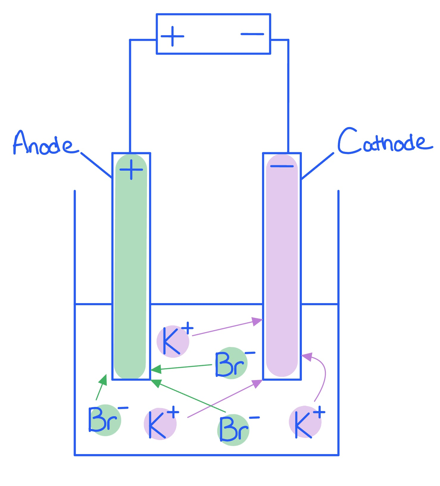

> **[exam-tip]**
> Make sure each product lines up with the correct electrode; positive ions go to the cathode and negative ions to the anode.
b) Electrolysis is:

- Breaking down of an ionic compound when molten or in aqueous solution; **[1 mark] **
- (Using) electricity / electric current / electrical energy; **[1 mark] **

**[Total: 2 marks] **

- *This is a definition that you need to know word for word*
c) A substance that can be used as the inert electrodes is:

- Platinum  
**OR** 
Graphite;** [1 mark] **

**[Total: 1 mark] **

- *These are commonly used as electrodes as they are good conductors of electricity and are un-reactive (inert)*
d) An ionic half equation for the formation of hydrogen during this electrolysis is:

- 2H+ + 2e– → H2; **[1 mark]**

**[Total: 1 mark]**

- *Hydrogen is formed at negative electrode during the electrolysis of aqueous sodium chloride*
- *Hydrogen ions are positive so are attracted to the negative electrode*
- *Here they gain electrons and form hydrogen molecules *
e) The four ions present are:

Na+, H+, Cl– and OH–

- 4 correct;** [2 marks]**
- 2 or 3 correct; **[1 mark]**
- 0 or 1; **[0 marks] **

**[Total: 2 marks] **

- *When sodium chloride, NaCl, is added to water it will break up into positive sodium ions and negative chloride ions*

  - *Na**+** and Cl**–*
- *Water, H**2**O, will form hydrogen and hydroxide ions*

  - *H**+ **and OH**–*
f) Sodium hydroxide is formed by:

- H+ and Cl– are discharged / removed;** [1 mark] **
- Na+ and OH– remain; **[1 mark]  **

**[Total: 2 marks]**

- *Chloride ions are discharged at the positive electrode rather than hydroxide** **ions*
- *Negatively charged OH**–** ions and non-metal ions are attracted to the positive electrode*
- *If halide ions (Cl**–**, Br**–**, I**–**) and OH**–** are present then the halide ion is discharged at the anode, loses electrons and forms a halogen (chlorine, bromine or iodine)*
- *If no halide ions are present, then OH**–** is discharged at the anode, loses electrons and forms oxygen gas*
- *Hydrogen ions are discharged at the negative electrode rather than sodium ions*
- *Sodium is above hydrogen in the reactivity series *

  - *If a metal is higher than hydrogen in the reactivity series, hydrogen gas is formed*
  - *If a metal is lower than hydrogen in the reactivity series, the metal will form*

### Q22
a) The alloy which contains zinc is:

- Brass;** [1 mark]**

The other element in this alloy is:

- Copper;** [1 mark] **
*Only accept if brass is correct *

**[Total: 2 marks]**

- *You need to be able to give the composition of the alloys, brass and steel*
b)

i) The balanced symbol equation is:

2ZnS + 3O2 →  2ZnO + 2SO2

- Correct formulae for reactants and products;** [1 mark]**
- Correct balancing;** [1 mark]**

ii) A major use of sulfur dioxide is:

- Making sulfuric acid / the Contact process;  **[1 mark]** 
*Allow bleach or making wood pulp or making paper food or fruit juice or wine preservative*

**[Total: 3 marks]**

- *The question gives you all the information you need to write the symbol equation which you can then balance*
- *You are given the formula for zinc sulfide, and the names of the two products (you should know the formula for these)*
- *You are told that the zinc sulfide is heated in air which implies it reacts with oxygen *
- *You may not be aware of all these uses of sulfuric acid however you should know that sulfur dioxide is used in the Contact process to produce sulfuric acid*
c)

i) The reagent that will react with zinc oxide to form zinc sulfate is:

- Sulfuric acid;  **[1 mark]**

ii) The equation at the negative electrode is

- Zn2+ + 2e- →  Zn; **[1 mark]**

The product at the positive electrode is

- Oxygen or water; **[1 mark]** 
*Allow O**2** and H**2**O if no name seen*

The electrolyte changes from zinc sulfate to

- Sulfuric acid; **[1 mark]**

**[Total: 4 marks]**

- *To form a sulfate, sulfuric acid is used*
- *Although the electrolysis of aqueous zinc sulfate is not one of the examples you have to learn specifically, the question tells you that it is similar to the electrolysis of aqueous copper sulfate so you need to apply your knowledge to this example*
- *In the electrolysis of aqueous copper sulfate, the metal is formed at the cathode and oxygen gas at the cathode*
- *Zinc ions are reduced (gain electrons) at the cathode to form zinc metal *
- *Hydroxide ions are oxidised (lose electrons) to form oxygen gas and water *
- *The H**+** and SO**4**2-** remain in solution to form H**2**SO**4*
d)

i) It should be a paste:

- To allow <u>ions</u> to flow; **[1 mark]**

ii) The changes that occur are:

- (Zn to Zn2+) oxidation **AND** There is a loss of electrons  
**OR** 
An increase in oxidation number; **[1 mark]**
- (Manganese(IV) oxide to manganese(III) oxide) reduction **AND** There is a gain of electrons 
**OR** 
Decrease in oxidation number; **[1 mark]**

**[Total: 3 marks]**

- *For electrolysis to work the ions in the electrolyte need to be able to move and carry a charge, this is only possible when ions are in solution or molten, not a solid so a paste allows the ions to move*
- *Zn to Zn**2+**:*

  - *This demonstrates that oxidation has occurred because electrons are lost to give an ion a positive charge *
  - *The oxidation number for an element is 0 so the oxidation number has increased from 0 to +2 *
- *Manganese(IV) oxide to manganese(III) oxide:*

  - *The charge has gone from +4 to +3 so the oxidation number has decreased indicating reduction and an electron has been gained*
- *Remember to use **OIL RIG**- Oxidation Is Loss (of electrons) Reduction Is Gain (of electrons)*

### Q23
a) The completed diagram should be:

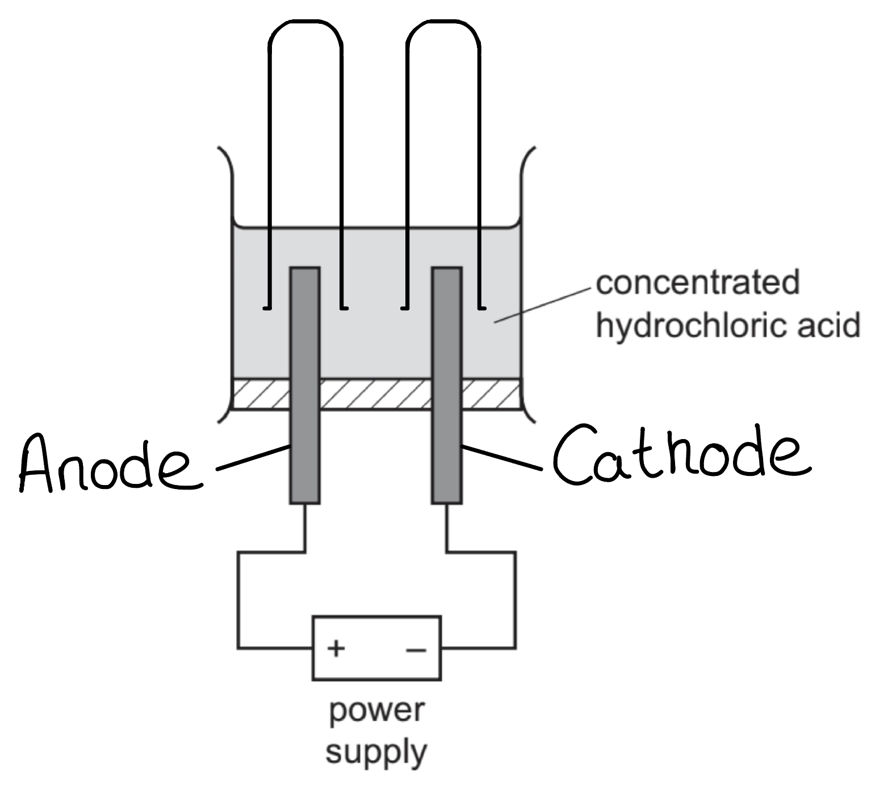

- Anode (on left) and cathode (on right) correctly labelled;** [1 mark] **
- Test tubes / measuring cylinders over each electrode with open ends dipping into the electrolyte; **[1 mark]**

**[Total: 2 marks] **

- *The anode is the positive electrode and the cathode is the negative electrode*

  - *You can remember this by **PANIC*
  
    - *P**ositive **A**node, **N**egative **I**s **C**athode*
- *The gases formed must be collected at each electrode*

  - *Therefore the opening of the test tubes must be submerged in the electrolyte*
  - *Otherwise the gases formed at the electrodes will escape into the room *
  - *The test tubes would also be full of water and the gas would displace it*
b) The products at the electrodes are:

- Positive electrode: chlorine / Cl2;** [1 mark] **
- Negative electrode: hydrogen / H2; **[1 mark]  **

**[Total: 2 marks] **

- *The ions in HCl (aq) are H**+**, Cl**– **and OH**–*
- *H**+** ions are attracted to the negative electrode and hydrogen gas is formed*
- *Cl**–** and OH**–** ions are both attracted to the positive electrode*

  - *Negatively charged OH*–* ions and non-metal ions are attracted to the positive electrode*
  - *If halide ions (Cl*-*, Br*-*, I*-*) and OH*-* are present then the halide ion is discharged at the anode, loses electrons and forms a halogen (chlorine, bromine or iodine)*
  - *If no halide ions are present, then OH*-* is discharged at the anode, loses electrons and forms oxygen gas*
c)  One other element that can be used as an electrode and give a reason, other than that it can conduct electricity is:

- Platinum; **[1 mark] **
- Inert / un-reactive; **[1 mark] **

**[Total: 2 marks] **

- *Graphite and platinum are used as electrodes as they are un-reactive and conduct electricity well*
d) The completed equation is:

Cl2 +** H****2** → **2**HCl

- H2 (on left); **[1 mark] **
- 2 (HCl) (on right);** [1 mark] **

**[Total: 2 marks] **

- *To complete the equation:*
- *You know that hydrogen gas has the formula H**2*

  - *Cl**2** +** H**2** → HCl*
- *Now to balance the equation:*

  - *Cl**2** +** H**2** → HCl *
  
    - *There are two hydrogen and chlorine atoms on the left hand side, but only one of each on the right hand side in HCl*
    - *Therefore a 2 is needed before HCl*
    - *Cl**2** +** H**2** → 2HCl *
e) The products at each electrode are:

- Positive electrode: oxygen / O2 / O; **[1 mark]**
- Negative electrode: aluminium / Al;** [1 mark] **

**[Total: 2 marks]**

- *Aluminium oxide is insoluble so in order for it to be electrolysed it must be molten*
- *When molten, Al**3+** ions and O**2–** ions are present *
- *Al**3+** ions are attracted to the negative electrode and form aluminium atoms*
- *O**2–** ions are attracted to the positive electrode and form oxygen gas*

### Q24
a) The completed diagram is:

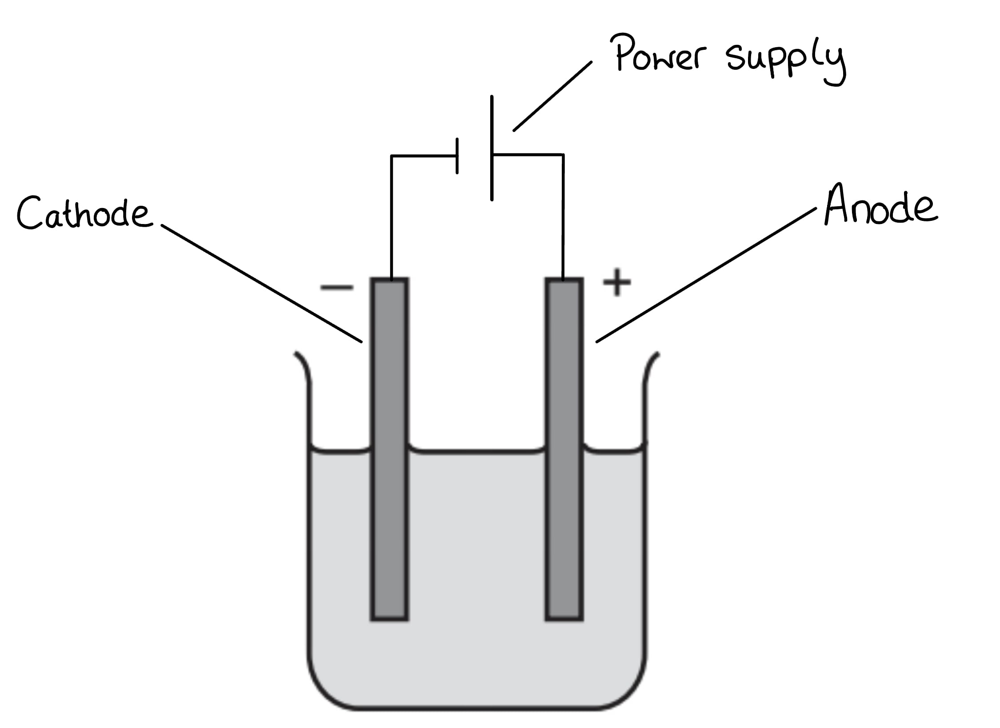

- Anode (on right) and cathode (on left);** [1 mark]**
- Power supply added  
**AND** 
Connecting wire from each end of power supply to separate electrodes; **[1 mark] **

**[Total: 2 marks]**

- *To help remember which electrode is which remember to PANIC; Positive Anode Negative Is Cathode*
- *Make sure your wire joins to the electrodes otherwise there would be a gap in the circuit and it would not work*

  - *All diagrams of apparatus you draw should be working *
- *Electrolysis requires a power source as the reaction requires electrical energy*
b) A suitable element for an electrode is:

- Platinum **OR** Graphite/carbon; **[1 mark]**

**[Total: 1 mark] **

- *These are suitable elements as they conduct electricity well*

> **[exam-tip]**
> An electrode must conduct electricity and also be inert, so avoid non-metal gases like chlorine and reactive metals like aluminium.
c) The products formed at the positive and negative electrodes are:

- Positive electrode: bromine / Br2; **[1 mark] **
- Negative electrode: magnesium / Mg; **[1 mark] **

**[Total: 2 marks] **

- *Magnesium bromide is an ionic compound which when electrolysed will split up into magnesium and bromine gas*
- *In** molten **magnesium bromide there are positive magnesium ions and negative bromide ions*
- *The positive magnesium ions are attracted to the negative electrode (cathode) and form magnesium*
- *The negative bromide ions are attracted to the positive electrode (anode) and form bromine gas*

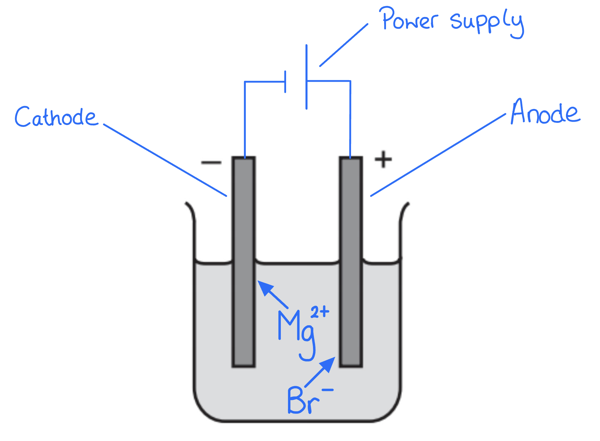
d) Electrodes must be:

- Inert / unreactive; **[1 mark]**

**[Total: 1 mark]**

- *Electrodes should be unreactive because:*

  - *They mustn’t react with the electrolyte*
  - *They mustn’t react with any products formed *
- *If electrodes react the circuit will not be able to flow *

> **[exam-tip]**
> Give a property of the electrode itself, not a feature of the wider setup such as a power supply or the electrolyte
